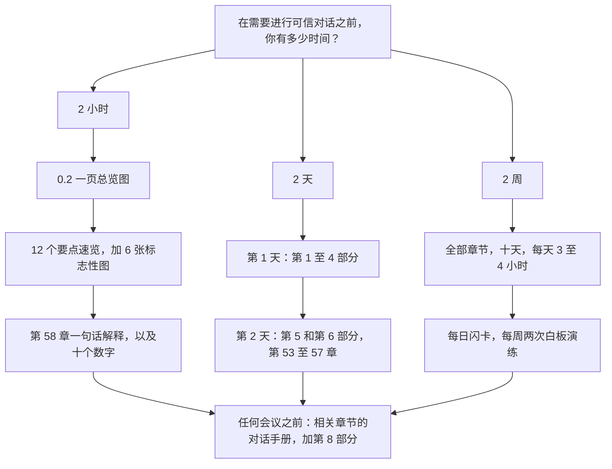
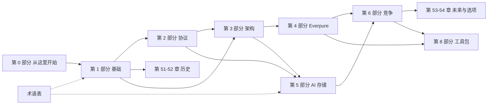

# 0.1. 如何使用本图谱

> 📄 英文原文：[docs/00-start-here/00a-how-to-use-this-atlas.md](../../../docs/00-start-here/00a-how-to-use-this-atlas.md) · 本文为简体中文参考译本，如有出入以英文原文为准。

> **深度：** L1 · **阅读时间：** 约 8 分钟 · **最后核实：** 2026-11-01
> **前置阅读：** 无。从这里开始，然后阅读 [0.2 一页总览图](00b-one-page-map.md)。建议在另一个标签页中打开[术语表](../glossary.md)。

## 要点速览（TL;DR）

- **本图谱是一本简报手册，而不是教科书。** 它帮助新入职的战略岗位人员与 Everpure 的产品经理、工程负责人和 CTO 办公室进行可信的对话：存储如何运作、权衡为何存在、这些权衡意味着什么。
- **默认深度为 L2：机制。** 能在白板上画出设计，并说明它为何在某类工作负载上胜出。L3 细节只出现在"深入阅读"框中。
- **每一章都有相同的十个小节。** 先读"要点速览（TL;DR）"，用"核心概念"掌握机制，会议前一晚看"对话手册"。
- **按可用时间选择路径。** 下文列出了 2 小时速成课、2 天快速上手和 2 周精通计划。
- **每个数字都带有标签。** *已申报（Filed）*、*公司自述*、*媒体报道*、*追踪机构估算*、*本图谱的判断*或*算例*。未经证实的内容以行内 VERIFY 标记标出，并汇总在一个清单中。引用数字时要连同标签和日期一起说，否则就不要引用。

## 对 Everpure 战略的意义

Everpure（NYSE: P，原 PSTG）[^1]新入职的战略人员，会很快被资深的存储从业者"打分"。如果你把 EXA 数据节点和 DirectFlash Module 混为一谈，产品经理会注意到；如果你把写放大说成营销话术，工程师会注意到；如果你把估值当作收入来引用，CTO 办公室会注意到。每一次失误都会把对话拉低到一个你学不到任何东西的层次；本图谱把能避免这些失误的内容放在最前面。

本图谱假设读者通过半导体并购熟悉 NAND、HBM、PCIe 和晶圆厂经济学，但对存储*系统*和*软件*并不熟悉。因此，每个机制旁边都配有半导体类比和对应的商业影响。

## 核心概念

### 本图谱涵盖的内容

九个部分从物理原理一路讲到战略：基础、协议与架构（第 1–3 部分）、Everpure（第 4 部分）、AI 存储（第 5 部分）、竞争（第 6 部分）、历史与未来（第 7 部分）以及对话工具包（第 8 部分）。第 1–3 部分是厂商中立的，因此第 4–6 部分读起来是你已掌握机制的应用，而不是相互竞争的销售说辞。

### 深度标签

| 标签 | 你能够…… | 出现位置 | 自测 |
|---|---|---|---|
| **L1 — 词汇** | 定义术语并在句子中正确使用 | 关键术语、术语表、要点速览、[第 58 章](../08-conversation-toolkit/58-explain-in-30-seconds.md)的一句话解释 | 用一句话向董事会成员解释"QLC" |
| **L2 — 机制** *（默认）* | 在白板上画出其工作原理，说出权衡，并说明某种设计为何在某类工作负载上优于另一种 | 每一章的"核心概念" | 画出双控制器的写确认流程，并说明主机收到"完成"时数据位于何处 |
| **L3 — 实现** | 讨论代码路径、盘上格式、内核内部机制 | 仅在"深入阅读"框中，以指引形式出现 | 不作要求。可以就此提问；切勿断言 |

*表 0.1.1 — 力求处处达到 L2，长尾内容达到 L1；把 L3 当作向工程师请教的领域，而不是自己宣称掌握的领域。*

达到 L2 时，你可以为一个机制给出数字并请对方纠正（"联网阵列上一次 4 KB 写入约为 ~100–250 µs，大部分耗在网络和控制器软件上；你们的情况是这样吗？"）。这时工程师就会开始教你：这就是[第 56 章](../08-conversation-toolkit/56-talking-with-engineering-and-cto.md)中的"可信度阶梯"。

### 每一章的结构

各章遵循同一模板，因此你总能知道该去哪里找内容。

| 小节 | 提供的内容 | 适用场景 |
|---|---|---|
| **页首信息** | 深度、阅读时间（正文字数 ÷ 230）、最后核实日期、前置阅读 | 决定现在读还是以后读 |
| **要点速览（TL;DR）** | 需要记住的五个要点 | 快速浏览、速成课、会议当天早上 |
| **对 Everpure 战略的意义** | 用两段话讲清商业上的"所以呢" | 为备忘录或高管摘要定框架 |
| **核心概念** | L2 机制、算例数字以及大部分图示 | 学习；准备白板讲解 |
| **Everpure 的做法与竞争对手对比** | 一张对比表，以及替代方案的最强版本论证（steelman） | 竞争类问题、交易评审 |
| **历史与发展轨迹** | 如何发展到今天，以及标注日期的未来走向信号 | 判断某个趋势是处于早期还是晚期 |
| **关键数字** | 五到十个有来源或经过演算的数字 | 制作幻灯片；核查某个说法 |
| **对话手册** | 向产品经理和工程师各提三个问题、高质量回答是什么样的，以及"不要这样说" | 会议前一晚 |
| **深入阅读** | L3 指引：论文、规范、演讲 | 仅在对话深入到这一层时 |
| **关键术语 / 资料来源** | 术语表条目；带出版日期和检索日期的脚注 | 核对定义或引用 |

*表 0.1.2 — 模板把需要记住的内容放在前面、证据放在最后，因此十分钟的浏览和两小时的研读用的是同一页。*

深度剖析章节（第 42–44 章）额外增加了五个商业小节，从财务一直到战略意义。每张图的斜体图注都写明了其要点，因此仅看图注就能构成一份可用的摘要。标志性图示在 `meta/outline.md` 中（而非在各章中）以 ★ 标注，值得能凭记忆重画。

### 三条学习路径

*图 0.1.1 — 三条路径都从同一张总览图出发，并终于同一处：对话工具包，以及会议涉及章节的对话手册。*

#### 2 小时速成课

1. **0:00–0:15. 总览图。** [0.2](00b-one-page-map.md)：思维导图、十张图、十个数字。
2. **0:15–0:50. 十二个要点速览，加"对 Everpure 战略的意义"。** 基础：[第 2 章](../01-storage-fundamentals/02-media-physics.md)、[第 3 章](../01-storage-fundamentals/03-inside-an-ssd.md)、[第 13 章](../03-system-architecture/13-storage-stack.md)。架构：[第 16 章](../03-system-architecture/16-disaggregated-shared-everything.md)、[第 24 章](../03-system-architecture/24-architecture-decision-matrix.md)。Everpure：[第 25 章](../04-everpure/25-company-history-and-strategy.md)、[第 26 章](../04-everpure/26-purity-and-directflash.md)、[第 29 章](../04-everpure/29-hyperscaler-ecosystem-financials.md)。AI：[第 30 章](../05-ai-storage/30-ai-data-pipeline.md)、[第 32 章](../05-ai-storage/32-inference-and-kv-cache.md)。竞争：[第 41 章](../06-industry-and-competition/41-why-ai-native-vendors-won.md)、[第 45 章](../06-industry-and-competition/45-head-to-head.md)。
3. **0:50–1:30. 六张图，每张约七分钟。** 图 2.1（介质层级）、图 13.1（智能位于何处）、图 26.2（DirectFlash 与 SSD 对比）、图 30.1（AI 流水线）、图 32.3（KV 缓存分层）和图 45.1（四种 AI 架构）。先读每张图的图注，然后不看图、口头讲解这张图。
4. **1:30–1:50. 词汇与数字。** [第 58 章](../08-conversation-toolkit/58-explain-in-30-seconds.md)中"Everpure 的模式"和"竞争"两组一句话解释，然后是 0.2 的数字表，每个数字都连同日期说出来。
5. **1:50–2:00. 行为。** [第 56 章](../08-conversation-toolkit/56-talking-with-engineering-and-cto.md)中的可信度阶梯，以及相应章节的"不要这样说"清单。

#### 2 天快速上手

第 1 天约六小时，第 2 天约五小时；页首的阅读时间只计算正文，因此这些估算为图示预留了 1.5 倍的时间。

- **第 1 天上午：** 完整阅读第 1 部分（[第 1–6 章](../01-storage-fundamentals/01-what-storage-does.md)），然后阅读第 2 部分中的第 [7](../02-protocols-and-networking/07-block-protocols.md)、[8](../02-protocols-and-networking/08-file-protocols.md)、[9](../02-protocols-and-networking/09-object-storage-and-s3.md) 和 [11](../02-protocols-and-networking/11-gpu-data-path.md) 章。
- **第 1 天下午：** 第 3 部分核心内容（[第 13–17 章](../03-system-architecture/13-storage-stack.md)、[第 23 章](../03-system-architecture/23-consumption-models.md)、[第 24 章](../03-system-architecture/24-architecture-decision-matrix.md)）以及第 4 部分全部内容（[第 25–29 章](../04-everpure/25-company-history-and-strategy.md)）。最后用 30 分钟做第 1–4 部分的闪卡。
- **第 2 天上午：** 第 5 部分核心内容（[第 30–32 章](../05-ai-storage/30-ai-data-pipeline.md)、[第 34 章](../05-ai-storage/34-nvidia-ecosystem.md)、[第 35 章](../05-ai-storage/35-ai-factories-and-neoclouds.md)、[第 37 章](../05-ai-storage/37-reading-benchmarks.md)）。
- **第 2 天下午：** 第 6 部分核心内容（[第 40 章](../06-industry-and-competition/40-market-structure.md)、[第 41 章](../06-industry-and-competition/41-why-ai-native-vendors-won.md)、[第 45 章](../06-industry-and-competition/45-head-to-head.md)、[第 46 章](../06-industry-and-competition/46-incumbents.md)、[第 49 章](../06-industry-and-competition/49-competitive-matrices.md)）。深度剖析第 42–44 章：只读要点速览和商业小节。然后是[第 53 章](../07-history-and-future/53-future-trends.md)和[第 54 章](../07-history-and-future/54-strategic-option-map.md)，以及[第 55–56 章](../08-conversation-toolkit/55-talking-with-pms.md)。最后从[第 57 章](../08-conversation-toolkit/57-question-bank.md)中挑十个问题收尾。

#### 2 周精通计划

十个工作日，每天 3–4 小时：15 分钟复习闪卡（[第 59 章](../08-conversation-toolkit/59-self-test-flashcards.md)，按部分组织），然后阅读（按页首时间的 1.5 倍计算约 1–2 小时；第 9 天和第 10 天最长），再用 30–45 分钟练习，其中每周包括两次白板演练。

| 天 | 阅读 | 练习 | 产出 |
|---|---|---|---|
| 1 | 0.1、0.2、第 1–4 章 | 第 1 部分闪卡 | 凭记忆重画介质金字塔 |
| 2 | 第 5–9 章 | 重做第 4 章的 TCO 核算和第 5 章的数据缩减核算 | 用一段话说明"为什么缩减比取决于数据本身" |
| 3 | 第 10–15 章 | 第 2 部分闪卡；**演练 1：** 一次 NVMe-oF 读取和 GPUDirect 路径 | 用自己的话写一页协议总结 |
| 4 | 第 16–21 章 | **演练 2：** 双控制器写入与 DASE 写入对比 | 在一页纸上比较四种架构 |
| 5 | 第 22–24 章、第 51–52 章 | 第 3 部分闪卡；从第一周中随机抽 30 张卡 | 把第 24 章的决策树应用于三种工作负载 |
| 6 | 第 25–29 章、第 55 章 | 阅读最新的 Everpure 财报新闻稿和管理层预备发言稿 | 一页附带来源数字的公司备忘录 |
| 7 | 第 30–34 章 | 第 4–5 部分闪卡；**演练 3：** 一次从 GPU 显存到闪存的检查点写入 | 估算一个 405B 模型检查点和一个 128K token 会话的规模 |
| 8 | 第 35–39 章、第 56 章、第 57 章 | **演练 4：** EXA 读路径与 VAST 读路径对比 | 为一次工程会议准备七个问题 |
| 9 | 第 40–45 章 | 第 6 部分闪卡；大声说出第 58 章的 30 秒回答 | 为一个竞争对手构建对抗 Everpure 的最强版本论证 |
| 10 | 第 46–50 章、第 53–54 章、第 60 章 | 第 59 章的 50 张卡限时混合测试；模拟产品经理会议 | 凭记忆写出十个数字和五个待解问题 |

*表 0.1.3 — 精通计划让阅读与产出交替进行；真正让这些材料能在会议中派上用场的是产出，而不是阅读。*

### 阅读顺序

*图 0.1.2 — 第 1–3 部分是基础；Everpure 和 AI 存储两部分可以按任意顺序阅读，但竞争与战略部分需要两者都读过。*

有三个依赖关系最为重要。先读[第 3 章](../01-storage-fundamentals/03-inside-an-ssd.md)（FTL）再读[第 26 章](../04-everpure/26-purity-and-directflash.md)，否则 DirectFlash 看起来就像营销。先读[第 11 章](../02-protocols-and-networking/11-gpu-data-path.md)再读第 5 部分；先读[第 14–17 章](../03-system-architecture/14-scale-up-dual-controller.md)再读[第 45 章](../06-industry-and-competition/45-head-to-head.md)。历史部分（第 51–52 章）只需要第 1 部分作为基础，适合在内容密集的日子之间作为轻松读物。

### 会议前如何使用对话工具包

会议前 24 小时内：

1. **确定受众和产品线。**（[第 55 章](../08-conversation-toolkit/55-talking-with-pms.md)、[第 56 章](../08-conversation-toolkit/56-talking-with-engineering-and-cto.md)）。
2. **做好公开信息的功课。** 最新的财报新闻稿，加上相关章节的"关键数字"；绝不要把会议时间花在 10-Q 就能回答的问题上。
3. **挑选五到七个问题，** 而不是三十个，来源为[第 57 章](../08-conversation-toolkit/57-question-bank.md)和各章的对话手册。为每个问题配一个带数字的假设。
4. **演练两个 30 秒回答**，来自[第 58 章](../08-conversation-toolkit/58-explain-in-30-seconds.md)
5. **重读涉及范围内每一章的"不要这样说"**，并查看[速查表](../08-conversation-toolkit/60-cheat-sheets.md)中的缩略语。

会后，记下与本图谱相矛盾的内容；这些是本图谱最有价值的更新来源。

### 来源、标签与 VERIFY

每一条时效性强或针对特定厂商的说法都配有脚注，注明出版方、出版日期和检索日期；公认的工程事实和页面上的算术则不加脚注。标签说明一个数字能承受多大的分量：

| 标签 | 含义 | 示例 | 如何表述 |
|---|---|---|---|
| **已申报 / 公司报告** | 见于 SEC 申报文件或财报新闻稿；经审计或受信息披露规则约束 | Everpure 订阅 ARR 为 US$2.13B（+20%），Q2 FY27[^2] | "Everpure 报告称……" |
| **公司自述** | 私营公司自己未经审计的数字 | VAST：已承诺 ARR 超过 US$500M[^3] | "VAST 称……" |
| **媒体报道** | 记者给出的数字，通常来自匿名消息源 | DDN 2025 年收入接近 US$500M，基数说法相互矛盾[^4] | "据 Forbes 报道……；数字存在矛盾" |
| **追踪机构估算** | 分析机构的追踪数据，采用其自有口径 | Everpure 占外部企业存储市场的 8.1%，2Q26[^5] | "按 IDC 的口径……" |
| **本图谱的判断** | 本图谱对公开事实的综合判断 | [第 49 章](../06-industry-and-competition/49-competitive-matrices.md)中的象限定位 | "根据我对公开信息的解读……" |
| **算例 / 示意** | 基于明示假设的算术；图表会在标题中注明"Illustrative（示意）" | 405B 参数 × ~16 字节 ≈ 6.5 TB 检查点（[第 31 章](../05-ai-storage/31-training-storage.md)） | "粗略估算……" |
| **VERIFY 标记**（行内，方括号中） | 未经一手来源或第二来源证实 | 仅见于搜索摘要的数字 | 核实之前不要复述 |

*表 0.1.4 — 标签是数字的一部分；丢掉标签，私营公司的说法就会在演示文稿里变成"事实"。*

私营公司的数字绝不会在不加标签的情况下与公开数字并列比较。图表只绘制有来源或明确为示意的数据，每张图表在 `data/` 中的 CSV 文件都记录了其 `source` 和 `as_of` 日期。

## Everpure 的做法与竞争对手对比

Everpure 与其竞争对手适用同样的证据标准；不做吹捧，对 Everpure 也一样。

| 对象 | 主要证据 | 典型弱点 | 本图谱如何弥补 |
|---|---|---|---|
| **Everpure** | 10-K/10-Q、财报新闻稿、管理层预备发言稿、产品规格书 | 管理层的叙事框架；由公司自选的指标 | 与对待竞争对手同样的怀疑态度；结合参赛阵容解读基准测试（[第 37 章](../05-ai-storage/37-reading-benchmarks.md)） |
| **私营 AI 原生厂商（VAST、WEKA、DDN）** | 公司声明、融资新闻稿、媒体报道、参赛时的 MLPerf 结果 | 未经审计且选择性披露 | 明确的标签；先陈述其最强论点，再作批评 |
| **上市传统厂商（Dell、NetApp、HPE、IBM）** | 申报文件、产品文档 | 存储业务常被埋在更大的业务分部中 | 概况表；[第 46 章](../06-industry-and-competition/46-incumbents.md)中的分部口径说明 |
| **超大规模云厂商** | 论文、工程博客、re:Invent 类演讲 | 选择性披露，且在部署多年之后才公开 | 视为架构证据，而非市场数据（[第 36 章](../05-ai-storage/36-hyperscaler-ai-storage.md)） |

*表 0.1.5 — 不同的竞争对手留下的证据轨迹各不相同；本图谱为每一类加上标签，而不是假装它们可以直接比较。*

战略内容均以*战略团队基于公开信息可能评估的选项*为框架，绝不涉及 Everpure 的非公开计划。

## 历史与发展轨迹

本图谱是截至 2026-11-01 的快照，涵盖自 2009 年起的 Pure Storage，以及自 2026 年 2 月更名后的 Everpure（自 2026-04-17 起股票代码为 P[^1]）。机制（第 1–3 部分）和历史老化得慢；第 4–6 部分过时得最快。每一次财报发布都会改变 ARR、RPO、利润率和业绩指引；MLPerf 各轮结果、NVIDIA 认证清单、NAND 价格和私营公司融资轮次也是如此。

### 如何保持内容最新

- **VERIFY 标记**就放在存疑之处的行内。`scripts/build_meta.py` 会把它们连同暂存的问题汇总到 `meta/open-questions.md`；起草时约有 200 个未解决，独立审阅之后为 177 个。
- **各章暂存文件**（`meta/open-questions-staging/`、`meta/glossary-staging/`）存放新的 VERIFY 条目、问题和术语；`scripts/build_glossary.py` 会把术语合并到[术语表](../glossary.md)中。
- **"最后核实"日期**表明一章最后一次核查的时间。优先重新核实"关键数字"：因为那正是会被复制进幻灯片的内容。
- **`meta/sources.md`** 可以把任何已被取代的来源追溯到引用它的每一章。

## 关键数字

| 指标 | 数值 | 背景 | 来源 / 日期 |
|---|---|---|---|
| 图谱规模 | ≈156,000 个正文单词，9 个部分共 62 个章节文件 | 仅计正文；不含表格、代码和来源；仅第 59 章的闪卡就约 ≈12,400 词 | 图谱统计，`scripts/wordcount.py`，2026-11-01 |
| 从头读到尾的时间 | ≈11 小时 | ~156,000 词 ÷ 每分钟 230 词 ≈ 680 分钟（不含图示）；不含闪卡约 ≈10.4 小时 | 算例 |
| 术语表 | ≈870 个术语 | 由各章暂存文件合并，按 A–Z 排列 | 图谱统计，2026-11-01 |
| 问题库 | 14 个主题共 150 个问题 | 按受众打标签 | [第 57 章](../08-conversation-toolkit/57-question-bank.md)，图谱统计 |
| 一句话解释 | 66 | 四拍式 30 秒回答 | [第 58 章](../08-conversation-toolkit/58-explain-in-30-seconds.md)，图谱统计 |
| 闪卡 | 279 | 按部分组织，另有战略混合组；该章标题仍写作 200 | [第 59 章](../08-conversation-toolkit/59-self-test-flashcards.md)，图谱统计 |
| 不重复来源 | 1,243 | 按 URL 去重 | `meta/sources.md`，2026-11-01 |
| 未解决的 VERIFY 标记 | ≈180 | 审阅后行内为 177 个；在重新生成前 `meta/open-questions.md` 显示为 200 | 图谱统计，2026-11-01 |

## 对话手册

**向产品经理提的 3 个问题**

1. *"本图谱中关于你们产品线的定位表，哪一行是错的？"* 高质量回答会说出一个工作负载、一个竞争对手和决定胜负的属性；较差的回答则是在为产品辩护。
2. *"你们向上汇报的是什么指标，它掩盖了什么？"* 高质量回答会把公开指标（ARR、客户数）与其所掩盖的运营指标（例如部署耗时）区分开来。
3. *"客户最常复述的是哪一条竞争对手的说法，它属实吗？"* 高质量回答会先承认其中属实的部分，这表明存在真正的赢单/丢单复盘机制。

**向工程师提的 3 个问题**

1. *"这是我对写路径的 L2 模型。对你们的系统而言，哪里错了？"* 高质量回答会纠正某个具体步骤并给出一个数字，而不是一个形容词。
2. *"在我们评估你们领域的一个目标公司之前，你希望非工程背景的人先理解什么？"* 高质量回答会说出一道"墙"（元数据、重建时间、客户端管理），而不是一个功能。
3. *"在我们这个领域里，你最不信任哪一个基准测试结果，为什么？"* 高质量回答会指出让结果显得好看的配置或归一化方式（[第 37 章](../05-ai-storage/37-reading-benchmarks.md)）。

**不要这样说：**

- 引用私营公司的数字却不带标签："VAST 有 $2B 的 ARR"是媒体的猜测；公司自述的数字是已承诺 ARR 超过 US$500M[^3]。
- 对 2026 年 2 月之后的事件说"Pure Storage"，或把"PSTG"说成现在的股票代码。
- 说"我们在 MLPerf 中排名第一"，却不补充 VAST、WEKA、DDN、Dell、IBM 和 NetApp 都没有参加那一轮（[第 27 章](../04-everpure/27-flasharray-and-flashblade.md)、[第 37 章](../05-ai-storage/37-reading-benchmarks.md)）。
- 做出你无法辩护的 L3 断言；应改为提问。
- 引用本图谱的数字却不带日期；第 4–6 部分的大部分内容会在两个季度内过时。

## 深入阅读（可选，L3 指引）

- `meta/research/` 存放第 4–6 部分背后的研究笔记；请引用其底层来源，而不是笔记本身。
- 当厂商术语与本图谱术语不一致时，SNIA Dictionary（snia.org）是参考词汇表。
- 每一章的"深入阅读"框都列出了其 L3 细节背后的规范、论文和演讲（USENIX FAST、Hot Chips、FMS）。

## 关键术语

- **深度标签（L1/L2/L3）** — 词汇、机制和实现三个层次（[术语表](../glossary.md#d)）。
- **公司自述（company-stated）** — 私营公司自己未经审计的数字。
- **媒体报道（reported by press）** — 由记者发布的数字，通常来自匿名消息源。
- **本图谱的判断（atlas judgment）** — 本图谱对公开事实的综合判断，例如象限定位。
- **算例（worked example）** — 基于明示假设、在页面上展示的算术。
- **VERIFY 标记** — 一种行内标记，用于尚未经一手来源或第二来源证实的说法。
- **标志性图示（★）** — 值得能凭记忆重画的图。
- **对话手册** — 每一章中的问题、高质量回答和常见误解。

## 资料来源

[^1]: Nasdaq / PR Newswire, "Everpure to Change Ticker Symbol to 'P'," 2026-04-07. https://www.nasdaq.com/press-release/everpure-change-ticker-symbol-p-2026-04-07 (retrieved 2026-11-01).
[^2]: Everpure, "Everpure Announces Second Quarter Fiscal 2027 Financial Results," 2026-08-26. https://investor.everpuredata.com/news-and-events/press-releases/press-release-details/2026/Everpure-Announces-Second-Quarter-Fiscal-2027-Financial-Results/default.aspx (retrieved 2026-11-01).
[^3]: Futurum, "VAST Data Valuation Triples. Can a Unified Platform Scale AI Globally?," 2026-04. https://futurumgroup.com/insights/vast-data-valuation-triples-can-a-unified-platform-scale-ai-globally/ (retrieved 2026-11-01).
[^4]: I. Martin, Forbes, "AI's Latest Rocket Ship Is An Old School, 28-Year-Old Data Company," 2026-08-06. https://www.forbes.com/sites/iainmartin/2026/08/06/ais-latest-rocket-ship-is-an-old-school-28-year-old-data-company/ (retrieved 2026-11-01; read via search extracts).
[^5]: StorageReview, "IDC External Storage Tracker: $10.3 Billion in Q2 2026 as Server Market Tops $166 Billion on AI Demand," 2026-09. https://www.storagereview.com/news/idc-external-storage-tracker-q2-2026-10-3-billion-as-server-market-tops-166-billion (retrieved 2026-11-01).
