# 0.2. 一页总览图

> 📄 英文原文：[docs/00-start-here/00b-one-page-map.md](../../../docs/00-start-here/00b-one-page-map.md) · 本文为简体中文参考译本，如有出入以英文原文为准。

> **深度：** L1 · **阅读时间：** 约 9 分钟 · **最后核实：** 2026-11-01
> **前置阅读：** [0.1 如何使用本图谱](00a-how-to-use-this-atlas.md)。除此之外无需其他；下文每一节都链接到对其作出解释的章节。

## 要点速览（TL;DR）

- **这个领域是一个堆栈：** 介质、设备、协议、架构和数据服务，承受着 AI 工作负载的压力，并由 NVIDIA、超大规模云厂商和 NAND 厂商塑造。
- **Everpure（NYSE: P，原 PSTG）[^1]的布局异常地"低"，也异常地"宽"。** 它掌握闪存管理（DirectFlash）、操作系统（Purity）、两大阵列产品家族，以及覆盖两者的订阅模式（Evergreen）。
- **其独特资产是介质经济性。** 在裸 NAND 模块之上运行一个统一的闪存转换层，使其模块容量大于标准 SSD；Everpure 把这一设计授权给超大规模云厂商。
- **其 AI 地位建立在一项基准测试领先之上，参考案例单薄，且 EXA 尚未完成认证。** FlashBlade//EXA 在 MLPerf Storage v3.0 中领先，而 VAST、WEKA、DDN、Dell、IBM 和 NetApp 都没有参加那一轮。
- **收入主体仍然是阵列，** 外面包着一层快速增长的订阅：订阅 ARR 为 US$2.13B，FY27 收入指引为 US$5.03–5.07B[^2]。

## 对 Everpure 战略的意义

每一笔交易、每一项合作或产品押注，都落在这张图的某一层上，并牵动其他层。一项数据智能收购位于阵列之上，但依赖于阵列所掌握的信息。一份 NVIDIA 参考设计位于阵列旁边，却决定了入围名单。一次 NAND 价格飙升位于阵列之下，会在一个季度内改变毛利率。下面的十张图展示了 Everpure 所处的位置，每张图都链接到相应的证据。

## 核心概念

### 一页纸看全整个领域

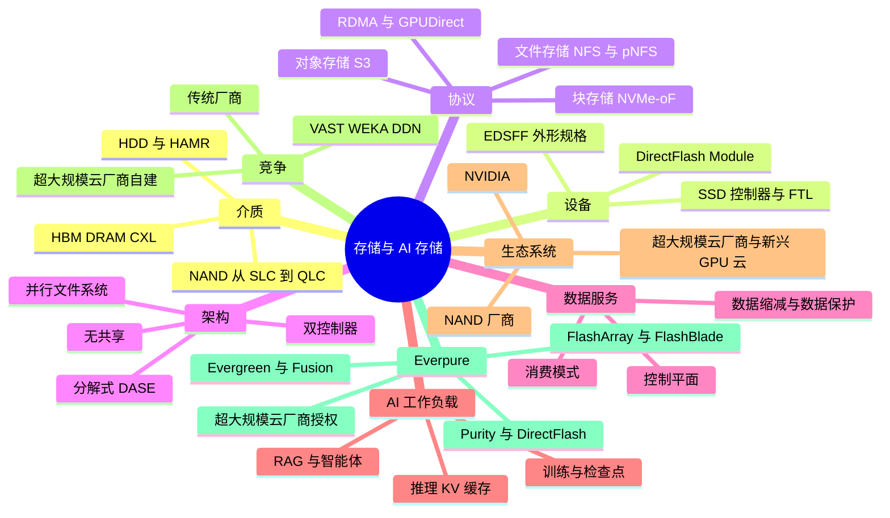

*图 0.2.1 — 九个分支覆盖了整个领域；Everpure 在每一个分支上都有产品或依赖关系，这正是其战略成为一个组合问题的原因。*

第 1–3 部分解释前五个分支，第 5 部分解释 AI 工作负载，第 4 和第 6 部分解释其余分支；[术语表](../glossary.md)定义了每一个叶节点。

### 用 10 张图看懂 Everpure

#### 1. 十七年，五次转型

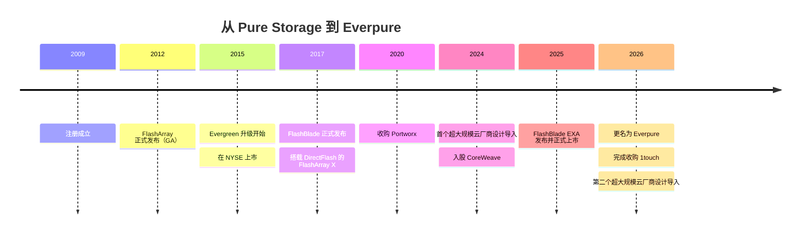

*图 0.2.2 — 每个时代都在同一个 Purity 与 DirectFlash 核心之上增加了一层。*

Pure Storage 于 2009 年注册成立[^3]，2012 年开始交付 FlashArray[^4]。它的几次转型是层层叠加而非相互替代的：阵列；商业模式（自 2015 年起的 Evergreen 原位升级[^5]，同年上市[^6]）；文件与对象存储（FlashBlade，2017 年[^7]）；云原生软件（Portworx，2020 年[^8]）；IP 授权（一项超大规模云厂商设计导入，2024 年 12 月[^9]）。数据智能（1touch，2026 年 5 月完成收购[^10]）与更名[^11]以及第二个前五大超大规模云厂商的设计导入[^12]同时到来。所有这些都是由阵列现金流支撑的小额押注。参见[第 25 章](../04-everpure/25-company-history-and-strategy.md)。

#### 2. Everpure 在堆栈中的位置

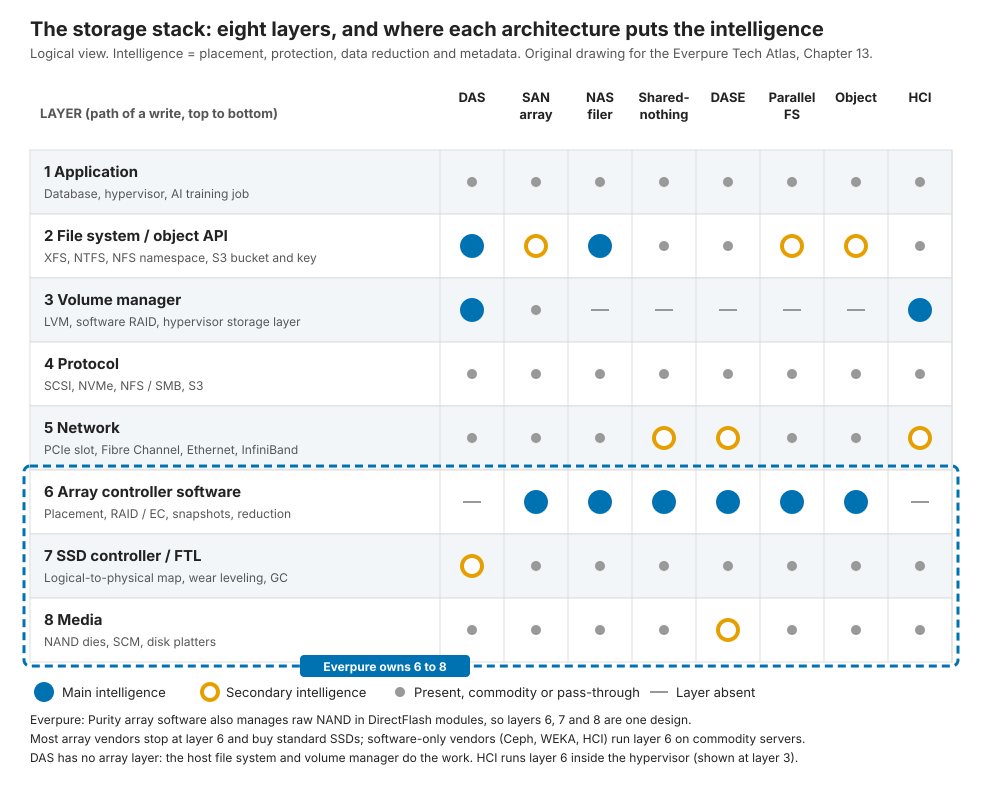

*图 0.2.3 — Everpure 把三个相邻层（阵列软件、闪存管理和介质封装）作为一个整体设计来掌握。*

每一次 I/O 都要穿越八层，从应用一直到 NAND。大多数阵列厂商把智能放在第 6 层，即阵列软件，其下是运行各自固件的 SSD。纯软件厂商止步于硬件之上。Purity 还承担了 SSD 控制器的工作，因此一个设计横跨第 6 至第 8 层。这种整合带来了密度、效率和超大规模云厂商授权；代价是研发投入，以及为每一代 NAND 做认证的负担。参见[第 13 章](../03-system-architecture/13-storage-stack.md)。

#### 3. DirectFlash 与商用 SSD 对比

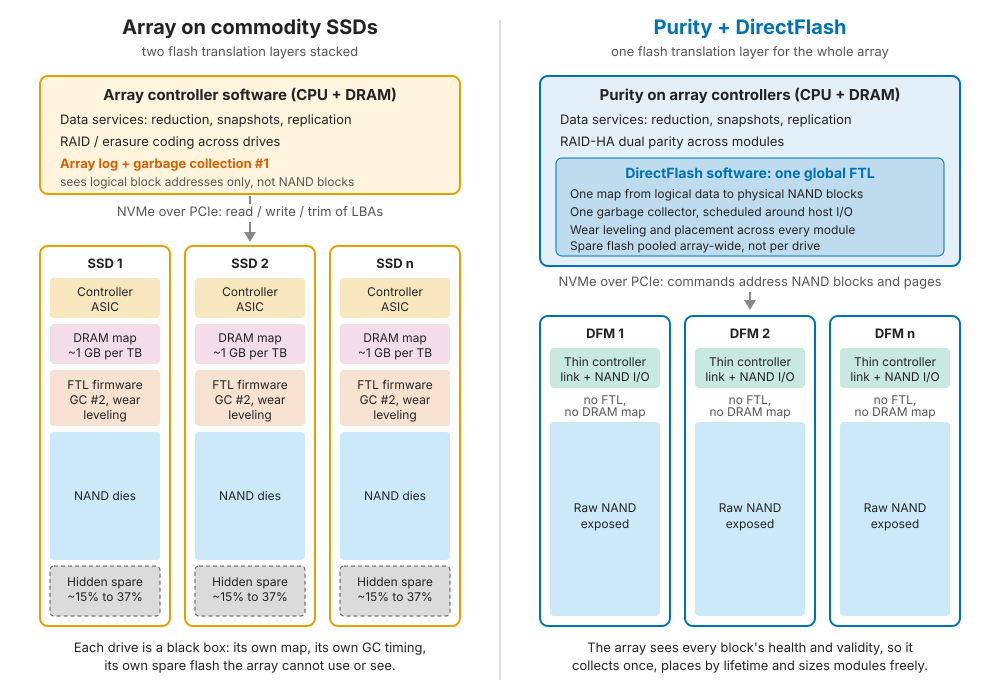

*图 0.2.4 — 基于商用 SSD 的阵列要为每块盘的控制器、DRAM 映射表、垃圾回收和备用闪存买单；DirectFlash 只需付出一次。*

SSD 是一台小型计算机，用一张映射表把 NAND"先擦除后写入"的物理特性隐藏起来。基于 SSD 的阵列会把这张映射表、垃圾回收和备用容量运行两遍：每块盘里一遍，阵列自己的日志里再一遍。DirectFlash 去掉了盘级"大脑"，因此 Purity 可以在全局调度每一个 NAND die。可见的结果是模块容量：300 TB 的 DFM（据 Everpure FY26 10-K，于 2025 年发布[^13]；2026 年 8 月的报道称"now up to 300 TB"[^14]），对比已确认出货的最大标准 SSD 的 245.76 TB[^15]；Sandisk 已宣布 256 TB 产品[^16]。超出这一点的功耗节省属于厂商说法，最好在系统层面核查。这相当于"集成内存控制器"式的举措，只不过是由一家从销售 SSD 的 IDM 那里采购 NAND 的 fabless 厂商来完成。参见[第 26 章](../04-everpure/26-purity-and-directflash.md)。

#### 4. Purity：从协议到 NAND 的统一操作系统

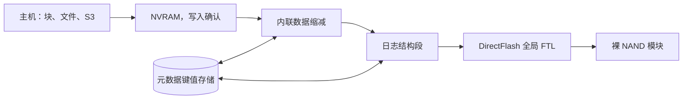

*图 0.2.5 — Purity 只追加、从不覆盖，并把每一个映射都保存在元数据存储中；这一个设计选择解释了快照、数据缩减和 DirectFlash。*

Purity 的行为就像一个以存储块为行的数据库。写入一旦进入能在控制器故障后保留数据的 NVRAM 即被确认，随后经过去重、压缩，并打包成带双重校验的大型顺序段。没有任何数据被原地覆盖；较新的版本只是在元数据映射中胜出。快照因此几乎零成本，小块随机写入也变成了 QLC 能够承受的大块顺序写入。Purity//FB 在 FlashBlade 的各个刀片之间应用同样的思路。参见[第 26 章](../04-everpure/26-purity-and-directflash.md)。

#### 5. 产品谱系

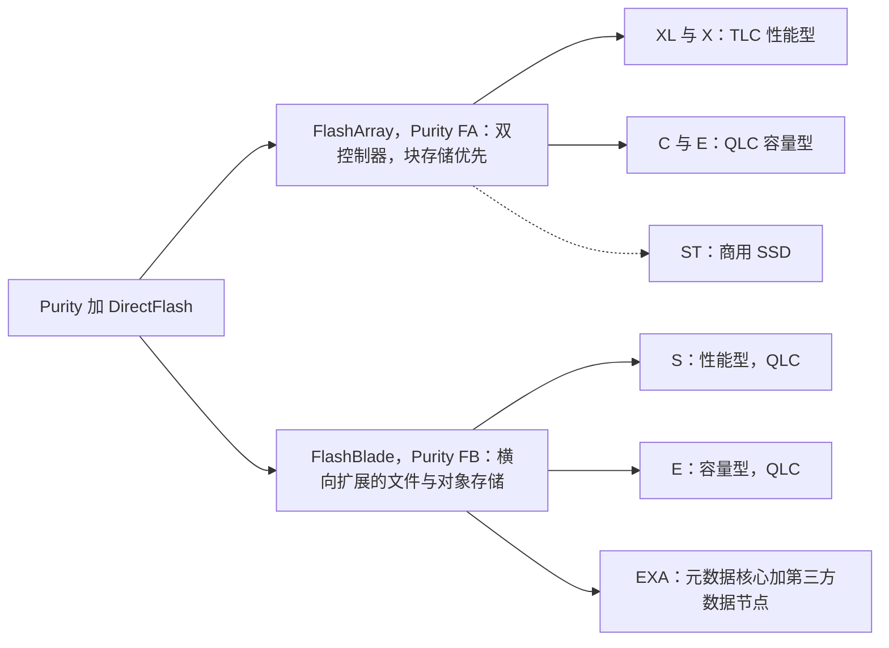

*图 0.2.6 — FlashArray 分为 TLC 性能层和 QLC 容量层；FlashBlade 按配置划分，全线采用 QLC；//ST 和 EXA 是"全线 DirectFlash"之外两个有意为之的例外。*

FlashArray 是纵向扩展（scale-up）、双控制器、块存储优先的产品，文件和 S3 是后来加入的。FlashBlade 是横向扩展（scale-out）的文件与对象存储。FlashArray 按介质分叉：TLC 用于性能（//X、//XL），QLC 用于容量（//C、//E）。FlashBlade 按配置而非介质分叉：//S 面向性能，//E 面向容量，两者都使用 QLC 模块。FlashBlade//S 并不是全共享架构；Everpure 把 Purity//FB 描述为"partitioned-writer"（分区写入者）[^17]，即每个刀片拥有命名空间的一部分，而介质是池化的（[第 15 章](../03-system-architecture/15-scale-out-shared-nothing.md)）。有两个例外值得注意：FlashArray//ST 使用商用 SSD[^18]；FlashBlade//EXA 于 2025 年 3 月发布[^19]，自 2025 年 6 月起正式上市[^20]，它加入了现成的 Linux/NVMe 数据节点。两者都是以牺牲 DirectFlash 的纯粹性来换取一个市场：//ST 换取极致 IOPS，EXA 换取 AI 级吞吐量。参见[第 27 章](../04-everpure/27-flasharray-and-flashblade.md)。

#### 6. FlashBlade//EXA 对阵 AI 原生阵营

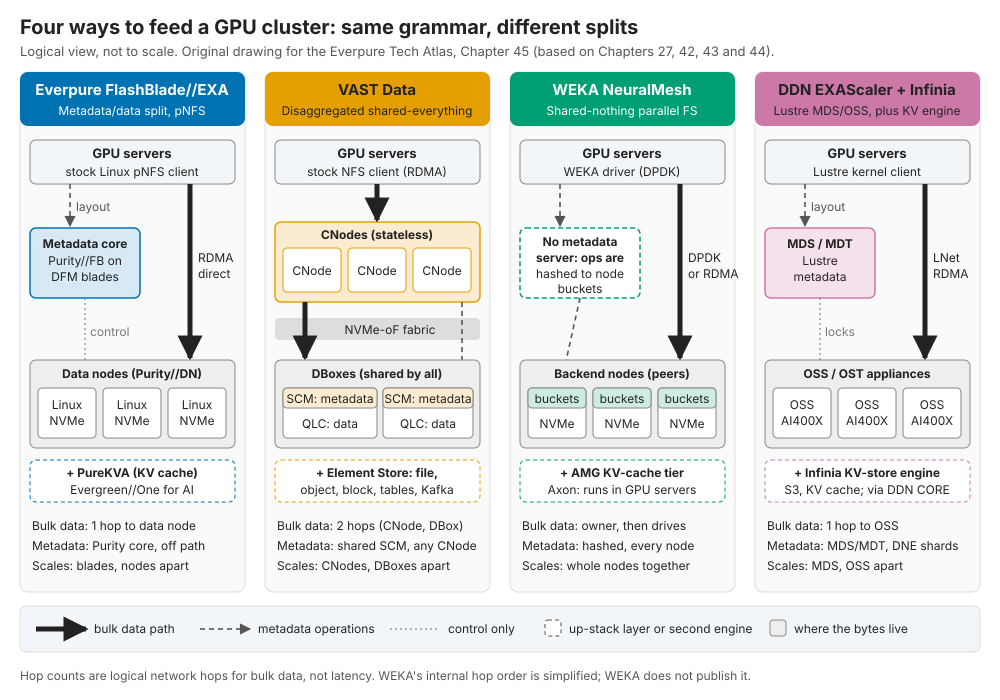

*图 0.2.7 — 各家处理元数据的方式不同：EXA 和 DDN 让大块数据一跳直达其所在位置；VAST 为共享的无状态计算多加了一跳 CNode；WEKA 则根本没有元数据服务器。*

EXA 把元数据保存在由 DirectFlash 刀片组成的 Purity//FB 核心上，并通过使用标准客户端的 pNFS 把大块数据直接发送到第三方数据节点，因此数据层并不是 DirectFlash。VAST 把一切都放在无状态计算之后的共享介质上；WEKA 把元数据分散到每个节点；DDN 运行带内核客户端的 Lustre。EXA 以 877.5 GiB/s 的检查点写入成绩位居 MLPerf Storage v3.0 榜首[^21]，而 VAST、WEKA 和 DDN 没有参加这一轮[^22]，Dell、IBM 和 NetApp 也没有参加[^23]。差距在于参考案例和认证徽章：目前没有公开的 10,000 GPU 规模 EXA 部署案例，NVIDIA 的 SuperPOD 认证属于 FlashBlade//S[^24]。对于 EXA，Everpure 于 2026 年 3 月宣布正在扩展 NVIDIA-Certified Storage 验证，这是迈向 NCP 级别的一步；截至 2026 年 11 月，未发现 EXA 已完成任何认证[^25]。参见[第 45 章](../06-industry-and-competition/45-head-to-head.md)。

#### 7. 平台与 Evergreen

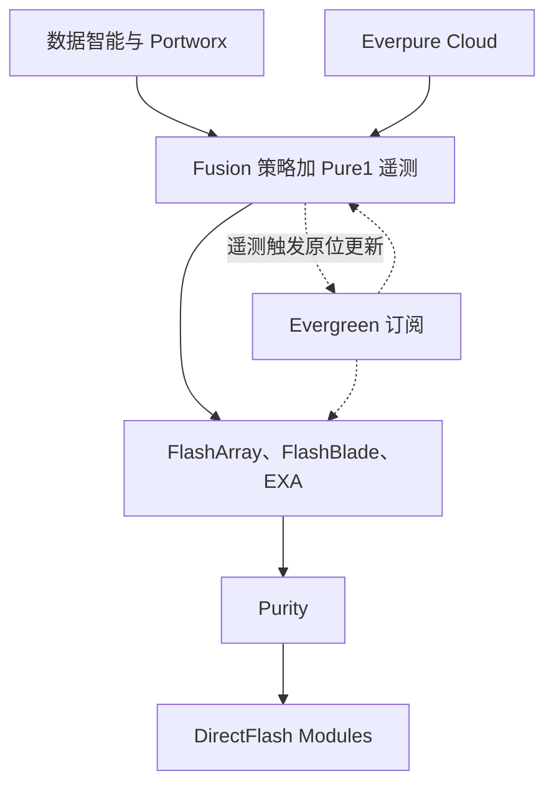

*图 0.2.8 — 每台阵列运行同一个操作系统，所有阵列之上是同一个控制平面，再加上一种订阅模式：由于遥测数据会指明时机，硬件可以原位更新。*

Evergreen 是让这个平台运转起来的关键。客户订阅的是一种架构；控制器和介质原位更新，无需数据迁移，这之所以可行，是因为控制器是无状态的，而且 Pure1 在监控整个设备群。在阵列之上，Fusion 把存储变成由策略和 API 驱动的容量，Portworx 把它延伸到 Kubernetes，数据智能（Data Intelligence，来自 1touch）则读取数据*是什么*。Everpure 的押注是：转换成本会转移到控制平面，但目前采用仍处于早期：截至 Q1 FY27，Fusion 客户数超过 1,200 家[^26]，按本图谱的估算不到装机客户群的十分之一（[第 28 章](../04-everpure/28-platform-and-software.md)）。参见[第 28 章](../04-everpure/28-platform-and-software.md)。

#### 8. 收入、ARR 与积压订单

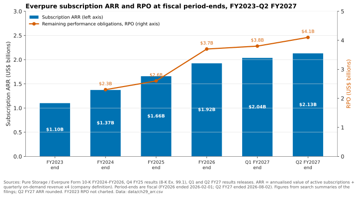

*图 0.2.9 — 自 FY2023 以来，ARR 年复合增长约 21%（FY26 为 16%，Q2 FY27 为 20%）；RPO 在 FY26 大幅跃升，因为大额交易和更长的 Evergreen 合同期限填满了积压订单，这在一定程度上是以牺牲 ARR 增速为代价的。*

两条收入线背后藏着三项业务：阵列（NAND 记在 Everpure 的账上）、按期确认的 Evergreen 订阅，以及超大规模 DirectFlash 授权（外加部分零部件，此时由客户购买 NAND）。FY26 收入为 US$3.66B[^13]。Q2 FY27 订阅 ARR 为 US$2.13B（+20%），RPO 为 US$4.1B（+44%）[^2]。NAND 是利润率风险所在：非 GAAP 产品毛利率为 66.2%，而订阅毛利率为 74.9%[^27]；DirectFlash 较低的物料成本只能缓冲而无法阻止这种挤压。FY27 的增长部分来自价格传导；应关注 ARR 和出货量。参见[第 29 章](../04-everpure/29-hyperscaler-ecosystem-financials.md)。

#### 9. 生态系统

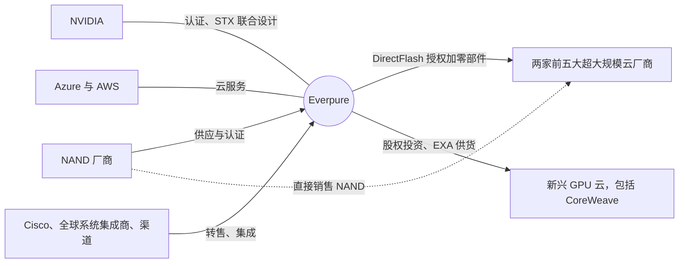

*图 0.2.10 — 生态系统的大部分是分销与验证；在超大规模领域，NAND 厂商绕过 Everpure，直接向其客户销售。*

NVIDIA 掌控着 AI 入围名单；Everpure 是其 BlueField-4 STX 架构的十二家存储联合设计伙伴之一，同列的还有 VAST、WEKA、DDN、Dell 和 NetApp[^28]。Microsoft 联合开发了一项 Azure 原生的 Everpure 服务[^29]。Cisco 和集成商承载着企业市场的销量。Everpure 持有 CoreWeave 的股份[^30]，但 VAST 是这家新兴 GPU 云的现有供应商（[第 35 章](../05-ai-storage/35-ai-factories-and-neoclouds.md)）。在超大规模领域，NAND 厂商直接向客户销售闪存，因此 Everpure 获得的是 IP、软件、支持和部分非 NAND 零部件的收入，而不是 NAND 比特的收入。参见[第 29 章](../04-everpure/29-hyperscaler-ecosystem-financials.md)和[第 34 章](../05-ai-storage/34-nvidia-ecosystem.md)。

#### 10. 竞争格局图

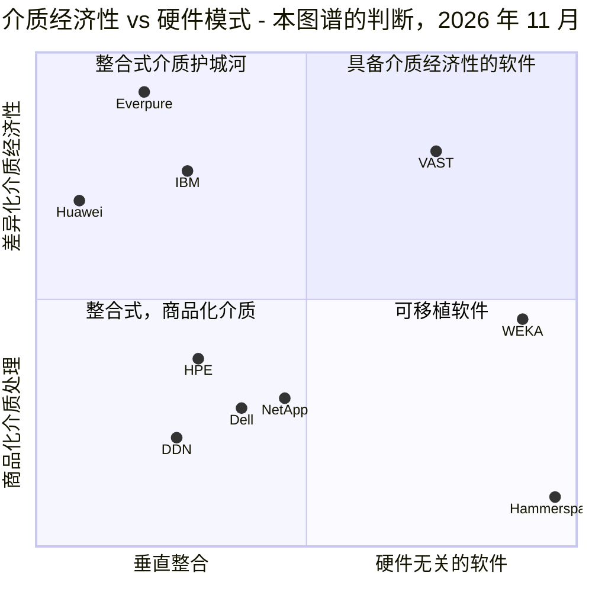

*图 0.2.11 — 通往介质经济性有两条路线：整合闪存管理（Everpure、IBM、Huawei），或在软件中从 QLC 榨取经济性（VAST）；大多数厂商两条都没走。*

这些定位是本图谱的判断，依据来自第 42–47 章。Everpure 位于最深入"整合介质"一角的位置；其他定位则更具争议。VAST 从相反的一角达到了相近的经济性——在商用 QLC 上用软件实现——这使它成为最直接的架构对手。Dell 和 NetApp 凭借装机量、渠道和产品广度竞争，而不是介质。Hammerspace 位于所有阵列之上的命名空间会让阵列变得可以互换：阵列还能保持控制点的地位吗？参见[第 49 章](../06-industry-and-competition/49-competitive-matrices.md)和[第 54 章](../07-history-and-future/54-strategic-option-map.md)。

## Everpure 的做法与竞争对手对比

| 总览图中的层 | Everpure | VAST | Dell / NetApp | 超大规模云厂商 |
|---|---|---|---|---|
| **介质与设备** | 基于裸 NAND 的自有模块（DirectFlash） | 商用 QLC 加 SCM，靠宽条带纠删码降低成本 | 标准 SSD | 商用硬盘、自有设计、授权 IP |
| **AI 架构** | EXA：元数据核心，直接数据路径 | DASE：无状态计算，共享介质 | 新推出的第一代 AI 系统（Lightning FS、AFX） | 自研文件系统 |
| **数据服务** | 两大产品家族共用一个操作系统 | 正向数据库和 AI 引擎上移 | 产品组合最广，操作系统众多 | 功能丰富，但只适用于其云中的数据 |
| **商业模式** | Evergreen 订阅与 IP 授权 | 软件许可，合作伙伴硬件 | 硬件、融资、捆绑销售 | 按使用付费 |

*表 0.2.1 — 每个竞争对手都在 Everpure 薄弱之处见长：VAST 在 AI 参考案例，Dell 和 NetApp 在产品广度和渠道，超大规模云厂商在已经位于云中的数据。本图谱的判断；证据见第 42–47 章。*

为对手构建最强版本论证（steelman）：VAST 的 US$30B 估值[^31]建立在超过 US$500M 的已承诺 ARR（公司自述）[^32]和最大规模的新兴 GPU 云参考案例之上；Dell 的外部存储份额约为 Everpure 的三倍[^33]。

## 历史与发展轨迹

在 Everpure 的生命周期中，这张图已经重绘了三次：闪存取代了性能型磁盘，订阅取代了"叉车式"整体替换升级，而 AI 正在把价值向下拉到网络互连（fabric），向上拉到数据服务（[第 53 章](../07-history-and-future/53-future-trends.md)）。值得关注的标注日期的信号：自 FY28 起来自第二家超大规模云厂商的收入[^12]、下一轮 MLPerf Storage 以及谁会参赛、EXA 本身获得 NVIDIA 认证，以及 NAND 价格能否让产品利润率恢复。

## 关键数字

**如果你只记 10 个数字：**

| 指标 | 数值 | 背景 | 来源 / 日期 |
|---|---|---|---|
| FY27 收入指引 | US$5.03–5.07B（~+38%） | 初始指引为 US$4.3–4.4B（2026 年 2 月），5 月和 8 月两次上调 | Everpure，2026-08-26[^2] |
| 订阅 ARR / RPO | US$2.13B（+20%）/ US$4.1B（+44%） | Q2 FY27，经常性收入基础与积压订单 | Everpure，2026-08-26[^2] |
| 外部企业存储市场份额 | 8.1%，第 4 名（Dell 23.8%） | 2Q26，仅品牌阵列 | IDC via StorageReview，2026-09[^33] |
| 非 GAAP 毛利率，产品 vs 订阅 | 66.2% vs 74.9% | Q2 FY27，产品毛利受 NAND 挤压 | Investing.com，2026-08[^27] |
| 最大 DFM vs 最大已出货 SSD | 300 TB vs 245.76 TB | DFM 容量为 Everpure 自述；Sandisk 已宣布 256 TB SSD，出货未经证实 | Blocks & Files，2026-08-11[^14]；Micron，2026-05-05[^15] |
| 超大规模出货量 | FY26 >2 EB | 首个客户为 Meta，见于 FY25 10-K；第二个未具名设计导入为 2026 年 8 月，收入自 FY28 起 | Blocks & Files，2025-12-03[^34]；10-K FY25[^35]；Everpure，2026-08-10[^12] |
| EXA 检查点写入，MLPerf Storage v3.0 | 877.5 GiB/s | 30 个第三方数据节点；VAST、WEKA、DDN、Dell、IBM、NetApp 缺席 | HPCwire，2026-09-02[^21]；StorageReview[^22] |
| 企业级 SSD ÷ 近线 HDD，$/TB | ~18.6× | 30 TB TLC，2026 年 8 月；单一厂商（VDURA）的指数，其他读数高达 ~23× | Hardware Busters，2026-08-21[^36] |
| VAST 估值 vs 已承诺 ARR | US$30B vs >US$500M | 估值由 CNBC 报道；ARR 为公司自述 | CNBC，2026-04-22[^31]；Futurum，2026-04[^32] |
| 存储占 AI 基础设施支出的比重 | 2.4% | 1Q26；占比虽小，却卡住了 GPU 的利用 | IDC，2026-07-21[^37] |

*表 0.2.2 — 这十个数字能回答首次会议中关于增长、利润率、份额、技术和 AI 的大部分问题；说出每个数字时都要带上日期。*

## 对话手册

**向产品经理提的 3 个问题**

1. *"这十张图中，哪一张在两年后会变化最大？"* 高质量回答会挑出一张并说出驱动因素，例如 EXA 参考案例或超大规模业务占比。
2. *"在思维导图的哪个位置，我们丢掉了本该赢下的交易？"* 留意对方是否说出一个分支和一个具名竞争对手。
3. *"FY27 的增长中，有多少来自价格，多少来自出货量？"* 留意对方如何区分 NAND 价格传导与实际出货容量。

**向工程师提的 3 个问题**

1. *"掌握第 6 至第 8 层，在每一代 NAND 上要让你们付出什么代价？"* 留意认证耗时和供应商数量。
2. *"与 VAST 的共享介质相比，EXA 的直接数据路径在哪里会吃亏？"* 高质量回答会承认某个真实存在的问题，例如数据节点的成熟度。
3. *"本章中哪张图是错的或已经过时？"* 把任何纠正意见带回到相应章节。

**不要这样说：**

- "Everpure 只是一家闪存阵列公司。"订阅和 IP 授权同样重要。
- "DirectFlash 就是一块大 SSD。"它没有盘级 FTL。
- "EXA 在 MLPerf 中击败了 VAST。"VAST 没有参加那一轮。
- "超大规模云厂商购买 Everpure 的阵列。"它们获得的是设计授权并购买部分零部件；NAND 来自它们自己的供应商。
- "EXA 已获 NVIDIA 认证。"Everpure 在 2026 年 3 月宣布了验证的扩展；已有记录的认证属于 FlashBlade//S。
- "FlashBlade 是全共享架构。"Everpure 称其为 partitioned-writer（分区写入者）；EXA 是元数据/数据分离架构，而不是 DASE。

## 深入阅读（可选，L3 指引）

- 每张图所链接的章节都通向其证据；标志性图示位于第 13、26、27、29、45 和 49 章。
- 基于这张图构建的战略选项：[第 54 章](../07-history-and-future/54-strategic-option-map.md)；海报式总结：[速查表](../08-conversation-toolkit/60-cheat-sheets.md)。

## 关键术语

- **DirectFlash**、**Purity**、**Evergreen** — 参见[术语表](../glossary.md#d)。
- **超大规模授权（Hyperscale licensing）** — 把 DirectFlash 设计出售给自行采购 NAND 的超大规模云厂商。
- **介质经济性（Media economics）** — 源自闪存管理方式的成本、密度和功耗优势。

## 资料来源

[^1]: Nasdaq / PR Newswire, "Everpure to Change Ticker Symbol to 'P'," 2026-04-07. https://www.nasdaq.com/press-release/everpure-change-ticker-symbol-p-2026-04-07 (retrieved 2026-11-01).
[^2]: Everpure, "Everpure Announces Second Quarter Fiscal 2027 Financial Results," 2026-08-26. https://investor.everpuredata.com/news-and-events/press-releases/press-release-details/2026/Everpure-Announces-Second-Quarter-Fiscal-2027-Financial-Results/default.aspx (retrieved 2026-11-01).
[^3]: SEC, "Pure Storage, Inc. Form S-1," 2015-08-27. https://www.sec.gov/Archives/edgar/data/0001474432/000119312515287576/d895532ds1.htm (retrieved 2026-11-01).
[^4]: The Register, article on the FlashArray 300-series general availability (title not retrieved), 2012-05-16. https://www.theregister.com/2012/05/16/pue_storage_flash_array/ (retrieved 2026-11-01).
[^5]: Pure Storage, "Pure's Evergreen Subscription to Innovation Reaches New Milestone," 2021-07. https://www.purestorage.com/company/newsroom/press-releases/pure-evergreen-subscription-reaches-new-milestone.html (retrieved 2026-11-01); corroborated by ITWeb, 2021-07. https://www.itweb.co.za/article/pures-evergreen-subscription-to-innovation-reaches-new-milestone-delivers-over-7-000-non-disruptive-controller-upgrades-since-2015/raYAyModA85qJ38N (retrieved 2026-11-01).
[^6]: Pure Storage / Business Wire, "Pure Storage Prices Initial Public Offering," 2015-10-06. https://investor.purestorage.com/news-and-events/press-releases/press-release-details/2015/Pure-Storage-Prices-Initial-Public-Offering/default.aspx (retrieved 2026-11-01).
[^7]: GeekFluent, "Pure Storage's FlashBlade is now GA," 2017-01-25. https://geekfluent.com/2017/01/25/pure-storages-flashblade-is-now-ga/ (retrieved 2026-11-01); FlashArray//X: Pure Storage, "Pure Storage Announces First Enterprise-Class All-NVMe Flash Array, FlashArray//X," 2017-04-11. https://investor.everpuredata.com/news-and-events/press-releases/press-release-details/2017/Pure-Storage-Announces-First-Enterprise-Class-All-NVMe-Flash-Array-FlashArrayX/default.aspx (retrieved 2026-11-01).
[^8]: SEC, "Pure Storage, Inc. Form 10-K for fiscal 2021," 2021-03. https://www.sec.gov/Archives/edgar/data/1474432/000162828021005538/pstg-20210131.htm (retrieved 2026-11-01).
[^9]: SiliconANGLE, "Shares of Pure Storage jump on impressive earnings beat and strong guidance," 2024-12-03. https://siliconangle.com/2024/12/03/shares-pure-storage-jump-impressive-earnings-beat-strong-guidance/ (retrieved 2026-11-01).
[^10]: SEC, "Everpure, Inc. Form 10-Q for the quarter ended May 3, 2026," 2026-06. https://www.sec.gov/Archives/edgar/data/0001474432/000147443226000061/pstg-20260503.htm (retrieved 2026-11-01).
[^11]: World Wide Technology, "Pure Storage Rebrands To Everpure And Announces Intent To Acquire 1touch," 2026-02-23. https://www.wwt.com/news/pure-storage-rebrands-to-everpure-and-announces-intent-to-acquire-1touch (retrieved 2026-11-01).
[^12]: Everpure, "Everpure Lands New Design Win with Second Top-Five Hyperscaler," 2026-08-10. https://www.everpuredata.com/company/newsroom/press-releases/everpure-lands-new-design-win-with-second-top-five-hyperscaler.html (retrieved 2026-11-01).
[^13]: Everpure, "Form 10-K for fiscal year ended February 1, 2026," 2026-03-24. https://www.sec.gov/Archives/edgar/data/1474432/000147443226000027/pstg-20260201.htm (retrieved 2026-11-01).
[^14]: Blocks & Files, "Second hyperscaler plumps for Everpure's flash technology," 2026-08-11. https://www.blocksandfiles.com/flash/2026/08/11/second-hyperscaler-plumps-for-everpures-flash-technology/5285903 (retrieved 2026-11-01).
[^15]: Micron Technology, "Industry-Leading 245TB Micron 6600 ION Data Center SSD Now Shipping," 2026-05-05. https://investors.micron.com/news/press-release/2026/Industry-Leading-245TB-Micron-6600-ION-Data-Center-SSD-Now-Shipping/default.aspx (retrieved 2026-11-01).
[^16]: Blocks & Files, "Sandisk unveils 256 TB SSD for AI workloads, shipping in 2026," 2025-08-05. https://www.blocksandfiles.com/ai-ml/2025/08/05/sandisk-unveils-256-tb-ssd-for-ai-workloads-shipping-in-2026/1589534 (retrieved 2026-11-01).
[^17]: J. Emerson (Pure Storage), "The Storage Architecture Spectrum: Why 'Shared-nothing' Means Nothing," n.d. https://blog.everpuredata.com/perspectives/the-storage-architecture-spectrum-why-shared-nothing-means-nothing/ (retrieved 2026-11-01; seen via search summary, host not fetchable).
[^18]: Techzine, "Pure surprises: FlashArray gets S3 support, FlashArray//ST without DFMs," 2025-06. https://www.techzine.eu/blogs/infrastructure/132388/pure-surprises-flasharray-gets-s3-support-flasharray-st-without-dfms/ (retrieved 2026-11-01).
[^19]: SiliconANGLE, "FlashBlade//EXA: Pure Storage helps enterprises avoid starving data-hungry GPUs," 2025-03-11. https://siliconangle.com/2025/03/11/flashblade-exa-pure-storage-helps-enterprises-avoid-starving-data-hungry-gpus-accelerate-ai-workloads/ (retrieved 2026-11-01).
[^20]: TechRepublic, "Pure Storage is 'Reinventing Storage for AI'" (Accelerate 2025 keynote, FlashBlade//EXA general availability), 2025-06-19. https://www.techrepublic.com/article/news-pure-storage-event-keynote-flashblade-exa/ (retrieved via search 2026-11-01).
[^21]: HPCwire (Everpure release), "Everpure Leads MLPerf Storage Tests for Large Model Checkpointing and KV Cache," 2026-09-02. https://hpcwire.com/off-the-wire/everpure-leads-mlperf-storage-tests-for-large-model-checkpointing-and-kv-cache (retrieved 2026-11-01).
[^22]: StorageReview, "MLPerf Storage v3.0: 877 GiB/s checkpoints, a cloud first and a leaderboard turned over," 2026-09. https://storagereview.com/news/mlperf-storage-v3-0-877-gib-s-checkpoints-a-cloud-first-and-a-leaderboard-turned-over (retrieved 2026-11-01).
[^23]: Blocks & Files, "MLPerf Storage benchmark updated for modern AI," 2026-09-01. https://www.blocksandfiles.com/ai-ml/2026/09/01/mlperf-storage-benchmark-updated-for-modern-ai/5293617 (retrieved via search 2026-11-01).
[^24]: Blocks & Files, "Pure Storage's FlashBlade//S500 gains Nvidia SuperPOD certification," 2024-11-18. https://www.blocksandfiles.com/ai-ml/2024/11/18/pure-storages-flashblade/s500-gains-nvidia-superpod-certification/1598641 (retrieved 2026-11-01).
[^25]: StorageReview, "Everpure aligns FlashBlade//EXA with NVIDIA AI Factory architectures, previews Data Stream," 2026-03-16. https://www.storagereview.com/news/everpure-aligns-flashblade-exa-with-nvidia-ai-factory-architectures-previews-data-stream ; Blocks & Files, "Everpure dives deeper into AI," 2026-03-16. https://www.blocksandfiles.com/ai-ml/2026/03/16/everpure-dives-deeper-into-ai/5209351 (both retrieved 2026-11-01; search-summary only; no EXA entry seen in search extracts of NVIDIA's certified-storage list).
[^26]: Everpure, "Q1 FY27 Prepared Remarks," 2026-05-27. https://s21.q4cdn.com/687136699/files/doc_financials/2027/q1/Everpure-Q1FY27-Prepared-Remarks.pdf (retrieved 2026-11-01).
[^27]: Investing.com, "Everpure Q2 FY27 slides: 38% revenue growth, guidance raised sharply," 2026-08. https://www.investing.com/news/company-news/everpure-q2-fy27-slides-38-revenue-growth-guidance-raised-sharply-93CH-4878054 (retrieved 2026-11-01).
[^28]: StorageNewsletter, "Nvidia GTC 2026: Nvidia Launches BlueField-4 STX Storage Architecture With Broad Industry Adoption," 2026-03-17. https://www.storagenewsletter.com/2026/03/17/nvidia-gtc-2026-nvidia-launches-bluefield-4-stx-storage-architecture-with-broad-industry-adoption/ (retrieved 2026-11-01).
[^29]: Blocks & Files, "Pure Enterprise Data Cloud updates," 2025-09-26. https://blocksandfiles.com/2025/09/26/pure-enterprise-data-cloud-updates/ (retrieved 2026-11-01); Microsoft Learn, "Pure Storage Cloud overview," n.d. https://learn.microsoft.com/en-us/azure/partner-solutions/pure-storage/overview (retrieved 2026-11-01).
[^30]: Pure Storage, "Pure Storage Announces Strategic Investment and Technology Partnership with CoreWeave," 2024-11. https://www.purestorage.com/company/newsroom/press-releases/pure-announces-strategic-investment-and-tech-partnership-with-coreweave.html (retrieved 2026-11-01).
[^31]: CNBC, "Nvidia backs AI company Vast Data at $30 billion valuation," 2026-04-22. https://www.cnbc.com/2026/04/22/nvidia-backs-ai-company-vast-data.html (retrieved 2026-11-01).
[^32]: Futurum, "VAST Data Valuation Triples. Can a Unified Platform Scale AI Globally?," 2026-04. https://futurumgroup.com/insights/vast-data-valuation-triples-can-a-unified-platform-scale-ai-globally/ (retrieved 2026-11-01).
[^33]: StorageReview, "IDC External Storage Tracker: $10.3 Billion in Q2 2026 as Server Market Tops $166 Billion on AI Demand," 2026-09. https://www.storagereview.com/news/idc-external-storage-tracker-q2-2026-10-3-billion-as-server-market-tops-166-billion (retrieved 2026-11-01).
[^34]: Blocks & Files, "Pure Storage hikes full-year forecast after solid Q3," 2025-12-03. https://www.blocksandfiles.com/2025/12/03/pure-storage-hikes-full-year-forecast-after-solid-q3/1720082 (retrieved 2026-11-01).
[^35]: SEC, "Pure Storage, Inc. Form 10-K for fiscal year ended February 2, 2025," 2025-04. https://www.sec.gov/Archives/edgar/data/1474432/000162828025015044/pstg-20250202.htm (retrieved 2026-11-01; Meta named as the December 2024 design win, seen via search summary).
[^36]: Hardware Busters, "Enterprise SSD Prices Now Run 18.6x Hard Drives, and the Cheap Alternative Is Sold Out Until 2027," 2026-08-21. https://hwbusters.com/news/enterprise-ssd-prices-now-run-18-6x-hard-drives-and-the-cheap-alternative-is-sold-out-until-2027/ (retrieved 2026-11-01).
[^37]: IDC, "AI Infrastructure Spending Holds Near $90 Billion in Q1 2026 as Arm Overtakes x86 in Accelerated Servers; 2026 Forecast Raised to $497 Billion," 2026-07-21. https://www.idc.com/resource-center/blog/ai-infrastructure-spending-holds-near-90-billion-in-q1-2026-as-arm-overtakes-x86-in-accelerated-servers-2026-forecast-raised-to-497-billion/ (retrieved 2026-11-01).
