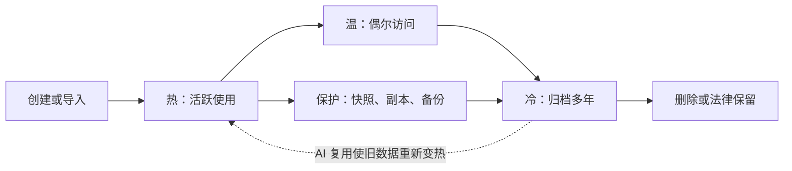
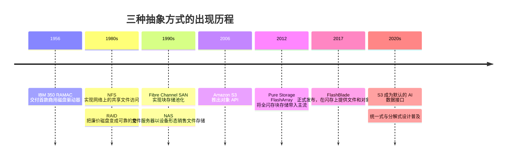

# 1. 存储做什么

> 📄 英文原文：[docs/01-storage-fundamentals/01-what-storage-does.md](../../../docs/01-storage-fundamentals/01-what-storage-does.md) · 本文为简体中文参考译本，如有出入以英文原文为准。

> **深度：** L2 · **阅读时间：** 约 11 分钟 · **最后核实：** 2026-11-01
> **前置阅读：** 无。这是第一个技术章节。[如何使用本图谱](../00-start-here/00a-how-to-use-this-atlas.md)解释了深度标签；[术语表](../glossary.md)定义了所有加粗术语。

## 要点速览（TL;DR）

- **存储有三项任务：安全地保存字节、能再次找到它们、以足够快的速度提供它们。** 本图谱中的每一款产品，都是在这三项任务与每 TB 成本之间做权衡。
- **寻址已存储字节的方式有三种。** *块*（编号的块；含义由主机掌握）、*文件*（树状结构中的路径；含义由存储系统掌握）和*对象*（扁平的键加元数据，通过 HTTP 访问）。抽象方式决定了谁来购买这款产品，以及它能扩展到多大规模。
- **数据有生命周期。** 数据在创建时是热的，随着访问减少而逐渐变冷，期间会被复制以作保护，最终进入归档或被删除。存储分层随之而定。*主存储*服务在线应用，*二级存储*保存备份与恢复副本，*归档存储*以最低成本将数据保存多年。
- **买家按工作负载而非技术划分。** DBA 和虚拟机管理员购买块存储；科研与 HPC 团队购买文件存储；云原生、数据与 AI 团队越来越多地购买对象存储。每个群体都有各自的评判标准和预算。
- **AI 正在模糊旧有版图。** 训练数据需要文件级的速度和对象级的规模，而"冷"归档正被重新加热为训练集。这为闪存厂商和 AI 原生挑战者打开了空间。

## 对 Everpure 战略的意义

IDC 测算，**2026 年第二季度全球外部企业存储系统市场规模为 US$10.3 billion，同比增长 33.6%**，其中全闪存阵列占 52.1%。Everpure（NYSE: P，原 PSTG）以 8.1% 的份额位列第四，是前五名中增长最快的厂商，增速约 +50%[^1][^2]。这些数字不包括超大规模云厂商的内部存储、云服务、备份软件和磁带，因此"我们身处哪个市场？"取决于你统计的是哪种抽象方式和哪个层级。

Everpure 的产品组合与本章词汇直接对应。**FlashArray** 于 2012 年作为面向数据库和虚拟机的块存储起家[^3]，此后增加了文件和 S3 对象访问[^4]。**FlashBlade** 自 2017 年正式发布（GA）以来一直提供文件和对象服务[^5]。**Portworx** 服务于容器平台[^6]。容量优化型 **//E** 系列瞄准曾由磁盘主导的二级存储[^7]。每一个增长论点（AI、超大规模云厂商、替代硬盘、2026 年 2 月更名后的数据管理[^8]）本质上都是进入新的层级、新的抽象方式或新的买家群体。本章提供的就是这张地图。

## 核心概念

### 三项任务：保存、查找、提供

半导体从业者早已熟悉**存储器层级**：SRAM，然后是 HBM 和 DRAM，再然后是存储。存储是必须在断电后依然存续的那一层。这一个属性派生出三项任务。

1. **保存（持久性）。** "已确认"必须意味着"已写入持久介质，或已进入一个最终必会落盘的受保护缓存"。企业存储的大部分成本和复杂性都花在兑现这一承诺上：镜像写缓存、RAID 与纠删码、复制和快照（[第 6 章](06-data-protection-and-resilience.md)）。
2. **查找（寻址与元数据）。** 除非有东西能再次定位这些字节，否则它们毫无用处。必须有某个组件维护从名称到物理位置的映射。这张映射表存放在哪里、会增长到多大，是不同架构之间的主要差异（[第 21 章](../03-system-architecture/21-metadata.md)）。
3. **提供（性能）。** 数据必须以应用所需的延迟、IOPS 或吞吐量返回（[第 4 章](04-performance-and-economics-metrics.md)）。

每一种设计都在这三项任务与**每 TB 成本**之间做权衡：即大家熟悉的密度与速度曲线，再加上一个维度——系统为不丢数据付出多大努力。曲线背后的介质物理（NAND、HDD 和磁带）见[第 2 章](02-media-physics.md)。

### 块、文件与对象

同一块 SSD 上的同一批字节可以用三种方式暴露出来。这一选择决定了谁掌握元数据、适用哪些协议，以及谁来购买产品。

*图 1.1 — 三种抽象方式的区别不在于字节存放在哪里，而在于谁维护从名称到块的映射，而这决定了延迟、规模和买家。*

**块存储**呈现一个**卷**（**LUN**，即逻辑单元），看起来就像一块裸盘：一组编号的固定大小块，即**逻辑块地址（LBA）**。主机按编号读写（"在 LBA 6 写入 8 KB"），阵列完全不知道这些块意味着什么。这些知识由服务器上的数据库或主机文件系统掌握。这使得块存储成为延迟最低、最可预测的选项，这也是数据库、ERP 和虚拟化管理程序（hypervisor）需要它的原因。半导体类比：物理地址总线——控制器负责搬运数据，由操作系统决定那里存放什么。协议是基于 Fibre Channel 和 iSCSI 的 SCSI 系列，如今还有 NVMe 和 NVMe-oF（[第 7 章](../02-protocols-and-networking/07-block-protocols.md)）。其局限在于共享：两台服务器在没有集群文件系统的情况下写同一个 LUN，会相互破坏数据。

**文件存储**把文件系统搬进了存储系统。客户端看到的是由目录和文件组成的树，请求的是"`/projects/training/shard-0001.tar` 的第 4–5 MB 字节"。阵列维护名称、权限、锁以及从文件偏移量到块的映射。许多客户端可以安全地共享同一个命名空间，因此适合用户主目录、媒体、HPC 和 AI 训练。用虚拟内存的术语来说，现在是存储系统在运行页表。协议是 NFS 和 SMB，以及把一个文件条带化分布到多台服务器上的并行文件系统客户端（[第 8 章](../02-protocols-and-networking/08-file-protocols.md)、[第 17 章](../03-system-architecture/17-parallel-file-systems.md)）。代价是元数据开销：每一次 open、stat 和 rename 都要访问一个共享结构，数十亿个小文件可能把它压垮。

**对象存储**抛弃了树结构。一个**桶（bucket）**容纳若干**对象**，每个对象由一个数据块（blob）、一个**键**（可以包含斜杠、但并不意味着目录的名称）和一组用户自定义元数据组成。客户端通过 Amazon 于 2006 年推出的 S3 API[^9]，使用 HTTP 动词（主要是 PUT、GET、LIST 和 DELETE）进行访问。对象通常整体写入，不做原地编辑。这消除了加锁需求，使系统可以分布到数千个节点和多个站点；可以把它想象成哈希表，而不是文件系统。代价是每次请求的延迟更高，且不支持部分覆盖写。它适合备份、数据湖、日志、媒体、模型制品和 AI 数据集（[第 9 章](../02-protocols-and-networking/09-object-storage-and-s3.md)、[第 18 章](../03-system-architecture/18-object-storage-architecture.md)）。

**算例：同样的 1 GB，三种方式。** 数据库把一张 1 GiB 的表写成 131,072 次独立的 8 KB 块写入（1 GiB ÷ 8 KiB），每次写入的 LBA 都由数据库选定，且每块都可原地更新。训练作业以文件方式读取同样这 1 GB，按路径和偏移量发出 1 MB 的请求，共 1,024 次读取，每次都要经过权限检查和共享命名空间校验。对象应用发出一次 PUT，或者分成 100 个 10 MB 的分段上传，此后它只能整体替换这 1 GB。同样的字节，不同的元数据负担，不同的扩展行为。

有两点需要说明。第一，这些层是叠加的：文件系统和对象存储在内部都建立在块之上，许多产品可以在同一系统中提供两种或三种抽象方式（**统一存储**）。第二，边界在移动：S3 正在成为默认的 AI 数据接口，因此文件系统纷纷增加 S3 入口。[第 13 章](../03-system-architecture/13-storage-stack.md)梳理了完整的存储栈。

### 数据生命周期：热、温、冷

一条新的订单记录会被频繁读取；一个季度后偶尔被读取；七年后它之所以还存在，主要是因为监管机构可能会要求调阅。存储从业者把这称为温度：**热**（持续访问，延迟很重要）、**温**（偶尔访问，成本和吞吐量很重要）、**冷**（极少访问，每 TB 成本几乎决定一切）。

*图 1.2 — 数据随访问减少而变冷，并在此过程中被复制以作保护；AI 正在增加一条从归档返回热层的箭头。*

层级的放置决定成本。在 US East 区域，S3 Standard 约为**每 GB-月 US$0.023**，而 S3 Glacier Deep Archive 约为 **US$0.00099**[^10]。对于 1 PB（1,000,000 GB），相当于**热存储每月约 US$23,000**，而**冷存储每月约 US$990**，相差 23 倍。冷存储的低价伴随着以小时计的恢复时间和最短保留期限[^10]。按策略在层级之间迁移数据（**分层**或**生命周期管理**）是控制支出的一个重要杠杆；但当一个"冷"数据集周一突然被 1,000 块 GPU 需要时，它也会成为痛点（[第 30 章](../05-ai-storage/30-ai-data-pipeline.md)）。

### 主存储、二级存储与归档存储

业界按任务而非介质将产品划分为不同层级：

| 层级 | 任务 | 买家优化的目标 | 当前典型介质 | 典型抽象方式 |
|---|---|---|---|---|
| **主存储** | 服务在线应用：数据库、虚拟机、AI 训练与推理 | 延迟、IOPS/吞吐量、可用性（常为 ≥ 99.999%） | TLC/QLC 闪存；部分为混合 | 块和文件；对象在增长 |
| **二级存储** | 保存备份副本、灾难恢复副本、开发/测试副本、分析副本 | 导入速度、快速恢复（RTO）、抵御勒索软件的不可变性、$/TB | 基于 HDD 的设备、QLC 闪存、云对象存储 | 对象和文件 |
| **归档存储** | 为合规、保存或未来复用而将数据保存多年 | 最低 $/TB、持久性、长达数十年的可读性 | 磁带、大容量 HDD、云归档存储类别 | 对象（或磁带库 API） |

*表 1.1 — 层级由副本所承担的任务定义；介质和抽象方式由任务决定，这正是闪存在成本下降后能够"下沉"进入二级存储的原因。*

这些边界并不严格："二级存储"也指承载已变冷主数据的较廉价容量层。磁带远未消亡。LTO 磁带 **2025 年出货量为 160.3 EB**，较 2024 年创纪录的 176.5 EB 下降 9%[^11]。这些数字按 2.5:1 压缩比计算[^12]，因此原生容量约为 160.3 ÷ 2.5 ≈ **64 EB**。2026 年第一季度出货量同比增长 57%[^11]。数据保护，包括恢复目标（RPO 和 RTO）以及勒索软件不可变性，见[第 6 章](06-data-protection-and-resilience.md)。$/TB、TB/W 和有效容量等经济指标见[第 4 章](04-performance-and-economics-metrics.md)。

### 谁买什么

技术版图之所以在商业上重要，是因为每种抽象方式和每个层级都对应着不同的买家、预算和评判标准：

| 买家 | 工作负载 | 抽象方式 | 购买依据 | 典型竞争对手 |
|---|---|---|---|---|
| **DBA 及虚拟机/基础设施管理员**（企业 IT） | Oracle、SQL Server、SAP、VMware/Hyper-V、Kubernetes | 块（部分文件） | 延迟一致性、正常运行时间、快照、易运维性、厂商稳定性 | Dell、NetApp、Everpure、HPE、Hitachi、IBM、Huawei |
| **备份、安全与合规团队** | 备份目标、网络安全恢复、归档 | 对象和文件 | 恢复速度、不可变性、$/TB | 备份软件厂商，以及磁盘/闪存和磁带供应商 |
| **科研与 HPC 团队**（实验室、大学、制药、能源、媒体） | 仿真、基因组学、渲染 | 并行文件 | 每美元总吞吐量、开源适配度、规模 | DDN、IBM、HPE、Dell、WEKA、VAST |
| **云原生、平台与数据团队** | 微服务、数据湖、分析 | 对象（S3）、容器卷 | API 兼容性、弹性、自助服务 | 公有云优先；本地部署对象存储厂商 |
| **AI 基础设施团队与新兴 GPU 云（neocloud）** | 训练、检查点保存、推理/KV 缓存、RAG | 并行文件和对象，且越来越多地两者兼用 | GPU 利用率、每机架 TB/s、功耗、NVIDIA 认证 | VAST、WEKA、DDN、Everpure、NetApp、Dell |

*表 1.2 — 每个买家群体评判存储的标准各不相同，因此一家在 DBA 群体中实力强劲的厂商，可能在 AI 团队眼中毫无存在感。*

战略上的张力在于：Everpure 的业务根基建立在看重运维简便性的保守型企业 IT 买家之上。HPC 买家偏好并行文件系统和开源方案。云原生和 AI 团队则是在 S3 和租用模式中成长起来的。而增长最快的预算恰恰掌握在最后这一群体手中（[第 35 章](../05-ai-storage/35-ai-factories-and-neoclouds.md)、[第 41 章](../06-industry-and-competition/41-why-ai-native-vendors-won.md)）。

## Everpure 的做法与竞争对手对比

| 厂商 | 块 | 文件 | 对象 | 容量/二级存储切入点 |
|---|---|---|---|---|
| **Everpure** | FlashArray（//X、//XL、//C、//ST） | FlashArray 文件服务；FlashBlade//S 和 //EXA | FlashBlade；自 2025 年起 FlashArray 支持 S3[^4] | 基于 QLC 的 FlashArray//E 和 FlashBlade//E[^7][^13]；向超大规模云厂商授权 DirectFlash 以替代 HDD[^14] |
| **Dell** | PowerStore、PowerMax | PowerScale；Lightning 并行文件系统 | ObjectScale | 在通用硬件上为每种抽象方式提供独立引擎[^15]；PowerProtect 用于备份 |
| **NetApp** | ONTAP AFF/ASA | ONTAP（统一的块、文件和 S3）；AFX 分解式架构[^16] | ONTAP S3；StorageGRID | 单一操作系统覆盖各层级；分层至云端 |
| **HPE** | Alletra MP B10000 | Alletra MP X10000（新增原生 NFS） | Alletra MP X10000 | 共享 Alletra MP 硬件[^17] |
| **VAST Data** | 自 2025 年初提供 NVMe/TCP 块卷，但并非重点[^18] | 核心优势 | 核心优势 | 基于 QLC 的单一平台同时承载热数据和容量数据[^19] |
| **公有云（以 AWS 为例）** | EBS | EFS、FSx（含 Lustre） | S3 存储类别 | 归档类别定价比标准类别低约 23 倍[^10] |

*表 1.3 — Everpure 以两个硬件系列和一条软件血统覆盖全部三种抽象方式；Dell 为每种抽象方式提供一款产品，NetApp 依靠单一统一操作系统，VAST 则以一个平台瞄准大规模文件和对象存储。*

**Everpure 的做法。** FlashArray（以块为先）和 FlashBlade（文件和对象）共享 Purity 软件血统、DirectFlash 模块和 Evergreen 订阅。其押注在于：一套闪存架构可以同时服务主存储*和*二级存储层，借助 QLC 的经济性把工作负载从磁盘上拉过来（[第 26 章](../04-everpure/26-purity-and-directflash.md)、[第 27 章](../04-everpure/27-flasharray-and-flashblade.md)）。

**替代方案的最强版本论证（steelman）。** Dell 的优势在于广度：为每种抽象方式提供一款专用、成熟的产品，外加服务器和备份栈，并通过规模最大的企业销售团队销售（据 IDC，2026 年第二季度以 23.8% 的份额位列第一[^1]）。NetApp 长期在单一操作系统 ONTAP 上运行块、文件和对象，"一个平台"是它的主场。VAST 主张，AI 时代需要的是一个在 EB 级规模上同时提供文件和对象服务的统一命名空间，而不是两个阵列产品系列。AWS 及其他云厂商天然掌握云原生买家，并为冷数据设定了价格锚点。基于公开信息，战略团队可能评估的选项包括：FlashBlade//EXA 和 FlashArray S3 能在多大程度上带领 Everpure 打入以对象为先的 AI 买家群体；以及面向超大规模云厂商的 DirectFlash 模式能否把闪存扩展到磁盘仍占据的、毗邻归档的层级。

## 历史与发展轨迹

*图 1.3 — 每种抽象方式的出现都是为了解决一个共享问题：块实现了磁盘池化，文件实现了命名空间共享，对象实现了互联网级共享。*

IBM 350 磁盘单元于 1956 年交付，配备 50 张 24 英寸盘片，容量约 3.75 MB[^20]。随后，网络把存储变成了一种共享服务。S3 的增长显示了规模的去向。Amazon 在 2023 年报告其对象数超过 280 万亿个、每秒请求数超过 1 亿次[^21]。到 2026 年 3 月 S3 二十周年时，Amazon 称其对象数超过 500 万亿个、每秒请求数超过 2 亿次，总量达数百 EB，存储价格则从每 GB 15 美分降至 2 美分[^22]。

对本图谱后续内容而言，有三条发展轨迹尤为重要：

1. **对象存储沿性能阶梯上移。** AI 流水线通过 S3 读取训练数据和写入检查点，这推动对象存储迁移到闪存和 RDMA 之上（[第 9 章](../02-protocols-and-networking/09-object-storage-and-s3.md)、[第 11 章](../02-protocols-and-networking/11-gpu-data-path.md)）。
2. **闪存沿层级下沉。** QLC 和超大容量模块正在进攻二级存储和部分 HDD 存量市场。Everpure 声称其 DirectFlash 模块的功耗比 HDD 最多低 75%（厂商声明）[^14]。磁盘与闪存之间的成本差距依然很大（[第 2 章](02-media-physics.md)、[第 48 章](../06-industry-and-competition/48-media-suppliers-and-nand-cycle.md)）。
3. **生命周期形成回环。** AI 把归档变成训练语料，把检查点变成热恢复点。推理增加了一个新的热层：KV 缓存卸载（[第 32 章](../05-ai-storage/32-inference-and-kv-cache.md)）。长期历史见[第 51 章](../07-history-and-future/51-history-of-storage.md)。

## 关键数字

| 指标 | 数值 | 背景 | 来源/日期 |
|---|---|---|---|
| 外部企业存储市场，2026 年第二季度 | US$10.3B，同比 +33.6% | 仅含阵列；不含超大规模云厂商内部存储和云服务 | IDC，2026-09-10[^1] |
| 全闪存在该市场中的份额 | 52.1%（US$5.4B，+42.9%） | 闪存已占阵列收入的多数 | IDC，经 StorageReview 转引，2026-09[^2] |
| Everpure 份额/排名，2026 年第二季度 | 8.1%，第 4 名，同比约 +50% | 前五名中增长最快 | IDC，2026-09-10[^1] |
| 云存储最热与最冷层价格 | 每 GB-月 US$0.023 对 US$0.00099（约 23 倍） | S3 Standard 对 Glacier Deep Archive，US East | AWS 定价，检索于 2026-11[^10] |
| 1 PB 存储一个月，热与冷对比 | 约 US$23,000 对约 US$990 | 1,000,000 GB × 目录价 | 算例 |
| LTO 磁带出货量，2025 年 | 160.3 EB 压缩容量（原生约 64 EB） | 较 2024 年下降 9%；2026 年第一季度同比 +57% | LTO Program，经 Blocks & Files 转引，2026-09-04[^11] |
| Amazon S3 规模 | 超过 500 万亿个对象，每秒超过 2 亿次请求 | 数百 EB | AWS，2026-03[^22] |
| 1 GiB 中的 8 KB 块写入次数 | 131,072 | 1 GiB ÷ 8 KiB；说明块存储的元数据为何存放在主机端 | 算例 |

## 对话手册

**向产品经理提的问题**

1. *"这笔交易由哪个买家主导：DBA、备份团队、科研团队还是 AI 平台团队？他们的评判标准有何不同？"* 高质量回答会指明采购决策中心、其预算科目、决定性标准（延迟一致性、恢复时间或每机架 TB/s）以及该买家会邀请的竞争对手。
2. *"我们的收入中，主存储、二级存储和毗邻归档的用例各占多少？增长来自哪里？"* 高质量回答会把层级与产品区分开（同一台 FlashBlade 可以在 AI 场景中充当主存储，在备份场景中充当二级存储），即便给不出具体数字，也能指明方向。
3. *"当客户希望在同一份数据上同时使用 S3 和 NFS 时，我们如何提供服务？会出现什么问题？"* 高质量回答会涵盖语义不匹配（重命名、部分覆盖写、权限），以及两种协议看到的是同一份副本还是两份副本。

**向工程师提的问题**

1. *"对于我们支持的每种协议，名称到块的映射存放在哪里？什么因素限制了它的规模？"* 高质量回答：区分主机掌握的元数据（块）与系统掌握的元数据（文件、对象），并指出瓶颈所在，例如目录操作或对象列举速率。
2. *"1 PB 数据从容量层迁移到性能层能有多快？迁移期间应用看到的是什么？"* 高质量回答：给出 GB/s 数值，说明访问是透明的还是需要复制，以及快照会受到什么影响。
3. *"在我们的写路径上，'已确认'意味着什么：写入 NVRAM、已镜像，还是已落到闪存？"* 高质量回答：指明持久化点及其故障域（[第 14 章](../03-system-architecture/14-scale-up-dual-controller.md)）。

**不要这样说：**

- "对象存储就是便宜、慢速的存储。"基于闪存的对象存储如今正在为 GPU 集群供数；S3 是一种接口，而不是一个层级。
- "文件存储和块存储已经过时。"数据库和虚拟机仍然运行在块存储上，大多数 AI 训练仍通过文件系统读取数据。
- "二级存储意味着旧硬件。"它指的是承担保护或分析任务的副本，且越来越多地运行在 QLC 闪存上。
- "磁带已死。"2025 年磁带出货量约为 160 EB（压缩容量）。
- "统一存储意味着样样都同样出色。"一个系统提供三种协议时，通常只针对其中一种做了优化，其余只是勉强支持。

## 深入阅读（可选，L3 指引）

- SNIA 的术语词典及其"Object Storage"和"File vs Block vs Object"教育类网络研讨会，提供了厂商中立的定义。
- Andy Warfield 在 FAST '23 上的主题演讲及配套文章，讲述大规模运营 S3 的经验[^21]。
- SCSI 块命令集（T10 SBC）和 NVMe 基础规范，说明 LBA 如何寻址。RFC 8881（NFSv4.1）说明文件语义。Amazon S3 API 参考文档说明对象语义。
- [第 13 章](../03-system-architecture/13-storage-stack.md)逐层介绍存储栈，[第 24 章](../03-system-architecture/24-architecture-decision-matrix.md)介绍如何将架构与工作负载相匹配。

## 关键术语

- **块存储（Block storage）** — 由编号的固定大小块组成的卷；含义由主机掌握。
- **文件存储（File storage）** — 由命名文件组成的共享树；文件系统由存储系统掌握。
- **对象存储（Object storage）** — 由带元数据的键控对象组成的扁平桶，通过 HTTP（S3）访问。
- **LUN / LBA** — 块卷，以及卷内某个块的地址。
- **主存储/二级存储/归档存储** — 由副本所承担的任务定义的层级：提供服务、提供保护、长期保留。
- **热/温/冷** — 按访问频率划分的数据温度。
- **统一存储（Unified storage）** — 提供不止一种抽象方式的单一系统。
- **生命周期管理（分层）** — 由策略驱动、在层级之间迁移数据。
- 其余术语见[术语表](../glossary.md)。

## 资料来源

[^1]: IDC, "Worldwide External Enterprise Storage Systems Market, Second Quarter 2026" (press release, N. Yezhkova and J. P. Seminara), 2026-09-10. https://www.idc.com/resource-center/press-releases/2q2026-ess-tracker/ (retrieved 2026-11-01).
[^2]: StorageReview, "IDC External Storage Tracker: $10.3 Billion in Q2 2026 as Server Market Tops $166 Billion on AI Demand," 2026-09. https://www.storagereview.com/news/idc-external-storage-tracker-q2-2026-10-3-billion-as-server-market-tops-166-billion (retrieved 2026-11-01).
[^3]: Pure Storage, Inc., "Form S-1 Registration Statement," 2015-08-27. https://www.sec.gov/Archives/edgar/data/0001474432/000119312515287576/d895532ds1.htm (retrieved 2026-11-01).
[^4]: Techzine, "Pure surprises: FlashArray gets S3 support, FlashArray//ST without DFMs," 2025-06. https://www.techzine.eu/blogs/infrastructure/132388/pure-surprises-flasharray-gets-s3-support-flasharray-st-without-dfms/ (retrieved 2026-11-01).
[^5]: GeekFluent, "Pure Storage's FlashBlade is now GA," 2017-01-25. https://geekfluent.com/2017/01/25/pure-storages-flashblade-is-now-ga/ (retrieved 2026-11-01).
[^6]: Pure Storage, Inc., "Form 10-K for fiscal year ended January 31, 2021," 2021-03. https://www.sec.gov/Archives/edgar/data/1474432/000162828021005538/pstg-20210131.htm (retrieved 2026-11-01).
[^7]: StorageReview, "Pure Storage adds 75TB flash module, FlashArray//E and new FlashArray//X, //C R4 nodes," 2023. https://www.storagereview.com/news/pure-storage-adds-75tb-flash-module-flasharray-e-and-new-flasharray-x-c-r4-nodes (retrieved 2026-11-01).
[^8]: World Wide Technology, "Pure Storage Rebrands To Everpure And Announces Intent To Acquire 1touch," 2026-02-23. https://www.wwt.com/news/pure-storage-rebrands-to-everpure-and-announces-intent-to-acquire-1touch (retrieved 2026-11-01).
[^9]: Amazon Web Services, "Announcing Amazon S3 - Simple Storage Service," 2006-03-14. https://aws.amazon.com/about-aws/whats-new/2006/03/announcing-amazon-s3---simple-storage-service (retrieved 2026-11-01).
[^10]: Amazon Web Services, "Amazon S3 pricing" (US East, N. Virginia; S3 Standard first 50 TB and S3 Glacier Deep Archive), n.d. https://aws.amazon.com/s3/pricing/ (retrieved 2026-11-01; figures corroborated by multiple third-party pricing summaries, e.g. https://cloudburn.io/blog/amazon-s3-pricing).
[^11]: Blocks & Files, "Tape capacity shipments fell in 2025 but 2026 could be a boom year for tape," 2026-09-04. https://www.blocksandfiles.com/tape/2026/09/04/tape-capacity-shipments-fell-in-2025-but-2026-could-be-a-boom-year-for-tape/5294464 (retrieved 2026-11-01); The Register, LTO 2025 shipments report, 2026-09. https://www.theregister.com/a/5293813 (retrieved 2026-11-01).
[^12]: HPCwire, "LTO Tape Shipments Reach 176.5 EB in 2024, Marking 15.4% Growth," 2025-07-23. https://www.hpcwire.com/off-the-wire/lto-tape-shipments-reach-176-5-eb-in-2024-marking-15-4-growth/ (retrieved 2026-11-01).
[^13]: Blocks & Files, "Everpure bulks up AI offer," 2026-09-30. https://blocksandfiles.com/flash/2026/09/30/everpure-bulks-up-ai-offer/5300162 (retrieved 2026-11-01).
[^14]: Pure Storage, "Hyperscaler," n.d. https://purestorage.com/pure-advantage/platform/hyperscaler.html (retrieved 2026-11-01).
[^15]: Dell Technologies, "Dell AI Data Platform with NVIDIA Supercharges Enterprise AI with Breakthrough Data Orchestration and Storage Innovations," 2026-03-16. https://www.dell.com/en-us/dt/corporate/newsroom/announcements/detailpage.press-releases~usa~2026~03~dell-ai-data-platform-with-nvidia-supercharges-enterprise-ai-with-breakthrough-data-orchestration-and-storage-innovations.htm (retrieved 2026-11-01).
[^16]: Blocks & Files, "NetApp disaggregates ONTAP storage and provides an AI Data Engine," 2025-10-14. https://blocksandfiles.com/2025/10/14/netapp-disaggregates-ontap-storage-and-provides-an-ai-data-engine/ (retrieved 2026-11-01).
[^17]: Blocks & Files, "HPE updates Alletras X and B10000, Zerto and Data Fabric in GreenLake private cloud update blast," 2026-05-12. https://www.blocksandfiles.com/file/2026/05/12/hpe-updates-alletras-x-and-b10000-zerto-and-data-fabric-in-greenlake-private-cloud-update-blast/5239011 (retrieved 2026-11-01).
[^18]: The Next Platform, "Vast Data Builds Out Data Platform With Block Storage And Kafka Streams," 2025-02-21. https://www.nextplatform.com/2025/02/21/vast-data-builds-out-data-platform-with-block-storage-and-kafka-streams (retrieved via search 2026-11-01); VAST Data KB, "Overview of Block Storage on VAST Cluster," n.d. https://kb.vastdata.com/documentation/docs/overview-of-block-storage-on-vast-cluster (retrieved via search 2026-11-01).
[^19]: Blocks & Files, "VAST Data's universal filesystem," 2019-02-26. https://blocksandfiles.com/2019/02/26/vast-datas-universal-filesystem/ (retrieved 2026-11-01).
[^20]: Computer History Museum, "1956: First commercial hard disk drive shipped," n.d. https://www.computerhistory.org/storageengine/first-commercial-hard-disk-drive-shipped/ (retrieved 2026-11-01).
[^21]: A. Warfield, "Building and operating a pretty big storage system called S3," All Things Distributed, 2023-07. https://www.allthingsdistributed.com/2023/07/building-and-operating-a-pretty-big-storage-system.html (retrieved 2026-11-01).
[^22]: AWS News Blog, "Twenty years of Amazon S3 and building what's next," 2026-03. https://aws.amazon.com/blogs/aws/twenty-years-of-amazon-s3-and-building-whats-next/ (retrieved 2026-11-01).
