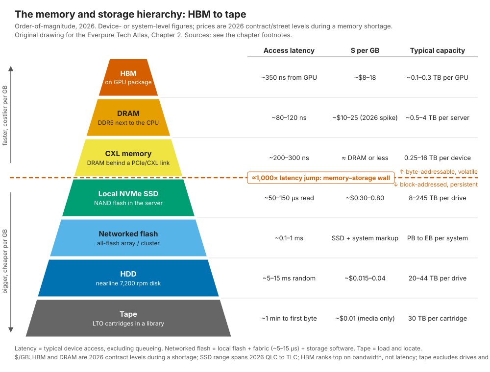
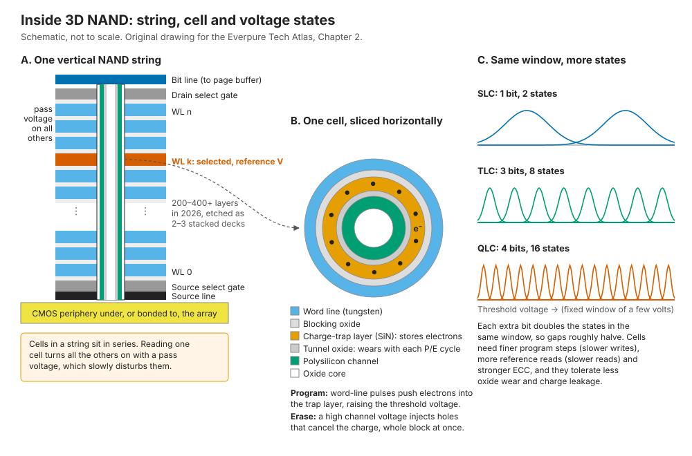
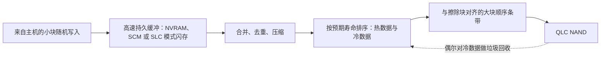
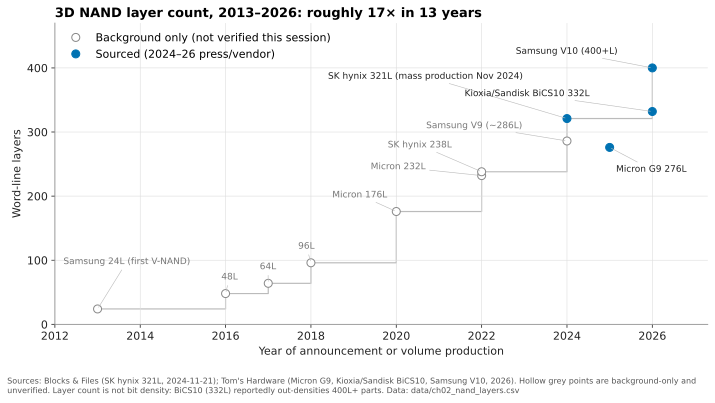
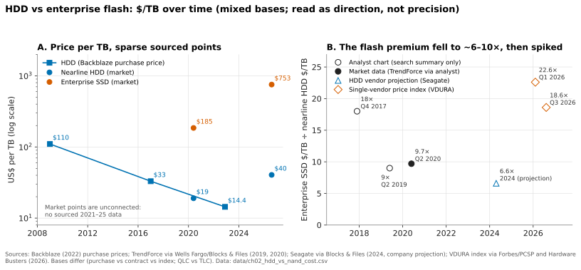
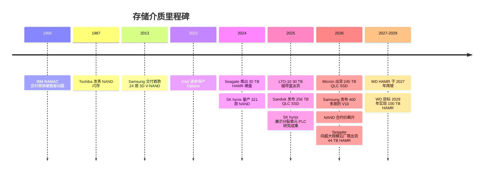

# 2. 写给半导体从业者的介质物理

> 📄 英文原文：[docs/01-storage-fundamentals/02-media-physics.md](../../../docs/01-storage-fundamentals/02-media-physics.md) · 本文为简体中文参考译本，如有出入以英文原文为准。

> **深度：** L2 · **阅读时间：** 约 14 分钟 · **最后核实：** 2026-11-01
> **前置阅读：** [存储做什么](01-what-storage-does.md) · 半导体领域的 NAND 基础知识（默认已具备）

## 要点速览（TL;DR）

- **存储是一个中间有断崖的缓存层级。** 内存层的响应时间约为 100–400 ns，NAND 约为 50–150 µs。存储系统设计的大部分工作，就是掩盖这道约 1,000× 的墙。
- **NAND 的不对称性源于物理本身。** 编程以页为单位，擦除却只能以整个块为单位，而且每个单元在有限次编程/擦除（P/E）循环后就会磨损。因此需要闪存转换层（FTL），这也是"由谁运行 FTL"具有战略意义的原因（[第 3 章](03-inside-an-ssd.md)、[第 26 章](../04-everpure/26-purity-and-directflash.md)）。
- **每个单元每多存 1 bit，电压裕量大约减半。** QLC（16 个状态）每 bit 成本更低，但比 SLC（2 个状态）更慢、耐久度更低、更脆弱。只有当软件能把小块随机写入转换为大块顺序写入时，QLC 才能在企业级场景中胜任。
- **微缩的重心已从光刻转向层数，又从层数转向键合。** 领先的 3D NAND 从 2013 年的 24 层发展到 2026 年的 400+ 层。应该关注的数字是每 mm² 的位密度，而不是层数。
- **HDD 并未消亡，2026 年的短缺重塑了经济性。** HAMR 已出货 40–44 TB 硬盘，而 2026 年企业级闪存的每 TB 成本约为磁盘的 18–23×，此前约为 6–10×。"闪存取代磁盘"的论据如今建立在功耗、密度和运维上，而非采购价格。

## 对 Everpure 战略的意义

Everpure 的核心技术押注是：谁能最好地管理裸 NAND，谁就能在成本、密度和功耗上胜出。其 DirectFlash 模块（DFM）将裸 NAND 直接暴露给 Purity 软件，而不是把它隐藏在每块盘自带的控制器之后；同一技术也支撑了它与 Meta（2024 年 12 月）以及第二家前五大超大规模云厂商（2026 年 8 月）的设计导入（design win）[^1][^2]。关于耐久度、QLC 可行性或"闪存比磁盘便宜"的各种说法，都可以追溯到本章所讲的物理原理；掌握这些原理，你就能检验这些说法，而不是人云亦云。

2025–26 年的存储器短缺使这一点变得紧迫。2026 年每个季度 NAND 合约价都在上涨。TrendForce 预计 4Q26 将再涨 15–20%，企业级 SSD 上涨 23–28%[^3]。当闪存的每 TB 成本是磁盘的 18× 而非 6× 时，替代磁盘的论据就从"买起来更便宜"变成了"供电、安置和运行起来更便宜"。[第 48 章](../06-industry-and-competition/48-media-suppliers-and-nand-cycle.md)讨论供给周期。

## 核心概念

### 层级结构：与 CPU 缓存同理，只是差距更大

*图 2.1 — 每下降一层，成本大约便宜 10×、容量大约大 10×，但从内存到闪存这一步要付出约 1,000× 的延迟代价，正是这道墙塑造了存储架构。*

2026 年数据的来源：HBM3E 合约价估计约为每 GB $8–18[^4]。2026 年服务器 DDR5 也涨到了相近区间：一条 64 GB RDIMM 在 1Q26 末约为 $927，即约 $14.5/GB[^5]。预计 2026 年 HBM 相对 DDR5 的溢价将收窄[^6]。一块 Blackwell Ultra 级 GPU 搭载 288 GB HBM3E，采用 12 层堆叠[^7]。HBM 是带宽层，而非延迟层：从 GPU 核心测量，一次未命中缓存的依赖加载在 H100 上约需 350 ns[^8]，比 CPU 访问本地 DRAM 还慢。实测 CXL 内存扩展器的加载延迟约为 214–271 ns[^9]。它们以 256 GB 模块[^10]和最高 16 TB 的机箱[^11]形态出货。基于 RDMA 的 NVMe-oF 会在本地闪存访问之上增加约 5–15 µs[^12]，阵列软件还会再增加一些。一块指数价格为 $1,216 的 30 TB 近线 HDD 折合约 $0.04/GB[^13]。LTO-10 磁带盒原生容量 30 TB，售价约 $275–315[^14][^15]，仅介质成本约为 $0.01/GB。

对半导体读者而言有三点值得注意：

1. **这道墙是架构性的，而不仅是数量上的。** 墙之上，CPU 对易失性、可按字节寻址的介质发出 load 和 store 指令。墙之下，操作系统通过驱动程序将块 I/O 排队送往持久介质。跨越这道墙需要一整套软件栈，并带来微秒级的开销。Intel 的 Optane 部分填补了这一空白，但需要新的软件模型才能发挥作用，Intel 已于 2022 年将其逐步停产[^16]。
2. **2026 年顶层的价格阶梯被打破。** 通常 HBM 的每 GB 成本是 DRAM 的数倍；2026 年的短缺使两者价格持平。重度依赖 DRAM 的设计成本大幅上升，这强化了把 KV 缓存和元数据下沉到闪存的理由（[第 32 章](../05-ai-storage/32-inference-and-kv-cache.md)）。
3. **网络化闪存付出的主要是延迟，其他代价不大。** 相对于约 100 µs 的介质读取，网络结构只增加几微秒。换来的是共享、保护和独立扩展（[第 16 章](../03-system-architecture/16-disaggregated-shared-everything.md)）。

### 深入一层：NAND 单元

现代 3D NAND 大多用**电荷俘获（charge-trap）**单元取代了浮栅：电子存储在包裹着垂直多晶硅沟道的氮化硅层中。字线是横向的钨板，堆叠数百层；一条"串（string）"是在位线与源线之间共享同一沟道的一列单元。

*图 2.2 — 单元在垂直串上串联排列，将电荷存储在氮化物俘获层中，并且必须在同样只有几伏的窗口内容纳越来越多的电压状态。*

对系统设计而言有四种行为至关重要：

**编程/擦除不对称。** 编程使用增量步进脉冲（ISPP）作用于一条字线，使电子隧穿进入俘获层，逐页进行（当前每个 plane 约 16 kB；TLC 和 QLC 在每条字线上存储多个逻辑页，并且常常分多轮编程）。擦除则是把沟道相对于块内每条字线抬升到高电压。在电荷俘获单元中，擦除主要通过注入空穴来中和被俘获的电子，而不是把电子拉回来。许多 3D 设计在多晶硅沟道下方没有体接触，因此要靠选择栅处的栅致漏极泄漏（GIDL）来产生这些空穴。无论哪种方式，在当前的 3D 器件中都只能对一整个数兆字节大小的**块**执行擦除。编程耗时从数百 µs（TLC）到几 ms（QLC）不等；擦除耗时数 ms。最关键的是，你无法原地覆盖写：更新必须写到一个新页，旧页成为垃圾，直到整个块被回收。这就催生了 FTL、垃圾回收和写放大——一种由单元物理决定的后台"家务税"，就像 DRAM 的刷新一样（[第 3 章](03-inside-an-ssd.md)）。

**耐久度。** 每一次 P/E 循环都会驱动电荷穿过隧穿氧化层，并留下界面陷阱和体陷阱。阈值电压分布不断展宽，直到控制器的纠错（LDPC 码）再也无法区分它们。以每日整盘写入次数（DWPD）为例的算例：DWPD ≈ P/E 循环次数 × （原始容量 ÷ 用户容量）÷（写放大 × 保修天数）。取一颗额定 1,000 次循环、保修 5 年（1,825 天）的 QLC 器件，为简化起见忽略预留空间（原始容量 = 用户容量）。如果写入完全是顺序的（WAF = 1），结果为 1,000 ÷ 1,825 ≈ 0.55 DWPD。同一块盘在 WAF = 3 的小块随机写入下约为 0.18 DWPD。对一块 122.88 TB 的盘来说，这相当于每天约 67 TB 与约 22 TB 主机写入量的差别。已出货的产品也呈现同样的比例：Micron 将其 245.76 TB QLC 6600 ION 的额定值定为 128 KB 顺序写入下 1.0 DWPD、16 KB 随机写入下 0.3 DWPD[^17]。顺序写入额定值也意味着当前 QLC 的循环次数远超 1,000 次、接近 2,000 次，因此上面的算例是保守的。

**数据保持。** 被俘获的电荷会泄漏，温度越高、单元磨损越严重，泄漏越快（这种损失是热激活的，因此厂商用烘烤测试加速它）。JEDEC 的企业级 SSD 规范（JESD218）只要求在额定寿命末期、40 °C 下断电保持三个月。新盘的保持时间要长得多，但没有人保证到底多长。通电的盘会在后台刷新数据，但闪存并不适合做离线归档，这是磁带得以存续的原因之一。

**读干扰。** 一条串中的单元是串联的，因此读取一个单元时，必须对块中其他每条字线施加导通电压。每次读取都会对相邻单元产生轻微编程。读取次数足够多之后，控制器就必须迁移该块。AI 训练每个 epoch 都会重复读取相同的块，因此即使是"只读"工作负载也会产生隐藏的后台写入；好的设计会把这些写入安排在前台读取之外，以保护尾延迟。

### 每单元位数：成本与质量的调节旋钮

| 单元类型 | 每单元位数 | 电压状态数 | 典型 P/E 耐久度 | 典型页读取时间（tR） | 2026 年现状 |
|---|---|---|---|---|---|
| SLC | 1 | 2 | 约 50,000–100,000 | 约 20–30 µs | 缓存、写缓冲、类 SCM 的低延迟器件 |
| MLC | 2 | 4 | 约 3,000–10,000 | 约 50 µs | 在数据中心中已基本被取代 |
| TLC | 3 | 8 | 约 3,000–10,000（企业级处于上限） | 约 40–80 µs | 性能层；出货量主力 |
| QLC | 4 | 16 | 约 1,000–3,000 | 约 100–160 µs | 容量层；122–256 TB SSD[^18][^19][^20] |
| PLC | 5 | 32 | 更低（尚未商用） | 更慢 | 仅限研究；SK hynix 于 2025 年 12 月在 IEDM 上展示了分裂单元设计[^21] |

*表 2.1 — 每增加 1 bit，每单元位数依次增加 100%、50%、33%、25%，而需要分辨的状态数却翻倍。成本收益在缩小，物理代价却在增大。* 耐久度和 tR 为各厂商的典型区间。NAND 厂商很少公布 P/E 额定值。在扣除预留空间和 WAF 之后，TLC 和 QLC 的区间与本章及[第 3 章](03-inside-an-ssd.md)所引 Micron 产品的 DWPD 额定值一致，但它们并非数据手册数值 [VERIFY: 用 2025–26 年 NAND 厂商披露信息核实 P/E 区间]。

TLC→QLC 每颗晶粒（die）增加约 33% 的容量，再减去额外的 ECC 校验位和预留空间。QLC→PLC 只增加 25%，代价却是状态数翻倍，这就是 PLC 一再推迟、而业界选择增加层数而非位数的原因。

### 为什么 QLC 需要智能写路径

QLC 编程慢、编程单元大，而且磨损快。小块随机覆盖写迫使 FTL 不断把有效数据从部分失效的块中搬出，于是写放大上升、耐久度下降、延迟变得飘忽不定。严肃的 QLC 系统会在 NAND 之前设置一条写路径：

*图 2.3 — 只有在一个缓冲层之后，把大量小块写入转换为少量按寿命排序的大块写入，QLC 才能在企业级系统中胜任；这一转换发生在栈中越高的位置，NAND 承受的负担就越小。*

通用 QLC SSD 在盘内用 SLC 模式缓存完成这项工作，但在持续写入下缓存会被耗尽。阵列则在更高一层完成：VAST 先在共享 SCM 中缓冲，再写入宽 QLC 条带（[第 16 章](../03-system-architecture/16-disaggregated-shared-everything.md)）。Everpure 的 DirectFlash 把整项工作放在阵列软件中完成，该软件能看到每个模块的裸 NAND（[第 26 章](../04-everpure/26-purity-and-directflash.md)）。超大规模云厂商则通过 NVMe 灵活数据放置（Flexible Data Placement，FDP）向下传递提示，让盘能把寿命相近的数据放在一起[^22]。半导体类比是 DRAM 控制器前面的写合并缓冲区。

### 3D NAND 微缩：层数、堆栈（deck）与键合

平面 NAND 在十几纳米中段停止了微缩，因为此时单元所容纳的电子太少，已无法可靠计数，于是业界把存储阵列"竖了起来"。如今最关键的工艺步骤是以极高的深宽比在整个堆叠中刻蚀沟道孔。较高的堆叠被分成两到三个**堆栈（deck）**分别刻蚀，再对准拼接。SK hynix 的 321 层器件采用三个"plug"，于 2024 年 11 月进入量产[^23]。最新的一步是**晶圆键合**：在另一片晶圆上制造 CMOS 外围电路，再与存储阵列进行混合键合。Samsung 的 400+ 层 V10 就采用了这一技术[^24]。

*图 2.4 — 层数在 13 年间增长了约 17×，但它并不能很好地代表每 bit 成本；决定竞争力的是密度和晶圆成本。*
数据：`data/ch02_nand_layers.csv`

层数是一个营销数字。据报道，Kioxia/Sandisk 的 332 层 BiCS10 以 QLC 形式可达约 37 Gb/mm²，比 Samsung 的 400+ 层 V10（以 TLC 形式约 28 Gb/mm²）更密[^25][^24]。Micron 的 276 层 G9 在 TLC 下约为 21 Gb/mm²[^26]。拿 QLC 与 TLC 比较会让 BiCS10 显得更好看，但结论依然成立：要像评估逻辑工艺节点一样，询问 Gb/mm²、晶圆成本和良率。每增加一个堆栈都会增加沉积和刻蚀步骤，因此即便每 bit 成本下降，每片晶圆的资本开支仍在上升，这使得供应商即便在短缺期间也对扩产持谨慎态度。

更大的晶粒和更多的层数造就了更大的盘。Micron 于 2026 年 5 月开始出货基于 G9 QLC 的 245.76 TB 6600 ION[^18]。Sandisk 推出了基于 218 层 BiCS8 的 256 TB 盘，并在路线图上列出 2027 年的 512 TB[^20]。据报道，Everpure 的 DirectFlash 模块容量最高可达 300 TB[^27] [VERIFY: 300 TB DFM 的 GA 及出货日期]。

### HDD 机械原理：容量不断提升，性能停滞不前

硬盘上的随机访问需要一次磁头寻道，外加平均半圈盘片旋转。在 7,200 rpm 下，旋转一圈需要 60 ÷ 7,200 = 8.33 ms，因此平均旋转延迟约为 4.2 ms。近线硬盘的平均寻道时间长期标称约 8 ms，实测访问时间还略高一些[^28]。因此一次随机读取约需 12 ms，即在队列深度 1 下每块盘约 80 IOPS。命令队列允许硬盘对请求重新排序以缩短寻道，因此一块 30 TB HAMR 硬盘在队列深度 16 下可达约 170 随机读 IOPS（[第 4 章](04-performance-and-economics-metrics.md)）。这些数字 20 年来几乎没有变化，而容量增长了十倍以上。因此一块 30 TB 硬盘每 TB 只能提供约 3–6 IOPS。假设持续速率约为 250 MB/s，重建一块这样的盘需要 30 × 10¹² ÷ 250 × 10⁶ ≈ 120,000 s，即最理想情况下约 **33 小时**。更大的 HDD 适合大批量顺序数据，在其他方面则越来越差，这也是厂商如今除了 TB 之外还开始宣传带宽的原因[^29]。

容量增长取决于面密度，而面密度受制于磁记录的**三难困境（trilemma）**：更小的磁颗粒能存储更多 bit，但会变得热不稳定；稳定的高各向异性颗粒需要比磁头所能产生的更强的写入磁场。有三种记录技术绕开了这一困境：

| 技术 | 如何提高密度 | 代价 | 2026 年现状 |
|---|---|---|---|
| CMR / ePMR | 垂直磁颗粒；能量辅助写磁头 | 正逼近三难困境的极限 | WD 路线图：ePMR 达到 60 TB，2026 年下半年推出 40 TB UltraSMR 硬盘[^30] |
| SMR（叠瓦式） | 利用读磁头比写磁头窄的特点，让磁道像屋顶瓦片一样相互重叠 | 无法在不重写整个磁道带的情况下重写单条磁道；主机管理型 SMR 需要按区域顺序写入，与 NAND 擦除块非常相似 | 在超大规模场景中很常见；WD UltraSMR 达 40 TB[^30] |
| HAMR | 激光在纳秒内加热一个极小区域，使高各向异性（FePt）介质得以写入，随后冷却并稳定保存 | 需要新的磁头、介质和可靠性验证；量产爬坡缓慢 | Seagate Mozaic 3+ 自 2024 年起达 30 TB[^31]；Mozaic 4+ 最高 44 TB，自 2026 年 3 月起向两家超大规模云厂商批量出货[^32]；WD HAMR 于 2027 年爬坡，目标 2029 年达到 100 TB[^30] |

*表 2.2 — HDD 厂商以牺牲写入灵活性（SMR）或增加制造复杂度（HAMR）为代价换取容量；但这些都没有改善随机 I/O。*

注意 SMR 与 NAND 的相似之处：两者都偏好向必须整体回收的区域进行大块顺序写入，因此相同的分区存储软件思路（ZNS、FDP、日志结构布局）同样适用于两者（[第 12 章](../02-protocols-and-networking/12-interfaces-and-emerging-tech.md)）。

### 每 bit 成本曲线：差距为何变化

*图 2.5 — 闪存相对磁盘的价格溢价在 2017 至 2020 年间大约减半，随后 2026 年的短缺又将其推回到约 20×；各来源的统计口径不同，因此应关注方向，而非小数点。*
数据：`data/ch02_hdd_vs_nand_cost.csv`

HDD 的曲线缓慢而平稳。Backblaze 的采购成本从 2009 年的约 $0.11/GB 降至 2022 年 11 月的 $0.014/GB[^33]，平均每月下降约 1.2%，即每年约 14%。NAND 的曲线更陡，但具有周期性。根据 TrendForce 数据，2020 年第二季度企业级 SSD 约为 $185/TB，而近线磁盘为 $19/TB，溢价 9.7×[^34]。Seagate 在 2024 年表示，预计到 2027 年磁盘将保持 >6:1 的优势，平均为 6.6:1（公司自述）[^35]。随后短缺来袭。VDURA 的 Flash Volatility Index 显示，2026 年第一季度一块 30 TB QLC SSD 的每 TB 价格是一块 30 TB HDD 的 22.6×，而 2025 年第二季度为 4.9×[^36]；2026 年第三季度一块 30 TB TLC SSD 为 18.6×（$22,600 对 $1,216）[^13]。该指数来自一家同时销售闪存和磁盘的混合型厂商，它没有披露价格来源，而且在不同版本之间切换过 QLC 与 TLC 口径，因此对其绝对水平应审慎看待 [VERIFY: 用 TrendForce 或 Coughlin 数据佐证 2026 年的溢价水平]。磁盘也在涨价：该指数中的 30 TB HDD 从 2026 年第一季度的 $668 涨到第三季度的 $1,216。

闪存在其他方面胜出。Micron 给出的 245 TB 盘约为 8.2 TB/W，而 44 TB HDD 约为 4.4 TB/W（厂商对比）[^19]。Everpure 声称 DirectFlash 与 HDD 相比最多可降低 75% 的功耗（厂商声明）[^37]。在功耗和空间受限的场景中，例如 AI 数据中心，尽管存在溢价，TCO 仍可能有利于闪存。[第 4 章](04-performance-and-economics-metrics.md)给出 TCO 的测算。

## Everpure 的做法与竞争对手对比

| 方案 | 代表厂商 | NAND 在哪里被管理 | 优势 | 劣势 |
|---|---|---|---|---|
| 阵列软件直接管理裸 NAND | Everpure DirectFlash（FlashArray、FlashBlade、超大规模云厂商 DFM） | 由 Purity 跨模块全局管理 | 整个系统只有一个 FTL：感知寿命的数据放置、更少的预留空间、超大容量模块 | 专有模块；Everpure 需自行承担 NAND 认证和供应工作 |
| 通用 SSD + SCM 缓冲 | VAST | 各 SSD 的 FTL，外加一个 SCM 写缓冲，把写入整形为宽 QLC 条带 | 使用业界最大的标准盘；缓冲层吸收 QLC 的弱点 | 两层 FTL；依赖 SCM 层[^38] |
| 通用 TLC/QLC SSD | NetApp、Dell、WEKA、DDN 及大多数其他厂商 | 在每块盘内部 | 多来源供应，可快速采用新盘 | 每块盘各自保留预留空间，各自进行垃圾回收 |
| 主机引导的数据放置 | 采用 FDP 的超大规模云厂商 | 共同管理：主机给出提示，盘负责执行 | 无需定制硬件即可降低写放大[^22] | 需要专门为此构建的软件；仅适用于超大规模场景 |
| 磁盘加闪存缓存 | 超大规模云厂商的大容量层、HDD 厂商的主张 | 对磁盘不适用 | 最低的采购 $/TB；6–20× 的差距 | 每 TB IOPS 很低、重建时间长、每 PB 的功耗和空间更大 |

*表 2.3 — 竞争的问题不在于"闪存还是磁盘"，而在于闪存管理的智能放在哪里、由谁来买单。*

通用 SSD 方案的最强论证是供应灵活性：一块新的 245 TB 盘可以很快完成认证，而模块厂商必须自行开发。磁盘方案的最强论证是：在 18× 的差距下，EB 级冷数据还将在 HDD 和磁带上保留多年。有两项公开事实塑造了 Everpure 的处境。第一，它与 Meta 及第二家超大规模云厂商的交易是对 DirectFlash 技术的授权，管理层表示 Everpure 不为超大规模云业务采购 NAND[^2]，这使该收入线免受 NAND 价格飙升的冲击。第二，它已认证了多个 NAND 来源（Micron G8/G9 QLC、Kioxia BiCS8）[^39]。基于公开信息，战略团队可能评估的选项包括：2026 年 NAND 涨价中有多少传导到了阵列定价、有多少由利润率吸收；以及结构性走高的闪存溢价是否会拖慢替代 HDD 的交易，同时又强化面向 AI 站点的功耗与密度论据。

## 历史与发展轨迹

*图 2.6 — 2026 年，单设备闪存容量已超过磁盘约 5×，而 HDD 的新技术 HAMR 才刚刚进入量产。*

RAMAC 的日期来自 Computer History Museum[^40]；Toshiba 的 NAND 论文（Masuoka 等，IEDM 1987）和 Samsung 的 24 层 V-NAND（2013 年）属于业界公认的历史，图 2.4 中 2016–2022 年的层数数据点仅作背景参考。展望未来：各厂商的层数路线图瞄准约 500 层，尽管时间表互有出入[^26]。PLC 仍处于研究阶段[^21]。HDD 容量路线图（WD：2029 年达到 100 TB）取决于 HAMR 能否按期爬坡[^30]。与此同时，2026 年的价格冲击是一场供给纪律事件，而非物理事件。AI 服务器吸纳了大量 bit 供给，TrendForce 报告称大部分新增供给已被预订[^3]。冲击持续多久，对 2027 年的定价至关重要。

## 关键数字

| 指标 | 数值 | 背景 | 来源/日期 |
|---|---|---|---|
| 已出货的最大标准 SSD | 245.76 TB（Micron 6600 ION，QLC） | 自 2026-05-05 起出货 | Micron[^18] |
| 领先 3D NAND 层数 | 400+（Samsung V10） | 混合键合；每 mm² 密度更重要 | Tom's Hardware，2026[^24] |
| 向超大规模云厂商出货的最大 HDD | 最高 44 TB（Seagate Mozaic 4+，HAMR） | 自 2026 年 3 月起向两家超大规模云厂商批量出货 | Seagate，2026-03-03[^32] |
| 企业级 SSD ÷ 近线 HDD 的 $/TB | 22.6×（QLC，2026 年第一季度）；约 18.6×（TLC，2026 年第三季度）；9.7×（2020 年第二季度） | 单一厂商指数与 TrendForce 数据 | Blocks & Files[^36]；Hardware Busters[^13]；Blocks & Files[^34] |
| 4Q26 NAND 合约价变化 | 环比 +15–20%（企业级 SSD +23–28%） | 预测值；此前 1H26 已大幅上涨 | TrendForce，2026-09-30[^3] |
| 每瓦容量 | 约 8.2 TB/W（245 TB QLC）对约 4.4 TB/W（44 TB HDD） | 厂商对比 | StorageReview[^19] |
| CXL 内存加载延迟 | 约 214–271 ns | 实测扩展器设备 | arXiv，2024[^9] |
| LTO-10 磁带盒 | 原生 30 TB，约 $275–315 | 仅介质约 $0.01/GB | TechRadar[^14] |
| QLC 耐久度（DWPD） | WAF 1 时约 0.55；WAF 3 时约 0.18 | 1,000 次 P/E、5 年保修；Micron 245 TB 额定值为顺序 1.0 / 随机 0.3 | 算例；StorageReview[^17] |
| HDD 每 TB 随机 IOPS（30 TB） | 约 3–6 | QD1 下约 80 IOPS 至 QD16 下约 170，÷ 30 TB | 算例 |

## 对话手册

**向产品经理提的问题**

1. *"按照当前闪存相对磁盘的溢价，全闪存方案在哪些场景仍能凭 TCO 胜出，在哪些场景会输？"* 高质量回答：指出每个细分市场的约束条件（功耗、机架空间、重建风险）和盈亏平衡溢价，而不是"闪存总是更便宜"。
2. *"产品利润率对 2026 年 NAND 涨价的敞口有多大？有多少可以转嫁出去？"* 高质量回答：把阵列业务（Everpure 采购 NAND）与超大规模云授权业务（客户采购 NAND）区分开，并涵盖合同时点以及限制重新定价的 Evergreen 承诺。
3. *"QLC 让我们能卖出哪些 TLC 卖不了的东西？在哪些场景我们会拒绝使用 QLC？"* 高质量回答：在文件、对象和备份场景中赢在容量和功耗；对于写密集、延迟敏感的块工作负载则需谨慎，除非写路径能够吸收这些写入。

**向工程师提的问题**

1. *"Purity 在现网 QLC 上看到的实际 WAF 是多少？它如何转化为 DWPD 余量？"* 高质量回答：按工作负载给出实测数字，并说明系统级 FTL 如何让 WAF 保持在接近 1 的水平。
2. *"对于以读为主的 AI 数据集，你们如何处理读干扰和数据保持问题？"* 高质量回答：围绕前台 I/O 调度后台巡检（scrub）和数据迁移，并将读重试率遥测作为磨损信号。
3. *"从 75 TB 模块升级到 300 TB 模块时，会有哪些变化：重建时间、爆炸半径（影响范围）、每 TB 性能？"* 高质量回答：给出重建小时数、保护方案，并说明模块内部的并行性如何防止每 TB 性能像大容量 HDD 那样崩塌。

**不要这样说：**

- "层数越多，闪存越便宜。"决定每 bit 成本的是位密度、晶圆成本和良率。332 层的器件可以在密度上超过 400 层的器件。
- "QLC 磨损太快，不适合企业级。"在良好的写路径之后，它足以胜任大多数容量型工作负载。
- "闪存现在比磁盘便宜。"在 2026 年按采购价格看并非如此——按某厂商的指数，溢价约为 18× 甚至更高。应改从 TCO、功耗和密度角度论证。
- "SSD 是很好的归档介质。"JEDEC 规定的寿命末期断电保持时间只有三个月，没有任何东西能保证数年。
- "HAMR 解决了磁盘的性能问题。"它增加的是容量。每块盘的 IOPS 保持不变，因此每 TB IOPS 持续下降。

## 深入阅读（可选，L3 指引）

- JEDEC JESD218/JESD219：SSD 耐久度和数据保持的测试条件。
- IEDM/ISSCC 的 NAND 论文：各厂商的 tR、tPROG 和键合技术，例如 SK hynix 的多位点单元 PLC（IEDM 2025）[^21]。
- NVM Express FDP（TP4146）和 ZNS 规范[^22]。
- Seagate 和 Western Digital 关于 HAMR 路线图的投资者日材料。

## 关键术语

- **P/E 循环（P/E cycle）** — NAND 块的一次编程/擦除循环；闪存磨损的计量单位。
- **DWPD** — 在保修期内可持续承受的每日整盘写入次数。
- **电荷俘获单元（Charge-trap cell）** — 将电子存储在氮化物层中的 3D NAND 单元。
- **读干扰（Read disturb）** — 由于读取相邻单元而导致未被读取单元逐渐损坏的现象。
- **QLC / PLC** — 每单元 4 bit 和 5 bit 的 NAND。
- **HAMR / SMR** — 热辅助磁记录和叠瓦式磁记录。
- **内存–存储墙（Memory–storage wall）** — DRAM 级内存与闪存之间约 1,000× 的延迟跃升。
- 其余术语见[术语表](../glossary.md)。

## 资料来源

[^1]: SiliconANGLE, "Shares of Pure Storage jump on impressive earnings beat and strong guidance," 2024-12-03. https://siliconangle.com/2024/12/03/shares-pure-storage-jump-impressive-earnings-beat-strong-guidance/ (retrieved 2026-11-01).
[^2]: Everpure, "Everpure Lands New Design Win with Second Top-Five Hyperscaler," 2026-08-10. https://www.everpuredata.com/company/newsroom/press-releases/everpure-lands-new-design-win-with-second-top-five-hyperscaler.html (retrieved 2026-11-01); Motley Fool, "Everpure (P) Q2 2027 Earnings Call Transcript," 2026-08-31. https://www.fool.com/earnings/call-transcripts/2026/08/31/everpure-p-q2-2027-earnings-call-transcript/ (retrieved 2026-11-01).
[^3]: TrendForce, "AI Server Demand Sustains Memory Contract Price Increases in 4Q26, While Consumer-Side Pressure Persists," 2026-09-30. https://www.trendforce.com/presscenter/news/20260930-13258.html (retrieved 2026-11-01).
[^4]: Silicon Analysts, "HBM Memory Pricing and Specifications (2026)," 2026. https://siliconanalysts.com/data/hbm-pricing (retrieved 2026-11-01; figures seen via search summary).
[^5]: Counterpoint Research, "Memory Price Tracker, April 2026," 2026-04. https://counterpointresearch.com/de/reports/memory-price-tracker-april-2026 (retrieved 2026-11-01; figure seen via search summary, consistent with a Citi estimate of $873 for 1Q26).
[^6]: uAnalyze, "DDR5大漲價 2026年與HBM3e定價差距將收斂" (DDR5 price surge: gap with HBM3e pricing to narrow in 2026), n.d. (late 2025). https://uanalyze.com.tw/articles/1451142587 (retrieved 2026-11-01).
[^7]: NVIDIA, "NVIDIA Blackwell Ultra AI Factory Platform Paves Way for Age of AI Reasoning," 2025-03-18. https://nvidianews.nvidia.com/news/nvidia-blackwell-ultra-ai-factory-platform-paves-way-for-age-of-ai-reasoning (primary release not fetched); The Register, "We heard you like HBM – Nvidia's Blackwell Ultra GPUs will have 288 GB of it," 2025-03-18. https://www.theregister.com/2025/03/18/nvidia_blackwell_ultra/ (retrieved via search 2026-11-01).
[^8]: arXiv:2608.15764, "Concurrency Response of Plain Global Loads on the NVIDIA H100," 2026-08. https://arxiv.org/pdf/2608.15764 (seen via search summary, 2026-11-01). Pointer-chase plateau of ~353 ns for HBM-resident working sets; cycle-based studies report ~290–480 cycles.
[^9]: arXiv:2409.14317, "Dissecting CXL Memory Performance at Scale: Analysis, Modeling, and Optimization," 2024-09. https://arxiv.org/pdf/2409.14317 (retrieved 2026-11-01).
[^10]: Red Hat Ecosystem Catalog, "Micron CMM CZ120 256GB E3.S CXL2.0 Memory Expander," n.d. https://catalog.redhat.com/en/hardware/components/detail/259147 (retrieved 2026-11-01).
[^11]: AnandTech, "Samsung Unveils CXL Memory Module Box: Up to 16 TB at 60 GB/s," 2024. https://www.anandtech.com/show/21333 (retrieved 2026-11-01).
[^12]: R. Davis (Mellanox), "Demonstrating NVMe Performance over Ethernet," SNIA Data Storage Innovation Conference, 2016. https://www.snia.org/sites/default/files/DSI/2016/presentations/stor_networks/Rob_Davis_Demonstrating_NVMe_Performance_Ethernet.pdf (retrieved 2026-11-01).
[^13]: Hardware Busters, "Enterprise SSD Prices Now Run 18.6x Hard Drives, and the Cheap Alternative Is Sold Out Until 2027," 2026. https://hwbusters.com/news/enterprise-ssd-prices-now-run-18-6x-hard-drives-and-the-cheap-alternative-is-sold-out-until-2027/ (retrieved 2026-11-01).
[^14]: TechRadar, "Tape storage is not dead yet – but $300 LTO-10 cartridges and inflated exabyte numbers won't help its cause," n.d. (2025–26). https://www.techradar.com/pro/tape-is-not-dead-yet-but-usd300-lto-10-cartridges-and-inflated-exabyte-numbers-wont-help-its-cause (retrieved 2026-11-01).
[^15]: StorageNewsletter, "Availability of FujiFilm LTO Ultrium 10 Cartridge with 30TB Native Capacity," 2025-06-16. https://www.storagenewsletter.com/2025/06/16/availability-of-fujifilm-lto-ultrium-10-cartridge-with-30tb-native-capacity/ (retrieved 2026-11-01).
[^16]: AnandTech, "Intel To Wind Down Optane Memory Business – 3D XPoint Storage Tech Reaches Its End," 2022-07-28. https://www.anandtech.com/show/17515 (retrieved 2026-11-01).
[^17]: StorageReview, "Micron 6600 ION 245TB SSD Review: A Quarter Petabyte Per Drive Bay," 2026. https://www.storagereview.com/review/micron-6600-ion-245tb-ssd-review-a-quarter-petabyte-per-drive-bay (retrieved via search 2026-11-01). Spec table: 1.0 DWPD (128 KB sequential), 0.3 DWPD (16 KB random).
[^18]: Micron Technology, "Industry-Leading 245TB Micron 6600 ION Data Center SSD Now Shipping," 2026-05-05. https://investors.micron.com/news/press-release/2026/Industry-Leading-245TB-Micron-6600-ION-Data-Center-SSD-Now-Shipping/default.aspx (retrieved 2026-11-01).
[^19]: StorageReview, "Micron 6600 ION 245TB SSD Review: A Quarter Petabyte Per Drive Bay," 2026. https://www.storagereview.com/review/micron-6600-ion-245tb-ssd-review-a-quarter-petabyte-per-drive-bay (retrieved 2026-11-01); StorageReview, "Solidigm 122.88TB D5-P5336 Review," 2025. https://www.storagereview.com/review/solidigm-122-88tb-d5-p5336-review-high-capacity-storage-meets-operational-efficiency (retrieved 2026-11-01).
[^20]: Blocks & Files, "Sandisk unveils 256 TB SSD for AI workloads, shipping in 2026," 2025-08-05. https://www.blocksandfiles.com/ai-ml/2025/08/05/sandisk-unveils-256-tb-ssd-for-ai-workloads-shipping-in-2026/1589534 (retrieved 2026-11-01).
[^21]: Blocks & Files, "SK hynix developing split-cell 5-bit flash," 2026-01-15. https://www.blocksandfiles.com/flash/2026/01/15/sk-hynix-developing-split-cell-5-bit-flash/4090388 (retrieved 2026-11-01).
[^22]: NVM Express, "Overcoming the Write Amplification Problem with NVM Express Flexible Data Placement," n.d. https://nvmexpress.org/nvmeflexible-data-placement-fdp-blog/ (retrieved 2026-11-01).
[^23]: Blocks & Files, "SK hynix begins mass production of 321-layer 3D NAND," 2024-11-21. https://www.blocksandfiles.com/ai-ml/2024/11/21/sk-hynix-begins-mass-production-of-321-layer-3d-nand/1605947 (retrieved 2026-11-01).
[^24]: Tom's Hardware, "Samsung unveils 10th Gen V-NAND: 400+ layers, 5.6 GT/s and hybrid bonding," 2026. https://www.tomshardware.com/pc-components/ssds/samsung-unveils-10th-gen-v-nand-400-layers-5-6-gt-s-and-hybrid-bonding (retrieved 2026-11-01).
[^25]: Tom's Hardware, "Kioxia and Sandisk sample world's densest 3D NAND — new 332-Layer beats Samsung's 400-Layer NAND," 2026. https://www.tomshardware.com/pc-components/ssds/kioxia-and-sandisk-sample-worlds-densest-3d-nand-new-332-layer-beats-samsungs-400-layer-nand (retrieved 2026-11-01).
[^26]: Tom's Hardware, "Inside the future of 3D NAND: The roadmap to 500 layers," 2026. https://www.tomshardware.com/pc-components/storage/inside-the-future-of-3d-nand-the-roadmap-to-500-layers (retrieved 2026-11-01).
[^27]: Blocks & Files, "Second hyperscaler plumps for Everpure's flash technology," 2026-08-11. https://www.blocksandfiles.com/flash/2026/08/11/second-hyperscaler-plumps-for-everpures-flash-technology/5285903 (retrieved 2026-11-01).
[^28]: StorageReview, "Seagate NL35" review (7,200 rpm nearline drive specified at 8 ms seek; 13.1 ms measured average read access time), n.d. (mid-2000s). https://storagereview.com/review/seagate-nl35 (seen via search summary, 2026-11-01).
[^29]: StorageReview, "WD Bets 8x Bandwidth Beats More Terabytes as 40TB UltraSMR Starts Shipping," 2026. https://www.storagereview.com/news/wd-bets-8x-bandwidth-beats-more-terabytes-as-40tb-ultrasmr-starts-shipping (retrieved 2026-11-01).
[^30]: Western Digital, "Western Digital Accelerates Storage Innovation for AI Era," 2026-02-03. https://www.westerndigital.com/company/newsroom/press-releases/2026/2026-02-03-western-digital-accelerates-storage-innovation-for-ai-era (retrieved 2026-11-01).
[^31]: PetaPixel, "Seagate's new 30TB Hard Drive is the Largest Ever," 2024-01-18. https://petapixel.com/2024/01/18/seagates-new-30tb-hard-drive-is-the-largest-ever/ (retrieved 2026-11-01).
[^32]: Seagate Technology, "Seagate Delivers Industry's Highest Capacity Hard Drives with Next-Generation Mozaic 4+," 2026-03-03. https://investors.seagate.com/news/news-details/2026/Seagate-Delivers-Industrys-Highest-Capacity-Hard-Drives-with-Next-Generation-Mozaic-4/default.aspx (retrieved via search 2026-11-01).
[^33]: Backblaze, "Hard Drive Cost Per Gigabyte," 2022-11. https://www.backblaze.com/blog/hard-drive-cost-per-gigabyte/ (retrieved 2026-11-01; figures seen via search summary); Blocks & Files, "Backblaze predicts HDD prices will fall to 1¢/GB by mid-2025," 2022-12-12. https://blocksandfiles.com/2022/12/12/backblaze-sees-hdd-pricing-falling-to-a-penny-a-gig/ (retrieved 2026-11-01).
[^34]: Blocks & Files, "Enterprise SSDs cost ten times more than nearline disk drives," 2020-08-24. https://blocksandfiles.com/2020/08/24/10x-enterprise-ssd-price-premium-over-nearline-disk-drives/ (retrieved 2026-11-01); Blocks & Files, "How long before SSDs replace nearline disk drives?," 2019-08-28. https://blocksandfiles.com/2019/08/28/nearline-disk-drives-ssd-attack/ (retrieved 2026-11-01).
[^35]: Blocks & Files, "Seagate: Is flash killing the hard drive? No," 2024-05-01. https://blocksandfiles.com/2024/05/01/seagate-is-flash-killing-the-hard-drive-no/ (retrieved 2026-11-01).
[^36]: Blocks & Files, "VDURA says 30 TB QLC SSD capacity now costs 22.6x more than HDD," 2026-04-08. https://www.blocksandfiles.com/flash/2026/04/08/vdura-says-30-tb-qlc-ssd-capacity-now-costs-226x-more-than-hdd/5214761 (retrieved via search 2026-11-01); Tom's Hardware, "Vdura hikes its enterprise SSD pricing, now costs 22.6x more than hard drives," 2026-04. https://www.tomshardware.com/pc-components/ssds/vdura-sharply-revises-its-enterprise-ssd-pricing-figures (retrieved via search 2026-11-01).
[^37]: Pure Storage, "Hyperscaler," n.d. https://purestorage.com/pure-advantage/platform/hyperscaler.html (retrieved 2026-11-01).
[^38]: VAST Data Knowledge Base, "DBox DF-3015V2/DF-3060V2 Ceres Datasheet," n.d. https://kb.vastdata.com/docs/dbox-df-3015v2df-3060v2-ceres-datasheet (retrieved 2026-11-01).
[^39]: Blocks & Files, "Pure qualifies Micron's 276-layer flash," 2025-01-08. https://blocksandfiles.com/2025/01/08/pure-qualifies-microns-276-layer-flash/ (retrieved 2026-11-01); Blocks & Files, "Kioxia 2 terabit NAND," 2024-07-03. https://blocksandfiles.com/2024/07/03/kioxia-2-terabit-nand/ (retrieved 2026-11-01).
[^40]: Computer History Museum, "1956: First commercial hard disk drive shipped," n.d. https://www.computerhistory.org/storageengine/first-commercial-hard-disk-drive-shipped/ (retrieved 2026-11-01).
