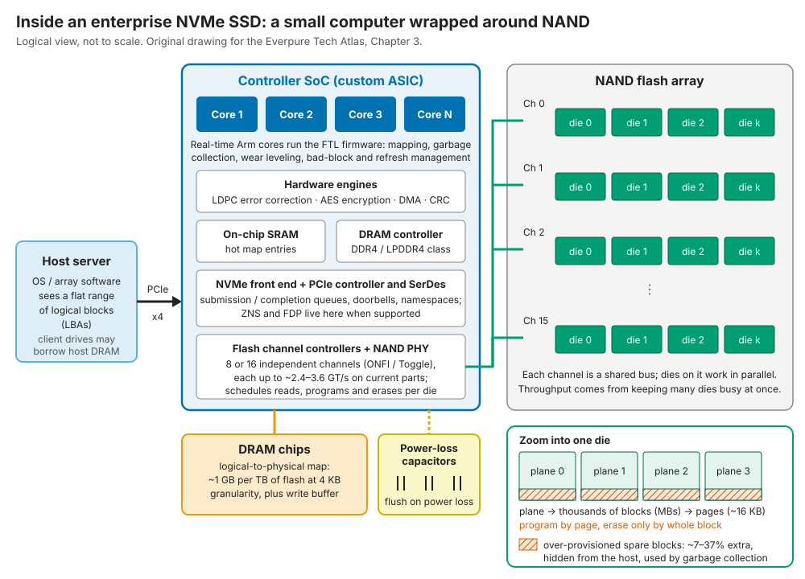
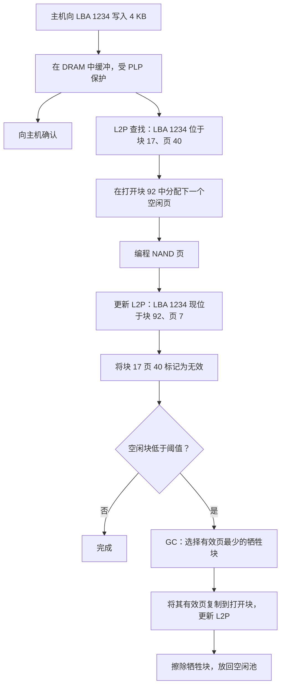
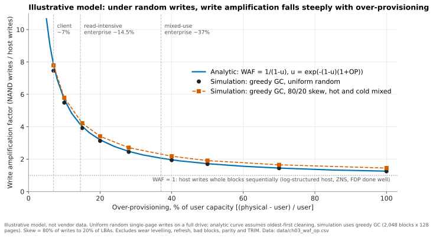
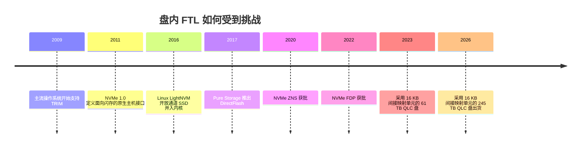

# 3. 固态硬盘（SSD）内部

> 📄 英文原文：[docs/01-storage-fundamentals/03-inside-an-ssd.md](../../../docs/01-storage-fundamentals/03-inside-an-ssd.md) · 本文为简体中文参考译本，如有出入以英文原文为准。

> **深度：** L2 · **阅读时间：** 约 12 分钟 · **最后核实：** 2026-11-01
> **前置阅读：** [面向半导体从业者的介质物理](02-media-physics.md) · [存储的作用](01-what-storage-does.md) · [术语表](../glossary.md)

## 要点速览（TL;DR）

- **SSD 是包裹着 NAND 的一台小型计算机。** 控制器 SoC（Arm 内核、ECC 引擎、8–16 个闪存通道）运行固件，让"先擦后写"的 NAND 看起来像一块简单的磁盘。
- **闪存转换层（FTL）就是一张页表。** 其映射表存放在盘上 DRAM 中，按 4 KB 粒度约为每 TB 需要 1 GB；这正是最大容量的 QLC 盘改用 16 KB 及以上映射单元、并因此对小写入不友好的原因。
- **垃圾回收（GC）是隐性税。** 回收失效页需要复制有效数据，这些额外写入就是写放大（WAF）。对抗写放大的主要手段是预留空间（OP），即主机永远看不到的备用闪存。
- **备用闪存换来耐久度。** 在一个示意性的随机写模型中，OP 从 7% 提高到 37%，WAF 从约 7.8 降到约 2.1：同样的 NAND 做成的"读密集型"盘与"混合负载型"盘之间的差距，大部分就来自这里。
- **在日志结构阵列之下，盘内 FTL 基本是重复劳动：** 第二张映射表、第二块备用区、第二套且不受调度的 GC。ZNS 与 FDP（[第 12 章](../02-protocols-and-networking/12-interfaces-and-emerging-tech.md)）以及 Everpure 的 DirectFlash（[第 26 章](../04-everpure/26-purity-and-directflash.md)）是针对这种浪费的三种解法。

## 对 Everpure 战略的意义

Everpure 的核心技术主张是：阵列应当采购裸 NAND，而不是通用 SSD，并在整个系统上只运行一个闪存转换层。这能否成为持久的护城河，取决于 SSD 内部 FTL 的真实成本（DRAM、隐藏的备用闪存、写放大、延迟尖峰），以及灵活数据放置（Flexible Data Placement，FDP）等标准能为其他所有厂商挽回多少这类成本。本章阐述的正是 DirectFlash（[第 26 章](../04-everpure/26-purity-and-directflash.md)）与超大规模云厂商授权（[第 29 章](../04-everpure/29-hyperscaler-ecosystem-financials.md)）背后的机制。

本章也为你提供了一把检验厂商说法的尺子。当竞争对手称其 245 TB QLC SSD 用于主存储"开箱即用"，或者 Everpure 称 DirectFlash"消除了"开销时，请追问：间接映射单元多大、预留空间多少、GC 是否隔离、固件归谁所有。

## 核心概念

### 包裹着 NAND 的小型计算机

拆开一块企业级 NVMe SSD，你会看到一颗控制器 ASIC、几颗 DRAM 芯片、若干电容和许多 NAND 封装；每个封装内堆叠着多颗 die，每颗 die 又分为 plane、block 和 page（[第 2 章](02-media-physics.md)）。

*图 3.1 — SSD 是一个嵌入式系统：Arm 内核运行映射固件，硬件引擎负责纠错，DRAM 存放映射表，电容保证崩溃安全，另有一部分 NAND 被留作备用。*

**控制器是一颗嵌入式 SoC**，与基带调制解调器颇为相似：通用内核处理控制流，固定功能引擎承担繁重运算。Marvell 的 PCIe Gen5 Bravera SC5 集成了 Arm Cortex-R8 实时内核、LDPC 纠错引擎、DDR4/LPDDR4X 接口以及 8 或 16 个 NAND 通道[^1]；Silicon Motion 的 SM8366 驱动 16 个通道，速率最高 2,400 MT/s[^2]。商用控制器厂商把芯片卖给没有自研控制器的 SSD 厂商，而 NAND IDM 大多自行设计。

**通道相当于内存通道，die 相当于 bank。** 单颗 die 很慢（QLC 读一页约需 100–160 µs），因此带宽来自把工作条带化到 8–16 个独立通道上（每个通道是挂载若干 die 的共享总线），以及每颗 die 内部的多个 plane 上。与 DRAM 的 bank 级并行一样，吞吐量本质上是一个调度问题。

**DRAM 存放映射表**，即下文讨论的逻辑到物理（L2P）表。消费级盘往往不配 DRAM，而是借用主机内存（NVMe 主机内存缓冲区，Host Memory Buffer），或在片上 SRAM 中缓存热点表项。

**掉电保护（PLP）**电容在断电后让盘维持足够长时间，以便把缓冲的写入和映射表更新刷写下去。有了 PLP，企业级盘可以在数据还在 DRAM 中时就向主机确认写入，同时保持崩溃安全。大多数消费级盘没有 PLP。

**备用区是已装入却不出售的 NAND。** 一块用 8 TiB NAND（8.80 TB）制造、按 7.68 TB 出售的盘，保留了 1.12 TB，即用户容量的 14.5%，作为预留空间。同样的 NAND 若按 6.4 TB 出售，预留比例则为 37%。这通常就是"读密集型"与"混合负载型"SKU 的区别：Micron 7.68 TB 的 7450 PRO 额定为每日整盘写入 1 次（DWPD），而 6.4 TB 的 7450 MAX 额定为 3 DWPD[^3][^4] [VERIFY: 两款 SKU 每盘是否使用相同的原始 NAND]。

### FTL：闪存的页表

NAND 按页（约 16 KB）编程，但只能按整块（若干 MB）擦除，因此 FTL 从不原地更新。每次写入都落到某个"打开"块的下一个空闲页，再由一张表记录每个逻辑块地址（LBA）当前所在的位置。

*图 3.2 — 每次写入都会把数据移到新页并留下一份失效副本；垃圾回收是后台循环，把失效页重新变回已擦除的块，代价是额外的复制。*

这里的半导体类比完全贴切。L2P 表就是**页表**，缓存在控制器 SRAM 中的那部分就是 **TLB**；无 DRAM 的盘在冷查找时会发生一次落到主机内存的 TLB 未命中。映射单元，即**间接映射单元（indirection unit，IU）**，相当于页大小，而选择 IU 就是大页（huge page）式的权衡：单元越大，映射表越小，但较小的访问会浪费更多工作。

FTL 的工作不止映射：

- **垃圾回收**回收充满失效页的块（见下一节）。
- **磨损均衡**让编程/擦除（P/E）次数均匀分布：新写入落到磨损较少的块，冷数据偶尔被迁离较"年轻"的块，让它们分担负载（这本身也是额外写入）。
- **TRIM**（NVMe 中称 Deallocate）告诉盘某个 LBA 已被删除。没有 TRIM，GC 会把已删除的文件当作有效数据反复复制；有了 TRIM，释放出的空间就相当于额外的预留空间。
- **坏块管理、读干扰与数据保持刷新**负责淘汰失效块，并重写被读取过于频繁或存放过久的数据（[第 2 章](02-media-physics.md)）。

### 纠错：LDPC 与读重试

闪存天生就有噪声：8 或 16 个电压状态挤在几伏的区间内，其分布还会随磨损、温度和时间变宽。因此每次读取都要经过硬件**低密度奇偶校验（LDPC）**解码器。第一次尝试是对单次读取做快速的"硬"解码。若失败，控制器逐级升级处理：先按重试表中偏移后的参考电压**重读**该页，再次硬解码；若仍失败，则围绕每个参考电压进行多次读取，构建"软"置信信息（每比特的对数似然比），使 LDPC 能纠正多得多的错误。最后手段是跨 die 的奇偶校验，相当于盘内的 RAID。

每次重试都要多付出一次完整的 NAND 读取，因此约 100 µs 的读取可能拉长到数百 µs。这是老化 QLC 上**尾延迟**的主要来源之一，也是标称 IOPS 相同的盘在 99.99 百分位上表现迥异的原因。可以把它类比为 SerDes 接收端在边缘链路上重新调整均衡器。能够跟踪每个块电压漂移的控制器可以避免大部分重试，这是掌握工艺数据的 IDM 不太显眼的优势。

### 垃圾回收与写放大：算例

设一个块有 256 页。当 FTL 需要空闲块时，它选出有效页最少的"牺牲块"（贪心 GC），先把这些有效页复制到别处，再擦除该块。

- 若牺牲块 **25% 有效**，GC 复制 64 页，为新的主机数据腾出 192 页。每次主机写入对应的 NAND 写入 = (192 + 64) / 192 = **1.33**。
- 若牺牲块 **75% 有效**，GC 要复制 192 页才能腾出 64 页。WAF = 256 / 64 = **4.0**。

一般而言，WAF = 1 / (1 − u)，其中 u 是平均牺牲块的有效页比例。对于满盘上的均匀随机覆盖写，可以用一个简单模型求出 u。假设块大致按从旧到新的顺序被清理，那么一个块要等日志在全部物理页上绕完一圈后才会被回收。在这一圈中，主机写入 Nphys × (1 − u) 页。每次写入落到某个给定 LBA 的概率为 1 / Nuser，因此一页存活下来的概率为 exp(−Nphys(1 − u) / Nuser)。由于 Nphys / Nuser = 1 + OP：

**u = exp(−(1 − u)(1 + OP))，且 WAF = 1 / (1 − u)。**

数值求解：OP 为 7% 时，u ≈ 0.87，WAF ≈ 7.8；OP 为 14.5% 时，u ≈ 0.76，WAF ≈ 4.1；OP 为 37% 时，u ≈ 0.51，WAF ≈ 2.1。贪心 GC 对均匀随机写是最优的，且有精确的闭式分析[^5]；在我们的仿真中，其结果落在该曲线约 5% 的范围以内。

*图 3.3 — 示意模型：预留空间的前 30 个百分点大约把写放大降低 4 倍，此后收益迅速递减；冷热数据混放会使情况更糟。*
数据：`data/ch03_waf_op.csv`

由此得出三条结论。**OP 换来耐久度：**OP 从 14.5% 提高到 37%，模型 WAF 减半，同样的 NAND 可吸收约两倍的主机写入，这解释了 Micron 两款 SKU 额定主机写入量 2.5 倍差距中的大部分。**随机小写入是最坏情况：**真实负载更友好，实测 WAF 通常低于这些模型[^6]。**数据放置胜过备用闪存：**当冷热数据共享块时，冷页会被一次又一次地复制（即倾斜序列）。如果写入方能把不同寿命的数据分开存放，或者把整块写满、之后整块一起失效，那么只需很少的 OP 就能让 WAF 接近 1。这正是日志结构阵列、ZNS 和 FDP 背后的思路。

### DRAM、间接映射单元与小写入惩罚

每 4 KB 对应一个约 4 字节的表项，即容量的 1/1,000：**每 TB 闪存约需 1 GB DRAM**。在 1 TB 时无伤大雅；到 245 TB 就不是了。

| 盘容量 | 间接映射单元 | 映射表项数 | 按约 4 B/表项计的映射 DRAM（下限） |
|---|---|---|---|
| 7.68 TB | 4 KB | 19 亿（1.9 billion） | 约 7.5 GB |
| 30.72 TB | 4 KB | 75 亿（7.5 billion） | 约 30 GB |
| 122.88 TB | 16 KB | 75 亿（7.5 billion） | 约 30 GB |
| 245.76 TB | 4 KB（假设） | 600 亿（60 billion） | 约 240 GB |
| 245.76 TB | 16 KB | 150 亿（15 billion） | 约 60 GB |
| 245.76 TB | 64 KB | 37.5 亿（3.75 billion） | 约 15 GB |

*表 3.1 — 算例：若以 4 KB 粒度映射一块四分之一 PB 的盘，需要约 240 GB DRAM，超过许多服务器的配置，因此大容量 QLC 盘改为加粗间接映射单元。*

还有两项约束同样关键。32 位表项只能寻址 2³² × 4 KB ≈ 17.6 TB，因此更大的盘需要更宽的表项或更大的 IU。即便采用 16 KB，一块 245.76 TB 的盘也有 150 亿个单元，超过 2³²（43 亿），所以表项至少需要 34 位；表中每表项约 4 字节是下限，而非设计值。另外，按 2026 年服务器 DRAM 约每 GB $14.5 的价格[^7]，240 GB 的映射表会使每块盘增加约 $3,500。于是 IU 越做越大。Solidigm 61 TB 的 D5-P5336 采用 16 KB IU，其前代产品用的是 64 KB[^8]。Micron 245.76 TB 的 6600 ION 在最大容量型号上采用 16 KB，在 30.72 TB 型号上采用 4 KB[^9]。评测者报告其盘上 DRAM 为 64 GB，与上表一致，并认为这使其随机写速率约为采用 64 KB IU 的同级 245 TB 竞品的三倍[^10]。（某媒体的标题写的是 16 GB；其正文及另一篇评测写的是 64 GB。）

代价是**小写入惩罚**。对 16 KB IU 的盘写入 4 KB，会迫使整个单元做一次读-改-写：在 GC 叠加自身倍数之前就已是 4 倍的 NAND 写入，64 KB IU 时则为 16 倍。因此大容量 QLC 盘适合大块对齐写入（对象存储、数据湖、AI 数据集、检查点），或适合先合并写入的主机。

### 为什么通用 SSD 的效率损失在 FTL

多数现代全闪存阵列（Purity、WAFL 类设计、VAST 的 element store）都是日志结构的：它们在 NVRAM 中缓冲写入、进行数据缩减、写出大块顺序段，并运行**自己的**垃圾回收。下层的 SSD 对此一无所知。研究者把这种结果称为"日志叠日志"（log-on-log）[^11]：

- **重复 GC。** 阵列的清理与盘的 GC 各自重写有效数据，二者的放大效应相乘：示意性地，1.5 × 2.0 = 每主机字节 3.0 NAND 字节。
- **隐藏的 OP，付两次钱。** 每块盘预留 7–37% 的备用空间；阵列自身也保留空闲空间，而二者无法相互借用。
- **重复 DRAM。** 每块盘每 TB 约 1 GB，在 10 PB 阵列上合计约 10 TB，用来翻译阵列早已翻译过的地址。
- **延迟不可预测。** 每块盘按自己的节奏做垃圾回收、重试和刷新，阵列只能为尾延迟做过度设计。
- **信息丢失。** 阵列知道哪些数据是冷的、下一个要清理哪个段；但隔着块接口，盘无法利用这些信息。

出路有三条。**分区命名空间（Zoned Namespaces，ZNS）**于 2020 年 6 月获批，向主机暴露必须顺序写入并重置的分区，从而去掉了盘内 GC[^12]。**灵活数据放置（FDP）**于 2022 年底获批，背后有 Meta、Google 和 Samsung 支持，做法更温和：主机为写入打标签，使寿命相近的数据共享擦除块，而盘保留自己的 FTL[^13]。Samsung 报告称，在 Meta 的 CacheLib 中，FDP 在默认配置（保留半块盘作为主机侧备用空间）下把设备 WAF 从约 1.3 降至约 1.0，在缓存使用整块盘时则从约 3.5 降至约 1[^14]。该工作经同行评审的版本（EuroSys 2025）报告，在 Meta 和 Twitter 的负载轨迹上，无需主机预留空间即可使设备 WAF 接近 1[^15]。一项 FAST '26 研究发现，寿命分类正确时 WAF 保持在 1 附近，分类错误时则会恶化[^16]。二者均在[第 12 章](../02-protocols-and-networking/12-interfaces-and-emerging-tech.md)中讨论。第三条路是**去掉盘内 FTL**：Everpure 的 DirectFlash 模块没有逻辑地址层，由 Purity 中的一个 FTL 统管所有模块[^17]（[第 26 章](../04-everpure/26-purity-and-directflash.md)）。

## Everpure 的做法与竞争对手对比

| | 消费级 SSD | 企业级 SSD | 超大规模 / FDP SSD | Everpure DirectFlash 模块 |
|---|---|---|---|---|
| 映射用 DRAM | 常常没有：SRAM 缓存加主机内存缓冲区 | 4 KB IU 下约 1 GB/TB；大容量 QLC 在 16 KB 下约 0.25 GB/TB | 与企业级相同 | 模块上没有；映射位于阵列控制器 DRAM 中（规模未公开） |
| 预留空间 | 约 7–10% | 约 14.5%（读密集型）至约 37%（混合负载型） | 由厂商设定；主机可另加备用空间 | 在整个阵列内统一池化一次，由 Purity 设定 |
| 掉电保护 | 通常没有 | 标配电容 | 超大规模规范的预期要求[^18] [VERIFY: OCP 规范中关于 PLP 的措辞] | 写入在阵列 NVRAM 中持久化；模块级细节未公开 |
| GC 与数据放置由谁负责 | 盘固件 | 盘固件 | 共同负责：主机提示放置，盘执行 | 阵列软件 |
| 固件归属 | 盘厂商 | 盘厂商 | 盘厂商，按超大规模云厂商的 OCP 式规范开发 | Everpure |
| 最适合 | PC、启动盘 | 数据库、虚拟机、基于标准盘构建的阵列 | 缓存、集群规模的日志结构服务 | Everpure 阵列及授权的超大规模云厂商设计 |

*表 3.2 — 从左到右，闪存管理的智能逐步从盘迁移到主机；成本也从每盘的 DRAM 和备用闪存转移到主机软件和认证工作上。*

为标准盘做最强版本论证（steelman）：它多源供应、即插即用，其 FTL 由掌握晶圆厂数据的公司与 NAND 协同设计；而在写合并缓冲层之后（如 VAST 的 SCM，[第 16 章](../03-system-architecture/16-disaggregated-shared-everything.md)），16 KB IU 的 QLC 盘可以避开大部分小写入惩罚。FDP 也能用标准部件挽回大部分 WAF 收益。DirectFlash 则从物料清单中去掉映射 DRAM、重复的备用空间和重复的 GC，并把延迟交给单一调度器管理，代价是要自行认证每一代 NAND。基于公开信息，战略团队可能评估的选项包括：FDP 广泛部署后，DirectFlash 的优势还能保留多少；以及这种优势是否会从"更低的写放大"转向"每 TB 更少的 DRAM 和备用闪存"——随着盘容量增长、DRAM 价格居高不下，后者更加重要。

## 历史与发展轨迹

*图 3.4 — 十五年来，业界一直在把闪存管理从盘中剥离出来：先是提示，再到开放通道设计、分区、放置句柄，而 Everpure 则彻底去掉了盘内 FTL。*

FTL 是让 SSD 模仿硬盘、使现有软件无需改动即可运行所付出的代价。此后，控制权稳步向主机转移。开放通道 SSD（Linux LightNVM，2016 年并入内核，在 FAST 2017 上发表论文）暴露了原始几何结构[^19]，随后走向碎片化，让位于标准化的 ZNS 和 FDP[^12][^13]。Pure Storage 于 2017 年推出 DirectFlash[^20]，在单一厂商的技术栈内实践了这一思路。

如今有两股力量推动得更猛。其一，容量增长正在超出 DRAM 的经济承受力：245.76 TB 的盘已于 2026 年出货[^21]，IU 也随之加大。其二，受电力约束的 AI 数据中心使不做用户工作的备用闪存和 DRAM 显得更加刺眼。可以预期：IU 继续加大、超大规模场景更广泛地采用 FDP，以及"智能盘"与"精简盘"之争仍将持续。

## 关键数字

| 指标 | 数值 | 背景 | 来源 / 日期 |
|---|---|---|---|
| 4 KB 粒度下的映射 DRAM | 每 TB 闪存约 1 GB | 每 4 KB 单元一个 4 字节表项 | 算例 |
| 245.76 TB QLC SSD 的间接映射单元 | 16 KB（30.72 TB 型号为 4 KB） | 映射表约 60 GB 而非约 240 GB | [^9]，2026 |
| 小写入惩罚：在 16 KB IU 上写入 4 KB | GC 之前即为 4 倍 NAND 写入 | 64 KB IU 上为 16 倍 | 算例 |
| 预留空间：用 8 TiB NAND 制造的 7.68 TB 与 6.4 TB 盘 | 14.5% 对 37% | 读密集型（1 DWPD）对混合负载型（3 DWPD） | 算例；[^3][^4] |
| 模型 WAF（随机写），OP 为 7% / 14.5% / 37% | 约 7.8 / 约 4.1 / 约 2.1 | 示意，均匀随机，满盘 | 算例（图 3.3） |
| 企业级控制器通道数 | 8 或 16 | Arm Cortex-R8 内核、LDPC 引擎 | [^1]，Marvell Bravera SC5 |
| 采用 FDP 的设备 WAF（CacheLib） | 约 1.3 → 约 1.0（50% 主机备用空间）；约 3.5 → 约 1（整盘） | Samsung/Meta 测试 | [^14]，2024；[^15]，2025 |

## 对话手册

**向产品经理提的问题**

1. *"当我们与基于 122–245 TB QLC SSD 构建的阵列竞争时，对方的小写入性能和耐久度会怎样？"* 高质量回答：点出 16 KB 间接映射单元和读-改-写惩罚，提到 SCM/NVRAM 写缓冲的缓解作用，并区分这种缓解在哪些场景有效（大块顺序的 AI 与对象数据）、在哪些场景无效（小块随机的数据库写入）。
2. *"如果 FDP 成为超大规模盘的标配，DirectFlash 的哪些优势还能保留？"* 高质量回答：承认 FDP 缩小了 WAF 差距；论证每盘 DRAM、每盘备用闪存、GC 时机和模块密度方面的优势依然存在，并对哪些客户愿意为此付费有自己的判断。
3. *"我们如何向客户解释，为什么我们每原始 TB 的可用容量与基于 SSD 的阵列不同？"* 高质量回答：把盘内 OP、阵列预留、RAID 开销和数据缩减分开讲，避免重复计算（[第 4 章](04-performance-and-economics-metrics.md)）。

**向工程师提的问题**

1. *"在典型客户负载上，Purity 端到端的 WAF 是多少？同样的数据放在标准 SSD 上又是多少？"* 高质量回答：按负载给出实测区间，说明感知寿命的数据放置如何让段整体失效，并坦诚指出 WAF 在哪些情况下会升高。
2. *"没有模块上的 DRAM 映射表，映射状态存放在哪里？每 PB 如何扩展？"* 高质量回答：元数据在控制器 DRAM、NVRAM 与闪存之间分层存放，并说明当模块容量达到 300 TB 时如何控制映射表的增长。
3. *"在老化的 QLC 上，你们如何处理读重试和 LDPC 降级解码带来的延迟？"* 高质量回答：按块跟踪阈值电压，把重试调度到前台 I/O 之外，并利用阵列校验重建数据而不是干等。

**不要这样说：**

- "SSD 不需要垃圾回收，因为没有寻道。" GC 的存在源于先擦后写，而非机械结构。
- "预留空间是浪费的容量。" 它换来耐久度和稳定的延迟；真正的问题是由谁持有、能否池化。
- "TRIM 会删除数据。" 它只是把 LBA 标记为空闲，让 GC 可以跳过；物理擦除发生在之后。
- "更大的 SSD 只是 NAND 更多而已。" 超过约 30 TB 后，映射表迫使间接映射单元变粗，并改变了适合的负载类型。

## 深入阅读（可选，L3 指引）

- Desnoyers，SYSTOR 2012：贪心清理下 WAF 的闭式解[^5]。
- Yang 等，INFLOW 2014：日志层叠加带来的复合效应[^11]。
- Bjørling 等，FAST 2017：LightNVM 开放通道 SSD[^19]。
- WARP，FAST '26：寿命提示错误时的 FDP 表现[^16]。
- 另可参阅：按需分页的映射缓存（DFTL）、QLC 上的 SLC 模式缓存、LDPC 软解码。

## 关键术语

FTL · L2P 表 · 间接映射单元 · 垃圾回收 · WAF · 预留空间 · TRIM · 磨损均衡 · LDPC · 读重试 · PLP · HMB · 日志叠日志 · ZNS · FDP。参见[术语表](../glossary.md)。

## 资料来源

[^1]: Guru3D, "Marvell announces Bravera SC5 SSD Controller Family supports PCIe Gen 5.0 (17GB/s)," 2021-05. https://www.guru3d.com/news-story/marvell-announces-bravera-sc5-ssd-controller-family-supports-pcie-gen-5-(17gbs).html (retrieved via search 2026-11-01); Marvell, "MV-SS1331/1333 Product Brief," n.d. https://www.marvell.com/content/dam/marvell/en/public-collateral/storage/marvell-ssd-mv-ss1331-1333-product-brief.pdf (retrieved via search 2026-11-01).
[^2]: Silicon Motion, "Silicon Motion to Demo Enterprise PCIe Gen5 SSD Controller Solutions," 2023-08-07. https://siliconmotiontechnologycorporation.gcs-web.com/news-releases/news-release-details/silicon-motion-demo-enterprise-pcie-gen5-ssd-controller (retrieved via search 2026-11-01).
[^3]: SabrePC, "Micron MTFDKCC7T6TFR-1BC1ZABYYR 7450 PRO SSD - 7.68 TB - 1 DWPD," n.d. https://www.sabrepc.com/MTFDKCC7T6TFR-1BC1ZABYYR-Micron-S5469323 (retrieved via search 2026-11-01).
[^4]: Thomas-Krenn, Micron 7450 MAX 6.4 TB product listing ("Mainstream, mixed workloads ~3 DWPD"), n.d. https://www.thomas-krenn.com/shopx/view.php/action.view/entity.detail_popup/shopx_components_mappings_key.257751 (retrieved via search 2026-11-01).
[^5]: P. Desnoyers, "Analytic Modeling of SSD Write Performance," ACM SYSTOR 2012. https://www.ccs.neu.edu/home/pjd/papers/pjd-systor12.pdf (seen via search summary, 2026-11-01); extended as "Analytic Models of SSD Write Performance," ACM Transactions on Storage 10(2), 2014.
[^6]: Comparison of analytic write-amplification models against a real SSD, ACM/SPEC ICPE 2017. https://research.spec.org/icpe_proceedings/2017/proceedings/p257.pdf (seen via search summary, 2026-11-01).
[^7]: Counterpoint Research, "Memory Price Tracker, April 2026," 2026-04. https://counterpointresearch.com/de/reports/memory-price-tracker-april-2026 (retrieved 2026-11-01; figure seen via search summary).
[^8]: AnandTech, "Solidigm Announces D5-P5336: 64 TB-Class Data Center SSD Sets NVMe Capacity Records," 2023-07. https://anandtech.com/show/18967 (retrieved via search 2026-11-01).
[^9]: StorageReview, "Micron 6600 ION 245TB SSD Review: A Quarter Petabyte per Drive Bay," 2026. https://www.storagereview.com/review/micron-6600-ion-245tb-ssd-review-a-quarter-petabyte-per-drive-bay (retrieved via search 2026-11-01).
[^10]: TweakTown, "Micron 6600 ION 245.76TB Enterprise SSD Review," 2026. https://www.tweaktown.com/reviews/11537/micron-6600-ion-245-76tb-enterprise-ssd-best-in-class-programming-speeds/index.html (retrieved via search 2026-11-01); TechRadar Pro, "245.76TB Micron 6600 ION SSD ... is the one to beat in its class, reviewer says," 2026. https://www.techradar.com/pro/245-76tb-micron-6600-ion-ssd-has-a-staggering-16gb-ram-with-a-usd100-000-price-tag-and-is-the-one-to-beat-in-its-class-reviewer-says (retrieved via search 2026-11-01; headline says 16 GB, body says 64 GB).
[^11]: J. Yang, N. Plasson, G. Gillis, N. Talagala, S. Sundararaman, "Don't Stack Your Log On My Log," USENIX INFLOW 2014. https://www.usenix.org/conference/inflow14/workshop-program/presentation/yang (retrieved 2026-11-01).
[^12]: NVM Express, "NVMe Zoned Namespaces (ZNS) Command Set Specification," n.d. https://nvmexpress.org/specification/nvme-zoned-namespaces-zns-command-set-specification/ (retrieved via search 2026-11-01); NVM Express, "New NVMe Command Sets: Zoned Namespace (ZNS) and Key Value (KV)," n.d. https://nvmexpress.org/wp-content/uploads/New-NVMe%C2%AE-Command-Sets-Zoned-Namespace-ZNS-Key-Value-KV.pdf (retrieved via search 2026-11-01).
[^13]: NVM Express, "Overcoming the Write Amplification Problem with NVM Express Flexible Data Placement," n.d. https://nvmexpress.org/nvmeflexible-data-placement-fdp-blog/ (retrieved 2026-11-01).
[^14]: Samsung, FMS 2024 presentation on FDP with CacheLib, 2024-08-08. https://files.futurememorystorage.com/proceedings/2024/20240808_OPSW-302-1_George.pdf (retrieved via search 2026-11-01). Device WAF 1.3 → ~1 at 50% host over-provisioning; 3.5 → ~1 at 100% utilisation.
[^15]: M. Allison et al., "Towards Efficient Flash Caches with Emerging NVMe Flexible Data Placement SSDs," EuroSys 2025 (arXiv:2503.11665), 2025-03. https://arxiv.org/abs/2503.11665 (retrieved via search 2026-11-01).
[^16]: USENIX FAST '26, "Characterizing and Emulating FDP SSDs with WARP," 2026. https://www.usenix.org/conference/fast26/presentation/song (seen via search summary, 2026-11-01).
[^17]: Everpure, "What Is DirectFlash and How Does It Work?," n.d. https://www.everpuredata.com/knowledge/what-is-directflash-and-how-does-it-work.html (retrieved via search 2026-11-01).
[^18]: Encryption Consulting, "What is OCP 2.6 and How PKI Plays an Important Role in It," n.d. https://www.encryptionconsulting.com/what-is-ocp-2-6-and-how-pki-plays-an-important-role-in-it/ (seen via search summary, 2026-11-01).
[^19]: M. Bjørling, J. González, P. Bonnet, "LightNVM: The Linux Open-Channel SSD Subsystem," USENIX FAST 2017. https://www.usenix.org/conference/fast17/technical-sessions/presentation/bjorling (retrieved 2026-11-01).
[^20]: The Register, "Pure becomes a direct flasher," 2017-04-11. https://www.theregister.com/2017/04/11/pure_becomes_a_direct_flasher/ (retrieved via search 2026-11-01).
[^21]: Micron Technology, "Industry-Leading 245TB Micron 6600 ION Data Center SSD Now Shipping," 2026-05-05. https://investors.micron.com/news/press-release/2026/Industry-Leading-245TB-Micron-6600-ION-Data-Center-SSD-Now-Shipping/default.aspx (retrieved 2026-11-01).
