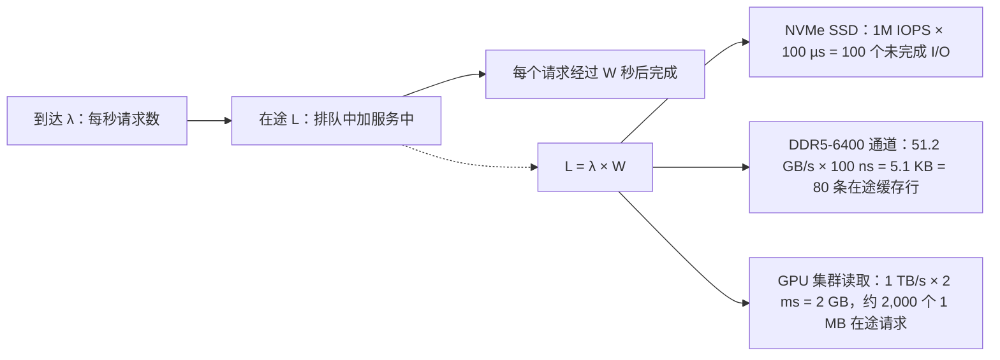
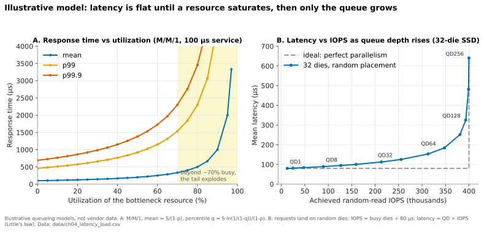
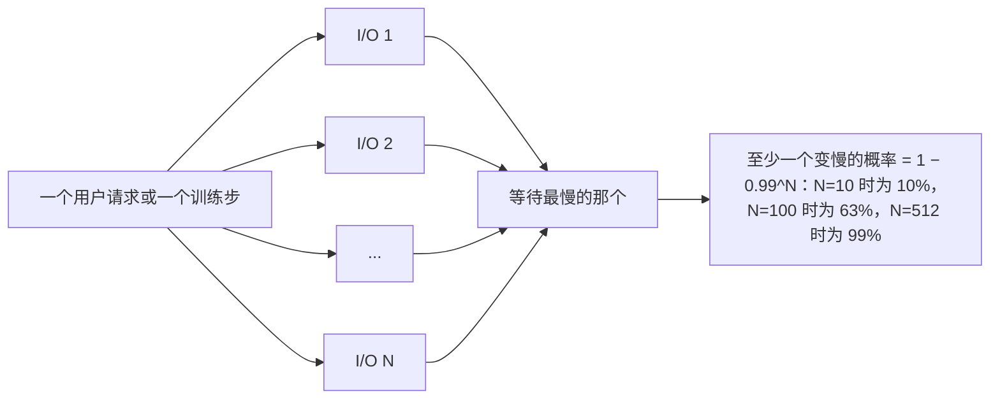
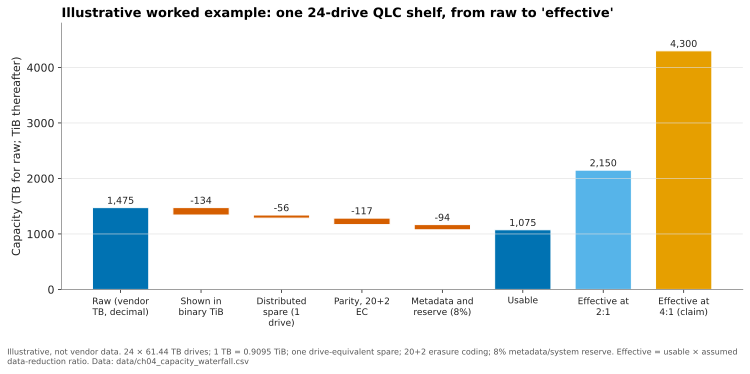

# 4. 性能与经济性指标

> 📄 英文原文：[docs/01-storage-fundamentals/04-performance-and-economics-metrics.md](../../../docs/01-storage-fundamentals/04-performance-and-economics-metrics.md) · 本文为简体中文参考译本，如有出入以英文原文为准。

> **深度：** L2 · **阅读时间：** 约 12 分钟 · **最后核实：** 2026-11-01
> **前置阅读：** [面向半导体从业者的介质物理](02-media-physics.md) · [固态硬盘（SSD）内部](03-inside-an-ssd.md)

## 要点速览（TL;DR）

- **IOPS、吞吐量和延迟是一个方程，而不是三项规格。** 吞吐量 = IOPS × I/O 大小，而利特尔法则（Little's law）通过在途请求数把 IOPS 与延迟联系起来。数据手册上的数字若不注明 I/O 大小、读写比例和队列深度，就毫无意义。
- **延迟在某个环节饱和之前保持平坦，之后呈曲棍球棒式陡升。** 瓶颈资源利用率超过约 70% 后，排队效应占主导，p99/p99.9 在平均值看起来还不错时就早已失控。
- **决定应用速度的是尾部，而非均值。** 数据库会串联多个 I/O，GPU 集群要同步成千上万个工作进程，因此最慢的请求说了算。
- **容量有三种价格：原始、可用和有效。** 数据保护和预留会从原始容量中扣掉 20–30%；数据缩减则把可用容量乘以一个*假设的*比率，因此 2:1 与 4:1 之间会让有效 $/TB 相差一倍（[第 5 章](05-data-reduction.md)）。
- **按 2026 年的 NAND 价格计算，冷容量的 TCO 有利于磁盘；闪存胜在性能、密度和功耗。** 在算例中，对 10 PB 冷数据而言，全闪存五年成本约为混合磁盘方案的 3.2 倍（计入磁盘自身在 2026 年的涨价后约为 2.7 倍），只有在 NAND 便宜*且*数据缩减达到约 4:1 时才能打平。电力与空间成本占 TCO 不到 10%。

## 对 Everpure 战略的意义

存储领域的每一个竞争性主张，本质上都是对指标的选择。Everpure 长期以来"闪存可以取代磁盘"的论点，建立在有效容量（数据缩减）、密度（每机架单元 TB 数）和能效（每瓦 TB 数）之上。AI 原生的竞争对手主打每机架 GB/s，磁盘厂商主打 $/TB。每种框架在其自身口径下都成立，换到别人的口径下则会产生误导。能够在这些框架之间互相换算，你就能判断哪些交易可以赢下，哪些"TCO 优势"幻灯片经不起客户电子表格的检验。

2026 年的 NAND 短缺让这件事变得紧迫。TrendForce 预计 4Q26 企业级 SSD 合约价将再环比上涨 23–28%[^1]。某厂商的指数显示，2026 年 Q1，30 TB QLC SSD 的 $/TB 是 30 TB 近线磁盘的 22.6 倍，而 2025 年 Q2 为 4.9 倍[^2]，2020 年约为 10 倍[^3]。当介质价差扩大到如此程度时，闪存的其他论据（每 TB 性能、功耗、密度和数据缩减）就必须承担更多说服力，而清楚每项论据的价值，正是可信度所在。

## 核心概念

### IOPS、吞吐量与延迟：一个方程

描述性能的三个数字：

- **IOPS**：每秒完成的 I/O 操作数，通常针对小块（4 KiB）随机读给出。
- **吞吐量**（带宽）：每秒字节数，通常针对大块（128 KiB–1 MiB）顺序传输给出。
- **延迟**：从发出一个请求到其完成所需的时间，闪存以微秒（µs）计，磁盘以毫秒计。

它们由两个恒等式联系起来。**吞吐量 = IOPS × I/O 大小**。**利特尔法则**由 John Little 于 1961 年证明[^4]：系统中平均在途请求数（L）等于到达率（λ）乘以每个请求在系统中的平均停留时间（W）。放到存储上就是 **未完成 I/O 数 = IOPS × 延迟**。

*图 4.1 — 利特尔法则：要从任何受延迟约束的器件（从 DRAM 通道到存储集群）中榨出带宽，都必须保持足够多的在途请求来覆盖延迟。*

由此得出两个推论。第一，**器件的峰值 IOPS 只有在并发足够时才能达到**。一个数据库线程若每次读取都要等结果返回才发出下一次读取，就是以队列深度 1 运行。按每次读取 100 µs 计算，它从一块额定百万 IOPS 的 SSD 上只能得到 1 ÷ 100 µs = 10,000 IOPS。第二，**IOPS 与吞吐量是两种不同的上限**。Micron 的 PCIe 6.0 9650 额定随机读 550 万 IOPS、顺序读 28 GB/s[^5]。按 4 KiB 计算，5.5M IOPS 只有 22.5 GB/s，因此小块负载会先碰到控制器的命令处理上限，而不是链路上限。一块 30 TB HAMR 磁盘的额定随机读约为 170 IOPS[^6]，按 4 KiB 计算仅 0.7 MB/s，而其顺序读写可达数百 MB/s，原因是每次随机 I/O 都要付出寻道和旋转等待的代价。由于单盘随机 IOPS 二十年来几乎没变，而容量增长了十倍，现代磁盘的 **每 TB IOPS** 不足 6。正是这个指标让磁盘退出了主存储：受性能约束的负载不得不购买容量上并不需要的盘位（spindle）。

**半导体类比：内存中的带宽与延迟。** 同样的法则支配着 DRAM。一条 DDR5-6400 通道传输 6.4 GT/s × 8 字节 = 51.2 GB/s。在约 100 ns 的负载延迟下，控制器必须保持约 5.1 KB（即 80 条 64 字节缓存行）在途才能填满它。这就是内存控制器配备深请求队列和 bank 级并行的原因，也是单个 CPU 内核（只能维持几十个未完成的缓存未命中）无法吃满一个插槽内存带宽的原因。HBM 把每个堆栈的带宽提高了一个数量级，而 DRAM 内核延迟基本持平，因此 GPU 靠数万个在途线程来隐藏延迟。存储重复着同样的模式：每一代 PCIe 都把链路带宽翻倍，但 NAND 读取时间并未改善，QLC 甚至更差（[第 2 章](02-media-physics.md)）。带宽随并行度扩展；延迟由物理决定。

### 为什么负载下延迟会曲棍球棒式陡升

任何共享资源，例如一颗 NAND die、一颗控制器 CPU、一个网络端口或一条磁盘磁臂，行为上都像一个队列。教科书中的单服务台模型（M/M/1）给出：平均响应时间 = 服务时间 ÷ (1 − 利用率)。忙碌度 50% 时，一个 100 µs 的操作平均耗时 200 µs；90% 时为 1 ms；95% 时为 2 ms。百分位数更糟。在同一模型中，无论*何种*负载，p99 约为均值的 4.6 倍，p99.9 约为 6.9 倍，因此 90% 忙碌度下 1 ms 的均值对应 4.6 ms 的 p99。

*图 4.2 — 示意模型：饱和之前，增加队列深度换来更多 IOPS；饱和之后，增加队列深度只换来更高延迟，且尾部最先上升。*
数据：`data/ch04_latency_load.csv`

面板 B 从器件一侧展示了这个拐点。SSD 的并行度来自其 NAND die（[第 3 章](03-inside-an-ssd.md)）。有 32 颗 die、每次读取 80 µs 时，完美并行可在队列深度 32 下提供 40 万（400K）IOPS。但请求随机落到各 die 上会发生冲突，因此在 QD32 下只有约 20 颗 die 处于忙碌状态：255K IOPS、延迟 125 µs。推到 QD256 可以榨出最后 145K IOPS，但延迟升高五倍。厂商引用的是曲线的右端，而对延迟敏感的客户生活在左端。垃圾回收会让读取阻塞在擦除和编程之后，进一步拉长尾部，因此满盘稳态下的数字才是关键。

**运行法则：** 系统容量规划应使瓶颈在峰值时处于 50–70% 的忙碌度。

### 尾延迟：为什么 p99 与 p99.9 决定业务

Dean 与 Barroso 的"The Tail at Scale"表明，当一个请求扇出到许多服务器时，罕见的慢请求会变得常见[^7]。若 100 个并行子请求中每个都有 1% 的概率变慢，那么至少有一个变慢的概率为 1 − 0.99¹⁰⁰ ≈ 63%。

*图 4.3 — 当工作要等待 N 个并行 I/O 中最慢的那个时，器件的 p99 就变成了系统的中位数。*

- **数据库。** 一次 OLTP 提交要等待日志写入，一个查询计划可能串联十次相互依赖的读取。十次读取时，有 1 − 0.99¹⁰ ≈ 10% 的查询至少要承受一次 p99 惩罚。锁被持有得更久，其他请求排在后面，曲棍球棒效应随之主导。因此数据库阵列以负载下的 p99 来评判（[第 14 章](../03-system-architecture/14-scale-up-dual-controller.md)）。
- **GPU 集群。** 同步训练要等待每一个 rank。若一个训练步需要为 512 块 GPU 取数，而每次取数有 1% 的概率遇到慢读，那么除非预取缓冲吸收掉它，99% 的训练步都会包含至少一个掉队者。检查点更糟：当 1,024 个 rank 各自写入分片时，训练要等*最后一个*分片落盘才能恢复，因此 1 − 0.999¹⁰²⁴ ≈ 64% 的检查点要等待一次 p99.9 写入。每停顿一秒，整个集群就空转一秒，这是[第 11 章](../02-protocols-and-networking/11-gpu-data-path.md)与[第 31 章](../05-ai-storage/31-training-storage.md)的经济学核心。

因此问题从来不是"你们的延迟是多少？"，而是"在满载系统上、额定负载的 70% 下、正在重建时，你们的 p99.9 是多少？"

### 原始容量、可用容量与有效容量

容量按三个层级报价，而大多数商业纠纷都始于层级之间的缺口。

*图 4.4 — 示意：数据保护与预留从原始容量中扣掉约 20%；随后，数据缩减假设决定了"有效容量"是原始数字的 1.5 倍还是 3 倍。*
数据：`data/ch04_capacity_waterfall.csv`

- **原始容量**是各盘容量之和，以十进制太字节（10¹² 字节）计。操作系统以二进制 tebibyte（2⁴⁰ 字节）报告，因此同样的容量读数会小 9%。瀑布图把它画成一个步骤，但这只是单位换算：没有任何字节丢失。
- **可用容量**是扣除校验、重建备用、元数据和系统预留之后剩下的部分。宽条带纠删码（[第 6 章](06-data-protection-and-resilience.md)）可把可用容量推高到原始容量的 85–90%；条带窄的小系统可能只有 60–70%。许多系统在使用率低于约 80% 时运行最佳。
- **有效容量**是可用容量 × 一个假设的数据缩减比（DRR，来自去重和压缩），有时还会再叠加精简配置和快照。Pure Storage 长期宣传 5:1 的全设备群平均缩减比[^8]，计入精简配置后的"总效率"则为 10:1[^9]，后者是一个软得多的数字。

DRR 是*客户数据*的属性，而非阵列的属性。数据库和虚拟机镜像通常缩减效果好；已压缩的媒体、加密数据以及大多数 AI 训练语料的缩减比接近 1:1。据发布时的媒体报道，Pure Storage 对 FlashArray//E 最大有效容量按 2:1 标注，而对 //C90 按 5:1 标注[^10]。VAST 称其基于相似性的缩减中位数约为 2:1（*公司自述*）[^11]。如何对 DRR 主张做合理性检验，见[第 5 章](05-data-reduction.md)。

**算例（原始 $/TB 与有效 $/TB）。** 一套闪存系统每原始 TB $450，可用率 80%，则每可用 TB 成本为 $563。按 4:1 计算，每有效 TB 为 $141，看起来能与磁盘竞争。若数据实际只缩减 1.5:1，同一系统每有效 TB 成本为 $375，是报价的 2.7 倍。变的只有假设。

### 密度与能效：TB/W 与 TB/RU

有两项物理指标的重要性逐年上升，因为如今稀缺的投入是电力，而不是机房面积。Gartner 预测 2026 年数据中心用电量将增长 26%[^12]。

- **TB/W**（或其倒数 W/TB）：每瓦容量。在单盘层面，闪存已经超过磁盘。Micron 将其 245 TB QLC SSD 标定为约 8.2 TB/W，而 44 TB HDD 约为 4.4 TB/W（*厂商对比*）[^13]。在系统层面，Pure Storage 的 FlashBlade//E 于 2023 年推出时约为 1 W/TB[^14]。注意口径：原始还是有效、运行还是空闲、单盘还是整机。
- **TB/RU**（每机架单元容量）及其 AI 版本 **每 RU GB/s**：每个机架空间槽位的密度，主要由单盘容量驱动。

这两项指标都偏向大容量盘和高 DRR，且忽略性能：一套系统可能在 TB/W 上表现出色，对于每 PB 需要 10 GB/s 的负载却毫无用处。

### 厂商如何挑选对自己有利的指标

| 标题指标 | 谁倚重它 | 它美化了什么 | 它掩盖了什么 | 应改问 |
|---|---|---|---|---|
| 峰值 IOPS（4 KiB 随机读，深队列） | SSD 和块存储阵列数据手册，例如单块 SSD 的 5.5M IOPS[^5] | 并行度 | 该负载下的延迟、写入、混合 I/O、满盘稳态 | 在注明的 p99 延迟、70/30 读写比、满载系统下的 IOPS |
| 每机架单元 GB/s | 面向 AI 的并行文件系统，例如 Dell 宣称每 RU 最高 150 GB/s[^15] | 前端带宽密度 | 每 RU 容量、未计入的交换机、写入速率 | 在注明容量下，含网络在内的每机架及每 kW GB/s |
| 每机架有效 PB | AI 与企业级厂商，例如 WEKApod 3 每机架 1.1 EB 有效容量（*公司自述*）[^16] | DRR 假设 | 可用容量；数据究竟能否缩减 | 每机架可用 PB，以及在客户数据上实测的 DRR |
| "功耗比磁盘最多低 75%" | 闪存厂商，包括 Pure Storage 的 DirectFlash 宣传[^17] | 磁盘基线和缩减比的选择 | HDD 基线的年代；空闲与运行功耗之别 | 在客户占空比下每可用 TB 的瓦数 |
| 原始 $/TB | 磁盘厂商和云归档层 | 介质成本 | 每 TB IOPS、重建时间、每 IOPS 功耗 | 满足所需 IOPS 和 GB/s 时的 $/TB |

*表 4.1 — 每个标题指标都只在运行包络的某一角成立；反问能把它挪到客户所在的那一角。*
