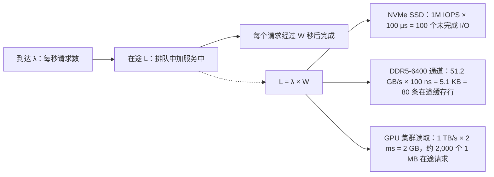
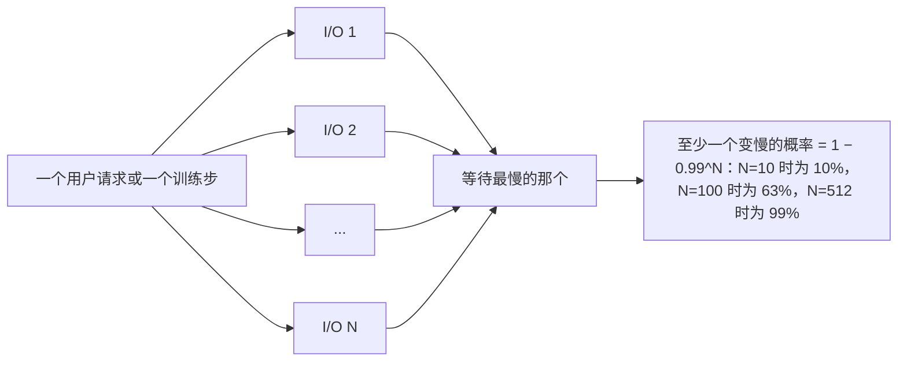
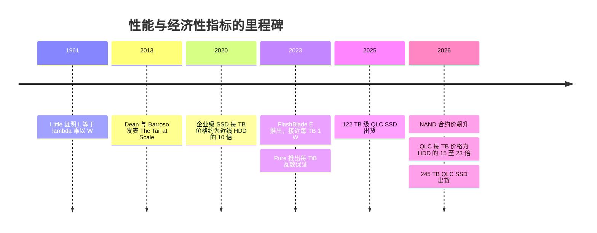

# 4. 性能与经济性指标

> 📄 英文原文：[docs/01-storage-fundamentals/04-performance-and-economics-metrics.md](../../../docs/01-storage-fundamentals/04-performance-and-economics-metrics.md) · 本文为简体中文参考译本，如有出入以英文原文为准。

> **深度：** L2 · **阅读时间：** 约 12 分钟 · **最后核实：** 2026-11-01
> **前置阅读：** [面向半导体从业者的介质物理](02-media-physics.md) · [固态硬盘（SSD）内部](03-inside-an-ssd.md)

## 要点速览（TL;DR）

- **IOPS、吞吐量和延迟是一个方程，而不是三项规格。** 吞吐量 = IOPS × I/O 大小，而利特尔法则（Little's law）通过在途请求数把 IOPS 与延迟联系起来。数据手册上的数字若不注明 I/O 大小、读写比例和队列深度，就毫无意义。
- **延迟在某个环节饱和之前保持平坦，之后呈曲棍球棒式陡升。** 瓶颈资源利用率超过约 70% 后，排队效应占主导，p99/p99.9 在平均值看起来还不错时就早已失控。
- **决定应用速度的是尾部，而非均值。** 数据库会串联多个 I/O，GPU 集群要同步成千上万个工作进程，因此最慢的请求说了算。
- **容量有三种价格：原始、可用和有效。** 数据保护和预留会从原始容量中扣掉 20–30%；数据缩减则把可用容量乘以一个*假设的*比率，因此 2:1 与 4:1 之间会让有效 $/TB 相差一倍（[第 5 章](05-data-reduction.md)）。
- **按 2026 年的 NAND 价格计算，冷容量的 TCO 有利于磁盘；闪存胜在性能、密度和功耗。** 在算例中，对 10 PB 冷数据而言，全闪存五年成本约为混合磁盘方案的 3.2 倍（计入磁盘自身在 2026 年的涨价后约为 2.7 倍），只有在 NAND 便宜*且*数据缩减达到约 4:1 时才能打平。电力与空间成本占 TCO 不到 10%。

## 对 Everpure 战略的意义

存储领域的每一个竞争性主张，本质上都是对指标的选择。Everpure 长期以来"闪存可以取代磁盘"的论点，建立在有效容量（数据缩减）、密度（每机架单元 TB 数）和能效（每瓦 TB 数）之上。AI 原生的竞争对手主打每机架 GB/s，磁盘厂商主打 $/TB。每种框架在其自身口径下都成立，换到别人的口径下则会产生误导。能够在这些框架之间互相换算，你就能判断哪些交易可以赢下，哪些"TCO 优势"幻灯片经不起客户电子表格的检验。

2026 年的 NAND 短缺让这件事变得紧迫。TrendForce 预计 4Q26 企业级 SSD 合约价将再环比上涨 23–28%[^1]。某厂商的指数显示，2026 年 Q1，30 TB QLC SSD 的 $/TB 是 30 TB 近线磁盘的 22.6 倍，而 2025 年 Q2 为 4.9 倍[^2]，2020 年约为 10 倍[^3]。当介质价差扩大到如此程度时，闪存的其他论据（每 TB 性能、功耗、密度和数据缩减）就必须承担更多说服力，而清楚每项论据的价值，正是可信度所在。

## 核心概念

### IOPS、吞吐量与延迟：一个方程

描述性能的三个数字：

- **IOPS**：每秒完成的 I/O 操作数，通常针对小块（4 KiB）随机读给出。
- **吞吐量**（带宽）：每秒字节数，通常针对大块（128 KiB–1 MiB）顺序传输给出。
- **延迟**：从发出一个请求到其完成所需的时间，闪存以微秒（µs）计，磁盘以毫秒计。

它们由两个恒等式联系起来。**吞吐量 = IOPS × I/O 大小**。**利特尔法则**由 John Little 于 1961 年证明[^4]：系统中平均在途请求数（L）等于到达率（λ）乘以每个请求在系统中的平均停留时间（W）。放到存储上就是 **未完成 I/O 数 = IOPS × 延迟**。

*图 4.1 — 利特尔法则：要从任何受延迟约束的器件（从 DRAM 通道到存储集群）中榨出带宽，都必须保持足够多的在途请求来覆盖延迟。*

由此得出两个推论。第一，**器件的峰值 IOPS 只有在并发足够时才能达到**。一个数据库线程若每次读取都要等结果返回才发出下一次读取，就是以队列深度 1 运行。按每次读取 100 µs 计算，它从一块额定百万 IOPS 的 SSD 上只能得到 1 ÷ 100 µs = 10,000 IOPS。第二，**IOPS 与吞吐量是两种不同的上限**。Micron 的 PCIe 6.0 9650 额定随机读 550 万 IOPS、顺序读 28 GB/s[^5]。按 4 KiB 计算，5.5M IOPS 只有 22.5 GB/s，因此小块负载会先碰到控制器的命令处理上限，而不是链路上限。一块 30 TB HAMR 磁盘的额定随机读约为 170 IOPS[^6]，按 4 KiB 计算仅 0.7 MB/s，而其顺序读写可达数百 MB/s，原因是每次随机 I/O 都要付出寻道和旋转等待的代价。由于单盘随机 IOPS 二十年来几乎没变，而容量增长了十倍，现代磁盘的 **每 TB IOPS** 不足 6。正是这个指标让磁盘退出了主存储：受性能约束的负载不得不购买容量上并不需要的盘位（spindle）。

**半导体类比：内存中的带宽与延迟。** 同样的法则支配着 DRAM。一条 DDR5-6400 通道传输 6.4 GT/s × 8 字节 = 51.2 GB/s。在约 100 ns 的负载延迟下，控制器必须保持约 5.1 KB（即 80 条 64 字节缓存行）在途才能填满它。这就是内存控制器配备深请求队列和 bank 级并行的原因，也是单个 CPU 内核（只能维持几十个未完成的缓存未命中）无法吃满一个插槽内存带宽的原因。HBM 把每个堆栈的带宽提高了一个数量级，而 DRAM 内核延迟基本持平，因此 GPU 靠数万个在途线程来隐藏延迟。存储重复着同样的模式：每一代 PCIe 都把链路带宽翻倍，但 NAND 读取时间并未改善，QLC 甚至更差（[第 2 章](02-media-physics.md)）。带宽随并行度扩展；延迟由物理决定。

### 为什么负载下延迟会曲棍球棒式陡升

任何共享资源，例如一颗 NAND die、一颗控制器 CPU、一个网络端口或一条磁盘磁臂，行为上都像一个队列。教科书中的单服务台模型（M/M/1）给出：平均响应时间 = 服务时间 ÷ (1 − 利用率)。忙碌度 50% 时，一个 100 µs 的操作平均耗时 200 µs；90% 时为 1 ms；95% 时为 2 ms。百分位数更糟。在同一模型中，无论*何种*负载，p99 约为均值的 4.6 倍，p99.9 约为 6.9 倍，因此 90% 忙碌度下 1 ms 的均值对应 4.6 ms 的 p99。

*图 4.2 — 示意模型：饱和之前，增加队列深度换来更多 IOPS；饱和之后，增加队列深度只换来更高延迟，且尾部最先上升。*
数据：`data/ch04_latency_load.csv`

面板 B 从器件一侧展示了这个拐点。SSD 的并行度来自其 NAND die（[第 3 章](03-inside-an-ssd.md)）。有 32 颗 die、每次读取 80 µs 时，完美并行可在队列深度 32 下提供 40 万（400K）IOPS。但请求随机落到各 die 上会发生冲突，因此在 QD32 下只有约 20 颗 die 处于忙碌状态：255K IOPS、延迟 125 µs。推到 QD256 可以榨出最后 145K IOPS，但延迟升高五倍。厂商引用的是曲线的右端，而对延迟敏感的客户生活在左端。垃圾回收会让读取阻塞在擦除和编程之后，进一步拉长尾部，因此满盘稳态下的数字才是关键。

**运行法则：** 系统容量规划应使瓶颈在峰值时处于 50–70% 的忙碌度。

### 尾延迟：为什么 p99 与 p99.9 决定业务

Dean 与 Barroso 的"The Tail at Scale"表明，当一个请求扇出到许多服务器时，罕见的慢请求会变得常见[^7]。若 100 个并行子请求中每个都有 1% 的概率变慢，那么至少有一个变慢的概率为 1 − 0.99¹⁰⁰ ≈ 63%。

*图 4.3 — 当工作要等待 N 个并行 I/O 中最慢的那个时，器件的 p99 就变成了系统的中位数。*

- **数据库。** 一次 OLTP 提交要等待日志写入，一个查询计划可能串联十次相互依赖的读取。十次读取时，有 1 − 0.99¹⁰ ≈ 10% 的查询至少要承受一次 p99 惩罚。锁被持有得更久，其他请求排在后面，曲棍球棒效应随之主导。因此数据库阵列以负载下的 p99 来评判（[第 14 章](../03-system-architecture/14-scale-up-dual-controller.md)）。
- **GPU 集群。** 同步训练要等待每一个 rank。若一个训练步需要为 512 块 GPU 取数，而每次取数有 1% 的概率遇到慢读，那么除非预取缓冲吸收掉它，99% 的训练步都会包含至少一个掉队者。检查点更糟：当 1,024 个 rank 各自写入分片时，训练要等*最后一个*分片落盘才能恢复，因此 1 − 0.999¹⁰²⁴ ≈ 64% 的检查点要等待一次 p99.9 写入。每停顿一秒，整个集群就空转一秒，这是[第 11 章](../02-protocols-and-networking/11-gpu-data-path.md)与[第 31 章](../05-ai-storage/31-training-storage.md)的经济学核心。

因此问题从来不是"你们的延迟是多少？"，而是"在满载系统上、额定负载的 70% 下、正在重建时，你们的 p99.9 是多少？"

### 原始容量、可用容量与有效容量

容量按三个层级报价，而大多数商业纠纷都始于层级之间的缺口。

*图 4.4 — 示意：数据保护与预留从原始容量中扣掉约 20%；随后，数据缩减假设决定了"有效容量"是原始数字的 1.5 倍还是 3 倍。*
数据：`data/ch04_capacity_waterfall.csv`

- **原始容量**是各盘容量之和，以十进制太字节（10¹² 字节）计。操作系统以二进制 tebibyte（2⁴⁰ 字节）报告，因此同样的容量读数会小 9%。瀑布图把它画成一个步骤，但这只是单位换算：没有任何字节丢失。
- **可用容量**是扣除校验、重建备用、元数据和系统预留之后剩下的部分。宽条带纠删码（[第 6 章](06-data-protection-and-resilience.md)）可把可用容量推高到原始容量的 85–90%；条带窄的小系统可能只有 60–70%。许多系统在使用率低于约 80% 时运行最佳。
- **有效容量**是可用容量 × 一个假设的数据缩减比（DRR，来自去重和压缩），有时还会再叠加精简配置和快照。Pure Storage 长期宣传 5:1 的全设备群平均缩减比[^8]，计入精简配置后的"总效率"则为 10:1[^9]，后者是一个软得多的数字。

DRR 是*客户数据*的属性，而非阵列的属性。数据库和虚拟机镜像通常缩减效果好；已压缩的媒体、加密数据以及大多数 AI 训练语料的缩减比接近 1:1。据发布时的媒体报道，Pure Storage 对 FlashArray//E 最大有效容量按 2:1 标注，而对 //C90 按 5:1 标注[^10]。VAST 称其基于相似性的缩减中位数约为 2:1（*公司自述*）[^11]。如何对 DRR 主张做合理性检验，见[第 5 章](05-data-reduction.md)。

**算例（原始 $/TB 与有效 $/TB）。** 一套闪存系统每原始 TB $450，可用率 80%，则每可用 TB 成本为 $563。按 4:1 计算，每有效 TB 为 $141，看起来能与磁盘竞争。若数据实际只缩减 1.5:1，同一系统每有效 TB 成本为 $375，是报价的 2.7 倍。变的只有假设。

### 密度与能效：TB/W 与 TB/RU

有两项物理指标的重要性逐年上升，因为如今稀缺的投入是电力，而不是机房面积。Gartner 预测 2026 年数据中心用电量将增长 26%[^12]。

- **TB/W**（或其倒数 W/TB）：每瓦容量。在单盘层面，闪存已经超过磁盘。Micron 将其 245 TB QLC SSD 标定为约 8.2 TB/W，而 44 TB HDD 约为 4.4 TB/W（*厂商对比*）[^13]。在系统层面，Pure Storage 的 FlashBlade//E 于 2023 年推出时约为 1 W/TB[^14]。注意口径：原始还是有效、运行还是空闲、单盘还是整机。
- **TB/RU**（每机架单元容量）及其 AI 版本 **每 RU GB/s**：每个机架空间槽位的密度，主要由单盘容量驱动。

这两项指标都偏向大容量盘和高 DRR，且忽略性能：一套系统可能在 TB/W 上表现出色，对于每 PB 需要 10 GB/s 的负载却毫无用处。

### 厂商如何挑选对自己有利的指标

| 标题指标 | 谁倚重它 | 它美化了什么 | 它掩盖了什么 | 应改问 |
|---|---|---|---|---|
| 峰值 IOPS（4 KiB 随机读，深队列） | SSD 和块存储阵列数据手册，例如单块 SSD 的 5.5M IOPS[^5] | 并行度 | 该负载下的延迟、写入、混合 I/O、满盘稳态 | 在注明的 p99 延迟、70/30 读写比、满载系统下的 IOPS |
| 每机架单元 GB/s | 面向 AI 的并行文件系统，例如 Dell 宣称每 RU 最高 150 GB/s[^15] | 前端带宽密度 | 每 RU 容量、未计入的交换机、写入速率 | 在注明容量下，含网络在内的每机架及每 kW GB/s |
| 每机架有效 PB | AI 与企业级厂商，例如 WEKApod 3 每机架 1.1 EB 有效容量（*公司自述*）[^16] | DRR 假设 | 可用容量；数据究竟能否缩减 | 每机架可用 PB，以及在客户数据上实测的 DRR |
| "功耗比磁盘最多低 75%" | 闪存厂商，包括 Pure Storage 的 DirectFlash 宣传[^17] | 磁盘基线和缩减比的选择 | HDD 基线的年代；空闲与运行功耗之别 | 在客户占空比下每可用 TB 的瓦数 |
| 原始 $/TB | 磁盘厂商和云归档层 | 介质成本 | 每 TB IOPS、重建时间、每 IOPS 功耗 | 满足所需 IOPS 和 GB/s 时的 $/TB |

*表 4.1 — 每个标题指标都只在运行包络的某一角成立；反问能把它挪到客户所在的那一角。*

### 算例：五年 TCO，全闪存 QLC 对比混合磁盘

**需求：** 为冷到温的非结构化数据（数据湖或 AI 数据集归档）提供 10 PB 有效容量，在美国一处托管机房中五年内保持不变。**示意**：平台成本、功率密度和缩减比均为本图谱的假设；市场输入数据均注明来源。

| 项目 | 全闪存 QLC | 混合磁盘（30 TB HDD + 3% 闪存层） | 依据 / 假设 |
|---|---|---|---|
| 数据缩减比 | 2:1 | 1.3:1（仅压缩） | 闪存取厂商自己对非结构化数据采用的 2:1[^10][^11]；磁盘系统很少做在线去重，因为会使读取碎片化 |
| 可用 ÷ 原始 | 80% | 75%（8+2 EC，含备用） | 假设 |
| 原始容量 | 6,250 TB | 10,256 TB HDD（342 块盘）+ 288 TB 闪存 | 10,000 ÷ DRR ÷ 可用率 |
| 介质价格 | $302/TB | HDD $22/TB；闪存层 $302/TB | 122.88 TB QLC SSD 售价 $37,128[^18]；30 TB 近线 HDD ≈ $668（Q1 2026）[^19] |
| 平台（控制器、机框、软件、网络） | 每原始 TB $150 | 每原始 HDD TB $40；闪存层每原始 TB $150 | 假设 |
| **购置成本** | **$2.83M** | **$0.77M** | 介质 + 平台 |
| 系统功耗（IT 负载） | 0.40 W/TB → 2.5 kW | 0.55 W/TB → 5.8 kW | 假设，并与 2023 年代闪存约 1 W/TB[^14] 以及每块 30 TB HDD 9.5 W（未计机框开销）[^6] 交叉核对 |
| 电费，5 年 | $23K | $54K | kW × PUE 1.54[^20] × 43,800 h × $0.1385/kWh[^21] |
| 空间与电力容量，5 年 | $29K | $68K | kW × 托管费每 kW 每月 $196.25[^22] × 60 |
| 机架单元（约数） | 约 13 RU | 约 17 RU | 闪存 0.5 PB/RU；4U 106 盘位 JBOD 加服务器为 0.64 PB/RU |
| 支持服务，第 2–5 年 | $1.13M | $0.31M | 每年为购置成本的 10% |
| 控制器/服务器更新（约第 4 年） | $0.28M | $0.14M | 平台成本的 30%；订阅模式下打包在费用中（[第 23 章](../03-system-architecture/23-consumption-models.md)） |
| **五年 TCO** | **$4.29M**（每有效 TB $429） | **$1.33M**（每有效 TB $133） | 闪存 ≈ 3.2 倍 |
| 随机读能力 | 数百万 IOPS（受控制器限制） | 约 58K IOPS（342 × 170） | 磁盘无法满足任何随机 I/O 需求 |

*表 4.2 — 示意：按 2026 年 NAND 价格，磁盘在冷容量 TCO 上约以 3 倍胜出；电力与空间在两种方案总额中均不到 10%。*

注意这些输入意味着什么：每 TB $302 对 $22 是 13.7 倍的介质溢价，远低于 22.6 倍的指数标题数字，因为 122 TB 盘每 TB 的市场价低于该指数所用的 30 TB QLC 盘（2026 年 Q1 约 $504/TB[^2]）。因此基准情形对闪存是宽厚的。磁盘价格也在变动：同一指数中的 30 TB HDD 到 2026 年 Q3 已涨至 $1,216（约 $40/TB）[^23]。按此磁盘价格、其他条件不变，闪存成本约为磁盘的 2.7 倍，而非 3.2 倍。有三项敏感性会改变结论。按 2025 年年中的介质价格（30 TB QLC 约 $80/TB，HDD $16.50/TB[^19]），闪存降至磁盘的约 2.0 倍。按 2026 年价格但闪存侧缩减比为 4:1 时，约为 1.6 倍。在 NAND 便宜*且*缩减 4:1 的*双重*条件下，两种方案打平（约 $1.17M 对 $1.16M）。仅靠电力无法弥合差距：即便把每腾出 1 kW 估值为每年 $15,000 的 GPU 产出（一个假设），节省的 3.3 kW 在五年内也只值约 $250K。闪存要拿下容量层，需要以下条件的某种组合：(a) 磁盘不超额采购盘位就无法满足的性能需求；(b) 可缩减的数据；(c) 电力或空间受限的站点；(d) 低于市场价的 NAND 成本——后者正是超大规模云厂商 DirectFlash 的投资逻辑（[第 29 章](../04-everpure/29-hyperscaler-ecosystem-financials.md)）。

## Everpure 的做法与竞争对手对比

| 厂商 | 主打指标（公开信息） | 为何适合其架构 | 最强版本论证 / 注意事项 |
|---|---|---|---|
| Everpure | 有效容量（全设备群平均 DRR）、大容量 DirectFlash 模块带来的 TB/W 与 TB/RU；合同约定的 watts/TiB | 掌控闪存转换层，因此能推出更大的模块（[第 26 章](../04-everpure/26-purity-and-directflash.md)）；始终开启的在线缩减 | 把指标变成保证。有效数字仍取决于 DRR：FlashArray 的有效容量假设平均 5:1，因此 FlashArray//XL R5 约 1.9 PB 的原始容量变成 7.4 PB 有效容量，在扣除 RAID、元数据和 TiB 换算后约为原始容量的 3.8 倍[^24][^25] |
| VAST Data | 规模化下的有效 $/TB；QLC 加相似性缩减与宽条带纠删码 | 在共享资源池上做全局缩减（[第 16 章](../03-system-architecture/16-disaggregated-shared-everything.md)） | 其自己引用的中位数约为 2:1[^11]，这是诚实的；节省需要规模 |
| WEKA | 每机架 IOPS、TB/s 与有效容量 | 运行在高密度服务器上的软件，为小文件和元数据密集型 AI 工作负载而构建 | 每机架有效容量数字带有 DRR 假设[^16] |
| Dell、DDN | 每 RU 或每台设备 GB/s（DDN AI400X3M：读取最高 190 GB/s[^26]） | 为 GPU 供数的并行文件系统 | 带宽密度无法说明 $/TB 或混合负载下的尾延迟 |
| Seagate、Western Digital | $/TB 与单盘 TB 数 | 磁盘的介质成本优势，目前在单盘层面约为 15–23 倍[^2] | 每 TB IOPS 随每一次容量提升而持续下降 |

*表 4.3 — 每家厂商的标题指标，正是其架构为之而生、最能取胜的那一项。*

Everpure 的独特之处在于合同化。其存储即服务（STaaS）产品 Evergreen//One 于 2023 年 1 月新增了每 TiB 最大瓦数保证，并以服务抵扣和整改措施作为担保[^27]。公布的数字在多数层级上假设 2:1 缩减，容量层则不假设缩减[^28]。其订阅按有效已用容量计费：客户无论是否用到，都要为预留承诺付费，超出部分按需计费。此外，Everpure 承诺在两者中较高者之上额外部署 25% 的容量缓冲（最多 1 PiB）[^29]。按每有效 TiB 定价把 DRR 风险转移给了厂商：如果数据缩减效果较差，Everpure 就得以同样的费用交付更多硬件，因此设备群缩减遥测数据成为毛利的一项输入。按每可用 TB 定价的最强版本论证是透明度。基于公开信息，战略团队可能评估的选项包括：当 NAND 成本一个季度内波动 50% 时，这类保证如何守住毛利；以及数据缩减效果差的 AI 买家是否会看重这类保证。

## 历史与发展轨迹

*图 4.5 — 这些指标由来已久；变化在于，电力恰好在 NAND 再度变贵之时成为硬约束。*

存储营销的重心从 IOPS（磁盘时代）转向延迟和有效容量（2010 年代的全闪存），再转向每机架 GB/s 和 TB/W（AI 时代）。如今两股力量方向相反。Micron 的 245 TB QLC SSD 于 2026 年 5 月开始出货[^13]，据报道 DirectFlash 模块容量最高达 300 TB[^30] [VERIFY: 300 TB DFM 是否已正式供货]。这使 TB/W 和 TB/RU 逐年改善；与此同时，受 AI 服务器需求推动，NAND 合约价在 2026 年每个季度都在上涨[^1]，重新拉开了闪存厂商原以为会持续收窄的 $/TB 差距。可以预期，TCO 论证将更多倚重功耗、密度和保证条款，买家也会要求看可用容量而非有效容量数字。[第 37 章](../05-ai-storage/37-reading-benchmarks.md)（基准测试）与[第 38 章](../05-ai-storage/38-power-and-density.md)（功耗）都以本章为基础。

## 关键数字

| 指标 | 数值 | 背景 | 来源 / 日期 |
|---|---|---|---|
| 扇出尾部效应 | N=100、各 1% 时 63% 的请求变慢 | 1 − 0.99¹⁰⁰ | Dean & Barroso，2013[^7] |
| M/M/1 p99 ÷ 均值 | ≈ 4.6 倍 | ln(100)；p99.9 ≈ 6.9 倍 | 算例 |
| HDD 随机 IOPS（30 TB HAMR） | 4K QD16 下读约 170 / 写 350 | 每 TB < 6 IOPS | StorageReview，2025[^6] |
| 旗舰 SSD（PCIe 6.0） | 5.5M IOPS，读取 28 GB/s | Micron 9650 | Tom's Hardware（经 Borecraft 转载），2026-02[^5] |
| 单盘 TB/W，QLC 对比 HDD | 约 8.2 对 约 4.4 | 245 TB SSD 对 44 TB HDD（*厂商*） | StorageReview，2026[^13] |
| QLC SSD 与 HDD 的 $/TB 之比 | 约 22.6 倍（Q1 2026）；约 10 倍（2020） | 仅购置成本；单一厂商指数 | VDURA 指数（经 Blocks & Files），2026[^2]；Blocks & Files，2020[^3] |
| Pure Storage 宣传的平均 DRR | 5:1（含精简配置为 10:1） | 全设备群平均主张；因数据而异 | 10-K FY2019[^8]；数据手册[^9] |
| 五年 TCO，10 PB 有效冷数据 | 每有效 TB 闪存约 $429 对磁盘约 $133（约 3.2 倍；按 Q3 2026 HDD 价格约 2.7 倍） | 2026 年价格；打平需要便宜的 NAND + 4:1 | 算例（表 4.2） |
| 美国商业电价 | 13.85¢/kWh | 截至 2026 年 7 月的 12 个月 | EIA，2026[^21] |

## 对话手册

**向产品经理提的问题**

1. *"我们为 AI 数据湖报有效容量时假设的 DRR 是多少？Pure1 遥测显示实际能达到多少？"* 高质量回答：按负载类别给出实测中位数，坦承 AI 语料缩减效果差，并说明 Evergreen//One 如何吸收缺口。
2. *"按当前 NAND 价格，与混合磁盘系统相比，每有效 TB 成本的交叉点在哪里？"* 高质量回答：明确给出 DRR、密度和功耗假设，并坦承在 2026 年若没有性能或电力约束，冷容量很难赢下。
3. *"在 AI 方案比拼中，我们在哪个指标上落败：每机架 GB/s、每 kW 还是 $/TB？"* 高质量回答：点名竞争对手、指标以及应对方式。

**向工程师提的问题**

1. *"在使用率 90% 的系统上、额定 IOPS 的 70% 下、单盘重建期间，p99.9 读延迟是多少？"* 高质量回答：给出带条件的数字，以及主导原因（GC、重建还是控制器 CPU）。
2. *"应用需要多大的队列深度才能达到额定 IOPS？"* 高质量回答：用利特尔法则做算术，并给出数据库所处的 QD1–4 下的性能。
3. *"watts/TiB 保证是在墙插处实测还是估算的？基于什么缩减比？"* 高质量回答：测量方法、DRR 口径，以及不可压缩数据的情形。

**不要这样说：**

- "我们的阵列能跑 200 万 IOPS，所以更快。" 应追问：在什么延迟、块大小、读写比例和填充水平下？
- "平均延迟 150 µs，所以跑数据库没问题。" 数据库和 GPU 集群看的是 p99 和 p99.9。
- "闪存现在比磁盘便宜。" 2026 年按 $/TB 并非如此；只有在注明的缩减、功耗和性能假设下才成立。
- "有效容量就是客户实际得到的容量。" 那是*在其数据按假设缩减的前提下*客户得到的容量。
- "电力是 TCO 中最大的一项。" 通常不到 10%；只有在电力受限的场合才占主导。

## 深入阅读（可选，L3 指引）

- 排队论：Harchol-Balter，*Performance Modeling and Design of Computer Systems*（Cambridge，2013），涉及 M/M/c、M/G/1，以及为何服务时间的方差会推高尾部。
- Dean & Barroso，"The Tail at Scale"，涉及对冲请求（hedged requests）与绑定请求（tied requests），这是应对扇出尾部的主要软件手段[^7]。
- SNIA 固态存储性能测试规范（Solid State Storage Performance Test Specification，PTS），涉及测量 SSD 之前的稳态预处理。
- DRAM 方面：内存控制器调度（FR-FCFS）与缺失状态保持寄存器（MSHR），可视为 CPU 侧的队列深度类比。

## 关键术语

- **IOPS / 吞吐量 / 延迟** — 每秒操作数、每秒字节数、每次操作耗时。
- **队列深度** — 同时未完成的 I/O 数；利特尔法则把它与 IOPS × 延迟联系起来。
- **尾延迟（p99、p99.9）** — 有 1% 或 0.1% 的请求超过的延迟值。
- **原始 / 可用 / 有效容量** — 盘容量总和；扣除保护与预留之后；按假设数据缩减之后。
- **TB/W、TB/RU** — 每瓦容量与每机架单元容量。
- **TCO** — 在注明期间内的总拥有成本，包括电力、空间、支持服务和设备更新。
- 其余术语参见[术语表](../glossary.md)。

## 资料来源

[^1]: TrendForce, "AI Server Demand Sustains Memory Contract Price Increases in 4Q26, While Consumer-Side Pressure Persists," 2026-09-30. https://www.trendforce.com/presscenter/news/20260930-13258.html (retrieved 2026-11-01).
[^2]: Blocks & Files, "VDURA says 30 TB QLC SSD capacity now costs 22.6x more than HDD," 2026-04-08. https://www.blocksandfiles.com/flash/2026/04/08/vdura-says-30-tb-qlc-ssd-capacity-now-costs-226x-more-than-hdd/5214761 (retrieved via search 2026-11-01). VDURA index: 30 TB QLC SSD from $2,450 (Q2 2025) to $15,121 (Q1 2026); VDURA is a hybrid flash/disk vendor and does not name its price sources.
[^3]: Blocks & Files, "Enterprise SSDs are ten times the price of nearline disk drives," 2020-05-15. https://blocksandfiles.com/2020/05/15/enterprise-ssds-are-ten-x-cost-of-nearline-disk-drives/ (retrieved 2026-11-01).
[^4]: J. D. C. Little, "A Proof for the Queuing Formula: L = λW," *Operations Research* 9(3):383–387, 1961. https://doi.org/10.1287/opre.9.3.383 (retrieved 2026-11-01).
[^5]: Borecraft (syndicating Tom's Hardware), "First PCIe 6.0 SSD enters mass production with 28GB/s speeds, 5.5 million IOPS and liquid cooling," 2026-02-14. https://borecraft.com/2026/02/14/first-pcie-6-0-ssd-enters-mass-production-with-28gb-s-speeds-5-5-million-iops-and-liquid-cooling-micron-9650-series-ssds-support-air-and-liquid-cooling/ (retrieved 2026-11-01).
[^6]: StorageReview, "Seagate Exos M 30TB Review: HAMR-ing Storage Density," 2025-07-15. https://www.storagereview.com/review/seagate-exos-m-30tb-review-hamr-ing-storage-density (retrieved 2026-11-01). Rated 9.5 W max operating, 6.9 W idle; 170/350 random read/write IOPS at 4K QD16.
[^7]: J. Dean and L. A. Barroso, "The Tail at Scale," *Communications of the ACM* 56(2):74–80, 2013-02. https://research.google/pubs/pub40801/ (retrieved 2026-11-01).
[^8]: Pure Storage, "Form 10-K for the fiscal year ended January 31, 2019," 2019-04. https://www.sec.gov/Archives/edgar/data/1474432/000162828019003437/a10k2019.htm (retrieved 2026-11-01).
[^9]: Pure Storage, "Purity Data Sheet," n.d. https://ie.insight.com/content/dam/insight-web/emea/partner/pure-storage/Pure_Purity_Data_Sheet.pdf (retrieved 2026-11-01).
[^10]: Blocks & Files, "Pure Storage intros fresh FlashArray features for enterprise," 2023-06-14. https://blocksandfiles.com/2023/06/14/pure-storage-flasharray/ (retrieved 2026-11-01).
[^11]: VAST Data, "Scaling Through Flash Scarcity" (webinar), n.d. https://www.vastdata.com/events/scaling-through-flash-scarcity (retrieved 2026-11-01).
[^12]: Gartner, "Gartner Says Data Center Electricity Consumption to Grow 26% in 2026," 2026-06-10. https://www.gartner.com/en/newsroom/press-releases/2026-06-10-gartner-says-data-center-electricity-demand-to-grow-26-percent-in-2026 (retrieved 2026-11-01).
[^13]: StorageReview, "Micron 6600 ION 245TB SSD Review: A Quarter Petabyte Per Drive Bay," 2026. https://www.storagereview.com/review/micron-6600-ion-245tb-ssd-review-a-quarter-petabyte-per-drive-bay (retrieved 2026-11-01).
[^14]: Blocks & Files, "Pure swings FlashBlade//E at unstructured data," 2023-03-01. https://blocksandfiles.com/2023/03/01/pure-flashblade-e/ (retrieved 2026-11-01). About 1.06 W/TB for a starting configuration, 0.83 W/TB per expansion.
[^15]: Dell Technologies, "Dell AI Data Platform with NVIDIA Supercharges Enterprise AI with Breakthrough Data Orchestration and Storage Innovations," 2026-03-16. https://www.dell.com/en-us/dt/corporate/newsroom/announcements/detailpage.press-releases~usa~2026~03~dell-ai-data-platform-with-nvidia-supercharges-enterprise-ai-with-breakthrough-data-orchestration-and-storage-innovations.htm (retrieved 2026-11-01).
[^16]: Unite.AI, "WEKA Launches NeuralMesh 6 and WEKApod 3 as AI Infrastructure Shifts Toward Inference," 2026-07. https://www.unite.ai/weka-launches-neuralmesh-6-and-wekapod-3-as-ai-infrastructure-shifts-toward-inference/ (retrieved 2026-11-01).
[^17]: Pure Storage, "Hyperscaler," n.d. https://purestorage.com/pure-advantage/platform/hyperscaler.html (retrieved 2026-11-01).
[^18]: TechRadar, "World's largest SSD has tripled in price in just nine months and now costs more than a new car," 2026. https://www.techradar.com/pro/worlds-largest-ssd-has-tripled-in-price-in-just-nine-months-and-now-costs-more-than-a-new-car (retrieved 2026-11-01). $37,128 for a 122.88 TB Solidigm D5-P5336 (~$302/TB).
[^19]: ServNet UK, storage price table (30 TB enterprise HDD $495 in Q2 2025 and $668 in Q1 2026; 30 TB QLC SSD $2,450 in Q2 2025), 2026. https://www.servnetuk.com/insights/all-flash-vs-nearline-hdd-tco-2026 (retrieved 2026-11-01). Consistent with the VDURA index ratios reported by Blocks & Files (4.9× and 22.6×), from which these HDD prices derive.
[^20]: Uptime Institute, "Global Data Center Survey 2025," 2025-07. https://intelligence.uptimeinstitute.com/resource/uptime-institute-global-data-center-survey-2025 (retrieved 2026-11-01). Weighted average PUE 1.54. [VERIFY: search-summary only]
[^21]: U.S. Energy Information Administration, "Electric Power Monthly, Table 5.3: Average Price of Electricity to Ultimate Customers" (data for July 2026), 2026-09-24. https://www.eia.gov/electricity/monthly/epm_table_grapher.php?t=epmt_5_3 (retrieved 2026-11-01). Commercial sector, trailing 12 months. [VERIFY: search-summary only]
[^22]: CBRE, "North America Data Center Trends H2 2025," 2026. https://www.cbre.co.uk/insights/books/north-america-data-center-trends-h2-2025/silicon-valley-data-center-market (retrieved 2026-11-01). Average asking rate for 250–500 kW in primary markets. [VERIFY: search-summary only]
[^23]: StorageReview, "Enterprise SSD prices run at 6.5x last year; Vdura pegs a 30TB TLC drive at $22,600," 2026-08. https://storagereview.com/news/enterprise-ssd-prices-run-at-6-5x-last-year-vdura-pegs-a-30tb-tlc-drive-at-22600 (retrieved via search 2026-11-01). 18.6× TLC-to-HDD multiple implies a 30 TB HDD at ~$1,216.
[^24]: Techzine, "Pure surprises: FlashArray gets S3 support, FlashArray//ST without DFMs," 2025-06. https://www.techzine.eu/blogs/infrastructure/132388/pure-surprises-flasharray-gets-s3-support-flasharray-st-without-dfms/ (retrieved 2026-11-01).
[^25]: Pure Storage, "FlashArray//XL" product page (effective capacity footnote: average data reduction calculated at 5-to-1, excluding thin provisioning), n.d. https://www.purestorage.com/uk/products/nvme/flasharray-xl.html (retrieved via search 2026-11-01).
[^26]: StorageReview, "DDN launches AI400X3M and Dynamo-integrated KV cache acceleration at ISC 2026," 2026-06. https://www.storagereview.com/news/ddn-launches-ai400x3m-and-dynamo-integrated-kv-cache-acceleration-at-isc-2026 (retrieved 2026-11-01).
[^27]: Pure Storage, "With Industry-First Energy Efficiency Guarantee, Pure Storage Further Expands SLA Offerings for Evergreen//One," 2023-01-18. https://www.everpuredata.com/company/newsroom/press-releases/pure-expands-sla-offerings-evergreen-one.html (retrieved 2026-11-01).
[^28]: Pure Storage Blog, post 110226 on the Evergreen//One energy efficiency SLA (title not retrieved), 2023. https://blog.purestorage.com/?p=110226 (retrieved 2026-11-01).
[^29]: Pure Storage, "Evergreen//One Product Guide (June 16, 2024 – August 4, 2024)," 2024. https://www.purestorage.com/content/dam/pdf/en/legal/evergreen-one-product-guide-jun-16-2024-aug-4-2024.pdf (retrieved via search 2026-11-01); Everpure support, "Evergreen//One and Everpure Cloud Dedicated Array capacity" (EUC as the billing unit), n.d. https://support.everpuredata.com/r/everpure-cloud-dedicated-aws/eg1-pscd-array-capacity (retrieved via search 2026-11-01).
[^30]: Blocks & Files, "Second hyperscaler plumps for Everpure's flash technology," 2026-08-11. https://www.blocksandfiles.com/flash/2026/08/11/second-hyperscaler-plumps-for-everpures-flash-technology/5285903 (retrieved 2026-11-01).
