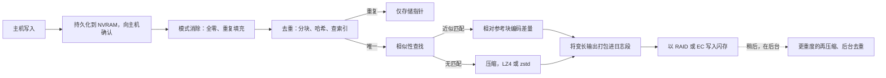
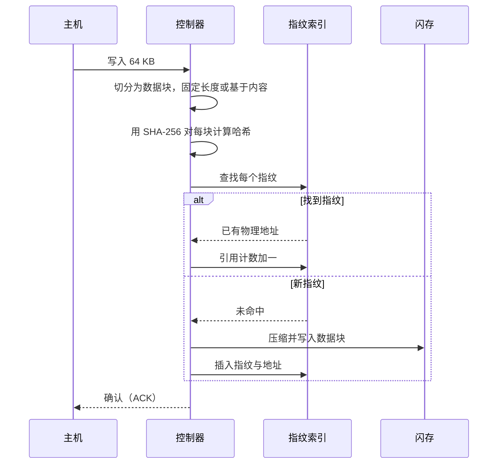
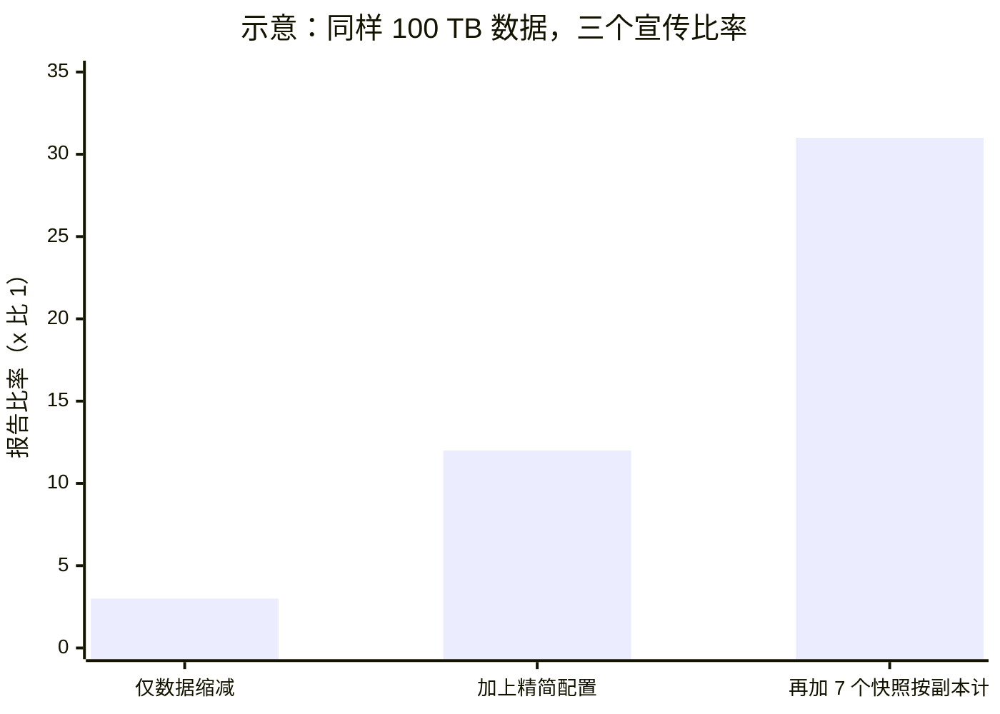
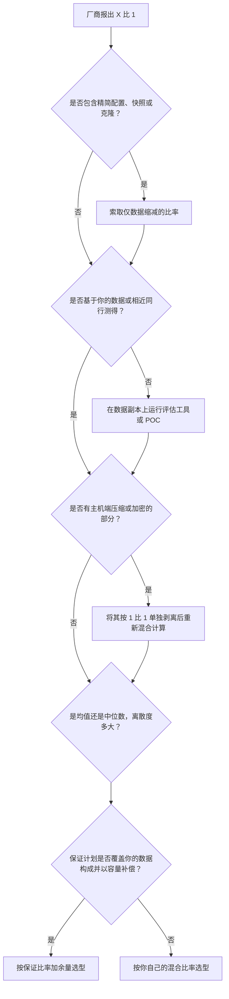
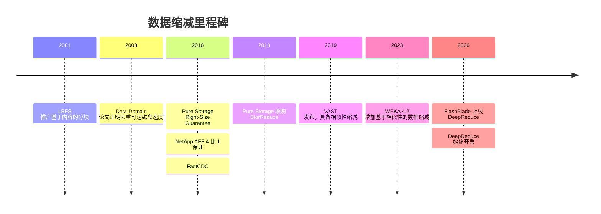

# 5. 数据缩减

> 📄 英文原文：[docs/01-storage-fundamentals/05-data-reduction.md](../../../docs/01-storage-fundamentals/05-data-reduction.md) · 本文为简体中文参考译本，如有出入以英文原文为准。

> **深度：** L2 · **阅读时间：** 约 11 分钟 · **最后核实：** 2026-11-01
> **前置阅读：** [固态硬盘内部](03-inside-an-ssd.md) · [性能与经济性指标](04-performance-and-economics-metrics.md)

## 要点速览（TL;DR）

- **数据缩减让 1 个物理 TB 容纳多个逻辑 TB。** 四种技术层层叠加：模式消除（全零与重复填充）、重复数据删除（相同数据块只存一份）、相似性缩减（近似相同的数据块以差异形式存储）以及压缩。数据缩减比（DRR）= 写入的逻辑数据 ÷ 消耗的物理容量。
- **缩减比取决于数据，而非阵列。** VDI 可达 12–20:1，SQL Server 为 2–3:1，而 JPEG、加密卷以及大多数 AI 数据接近 1:1。在混合负载中，最难缩减的那部分数据决定了整体结果。
- **"总效率"（total efficiency）不等于数据缩减。** 把精简配置和快照算进来，可以在数据毫无变化的情况下成倍放大宣传比率。Pure Storage 自己的产品手册就把约 5:1 的平均缩减比与包含精简配置的约 10:1"总效率"分开列示[^1]。
- **保证计划转移风险，细则决定价格。** Dell（6:1，PowerStore Gen 3）、NetApp（4:1 SAN）、HPE（4:1）和 Everpure（基于工作负载的 Right-Size Guarantee）大多只覆盖"可缩减数据"，且以容量形式赔付。
- **AI 是难点，也是新的竞争焦点。** 图像、token 和 BF16 检查点用通用工具几乎压不动。相似性缩减（VAST、WEKA、Everpure 的 Purity DeepReduce）和格式感知压缩是目前尝试的解法。

## 对 Everpure 战略的意义

全闪存阵列在主存储市场击败磁盘，部分原因就在于数据缩减：把闪存较高的原始 $/TB 除以 4–5:1，按每有效 TB 计算就弥合了大部分差距。Everpure 至今仍以有效容量报价 FlashArray，Evergreen//One 也按有效已用容量计费，且该容量在数据缩减之前计量[^2]。因此 DRR 是一条利润率线。当设备群的实际缩减比低于选型时的假设，就得有人为额外的 DirectFlash Module 买单；在保证计划或订阅模式下，买单的是厂商。

AI 改变了数据构成。虚拟机和数据库缩减效果好；图像、token 和检查点则不然。在 AI 交易中，原始 $/TB、密度和功耗更重要，而这正是 DirectFlash 的竞争阵地（[第 26 章](../04-everpure/26-purity-and-directflash.md)），近似重复数据的缩减也随之成为差异化因素。VAST 的卖点正是建立在这一点上；Everpure 则在 2026 年以 FlashBlade 上的 DeepReduce 作出回应。战略团队必须把物理事实与会计口径区分开来。

## 核心概念

### 四种技术，一个比率

**DRR = 主机写入的逻辑字节 ÷ 消耗的物理字节**，在缩减之后、RAID 或纠删码开销之前计量；后者属于"原始容量到有效容量"瀑布图中的另一环（[第 4 章](04-performance-and-economics-metrics.md)）。节省比例为 1 − 1/DRR：2:1 节省 50%，5:1 节省 80%，10:1 节省 90%。收益递减：把 5:1 翻倍到 10:1 只多节省 10 个百分点，所以应比较百分比而非比率。

处理流水线按成本由低到高运行：

*图 5.1 — 缩减是一条由廉价到昂贵的流水线；主机确认点相对于流水线的位置，就是"内联还是后处理"的选择。*

### 重复数据删除：分块、指纹、查找

重复数据删除把数据切成数据块，对每块计算哈希得到指纹，再查询索引。命中则只存一个指针；未命中则写入该块并加入索引。

*图 5.2 — 每次写入都变成一次索引查找，因此决定去重成本的是指纹索引的速度和规模，而不是哈希本身。*

**固定分块与变长分块。** 固定分块每 4 KB 或 8 KB 切一刀，成本低，且与块地址对齐，但只要插入一个字节，后面所有边界都会偏移，于是什么都匹配不上。基于内容的分块（content-defined chunking，CDC）在滚动哈希命中选定模式处切分，因此边界跟随内容，插入后会重新同步。LBFS 为此使用 Rabin 指纹，而 FastCDC 采用更廉价的 Gear 哈希，速度快 3–12 倍，去重比大致相同[^3]。备份设备使用 CDC，因为备份数据流会发生偏移；主存储阵列大多使用对齐分块，因为数据库是原地覆盖页面的。FlashArray 上的 Purity 采用混合方案：4–32 KB 的变长数据块，以 512 字节粒度扫描，从而能捕获未对齐的副本[^4]。

**真正的难题是索引。** 以 8 KB 分块计，1 PB 唯一数据就是 10¹⁵ ÷ 8,192 ≈ 1.2 × 10¹¹ 个数据块。按每条目约 40 字节（32 字节 SHA-256 加地址）计，索引约 5 TB，远超一对控制器的 DRAM 容量。Data Domain 在内存中保留一个 Bloom 过滤器，以低成本回答"肯定是新块"，按数据流顺序排布数据块并预取相邻指纹，从而消除了 99% 的索引磁盘访问[^5]。许多主存储阵列只保留部分索引，把去重当作尽力而为的功能。VAST 把缩减元数据保存在共享的存储级内存（SCM）中[^6]（[第 16 章](../03-system-architecture/16-disaggregated-shared-everything.md)）。更大的数据块能缩小索引，但找到的重复更少。

**半导体类比。** 指纹索引就像一个巨型缓存的标签 RAM（tag RAM），每次写入都是一次查找，而 Bloom 过滤器就是它的侦听过滤器（snoop filter）。哈希冲突在实践中不构成风险：对于 1.2 × 10¹¹ 个数据块和 256 位哈希，n² ÷ 2²⁵⁷ ≈ 10⁻⁵⁵。

### 压缩：数据块内部的冗余

LZ 系列压缩器把重复字符串替换为回指引用，再进行熵编码。速度与压缩比相互权衡：在 Silesia 语料库上，LZ4 以单核约 700 MB/s 的速度达到约 2.1:1，zstd 1 级以约 510 MB/s 达到约 2.9:1，两者解压速度均超过 1.5 GB/s[^7]。阵列在内联路径上运行快速编解码器，并在后台对冷数据再压缩（Purity 的"深度缩减"（deep reduction）[^4]）。卸载引擎类似于 SSD 控制器中的 LDPC 模块（[第 3 章](03-inside-an-ssd.md)）：固定功能逻辑在每瓦吞吐量上胜出。

粒度是一个微妙的权衡。32 KB 单元的压缩效果好于 4 KB 单元，但一次 4 KB 随机读必须解压整个单元。压缩输出大小不一，因此要打包进日志结构的段中，之后再做垃圾回收，这会增加写放大。这就是为什么在原地更新架构上外挂压缩功能举步维艰，也是 Purity 和 VAST 从一开始就采用日志结构的原因。

### 相似性缩减：只存储差异

改动一个字节就能让精确匹配去重失效。相似性缩减使用局部敏感哈希（locality-sensitive hash），让近似相同的数据块发生"碰撞"。首个具有某哈希值的数据块成为参考块；之后匹配到的块以它为字典进行压缩，只存储差异[^8]。VAST 先去重，然后在压缩与相似性缩减中选择节省更多的一种，这一过程发生在数据从 SCM 缓冲区迁移到 QLC 时，不在写入路径上[^9]。哈希表位于共享 SCM 中，使作用范围覆盖整个集群[^6]。

VAST 的数据为*公司自述*：2022 年其装机基础整体约 3:1[^10]，某量化交易公司的市场数据为 8:1[^6]，后来一次网络研讨会给出的中位数约为 2:1[^11]。Everpure 的 Purity DeepReduce 同样基于相似性、覆盖全集群且异步运行[^12]。它于 2026 年 2 月登陆 FlashBlade；9 月底，Everpure 又宣布将于 10 月推出始终开启（always-on）的版本。Everpure 引用的中位数约为 2:1，是在已压缩数据之上测得的，因此它是传统缩减之外的增量，而不是总比率[^13][^14]。代价在于：读取一个差量块可能还需要读取其参考块，且被引用的块无法释放，这使垃圾回收更复杂。**半导体类比：** 这就是视频编码中的 P 帧，以相对 I 帧的差异进行编码。

### 内联与后处理

**内联**（inline）缩减在数据写到闪存之前运行：NAND 写入更少，无需落地空间，但 CPU 工作位于写入路径上；有些系统在高负载下会推迟缩减，因此缩减比可能随负载变化。**后处理**（post-process）先以原始或轻度压缩形式落盘，之后再缩减：写入延迟最低，并为更重的算法留出余地，但需要落地容量，且缩减比滞后于数据摄入。多数系统是混合型：从 NVRAM 确认写入，内联做轻度缩减，后台再加大力度。Purity 的深度缩减[^4]、ONTAP 的内联加后台去重及其面向冷数据的温度敏感存储效率[^15]、VAST 在迁移时的缩减[^9]以及 WEKA 的后台相似性缩减[^16]都遵循这一模式。应当追问：迁移当周的缩减比和第三个月的缩减比分别是多少。

### 模式消除、精简配置与"总效率"把戏

**模式消除**把全零或重复模式的数据块记录为元数据[^4]。节省是真实的，但填零的厚置备虚拟机磁盘和预分配的数据库文件可以无限"缩减"，因此某些虚拟机环境的缩减比有一部分来自全零数据。

**精简配置**只在写入时才分配容量。这属于容量效率，而非数据缩减，Pure Storage 自己的博客也是这样论证的：8 TB 数据放在 10 TB 的精简 LUN 上"节省"20%，放在 100 TB 的 LUN 上则"节省"92%[^17]。快照和克隆是元数据副本（[第 6 章](06-data-protection-and-resilience.md)）；把每份都按完整逻辑大小计算，会进一步虚增比率。

算例：主机写入 100 TB，按 3:1 缩减，物理占用 33.3 TB。若按 400 TB 配置，"总效率"为 400 ÷ 33.3 = 12:1。再加上 7 个每日快照、每个按 100 TB 计，日变化率 1%（写入 7 TB，物理占用 2.3 TB）：(400 + 700) ÷ 35.6 ≈ 31:1。而数据本身没有任何变化。

*图 5.3 — 示意算例：把精简配置和快照计算在内，在数据不变的情况下，3:1 的缩减就变成了 31:1 的宣传数字。*

### 不同数据的缩减效果

| 数据类型 | 典型缩减比 | 原因 | 来源 |
|---|---|---|---|
| SQL Server 数据库 | 2.2–2.9:1 | 页压缩；除非存在副本，否则重复很少 | 基于 Pure1 遥测数据的 Everpure 指导值[^18] |
| Oracle 数据库 | 3.5–4.1:1 | 同上，且块格式更易压缩 | Everpure 指导值[^18] |
| 服务器虚拟机（VSI） | 6–8:1 | 通用操作系统和应用镜像可去重 | Everpure 指导值[^18] |
| VDI | 12–20+:1 | 桌面镜像几乎相同 | Everpure 指导值[^18] |
| 已压缩的媒体和备份（JPEG、MP4、zstd Parquet） | 约 1.0–1.1:1 | 已经过熵编码 | 工程估算 |
| 主机端加密数据 | 1.0:1 | 密文看起来是随机的 | 工程事实 |
| AI 训练图像（JPEG/PNG 分片） | 约 1.0–1.1:1 | 已压缩；经过数据清洗后重复很少 | 工程估算 |
| token 化文本（uint16 分片） | 约 1.1–1.5:1 | 分词器已消除大部分冗余 | 作者估算；原始文本用 zstd 约 1.9:1[^19] |
| BF16 检查点，格式感知无损压缩 | 约 1.5:1 | 指数位分布偏斜；尾数看起来是随机的 | ZipNN，节省 33%[^20] |
| 连续的稠密检查点，去重 | 约 1:1 | 每一步所有权重都会变化；差量压缩效果更好 | ZipNN[^20] |

*表 5.1 — 缩减效果是数据的属性。除非采用格式感知缩减，否则 AI 数据处于区间的底部。*

**混合缩减比是调和平均，而非算术平均。** 物理容量 = Σ（逻辑占比 ÷ DRR）。一个由 80% 虚拟机（6:1）和 20% 图像（1:1）组成的环境，需要其逻辑大小的 0.8/6 + 0.2/1 = 0.333：即 **3:1**，而不是简单平均所暗示的 5:1。

对 AI 而言，分词器本身就是压缩器：原始英文文本用 zstd 约可压缩到 1.9:1，仅 token ID 打包就能达到约 2.25:1[^19]，因此存储的分片几乎没有剩余冗余。在 BF16 权重中，一半的位是指数位；像 ZipNN 这样的格式感知编码器利用其分布偏斜节省约 33%，优于通用编解码器[^20]。AI 领域的大幅节省来自应用层：Check-N-Run 的增量、量化检查点使推荐模型的容量需求降低 2.5–8 倍[^21]，但这是有损的、在应用侧完成的，阵列的 DRR 看不到（[第 31 章](../05-ai-storage/31-training-storage.md)）。

### 如何审视厂商的 DRR 声明

*图 5.4 — 一个站得住脚的选型比率，来自剔除会计口径影响、剥离不可压缩数据，然后才决定在多大程度上信任厂商的保证。*

向任何厂商提出的六个问题：

1. **分子和分母分别是什么？** 是写入容量还是配置容量？是否包含填零、快照或克隆空间？
2. **是谁的数据？** 哪种工作负载，看中位数而非均值，以及第 25 百分位客户的情况。
3. **我的数据中有多少已经压缩或加密？** 备份、媒体、Parquet、AI 分片、主机端加密卷。
4. **内联还是后处理，高负载下表现如何？** 迁移第一周以及利用率 80% 时的缩减比。
5. **缩减的代价是什么？** 开启与关闭时的延迟和吞吐量，以及每 PB 所需的索引 DRAM 或 SCM。
6. **保证计划承诺了什么？** 覆盖范围（"可缩减数据"）、计量点、补偿方式（容量还是退款）以及期限。

### 算例：$/有效 TB

某买方需要 1,000 TB 逻辑容量：400 TB 数据库、400 TB 虚拟机、200 TB AI 图像和检查点。价格为示意值。

| | 厂商 X | 厂商 Y |
|---|---|---|
| 每可用 TB 价格 | $600 | $450 |
| 宣传 DRR → 宣传 $/有效 TB | 5:1 → **$120** | 3:1 → **$150** |
| 假设 DRR：数据库 / 虚拟机 / AI | 2.5 / 6 / 1.2 | 2.2 / 4.5 / 1.1 |
| 所需物理容量（Σ 逻辑 ÷ DRR） | 160 + 66.7 + 166.7 = 393 TB | 181.8 + 88.9 + 181.8 = 453 TB |
| 混合 DRR | 2.54:1 | 2.21:1 |
| 采购可用容量（+20% 余量） | 472 TB → $283k | 543 TB → $244k |
| 实际 $/有效 TB | **$283** | **$244** |

*表 5.2 — 示意算例：按宣传数字 X 便宜 20%，但在这一数据构成下 X 反而贵 16%。*

保证计划会改变答案。如果 X 的 5:1 保证覆盖 800 TB 的数据库和虚拟机，那么缺口（226.7 − 160 = 66.7 TB）将以免费容量补足，价值约 $40k，使 X 降到每有效 TB 约 $243，与 Y 持平。**保证计划的覆盖范围与其比率同样重要。**

## Everpure 的做法与竞争对手对比

| 系统 | 去重 | 压缩 / 相似性缩减 | 运行时机 | 保证计划（当前公开条款） |
|---|---|---|---|---|
| Everpure FlashArray（Purity Reduce） | 内联、全局；4–32 KB 变长，512 B 扫描 | 内联加后处理深度缩减；模式消除；副本缩减[^4] | 混合 | Right-Size Guarantee：基于工作负载的有效容量，12 个月，适用于 //X 和 //XL，需签署协议[^22] |
| Everpure FlashBlade | DeepReduce 资料中未提及 | DeepReduce 相似性缩减，覆盖全集群[^12] | 异步，不在写入路径上 | 未找到 [VERIFY: 是否存在 FlashBlade 数据缩减保证] |
| VAST Data | 全局 | 压缩*或*相似性缩减，取节省更多者[^9] | 在 SCM→QLC 迁移期间 | 未找到正式计划 [VERIFY: 是否存在 VAST 数据缩减保证] |
| Dell PowerStore | 始终开启的内联 | 始终开启的内联 | 内联 | Gen 3（PowerStoreOS 5.0+）为 6:1；Gen 2 和 PowerMax 为 5:1；仅限可缩减数据[^23][^24] |
| NetApp AFF（ONTAP） | 内联加后台，跨卷 | 内联压缩与数据压紧（compaction）；冷数据采用 TSSE[^15] | 混合 | SAN 4:1，NAS 上虚拟化 3:1，NAS 1.5:1[^25][^26] |
| HPE Alletra MP | 有 | 有 | 内联 | StoreMore：对可缩减数据，有效容量相对可用容量 ≥4:1，在支持期内有效[^27] |
| WEKA（NeuralMesh） | 全集群，4 KB 块级 | 相似性分组加差量压缩[^16] | 后处理，按文件系统，需单独许可 | 未找到 |

*表 5.3 — 人人都做数据缩减。真正的差别在于作用范围（按卷还是全局）、相似性匹配还是精确匹配，以及各家保证条款的措辞有多严谨。*

**保证计划的机制比宣传数字更重要。** Dell 的 PowerStore 条款排除主机端压缩和主机端加密的数据，要求缩减功能保持开启，并且只有在写满一半物理容量后才受理索赔[^28]。对 Dell 有利的一点是，其 6:1 无需评估、也无需签署协议[^23]。HPE 的补偿方式（专业服务、容量或其他补偿）由其自行决定[^27]。Everpure 则颠覆了固定比率承诺：它为每个客户的工作负载做选型，并在签署协议的前提下保证由此得出的有效容量[^22][^29]。对于混合型或以 AI 为主的环境，这比一个横幅式比率更贴合数据。问题在于，选型比率由厂商设定，保守的选型可以让任何保证都变得安全，因此买方应比较选型得出的容量，而不是仅看有没有保证。

**为 VAST 构建最强版本论证（steelman）。** 全局相似性缩减能找到精确匹配去重遗漏的节省空间，而在迁移时运行则使其远离延迟路径。FlashArray 的优势在于针对成熟、易理解的块工作负载提供成熟的内联缩减。把 DeepReduce 放到 FlashBlade 上，等于承认相似性缩减对非结构化数据和 AI 数据很重要。基于公开信息，战略团队可能评估的选项包括：将相似性缩减扩展到 FlashBlade//EXA 数据节点，以及面向检查点和 KV 缓存的格式感知编解码器（[第 42 章](../06-industry-and-competition/42-vast-data.md)、[第 45 章](../06-industry-and-competition/45-head-to-head.md)）。

## 历史与发展轨迹

*图 5.5 — 数据缩减从备份（2000 年代）走向主存储闪存（2010 年代），再走向非结构化数据和 AI 数据（2020 年代），保证计划也随之跟进。*

重复数据删除在备份领域成长起来，Data Domain 证明了它能以磁盘速度运行[^5]；随后，闪存的原始 $/TB 使其成为主存储功能。保证计划于 2016 年由 Pure Storage[^30] 和 NetApp[^31] 相继推出。Pure 于 2018 年以 US$20.5 million 现金（扣除所获现金后）收购 StorReduce，将重复数据删除引入云对象存储[^32]。VAST 于 2019 年发布，具备相似性缩减[^33]。WEKA 在 2023 年的 4.2 版本中加入后处理相似性缩减[^16]，并在 2026 年 7 月发布的 NeuralMesh 6 中再次突出数据缩减[^34]。2026 年，Everpure 在非结构化数据和 AI 数据上跟进，在 FlashBlade 上推出 DeepReduce[^13]。下一步是格式感知：能够理解张量、token 流和 KV 缓存块的编解码器[^20]。

## 关键数字

| 指标 | 数值 | 背景 | 来源 / 日期 |
|---|---|---|---|
| Purity 平均 DRR 与"总效率" | 约 5:1 vs 约 10:1 | 10:1 包含精简配置 | Pure Storage 产品手册[^1] |
| VDI / VSI / SQL 缩减比 | 12–20+:1 / 6–8:1 / 2.2–2.9:1 | 基于遥测数据的指导值 | Everpure 博客[^18] |
| Dell PowerStore 保证 | 6:1（Gen 3） | 仅限可缩减数据；需写满 ≥50% 物理容量 | Dell[^23][^28] |
| NetApp AFF 保证 | 4:1 SAN / 1.5:1 NAS | 受条款约束 | NetApp[^25] |
| HPE StoreMore | ≥4:1 | 有效容量相对可用容量 | HPE 宣传册[^27] |
| VAST 设备群 DRR | 约 3:1（2022） | *公司自述* | Blocks & Files[^10] |
| DeepReduce 中位数 | 约 2:1 | *公司自述*；在已压缩数据之上 | StorageReview[^13] |
| BF16 无损压缩节省 | 约 33%（≈1.5:1） | 格式感知的 ZipNN | arXiv 2024[^20] |
| 去重索引规模 | 每 PB 唯一数据约 5 TB | 8 KB 分块，每条目约 40 B | 算例 |
| LZ4 vs zstd-1 | 2.1:1 @ 700 MB/s vs 2.9:1 @ 510 MB/s | Silesia 语料库，单核 | zstd README[^7] |

## 对话手册

**向产品经理提的问题**

1. *"在剔除精简配置和快照之后，设备群中每类工作负载的 DRR 中位数和第 25 百分位数是多少？"* 高质量回答：按工作负载给出遥测分布，并明确指出"总效率"是另一个指标。
2. *"Right-Size Guarantee 如何为 AI 数据集和检查点定价？"* 高质量回答：如何剥离接近 1:1 的数据、历史赔付情况，以及这部分成本如何计提准备。
3. *"DeepReduce 相对 VAST 的相似性缩减，在哪些场景占优、哪些场景落后？"* 高质量回答：相同数据集上的比率、作用范围，以及对 EXA 数据节点情况的坦率说明。

**向工程师提的问题**

1. *"每 PB 的去重索引有多大，存放在哪里？"* 高质量回答：每条目字节数、存放位置（DRAM、NVRAM、闪存）以及未命中时的行为。
2. *"在什么负载下内联缩减会推迟，后处理追赶的速度有多快？"* 高质量回答：阈值、积压指标、最坏情况下的落地容量。
3. *"对已压缩或经相似性编码的数据，一次 4 KB 随机读的读放大是多少？"* 高质量回答：压缩单元大小、参考块读取、缓存命中率。

**不要这样说：**

- "我们的阵列能达到 10:1。"应说明那是数据缩减还是总效率，以及针对哪种工作负载。
- "去重对 AI 数据有效。"经过数据清洗后精确重复很少；收益来自相似性缩减或格式感知编码。
- "比率越高越好。"从 5:1 到 10:1 只多节省 10 个百分点，还可能牺牲延迟。
- "保证计划能兜底。"多数保证排除主机端压缩和加密数据，且只以容量赔付。
- "加密不影响缩减。"主机端加密会把缩减比降到 1:1；只有在缩减之后进行的阵列端加密才能保留缩减效果。

## 深入阅读（可选，L3 指引）

- 关于去重索引和分块的 Data Domain（FAST '08）[^5] 与 FastCDC[^3] 论文。
- Colgrove 等人，SIGMOD 2015，关于 Purity 的日志结构设计。
- VAST 的数据缩减知识库和相似性缩减相关文章[^9][^8]；VAST Probe 可在你的数据上估算节省量。
- 关于模型与检查点缩减的 ZipNN[^20] 和 Check-N-Run[^21]。

## 关键术语

- **DRR** — 写入的逻辑容量 ÷ 消耗的物理容量。
- **基于内容的分块（content-defined chunking）** — 由滚动哈希确定边界。
- **相似性缩减（similarity reduction）** — 近似重复的数据以差量形式存储。
- **总效率（total efficiency）** — DRR 加上精简配置和快照。
- **Right-Size Guarantee** — Everpure 基于工作负载的容量保证。
- 其余术语见[术语表](../glossary.md)。

## 资料来源

[^1]: Pure Storage, "FlashArray Datasheet," n.d. https://info.purestorage.com/rs/225-USM-292/images/Pure_Storage_FlashArray_Datasheet.pdf (retrieved 2026-11-01); corroborated by Pure Storage, "Pure Storage vs Dell EMC PowerMax" white paper, n.d. https://www.purestorage.com/content/dam/pdf/en/white-papers/protected/wp-pure-storage-vs-dell-emc-powermax.pdf (retrieved 2026-11-01).
[^2]: Everpure support, "Evergreen//One and Everpure Cloud Dedicated Array capacity" (Effective Used Capacity is the unit of measure for subscription billing), n.d. https://support.everpuredata.com/r/everpure-cloud-dedicated-aws/eg1-pscd-array-capacity (retrieved via search 2026-11-01).
[^3]: W. Xia et al., "The Design of Fast Content-Defined Chunking for Data Deduplication Based Storage Systems," IEEE TPDS, 2020 (extends USENIX ATC '16 FastCDC; cites LBFS's Rabin-based CDC). https://ranger.uta.edu/~jiang/publication/Journals/2020/2020-IEEE-TPDS(Wen%20Xia).pdf (retrieved 2026-11-01).
[^4]: Pure Storage, "Purity Data Sheet" (via Insight), n.d. https://ie.insight.com/content/dam/insight-web/emea/partner/pure-storage/Pure_Purity_Data_Sheet.pdf (retrieved 2026-11-01).
[^5]: B. Zhu, K. Li, H. Patterson, "Avoiding the Disk Bottleneck in the Data Domain Deduplication File System," USENIX FAST '08, 2008-02. https://www.usenix.org/conference/fast-08/avoiding-disk-bottleneck-data-domain-deduplication-file-system (retrieved 2026-11-01).
[^6]: VAST Data, "Similarity Reduction: A Report from the Field," 2020. https://www.vastdata.com/blog/similarity-reduction-report-from-the-field (retrieved 2026-11-01).
[^7]: Meta / zstd project, "Zstandard README — benchmarks (v1.5.6, lzbench, Silesia corpus)," n.d. https://github.com/facebook/zstd (retrieved 2026-11-01).
[^8]: VAST Data, "Breaking Data Reduction Trade-offs with Global Compression," n.d. https://vastdata.com/blog/breaking-data-reduction-trade-offs-with-global-compression (retrieved 2026-11-01).
[^9]: VAST Data Knowledge Base, "Data Reduction," n.d. https://kb.vastdata.com/documentation/docs/data-reduction (retrieved 2026-11-01).
[^10]: Blocks & Files, "VAST Data: flash cost heading below nearline disk," 2022-06-07. https://blocksandfiles.com/2022/06/07/vast-data-flash-cost-heading-below-nearline-disk/ (retrieved 2026-11-01).
[^11]: VAST Data, "Scaling Through Flash Scarcity" (webinar), n.d. https://www.vastdata.com/events/scaling-through-flash-scarcity (retrieved 2026-11-01).
[^12]: Everpure, "Why Purity DeepReduce Is Architecturally Different for Modern Data," n.d. (2026). https://blog.everpuredata.com/purely-technical/architecturally-different-for-modern-data/ (retrieved 2026-11-01).
[^13]: StorageReview, "Everpure Adds PureKVA to FlashBlade, Claims Up to 20x Faster TTFT, Makes DeepReduce Always-On," 2026-09/10. https://www.storagereview.com/news/everpure-purekva-flashblade-20x-time-to-first-token-always-on-deepreduce (retrieved 2026-11-01).
[^14]: Blocks & Files, "Everpure bulks up AI offer," 2026-09-30. https://blocksandfiles.com/flash/2026/09/30/everpure-bulks-up-ai-offer/5300162 (retrieved 2026-11-01).
[^15]: NetApp, "Temperature-sensitive storage efficiency overview," ONTAP 9 documentation, n.d. https://docs.netapp.com/us-en/ontap/volumes/enable-temperature-sensitive-efficiency-concept.html (retrieved 2026-11-01).
[^16]: WEKA documentation, "Filesystems, object stores, and filesystem groups" (data reduction: cluster-wide, 4K-block similarity clustering and delta compression, post-process, Data Efficiency Option licence), n.d. https://docs.weka.io/weka-system-overview/filesystems (retrieved via search 2026-11-01); WEKA, "What's New" in WEKA 4.2 (data reduction), 2023. https://www.weka.io/?p=35260 (retrieved via search 2026-11-01).
[^17]: Everpure, "Does Thin Provisioning Reduce Storage Capacity?," n.d. https://blog.everpuredata.com/purely-technical/understanding-thin-provisioning-does-it-reduce-storage-capacity/ (retrieved 2026-11-01).
[^18]: Everpure, "How to Simulate VSI, VDI, SQL & Oracle Workloads with Oracle vdbench" (updated ratios), n.d. https://blog.everpuredata.com/purely-technical/how-to-simulate-vsi-vdi-sql-oracle-workloads-with-oracle-vdbench/ (retrieved 2026-11-01).
[^19]: "Token-Native Storage: Read and Write in your Agent's Language," arXiv 2608.02376, 2026. https://arxiv.org/pdf/2608.02376 (retrieved 2026-11-01).
[^20]: M. Hershcovitch et al., "ZipNN: Lossless Compression for AI Models," arXiv 2411.05239, 2024-11. https://arxiv.org/html/2411.05239v2 (retrieved 2026-11-01).
[^21]: A. Eisenman et al., "Check-N-Run: a Checkpointing System for Training Deep Learning Recommendation Models," USENIX NSDI '22, 2022-04. https://www.usenix.org/conference/nsdi22/presentation/eisenman (retrieved 2026-11-01).
[^22]: Everpure, "Evergreen Program Description," n.d. https://www.purestorage.com/legal/evergreen-program-description.html (retrieved 2026-11-01) [VERIFY: search-summary only].
[^23]: Dell Technologies, "Future-Proof Program," n.d. https://www.dell.com/en-uk/lp/future-proof-program (retrieved 2026-11-01).
[^24]: Dell Technologies, "PowerStore storage appliance," n.d. https://www.dell.com/en-us/dt/storage/powerstore-storage-appliance.htm (retrieved 2026-11-01).
[^25]: NetApp, "AFF series," n.d. https://www.netapp.com/fr/aff-series/ (retrieved 2026-11-01); also NetApp/Business Wire, "NetApp Announces New Line of Low-Cost, Capacity Flash Storage," 2023-02-07. https://www.businesswire.com/news/home/20230207005482/en/ (retrieved 2026-11-01).
[^26]: Bechtle, "NetApp Hardware Solutions" (efficiency guarantee tiers), n.d. https://www.bechtle.com/de-en/brand/netapp/hardware-solutions (retrieved 2026-11-01).
[^27]: HPE (via CDW), "Store more for less" brochure, n.d. https://webobjects2.cdw.com/is/content/CDW/cdw/on-domain-cdw/brands/hewlett-packard-enterprise/brochure-store-more-for-less.pdf (retrieved 2026-11-01).
[^28]: Dell Technologies, "PowerStore: What to Do if the Data Reduction Ratio is Less Than Expected," KB 000267460, n.d. https://www.dell.com/support/kbdoc/en-us/000267460/powerstore-what-to-do-if-drr-data-reduction-ratio-is-less-than-expected (retrieved 2026-11-01) [VERIFY: search-summary only].
[^29]: Everpure, "Pure Storage Evergreen Delivers Right-Sized Storage, Again and Again and Again," n.d. https://blog.everpuredata.com/products/pure-storage-evergreen-delivers-right-size-storage/ (retrieved 2026-11-01).
[^30]: StorageReview, "Pure Storage Announces Right-Size Guarantee," 2016. https://www.storagereview.com/news/pure-storage-announces-right-size-guarantee (retrieved 2026-11-01).
[^31]: NetApp, "NetApp guarantees storage efficiency for AFF systems," n.d. https://www.netapp.com/blog/netapp-guarantees-storage-efficiency-aff-systems/ (retrieved 2026-11-01); FCW, NetApp efficiency-guarantee advertisement (ONTAP 9.0+, 4:1), 2016-08-15. https://digital.1105media.com/FCW/2016/FCW_0815/files/basic-html/page1.html (retrieved 2026-11-01).
[^32]: Pure Storage, "Form 10-K for fiscal year 2020," 2020-03. https://www.sec.gov/Archives/edgar/data/1474432/000162828020004133/pstg-20200202.htm (retrieved 2026-11-01).
[^33]: Blocks & Files, "VAST Data reduction," 2019-02-26. https://blocksandfiles.com/2019/02/26/vast-data-reduction/ (retrieved 2026-11-01).
[^34]: HPCwire, "WEKA Launches NeuralMesh 6 and WEKApod as AI Inference Pushes Infrastructure Limits," 2026-07-22. https://www.hpcwire.com/2026/07/22/weka-launches-neuralmesh-6-and-wekapod-as-ai-inference-pushes-infrastructure-limit (retrieved 2026-11-01).
