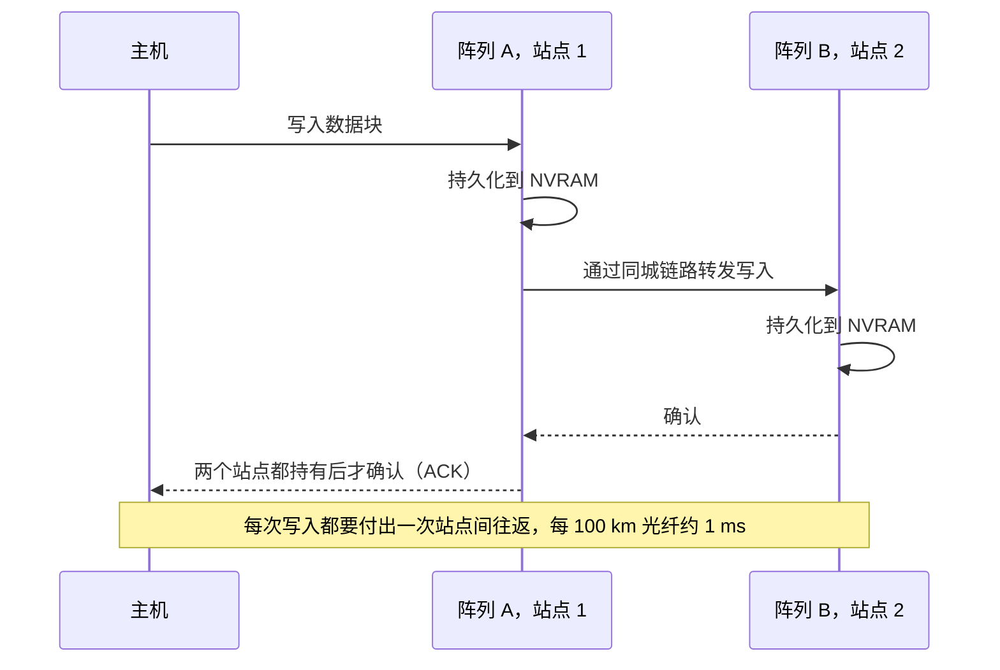
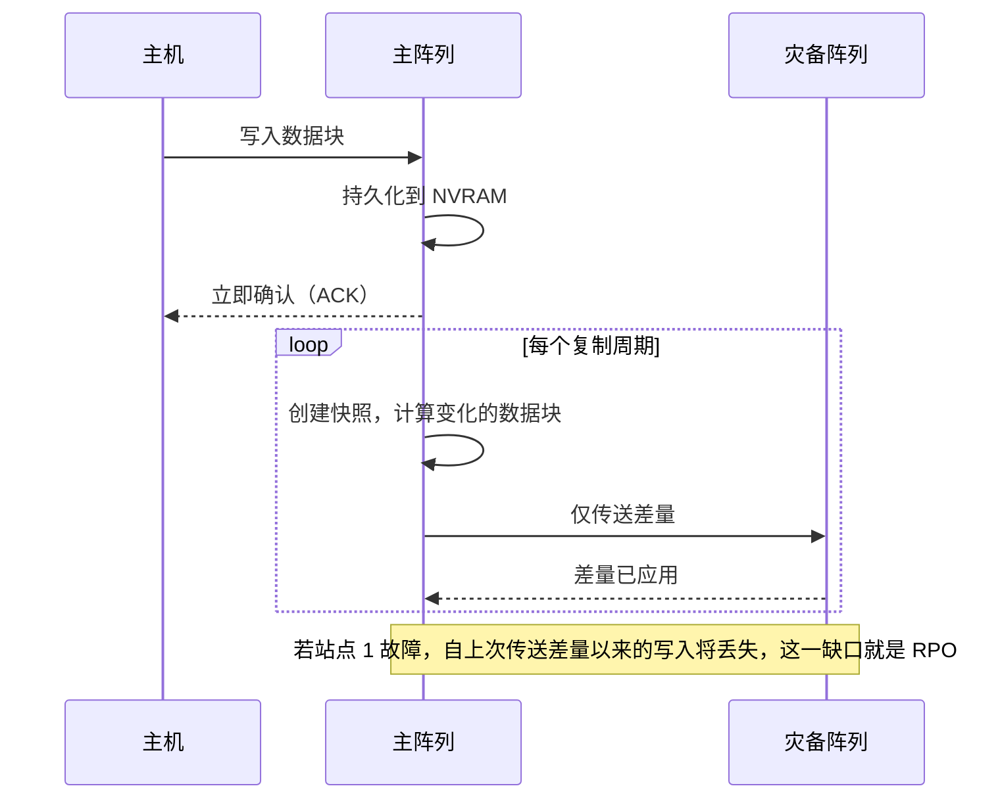

# 6. 数据保护与韧性

> 📄 英文原文：[docs/01-storage-fundamentals/06-data-protection-and-resilience.md](../../../docs/01-storage-fundamentals/06-data-protection-and-resilience.md) · 本文为简体中文参考译本，如有出入以英文原文为准。

> **深度：** L2 · **阅读时间：** 约 13 分钟 · **最后核实：** 2026-11-01
> **前置阅读：** [介质物理](02-media-physics.md) · [固态硬盘内部](03-inside-an-ssd.md) · [性能与经济性指标](04-performance-and-economics-metrics.md)

## 要点速览（TL;DR）

- **数据保护是分层的；每一层应对一类故障。** RAID/纠删码应对硬盘损坏，快照应对错误写入，复制应对站点丢失，而不可变、独立管理的副本则应对掌握了你管理员密码的攻击者。
- **纠删码是 RAID 的推广形式。** k+m 编码可承受任意 m 个故障。宽条带降低开销（8+2 多占 25% 原始容量，146+4 不到 3%），但每重建一个条带单元（strip），都要读取 k 个条带单元。
- **重建时间随硬盘容量增长。** 一块 245 TB 的 QLC SSD 以 1 GB/s 重建到单块热备盘上约需 68 小时，比过去 30 TB 机械硬盘的重建时间还长。分散式布局（declustering）、主动迁出（evacuation）和双校验是应对之道。
- **同步复制以每次写入增加一次往返为代价换取 RPO = 0。** 按每 100 km 约 1 ms 计算，这将其限制在同城距离内。
- **勒索软件把存储变成了安全产品。** 连管理员都无法提前删除的快照，加上合同约定的恢复 SLA（Everpure、NetApp、Dell），如今已成为销售内容的一部分。

## 对 Everpure 战略的意义

韧性过去只是一个勾选项。勒索软件改变了买方：CISO 如今参与存储决策，问题变成了"我能否在周一之前用可信的数据恢复业务？"恢复仍然缓慢。在 Sophos 2025 年的美国调查中，受攻击组织中只有 51% 在一周内完全恢复[^1]。备份遭到破坏的受害者在一周内恢复的比例要低得多（26% 对 46%）[^2]。监管机构如今要求经过测试的恢复能力：欧盟《数字运营韧性法案》（DORA）自 2025 年 1 月 17 日起适用于金融机构[^3]。

对 Everpure（NYSE: P，原 PSTG）而言，这既是机会，也是定位选择。其 2026 年 5 月的宣传口径称存储为"最后一道防线"[^4]，其快照不可变性（SafeMode）和 Evergreen//One 恢复 SLA 是其最具体的差异化因素之一。备份厂商（Veeam、Rubrik、Cohesity、Commvault）也宣称扮演同样的角色，因此谁掌控恢复预算是一个现实的战略问题；大多数传统厂商（[第 46 章](../06-industry-and-competition/46-incumbents.md)）如今都在推销勒索软件保证。

## 核心概念

### 四类故障，四种工具

| 故障 | 示例 | 主要防御手段 | *无法*解决的问题 |
|---|---|---|---|
| 介质 / 组件 | SSD 损坏、控制器故障 | RAID / 纠删码、双控制器 | 被删除或被破坏的数据（它会忠实地保护这些破坏） |
| 逻辑 | 错误脚本删除了一个卷，应用缺陷破坏了数据库 | 快照、克隆、备份 | 整个阵列或站点丢失 |
| 站点 | 火灾、洪水、断电、区域性中断 | 复制（同步、准同步、异步）、延伸集群 | 数据损坏，它会立即复制到另一站点 |
| 恶意攻击 | 勒索软件、拥有管理员权限的恶意内部人员 | 不可变快照、隔离或离线副本、职责分离 | 从未捕获的数据（RPO 缺口） |

*表 6.1 — 每一层保护只覆盖一类故障，对其他故障视而不见；这就是为什么"我们有 RAID 和复制"不等于勒索软件应对方案。*

最后两行之间的相互作用很糟糕：复制会全速复制被加密的数据块，因此对一次攻击做同步镜像，只不过是多了一份加密副本。

### RAID：设备内部的冗余

1988 年 Patterson、Gibson 和 Katz 的伯克利论文提出用廉价磁盘阵列构建可靠存储[^5]。实践中沿用下来的有四个级别（图 6.1）：

- **RAID 1（镜像）** 每个数据块写两次：可用率 50%，重建只需复制幸存的另一份。
- **RAID 10** 在镜像对之间做条带化：可用率 50%，重建快，每个镜像对可承受一个故障。
- **RAID 5** 增加一个轮转的 XOR 校验块：7+1 组的可用率为 87.5%，可承受一个故障，重建时需读取全部七块幸存盘。
- **RAID 6** 增加第二个独立校验（Reed–Solomon "Q" 校验子）：8+2 的可用率为 80%，可承受任意两个故障。

*图 6.1 — 传统 RAID 把一个条带绑定在固定的一组硬盘上；分散式纠删码把条带和备用空间分散到整个池中，因此每块硬盘都参与重建。*

**半导体类比。** 校验就是上移了一层的 ECC。RAID 5 相当于一个奇偶校验位；RAID 6 类似于 chipkill ECC，可承受整颗 DRAM 器件失效。在每块 SSD 内部，控制器已经在页面上运行 LDPC，并且常常在晶粒（die）之间做校验（[第 3 章](03-inside-an-ssd.md)）；阵列 RAID 防护的是整块硬盘丢失。

### 纠删码：推广并加宽的 RAID

纠删码取 k 个数据条带单元，计算 m 个校验条带单元，并可从 k+m 中的任意 k 个重建。RAID 5 是 k+1，RAID 6 是 k+2。横向扩展系统和对象存储系统（[第 18 章](../03-system-architecture/18-object-storage-architecture.md)）把 k 推得更高，并把条带分散到节点、机箱或站点之间。

| 方案 | 原始 : 可用 | 10 PB 可用所需原始容量 | 可承受故障数 | 重建一个丢失条带单元需读取的条带单元数 |
|---|---|---|---|---|
| 三副本 | 3.00× | 30.0 PB | 2 | 1 |
| RAID 10 / 双副本镜像 | 2.00× | 20.0 PB | 1（保证） | 1 |
| RAID 6，8+2 | 1.25× | 12.5 PB | 2 | 8 |
| EC 16+2 | 1.125× | 11.25 PB | 2 | 16 |
| EC 146+4（VAST 最大宽度）[^6] | 1.027× | 10.27 PB | 4 | 采用局部可解码编码时约 37[^7] |

*表 6.2 — 更宽的条带可使每 10 PB 可用容量少用最多 2.2 PB 原始容量，但除非编码专门为此设计，否则每丢失一个条带单元，重建所需的读取量更大。*

最后一列就是隐性成本。采用普通 Reed–Solomon 16+2 编码时，重建一块 245 TB 的硬盘意味着在集群中读取 16 × 245 TB ≈ **3.9 PB**。局部可解码编码或局部可修复编码（locally repairable codes）在子组上计算校验，使修复只需读取条带的一部分。VAST 称其编码约读取条带的四分之一[^7]。这是经典的权衡：容量效率对修复带宽。[第 20 章](../03-system-architecture/20-distributed-systems-fundamentals.md)介绍持久性算术（几个 9、平均数据丢失时间）。

### 为什么大容量硬盘让重建时间成为战略问题

重建时间 ≈ 待重构容量 ÷ 有效重建速率。风险敞口就是这样一个时间窗口：其间再出现一次故障或一个不可读扇区，就可能导致数据丢失。

**算例（单块热备盘）。** 一块 30 TB HAMR 机械硬盘[^8]以 200 MB/s 重建，耗时 30×10¹² ÷ 2×10⁸ = 150,000 s ≈ **42 小时**。一块 245.76 TB QLC SSD[^9]以 1 GB/s（受限速率，因为阵列仍在服务生产业务）重建到一块替换盘上，耗时 245,760 s ≈ **68 小时**。一块 300 TB 级模块[^10]约需 83 小时。容量增长了约八倍，而单盘写入带宽并没有。

**算例（分散式）。** 重建受限于读取而非写入：每重构一个字节，都要从幸存盘读取 k 个字节。假设 100 块幸存硬盘每块拿出 4 GB/s 读带宽用于重建（合计 400 GB/s），条带为 8+2。则整个池以 400 ÷ 8 = 50 GB/s 的速度重构数据，写入分散在所有硬盘上的备用空间，这块 245 TB 硬盘可在 245,760 ÷ 50 ≈ 4,900 s ≈ **1.4 小时**内恢复。若采用 16+2 条带，同样的读取预算耗时翻倍；若采用 146+4 的普通 Reed–Solomon，则约需 18 倍时间，这就是超宽条带需要局部可解码编码的原因。代价是重建期间的读取负载和性能下滑。

*图 6.2 — 示意：QLC 时代的容量使传统单块热备盘重建超过三天，这就是大容量硬盘系统采用分散式布局、主动迁出或增加校验的原因。*
数据：`data/ch06_rebuild.csv`

有两种风险随时间窗口增大：更多硬盘故障（同组硬盘的使用年限、批次和工作负载相同）以及不可恢复读错误。企业级 HDD 通常标称每读取 10¹⁵ 位出现一次不可恢复错误。一次读取七块 30 TB 幸存盘的 RAID 5 重建要读 210 TB = 1.7×10¹⁵ 位，因此按标称错误率应会遇到不止一次错误。标称值是最坏情况上限，现场错误率通常更低，但这一算术正是 2007 年"RAID 5 将失效"论点的依据[^11]，也是双校验成为大容量硬盘最低标准的原因。企业级 SSD 的标称值约好十倍，但其容量增长更快。

Everpure 的答案分两部分：跨 DirectFlash Module 的双校验保护，重建期间优先保障主机 I/O[^12]；以及**主动迁出即将失效的模块**，而不是等它失效后再重建。由于 Purity 知道一个性能退化模块中哪些部分仍然完好，它会把这些数据复制到新设备，而不是从校验中重构；Everpure 称这能使恢复到完全保护状态的时间缩短 95% 或更多（*公司自述*，未公布基准）[^13] [VERIFY: 150 TB DFM 重建与迁出各需多少小时；在一小时内复制 150 TB 需约 40 GB/s，高于单个模块可能的读取速率]。直接管理原始 NAND（[第 26 章](../04-everpure/26-purity-and-directflash.md)）使 Purity 能及早发现模块性能退化。

### 快照与克隆

快照是卷的时间点映像。构建方式有两种。

*图 6.3 — 写时复制在每个数据块首次被覆盖时要付出一次读和两次写；写时重定向只需一次写加一次指针更新，这就是闪存原生系统可以创建数千个快照而无可测性能损失的原因。*

- **写时复制（copy-on-write，COW）** 将当前数据保留在原位，在每个旧数据块被覆盖之前把它复制到预留区。其成本随快照数量和写入速率增长。
- **写时重定向（redirect-on-write，ROW）** 冻结元数据映射表，把新写入导向空闲空间。Purity（日志结构）、NetApp WAFL 和 ZFS 等"随处写"（write-anywhere）设计本来就从不原地覆盖，因此快照几乎是免费的：只是一份指针树副本加上引用计数。术语陷阱：ZFS 和 WAFL 的文档自称"写时复制"文件系统，尽管它们的快照按这里描述的写时重定向方式工作。成本转移到了元数据和垃圾回收上，因为只有当没有任何快照引用某个数据块时，其空间才会被释放。

**克隆**是可写的快照。为开发和测试创建一个 20 TB 数据库的十份副本，在副本出现差异之前几乎不占用额外容量。

局限在于：**快照与其数据位于同一个阵列上**，因此它无法在阵列丢失后幸存，也无法抵御能够删除快照的攻击者。

### 复制：同步、异步以及介于两者之间

*图 6.4 — 同步复制只在两个站点都持久化写入后才确认：RPO 为零，站点间往返时间叠加到每次写入上。*

*图 6.5 — 异步复制保持本地写入延迟，可在任意距离工作，代价是由复制周期和链路决定的非零 RPO。*

**算例（物理税）。** 光在光纤中的传播速度约为 200,000 km/s，即每公里 5 µs。相距 100 km 会增加约 1 ms 的往返时间，这还不包括交换机和协议开销。NetApp 的指导采用同样的经验法则[^14]。一次本地耗时 150–300 µs 的全闪存写入会变成约 1.15–1.3 ms，慢了大约四到八倍：对大多数数据库无妨，对延迟敏感的交易系统则是致命的。每次写入需要两次往返的协议（例如未启用写加速的 Fibre Channel）会使增量翻倍。

**准同步**（near-synchronous）介于两者之间。写入在本地确认，并以连续流而非周期性批次的方式传送，因此 RPO 为秒级，主机延迟不受影响。Everpure 的 ActiveDR（2020）采用这一模式[^15]。基于日志的持续数据保护（CDP）产品，例如 HPE 的 Zerto，宣称 RPO 为秒级，并可回退到日志中的任意时间点[^16]。

### 延伸集群与同城集群

延伸（同城）集群通过同步镜像和自动故障切换，呈现一个在两个站点都可写的卷。难点是**脑裂**（split-brain）：如果链路中断，两个健康的阵列都可能继续接受写入并产生分歧。由第三方见证者（*仲裁器*，mediator）决定哪一侧继续提供服务。Everpure 的 ActiveCluster 使用 SaaS 见证服务 Pure1 Cloud Mediator，因此客户无需第三个站点[^17]。

主要实现包括 Everpure **ActiveCluster**（FlashArray）、NetApp **MetroCluster**（IP 版本支持最远 700 km，受延迟限制）和 **SnapMirror active sync**（原 SnapMirror Business Continuity）[^14][^18]、PowerMax 上的 Dell **SRDF/Metro**[^19]，以及 Alletra 上的 HPE **Active Peer Persistence**[^20]。

*图 6.6 — 示意：沿保护阶梯越往下，丢失的数据越多，停机时间越长。勒索软件是个例外，其 RPO 相对较短，RTO 却最长，因为取证、扫描和准备干净的基础设施主导了恢复过程。*
数据：`data/ch06_rpo_rto.csv`

**RPO**（恢复点目标）是你能承受丢失多少近期数据。**RTO**（恢复时间目标）是你能承受停机多久。每提升一级都要付出更多带宽、许可和备用硬件成本，因此成熟的企业会把应用分为 0/0、分钟/小时和天/数天等级别。
