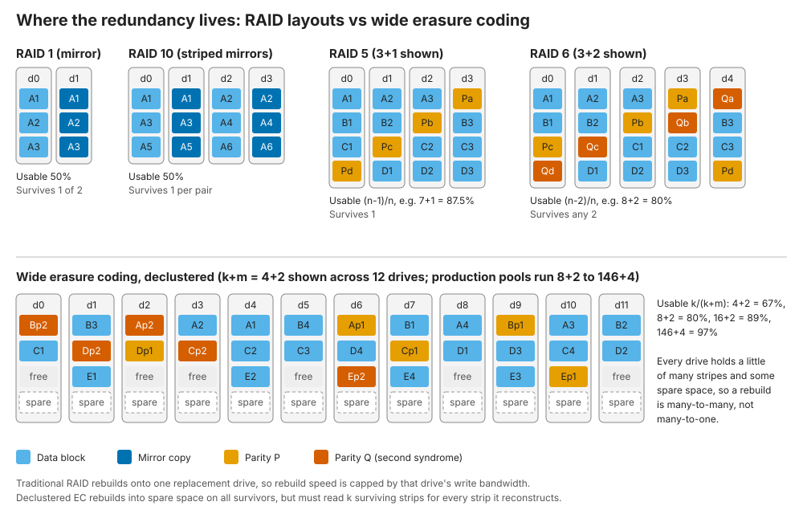
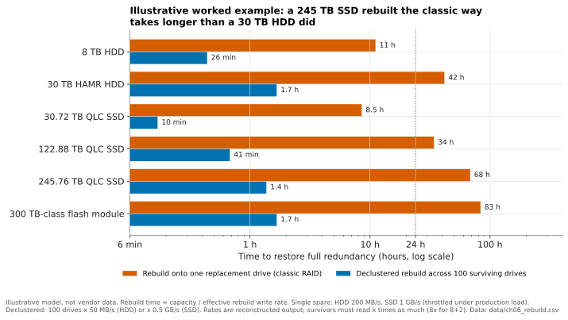
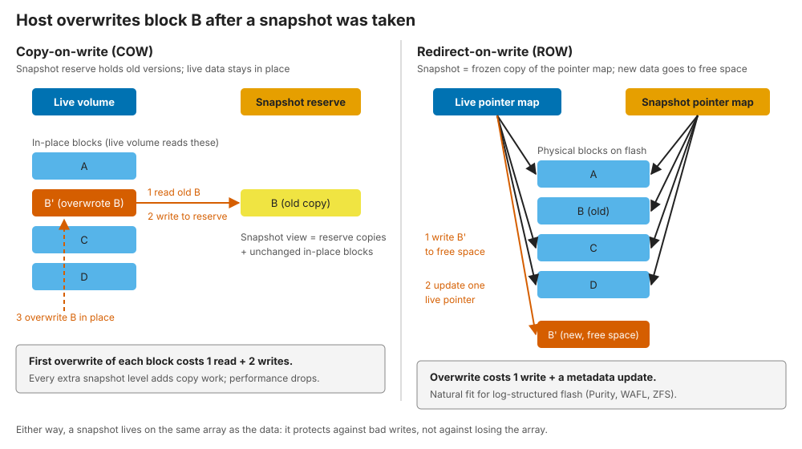
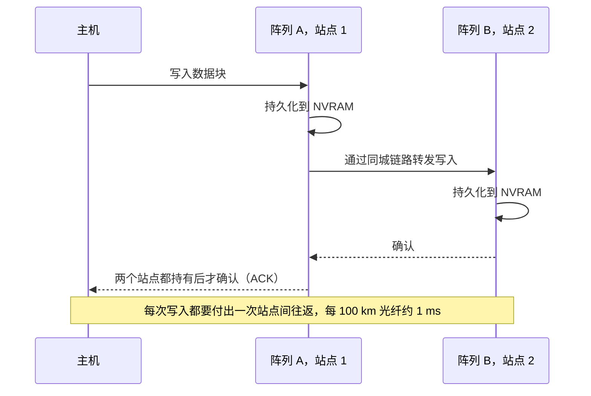
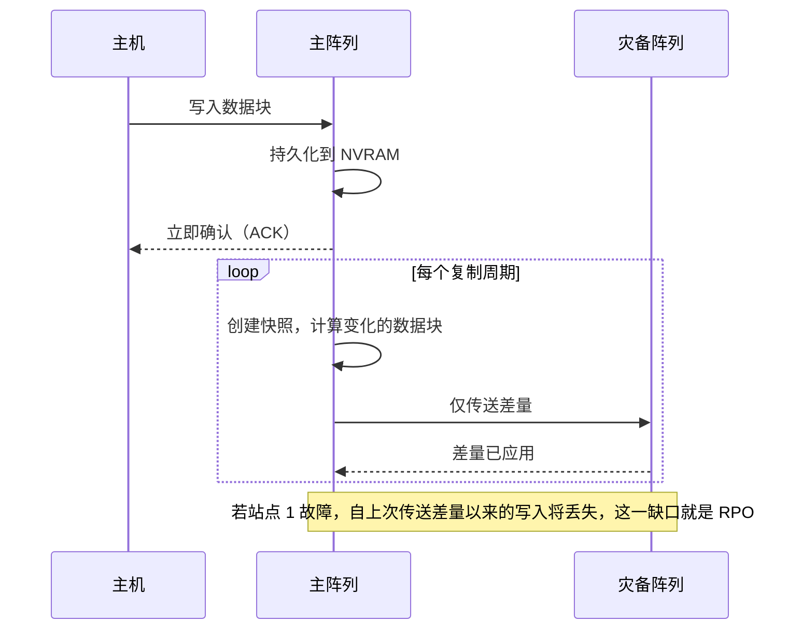
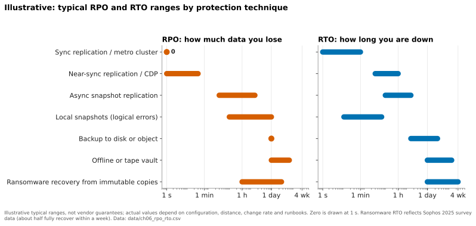
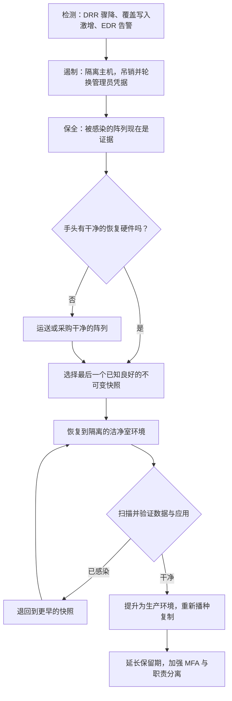
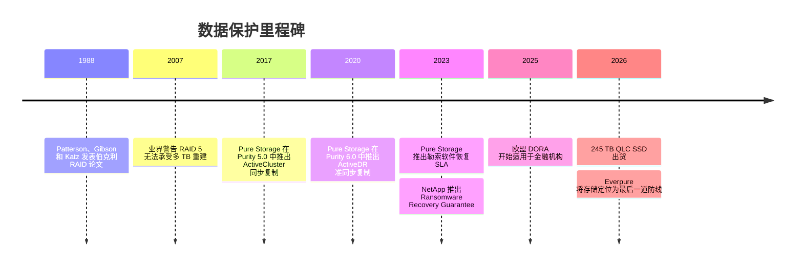

# 6. 数据保护与韧性

> 📄 英文原文：[docs/01-storage-fundamentals/06-data-protection-and-resilience.md](../../../docs/01-storage-fundamentals/06-data-protection-and-resilience.md) · 本文为简体中文参考译本，如有出入以英文原文为准。

> **深度：** L2 · **阅读时间：** 约 13 分钟 · **最后核实：** 2026-11-01
> **前置阅读：** [介质物理](02-media-physics.md) · [固态硬盘内部](03-inside-an-ssd.md) · [性能与经济性指标](04-performance-and-economics-metrics.md)

## 要点速览（TL;DR）

- **数据保护是分层的；每一层应对一类故障。** RAID/纠删码应对硬盘损坏，快照应对错误写入，复制应对站点丢失，而不可变、独立管理的副本则应对掌握了你管理员密码的攻击者。
- **纠删码是 RAID 的推广形式。** k+m 编码可承受任意 m 个故障。宽条带降低开销（8+2 多占 25% 原始容量，146+4 不到 3%），但每重建一个条带单元（strip），都要读取 k 个条带单元。
- **重建时间随硬盘容量增长。** 一块 245 TB 的 QLC SSD 以 1 GB/s 重建到单块热备盘上约需 68 小时，比过去 30 TB 机械硬盘的重建时间还长。分散式布局（declustering）、主动迁出（evacuation）和双校验是应对之道。
- **同步复制以每次写入增加一次往返为代价换取 RPO = 0。** 按每 100 km 约 1 ms 计算，这将其限制在同城距离内。
- **勒索软件把存储变成了安全产品。** 连管理员都无法提前删除的快照，加上合同约定的恢复 SLA（Everpure、NetApp、Dell），如今已成为销售内容的一部分。

## 对 Everpure 战略的意义

韧性过去只是一个勾选项。勒索软件改变了买方：CISO 如今参与存储决策，问题变成了"我能否在周一之前用可信的数据恢复业务？"恢复仍然缓慢。在 Sophos 2025 年的美国调查中，受攻击组织中只有 51% 在一周内完全恢复[^1]。备份遭到破坏的受害者在一周内恢复的比例要低得多（26% 对 46%）[^2]。监管机构如今要求经过测试的恢复能力：欧盟《数字运营韧性法案》（DORA）自 2025 年 1 月 17 日起适用于金融机构[^3]。

对 Everpure（NYSE: P，原 PSTG）而言，这既是机会，也是定位选择。其 2026 年 5 月的宣传口径称存储为"最后一道防线"[^4]，其快照不可变性（SafeMode）和 Evergreen//One 恢复 SLA 是其最具体的差异化因素之一。备份厂商（Veeam、Rubrik、Cohesity、Commvault）也宣称扮演同样的角色，因此谁掌控恢复预算是一个现实的战略问题；大多数传统厂商（[第 46 章](../06-industry-and-competition/46-incumbents.md)）如今都在推销勒索软件保证。

## 核心概念

### 四类故障，四种工具

| 故障 | 示例 | 主要防御手段 | *无法*解决的问题 |
|---|---|---|---|
| 介质 / 组件 | SSD 损坏、控制器故障 | RAID / 纠删码、双控制器 | 被删除或被破坏的数据（它会忠实地保护这些破坏） |
| 逻辑 | 错误脚本删除了一个卷，应用缺陷破坏了数据库 | 快照、克隆、备份 | 整个阵列或站点丢失 |
| 站点 | 火灾、洪水、断电、区域性中断 | 复制（同步、准同步、异步）、延伸集群 | 数据损坏，它会立即复制到另一站点 |
| 恶意攻击 | 勒索软件、拥有管理员权限的恶意内部人员 | 不可变快照、隔离或离线副本、职责分离 | 从未捕获的数据（RPO 缺口） |

*表 6.1 — 每一层保护只覆盖一类故障，对其他故障视而不见；这就是为什么"我们有 RAID 和复制"不等于勒索软件应对方案。*

最后两行之间的相互作用很糟糕：复制会全速复制被加密的数据块，因此对一次攻击做同步镜像，只不过是多了一份加密副本。

### RAID：设备内部的冗余

1988 年 Patterson、Gibson 和 Katz 的伯克利论文提出用廉价磁盘阵列构建可靠存储[^5]。实践中沿用下来的有四个级别（图 6.1）：

- **RAID 1（镜像）** 每个数据块写两次：可用率 50%，重建只需复制幸存的另一份。
- **RAID 10** 在镜像对之间做条带化：可用率 50%，重建快，每个镜像对可承受一个故障。
- **RAID 5** 增加一个轮转的 XOR 校验块：7+1 组的可用率为 87.5%，可承受一个故障，重建时需读取全部七块幸存盘。
- **RAID 6** 增加第二个独立校验（Reed–Solomon "Q" 校验子）：8+2 的可用率为 80%，可承受任意两个故障。

*图 6.1 — 传统 RAID 把一个条带绑定在固定的一组硬盘上；分散式纠删码把条带和备用空间分散到整个池中，因此每块硬盘都参与重建。*

**半导体类比。** 校验就是上移了一层的 ECC。RAID 5 相当于一个奇偶校验位；RAID 6 类似于 chipkill ECC，可承受整颗 DRAM 器件失效。在每块 SSD 内部，控制器已经在页面上运行 LDPC，并且常常在晶粒（die）之间做校验（[第 3 章](03-inside-an-ssd.md)）；阵列 RAID 防护的是整块硬盘丢失。

### 纠删码：推广并加宽的 RAID

纠删码取 k 个数据条带单元，计算 m 个校验条带单元，并可从 k+m 中的任意 k 个重建。RAID 5 是 k+1，RAID 6 是 k+2。横向扩展系统和对象存储系统（[第 18 章](../03-system-architecture/18-object-storage-architecture.md)）把 k 推得更高，并把条带分散到节点、机箱或站点之间。

| 方案 | 原始 : 可用 | 10 PB 可用所需原始容量 | 可承受故障数 | 重建一个丢失条带单元需读取的条带单元数 |
|---|---|---|---|---|
| 三副本 | 3.00× | 30.0 PB | 2 | 1 |
| RAID 10 / 双副本镜像 | 2.00× | 20.0 PB | 1（保证） | 1 |
| RAID 6，8+2 | 1.25× | 12.5 PB | 2 | 8 |
| EC 16+2 | 1.125× | 11.25 PB | 2 | 16 |
| EC 146+4（VAST 最大宽度）[^6] | 1.027× | 10.27 PB | 4 | 采用局部可解码编码时约 37[^7] |

*表 6.2 — 更宽的条带可使每 10 PB 可用容量少用最多 2.2 PB 原始容量，但除非编码专门为此设计，否则每丢失一个条带单元，重建所需的读取量更大。*

最后一列就是隐性成本。采用普通 Reed–Solomon 16+2 编码时，重建一块 245 TB 的硬盘意味着在集群中读取 16 × 245 TB ≈ **3.9 PB**。局部可解码编码或局部可修复编码（locally repairable codes）在子组上计算校验，使修复只需读取条带的一部分。VAST 称其编码约读取条带的四分之一[^7]。这是经典的权衡：容量效率对修复带宽。[第 20 章](../03-system-architecture/20-distributed-systems-fundamentals.md)介绍持久性算术（几个 9、平均数据丢失时间）。

### 为什么大容量硬盘让重建时间成为战略问题

重建时间 ≈ 待重构容量 ÷ 有效重建速率。风险敞口就是这样一个时间窗口：其间再出现一次故障或一个不可读扇区，就可能导致数据丢失。

**算例（单块热备盘）。** 一块 30 TB HAMR 机械硬盘[^8]以 200 MB/s 重建，耗时 30×10¹² ÷ 2×10⁸ = 150,000 s ≈ **42 小时**。一块 245.76 TB QLC SSD[^9]以 1 GB/s（受限速率，因为阵列仍在服务生产业务）重建到一块替换盘上，耗时 245,760 s ≈ **68 小时**。一块 300 TB 级模块[^10]约需 83 小时。容量增长了约八倍，而单盘写入带宽并没有。

**算例（分散式）。** 重建受限于读取而非写入：每重构一个字节，都要从幸存盘读取 k 个字节。假设 100 块幸存硬盘每块拿出 4 GB/s 读带宽用于重建（合计 400 GB/s），条带为 8+2。则整个池以 400 ÷ 8 = 50 GB/s 的速度重构数据，写入分散在所有硬盘上的备用空间，这块 245 TB 硬盘可在 245,760 ÷ 50 ≈ 4,900 s ≈ **1.4 小时**内恢复。若采用 16+2 条带，同样的读取预算耗时翻倍；若采用 146+4 的普通 Reed–Solomon，则约需 18 倍时间，这就是超宽条带需要局部可解码编码的原因。代价是重建期间的读取负载和性能下滑。

*图 6.2 — 示意：QLC 时代的容量使传统单块热备盘重建超过三天，这就是大容量硬盘系统采用分散式布局、主动迁出或增加校验的原因。*
数据：`data/ch06_rebuild.csv`

有两种风险随时间窗口增大：更多硬盘故障（同组硬盘的使用年限、批次和工作负载相同）以及不可恢复读错误。企业级 HDD 通常标称每读取 10¹⁵ 位出现一次不可恢复错误。一次读取七块 30 TB 幸存盘的 RAID 5 重建要读 210 TB = 1.7×10¹⁵ 位，因此按标称错误率应会遇到不止一次错误。标称值是最坏情况上限，现场错误率通常更低，但这一算术正是 2007 年"RAID 5 将失效"论点的依据[^11]，也是双校验成为大容量硬盘最低标准的原因。企业级 SSD 的标称值约好十倍，但其容量增长更快。

Everpure 的答案分两部分：跨 DirectFlash Module 的双校验保护，重建期间优先保障主机 I/O[^12]；以及**主动迁出即将失效的模块**，而不是等它失效后再重建。由于 Purity 知道一个性能退化模块中哪些部分仍然完好，它会把这些数据复制到新设备，而不是从校验中重构；Everpure 称这能使恢复到完全保护状态的时间缩短 95% 或更多（*公司自述*，未公布基准）[^13] [VERIFY: 150 TB DFM 重建与迁出各需多少小时；在一小时内复制 150 TB 需约 40 GB/s，高于单个模块可能的读取速率]。直接管理原始 NAND（[第 26 章](../04-everpure/26-purity-and-directflash.md)）使 Purity 能及早发现模块性能退化。

### 快照与克隆

快照是卷的时间点映像。构建方式有两种。

*图 6.3 — 写时复制在每个数据块首次被覆盖时要付出一次读和两次写；写时重定向只需一次写加一次指针更新，这就是闪存原生系统可以创建数千个快照而无可测性能损失的原因。*

- **写时复制（copy-on-write，COW）** 将当前数据保留在原位，在每个旧数据块被覆盖之前把它复制到预留区。其成本随快照数量和写入速率增长。
- **写时重定向（redirect-on-write，ROW）** 冻结元数据映射表，把新写入导向空闲空间。Purity（日志结构）、NetApp WAFL 和 ZFS 等"随处写"（write-anywhere）设计本来就从不原地覆盖，因此快照几乎是免费的：只是一份指针树副本加上引用计数。术语陷阱：ZFS 和 WAFL 的文档自称"写时复制"文件系统，尽管它们的快照按这里描述的写时重定向方式工作。成本转移到了元数据和垃圾回收上，因为只有当没有任何快照引用某个数据块时，其空间才会被释放。

**克隆**是可写的快照。为开发和测试创建一个 20 TB 数据库的十份副本，在副本出现差异之前几乎不占用额外容量。

局限在于：**快照与其数据位于同一个阵列上**，因此它无法在阵列丢失后幸存，也无法抵御能够删除快照的攻击者。

### 复制：同步、异步以及介于两者之间

*图 6.4 — 同步复制只在两个站点都持久化写入后才确认：RPO 为零，站点间往返时间叠加到每次写入上。*

*图 6.5 — 异步复制保持本地写入延迟，可在任意距离工作，代价是由复制周期和链路决定的非零 RPO。*

**算例（物理税）。** 光在光纤中的传播速度约为 200,000 km/s，即每公里 5 µs。相距 100 km 会增加约 1 ms 的往返时间，这还不包括交换机和协议开销。NetApp 的指导采用同样的经验法则[^14]。一次本地耗时 150–300 µs 的全闪存写入会变成约 1.15–1.3 ms，慢了大约四到八倍：对大多数数据库无妨，对延迟敏感的交易系统则是致命的。每次写入需要两次往返的协议（例如未启用写加速的 Fibre Channel）会使增量翻倍。

**准同步**（near-synchronous）介于两者之间。写入在本地确认，并以连续流而非周期性批次的方式传送，因此 RPO 为秒级，主机延迟不受影响。Everpure 的 ActiveDR（2020）采用这一模式[^15]。基于日志的持续数据保护（CDP）产品，例如 HPE 的 Zerto，宣称 RPO 为秒级，并可回退到日志中的任意时间点[^16]。

### 延伸集群与同城集群

延伸（同城）集群通过同步镜像和自动故障切换，呈现一个在两个站点都可写的卷。难点是**脑裂**（split-brain）：如果链路中断，两个健康的阵列都可能继续接受写入并产生分歧。由第三方见证者（*仲裁器*，mediator）决定哪一侧继续提供服务。Everpure 的 ActiveCluster 使用 SaaS 见证服务 Pure1 Cloud Mediator，因此客户无需第三个站点[^17]。

主要实现包括 Everpure **ActiveCluster**（FlashArray）、NetApp **MetroCluster**（IP 版本支持最远 700 km，受延迟限制）和 **SnapMirror active sync**（原 SnapMirror Business Continuity）[^14][^18]、PowerMax 上的 Dell **SRDF/Metro**[^19]，以及 Alletra 上的 HPE **Active Peer Persistence**[^20]。

*图 6.6 — 示意：沿保护阶梯越往下，丢失的数据越多，停机时间越长。勒索软件是个例外，其 RPO 相对较短，RTO 却最长，因为取证、扫描和准备干净的基础设施主导了恢复过程。*
数据：`data/ch06_rpo_rto.csv`

**RPO**（恢复点目标）是你能承受丢失多少近期数据。**RTO**（恢复时间目标）是你能承受停机多久。每提升一级都要付出更多带宽、许可和备用硬件成本，因此成熟的企业会把应用分为 0/0、分钟/小时和天/数天等级别。

### 不可变性与勒索软件

现代攻击者用窃取的管理员凭据登录，删除快照和备份，然后加密数据。Sophos 发现，在其 2024 年调查中，94% 的受害者表示攻击者曾试图破坏其备份[^2]。存储层面的应对是**以职责分离为支撑的不可变性**：

- **Everpure SafeMode。** 被删除的快照进入"待清除"（eradication-pending）状态，且无法强制清除。默认延迟为 24 小时，在 FlashArray 上可配置到 30 天[^21][^22]。修改或禁用 SafeMode 需要 Everpure Support 加上预先登记的客户联系人共同参与，仅凭管理员登录是不够的[^21]。自 Purity//FA 6.4.10 起，新建卷默认加入受 SafeMode 保护的组（"Auto-on SafeMode"）[^23]。2026 年新增的功能包括使其保持开启的 Fusion "Security Presets"[^4][^24]。
- **其他厂商的对应功能。** NetApp 提供防篡改快照，以 SnapLock Compliance 时钟锁定，管理员和 NetApp 支持人员都无法提前删除；此外还有 SnapLock WORM 卷以及针对破坏性命令的多管理员验证[^25]。Dell 提供 PowerMax Secure Snaps 以及隔离的 PowerProtect Cyber Recovery 保险库。HPE 在 Alletra MP B10000 上提供 Virtual Lock。S3 Object Lock 为对象存储提供同样的能力。真正的差别在于默认设置以及谁能解除锁定：SafeMode 可在 Everpure Support 的协助下修改，而 NetApp 的合规锁任何人都无法缩短。

阵列还能帮助**检测**攻击。加密数据无法压缩或去重，因此数据缩减比骤降或覆盖写入率激增都是强烈信号（[第 5 章](05-data-reduction.md)）。厂商已将其产品化：NetApp 的 Autonomous Ransomware Protection 在 ONTAP 内部分析 NAS 工作负载，并在怀疑遭受攻击时创建快照[^25]；Dell 的 Cyber Recovery 保险库提供 CyberSense 内容分析；Everpure 则通过 Pure1 标记异常。

*图 6.7 — 恢复是一个循环，而不是一个按钮：瓶颈通常在于找到干净的恢复点和干净的硬件，而这正是不可变性和恢复 SLA 所针对的问题。*

注意"保全"一步：调查人员通常希望被攻击的阵列保持原样，因此你需要干净的硬件来恢复数据。Everpure 的 Evergreen//One SLA 恰好解决这一问题（见下文）。

### 3-2-1(-1-0) 规则

这一备份经验法则通常归功于摄影师 Peter Krogh 的 *The DAM Book*[^26]：数据保留 **3** 份副本，存放在 **2** 种不同介质上，其中 **1** 份异地存放。由 Veeam 推广的勒索软件时代扩展版增加了 **1** 份不可变、物理隔离（air-gapped）或离线的副本，以及自动恢复验证 **0** 错误[^27]。阵列快照是这类设计中快速的第一层，而不是它的替代品。

## Everpure 的做法与竞争对手对比

| 厂商 | 同城 / 同步 | 准同步 / 异步 | 不可变副本 | 恢复保证 |
|---|---|---|---|---|
| **Everpure**（FlashArray、FlashBlade） | ActiveCluster：双活（active/active），Pure1 Cloud Mediator[^17] | ActiveDR 准同步；基于快照的异步复制[^15] | SafeMode：FlashArray 上 24 小时至 30 天，新建卷自动开启[^21][^23] | Evergreen//One Cyber Recovery and Resilience SLA（附加服务）：下一个工作日运送干净阵列，48 小时内提供恢复计划，8 TiB/h 传输速率；覆盖勒索软件及其他灾难[^28][^29] |
| **NetApp**（ONTAP） | MetroCluster；SnapMirror active sync，自 ONTAP 9.15.1 起支持对称双活[^18] | SnapMirror 异步 | 防篡改快照、SnapLock | Ransomware Recovery Guarantee（2023）；要求在符合条件的新阵列上使用 SnapLock Compliance 卷[^30][^31] |
| **Dell**（PowerMax） | SRDF/Metro，Smart DR 复制到第三个阵列[^19] | SRDF/A；四站点拓扑 | Secure Snaps；每阵列最多 65 M 个快照（公司自述）[^19] | Cyber Recovery Guarantee 最高 US$10 M，适用于 DD 设备上的 PowerProtect Cyber Recovery 保险库（而非 PowerMax 本身），附有采购、Retention Lock 和服务等条件[^32] |
| **HPE**（Alletra） | Active Peer Persistence，宣称 RPO 和 RTO 为零[^20] | Remote Copy；Zerto CDP（秒级）[^16] | Virtual Lock 快照[^33] [VERIFY: 仅见于搜索摘要] | 未核实到针对主存储的保证 |
| **备份软件**（Rubrik、Veeam、Cohesity） | 不适用 | 备份计划 | 不可变备份存储库 | Rubrik 为 Cloud Vault 提供最高 US$5 M 的保修（2022）[^34] |

*表 6.3 — 在复制和不可变性上，传统厂商之间差距不大；差别在于默认设置、谁能解除锁定，以及厂商在遭受攻击后的合同承诺。*

**Everpure 的差异化所在。** 优势更多在于运营模式，而非复制技术。与 NetApp 一样，其 ROW 快照几乎免费，这使 SafeMode 可以默认开启。Evergreen//One SLA 进而把"你会得到干净的硬件"变成订阅合同中的承诺。NetApp 的保证范围更窄（新阵列上的 SnapLock Compliance 快照），Dell 的保证覆盖的是备份保险库而非主阵列，因此在这里介绍的三种保证中，只有 Everpure 承诺运送干净的替换阵列。它与 Veeam 的联合方案[^35]以及基于 1touch 的数据发现（用于弄清哪些数据受到影响）[^36]形成互补。

**为替代方案构建最强版本论证（steelman）。** Dell PowerMax 的 SRDF 拥有三十年的大型机和多站点部署经验，这是 ActiveCluster 从未瞄准的领域。NetApp 的 SnapLock 是获监管机构认可的 WORM 实现。备份厂商的论点也颇具说服力：放在另一个系统、使用另一套凭据的副本，胜过任何同阵列快照。诚实的表述是：SafeMode 在常见情况下缩短 RTO；隔离的备份则覆盖阵列丢失或不可信的情况。基于公开信息，战略团队可能评估的选项包括：是否将恢复 SLA 扩展到 FlashBlade//EXA 规模的 AI 数据集（以 8 TiB/h 恢复 5 PB 约需 24 天），以及在备份层自建与合作之间如何取舍。

## 历史与发展轨迹

*图 6.8 — 重心从抵御硬件故障（1988–2010）转向抵御站点丢失（2010 年代），再转向抵御攻击者（2020 年代）。*

ActiveCluster 于 2017 年随 Purity//FA 5.0 推出[^17]，ActiveDR 随后于 2020 年 6 月随 Purity 6.0 推出[^15]。2023 年 Pure Storage[^28] 和 NetApp[^30] 推出的保证计划把韧性写进了合同。展望未来，300 TB 以上的硬盘将推动设计转向分散式布局和局部可修复编码，而 PB 级 AI 数据集将以恢复带宽而不仅仅是不可变性来评判恢复保证。

## 关键数字

| 指标 | 数值 | 背景 | 来源 / 日期 |
|---|---|---|---|
| 10 PB 可用容量所需原始容量 | 20 PB（镜像）/ 12.5 PB（8+2）/ 10.3 PB（146+4） | 保护开销决定 $/TB | 算例；VAST 条带宽度[^6] |
| 单块热备盘重建，245.76 TB SSD | 1 GB/s 下 ≈ 68 h | 对比在 100 块硬盘上分散式重建 ≈ 1.4 h | 算例；容量依据 Micron，2026-05[^9] |
| 同步复制延迟增量 | 每 100 km ≈ 1 ms RTT | 光在光纤中传播的物理特性 | NetApp 指导[^14] |
| SafeMode 清除延迟 | 默认 24 h，最长 30 天（FlashArray） | 发现问题并恢复的时间窗口 | Everpure 方案简介；Ansible 文档[^21][^22] |
| Evergreen//One 恢复 SLA | 下一个工作日运送干净阵列；48 h 内提供恢复计划；8 TiB/h 传输速率 | 附加服务；完整合同条款未公开 | Pure Storage，2023[^28][^29] |
| 一周内完全恢复的勒索软件受害者比例 | 51%（美国，2025） | 上一年为 36% | Sophos，2025[^1] |
| 报告攻击者曾试图破坏备份的受害者比例 | 94% | 不可变性为何重要 | Sophos，2024[^2] |
| Dell 网络恢复保证 | 最高 US$10 M | PowerProtect Cyber Recovery 保险库；以采购和服务为条件 | Dell[^32] |

## 对话手册

**向产品经理提的问题**

1. *"客户遭受攻击时，RTO 中有多大比例花在存储上，又有多大比例花在取证和洁净室工作上？"* 高质量回答：真实的事件时间线，承认数据恢复很少是瓶颈，并说明哪些功能能缩短其他阶段。
2. *"有多少 Evergreen//One 客户购买了 Cyber Recovery SLA，是否曾被触发过？"* 高质量回答：附加购买率、索赔历史、履约成本和前提条件。
3. *"在'最后一道防线'的讨论中，我们在哪些方面输给 Veeam、Rubrik 或 Cohesity？"* 高质量回答：承认"独立系统"论点的合理性，并举出联合设计（快照作为第一层，备份作为第二层）。

**向工程师提的问题**

1. *"一块 150 TB DFM 彻底失效，无法迁出。在 80% 填充率和生产负载下，恢复到完全冗余需要多长时间，主机会看到什么？"* 高质量回答：给出小时数、以百分比表示的性能下滑以及重建速率策略。
2. *"如果仲裁器和站点间链路同时故障，ActiveCluster 会如何表现？"* 高质量回答：说明预选举（pre-election）行为、哪一侧存活及原因，以及主机多路径看到的情况。
3. *"如何阻止窃取凭据的攻击者缩短 SafeMode 保留期？"* 高质量回答：说明带外认证路径、需要多少审批人，以及审计追踪。

**不要这样说：**

- "RAID 就是备份。"它防护的是硬盘故障，并会忠实地保留每一次删除和每一个被加密的数据块。
- "我们做了复制，所以不怕勒索软件。"复制会在几秒内把加密结果复制到另一个站点。
- "快照会拖慢阵列。"这对写时复制是成立的。在写时重定向的闪存系统上，成本主要在元数据和垃圾回收。
- "纠删码总是比 RAID 便宜。"它在容量上更便宜，但在重建读取、网络流量和最小集群规模上成本更高。
- "同步复制在哪里都能用。"它会给每次写入增加每 100 km 约 1 ms 的延迟，所以是同城距离的工具。

## 深入阅读（可选，L3 指引）

- RAID 原始论文[^5]；Huang 等人关于局部重构编码的《Erasure Coding in Windows Azure Storage》（USENIX ATC 2012）。
- Everpure ActiveCluster 文档（仲裁逻辑、预选举）以及 SafeMode 技术简介[^17][^21]。
- VAST 关于局部可解码编码的韧性系列博客[^7]。NetApp 的 SnapMirror active sync 架构文档[^18]。
- 持久性数学（MTTDL、几个 9）见[第 20 章](../03-system-architecture/20-distributed-systems-fundamentals.md)，镜像 NVRAM 写入路径见[第 14 章](../03-system-architecture/14-scale-up-dual-controller.md)。

## 关键术语

- **RAID 1/5/6/10** — 镜像、单校验、双校验以及条带化镜像。
- **纠删码（k+m）** — k 个数据条带单元加 m 个校验条带单元；可承受任意 m 个丢失。
- **分散式 RAID（declustered RAID）** — 条带和备用空间分散在所有硬盘上。
- **写时重定向 / 写时复制** — 实现快照的两种方式。
- **RPO / RTO** — 你能丢失的数据量，以及你能承受的停机时间。
- **仲裁器（mediator）** — 防止脑裂的裁决者。
- **SafeMode** — Everpure 的快照不可变功能，清除操作被延迟且须经支持团队把关。
- **3-2-1-1-0** — 三份副本、两种介质、一份异地、一份不可变、零恢复错误。
- 其余术语见[术语表](../glossary.md)。

## 资料来源

[^1]: Sophos, "The State of Ransomware in the US 2025," 2025. https://assets.sophos.com/X24WTUEQ/at/k7f88k4hqrgw9fqkknvctrp/sophos-state-of-ransomware-in-us-2025.pdf (retrieved 2026-11-01).
[^2]: Sophos, "The impact of compromised backups on ransomware outcomes," 2024. https://www.sophos.com/en-us/blog/the-impact-of-compromised-backups-on-ransomware-outcomes (retrieved 2026-11-01).
[^3]: European Union, "Regulation (EU) 2022/2554 on digital operational resilience for the financial sector (DORA)," Official Journal, 2022-12-27 (applies from 2025-01-17). https://eur-lex.europa.eu/eli/reg/2022/2554/oj (retrieved 2026-11-01).
[^4]: Everpure, "Everpure Redefines Cyber Resilience with Data Management as the Last Line of Defense," press release, 2026-05-19. https://www.everpuredata.com/company/newsroom/press-releases/everpure-redefines-cyber-resilience-with-data-management.html (retrieved 2026-11-01).
[^5]: D. A. Patterson, G. Gibson, R. H. Katz, "A Case for Redundant Arrays of Inexpensive Disks (RAID)," ACM SIGMOD, 1988. https://www.cs.cmu.edu/~garth/RAIDpaper/Patterson88.pdf (retrieved 2026-11-01).
[^6]: VAST Data, "Bringing rack-level resilience to VAST, part one," n.d. https://www.vastdata.com/blog/bringing-rack-level-resilience-to-vast-part-one (retrieved 2026-11-01).
[^7]: VAST Data, "Beyond Better Codes (Providing Resilience Efficiently, Part II)," n.d. https://vastdata.com/blog/providing-resilience-efficiently-part-ii (retrieved 2026-11-01).
[^8]: PetaPixel, "Seagate's new 30TB Hard Drive is the Largest Ever," 2024-01-18. https://petapixel.com/2024/01/18/seagates-new-30tb-hard-drive-is-the-largest-ever/ (retrieved 2026-11-01).
[^9]: Micron Technology, "Industry-Leading 245TB Micron 6600 ION Data Center SSD Now Shipping," 2026-05-05. https://investors.micron.com/news/press-release/2026/Industry-Leading-245TB-Micron-6600-ION-Data-Center-SSD-Now-Shipping/default.aspx (retrieved 2026-11-01).
[^10]: Blocks & Files, "Second hyperscaler plumps for Everpure's flash technology," 2026-08-11. https://www.blocksandfiles.com/flash/2026/08/11/second-hyperscaler-plumps-for-everpures-flash-technology/5285903 (retrieved 2026-11-01).
[^11]: R. Harris, "Why RAID 5 stops working in 2009," ZDNet Storage Bits, 2007-07-18. https://www.zdnet.com/article/why-raid-5-stops-working-in-2009/ (not re-fetched 2026-11-01; title and date as widely cited).
[^12]: Everpure blog, "The Three Rs of Data Storage: Resiliency, Redundancy, and Rebuilds," n.d. https://blog.everpuredata.com/perspectives/the-three-rs-of-data-storage-resiliency-redundancy-and-rebuilds/ (retrieved 2026-11-01).
[^13]: Pure Storage / Everpure blog post on DFM evacuation versus rebuild, n.d. https://blog.purestorage.com/?p=143164 (seen via search summary, 2026-11-01).
[^14]: NetApp, "FlexPod MetroCluster IP solutions," blog, n.d. https://www.netapp.com/blog/flexpod-metrocluster-ip-solutions/ (retrieved via search 2026-11-01).
[^15]: Blocks & Files, "Pure Storage Purity 6," 2020-06-10. https://blocksandfiles.com/2020/06/10/pure-storage-purity-6/ (retrieved 2026-11-01).
[^16]: Zerto (HPE), "Zerto Continuous Data Protection," n.d. https://www.zerto.com/?p=52452 (retrieved 2026-11-01).
[^17]: Pure Storage, "Purity ActiveCluster" datasheet, n.d. https://www.purestorage.com/content/dam/purestorage/pdf/datasheets/ps_ds2p_activecluster_01.pdf (retrieved via search 2026-11-01).
[^18]: NetApp, "SnapMirror active sync overview," ONTAP documentation, n.d. https://docs.netapp.com/us-en/ontap/snapmirror-active-sync/index.html (retrieved via search 2026-11-01).
[^19]: Dell Technologies, "PowerMax 2500 and 8500 data sheet," 2025. https://www.delltechnologies.com/asset/en-ie/products/storage/technical-support/powermax-2500-8500-data-sheet.pdf (retrieved via search 2026-11-01).
[^20]: Commvault documentation, "Active Peer Persistence with HPE Alletra Storage MP Snap Engine," n.d. https://documentation.commvault.com/11.46/software/active_peer_persistence_with_hpe_alletra_storage_mp_snap_engine.html (retrieved via search 2026-11-01).
[^21]: Pure Storage, "Ransomware Remediation for FlashArray" solution brief, n.d. https://www.purestorage.com/content/dam/pdf/en/solution-briefs/sb-ransomware-remediation-for-flasharray.pdf (retrieved via search 2026-11-01).
[^22]: Ansible documentation, "purestorage.flasharray.purefa_eradication module," n.d. https://docs.ansible.com/projects/ansible/13/collections/purestorage/flasharray/purefa_eradication_module.html (retrieved via search 2026-11-01).
[^23]: Pure Storage blog, "Auto-on SafeMode: Default Ransomware Protection," n.d. https://blog.purestorage.com/purely-technical/auto-on-safemodetm-now-available-in-purity-6-4-10 (retrieved via search 2026-11-01).
[^24]: Efficiently Connected, "Pure Accelerate 2026: Storage-Layer Cyber Resilience," 2026. https://www.efficientlyconnected.com/pure-storage-accelerate-2026-storage-layer-cyber-resilience/ (retrieved via search 2026-11-01).
[^25]: NetApp, "Ransomware Recovery Guarantee" blog and ONTAP cyber vault terminology documentation (tamperproof snapshots on the SnapLock Compliance clock cannot be deleted by any user or NetApp support; Autonomous Ransomware Protection for NFS/SMB), n.d. https://www.netapp.com/blog/ransomware-recovery-guarantee/ ; https://docs.netapp.com/us-en/netapp-solutions/cyber-vault/ontap-cyber-vault-terminology.html (retrieved via search 2026-11-01).
[^26]: Engadget, "What is the 3-2-1 rule for backing up your data?," n.d. https://engadget.com/2280127/backing-up-data-3-2-1-rule-explained/ (retrieved via search 2026-11-01).
[^27]: Veeam, "Best Practice Guide: Protect," n.d. https://bp.veeam.com/security/Design-and-implementation/Protect (retrieved via search 2026-11-01).
[^28]: Pure Storage, "Pure Storage Advances Data Resilience with New SLA Guarantee for Evergreen//One," press release, 2023-06. https://purestorage.com/company/newsroom/press-releases/pure-advances-data-resilience-with-evergreen-one-sla.html (retrieved via search 2026-11-01).
[^29]: Pure Storage blog, "Evergreen//One STaaS Cyber Recovery and Resilience SLA: Get Clean Arrays after an Attack or Disaster," n.d. https://blog.purestorage.com/?p=123794 (retrieved via search 2026-11-01).
[^30]: NetApp (Business Wire), "NetApp Delivers Simplicity and Savings to Block Storage with New All Flash SAN Array and Introduces a Ransomware Recovery Guarantee," 2023-05-16. https://www.businesswire.com/news/home/20230516005387/en/ (retrieved via search 2026-11-01).
[^31]: NetApp, "Ransomware Recovery Guarantee — additional terms," v2.1, 2024-10. https://www.netapp.com/how-to-buy/sales-terms-and-conditions/additional-terms/ransomware-recovery-guarantee/ (retrieved via search 2026-11-01).
[^32]: Dell Technologies, "Dell Delivers Cyber Recovery Guarantee," blog, n.d. (2022). https://www.dell.com/en-us/blog/dell-delivers-cyber-recovery-guarantee (retrieved via search 2026-11-01); Dell Technologies, "Cyber Recovery Guarantee FAQ," n.d. https://delltechnologies.com/asset/it-it/products/data-protection/legal-pricing/cyber-recovery-guarantee-faq.pdf (retrieved via search 2026-11-01). Up to US$5 M production plus US$5 M vault recovery; PowerProtect DD9900/DD9400/DD6900/DD6400 vaults; requires DD Retention Lock Compliance and services.
[^33]: HPE, partner listing describing Virtual Lock immutable snapshots on Alletra Storage MP B10000 with Veeam, n.d. https://buy.hpe.com/us/en/p/R6S04AAE (seen via search summary, 2026-11-01).
[^34]: Rubrik, "Rubrik Expands Ransomware Recovery Warranty," press release, 2022-02. https://www.rubrik.com/company/newsroom/press-releases/22/rubrik-expands-ransomware-recovery-warranty (retrieved via search 2026-11-01).
[^35]: Veeam, "Veeam and Everpure: Cyber Resilience Delivered as-a-Service for the Modern Enterprise," blog, 2026. https://www.veeam.com/blog/veeam-everpure-storage-cyber-resilience-as-a-service.html (retrieved via search 2026-11-01).
[^36]: SecurityBrief Australia, "Everpure adds 1touch data discovery to cyber recovery," 2026-05. https://securitybrief.com.au/story/everpure-adds-1touch-data-discovery-to-cyber-recovery (retrieved via search 2026-11-01).
