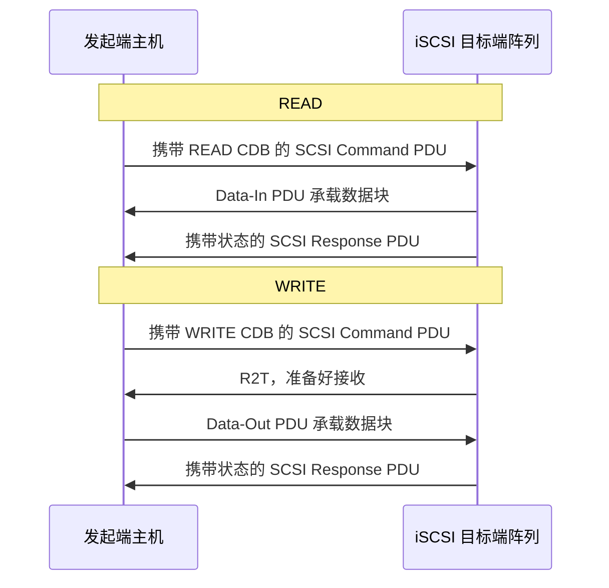
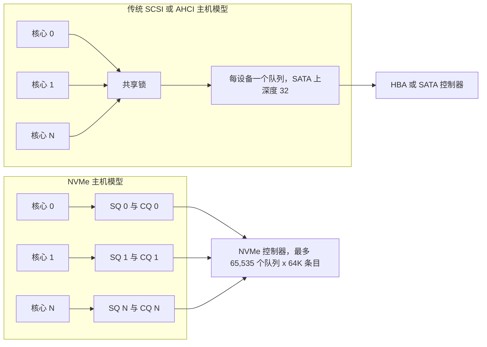
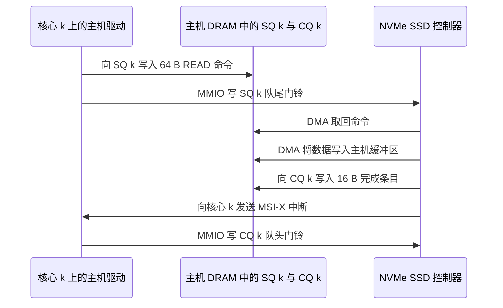
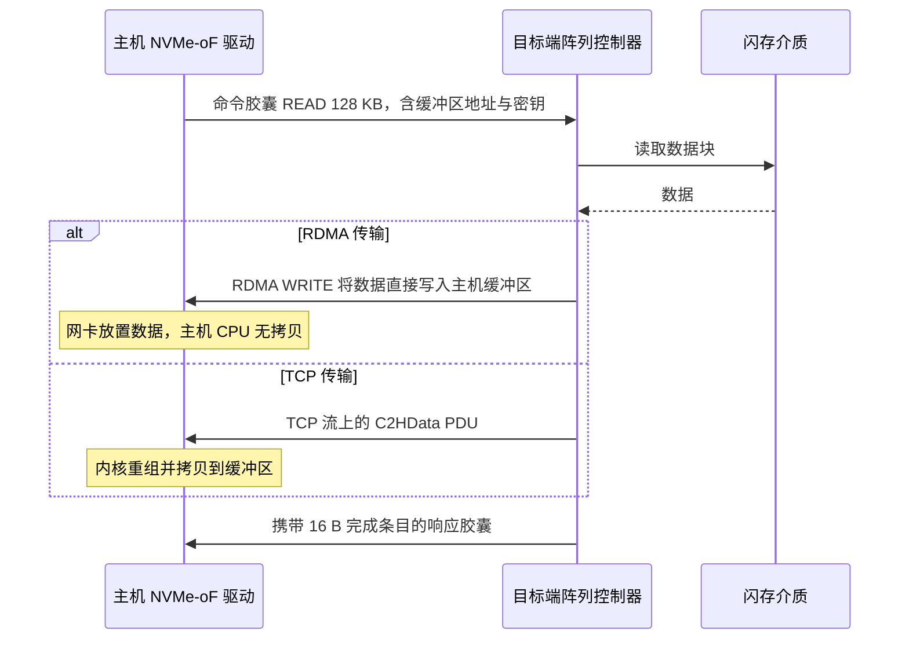
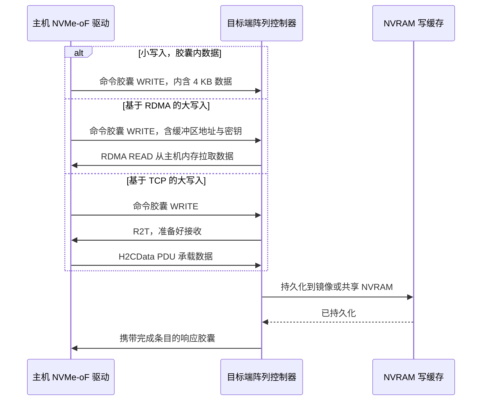
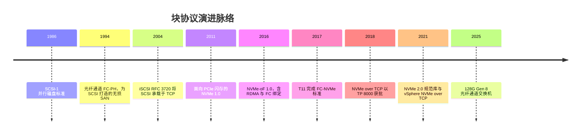

# 7. 块协议

> 📄 英文原文：[docs/02-protocols-and-networking/07-block-protocols.md](../../../docs/02-protocols-and-networking/07-block-protocols.md) · 本文为简体中文参考译本，如有出入以英文原文为准。

> **深度：** L2 · **阅读时间：** 约 10 分钟 · **最后核实：** 2026-11-01
> **前置阅读：** [存储的作用](../01-storage-fundamentals/01-what-storage-does.md) · [SSD 内部结构](../01-storage-fundamentals/03-inside-an-ssd.md) · [性能与经济性指标](../01-storage-fundamentals/04-performance-and-economics-metrics.md)

## 要点速览（TL;DR）

- **块协议 = 命令集 + 承载它的传输层**（再加上负责发现与访问控制的 fabric 服务）。SCSI 先后跑在并行线缆、光纤通道（Fibre Channel，FC）和 TCP/IP（iSCSI）上。NVMe 取代了 SCSI，而 NVMe over Fabrics（NVMe-oF）则把 NVMe 承载在 FC、RDMA 或 TCP 之上。
- **NVMe 的优势在于队列模型，而不是原始带宽。** 最多 65,535 个 I/O 队列，每个最多 64K 个条目，每个 CPU 核心独占一个或多个队列，通过门铃（doorbell）寄存器驱动，没有共享锁。
- **NVMe/TCP 是企业级市场的默认演进方向。** 它可运行在任何以太网网卡上，所有主流操作系统和阵列都已支持，额外增加的延迟约 20–35 µs，与一次闪存读取相比很小。
- **NVMe over RoCE（以太网上的 RDMA）在 AI 后端网络中胜出。** GPU 服务器本就配备 400G RDMA 网卡，免拷贝的数据搬运可以让 GPU 持续获得数据供给。
- **光纤通道并未消亡。** 2025 年 FC 销售额实现增长，128G 交换机也已发布。大多数 FC 存量环境将在同一套硬件上迁移到 NVMe/FC。

## 对 Everpure 战略的意义

FlashArray 是块存储阵列，因此其收入取决于客户服务器采用哪种连接方式。传输层更替的时间点，正是客户重新选型、传统厂商（在位者）丢失份额的时刻。当前有两个例子：一是 VMware 迁出项目——Everpure 于 2025 年 5 月与 Nutanix 建立合作，通过 NVMe/TCP 将 FlashArray 连接到 AHV 主机[^1]；二是 AI 集群——存储必须接入 GPU 已在使用的 RDMA 网络。

协议支持如今只是入场门槛，真正的战略问题更为微妙：买方会在未来十年标准化采用哪种传输？谁掌控发现（discovery）与自动化？当前端也变成 NVMe 之后，端到端 NVMe（Everpure 的 DirectFlash，参见[第 26 章](../04-everpure/26-purity-and-directflash.md)）能否形成可量化的优势？

## 核心概念

### 块协议做什么

块协议让服务器（**发起端**，initiator，或称**主机**）读写远端设备（**目标端**，target）上编号的、固定大小的块。它请求的是"第 1,000,000 块，长度 256 块"，对文件一无所知——文件是上层文件系统的职责（参见[第 1 章](../01-storage-fundamentals/01-what-storage-does.md)）。每种块协议都分为三层：

1. **命令集。** READ、WRITE、FLUSH 以及错误报告。SCSI 使用寻址到 **LUN** 的命令描述块（Command Descriptor Block，CDB）；NVMe 使用寻址到**命名空间（namespace）**的 64 字节提交队列条目（Submission Queue Entry，SQE）。
2. **传输层。** 命令、数据和状态如何在线路上传输：并行 SCSI、FC、TCP/IP、PCIe 或 RDMA。
3. **Fabric 服务。** 发现、命名、访问控制与多路径：FC zoning（分区）、iSCSI 限定名（IQN）、NVMe 限定名（NQN）以及发现控制器（discovery controller）。

命令集和传输层按照各自不同的节奏演进。

### SCSI：比它的线缆更长寿的命令集

SCSI 于 1986 年标准化，用于连接带状线缆上的磁盘[^2]。它的命令模型很丰富（sense code、集群用于隔离（fencing）的持久预留（persistent reservation）），而设计之初一次磁盘访问约需 5 ms。当时 20 µs 的软件栈只占 I/O 时间的 0.4%；而面对 80 µs 的闪存读取，它占到 25%（算例）。

更大的问题在于排队。SCSI 时代的协议栈大致为每台设备每条路径提供一个队列，各 CPU 核心争抢这个队列的锁。SATA 的 AHCI 是极端情况：只有一个队列，深度 32 条命令。持续 IOPS ≈ 未完成命令数 ÷ 延迟，因此在 100 µs 延迟下，32 条命令把一台设备的上限锁定在 32 ÷ 0.0001 s = **320,000 IOPS**，无论其背后的 NAND 有多快。Linux 后来补上了多队列层（blk-mq、scsi-mq），现代 FC 和 SAS HBA 也提供多个硬件队列，但每 LUN 的队列深度和更重的 SCSI 命令路径，仍让并发度远低于 NVMe。

### 光纤通道与 iSCSI：把 SCSI 网络化的两种方式

**光纤通道**（FC-PH，1994 年[^3]）为 SCSI 构建了一张专用的无损网络。无损是其决定性特征。每条链路使用**缓冲区到缓冲区信用（buffer-to-buffer credits）**：发送方只发送与接收方所通告缓冲区数量相等的帧，因此拥塞永远不会导致丢帧。半导体类比：这就是把 PCIe 的流控信用机制拉伸到整栋楼的范围。FC 还增加了名称服务器和 zoning（交换机上的访问控制列表），并通过 FCP 将 SCSI 映射到帧上。其结果是确定性强、由 HBA 卸载处理、由存储团队运维。它同样需要专用交换机（实际上就是 Broadcom 的 Brocade 或 Cisco MDS）、HBA 和专门技能。

**iSCSI**（RFC 3720，2004 年 4 月[^4]）把同样的 SCSI 命令放进 TCP/IP，于是任何以太网和任何服务器网卡都能组建 SAN。它让 SAN 对中端市场变得负担得起，代价是主机要为 TCP 消耗 CPU，并承受以太网有损、共享的特性。

*图 7.1 — 基于 iSCSI 的 SCSI（在 FC 中，相同步骤对应 FCP_CMND、FCP_XFER_RDY、FCP_DATA 和 FCP_RSP）：默认情况下，一次写入要多花一次往返，因为目标端必须先邀请数据，主机才会发送。如果两端协商一致，iSCSI 的 immediate/unsolicited data 和 FC 的 first burst 可以让第一块数据跳过这一步。*

### NVMe：围绕队列设计的协议

NVMe 1.0（2011 年 3 月[^5]）是为 PCIe 上的闪存而编写的，其接口围绕主机内存中成对的环形队列组织：

- **提交队列（SQ）**存放 64 字节的命令；**完成队列（CQ）**存放 16 字节的完成条目。
- 主机最多可创建 65,535 个 I/O 队列对，每个最多 64K 个条目深[^6]。驱动程序通常为每个 CPU 核心分配专属的队列对，因此没有核心需要等待其他核心的锁。
- 命令集小且格式固定，控制器可以在硬件中直接解析命令，无需遍历变长的 CDB。

*图 7.2 — NVMe 用每核心专属的队列对取代了单个受锁保护的队列；并行度来自接口本身，而不是依靠每条命令的极致速度。*

再次套用利特尔法则（Little's law）：64 个核心各自保持 32 条命令在途，总计 2,048 条未完成命令。在 100 µs 延迟下，这相当于约 **2,000 万（20 million）IOPS** 的可寻址并发能力，远超任何单块 SSD。接口不再是瓶颈。

**半导体类比：NVMe 就是一个带描述符环的 DMA 引擎。** 主机把一个描述符（SQE）写入 DRAM 中的环形队列，然后对 SSD 的 PCIe BAR 中的**门铃寄存器**执行一次内存映射写入，通告新的队尾指针。SSD 作为 PCIe 总线主设备，通过 DMA 取回描述符，再通过 DMA 将数据搬入或搬出描述符所指向的主机缓冲区，向 CQ 写入一个完成条目（带有 phase 位，便于主机区分新条目和旧条目），并触发一次 MSI-X 中断。主机消费完成条目后，再敲第二个门铃以释放 CQ 槽位。PCIe 是 NVMe 的原生传输层：该协议假设设备可以直接访问主机内存。

*图 7.3 — 基于 PCIe 的本地 NVMe：一次门铃写入启动 I/O，其余工作由设备通过 DMA 完成，这就是主机侧开销只有几微秒的原因。*

### NVMe-oF：把环形队列延伸到网络上

远端 SSD 无法通过 DMA 从主机 DRAM 中读取描述符，因此 NVMe-oF（1.0 版于 2016 年 6 月发布，含 RDMA 和 FC 绑定[^7]）改为把描述符发送过去。64 字节的 SQE 封装在**命令胶囊（command capsule）**中传输，小写入的数据可选择性地放在胶囊内部；完成条目则通过**响应胶囊（response capsule）**返回。每个 NVMe 队列对映射到一条传输连接（一个 RDMA 队列对、一条 TCP 连接，或某个 association 内的一条 FC-NVMe 连接），从而端到端保留每核心的并行性。多路径使用 **ANA**（Asymmetric Namespace Access，非对称命名空间访问），即 NVMe 版的 SCSI ALUA（参见[第 14 章](../03-system-architecture/14-scale-up-dual-controller.md)）。

各传输层的差异主要在于批量数据如何搬运：

- **RDMA（以太网上的 RoCEv2，或 InfiniBand）。** 胶囊携带已注册主机缓冲区的地址和密钥；读取时目标端以 RDMA WRITE 把数据写入该缓冲区，写入时目标端以 RDMA READ 把数据从中读出。主机 CPU 不拷贝任何字节，相对本地 NVMe 的额外延迟约 5–15 µs[^8]。代价是需要 RDMA 网卡，而 RoCE 还需要精心调优的以太网（参见[第 10 章](10-datacenter-networking.md)）。
- **TCP。** 胶囊和数据以 PDU 形式在 TCP 流上传输：读取数据以 C2HData PDU 返回（最后一个 PDU 可携带成功标志，使目标端省去响应胶囊）；超过胶囊内数据上限的写入需等待 R2T（与 iSCSI 相同），然后发送 H2CData PDU。内核负责拷贝负载并运行 TCP；早期 Linux 测试显示额外增加 20–35 µs[^9]。在重负载下差距会扩大：2018 年一项厂商测试测得 TCP 平均延迟 183 µs，RoCE 为 107 µs，尽管单个 I/O 的延迟仅相差几微秒[^10]。
- **FC（FC-NVMe，由 T11 于 2017 年标准化[^11]）。** 胶囊承载于 FC 帧，使用与 SCSI-FC 相同的 HBA、交换机、zoning 和无损信用机制，数据搬运由 HBA 卸载。

*图 7.4 — NVMe-oF 读取：各传输层的命令和完成条目完全相同，只有数据这一段不同，而 RDMA 正是在这一段节省了 CPU 和微秒级延迟。*

*图 7.5 — NVMe-oF 写入：胶囊内数据（不超过目标端通告的大小）让小写入在 RDMA 或 TCP 上一次往返即可完成；大写入则由目标端拉取（RDMA）或通过 R2T 邀请（TCP）。FC-NVMe 也有类似的 first burst 选项。*

### 各传输层对比

| 传输层 | 相对本地 NVMe 的额外延迟 | 硬件要求 | 生态 | 典型买方 |
|---|---|---|---|---|
| FC-NVMe（NVMe/FC） | 低；由 HBA 卸载。厂商声称端到端延迟比 SCSI-FC 低约 50%[^12] | FC HBA（32G 及以上）、FC 交换机、zoning | Brocade/Cisco fabric；VMware、Linux、Windows；所有主流阵列 | 已有 FC 存量环境且由存储团队掌管的企业 |
| NVMe/RoCE | 约 5–15 µs[^8] | RDMA 网卡（ConnectX/BlueField 级别）、为 RoCE 调优的交换机 | NVIDIA 网络、Linux、VMware；DASE 后端 | AI 集群、新兴 GPU 云（neocloud）、对延迟要求严苛的数据库 |
| NVMe/TCP | 早期 Linux 测试中约 20–35 µs[^9]；负载下更大[^10] | 任何以太网网卡；卸载为可选 | Linux 内核、VMware（自 2021 年起）、所有主流阵列 | 新建以太网 SAN、VMware/Nutanix 更新换代、云与软件定义存储（SDS） |
| iSCSI | 最高：TCP 加 SCSI 转换。厂商声称 NVMe/RoCE 延迟比其低约 50%[^13] | 任何以太网网卡 | 普及度最高，拥有 20 多年的工具积累 | 中端市场与分支机构；大量已部署 SAN 的长尾 |

*图 7.6 — 四种传输层在额外延迟与硬件专用化之间取舍；买方现有的 fabric 往往比那几微秒更具决定性。*

### 为什么 NVMe/TCP 是企业级市场的默认演进方向

NVMe/TCP 于 2018 年 11 月获批（TP 8000）[^14]，在 Linux 5.0 中进入上游内核[^15]，并于 2021 年底在 vSphere 7 Update 3 中进入 VMware[^16]。它赢得新建以太网 SAN 的四个原因：

1. **无需专用硬件。** 它运行在现有网卡上，像任何 TCP 流量一样可路由；RoCE 则需要 RDMA 网卡和精心设计的交换机。
2. **在关键场景中代价很小。** 在 100–200 µs 的阵列往返时间上增加 20–35 µs 是真实存在的，但对数据库或虚拟机而言很少起决定作用。2021 年的一场 SNIA 演讲报告称，其实际性能与 RoCEv2 相近[^17]。
3. **CPU 开销持续下降。** 更多的核心以及网卡/DPU 卸载缩小了拷贝开销。
4. **它无需重新培训即可替代 iSCSI。** 同样的网络、同样的团队，更好的队列模型。

尚存的差距在运维层面：大规模下的发现（Dell 的 SmartFabric Storage Software 就是为此提供的集中式发现控制器[^18]）、认证与 TLS，以及拥塞网络上的尾延迟。

### 为什么 RoCE 在 AI 后端网络中胜出

在 AI 集群中，经济账反转了。GPU 服务器本就配备多块 400G RDMA 网卡，因此 RDMA 是"免费"的；而在每台服务器数百 Gb/s 的流量下，CPU 拷贝会大量消耗主机核心。GPUDirect Storage 需要支持 RDMA 的路径，才能把数据直接送入 GPU 显存（参见[第 11 章](11-gpu-data-path.md)）。VAST 等分解式后端在内部使用 NVMe over RDMA（参见[第 16 章](../03-system-architecture/16-disaggregated-shared-everything.md)）。NVIDIA 声称，根据其自有测试，Spectrum-X 自适应路由比普通 RoCEv2 带来近 50% 的存储读取带宽提升[^19]。

### 为什么光纤通道经久不衰

FC 的存续既是技术问题，也是组织问题：一张独立的无损网络、较小的爆炸半径（影响范围）、由存储团队掌控的变更管理，以及在数十年关键业务数据库上积累的成熟诊断能力。它升级到 NVMe 的路径成本很低，因为 NVMe/FC 运行在同样的 32G 及更新一代的 HBA 和交换机上。Crehan Research 报告称，2025 年 FC 网络销售额增长 6%，64G 约占出货量的一半[^20] [VERIFY: 仅见于搜索摘要]；Broadcom 于 2025 年 11 月发布了 Gen 8 128G Brocade 交换机[^21]。

## Everpure 的做法与竞争对手对比

| 厂商 / 阵列 | NVMe/RoCE | NVMe/FC | NVMe/TCP | 值得关注的角度 |
|---|---|---|---|---|
| Everpure FlashArray | 2019 年，Purity 5.2 "DirectFlash Fabric"[^13] | 2021 年 2 月，Purity 6.1[^12] | Purity 6.4.2，2022 年 [VERIFY: 确切 GA 月份；各来源说法不一][^22] | 内部端到端 NVMe（DirectFlash）；通过 NVMe/TCP 支持 Nutanix AHV[^1] |
| NetApp ONTAP（AFF/ASA） | ONTAP 不支持，仅提供 NVMe/FC 和 NVMe/TCP[^23]；独立的 E-Series/EF 产品线有 RDMA 选项 | ONTAP 9.4，2018 年[^24] | ONTAP 9.10.1，2021 年底[^25] | 统一文件+块；庞大的 FC 存量客户群 |
| Dell PowerStore | 公开的 PowerStore 资料中未见；Dell 为以太网主机选择了 NVMe/TCP[^26] | PowerStoreOS 2.0，2021 年[^27] | PowerStoreOS 2.1，2022 年初[^28] | 用于 NVMe/TCP 发现的 SmartFabric Storage Software[^18] |

*图 7.7 — Everpure 很早就推出 RoCE，在 TCP 上则属于跟进；到 2026 年，三家厂商在 NVMe/FC 和 NVMe/TCP 上已基本持平（在这些产品线中只有 Everpure 提供 RoCE），因此差异化体现在内部数据路径以及围绕发现的自动化上。*

Everpure 率先推出 RoCE，押注的是对延迟敏感的数据库。其结构性论点是：DirectFlash 从控制器到裸 NAND 已经全程使用 NVMe，因此 NVMe 前端消除了最后一道 SCSI 转换（参见[第 26 章](../04-everpure/26-purity-and-directflash.md)）。竞争对手的最强版本论证（steelman）同样有力：Dell 的集中式发现解决了 NVMe/TCP 在规模化时的真实痛点；NetApp 统一的 ONTAP 可以在同一环境中提供 FC、NVMe 和 NAS；而由于 FC 客户很少更换 fabric，拥有最深厚 FC 关系的传统厂商往往能守住客户。基于公开信息，战略团队可以评估的选项包括：在 VMware 迁出和 Nutanix 交易中掌握 NVMe/TCP 自动化；以及判断 AI 后端的 RoCE 需求中有多少会落到块存储阵列上，而不是文件与对象存储（FlashBlade；参见[第 27 章](../04-everpure/27-flasharray-and-flashblade.md)）。

## 历史与发展轨迹

*图 7.8 — 25 年间命令集只换过一次（SCSI 到 NVMe）；传输层却不断增多，因为每个买方细分市场都带着自己的 fabric。*

一个命令集诞生于本地总线，随后被搬到每一种网络上：SCSI 从带状线缆到 FC 再到 TCP，NVMe 从 PCIe 到 RDMA 和 FC 再到 TCP。2021 年 6 月的 NVMe 2.0 重构把每种传输层拆分为独立的规范[^29]。

值得关注的信号：DPU 上的 NVMe/TCP 卸载（消除其 CPU 代价）、更好的以太网 RDMA 拥塞控制（让 RoCE 在 AI 之外也更易部署）、FC 向 128G 的迁移，以及超大规模云厂商式的块存储服务（参见[第 19 章](../03-system-architecture/19-software-defined-and-hci.md)）是否会把企业买方推向纯 NVMe/TCP 设计。

## 关键数字

| 指标 | 数值 | 背景 | 来源 / 日期 |
|---|---|---|---|
| NVMe 最大 I/O 队列数 | 65,535 个，每个最多 64K 条目 | 每控制器；每核心一个或多个 | Microsoft / NVMe 规范[^6] |
| RDMA NVMe-oF 额外延迟 | 约 5–15 µs | 每个 I/O，相对本地 NVMe | SNIA 2016[^8] |
| NVMe/TCP 额外延迟 | 约 20–35 µs | 早期 Linux 测试，裸设备 | SNIA 2019[^9] |
| 100 µs 下 SATA AHCI 上限 | 320K IOPS | 32 条未完成命令 ÷ 100 µs | 算例 |
| 100 µs 下 NVMe 并发能力 | 约 20M IOPS | 64 核心 × 每核 32 条在途 | 算例 |
| FC 网络销售额增长 | 2025 年 +6%；64G 约占出货量一半 | 企业需求持续 | Crehan Research，2026-03[^20] |
| 最新 FC 速率 | 128G（Gen 8） | 2025 年 11 月发布 | Broadcom[^21] |

## 对话手册

**向产品经理提的问题**

1. *"在新的 FlashArray 交易中，通过 NVMe/TCP、FC 和 iSCSI 连接的主机各占多少比例？两年来有何变化？"* 高质量回答：来自遥测数据、按细分市场划分的实测比例，并说明 NVMe/TCP 替代的是 iSCSI 还是 FC。
2. *"当 VMware 客户迁移到 Nutanix 或其他虚拟化平台时，存储协议会变吗？由谁决定？"* 高质量回答：点明决策者，并说明 NVMe/TCP 自动化能否缩短销售周期。
3. *"我们在哪些块存储交易中因协议原因落败？"* 高质量回答：具体案例（缺少某个自动化集成、FC 环境被竞争对手锁定），而不是"我们什么都支持"。

**向工程师提的问题**

1. *"在 FlashArray 上，NVMe/TCP 与 NVMe/RoCE 在队列深度 1 和饱和状态下的延迟差是多少？"* 高质量回答：给出两个数字、每 IOPS 的主机 CPU 开销，以及尾延迟从何处开始分化。
2. *"NVMe-oF 上的 ANA 路径和控制器故障切换，与 SCSI 上的 ALUA 相比表现如何？"* 高质量回答：路径状态的转换方式和故障切换时间。
3. *"阵列内部的 NVMe 路径是否改变了每台主机可服务的队列对数量？"* 高质量回答：每端口具体的队列和连接上限，以及面对数千台 Kubernetes 主机时的表现。

**不要这样说：**

- "NVMe-oF 更快是因为线路更快。"线路是一样的；收益来自队列模型以及没有 SCSI 转换。
- "光纤通道已经死了。"2025 年销售额在增长，128G 已在出货。应该说"份额在缩小，但存量基础稳固"。
- "NVMe/TCP 太慢，干不了正经活。"它增加的是几十微秒，而不是毫秒。
- "RoCE 和 InfiniBand 是一回事。"RoCE 共享 RDMA 语义，但运行在以太网上，并依赖拥塞管理。
- "iSCSI 和 NVMe/TCP 可以互换。"网络相同，但命令集和队列模型不同。

## 深入阅读（可选，L3 指引）

- NVM Express 基础规范与传输规范（2.x 规范库）：胶囊格式、SGL、ANA。
- Linux `nvme-tcp`、`nvme-rdma` 与 `nvmet` 驱动，以及 blk-mq 的队列到 CPU 映射。
- iSCSI RFC 7143 与 T11 FC-NVMe-2（传输错误恢复）。
- 内核旁路存储栈（SPDK）以及 DPU 上的 NVMe/TCP 卸载。

## 关键术语

- **发起端 / 目标端（Initiator / target）** — 发出块命令的主机；执行这些命令的设备。
- **LUN / 命名空间（namespace）** — SCSI 和 NVMe 中对可寻址块卷的称呼。
- **SQ / CQ** — NVMe 的命令环与完成环。
- **门铃（Doorbell）** — 用于通告新队列条目的设备寄存器。
- **胶囊（Capsule）** — NVMe-oF 的命令或响应消息。
- **ANA** — Asymmetric Namespace Access（非对称命名空间访问），NVMe 的多路径路径状态机制。
- **R2T** — Ready to Transfer（准备好接收），目标端邀请主机发送写入数据的消息。
- 其余术语参见[术语表](../glossary.md)。

## 资料来源

[^1]: SDxCentral, "Nutanix partners with Pure Storage in latest VMware assault," 2025-05. https://www.sdxcentral.com/news/nutanix-partners-with-pure-storage-in-latest-vmware-assault/ (retrieved 2026-11-01).
[^2]: INCITS T10, "X3T9.2 (SCSI) archive" (SCSI-1 published as ANSI X3.131-1986), n.d. https://t10.org/x3t9_2.htm (retrieved 2026-11-01).
[^3]: ANSI Webstore, "ANSI INCITS 230-1994 (Fibre Channel Physical and Signaling Interface, FC-PH)," n.d. https://webstore.ansi.org/standards/incits/ansiincits2301994am1996r2001 (retrieved 2026-11-01).
[^4]: IETF, J. Satran et al., "RFC 3720: Internet Small Computer Systems Interface (iSCSI)," 2004-04. https://www.rfc-editor.org/rfc/rfc3720 (retrieved 2026-11-01).
[^5]: EE Times Japan, report on the NVMHCI Working Group's release of NVM Express 1.0, 2011-03-10. https://eetimes.itmedia.co.jp/ee/articles/1103/10/news116.html (retrieved 2026-11-01); UNH-IOL, "Emerging NVM Express spec has busy year," 2014-12-15. https://iol.unh.edu/news/2014/12/15/emerging-nvm-express-spec-has-busy-year (retrieved 2026-11-01).
[^6]: Microsoft Learn, "NVME_CDW11_FEATURE_NUMBER_OF_QUEUES union (nvme.h)," n.d. https://learn.microsoft.com/en-us/windows/win32/api/nvme/ns-nvme-nvme_cdw11_feature_number_of_queues (retrieved 2026-11-01); NVM Express, "What makes NVMe architecture so efficient?" (FAQ), n.d. https://nvmexpress.org/faq-items/what-makes-nvme-architecture-so-efficient/ (retrieved 2026-11-01).
[^7]: NVM Express, "NVM Express over Fabrics Specification Released," 2016-06-09. https://nvmexpress.org/nvm-express-over-fabrics-specification-released/ (retrieved 2026-11-01).
[^8]: R. Davis (Mellanox), "Demonstrating NVMe Performance over Ethernet," SNIA Data Storage Innovation Conference, 2016. https://www.snia.org/sites/default/files/DSI/2016/presentations/stor_networks/Rob_Davis_Demonstrating_NVMe_Performance_Ethernet.pdf (retrieved 2026-11-01).
[^9]: SNIA, "Author of NVMe/TCP Spec Answers Your Questions," 2019. https://snia.org/blog/2019/author-nvmetm-tcp-spec-answers-your-questions (retrieved 2026-11-01).
[^10]: The Register, "Pavilion fabrics performance" (NVMe/TCP vs RoCE test), 2018-08-16. https://www.theregister.com/2018/08/16/pavilion_fabrics_performance (retrieved 2026-11-01).
[^11]: Fibre Channel Industry Association, "Event also signals first validation of the newly completed INCITS T11 FC-NVMe standard," 2017. https://fibrechannel.org/?p=1914 (retrieved 2026-11-01).
[^12]: Blocks & Files, "Pure Storage ramps up enterprise creds with ransomware and DR support" (Purity 6.1, NVMe/FC), 2021-02-16. https://www.blocksandfiles.com/flash/2021/02/16/pure-storage-ramps-up-enterprise-creds-with-ransomware-and-dr-support/1591949 (retrieved 2026-11-01); C. Hosterman, "What's New in Purity 6.1: NVMe-oF/Fibre Channel," 2021-02. https://www.codyhosterman.com/2021/02/whats-new-in-purity-6-1-nvme-of-fibre-channel/ (retrieved 2026-11-01).
[^13]: Techzine, "Pure Storage introduces NVMe-oF RoCE with DirectFlash Fabric," 2019-02. https://www.techzine.eu/news/data-management/38963/pure-storage-introduces-nvme-of-roce-with-directflash-fabric/ (retrieved 2026-11-01); CRN (J. F. Kovar, via Converge TP), "Pure Storage pushes all-flash performance with NVMe-oF RoCE," 2019-02-19. https://convergetp.com/2019/02/19/pure-storage-pushes-all-flash-performance-with-nvme-of-roce-intros-flash-storage-for-cloud-backups/ (retrieved 2026-11-01).
[^14]: Linux NVMe mailing list, "[PATCH v2 00/14] TCP transport binding for NVMe over Fabrics" (references ratified TP 8000), 2018-11-21. https://lore.kernel.org/all/20181121130545.GD1373@lst.de/T/ (retrieved 2026-11-01); Lightbits Labs, "Lightbits Labs celebrates NVM Express ratification of NVMe/TCP transport standard," via StorageNewsletter, 2018-12-11. https://www.storagenewsletter.com/2018/12/11/lightbits-labs-celebrates-nvm-express-ratification-of-nvme-tcp-transport-standard/ (retrieved 2026-11-01).
[^15]: NVM Express, "Answering Your Questions: NVMe/TCP: What You Need to Know About the Specification" (webcast Q&A), n.d. https://nvmexpress.org/answering-your-questions-nvme-tcp-what-you-need-to-know-about-the-specification-webcast-qa/ (retrieved 2026-11-01).
[^16]: VMware, "Announcing NVMe/TCP support in vSphere 7 Update 3," 2021-09. https://blogs.vmware.com/vsphere/?p=33749 (retrieved 2026-11-01); StorageNewsletter, "VMware vSphere 7 Update 3 with NVMe/TCP support," 2021-10-08. https://www.storagenewsletter.com/?p=239261 (retrieved 2026-11-01).
[^17]: SNIA SDC 2021, Gupta and Rajagopal, "NVMe/TCP in the enterprise," 2021. https://www.snia.org/sites/default/files/2025-05/SNIA-SDC21-Gupta-Rajagopal-NVMe-TCP-in-the-enterprise.pdf (retrieved 2026-11-01).
[^18]: Dell Technologies, "The future of software-defined networking for storage connectivity" (SmartFabric Storage Software), n.d. https://www.dell.com/fr-ca/blog/the-future-of-software-defined-networking-for-storage-connectivity/ (retrieved 2026-11-01).
[^19]: Blocks & Files, "Nvidia says Spectrum-X adaptive routing can boost storage fabric bandwidth," 2025-02-04. https://www.blocksandfiles.com/ai-ml/2025/02/04/nvidia-says-spectrum-x-adaptive-routing-can-boost-storage-fabric-bandwidth/1606433 (retrieved 2026-11-01); NVIDIA Developer Blog, "Accelerating AI storage by up to 48% with NVIDIA Spectrum-X networking platform and partners," n.d. (2025). https://developer.nvidia.com/blog/accelerating-ai-storage-by-up-to-48-with-nvidia-spectrum-x-networking-platform-and-partners/ (retrieved 2026-11-01).
[^20]: Crehan Research (via GlobeNewswire), "Fibre Channel Networking Sales Grew 6% in 2025, Reports Crehan Research," 2026-03-23. https://www.globenewswire.com/news-release/2026/03/23/3260519/0/en/Fibre-Channel-Networking-Sales-Grew-6-in-2025-Reports-Crehan-Research.html (retrieved 2026-11-01).
[^21]: Broadcom, "Broadcom introduces the world's first quantum-safe Gen 8 128G SAN switch portfolio," 2025-11-19. https://investors.broadcom.com/news-releases/news-release-details/broadcom-introduces-worlds-first-quantum-safe-gen-8-128g-san (retrieved 2026-11-01).
[^22]: Pure Storage, "Purity//FA 6.4 Release Highlights," n.d. https://blog.purestorage.com/purity-fa-releases/current-active-release-purity-fa-6-4-0 (retrieved 2026-11-01); OpenStack Cinder, "[Pure Storage] Add TCP transport type to NVMe driver" (requires Purity 6.4.2+), n.d. https://gitea09.opendev.org:3081/openstack/cinder/commit/dc77207e4c73950f1cacee5c9022586821ea6b59 (retrieved 2026-11-01).
[^23]: NetApp Knowledge Base, "Is NVMe over RoCE supported with ONTAP?" n.d. https://kb.netapp.com/on-prem/ontap/da/SAN/SAN-KBs/Is_NVME_over_ROCE_supported_with_Ontap (retrieved 2026-11-01; search-summary only).
[^24]: NetApp, "NVMe configuration, support and limitations" (ONTAP 9 documentation), n.d. https://docs.netapp.com/us-en/ontap/nvme/support-limitations.html (retrieved 2026-11-01; search-summary only).
[^25]: TechTarget, "NetApp OnTap 9.10.1 adds ransomware protection, NVMe/TCP," 2021. https://www.techtarget.com/searchstorage/news/252508661/NetApp-OnTap-9101-adds-ransomware-protection-NVMe-TCP (retrieved 2026-11-01).
[^26]: WWT, "PowerStore 2.1: NVMe over TCP and SmartFabric Storage Software," n.d. (2022). https://www.wwt.com/article/powerstore-2-1-nvme-over-tcp-smartfabric-storage-software (retrieved 2026-11-01; search-summary only).
[^27]: Channelbuzz, "Dell upgrades PowerStore software and unveils entry-level PowerStore 500 model," 2021-04. https://channelbuzz.ca/2021/04/dell-upgrades-powerstore-software-and-unveils-entry-level-powerstore-500-model-36437/ (retrieved 2026-11-01).
[^28]: Blocks & Files, "More power for PowerStore: Dell adds NVMe/TCP networking to unified file/block array," 2021-09-28. https://blocksandfiles.com/2021/09/28/more-power-for-powerstore-dell-adds-nvme-tcp-networking-to-unified-fileblock-array/ (retrieved 2026-11-01); Dell Info Hub, "What's New with the Dell PowerStoreOS 2.1 Release?" 2022. https://infohub.delltechnologies.com/en-au/p/what-s-new-with-the-dell-powerstoreos-2-1-release (retrieved 2026-11-01).
[^29]: NVM Express, "Which specifications are included in the refactored NVMe 2.0 specifications?" (FAQ), n.d. https://nvmexpress.org/?p=5558 (retrieved 2026-11-01).
