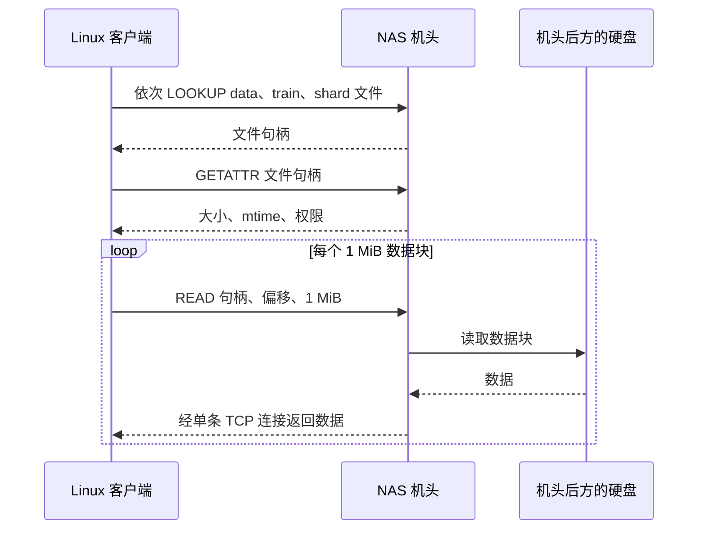
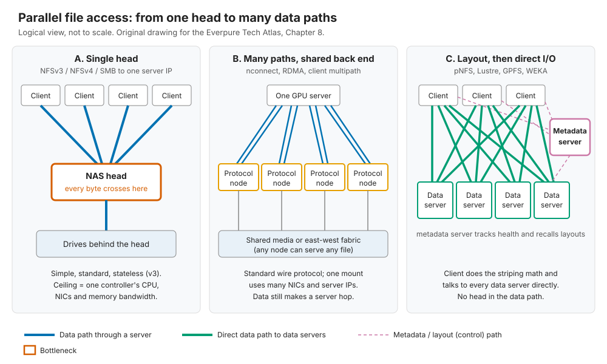
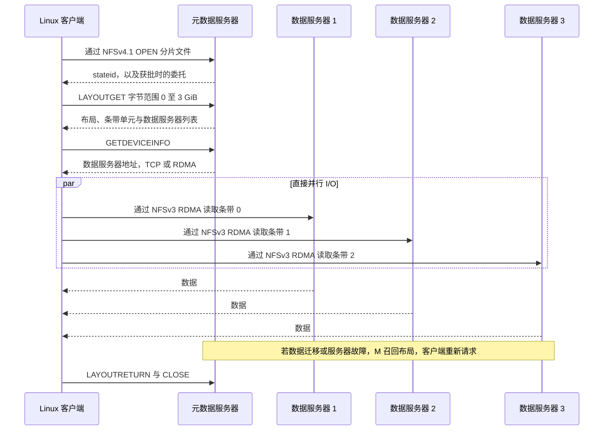
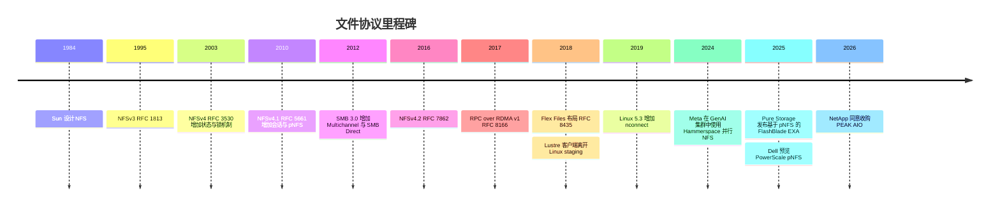

# 8. 文件协议

> 📄 英文原文：[docs/02-protocols-and-networking/08-file-protocols.md](../../../docs/02-protocols-and-networking/08-file-protocols.md) · 本文为简体中文参考译本，如有出入以英文原文为准。

> **深度：** L2 · **阅读时间：** 约 9 分钟 · **最后核实：** 2026-11-01
> **前置阅读：** [存储的作用](../01-storage-fundamentals/01-what-storage-does.md) · [块协议与 NVMe-oF](07-block-protocols.md) · [数据中心网络](10-datacenter-networking.md)（有帮助）

## 要点速览（TL;DR）

- **文件协议承载的是对名称的操作，而不是对块的操作。** 服务器掌管命名空间、锁和字节的物理位置。NFS 统治 Linux 和 AI 集群；SMB 统治 Windows。
- **NFSv3 是无状态的；NFSv4.x 是有状态的**，具备租约（lease）、委托（delegation）和集成的锁机制。v4.1 增加了会话（session）和 **pNFS**；v4.2 增加了服务器端拷贝和稀疏文件。
- **传统 NAS 存在"单机头"问题。** 每个挂载点都指向一台服务器，因此每个字节都要穿过同一个控制器。解决办法按颠覆程度从低到高依次为：`nconnect`、RDMA、客户端多路径、pNFS、专有并行客户端。
- **pNFS 把控制路径与数据路径分离。** 客户端从元数据服务器获取一份*布局（layout）*，然后直接、并行地对各数据服务器执行 I/O。Flex Files 布局（2018 年）允许这些数据服务器只是普通的 NFSv3 服务器。
- **厂商正在向"并行化，且使用 Linux 原生客户端"收敛。** Hammerspace、Everpure FlashBlade//EXA、Dell 和 NetApp 押注 pNFS；VAST 押注其多路径 NFS 客户端；Lustre、GPFS 和 WEKA 则押注专有客户端。

## 对 Everpure 战略的意义

GPU 服务器以 POSIX 文件系统的形式挂载数据、检查点和主目录，在 Linux 上这通常意味着 NFS——这也是 FlashBlade 的主要入口。因此，协议决定了交易的成败。专有并行客户端最快，但需要在每个 GPU 节点上安装软件、承受内核锁定并通过安全审查；标准 NFS 易于采用，但性能上限受制于服务器机头。

FlashBlade//EXA（2025 年 3 月）是 Pure Storage（现为 Everpure）在中间路线上的押注。它使用 pNFS：元数据经由 NFSv4.1/TCP 发送到 FlashBlade 元数据核心，数据经由 NFSv3/RDMA 直接发送到数据节点，且无需专有客户端[^1]。竞争对手也在做同样的押注：2026 年 9 月，NetApp 宣布拟收购 PEAK:AIO（尚未完成），以便为 ONTAP 引入并行 NFS[^2]；Dell 正在为 PowerScale 增加 pNFS Flex Files[^3]。评估 EXA，需要弄清 pNFS 在哪些场景胜过 VAST 的多路径 NFS 或 Lustre 客户端、又在哪些场景不及；参见[第 17 章](../03-system-architecture/17-parallel-file-systems.md)和[第 16 章](../03-system-architecture/16-disaggregated-shared-everything.md)。

## 核心概念

### 文件协议实际承载的内容

[块协议](07-block-protocols.md)说的是"读取 LBA 1,000,000 处的 8 个块"，含义交由主机的文件系统去解释。文件协议说的是"查找 `shard-00042.tar`"以及"在偏移 64 MiB 处读取 1 MiB"。由于服务器掌管命名空间和锁，多个客户端可以安全地共享数据，这正是 NAS 的意义所在。代价是：每个客户端都依赖服务器把名称转换为字节。

**半导体类比。** 在基于目录的缓存一致性协议中，由归属节点（home node）跟踪每条缓存行所在的位置。文件服务器就是这个归属节点，而传统 NAS 还要让数据也经过它。pNFS 则告诉请求方缓存行在哪里，让请求方以点对点方式直接获取。

### NFSv3：天生无状态

NFSv3（RFC 1813，1995 年）[^4]运行在 Sun RPC 之上。每个请求都携带一个不透明的**文件句柄（file handle）**，且各自独立；服务器不跟踪打开状态，因此重启之后客户端只需重试即可。正是这种简单性，让 v3 至今仍是部署最广泛的版本。无状态有三项代价：

- **锁机制位于协议之外**，依赖脆弱的 NLM/NSM 旁路协议。
- **一致性是"close-to-open"（关闭后打开一致性）。** 客户端会把属性缓存几秒，在 `open()` 时重新验证，在 `close()` 时刷新。只有在你关闭文件、而另一个客户端重新打开它之后，对方才能保证看到你的写入。
- **路径中的每一级都要一次往返。** 在第一个 `READ` 之前，每一级路径都需要一次 `LOOKUP`，外加若干 `GETATTR`。

*图 8.1 — 在 NFSv3 中，每一步元数据操作和每一个数据字节都要经过掌管该挂载点的那台服务器，因此这台服务器的 CPU 和网卡决定了性能上限。*

### NFSv4.0、4.1 与 4.2：状态、会话、布局

**NFSv4.0**（2003 年的 RFC 3530，后修订为 RFC 7530）[^5]让 NFS 变成有状态协议。客户端在可续期的**租约**下 `OPEN` 文件，锁机制也成为协议的一部分。**委托**赋予某个客户端对某文件的独占缓存权，直到服务器召回。**COMPOUND** 把多个操作（如 LOOKUP、GETATTR 和 READ）打包成一次往返。它只使用一个端口，并支持 Kerberos 和 ACL。代价是重启后需要一段宽限期，供客户端回收状态。

**NFSv4.1**（2010 年的 RFC 5661，现为 RFC 8881）[^6]增加了**会话**（使重试具有恰好一次（exactly-once）语义）、**链路聚合（trunking）**（把一个会话分散到多条连接上）以及 **pNFS**。**NFSv4.2**（RFC 7862，2016 年）[^7]增加了服务器端拷贝、稀疏文件、I/O 提示、带标签的 NFS（labeled NFS），以及 pNFS 服务器用来引导客户端的布局统计与错误报告。**Flex Files 布局**（RFC 8435，2018 年）[^8]允许数据服务器只使用普通的 NFSv3，并允许客户端镜像写入。

### 单机头瓶颈与逐级升级的解决方案

TCP 连接的每一端大致由一个 CPU 核心和一个网卡队列服务。VAST 的文档指出，在 100 Gb/s 网卡上，一个普通的 NFS/TCP 挂载约可达到 2–2.5 GB/s[^9] [VERIFY: 仅见于搜索摘要]。**算例**：一台配有两个 400 Gb/s 存储端口的 GPU 服务器可吸收 2 × 50 = 100 GB/s，相当于 100 ÷ 2.25 ≈ 44 条这样的连接。放大到 500 台服务器就是 50 TB/s，远超任何一对控制器的能力；横向扩展 NAS 节点往往还要在后台进行东西向的数据转发。五种解决办法，按颠覆程度从低到高排列（图 8.2）：

1. **`nconnect`**（Linux 5.3，2019 年）可为每个挂载点向同一服务器地址打开最多 16 条 TCP 连接[^10]。VAST 称在一块 100 Gb/s 网卡上约可达 11 GB/s[^9]：管道更多了，机头还是同一个。
2. **NFS over RDMA**（RFC 8166/8267，2017 年）[^11]让服务器把批量数据直接放入客户端内存，节省拷贝和 CPU。这也是 [GPUDirect Storage](11-gpu-data-path.md) 在 NFS 上的运行方式：NVIDIA 的 GDS 驱动支持 NFS/RDMA[^12]。VAST 称在 100 GbE 上每条 RDMA 连接约可达 8–8.5 GB/s[^9]。
3. **客户端多路径**把一个挂载点分散到多块本地网卡和多个服务器 IP 上。VAST 为此发布了自己构建的 Linux NFS 客户端版本，覆盖基于 TCP 或 RDMA 的 NFSv3 和 NFSv4.1，并报告在一台配有 8 块 200 Gb/s 网卡并启用 GDS 的 DGX A100 上达到 162 GiB/s（*公司自述*）[^13]。线路协议是标准的，客户端模块则是 VAST 自己的。它之所以可行，是因为在 [DASE](../03-system-architecture/16-disaggregated-shared-everything.md) 中任何节点都可以服务任何文件。
4. **pNFS** 修改了协议本身，让数据绕过机头（图 8.3）。
5. **专有并行客户端**（Lustre、IBM Storage Scale/GPFS、WEKA、BeeGFS）在客户端上完全取代 NFS。

*图 8.2 — 逐级升级的路径从"向同一机头接入更多管道"（A 到 B）走向"把机头移出数据路径"（C）。*

### pNFS 的工作原理

*图 8.3 — pNFS 对每个文件或范围只访问一次元数据服务器，随后并行地从多台服务器流式读取数据，因此吞吐量随数据服务器数量扩展，而不受元数据服务器限制。*

有三个特性值得关注。第一，**条带计算由客户端完成**：客户端根据条带单元和服务器列表算出偏移 X 位于哪台服务器，就像 [Lustre](../03-system-architecture/17-parallel-file-systems.md) 客户端利用其条带映射所做的那样。第二，**布局是可召回的租约**：再平衡、故障或存在冲突的写入方都会触发召回，客户端随后重新获取布局，或经由元数据服务器发送 I/O。第三，**布局类型各不相同**。"files"布局要求数据服务器支持 NFSv4.1，block 和 SCSI 布局则指向 LUN。Flex Files 接受普通的 NFSv3 服务器，这就是 Hammerspace 和 FlashBlade//EXA 在数据这一段使用 NFSv3 的原因[^1][^8]。

### SMB3：Windows 一侧

SMB 3.0（Windows Server 2012）增加了 **Multichannel**（自动把一个会话分散到多块网卡上）、**SMB Direct**（基于 iWARP、InfiniBand 或 RoCE 的 SMB over RDMA）以及透明故障切换[^14][^15]。Multichannel 还能检测 RDMA 适配器，SMB Direct 在 Windows Server 2022 中增加了加密[^14]。SMB3 功能完备，但在 Linux GPU 节点上很少见；它的重要性体现在媒体、Windows 分析业务以及作为多协议支持的勾选项。

### POSIX 语义，以及 AI 数据加载器为何需要它

AI 软件是按照 POSIX 编写的：`open`、任意偏移的 `read`、`mmap`、`fsync`、原子 `rename`。数据加载器在分片内部随机读取样本；检查点程序先写临时文件再将其重命名。NVIDIA 的 NIXL 和 Dynamo KV 分层对磁盘使用 POSIX 后端，NVIDIA 的云合作伙伴规范也要求使用带 POSIX 访问控制的 NFSv4 主目录[^16]。S3 的份额正在上升：MLPerf Storage v3.0（2026 年 9 月）中约六分之一的提交使用 S3[^17]。但 S3 没有重命名、追加或部分覆盖写，因此大多数训练代码仍然期望使用挂载点（[第 9 章](09-object-storage-and-s3.md)）。

POSIX 有多重要取决于访问模式。以读为主的数据集和"先写后重命名"的检查点在 close-to-open 下是安全的。**多个进程同时写同一个共享文件**则不安全，例如 1,024 个 rank 同时写一个检查点文件。这需要字节范围锁和跨客户端的即时可见性，Lustre、GPFS 和 WEKA 客户端通过分布式锁管理器提供这些能力。这正是安装专有客户端所换来的东西。

### 对比

| 协议 | 状态模型 | 锁机制 | 并行数据路径 | RDMA | 客户端 | 最适合场景 |
|---|---|---|---|---|---|---|
| NFSv3 | 无状态 | 旁路协议（NLM） | 否：每个挂载点一台服务器（多路径需要厂商客户端） | 是（NFS/RDMA） | 所有操作系统内置 | 简单的共享数据、遗留应用、pNFS 数据段 |
| NFSv4.1 / 4.2（不含 pNFS） | 有状态：租约、委托、会话 | 集成，基于租约 | 仅链路聚合；数据仍来自一台服务器 | 是 | 所有现代 Linux 内置 | 主目录、安全的多租户 NAS |
| pNFS（v4.1+，Flex Files） | 元数据服务器有状态；数据服务器简单 | 经由元数据服务器 | **是**：直连多台数据服务器 | 数据段支持 | Linux 原生 NFSv4.1/4.2 客户端 | 无需定制客户端的大规模 AI 训练/推理 |
| SMB3 | 有状态会话、租约 | 集成（oplocks/租约） | 跨网卡 Multichannel，同一服务器 | SMB Direct | Windows 原生；Linux CIFS | Windows、媒体、VDI、企业共享 |
| 专有并行（Lustre、GPFS、WEKA） | 有状态，分布式锁管理器 | 完整 POSIX 字节范围锁 | **是**：客户端跨存储服务器条带化 | 原生（IB/RoCE；WEKA 用 DPDK） | 厂商内核模块或代理 | 最大规模的 HPC/AI 集群、共享文件写入 |

*表 8.1 — 只有 pNFS 和专有客户端能把服务器机头移出数据路径；pNFS 做到这一点所用的客户端早已在内核中。*

专有路线是有代价的。Lustre 客户端于 2018 年离开 Linux staging 树，目前在内核树外维护[^18]，因此 GPU 集群的每次内核更新都要等待与之匹配的客户端版本。WEKA 的客户端可以借助 DPDK 绕过内核网络栈[^19]，以占用专用核心为代价换取速度。

## Everpure 的做法与竞争对手对比

| 厂商 / 产品 | 面向客户端的方式 | 客户端软件 | 备注 |
|---|---|---|---|
| Everpure FlashBlade//S | NFSv3/4.1、SMB、S3；`nconnect`；NFS over RDMA | 原生 | 横向扩展 NAS；Everpure 文档说明在 ≥ 5.3 的内核上支持 nconnect[^20]；据报道自 Purity//FB 4.3.4（2023 年底）起支持结合 GDS 的 NFS over RDMA[^21] [VERIFY: 仅见于搜索摘要；需在 Purity//FB 发布说明中确认] |
| Everpure FlashBlade//EXA | pNFS：NFSv4.1/TCP 连接元数据核心，NFSv3/RDMA 连接数据节点 | Linux 原生客户端 | 元数据核心由 1–10 个 FlashBlade 机箱组成；发布时数据节点为现成通用硬件[^1][^22] |
| VAST Data | NFSv3/4.1、NFS/RDMA、SMB、S3 | 可选的 VAST NFS 多路径客户端 | 未发现公开的 pNFS 支持：其 NFS 客户端文档（v4.5，2026 年）列出了 NFSv3 和 v4.1 的多路径，未提及 pNFS[^23]；DASE 使任何节点都是有效目标[^13] |
| Hammerspace | 基于现有 NFS 存储的 pNFS Flex Files | Linux 原生 NFSv4.2 客户端 | 元数据位于 Anvil 服务器[^24]；为 Meta 的 24k GPU 集群共同开发了并行 NFS[^25] |
| Dell PowerScale / Lightning FS | 带独立元数据服务器的 pNFS Flex Files（2026 年） | 原生 | Lightning FS 面向 >16k GPU / 4 TB/s 规模的站点[^3] |
| NetApp ONTAP / AFX | NFSv4.1 pNFS、链路聚合；PEAK:AIO 横向扩展元数据即将引入 | 原生 | 交易于 2026-09-25 宣布；条款未披露[^2][^26] |
| WEKA、DDN EXAScaler、IBM Storage Scale | 专有 POSIX 客户端（另有 NFS/SMB/S3 网关） | 厂商客户端 | 单客户端吞吐量最高且具备完整 POSIX；部署负担最重[^19] |

*表 8.2 — 应对单机头问题的三种答案：在标准 NFS 上使用更好的客户端（VAST）、采用 pNFS 标准（Everpure EXA、Hammerspace、Dell、NetApp），或使用专有客户端（WEKA、DDN、IBM）。*

**最强版本论证（steelman）。** *专有客户端*在共享文件写入方面仍然最稳妥。*VAST 的多路径*无需每次打开文件都访问元数据服务器，就能获得 pNFS 的大部分带宽，且客户端比 Lustre 轻量得多。*pNFS* 是唯一一种利用发行版自带客户端就能把机头移出数据路径的方案。Hammerspace 援引了一项基于上游 NFSv4.2 客户端、10 节点生产环境的 IO500 成绩（*公司自述*）[^27]。

**pNFS 的薄弱之处。** 它的表现取决于各发行版的 Linux 客户端，而该客户端的一位上游维护者正是 Hammerspace 的 CTO[^28]。在频繁变动的情况下，布局召回可能导致客户端停顿，元数据也会成为扩展的瓶颈点。基于公开信息，战略团队可以评估的选项包括：

- EXA 的 NFSv3/RDMA 数据段把 GDS 数据送入 GPU 显存的效果如何：Portworx 文档描述了 EXA 文件系统基于 RDMA NFS 的 GDS[^29] [VERIFY: 仅见于搜索摘要]，但 NVIDIA 对 EXA 的认证以及实测的单客户端数据尚未公开；
- FlashBlade//S 是否应增加 pNFS，从而形成从企业级到 EXA 的统一协议叙事；
- Everpure 应在多大程度上投资上游的 Linux pNFS 客户端——所有 pNFS 厂商共用这一客户端。

## 历史与发展轨迹

*图 8.4 — pNFS 标准自 2010 年就已存在，但直到 Flex Files（2018 年）出现、上游 Linux 客户端成熟之后，才在 AI 规模上得到采用；2024–2026 年是各大厂商纷纷投入的时期。*

在 15 年里，pNFS 一直是一个在寻找市场的标准，而 HPC 领域运行的是 Lustre 或 GPFS。随后，Flex Files 和更好的上游客户端消除了对专用数据服务器的需求，而 AI 买方——尤其是拥有数千个 GPU 节点的新兴 GPU 云（neocloud）——抵触专有内核模块。值得关注的方向：上游 NFSv4.2 客户端的进展（属性委托、更快的故障切换以及客户端纠删码在 2024 年均在开发中[^28]）、pNFS 数据段上的 GDS，以及 S3-over-RDMA 是否会吸收检查点和 KV 缓存流量（[第 32 章](../05-ai-storage/32-inference-and-kv-cache.md)）。

## 关键数字

| 指标 | 数值 | 背景 | 来源 / 日期 |
|---|---|---|---|
| `nconnect` 最大连接数 | 每个挂载点 16 条 | Linux 内核 ≥ 5.3 | Dell InfoHub[^10] |
| 单个 NFS/TCP 挂载，100 GbE | 约 2–2.5 GB/s | 厂商实测；使用 nconnect 约 11 GB/s | VAST KB[^9] |
| 单条 NFS/RDMA 连接，100 GbE | 约 8–8.5 GB/s | 厂商实测 | VAST KB[^9] |
| 多路径 NFS 写入单台 DGX A100 | 162 GiB/s | 8×200 Gb/s 网卡 + GDS；公司自述 | VAST 博客[^13] |
| FlashBlade//EXA 读取目标 | >10 TB/s，单一命名空间 | 公司自述，初步数据 | Everpure 简报[^1] |
| 喂饱一台 100 GB/s GPU 服务器所需连接数 | 约 44 条单 TCP 流 | 100 ÷ 2.25 GB/s | 算例 |
| MLPerf Storage v3.0 中使用 S3 的比例 | 约 1/6 的提交 | 其余使用 POSIX 文件访问 | MLCommons，2026-09-01[^17] |
| Dell Lightning FS 目标 | >16k GPU 或 >4 TB/s | 公司自述的定位 | Blocks & Files，2025-11-17[^3] |

## 对话手册

**向产品经理提的问题**

1. *"EXA 为什么选择 pNFS，而不是专有客户端或多路径客户端？"* 高质量回答：采用阻力（GPU 节点上无需内核模块，新兴 GPU 云的安全审查更快），同时坦率说明代价：共享文件写入以及对发行版客户端的依赖。
2. *"我们验证了哪些发行版和内核？在较旧的 RHEL 上会怎样？"* 高质量回答：最低版本要求、已知客户端缺陷、回退路径。
3. *"与 VAST 相比，多路径 NFS 在哪些方面与我们持平，直连路径又在哪些方面胜出？"* 高质量回答：单客户端和总体性能数字，并说明双方测试时是否启用了 GDS。

**向工程师提的问题**

1. *"检查点写到一半时某个数据节点故障，在途 I/O 会怎样？"* 高质量回答：布局召回、重试或回退、获取新布局所需时间，以及写入是如何受到保护的。
2. *"我们下发的是哪种布局类型？条带化和冗余由谁负责？"* 高质量回答：点明是 Flex Files 还是 files 布局，给出条带单元，并说明客户端是否做镜像。
3. *"元数据核心能维持多高的 create/open 速率？最先饱和的是什么？"* 高质量回答：给出每机箱的数字，并说明最先触及上限的是打开操作、布局还是目录锁（[第 21 章](../03-system-architecture/21-metadata.md)）。

**不要这样说：**

- "pNFS 是新东西。"它在 2010 年就已标准化。新的是 Flex Files、成熟的客户端和 AI 需求。
- "NFS 不能用 RDMA。"NFS/RDMA 已经标准化，而且是常见的 GDS 路径。
- "nconnect 让 NFS 实现了并行。"同一台服务器，只是连接更多。
- "NFS 就是 POSIX。"它是 close-to-open 一致性：读取没问题，并发写共享文件则不行。
- "VAST 使用 pNFS。"它的并行性来自对全共享后端的多路径访问。

## 深入阅读（可选，L3 指引）

- RFC 8881 §12–13（pNFS 与 file 布局）、RFC 8435（Flex Files）、RFC 8166/8267（RPC-over-RDMA）。
- Trond Myklebust，"Advancements in pNFS and NFSv4.2"，SNIA SDC 2024[^28]。
- Linux `fs/nfs/flexfilelayout/` 与 `net/sunrpc/xprtrdma/`；`nfs(5)` 中关于 `nconnect`、`actimeo`、`nocto` 和 `proto=rdma` 的说明。
- 完整的并行文件系统（Lustre MDS/OSS、GPFS 令牌）：[第 17 章](../03-system-architecture/17-parallel-file-systems.md)。

## 关键术语

- **文件句柄（File handle）** — NFS 中用于指代文件的不透明服务器令牌。
- **Close-to-open 一致性（Close-to-open consistency）** — 写入仅在关闭并重新打开后才对他人可见。
- **租约 / 委托（Lease / delegation）** — NFSv4 中有时限的状态；可召回的独占缓存权。
- **pNFS 布局（pNFS layout）** — 标明哪些数据服务器持有哪些字节范围的映射。
- **Flex Files** — 数据服务器可以是普通 NFSv3 的 pNFS 布局。
- **nconnect** — Linux 选项，每个挂载点最多 16 条 TCP 连接。
- **SMB Multichannel / SMB Direct** — SMB3 的多连接与 RDMA 传输。
- 其余术语参见[术语表](../glossary.md)。

## 资料来源

[^1]: Everpure, "Technical Brief: FlashBlade//EXA," n.d. (2025). https://www.everpuredata.com/content/dam/pdf/en/technical-briefs/tb-flashblade-exa.pdf (retrieved 2026-11-01); Blocks & Files, "How Pure Storage developed its disaggregated FlashBlade//EXA system," 2025-04-17. https://blocksandfiles.com/2025/04/17/how-pure-storage-developed-its-disaggregated-flashblade-exa-system/ (retrieved 2026-11-01).
[^2]: NetApp, "NetApp Announces Intent to Acquire PEAK:AIO to Advance Scalable AI Infrastructure Architecture," 2026-09-25. https://s21.q4cdn.com/371534297/files/doc_news/NetApp-Announces-Intent-to-Acquire-PEAKAIO-to-Advance-Scalable-AI-Infrastructure-Architecture-2026.pdf (retrieved 2026-11-01).
[^3]: Blocks & Files, "Dell PowerScale gets struck by Lightning and goes parallel," 2025-11-17. https://www.blocksandfiles.com/ai-ml/2025/11/17/dell-powerscale-gets-struck-by-lightning-and-goes-parallel/1711291 (retrieved 2026-11-01).
[^4]: IETF, "RFC 1813: NFS Version 3 Protocol Specification," 1995-06. https://www.rfc-editor.org/rfc/rfc1813 (retrieved 2026-11-01).
[^5]: IETF, "RFC 7530: Network File System (NFS) Version 4 Protocol" (obsoletes RFC 3530 of 2003-04), 2015-03. https://www.rfc-editor.org/rfc/rfc7530 (retrieved 2026-11-01).
[^6]: IETF, "RFC 8881: Network File System (NFS) Version 4 Minor Version 1 Protocol" (obsoletes RFC 5661 of 2010-01), 2020-08. https://www.rfc-editor.org/rfc/rfc8881 (retrieved 2026-11-01).
[^7]: IETF, "RFC 7862: Network File System (NFS) Version 4 Minor Version 2 Protocol," 2016-11. https://www.rfc-editor.org/rfc/rfc7862 (retrieved 2026-11-01).
[^8]: IETF, "RFC 8435: Parallel NFS (pNFS) Flexible File Layout," 2018-08. https://www.rfc-editor.org/rfc/rfc8435 (retrieved 2026-11-01).
[^9]: VAST Data, "NFS Features for Enhanced Performance" (knowledge base), n.d. https://kb.vastdata.com/documentation/docs/nfs-features-for-enhanced-performance (retrieved 2026-11-01).
[^10]: Dell Technologies InfoHub, "PowerScale best practices for semiconductor EDA design environments: nconnect option," n.d. https://infohub.delltechnologies.com/en-au/l/powerscale-best-practices-for-semiconductor-eda-design-environments/nconnect-option (retrieved 2026-11-01).
[^11]: IETF, "RFC 8166: Remote Direct Memory Access Transport for Remote Procedure Call, Version 1," 2017-06, https://www.rfc-editor.org/rfc/rfc8166; and "RFC 8267: NFS Upper-Layer Binding to RPC-over-RDMA Version 1," 2017-10, https://www.rfc-editor.org/rfc/rfc8267 (retrieved 2026-11-01).
[^12]: NVIDIA, "GPUDirect Storage Filesystem Kernel Driver (nvidia-fs)," n.d. https://docs.nvidia.com/gpudirect-storage/nvidia_fs/index.html (retrieved 2026-11-01).
[^13]: VAST Data, "Achieve high bandwidth performance with NFS enhancements from VAST Data" (blog), n.d. (c. 2020). https://vastdata.com/blog/meet-your-need-for-speed-with-nfs (retrieved 2026-11-01); VAST Data, "7. VAST Client NFS Multipathing" (knowledge base), n.d. https://kb.vastdata.com/docs/7-vast-client-nfs-multipathing (retrieved 2026-11-01).
[^14]: Microsoft Learn, "SMB Direct," n.d. https://learn.microsoft.com/en-us/windows-server/storage/file-server/smb-direct (retrieved 2026-11-01).
[^15]: Microsoft Support, "SMB 3.0 features in Windows Server 2012 file server" (KB 2709568), n.d. https://support.microsoft.com/kb/2709568 (retrieved 2026-11-01).
[^16]: NVIDIA Docs, "NVIDIA Requirements for AI Clouds: Storage requirements," n.d. https://docs.nvidia.com/dsx/ncp/nvidia-requirements-for-ai-clouds/storage-requirements (retrieved 2026-11-01).
[^17]: MLCommons via GlobeNewswire, "MLCommons Releases New MLPerf Storage v3.0 Benchmark Results," 2026-09-01. https://www.globenewswire.com/news-release/2026/09/01/3354412/0/en/mlcommons-releases-new-mlperf-storage-v3-0-benchmark-results.html (retrieved 2026-11-01); StorageReview, "MLPerf Storage v3.0: 877 GiB/s Checkpoints, a Cloud First, and a Leaderboard Turned Over," 2026-09. https://www.storagereview.com/news/mlperf-storage-v3-0-877-gib-s-checkpoints-a-cloud-first-and-a-leaderboard-turned-over (retrieved 2026-11-01).
[^18]: The Register, "Linux 4.18-rc1 removes Lustre filesystem," 2018-06-18. https://www.theregister.com/2018/06/18/linux_4_18_rc_1_removes_lustre_filesystem/ (retrieved 2026-11-01); LWN.net, "Getting Lustre upstream," 2025. https://lwn.net/Articles/1025268 (retrieved 2026-11-01).
[^19]: WEKA, "Networking in WEKA" (docs v5.0), n.d. https://docs.weka.io/5.0/weka-system-overview/networking-in-wekaio (retrieved 2026-11-01).
[^20]: Everpure Support, "NFS on SUSE/openSUSE: Performance Optimization," n.d. https://support.everpuredata.com/r/linux/suse-nfs-best-practices-performance-optimization (retrieved 2026-11-01).
[^21]: iThome (Taiwan), overview of GPUDirect Storage support among storage vendors (Pure Storage FlashBlade//S: NFS over RDMA, Purity//FB 4.3.4 or later, from October 2023), n.d. https://www.ithome.com.tw/tech/165670 (retrieved 2026-11-01; search-summary only, host not fetchable).
[^22]: Pure Storage, "FlashBlade//EXA for AI" (solution brief), 2025. https://www.purestorage.com/content/dam/pdf/en/solution-briefs/sb-flashblade-exa-ai.pdf (retrieved 2026-11-01).
[^23]: VAST Data, "VAST NFS documentation v4.5," 2026-04. https://vastnfs.vastdata.com/docs/4.5/index.html (retrieved 2026-11-01; search-summary only).
[^24]: Futurum, "Hammerspace shows storage acceleration for AI training at AI Field Day," n.d. https://futurumgroup.com/insights/hammerspace-shows-storage-acceleration-for-ai-training-at-ai-field-day (retrieved 2026-11-01); Hammerspace, "Hyperscale NAS," n.d. https://hammerspace.com/hyperscale-nas/ (retrieved 2026-11-01).
[^25]: Meta Engineering, "Building Meta's GenAI Infrastructure," 2024-03-12. https://engineering.fb.com/2024/03/12/data-center-engineering/building-metas-genai-infrastructure/ (retrieved 2026-11-01).
[^26]: NetApp, "Parallel NFS" (ONTAP 9 documentation), 2026-02. https://docs.netapp.com/us-en/ontap/pdfs/sidebar/Parallel_NFS.pdf (retrieved 2026-11-01).
[^27]: Hammerspace via Business Wire, "Hammerspace Breaks IO500 Barriers: First Standards-Based Linux + NFS System To Achieve True HPC-Class Performance," 2025-11-20. https://www.businesswire.com/news/home/20251120823774/en/Hammerspace-Breaks-IO500-Barriers-First-Standards-Based-Linux-NFS-System-To-Achieve-True-HPC-Class-Performance (retrieved 2026-11-01).
[^28]: SNIA, Trond Myklebust (Hammerspace), "Advancements in pNFS and NFSv4.2," SDC 2024 (posted 2025-05). https://snia.org/sites/default/files/2025-05/SNIA-SDC2024-Myklebust-Advancements-in-PNFS-NFSv4.2.pdf (retrieved 2026-11-01).
[^29]: Portworx, "Enable the FlashArray and FlashBlade driver" (FlashBlade//EXA file systems with GPUDirect Storage over RDMA NFS), n.d. https://docs.portworx.com/portworx-enterprise/platform/configure-portworx-components/enable-fa-fb-driver (retrieved 2026-11-01; search-summary only, host not fetchable).
