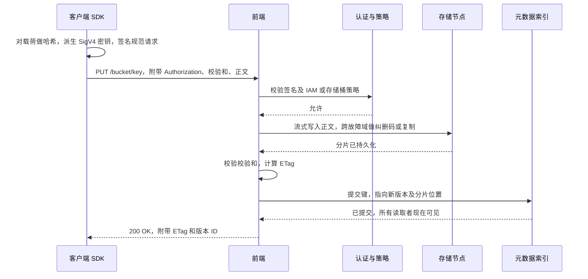
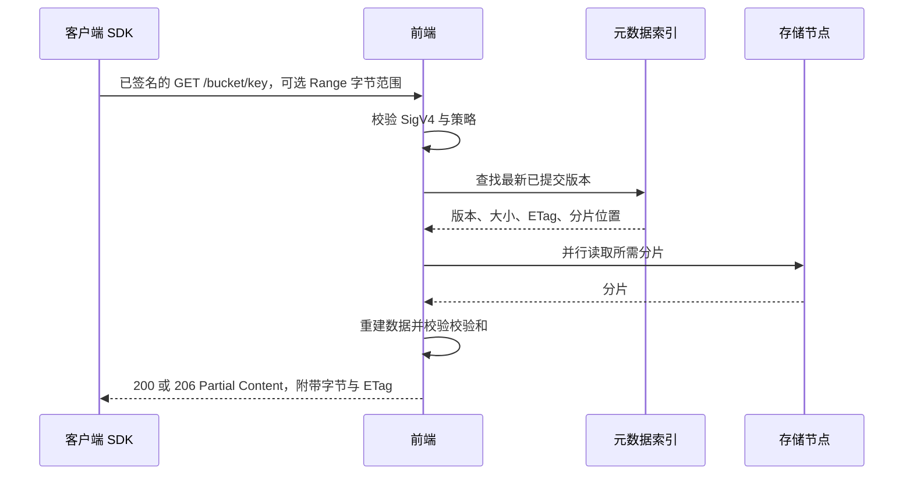
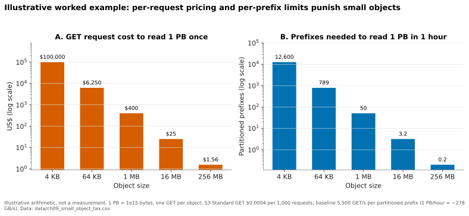
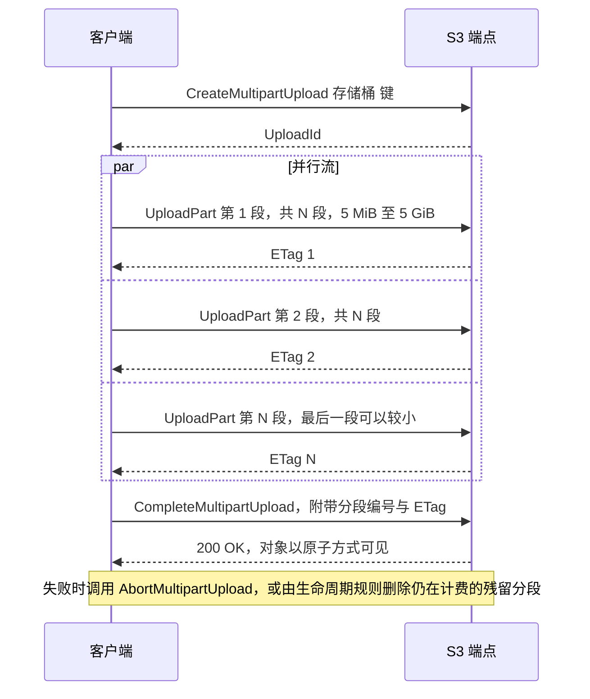
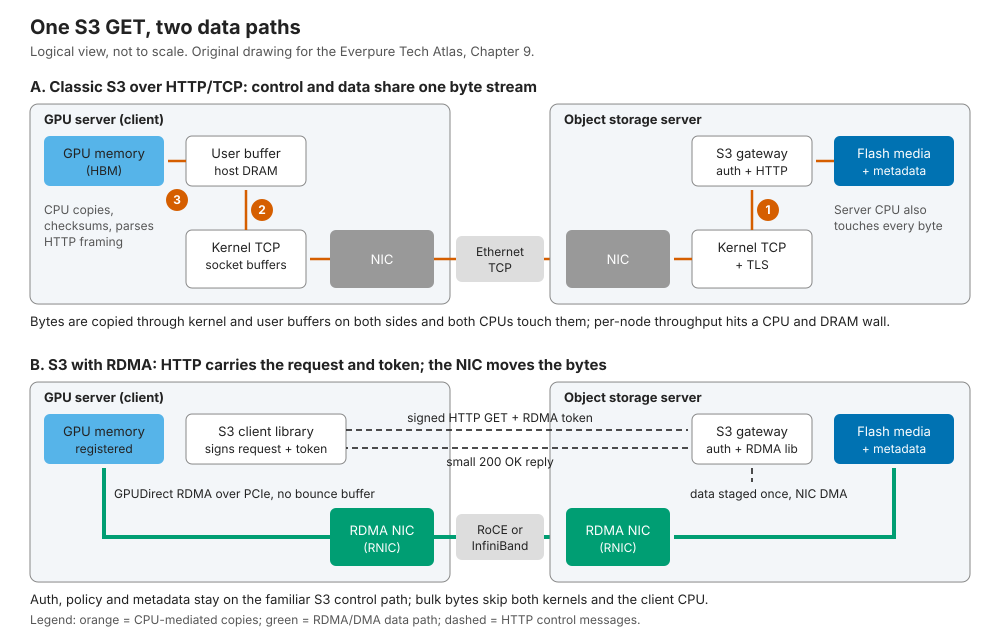
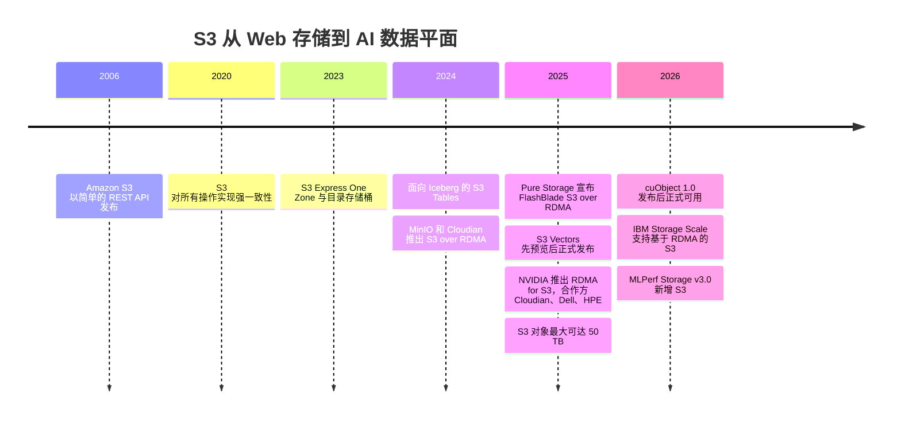

# 9. 对象存储与 S3

> 📄 英文原文：[docs/02-protocols-and-networking/09-object-storage-and-s3.md](../../../docs/02-protocols-and-networking/09-object-storage-and-s3.md) · 本文为简体中文参考译本，如有出入以英文原文为准。

> **深度：** L2 · **阅读时间：** 约 9 分钟 · **最后核实：** 2026-11-01
> **前置阅读：** [存储的作用](../01-storage-fundamentals/01-what-storage-does.md) · [文件协议](08-file-protocols.md) · [面向存储的数据中心网络](10-datacenter-networking.md)

## 要点速览（TL;DR）

- **S3 是基于 HTTP 的 REST API。** 客户端把完整对象以某个键（key）PUT 进存储桶（bucket），再用 GET 取回；每个请求都要签名（SigV4），也都要计费。没有目录、没有原地修改、没有锁：这正是它能够扩展的原因。
- **命名空间是扁平的；LIST 和小对象是薄弱环节。** "文件夹"只是键前缀。LIST 以每次 1,000 个键的方式分页遍历索引，按请求计收的费用可能超过存储费本身。
- **AWS S3 自 2020 年 12 月起提供强一致性。** 其他 S3 兼容系统表现不一，跨站点时尤其如此。
- **S3 正在成为默认的 AI 数据接口。** 湖仓（lakehouse）、数据加载器、检查点库和 KV 缓存层都以它为目标，AWS 还在不断推出 Express One Zone、S3 Tables 和 S3 Vectors。
- **S3 over RDMA 消除了"性能不够"这一借口。** HTTP 保留控制路径，RDMA 则把字节直接搬进 GPU 显存；实现方式包括 NVIDIA 的 cuObject 库（Cloudian、Dell 和 HPE 已采用）以及 MinIO 等厂商的独立实现。

## 对 Everpure 战略的意义

对 AI 买家而言，问题正从"文件还是对象？"转向"你的 S3 有多快？"。MLPerf Storage v3.0（2026 年 9 月）新增了 S3 访问层，约六分之一的提交结果使用了它[^1]。Pure Storage 将 FlashBlade 打造为统一的高速文件与对象平台，并于 2025 年 6 月为 FlashArray 增加了 S3[^2]，这与 S3 优先的趋势相契合。

威胁在于来自两个方向的商品化。借助 RDMA，对象原生厂商（Cloudian、MinIO、HPE、Dell）可以竞标过去需要并行文件系统才能承担的 GPU 供数工作。与此同时，AWS 正把表管理、向量检索和低延迟层级*纳入* S3 本身。关键问题在于：Everpure 的 S3 在小对象、LIST 和 RDMA 方面表现如何，其价值究竟在协议本身还是在协议背后的数据服务。对象存储的内部设计见[第 18 章](../03-system-architecture/18-object-storage-architecture.md)。

## 核心概念

### 模型：存储桶、键、完整对象

**对象（object）**是一段字节数据加上元数据（大小、ETag、校验和、用户标签）。对象存放在**存储桶（bucket）**中——存储桶是策略、区域、计费和版本控制的单位——并通过最长 1,024 字节的**键（key）**寻址。`s3://training/imagenet/train/0001.jpg` *看起来*像路径，但斜杠没有任何含义：它只是扁平命名空间中的一个键，控制台里的"文件夹"不过是按前缀列出的结果。

有三项设计选择使它区别于文件系统（[第 8 章](08-file-protocols.md)）：

1. **整对象写入。** 一次 PUT 以原子方式创建或替换整个对象。无法原地写入第 4,096–8,191 字节，也没有低成本的重命名："重命名文件夹"意味着复制并删除其下的每一个键。
2. **没有会话或锁。** 每个请求相互独立。条件写入（`If-None-Match: *`、`If-Match: <ETag>`）让第一个写入者胜出，之后的写入者收到 `412 Precondition Failed`[^3]。
3. **元数据很薄。** 没有 POSIX 权限、硬链接或 mtime 语义；访问控制由存储桶策略和 IAM 负责。

**半导体类比：S3 是行星级规模的 FTL。** NAND 不能覆写页，因此 FTL 会写到别处、重新映射，之后再做垃圾回收（[第 3 章](../01-storage-fundamentals/03-inside-an-ssd.md)）。S3 的覆写同样是一个新的不可变版本，再加上索引中的一次指针切换。支持原地修改的文件系统则更接近可按字节寻址的 DRAM。正是不可变性让对象存储可以激进地使用纠删码、在任何位置缓存，并且无需一致性协调流量即可复制。

### 一次 PUT 的剖析

AWS 不公开 S3 的内部实现；以下是通用模式（组件名称为示意）：

*图 9.1 — 只有在数据持久化之后、索引提交完成时，PUT 才变为可见；正是这一顺序带来了原子替换和写后读一致性。*

**SigV4** 对方法、路径、请求头和载荷哈希的规范形式进行签名，签名密钥通过链式 HMAC-SHA256 派生（secret → 日期 → 区域 → 服务）。服务端重新计算签名，因此密钥从不在线路上传输，请求也会很快过期。代价是每个请求在两端都要消耗 CPU 做哈希。

### 一次 GET 的剖析

*图 9.2 — 每次 GET 在任何数据移动之前都要付出一次认证检查和一次索引查找，因此小读取主要由固定的每请求成本主导。*

**按字节范围 GET（byte-range GET）**是主要的调优手段：把一个 1 GB 对象拆成 64 个并行的 16 MB 范围，分布在多条连接上，因为单条 HTTP 流的速度远低于网卡线速。

### LIST、前缀与小对象税

有两个数字决定了 S3 工作负载的设计。AWS 对**每个分区前缀**支持*至少*每秒 3,500 次写入和 5,500 次读取，随负载增长拆分前缀，拆分期间返回 `503 Slow Down`[^4]。此外请求是计费的：在 S3 Standard（us-east-1）中，每 1,000 次 GET 收费 $0.0004，每 1,000 次 PUT 或 LIST 收费 $0.005，而前 50 TB 的存储费为每 GB-月 $0.023[^5]。

LIST 是对有序索引的分页扫描，每次调用返回 1,000 个键。枚举 10 亿个对象需要 1,000,000 次调用：费用为 $5，但若假设每次调用约 20 ms，单线程需要 5.6 小时。这就是湖仓格式维护自己的清单（manifest）而不依赖 LIST 的原因。

*图 9.3 — 示意：每个对象 4 KB 时，请求费用和每前缀限额占主导；对象 ≥16 MB 时这些成本几乎消失，这就是 AI 数据集要打包成大分片（shard）的原因。*
数据：`data/ch09_small_object_tax.csv`

写入的情况更糟。把 1 PB 存为 4 KB 对象需要 2.5e11 次 PUT × $0.005 / 1,000 = **$1.25 million** 的费用，而每月存储费约为 $21,550（按 $0.023/$0.022/$0.021 每 GB 分档计价[^5]）：相当于 58 个月的存储费。因此才有了 tar 分片、Parquet 行组以及数百 MB 的检查点文件。

### 分段上传（multipart upload）

大对象以并行、可单独重试的分段上传，最终以原子方式变为可见：

*图 9.4 — 分段上传把一条脆弱的数 TB 级数据流变成数千个独立、可重试的分段，并通过单一原子步骤提交。*

限制为最多 10,000 个分段，每段 5 MiB–5 GiB[^6]；2025 年 12 月，AWS 将单个对象的最大尺寸从 5 TB 提高到 50 TB[^7]，约等于 10,000 × 5 GiB。因此一个 6.5 TB 的检查点（405B 参数 × 16 字节）需要每段至少 650 MB；以 64 条流 × 200 MB/s 计算，写入约需 8.5 分钟（[第 31 章](../05-ai-storage/31-training-storage.md)）。

### 一致性模型

2020 年之前，S3 只对新键保证写后读一致；覆写、删除和 LIST 都是*最终*一致的[^8]。2020 年 12 月 1 日，AWS 在不额外收费的情况下将这些操作全部改为强一致[^9]，Hadoop 的 S3Guard 元数据表等变通方案随之退役。

| 系统 | 写后读（新建与覆写） | 写后 LIST | 跨区域 / 跨站点 | 注意事项 |
|---|---|---|---|---|
| Amazon S3，2020 年 12 月之前 | 仅新键；覆写和删除为最终一致 | 最终一致 | 异步复制 | 读取者可能看到过期数据或缺失的键[^8] |
| Amazon S3，2020 年 12 月起 | 强一致 | 强一致 | 跨区域复制为异步 | 存储桶配置变更仍为最终传播[^9] |
| Google Cloud Storage | 强一致，全球范围 | 强一致 | 即使多区域存储桶也是强一致 | ACL 变更约需 1 分钟生效；已缓存的公开对象可能过期[^10] |
| Azure Blob Storage | 强一致 | 强一致 | 异地冗余的次要副本为异步 | 使用 ETag `If-Match` 实现乐观并发[^11] |
| Ceph RGW | 区域（zone）内强一致 | 区域（zone）内强一致 | 多站点为异步、最终一致；最后写入者胜出 | 站点间 RPO 不为零[^12] |
| MinIO AIStor | 严格写后读（公司自述）[^13] | 严格写后 LIST（公司自述）[^13] | 站点复制为异步 | 纠删集（erasure set）法定数写入 |

*表 9.1 — 站点内强一致性如今已是标配；跨站点则几乎所有系统都是异步的。*

强一致性意味着图 9.1 中的索引提交是一个所有读取者都能看到的单一线性化点。在 S3 的规模下（2024 年超过 350 万亿个对象、每秒 1 亿次请求[^14] [VERIFY: 仅见于搜索摘要]），这需要一个经过复制、保持一致的元数据层（[第 20 章](../03-system-architecture/20-distributed-systems-fundamentals.md)）。

### AWS 正把更多功能纳入 S3

- **S3 Express One Zone**（2023 年 11 月）：单可用区的"目录存储桶（directory bucket）"，比 S3 Standard 快至多 10 倍，请求成本低 50%（AWS 自述）[^15]，目标是个位数毫秒级延迟。2025 年 4 月的降价把存储费从每 GB-月 $0.16 降到 $0.11，GET 费用下降 85%[^16]。代价是只有单可用区的持久性。
- **S3 Tables**（2024 年 12 月）：托管的 Apache Iceberg 表，支持自动压缩合并（compaction），把湖仓维护工作移入存储服务[^17]。
- **S3 Vectors**（2025 年 7 月预览，2025 年 12 月正式发布）：每个索引 20 亿个向量、每个存储桶 20 万亿个向量，比专用向量数据库便宜至多 90%（AWS 自述）[^18]；参见[第 33 章](../05-ai-storage/33-rag-vector-lakehouse.md)。

### S3 为何成为 AI 数据接口

四股力量交汇。**湖仓**：Iceberg、Delta 和 Hudi 表就是对象存储中的 Parquet 文件加清单。**数据加载器**：PyTorch S3 连接器和 WebDataset 类库无需挂载任何东西即可流式读取分片。**检查点库**：分布式检查点是大文件，非常适合并行的分段 PUT。**推理**：NVIDIA Dynamo 的 KV Block Manager 把远程对象存储作为继 HBM、DRAM 和本地 SSD 之后的第四级缓存层[^19]；CoreWeave 在每个 GPU 节点上部署对象缓存（LOTA），宣称每 GPU 可达 7 GB/s（公司自述）[^20]。同一套 API 可运行于所有公有云、新兴 GPU 云（neocloud）和本地系统，且无需客户端内核模块。唯一缺少的是足以喂饱 GPU 的带宽。

### S3 over RDMA

传统 S3 让每个字节都经过 TCP、TLS、HTTP 解析和一次主机内存中转，因此两端 CPU 都要处理每个字节，吞吐量在 400 GbE 链路跑满之前就撞上了 CPU 与 DRAM 的瓶颈。S3 over RDMA 把请求一分为二：

*图 9.5 — S3 over RDMA 保留 HTTP 负责认证和元数据，但把大块字节交给网卡传输，从数据路径中去掉了 CPU 拷贝和中转缓冲区拷贝。*

客户端注册一块 GPU 或主机缓冲区，并把描述它的令牌放入一个普通 SigV4 签名请求的请求头（`x-amz-rdma-token`）中。服务端照常完成认证和元数据查找，然后通过基于 RoCEv2 或 InfiniBand 的 RDMA 把字节读入或写出该缓冲区；HTTP 响应只用于确认完成[^21]。部分服务端会对不支持 RDMA 的客户端回退到 HTTP 正文传输[^21]；MinIO 则返回 `x-amz-rdma-reply: 501`[^22]。这就是 PIO 与 DMA 的区别：CPU 只发出描述符，由 DMA 引擎搬运载荷，与文件领域的 GPUDirect Storage 如出一辙（[第 11 章](11-gpu-data-path.md)）。

**谁在做。** MinIO 于 2024 年 11 月推出 S3 over RDMA[^23]，Cloudian 同月展示了面向对象的 GPUDirect（宣称 >200 GB/s）[^24]。2025 年 11 月中旬，NVIDIA 将这一模式产品化为"RDMA for S3-compatible storage"（cuObject 库），点名 Cloudian、Dell 和 HPE 为采用者，并承诺于 1 月通过 CUDA Toolkit 正式发布[^25]。cuObject 1.0 的发布说明日期为 2026 年 1 月[^26]；到 2026 年秋，NVIDIA 称这些库已正式可用，并正与 Google Cloud 和 Microsoft 合作推进标准化（xio-sig）[^27]。IBM Storage Scale（2026 年 6 月）[^28]、Dell ObjectScale 4.3[^29] 以及开源的 Versity 网关（另有一个实验性的 AMD 变体[^21]）随后跟进。各厂商的数字不可直接比较：Cloudian 宣称每节点 35 GB/s、CPU 占用降低 90%[^30]；MinIO 报告一个 16 GiB 检查点加载耗时 0.65 s，而经调优的 HTTP 需要 12.16 s[^31]。

需要注意的是碎片化：这些请求头是生态系统惯例，并非 AWS 的 API，AWS 也不为 S3 提供 RDMA。目前它是一种用于本地部署和新兴 GPU 云 GPU 网络的协议。

## Everpure 的做法与竞争对手对比

| 系统 | 对象角色 | S3 over RDMA（公开状态） | 与 AI 相关的说明 |
|---|---|---|---|
| Everpure FlashBlade | 统一的高速文件与对象，单一平台 | Pure Storage 于 2025 年 3 月 GTC 宣布面向 FlashBlade//S 推出，"今年晚些时候"上市，五机箱初步性能约 250 GB/s（公司自述）[^32][^33] [VERIFY: 正式发布日期及 cuObject 兼容性；截至 2026-11 未找到正式发布公告] | 基于 S3 和 NFS 的 KV 缓存加速器[^34]；NVIDIA 认证存储 |
| Everpure FlashArray | 以块为主；2025 年 6 月新增 S3[^2] | 未宣布 | 把 S3 带入企业块存储环境 |
| VAST Data | NFS、SMB 和 S3 共用一个命名空间[^35] | 我们的调研中未能确认 | 多协议全共享架构（[第 16 章](../03-system-architecture/16-disaggregated-shared-everything.md)） |
| HPE Alletra MP X10000 | 对象原生，现已具备原生文件能力 | 是（RDMA for S3）[^25] | 首个获得 NVIDIA 认证（Foundation）的对象平台，2026 年 3 月[^36] |
| Dell ObjectScale | Dell AI Data Platform 的对象引擎 | 是，4.3 版本支持 cuObject[^29] | 与 PowerScale 和 Lightning FS 搭配 |
| Cloudian HyperStore | 纯对象，S3 原生 | 是，先行者（2024 年）[^24] | 宣称每节点 35 GB/s[^30] |
| MinIO AIStor | 软件定义对象存储 | 是，自 2024 年 11 月起[^23] | 在自建（DIY）/ 新兴 GPU 云市场较强；2025 年许可变更 |
| AWS S3 / Express One Zone | 参考 API | 否 | 把表、向量和低延迟纳入服务本身[^15][^17][^18] |

*表 9.2 — 人人都支持 S3；差异化正转向 RDMA、小对象与 LIST 性能，以及数据服务。*

对象原生厂商的最强版本论证（steelman）：从第一天起就为 S3 语义而构建，如今又有了 RDMA 吞吐量，通常每 TB 成本更低。统一平台（FlashBlade、VAST）的最强版本论证：AI 流水线会在*同一份*数据上混用 POSIX 工具和对象原生的湖仓，而在孤岛之间复制数据代价高昂。Everpure 自己对 re:Invent 2025 的解读，把 AWS 在 S3 上的动作视为企业 AI 正向对象存储收敛的证据[^37]。基于公开信息，战略团队可评估的选项包括：发布 FlashBlade S3 over RDMA 的测试结果（MLPerf Storage 现已提供 S3 路径[^1]）、在本地部署中提供与 S3 Tables/Vectors 对等的功能，以及凭借 NVIDIA 认证与 HPE、Dell 的捆绑方案展开竞争定位。

## 历史与发展轨迹

*图 9.6 — S3 从 Web 备份 API 演变为 AI 框架首选的接口，并在 2024–2026 年获得了 GPU 原生的数据路径。*

S3 于 2006 年 3 月发布，到 2021 年已存储超过 100 万亿个对象[^38]。它的 API 在没有标准组织的情况下成为事实标准：厂商纷纷克隆，兼容性由测试套件来界定。前瞻信号包括：GPU 原生数据路径（cuObject 标准化）、Google 的分区级 Rapid Storage 以有状态的 gRPC 协议取代普通 HTTP[^39]，以及 S3 吸纳表和向量功能。竞争焦点正从"你支持 S3 吗？"转向小 GET 延迟、LIST 速率，以及存储桶*内部*运行什么。

## 关键数字

| 指标 | 数值 | 背景 | 来源 / 日期 |
|---|---|---|---|
| S3 强一致性 | 自 2020-12-01 起 | GET、PUT、LIST、DELETE；不额外收费 | AWS[^9] |
| 基准请求速率 | 每秒 ≥3,500 次写入、≥5,500 次读取 | 每个分区前缀；扩展期间返回 503 | AWS 文档[^4] |
| 分段上传限制 | 10,000 个分段，每段 5 MiB–5 GiB | 自 2025 年 12 月起最大对象 50 TB | AWS[^6][^7] |
| S3 Standard 请求价格 | 每 1k 次 GET $0.0004；每 1k 次 PUT/LIST $0.005 | us-east-1；前 50 TB 存储 $0.023/GB-月 | 2026 年定价指南[^5] |
| 以 4 KB 对象存储 1 PB 的 PUT 费用 | 约 $1.25 M | 约等于 58 个月的存储费 | 算例 |
| Express One Zone 存储价格 | $0.11/GB-月（原为 $0.16） | 2025 年 4 月降价后 | AWS[^16] |
| S3 Vectors 规模 | 每索引 2 B 个向量，每存储桶 20 T 个 | 2025 年 12 月正式发布 | StorageNewsletter[^18] |
| MLPerf Storage v3.0 中 S3 的占比 | 约 1/6 的提交结果 | 首轮支持 S3 访问 | MLCommons，2026-09-01[^1] |
| RDMA 与 HTTP 检查点加载对比 | 16 GiB 耗时 0.65 s 对 12.16 s | 厂商报告（MinIO） | MinIO 博客[^31] |

## 对话手册

**向产品经理提的问题**

1. *"当一家新兴 GPU 云要求 S3 over RDMA 时，我们交付什么、支持哪些 FlashBlade 型号、配套哪些客户端库？"* 高质量回答：正式发布状态、cuObject 兼容性、支持的网卡以及实测的每节点 GB/s。
2. *"面对拥有 RDMA 且每 TB 价格更低的对象原生厂商，我们如何胜出？"* 高质量回答：同一数据上的统一文件与对象、小对象与 LIST 性能、数据缩减，并给出交易案例。
3. *"客户希望在本地获得 AWS S3 的哪些功能：条件写入、低延迟、Iceberg 表、向量？"* 高质量回答：按对交易的影响排定优先级，并坦承差距。

**向工程师提的问题**

1. *"在一个 10 亿键的存储桶上，我们的 LIST 速率是多少，如何扩展？"* 高质量回答：每秒键数，以及索引如何分片。
2. *"一次 PUT 的线性化点在哪里，上传过程中其他读取者看到什么？"* 高质量回答：索引提交、原子化的分段上传完成、条件写入的强制执行。
3. *"在 S3 over RDMA 中，令牌如何保护，TLS 又怎么处理？"* 高质量回答：认证仍在 HTTP 上完成，令牌有作用域且会过期，并说明如何缓解网络上载荷未加密的问题。

**不要这样说：**

- "S3 很慢，是冷存储。" Express One Zone 以个位数毫秒为目标；通过 RDMA 连接的 S3 能以每节点数十 GB/s 的速度为 GPU 供数。
- "S3 是最终一致的。" 自 2020 年 12 月起 AWS 已不是这样；应询问*跨站点*一致性。
- "对象存储有文件夹。" 它只有前缀；重命名一个前缀要复制其下每个对象。
- "S3 兼容就等于完全相同。" 一致性、限制和 RDMA 请求头都各不相同。
- "S3 over RDMA 是 AWS 的功能。" 它是 NVIDIA 与厂商生态面向本地 GPU 网络打造的方案。

## 深入阅读（可选，L3 指引）

- AWS S3 用户指南：SigV4、条件写入、分段上传限制、性能模式。
- NVIDIA cuObject 文档；Versity 网关的 "S3-RDMA" wiki（开源服务端，含 AMD hipObject 变体）。
- Apache Iceberg 规范（清单与 LIST 发现方式的对比）。

## 关键术语

- **对象、存储桶、键**、**SigV4**、**分段上传**、**分区前缀**、**条件写入**、**S3 over RDMA**、**cuObject**。定义见[术语表](../glossary.md)。

## 资料来源

[^1]: MLCommons via GlobeNewswire, "MLCommons Releases New MLPerf Storage v3.0 Benchmark Results," 2026-09-01. https://www.globenewswire.com/news-release/2026/09/01/3354412/0/en/mlcommons-releases-new-mlperf-storage-v3-0-benchmark-results.html (retrieved 2026-11-01).
[^2]: Techzine, "Pure surprises: FlashArray gets S3 support, FlashArray//ST without DFMs," 2025-06. https://www.techzine.eu/blogs/infrastructure/132388/pure-surprises-flasharray-gets-s3-support-flasharray-st-without-dfms/ (retrieved 2026-11-01).
[^3]: AWS, "How to prevent object overwrites with conditional writes," Amazon S3 User Guide, n.d. https://docs.aws.amazon.com/AmazonS3/latest/userguide/conditional-writes.html (retrieved 2026-11-01).
[^4]: AWS, "Best practices design patterns: optimizing Amazon S3 performance," Amazon S3 User Guide, n.d. https://docs.aws.amazon.com/AmazonS3/latest/userguide/optimizing-performance.html (retrieved 2026-11-01).
[^5]: CloudForecast, "Amazon S3 Pricing Guide (2026): Storage Classes, Requests & Hidden Costs," 2026. https://www.cloudforecast.io/blog/amazon-s3-pricing-and-optimization-guide/ ; Upstash, "AWS S3 Pricing Explained (2026)," 2026. https://upstash.com/blog/aws-s3-pricing-explained-2026 (both retrieved 2026-11-01; secondary summaries of the AWS S3 pricing page).
[^6]: AWS, "Amazon S3 multipart upload limits," Amazon S3 User Guide, n.d. https://docs.aws.amazon.com/AmazonS3/latest/userguide/qfacts.html (retrieved 2026-11-01).
[^7]: AWS What's New, "Amazon S3 increases the maximum object size to 50 TB," 2025-12-02. https://aws.amazon.com/about-aws/whats-new/2025/12/amazon-s3-maximum-object-size-50-tb/ (retrieved 2026-11-01).
[^8]: InfoQ, "AWS S3 now delivers strong read-after-write consistency," 2020-12. https://www.infoq.com/news/2020/12/aws-s3-strong-consistency/ (retrieved 2026-11-01).
[^9]: AWS What's New, "Amazon S3 now delivers strong read-after-write consistency automatically for all applications," 2020-12-01. https://aws.amazon.com/about-aws/whats-new/2020/12/amazon-s3-now-delivers-strong-read-after-write-consistency-automatically-for-all-applications (retrieved 2026-11-01).
[^10]: Google Cloud, "Cloud Storage consistency," n.d. https://cloud.google.com/storage/docs/consistency (retrieved 2026-11-01).
[^11]: Microsoft Learn, "Manage concurrency in Blob Storage," n.d. https://learn.microsoft.com/azure/storage/blobs/concurrency-manage (retrieved 2026-11-01).
[^12]: Ceph.io, "Ceph Object Storage Multisite Replication Series. Part One," 2025. https://ceph.io/en/news/blog/2025/rgw-multisite-replication_part1/ (retrieved 2026-11-01).
[^13]: MinIO, "Strict Consistency: A Hard Requirement for Primary Storage" (blog), n.d. https://blog.min.io/strict-consistency-hard-requirement-for-primary-storage (retrieved 2026-11-01; company-stated, search-summary only).
[^14]: AWS News Blog, "AWS Pi Day 2024: Use your data to power generative AI," 2024-03-14. https://aws.amazon.com/blogs/aws/aws-pi-day-2024-use-your-data-to-power-generative-ai (retrieved 2026-11-01).
[^15]: AWS What's New, "Announcing the Amazon S3 Express One Zone storage class," 2023-11-28. https://aws.amazon.com/about-aws/whats-new/2023/11/amazon-s3-express-one-zone-storage-class (retrieved 2026-11-01).
[^16]: AWS What's New, "Amazon S3 Express One Zone reduces storage and request prices," 2025-04-10. https://aws.amazon.com/about-aws/whats-new/2025/04/amazon-s3-express-one-zone-reduces-storage-request-prices/ (retrieved 2026-11-01).
[^17]: AWS, "What's new," Amazon S3 User Guide, n.d. https://docs.aws.amazon.com/AmazonS3/latest/userguide/WhatsNew.md (retrieved 2026-11-01).
[^18]: StorageNewsletter, "AWS re:Invent 2025: Amazon S3 Vectors is Now Generally Available with 40 Times the Scale of Preview," 2025-12-05. https://www.storagenewsletter.com/2025/12/05/aws-reinvent-2025-amazon-s3-vectors-is-now-generally-available-with-40-times-the-scale-of-preview/ (retrieved 2026-11-01).
[^19]: NVIDIA, "KVBM design," Dynamo documentation v1.3.0, n.d. https://docs.nvidia.com/dynamo/v1.3.0/design-docs/component-design/kvbm-design.md (retrieved 2026-11-01).
[^20]: CoreWeave, "Storage," product page, n.d. https://coreweave.com/products/storage (retrieved 2026-11-01).
[^21]: Versity, "S3 RDMA," versitygw GitHub wiki, last edited 2026-09-29. https://github.com/versity/versitygw/wiki/S3-RDMA (retrieved 2026-11-01); NVIDIA, "NVIDIA cuObject: Accelerated CUDA libraries for Object Storage," n.d. https://docs.nvidia.com/gpudirect-storage/cuobject (retrieved 2026-11-01).
[^22]: MinIO, "RDMA Acceleration," AIStor documentation, n.d. https://docs.min.io/aistor/operations/rdma/ (retrieved 2026-11-01).
[^23]: Blocks & Files, "MinIO releases AIStor with GPUDirect-like S3 over RDMA," 2024-11-13. https://blocksandfiles.com/2024/11/13/minio-releases-aistor-with-gpudirect-like-s3-over-rdma/ (retrieved 2026-11-01).
[^24]: IT Brief, "Cloudian enhances AI processing with NVIDIA GPUDirect tie-up," 2024-11. https://itbrief.co.uk/story/cloudian-enhances-ai-processing-with-nvidia-gpudirect-tie-up (retrieved 2026-11-01).
[^25]: NVIDIA Blog, "How to Unlock Accelerated AI Storage Performance With RDMA for S3-Compatible Storage," n.d. (c. 2025-11-13; secondary coverage dated 2025-11-14). https://blogs.nvidia.com/blog/s3-compatible-ai-storage/ ; Digital Watch Observatory, "NVIDIA brings RDMA acceleration to S3 object storage for AI workloads," 2025. https://dig.watch/updates/nvidia-brings-rdma-acceleration-to-s3-object-storage-for-ai-workloads (both retrieved 2026-11-01).
[^26]: NVIDIA, "NVIDIA cuObject server v1.0.0 Release Notes," 2026-01-12. https://docs.nvidia.com/gpudirect-storage/cuobject/cuobject-server-release-notes/index.html (retrieved 2026-11-01).
[^27]: NVIDIA Technical Blog, "Expanding AI Storage Access with NVIDIA cuObject and the NVIDIA SCADA Server SDK," 2026. https://developer.nvidia.com/blog/expanding-ai-storage-access-with-nvidia-cuobject-and-the-nvidia-scada-server-sdk (retrieved 2026-11-01).
[^28]: IBM Community, "IBM Storage Scale announces support for S3 over RDMA," 2026-06-16. https://community.ibm.com/community/user/blogs/ted-hoover/2026/06/16/ibm-storage-scale-announces-support-for-s3-over-rd (retrieved 2026-11-01).
[^29]: SNIA, Goldschmidt and Mether, "Update: Accelerated Object Storage," SDC AI 2026, 2026-04. https://www.snia.org/sites/default/files/2026-04/SNIA-SDCAI26-Goldschmidt-Mether-Update-Accelerated-Object-Storage_0.pdf (retrieved 2026-11-01).
[^30]: Cloudian, "Cloudian Deploys New NVIDIA RDMA for S3-Compatible Storage: A Game-Changer for AI Storage Performance," n.d. (2025). https://cloudian.com/blog/cloudian-deploys-new-nvidia-rdma-for-s3-compatible-storage-a-game-changer-for-ai-storage-performance/ (retrieved 2026-11-01).
[^31]: MinIO, "Introducing S3 over RDMA in AIStor: Object Storage at the Speed of Memory," n.d. https://www.min.io/blog/introducing-s3-over-rdma-in-aistor-object-storage-at-the-speed-of-memory (retrieved 2026-11-01).
[^32]: Pure Storage, "Pure//Launch Blog March Edition," 2025-03. https://blog.purestorage.com/?p=159567 ; StorageNewsletter, "NVIDIA GTC 2025: Pure Storage Integrates NVIDIA AI Data Platform into FlashBlade," 2025-03-19. https://www.storagenewsletter.com/2025/03/19/nvidia-gtc-2025-pure-storage-integrates-nvidia-ai-data-platform-into-flashblade/ (both retrieved 2026-11-01).
[^33]: Pure Storage, "FlashBlade Augments its Fast Object Store with S3 over RDMA for AI/ML Workflows," n.d. (2025). https://blog.purestorage.com/purely-technical/pure-storage-flashblade-fast-object-store-s3-rdma-for-ai-ml-workflows (retrieved 2026-11-01; search-summary only).
[^34]: Pure Storage, "Breaking Enterprise AI Bottlenecks: 20X Faster Inference with the First KV Cache for S3 and NFS," 2025. https://blog.purestorage.com/purely-technical/20x-faster-inference-first-kv-cache-for-s3-and-nfs/ (retrieved 2026-11-01).
[^35]: VAST Data, "Supported Platforms / Specifications," n.d. https://www.vastdata.com/specifications (retrieved 2026-11-01).
[^36]: HPE Newsroom, "HPE accelerates secure, scalable production-ready AI through new innovations with NVIDIA," 2026-03-16. https://www.hpe.com/us/en/newsroom/press-release/2026/03/hpe-accelerates-secure-scalable-production-ready-ai-through-new-innovations-with-nvidia.html (retrieved 2026-11-01).
[^37]: Everpure, "AWS re:Invent 2025: Five S3 Updates That Signal the Future of Enterprise AI Storage," 2025-12. https://blog.everpuredata.com/news-events/aws-reinvent-2025-future-of-enterprise-ai-storage/ (retrieved 2026-11-01).
[^38]: AWS News Blog, "Amazon S3's 15th Birthday – It is Still Day 1 after 5,475 Days & 100 Trillion Objects," 2021-03. https://aws.amazon.com/blogs/aws/amazon-s3s-15th-birthday-it-is-still-day-1-after-5475-days-100-trillion-objects/ (retrieved 2026-11-01).
[^39]: Google Cloud Blog, "How the Colossus stateful protocol benefits Rapid Storage," 2025-04. https://cloud.google.com/blog/products/storage-data-transfer/how-the-colossus-stateful-protocol-benefits-rapid-storage (retrieved 2026-11-01).
