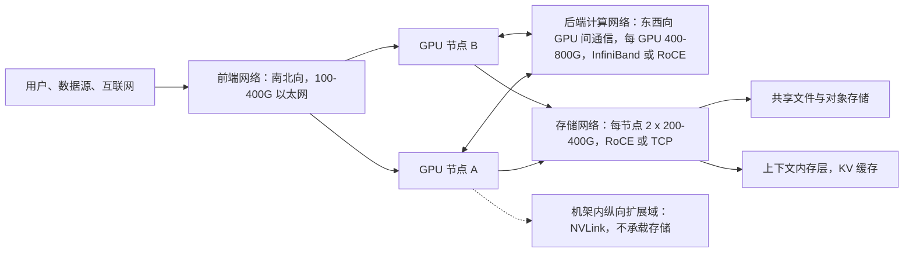
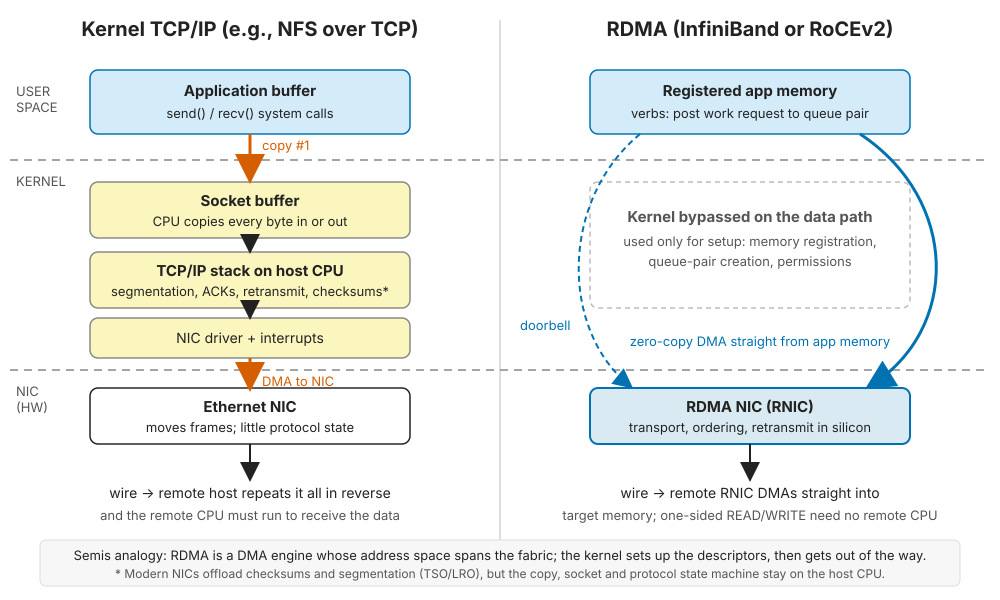
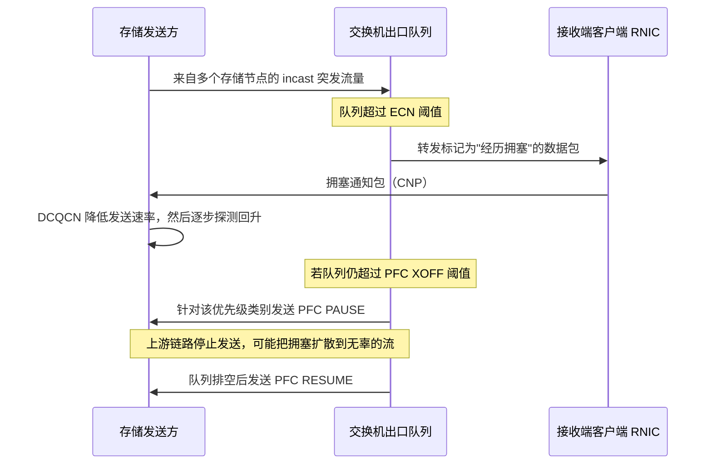
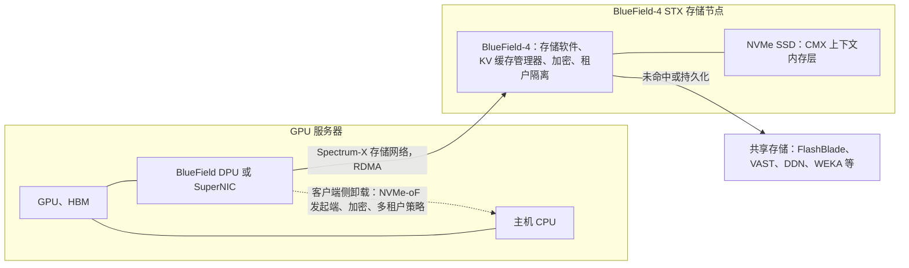
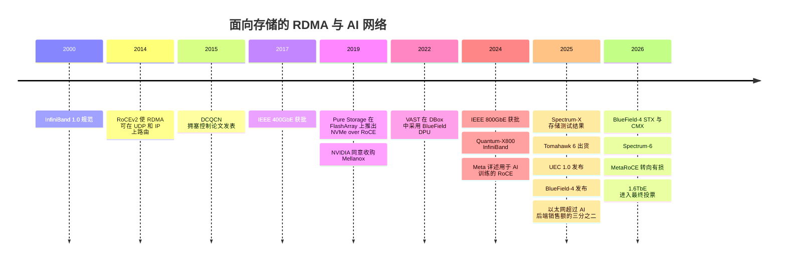

# 10. 面向存储的数据中心网络

> 📄 英文原文：[docs/02-protocols-and-networking/10-datacenter-networking.md](../../../docs/02-protocols-and-networking/10-datacenter-networking.md) · 本文为简体中文参考译本，如有出入以英文原文为准。

> **深度：** L2 · **阅读时间：** 约 11 分钟 · **最后核实：** 2026-11-01
> **前置阅读：** [块协议与 NVMe-oF](07-block-protocols.md) · [文件协议](08-file-protocols.md) · [性能与经济性指标](../01-storage-fundamentals/04-performance-and-economics-metrics.md)

## 要点速览（TL;DR）

- **在 AI 集群中，网络是存储系统的一部分。** 网络架构设计、拥塞行为和网卡卸载能力对实际交付吞吐量的影响，不亚于存储阵列本身。
- **RDMA 就是延伸到整个网络上的 DMA。** 网卡在已注册的内存区域之间搬运数据，无需内核拷贝，也无需远端 CPU 参与。
- **以太网在出货量之争中已胜过 InfiniBand。** Dell'Oro 报告称，2025 年以太网占 AI 后端交换机销售额的三分之二以上，而两年前约为 20%[^1]。但 InfiniBand 仍是许多最大规模训练集群的支柱。
- **RoCE 的软肋是拥塞。** 经典 RoCEv2 假定网络无损（PFC 暂停加上由 ECN 驱动的 DCQCN）。Spectrum-X、Ultra Ethernet（UEC 1.0，2025 年 6 月）以及 Meta 2026 年的 MetaRoCE 都在设法摆脱这种脆弱性[^2][^3]。
- **DPU 正把存储逻辑搬进网卡。** NVIDIA 的 BlueField-4 STX 参考架构（2026 年 3 月）在 800G DPU 上运行存储服务。Everpure 是点名的联合设计合作伙伴，几乎所有竞争对手也都在列[^4][^5]。

## 对 Everpure 战略的意义

在 AI 交易中，存储厂商是 NVIDIA 牌桌上的客人。NVIDIA 同时销售网卡、DPU、交换机，以及规定哪种存储接入何处的参考架构。据报道，NVIDIA 截至 2026 年 4 月的季度网络业务收入达到 US$14.8 billion，同比增长 199%[^6]。在 NVIDIA 网络上表现出色并获得认证的存储，才能进入候选名单。

由此引出三个问题。Everpure 只做以太网的姿态，是让它失去了基于 InfiniBand 的集群，还是在一个日渐萎缩的网络技术上省下了工程投入？由 BlueField 承载的存储软件，会不会让阵列控制器——Purity 创造价值的地方——走向商品化？Everpure 应向哪个网络阵营靠拢：NVIDIA、Cisco（CEO Charles Giancarlo 曾在此任职 14 年[^7]）、Arista，还是 UEC？GPU 数据路径见[第 11 章](11-gpu-data-path.md)，认证见[第 34 章](../05-ai-storage/34-nvidia-ecosystem.md)。

## 核心概念

### 三张网络，而不是一张

AI 集群运行相互独立的网络，因为各类流量模式彼此冲突：

*图 10.1 — 存储流量通常走独立的网络（或融合的前端网络），其规模只有 GPU 间后端网络的一小部分，但流量模式更为棘手。*

- **前端（南北向）：** 用户请求、数据摄取、管理流量，在许多设计中也包括存储（即"融合"前端）。
- **后端计算网络（东西向）：** all-reduce 等 GPU 集合通信，通常每个 GPU 配一块网卡。这是成本最高的网络，也是 InfiniBand 与以太网之争的焦点。Meta 运行专用的训练后端网络，以便其独立演进[^8]。
- **存储网络：** 输送数据集、吸收检查点，并越来越多地承载 KV 缓存（[第 32 章](../05-ai-storage/32-inference-and-kv-cache.md)）。

**算例（示意）。** 以一个 1,024-GPU 集群为例：128 个节点，每节点 8 个 GPU。若每个 GPU 配一块 800G 后端网卡，注入带宽为 128 × 8 × 800 Gb/s ≈ 819 Tb/s。若每个节点有 2 × 400G 存储端口，存储侧为 128 × 800 Gb/s ≈ 102 Tb/s（12.8 TB/s），约为前者的八分之一。现在要在 60 秒内为一个 405B 参数、含优化器状态的模型保存检查点，数据量约为 405e9 × 16 字节 ≈ 6.5 TB。这需要 108 GB/s ≈ 0.86 Tb/s，不到客户端侧存储带宽的 1%。瓶颈在于*存储侧*端口：0.86 Tb/s 会落在少数几个 400G 端口上（线速下两到三个）。写入时，大量客户端汇聚到少数存储端口；读取时，每个跨多个存储节点条带化读取的客户端会同时从所有节点接收数据。两者都是 **incast**（多发送方、单接收端口），这是存储网络的典型病症。

### RDMA：跨越网络的 DMA

在芯片上，DMA 引擎在内存与外设之间搬运数据块，同时 CPU 处理其他工作。RDMA（远程直接内存访问）为网卡配备了一个地址空间覆盖整个网络的 DMA 引擎。应用程序只需注册一次内存区域（内核将其锁定并把地址转换信息交给网卡），之后通过敲门铃（doorbell）向**队列对（queue pair**）投递工作请求。RDMA 网卡（RNIC）在硅片中完成传输层处理。

*图 10.2 — RDMA 从数据路径中去掉了内核拷贝和远端 CPU；内核只负责设置内存注册和队列对。*

对存储而言有三项关键特性：

1. **零拷贝。** 应用（或 GPU）内存与线路之间没有 CPU 拷贝。
2. **内核旁路。** 每次 I/O 都不需要系统调用、中断或套接字。
3. **单边操作。** RDMA READ 或 WRITE 无需目标端 CPU 即可完成，分解式设计正依赖于此（[第 16 章](../03-system-architecture/16-disaggregated-shared-everything.md)）。

**算例（示意性计算）：为什么在 400G 下拷贝很关键。** 一个 400 Gb/s 端口承载 50 GB/s。在内核 TCP 接收路径上，网卡以 50 GB/s 将数据 DMA 到内核缓冲区，随后 CPU 再读 50 GB/s、写 50 GB/s，把数据拷贝到用户空间。每个端口约产生 150 GB/s 的 DRAM 流量。一颗配备 12 通道 DDR5-4800 的服务器处理器峰值为 12 × 38.4 ≈ 461 GB/s。两个以线速运行 TCP 的 400G 端口，在应用触碰任何字节之前就会用掉其中约 65%。采用 RDMA 时，同样两个端口只消耗约 100 GB/s 的 DMA 流量。每次 I/O 的开销会进一步放大这一差距：在 4 KiB 下，50 GB/s 约等于每秒 1,200 万次 I/O；假设每次耗费 2 µs 内核 CPU 时间，就相当于约 24 个满负荷核心。WEKA 不使用 RDMA，而是在 DPDK 上运行自有用户态协议栈，也能取得类似效果[^9]。

各种传输方式的区别在于由什么承载 RDMA：

- **InfiniBand：** 专用网络，采用基于信用的流控（只有接收方有缓冲区时才发送），并由集中式子网管理器管理。
- **RoCEv2（2014 年）：** 把 InfiniBand 的传输层封装进普通以太网上可路由的 UDP/IP 数据包。Meta 的大部分 AI 算力都使用它[^8]；Microsoft 报告称 RDMA 承载了 Azure 约 70% 的流量[^10]。
- **TCP 方案：** iWARP 已失去市场；NVMe/TCP 和基于 TCP 的 NFS 仍是"无需特殊网络"的选择（[第 7 章](07-block-protocols.md)）。

| 维度 | InfiniBand（NVIDIA Quantum） | 以太网 + RoCEv2（标准交换机） | 以太网，AI 调优型（Spectrum-X、UEC） |
|---|---|---|---|
| 丢包处理 | 设计上即无损：链路级信用 | 需要 PFC 实现无损；丢包会严重拖累老一代 RNIC | Spectrum-X：无损 RoCE 加自适应路由。UEC：有损或无损均可[^11] |
| 拥塞控制 | 内置，集中管理 | DCQCN（ECN + 降速）；大规模下难以调优[^8] | 遥测驱动（Spectrum-X）；全新的 UET 拥塞控制（UEC） |
| 多路径 | 交换机内自适应路由 | 按流 ECMP 哈希；大象流相互碰撞 | 逐包喷洒（per-packet spraying），由网卡重排数据包 |
| 网内计算 | 交换机内 SHARP 归约 | 无 | 有限；厂商专有 |
| 供应商 | 实际上只有 NVIDIA | Broadcom、NVIDIA、Cisco、Marvell 等；众多 OEM | NVIDIA（Spectrum-X）；Broadcom、AMD、Cisco 等（UEC） |
| 运维 | 需要独立的技能和工具 | 与数据中心其他部分相同，但 PFC/ECN 调优需要专家 | 以太网工具加厂商专有功能 |
| 存储支持 | 在 HPC 文件系统（Lustre、GPFS）中有长期原生支持 | 最广泛：NVMe/RoCE、基于 RDMA 的 NFS、S3 over RDMA | DDN、VAST、WEKA、Everpure 发布了 Spectrum-X 存储测试结果[^12][^13] |
| 2025 年 AI 后端份额 | 不到交换机销售额的三分之一 | 以太网合计超过三分之二[^1] | （已计入左栏） |

*表 10.1 — InfiniBand 卖的是单一厂商带来的可预测性；以太网卖的是供应商选择和运维熟悉度，并且不得不补上 InfiniBand 原生具备的能力。*

### 拥塞控制：为什么"无损"对 RoCE 很重要

TCP 把丢包视为常态。RNIC 是为 InfiniBand 的无损链路设计的，许多代产品采用 **go-back-N** 方式恢复：一次丢包会迫使其后发送的所有数据全部重传，因此即使 0.1% 的丢包率也可能使有效吞吐量（goodput）崩溃。因此 RoCE 网络被设计成不丢包：

*图 10.3 — ECN 加 DCQCN 是第一道端到端的刹车；PFC 是防止丢包的紧急刹车，但可能冻结整条链路。*

- **ECN + DCQCN。** 交换机在队列积压时给数据包打标记；接收方回送通知，发送方网卡随即降速。DCQCN（Microsoft 与 Mellanox，2015 年）成为 RoCE 的默认算法[^14]。
- **PFC（优先级流控）。** 如果队列持续增长，交换机会针对该流量类别向上游发送暂停帧。不会丢包，但被暂停的链路也会阻断无关的流：造成队头阻塞、拥塞扩散，极少数情况下还会死锁[^14]。

**算例（示意）：无损要付出缓冲区代价。** 发出 PAUSE 之后，交换机必须吸收已经在途的所有数据。在一条 100 m 光纤（单向约 0.5 µs）的 400G 链路上，仅往返时间就约 1 µs；考虑到交换机和网卡的反应时间还会增加，取约 1 µs 作为下限。即 50 GB/s × 1 µs = 50 KB，再加上每个方向一个最大尺寸帧，每个端口每个无损类别约需预留 70 KB 余量（headroom）。一台 64 端口交换机仅此一项就要预留约 4.5 MB，在 800G 下翻倍。在浅缓冲区的 AI 交换机 ASIC 中，这部分缓冲区就无法用于吸收 incast。

有三种应对思路。**更精细地调优**，不过 Meta 发现 DCQCN 很难针对其训练集合通信进行调优[^8]。**让网络更智能**：Spectrum-X 将 NVIDIA 交换机与 SuperNIC 配对，把数据包喷洒到所有路径上、在接收端重排，并采用基于遥测的速率控制。NVIDIA 报告称，与 DDN、VAST 和 WEKA 合作测试时，存储读取性能比标准 RoCE 高 20–48%[^12]；Everpure 报告在 FlashBlade//EXA 上读取提升 25%、写入提升 23%，并改善了嘈杂邻居（noisy-neighbour）隔离[^13] [VERIFY: 仅见于搜索摘要]。以上均为厂商自行进行的测试。**不再依赖无损**：UEC 1.0（2025 年 6 月 11 日发布）定义了全新的传输协议 UET，支持逐包多路径、乱序交付和有损网络，并可选链路级重传和基于信用的流控[^2][^11]。Meta 2026 年 8 月的 MetaRoCE 同样把以太网视为有损网络，不使用 PFC[^3] [VERIFY: 仅见于搜索摘要]。

### 存储路径中的 DPU

**SmartNIC** 卸载固定功能（校验和、RoCE、加密）。**DPU** 在此基础上增加了通用 CPU 集群和内存，因此可以运行存储客户端、存储目标端或防火墙。这相当于服务器的 I/O 裸片（die）变成了一块可编程的芯粒（chiplet）。

BlueField-3 是一款 400G 器件，配备 16 个 Arm 核心。BlueField-4 于 2025 年 10 月发布、面向 2026 年，将 800G ConnectX-9 与 64 核 Grace CPU 结合，NVIDIA 称其算力是 BlueField-3 的 6 倍[^15][^16]。

*图 10.4 — DPU 位于存储路径的两端：在客户端，它向主机屏蔽存储细节；在 STX 中，它本身就成了存储控制器。*

DPU 在存储中扮演三种角色：

1. **客户端侧卸载。** DPU 终结存储协议，并执行加密和租户隔离，这对出租裸金属服务器的新兴 GPU 云（neocloud）很重要。
2. **目标端控制器。** 自 2022 年起，VAST 就在其 DBox 机箱中使用 BlueField DPU 作为网络端点[^17]。
3. **在 DPU 上运行存储软件。** 在 CES 2026 上，NVIDIA 发布了基于 BlueField-4、面向 KV 缓存的上下文内存存储层[^18]。2026 年 3 月 16 日的 GTC 上，它将其推广为 **BlueField-4 STX**——一种基于 Vera Rubin、BlueField-4 和 Spectrum-X 的模块化存储参考架构，其首个机架级实现是 **CMX** 上下文内存平台[^4]。点名的联合设计合作伙伴包括 Cloudian、DDN、Dell、Everpure、Hitachi Vantara、HPE、IBM、MinIO、NetApp、Nutanix、VAST 和 WEKA[^5]。VAST 表示将在 BlueField-4 上原生运行其 CNode 软件[^19]。Everpure 表示正在使 FlashBlade//EXA 与 STX 对齐[^20]。

其中的张力在于：STX 让 NVIDIA 成为参考控制器硬件的提供方，厂商只能在 NVIDIA 芯片上运行的软件层面竞争，这有利于软件定义型厂商，而不利于依靠控制器硬件实现差异化的厂商。

### 链路速率及其底层的 SerDes 引擎

端口速率 = 通道（lane）速率 × 通道数，而通道速率由 SerDes 代际决定：

| SerDes 等级 | 通道速率、调制方式 | 4 通道端口 | 8 通道端口 | 首个 IEEE 标准 |
|---|---|---|---|---|
| 28G | 25G NRZ | 100GbE | — | 802.3bm 时代的 100GbE 光模块 |
| 56G | 50G PAM4 | 200GbE | 400GbE | 802.3bs，2017 年 12 月[^21] |
| 112G | 100G PAM4 | 400GbE | 800GbE | 802.3ck，2022 年 9 月[^22]；802.3df，2024 年 2 月[^23] |
| 224G | 200G PAM4 | 800GbE | 1.6TbE | 802.3dj，2026 年 10 月仍在投票中[^24] |

*表 10.2 — SerDes 每翻一番就带来下一代端口速率；PAM4 使每个符号承载的比特数翻倍，代价是更严格的信号完整性要求，这也是传输距离缩短、共封装光学（co-packaged optics）登场的原因。*

*图 10.5 — 产品如今领先于标准出货：NVIDIA 的 800G InfiniBand 和具备 1.6T 能力的以太网芯片，都在 IEEE 完成 1.6TbE 标准之前问世。*
数据：`data/ch10_link_speeds.csv`

224G 一代已在芯片层面落地。Quantum-X800（2024 年 3 月）的 800G 端口运行在每通道 200G 的 SerDes 上，是这一代最早的交换机之一[^25]。Broadcom 的 Tomahawk 6（2025 年 6 月）和 NVIDIA 的 Spectrum-6（CES 2026）单芯片均达到 102.4 Tb/s[^26][^27]。一个 800G 客户端端口的摄入速率为 100 GB/s，超过整台中端阵列的能力，因此阵列必须横向扩展，或者置于缓存层之后。

## Everpure 的做法与竞争对手对比

| 厂商 | 网络姿态（公开信息） | 与 NVIDIA 网络的协同 | 其他网络协同 |
|---|---|---|---|
| Everpure | 只做以太网：FlashArray 自 Purity 5.2（2019 年）起支持 NVMe/RoCE[^28]；FlashBlade 采用 400GbE RoCE，在 SuperPOD 设计中每台 FlashBlade//S R2 配 16 个端口[^29] | 基于以太网获得 SuperPOD 认证（2024 年）[^30]；Spectrum-X 测试[^13]；STX 联合设计合作伙伴[^5] | Cisco FlashStack 与 Secure AI Factory[^31][^32] |
| VAST Data | 基于 RDMA 的 NFS；DBox 内置 BlueField DPU[^17] | 经 Spectrum-X 测试[^12]；CNode 运行于 BlueField-4[^19] | Cisco UCS 与 Nexus HyperFabric[^33] |
| DDN | 源自 InfiniBand 上的 Lustre（EXAScaler）；Infinia 运行于以太网 | Spectrum-X "Inferno" 捆绑方案（GTC 2025）[^34] | HPC 系统集成商 |
| WEKA | 基于以太网或 InfiniBand 的 DPDK 用户态协议栈[^9] | 经 Spectrum-X 测试[^12]；STX 集成 | 云原生网络（AWS、OCI） |
| HPE | Slingshot HPC 网络；宣称 UEC 传输协议约 75% 源自 Slingshot[^2] | STX 合作伙伴[^5] | UEC 阵营 |

*表 10.3 — Everpure 在以太网上与 NVIDIA 紧密协同，但与 DDN、VAST 和 WEKA 不同，它没有公开的 InfiniBand 方案。*

**Everpure 只做以太网立场的最强版本论证（steelman）。** 市场正朝它的方向发展：以太网已超过 AI 后端交换机销售额的三分之二[^1]；专注一个网络技术家族能让工程资源更集中；Cisco 则提供了进入企业 AI 工厂的通道。

**竞争对手的最强版本论证。** 在最大规模的 InfiniBand 训练集群中，DDN、VAST 和 WEKA 可以原生接入，而 Everpure 不能 [VERIFY: 是否有任何 FlashBlade 型号提供 InfiniBand 连接]。VAST 在 BlueField 上的先发优势（自 2022 年起在 DBox 中使用）使它天然具备 STX 叙事。基于公开信息，战略团队可评估的选项包括：Purity 的元数据和数据缩减引擎能否作为 STX 的一种"personality"运行在 BlueField-4 上；随着基于 Broadcom 的网络增长，Spectrum-X 认证深度与 UEC 中立性相比孰轻孰重；以及与 Cisco 或 Arista 更深度的协同，能否对冲 NVIDIA 既是合作伙伴又是参考架构把关者的双重角色。

## 历史与发展轨迹

*图 10.6 — RDMA 作为 HPC 小众技术存在了 20 年，随后 AI 使其成为默认的存储传输协议，争论也从"InfiniBand 还是以太网"转向"哪一种以太网"。*

InfiniBand 起源于 2000 年前后一项旨在取代服务器 I/O 的努力，后来在 HPC 领域存活下来，Mellanox 使其成为该领域的默认选择。收购 Mellanox（2019 年 3 月 11 日宣布，作价 US$6.9 billion；2020 年 4 月完成）让 NVIDIA 同时拥有了领先的 InfiniBand 技术栈和领先的 RNIC 产品线[^35]。Ultra Ethernet Consortium 于 2023 年 7 月作为 Linux Foundation（Joint Development Foundation）项目成立，创始成员为 AMD、Arista、Broadcom、Cisco、Eviden、HPE、Intel、Meta 和 Microsoft，目标是为开放以太网带来类似 InfiniBand 的特性[^36]。NVIDIA 并非创始成员。SNIA 的 Storage.AI 项目（2025 年 8 月）将 UEC 列为合作伙伴，暗示存储协议将针对 UET 制定配置规范（profile）[^37]。

2026–2028 年的三个信号：（1）随着 802.3dj 完成，基于 224G SerDes 的 **1.6T 客户端端口**[^24]；（2）**容忍有损的 RDMA**（UEC、MetaRoCE）降低 PFC 调优难度；（3）通过 STX 实现**存储软件迁移到 DPU 上**，硬件于 2026 年下半年推出[^4]。

## 关键数字

| 指标 | 数值 | 背景 | 来源 / 日期 |
|---|---|---|---|
| 以太网在 AI 后端交换机销售额中的份额 | >2/3（2025 年），两年前约 20% | Dell'Oro；InfiniBand 曾约占 80% | Dell'Oro，2025–26[^1] |
| NVIDIA 网络业务收入 | US$14.8 B，同比 +199% | 截至 2026-04-26 的季度 | NVIDIA Q1 FY27 报道[^6] |
| Spectrum-X 相对 RoCE 的存储读取提升 | 20–48%（写入 9–41%） | NVIDIA 与 DDN、VAST、WEKA 的测试 | NVIDIA，2025-02-04[^12] |
| Everpure Spectrum-X 内部测试 | 读取 +25%，写入 +23% | FlashBlade//EXA，400G；厂商测试 | Everpure 博客，2026[^13] |
| BlueField-4 | 800G，64 个 Grace 核心，算力约为 BlueField-3 的 6 倍 | 2026 年随 Vera Rubin 推出 | STH / CRN，2025-10[^15][^16] |
| UEC 1.0 发布 | 2025 年 6 月 11 日 | 全新 UET 传输协议；有损或无损 | DCD，2025-06-11[^2] |
| 顶级交换机 ASIC 带宽 | 102.4 Tb/s（200G 通道） | Tomahawk 6、Spectrum-6 | Broadcom 2025-06-03[^26]；SDxCentral 2026-01[^27] |
| 每个 400G 端口的 DRAM 流量，TCP 对 RDMA | 约 150 GB/s 对约 50 GB/s | 接收时一次内核拷贝 | 算例 |
| 每个 400G 端口的 PFC 余量 | 每个无损类别约 70 KB | 100 m 链路，约 1 µs 反应时间 | 算例 |

## 对话手册

**向产品经理提的问题**

1. *"在哪些 AI 交易中，我们因客户网络是 InfiniBand 而失利？"* 高质量回答会量化流失的商机，并清楚这些客户是否本就另建了以太网存储网络——这种情况很常见。
2. *"BlueField-4 STX 对我们的控制器路线图意味着什么：合作、移植还是竞争？"* 高质量回答会把 CMX 上下文内存层与完整的控制器角色区分开，并对 Purity 运行在 Arm/Grace 上有明确看法。
3. *"FlashBlade//EXA 的物料清单中网络占多少，由谁供应？"* 高质量回答会给出百分比，并说明是否复用客户现有网络。

**向工程师提的问题**

1. *"我们的 RoCE 是否要求 PFC，在有损网络上会怎样？"* 高质量回答：说出 RNIC 的丢包恢复模式、在 0.01–0.1% 丢包率下的吞吐量下降幅度，以及推荐的 ECN 和 PFC 阈值。
2. *"一次 128 个客户端的检查点突发流量，在我们的存储侧端口上表现如何？"* 高质量回答：引用 incast 实测数据，并说明逐包喷洒对基于 RDMA 的 NFS 是有利还是有害。
3. *"我们的 UEC 计划是什么？"* 高质量回答：知道哪些网卡已支持 UET，以及 NFS、NVMe-oF 和 S3 over RDMA 将如何映射到 UET 上。

**不要这样说：**

- "RDMA 就是更快的以太网。" RDMA 是一种传输协议，既可运行于 InfiniBand *也可*运行于以太网。
- "InfiniBand 已经死了。" 它仍是许多最大规模训练集群的支柱，并在 2025 年第二季度强劲增长[^1]。
- "无损意味着没有拥塞。" PFC 通过暂停链路来防止丢包，而这可能扩散拥塞。
- "800G 就是 800 GB/s。" 它是 800 Gb/s，即扣除协议开销前的 100 GB/s。
- "DPU 就是 SmartNIC。" DPU 运行通用软件；这一区别正是整个 STX 论点的核心。

## 深入阅读（可选，L3 指引）

- Zhu 等，SIGCOMM 2015：DCQCN 的流体模型与缓冲区调优[^14]。
- Gangidi 等，SIGCOMM 2024：Meta 的 RoCE 拓扑、路由与 DCQCN 实践经验[^8]。
- ultraethernet.org 上的 UEC Specification 1.0：UET 的语义层、数据包交付层和拥塞控制子层。
- InfiniBand Architecture Specification Vol. 1, Annex A17（RoCEv2），了解线路格式。

## 关键术语

- **RDMA / RNIC** — 远程直接内存访问；在硬件中实现它的网卡。
- **RoCEv2** — 通过以太网上的 UDP/IP 承载的 RDMA 传输协议。
- **PFC、ECN、DCQCN** — 暂停帧、拥塞标记和 RoCE 速率控制。
- **Incast** — 多个发送方汇聚到同一个接收端口。
- **DPU / SuperNIC** — 自带 CPU 集群的网卡；NVIDIA 面向 AI 调优的网卡。
- **UEC / UET** — Ultra Ethernet Consortium 及其传输协议。
- **SerDes、PAM4** — 端口速率背后的通道与四电平信号调制。
- 其余术语见[术语表](../glossary.md)。

## 资料来源

[^1]: Dell'Oro Group, "Ethernet more than doubles size of InfiniBand as the leading fabric for AI scale-out networks in 2025," 2026; and "2026 predictions: data center switch, front-end and AI back-end networks," 2026. https://www.delloro.com/news/ethernet-more-than-doubles-size-of-infiniband-as-the-leading-fabric-for-ai-scale-out-networks-in-2025/ ; https://www.delloro.com/2026-predictions-data-center-switch-frontend-ai-backed-networks/ (retrieved 2026-11-01; search-summary only: the 4Q25 release says Ethernet took more than two-thirds of AI-cluster switch sales in the quarter and the full year, against InfiniBand's ~80% two years earlier; corroborated by insideHPC, "Report: AI Back-End Networks Continue Shift to Ethernet," 2025-12, https://insidehpc.com/2025/12/report-ai-back-end-networks-continue-shift-to-ethernet/).
[^2]: DatacenterDynamics, "Ultra Ethernet Consortium launches 1.0 specification," 2025-06-11. https://www.datacenterdynamics.com/en/news/ultra-ethernet-consortium-launches-10-specification/ ; Phoronix, "Ultra Ethernet Consortium Publishes UEC 1.0 Specification," 2025-06-11. https://phoronix.com/news/Ultra-Ethernet-1.0-UEC ; HPE Community, "Ultra Ethernet Consortium (UEC) 1.0 specification launch," 2025-06. https://community.hpe.com/t5/high-performance-computing/ultra-ethernet-consortium-uec-1-0-specification-launch/td-p/7244476 (retrieved 2026-11-01).
[^3]: Meta Engineering, "MetaRoCE: RDMA transport for AI over Ethernet," 2026-08-24. https://engineering.fb.com/2026/08/24/networking-traffic/metaroce-rdma-transport-ai-ethern (retrieved 2026-11-01; search-summary only).
[^4]: NVIDIA Investor Relations, "NVIDIA Launches BlueField-4 STX Storage Architecture With Broad Industry Adoption," 2026-03-16. https://investor.nvidia.com/news/press-release-details/2026/NVIDIA-Launches-BlueField-4-STX-Storage-Architecture-With-Broad-Industry-Adoption/default.aspx (retrieved 2026-11-01).
[^5]: StorageNewsletter, "Nvidia GTC 2026: Nvidia Launches BlueField-4 STX Storage Architecture With Broad Industry Adoption," 2026-03-17. https://www.storagenewsletter.com/2026/03/17/nvidia-gtc-2026-nvidia-launches-bluefield-4-stx-storage-architecture-with-broad-industry-adoption/ (retrieved 2026-11-01).
[^6]: HPCwire (NVIDIA release), "NVIDIA Announces Financial Results for First Quarter Fiscal 2027," 2026-05. https://www.hpcwire.com/off-the-wire/nvidia-announces-financial-results-for-1st-quarter-fiscal-2027/ ; SDxCentral, "Nvidia gets greener, edging 200% networking revenue bump," 2026-05. https://www.sdxcentral.com/news/nvidia-gets-greener-edging-200-networking-revenue-bump/ (retrieved 2026-11-01; networking figure from secondary coverage, two sources agree).
[^7]: SEC, "Pure Storage Form 8-K," 2017-08. https://www.sec.gov/Archives/edgar/data/0001474432/000162828017008861/pstg-8kq22017.htm (retrieved 2026-11-01).
[^8]: A. Gangidi et al. (Meta), "RDMA over Ethernet for Distributed AI Training at Meta Scale," ACM SIGCOMM 2024, 2024-08-05. https://engineering.fb.com/wp-content/uploads/2024/08/sigcomm24-final246.pdf (retrieved 2026-11-01).
[^9]: WEKA, "Networking in WEKA" (v5.0 documentation), n.d. https://docs.weka.io/5.0/weka-system-overview/networking-in-wekaio (retrieved 2026-11-01).
[^10]: W. Bai (Microsoft), "RDMA at hyperscale: experience and future directions," APNet 2023 industry talk, 2023-06. https://conferences.sigcomm.org/events/apnet2023/slides/apnet23/Industry/bai-1500-0630.pdf (retrieved 2026-11-01).
[^11]: SNIA, "UEC Overview" (Carlson), Regional SDC 2025, 2025-05. https://www.snia.org/sites/default/files/2025-05/SNIA-RSDC2025-Carlson-UEC-Overview.pdf ; OpenFabrics Alliance, "Webinar 4: Slingshot to Ultra Ethernet," 2025. https://www.openfabrics.org/wp-content/uploads/2025_webinars/webinar_4/Webinar-4-Slingshot-to-Ultra-Ethenet-Slides.pdf (retrieved 2026-11-01).
[^12]: NVIDIA Developer Blog, "Accelerating AI Storage by up to 48% with NVIDIA Spectrum-X Networking Platform and Partners," 2025-02-04. https://developer.nvidia.com/blog/accelerating-ai-storage-by-up-to-48-with-nvidia-spectrum-x-networking-platform-and-partners/ (retrieved 2026-11-01).
[^13]: Everpure blog, "Infrastructure Is the New Accelerator: Why Consistent High Bandwidth and Low Latency Are Critical for AI Factories," n.d. (2026). https://blog.everpuredata.com/products/infrastructure-is-the-new-accelerator/ (retrieved 2026-11-01; search-summary only).
[^14]: Y. Zhu et al. (Microsoft, Mellanox), "Congestion Control for Large-Scale RDMA Deployments," ACM SIGCOMM 2015, 2015-08. https://www.microsoft.com/en-us/research/publication/congestion-control-for-large-scale-rdma-deployments/ (retrieved 2026-11-01).
[^15]: ServeTheHome, "NVIDIA BlueField-4 with 64 Arm cores and 800G networking announced for 2026," 2025-10. https://www.servethehome.com/nvidia-bluefield-4-with-64-arm-cores-and-800g-networking-announced-for-2026/ (retrieved 2026-11-01).
[^16]: CRN Asia, "Nvidia reveals BlueField-4 DPU, packed with 64-core Grace CPU for AI data centers," 2025-10. https://www.crnasia.com/news-network/2025/nvidia-reveals-bluefield-4-dpu (retrieved 2026-11-01).
[^17]: Blocks & Files, "VAST Data launches Ceres storage drive enclosure," 2022-03-22. https://blocksandfiles.com/?p=37064 (retrieved 2026-11-01).
[^18]: NVIDIA Newsroom, "NVIDIA BlueField-4 Powers New Class of AI-Native Storage Infrastructure for the Next Frontier of AI," 2026-01-05. https://nvidianews.nvidia.com/news/nvidia-bluefield-4-powers-new-class-of-ai-native-storage-infrastructure-for-the-next-frontier-of-ai (retrieved 2026-11-01).
[^19]: StorageNewsletter, "CES 2026: Vast Data Redesigns AI Inference Architecture for the Agentic Era with Nvidia," 2026-01-07. https://www.storagenewsletter.com/2026/01/07/ces-2026-vast-data-redesigns-ai-inference-architecture-for-the-agentic-era-with-nvidia/ (retrieved 2026-11-01).
[^20]: StorageReview, "Everpure aligns FlashBlade//EXA with NVIDIA AI factory architectures, previews Data Stream," 2026-03-16. https://www.storagereview.com/news/everpure-aligns-flashblade-exa-with-nvidia-ai-factory-architectures-previews-data-stream (retrieved 2026-11-01).
[^21]: Lightwave (Ethernet Alliance), "Ethernet Alliance salutes approval of IEEE 802.3bs 200 Gigabit Ethernet, 400 Gigabit Ethernet standard," 2018-01. https://lightwaveonline.com/articles/2018/01/ethernet-alliance-salutes-approval-of-ieee-802-3bs-200-gigabit-ethernet-400-gigabit-ethernet-standard.html (retrieved 2026-11-01).
[^22]: IEEE 802.3, "100 Gb/s per Lane Electrical Study Group / P802.3ck," n.d. https://ieee802.org/3/100GEL/index.html (retrieved 2026-11-01; 2022-09-21 approval date from search summary).
[^23]: IEEE 802.3, "IEEE P802.3df 400 Gb/s and 800 Gb/s Ethernet Task Force," n.d. (approval 2024-02-16). https://ieee802.org/3/df/ (retrieved 2026-11-01).
[^24]: Network World, "The race to 1.6T: Ethernet and coherent optics tackle AI's bandwidth crunch," 2026-09-11. https://www.networkworld.com/article/4221167/the-race-to-1-6t-ethernet-and-coherent-optics-tackle-ais-bandwidth-crunch.html ; IEEE 802 LMSC email archive (802.3dj ballot status), 2026. https://ieee802.org/email/stds-802-lmsc/msg00846.html (retrieved 2026-11-01).
[^25]: NVIDIA Newsroom, "NVIDIA Announces New Switches Optimized for Trillion-Parameter GPU Computing and AI Infrastructure," 2024-03-18. https://nvidianews.nvidia.com/news/networking-switches-gpu-computing-ai (retrieved 2026-11-01).
[^26]: Broadcom, "Broadcom Ships Tomahawk 6: World's First 102.4 Tbps Switch," 2025-06-03. https://investors.broadcom.com/news-releases/news-release-details/broadcom-ships-tomahawk-6-worlds-first-1024-tbps-switch (retrieved 2026-11-01).
[^27]: SDxCentral, "Nvidia debuts Spectrum-6 switches to power next-gen AI networking," 2026-01. https://www.sdxcentral.com/news/nvidia-debuts-spectrum-6-switches-to-power-next-gen-ai-networking/ (retrieved 2026-11-01).
[^28]: Converge (CRN), "Pure Storage pushes all-flash performance with NVMe-oF RoCE," 2019-02-19. https://convergetp.com/2019/02/19/pure-storage-pushes-all-flash-performance-with-nvme-of-roce-intros-flash-storage-for-cloud-backups/ (retrieved 2026-11-01).
[^29]: Everpure, "Networking for NVIDIA AI Factory with Everpure," n.d. https://support.everpuredata.com/r/nvidia/networking-for-nvidia-ai-factory-with-everpure (retrieved 2026-11-01; search-summary only).
[^30]: Blocks & Files, "Pure Storage's FlashBlade//S500 gains Nvidia SuperPOD certification," 2024-11-18. https://www.blocksandfiles.com/ai-ml/2024/11/18/pure-storages-flashblade/s500-gains-nvidia-superpod-certification/1598641 (retrieved 2026-11-01).
[^31]: Cisco Investor Relations, "Cisco to Deliver Secure AI Infrastructure with NVIDIA," 2025-03-18. https://investor.cisco.com/news/news-details/2025/Cisco-to-Deliver-Secure-AI-Infrastructure-with-NVIDIA/default.aspx (retrieved 2026-11-01).
[^32]: StorageNewsletter, "Pure Storage and Cisco Deliver AI Factories for the Enterprise with Nvidia," 2025-11-07. https://www.storagenewsletter.com/2025/11/07/pure-storage-and-cisco-deliver-ai-factories-for-the-enterprise-with-nvidia/ (retrieved 2026-11-01).
[^33]: Cisco, "Nexus HyperFabric and VAST Data at-a-glance," n.d. https://www.cisco.com/c/en/us/products/collateral/data-center-networking/nexus-hyperfabric/nexus-hyperfabric-vast-data-aag.pdf (retrieved 2026-11-01).
[^34]: Blocks & Files, "Storage vendors rally behind Nvidia at GTC 2025," 2025-03-18. https://www.blocksandfiles.com/ai-ml/2025/03/18/storage-vendors-rally-behind-nvidia-at-gtc-2025/1602277 (retrieved 2026-11-01).
[^35]: NVIDIA and Mellanox, "NVIDIA to Acquire Mellanox for $6.9 Billion" (joint press release, Exhibit 99.1 to NVIDIA Form 8-K), 2019-03-11. https://www.sec.gov/Archives/edgar/data/1045810/000104581019000031/ex991jointpr.htm (retrieved 2026-11-01; search-summary only, sec.gov not fetchable; closing c. 2020-04-27 per NVIDIA).
[^36]: Linux Foundation, "Leading Cloud Service, Semiconductor, and System Providers Unite to Form Ultra Ethernet Consortium," 2023-07-19. https://www.linuxfoundation.org/press/announcing-ultra-ethernet-consortium-uec (retrieved 2026-11-01; search-summary only).
[^37]: SNIA, "SNIA Announces Storage.AI," 2025-08-04. https://www.snia.org/news_events/newsroom/announces-storageai (retrieved 2026-11-01).
