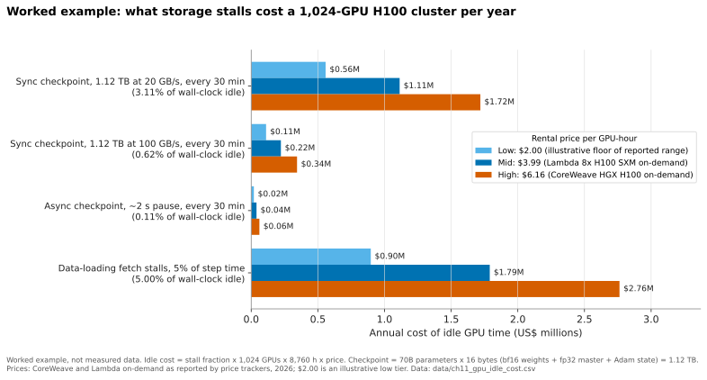
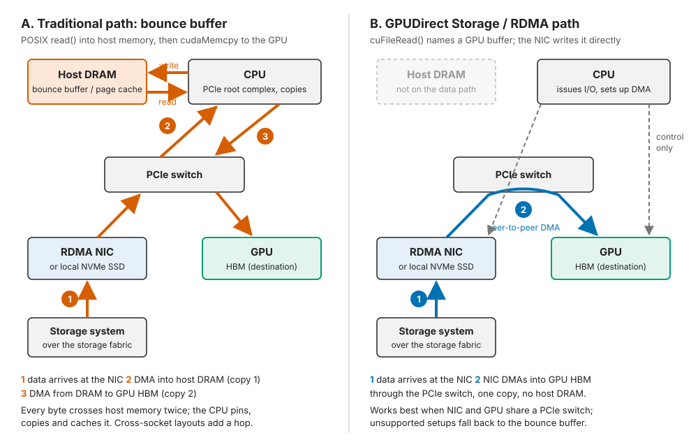
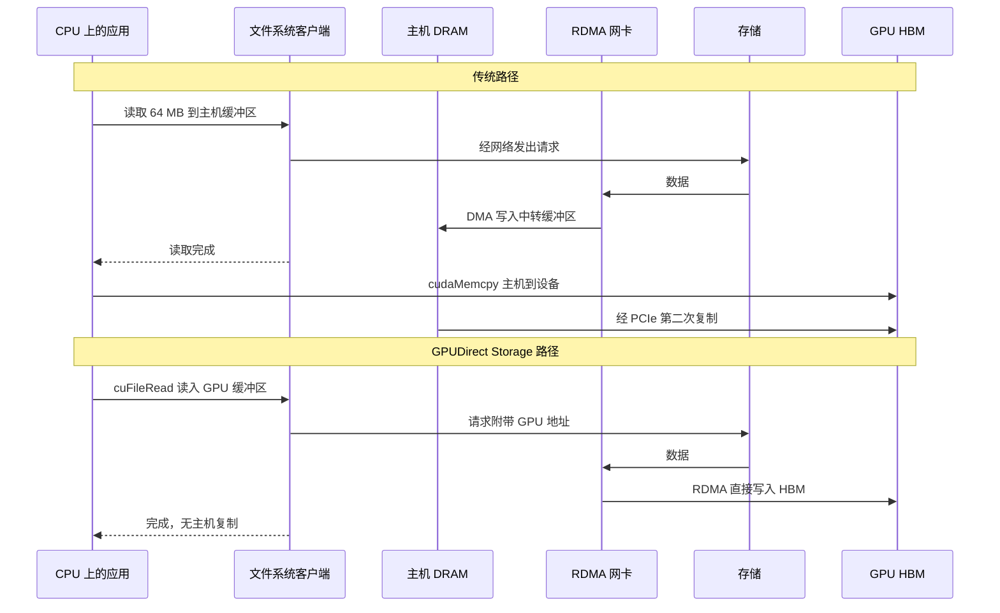
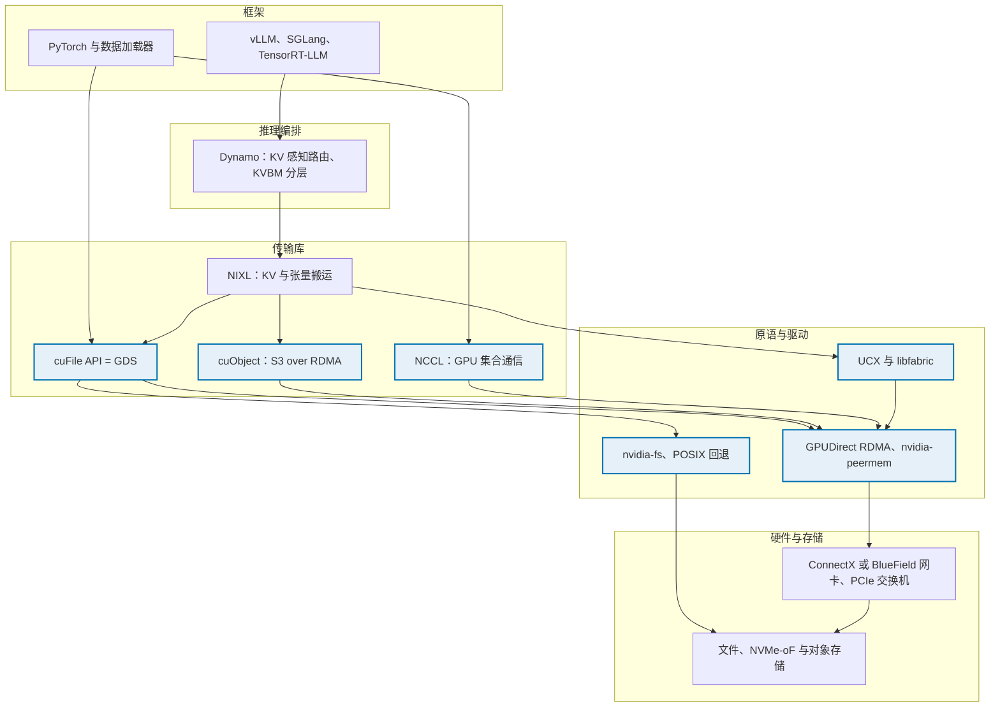
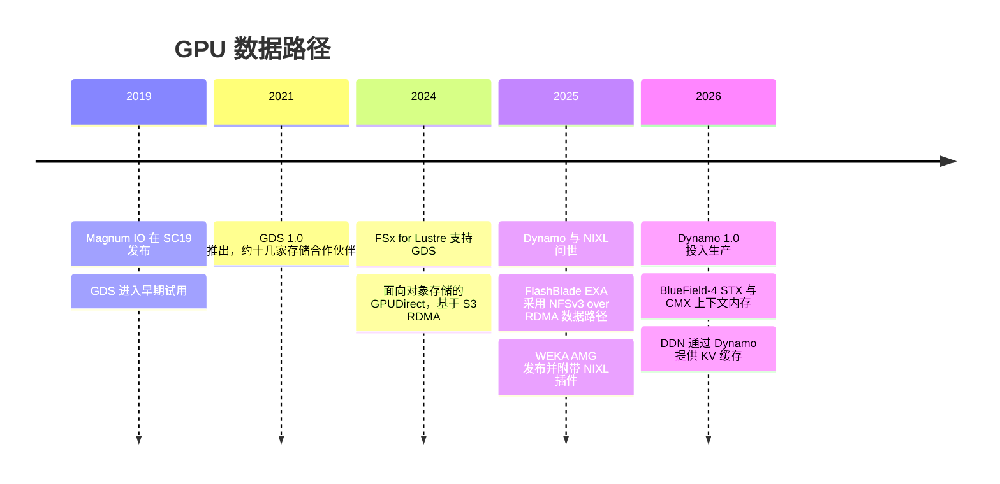

# 11. GPU 数据路径

> 📄 英文原文：[docs/02-protocols-and-networking/11-gpu-data-path.md](../../../docs/02-protocols-and-networking/11-gpu-data-path.md) · 本文为简体中文参考译本，如有出入以英文原文为准。

> **深度：** L2 · **阅读时间：** 约 10 分钟 · **最后核实：** 2026-11-01
> **前置阅读：** [块协议与 NVMe-oF](07-block-protocols.md) · [文件协议](08-file-protocols.md) · [面向存储的数据中心网络](10-datacenter-networking.md) · [性能与经济性指标](../01-storage-fundamentals/04-performance-and-economics-metrics.md)

## 要点速览（TL;DR）

- **GPU 才是昂贵的资产；存储的任务是让它保持忙碌。** 按每 H100 小时 US$2.00–6.16 计算，一个 1,024-GPU 集群每等待 I/O 一秒，就要损失 US$0.57–1.75。存储的价值体现在利用率上，而不在于它自身的价格。
- **GPUDirect Storage（GDS）去掉了 CPU"中转缓冲区"（bounce buffer）。** 网卡（NIC）或 SSD 通过 PCIe 直接写入 GPU 显存，释放 CPU 与 DRAM 带宽。它提高的是单节点上限，并不会让存储系统本身变快。
- **大多数 LLM 训练受算力约束（compute-bound）。** 在 1,024 块 GPU 上训练一个 70B 模型，读取 token 的速率只有每秒几 MB。存储的作用集中在突发场景：检查点保存、恢复、多模态数据加载，以及推理中的 KV 缓存加载。
- **弄清这套技术栈。** Magnum IO 是总称，GPUDirect RDMA 是底层原语，cuFile 是 GDS 的 API，NIXL 是推理数据传输库，Dynamo 是调用 NIXL 的编排框架。
- **GDS 只是入场门槛。** 几乎所有 AI 存储厂商（包括 Everpure 的 FlashBlade//S）都宣称支持。决定交易成败的是聚合吞吐量、检查点表现以及 KV 缓存集成。

## 对 Everpure 战略的意义

在 AI 交易中，最大的单项支出是 GPU，因此存储的卖点是"我们让你价值 US$50 million 的 GPU 保持忙碌"，而不是"我们每 TB 更便宜"。于是每家厂商都在 GPU 数据路径上卡位：GDS 认证、RDMA 协议，以及如今面向 KV 缓存的 NIXL 插件。这些检查不过关，就会失去进入 NVIDIA 参考架构的机会（[第 34 章](../05-ai-storage/34-nvidia-ecosystem.md)）；过关本身则什么也赢不来。

这条路径经历了三个阶段：批量文件读取（GDS，2019–2021）、基于 RDMA 的对象访问（2024–2025），以及由 Dynamo 编排的延迟敏感型 KV 缓存层（2025–2026）。最后一步让存储成为推理服务的一部分——这是经常性支出，也正是 Everpure 的 PureKVA、WEKA 的 Augmented Memory Grid 和 DDN 的 Infinia 当前竞争的战场（[第 32 章](../05-ai-storage/32-inference-and-kv-cache.md)）。

## 核心概念

### "喂饱 GPU"就是全部

GPU 集群就像一座晶圆厂：一台固定成本的机器，利润率由利用率决定。无论是否在计算，它的成本都按小时累积；而只占资本开支一小部分的存储，却可能让整个集群闲置。CoreWeave 对 8× HGX H100 节点的报价为每小时 US$49.24，即每 GPU 小时 US$6.16[^1]。专业云厂商与算力交易平台的价格区间大约为 US$1.49 至 US$6.98[^2]。以每 GPU 小时 US$3.99 计算（多家价格追踪网站报道的 Lambda 2026 年 8× H100 按需价格[^3] [VERIFY: Lambda 官方定价页面也曾显示 US$2.99]），一个 1,024-GPU 集群的成本为 1,024 × 3.99 = **每小时 US$4,086，约合每年 US$35.8 million**。闲置 1% 就是每年 US$358,000。

在大规模下，闲置时间很大一部分来自中断。Meta 在 16,384 块 H100 上训练 Llama 3，54 天内记录了 466 次中断，但有效训练时间仍超过 90%，部分得益于缩短了作业启动和检查点时间[^4]。每次中断都要重新加载最近的检查点，因此重启成本由存储决定。

### 存储究竟在哪里拖慢 GPU

稳态 LLM 训练所需的带宽远低于人们的想象。以 1,024 块 H100 训练一个 70B 稠密模型为例。按 H100 约 989 稠密 BF16 TFLOPS 的 40% 利用率计算，集群每秒处理约 1,024 × 989×10¹² × 0.4 ÷ (6 × 70×10⁹) ≈ **每秒 0.96 million 个 token**。每个 token ID 约 4 字节，**整个集群也就约 4 MB/s**。任何 NAS 都能满足；GDS 对此毫无作用。存储在以下四个地方拖慢 GPU：

1. **检查点保存。** 采用 Adam 与混合精度时，完整训练状态约为每参数 16 字节：bf16 权重（2）与梯度（2）、fp32 主权重（4），以及两个 fp32 Adam 动量（4 + 4）。梯度通常不保存，所以实际检查点更接近每参数 14 字节（[第 31 章](../05-ai-storage/31-training-storage.md)逐一讨论了各种变体）；本例取 16 作为整数上限。因此一个 70B 模型的检查点最大为 70×10⁹ × 16 = **1.12 TB**。以 20 GB/s 同步写入需 56 秒。若每 30 分钟保存一次，就有 3.1% 的挂钟时间处于闲置。
2. **检查点恢复。** 所有 GPU 同时读取各自的分片，这是存储所面对的最具突发性的读取。
3. **多模态数据加载。** 单个样本就有数 MB。Mohan 等人发现，对许多视觉和音频模型而言，训练时间主要被"数据停顿"（data stalls，即读取加预处理）占据[^5]。
4. **推理 KV 缓存加载。** Llama 3 70B 每个 token 需要 80 层 × 8 个 KV 头 × 128 维 × 2（键与值）× 2 字节 ≈ **320 KiB 的 KV 缓存**[^4]。一个 32K-token 的上下文约 10.7 GB，读取它必须快于重新计算约 2 × 70×10⁹ × 32,768 ≈ 4.6×10¹⁵ FLOPs（即便在八块 GPU 上也要一秒或更久）。这种加载对延迟极其敏感，而且每个回访用户都会重复一次（[第 32 章](../05-ai-storage/32-inference-and-kv-cache.md)）。

*图 11.1 — 算例：在一个中等规模集群上，存储停顿每年造成七位数的损失；但软件（异步检查点）消除的成本比更快的硬件更多。*
数据：`data/ch11_gpu_idle_cost.csv`

细微之处在于：把检查点带宽从 20 GB/s 提升到 100 GB/s，按中档价格每年可节省约 US$0.9 million，而**异步检查点**用软件就能省下几乎全部。GPU 在一两秒内把状态复制到主机 DRAM，然后继续训练，由 CPU 在后台把数据写出，因此存储只需在检查点间隔内吸收完这份数据即可。[第 31 章](../05-ai-storage/31-training-storage.md)详细推算了 405B 和 1T 的情形。

### 传统路径：中转缓冲区

在标准 Linux 服务器上，`read()` 先把数据放入主机 DRAM（页缓存或锁页的暂存缓冲区）；随后 `cudaMemcpy` 再把数据搬到 GPU 高带宽内存（HBM）。每个字节都要两次穿过内存总线，而 CPU 要为系统调用、复制和缓存管理付出开销。

*图 11.2 — GPUDirect 用一次穿越 PCIe 交换机的点对点 DMA，取代了两次经过主机 DRAM 的往返；CPU 保留控制权，但不再触碰数据。*

**算例（中转缓冲区为何是瓶颈）。** 假设一个 GPU 节点有 200 GB/s 面向存储的网络带宽，例如四个 400 Gb/s 端口。以中转缓冲方式处理 200 GB/s，会产生约 400 GB/s 的 DRAM 流量。一台每路配备八通道 DDR5-4800 的双路服务器，*理论*峰值为 2 × 8 × 38.4 ≈ 614 GB/s。暂存复制将吃掉其中约三分之二，并与数据加载进程争抢带宽；如果网卡和 GPU 位于不同 CPU 插槽，每个字节还要穿过插槽间互连。这正是绕过主机桥进行点对点 DMA 的经典理由：别再把稀缺的内存带宽当作中转候机厅。

NVIDIA 最初介绍 GDS 的文章在系统层面阐明了这一点：在 DGX-2 上，CPU 内存向 GPU 供数的速度约为 50 GB/s，而让硬盘和网卡直接对接 GPU，聚合带宽可接近 200 GB/s[^6]。

### GPUDirect RDMA 与 GPUDirect Storage

**GPUDirect RDMA** 是底层原语：GPU 在 PCIe 上暴露一段显存窗口，`nvidia-peermem` 将其注册到 RDMA 协议栈，网卡即可直接 DMA 写入 HBM。NCCL 就是用这种方式传输梯度的（[第 10 章](10-datacenter-networking.md)）。

**GPUDirect Storage** 把这一原语应用于文件和块 I/O。应用程序调用 **cuFile**（以 GPU 缓冲区调用 `cuFileRead`，而不是调用 `read`）；文件系统客户端把偏移量转换成以 GPU 地址为 DMA 目标的存储请求；网卡或本地 NVMe SSD 直接写入 GPU 显存[^7]。

*图 11.3 — 两条路径发出的存储请求相同；GDS 改变的只是字节落地的位置，因此它需要文件系统客户端的支持，而不需要新的存储协议。*

工程师会默认你了解 GDS 的局限：

- **阵列的上限不会改变。** GDS 提高的是单个客户端的吸收能力；100 GB/s 的阵列仍然只能交付 100 GB/s。
- **拓扑很重要。** 当网卡或 SSD 与 GPU 共享同一个 PCIe 交换机时收益最大；不受支持的配置会回退到使用中转缓冲区的"兼容模式"[^7]。
- **客户端必须支持。** NFS over RDMA、Lustre、WekaFS、IBM Storage Scale 和 BeeGFS 客户端支持；NFS over TCP 不支持。
- **数据必须以 GPU 可直接使用的形式到达。** 在 CPU 侧做 JPEG 解码或数据增强，数据无论如何都要经过主机内存。当 GPU 负责解码（例如 DALI），或字节本身已是张量（如检查点和 KV 块）时，GDS 才有帮助。

### 分层技术栈：Magnum IO、cuFile、NIXL 与 Dynamo

这些名称层层嵌套；把它们搞混，很快就会失去工程师的信任。

*图 11.4 — 蓝色阴影部分的 Magnum IO 是 I/O 管道；NIXL 和 Dynamo 位于其上服务于推理，因此存储厂商的集成点已从"支持 GDS 的文件系统"上移到"NIXL 后端"。*

- **Magnum IO** 是 NVIDIA GPU I/O 软件的总称（GPUDirect RDMA、GDS、NCCL、NVSHMEM、UCX），于 2019 年 11 月在 SC19 上发布，当时 GDS 处于早期试用阶段[^8]。GDS 1.0 于 2021 年推出，约有十几家存储合作伙伴[^9]。
- **cuFile** 是 GDS 的 API，数据加载器和检查点写入程序调用它来替代 POSIX。
- **cuObject** 为 S3 做同样的事：控制仍走 S3 调用，有效载荷通过 RDMA 传输；客户端 SDK 和对象服务器都需要修改[^10]。
- **NIXL** 是一个开源（Apache 2.0）的点对点传输库，通过插件在 GPU 显存、CPU 内存和存储之间搬运 KV 块和张量，插件包括 UCX、POSIX、GDS、对象存储、Azure Blob、3FS、Mooncake 和 libfabric[^11]。
- **Dynamo** 是 NVIDIA 的开源推理框架。其 KV 块管理器（KVBM）将 KV 缓存分布在 HBM（G1）、主机 DRAM（G2）、本地 SSD（G3）和远程存储（G4）几个层级，磁盘 I/O 经由 NIXL，在可用时使用 GDS[^12]。Dynamo 1.0 于 2026-03-16 发布[^13]。

半导体类比：Magnum IO 相当于 DMA 引擎和总线结构，cuFile 和 NIXL 相当于驱动 API，而 Dynamo 相当于内存控制器的页策略——决定哪些数据留在"HBM"、哪些被逐出到"闪存"。

## Everpure 的做法与竞争对手对比

| 厂商 / 系统 | 宣称的 GPU 直连路径 | 推理 / KV 集成 | 备注 |
|---|---|---|---|
| DDN EXAScaler（Lustre） | GDS，自早期版本起即列入 NVIDIA 合作伙伴表[^14] | 在 EXAScaler 和 Infinia 上通过 Dynamo/NIXL 提供 KV 缓存（2026 年 6 月）[^15] | 内核态 Lustre 客户端；HPC 传统 |
| WEKA NeuralMesh（WekaFS） | 自 1.0 起支持 GDS[^14] | 基于 RDMA 和 GDS 的 Augmented Memory Grid；开源了一个 NIXL 插件[^16] | 自研内核旁路（kernel-bypass）客户端 |
| VAST Data | 通过 NFS over RDMA 支持 GDS[^14] | Dynamo 集成 [VERIFY: VAST NIXL 后端状态] | 标准 NFS 客户端，支持 RDMA 与多路径 |
| IBM Storage Scale | GDS（5.1.2 及更新版本）[^14] | — | GPFS 客户端 |
| NetApp ONTAP | 通过 NFS over RDMA 支持 GDS；八节点演示中达到 171 GiB/s（公司自述）[^17] | — | AFX 分解式产品线（2025） |
| Dell PowerScale | 通过 NFS over RDMA 支持 GDS（OneFS 9.2 及更新版本）[^14] | — | pNFS "Lightning" 变体（2025） |
| **Everpure FlashBlade//S** | 基于 NFS over RDMA 的 GDS，据报道自 Purity//FB 4.3.4（2023 年 10 月）起支持[^18][^19] [VERIFY: 仅见于搜索摘要；未见于 NVIDIA GDS 发行说明的合作伙伴表] | PureKVA：通过 NFS 和 S3 在 FlashBlade 上存放 KV 缓存，集成 Dynamo，RDMA 直接写入 GPU 显存[^20] | 已宣布为对象存储提供 S3 over RDMA[^21] |
| **Everpure FlashBlade//EXA** | 到数据节点的 NFSv3 over RDMA 数据路径[^22]；Portworx 文档说明可在 EXA 文件系统上通过 RDMA NFS 使用 GDS[^23] [VERIFY: 仅见于搜索摘要] | 通过 PureKVA [VERIFY: EXA 支持情况] | 截至 2026 年 3 月，EXA 的 NVIDIA 认证仍在进行中（[第 34 章](../05-ai-storage/34-nvidia-ecosystem.md)） |
| Hammerspace | GDS 验证（公司自述，2024）[^24] | — | 基于 NFS 的全局命名空间 |
| AWS FSx for Lustre | 配合 EFA 支持 GDS（2024 年 11 月）[^25] | — | 首个支持 GDS 的主流云文件服务 |
| Cloudian HyperStore | 面向对象存储的 GPUDirect，S3 over RDMA（2024 年 11 月）[^26] | — | 以对象存储为先 |

*表 11.1 — 每一家严肃的 AI 存储厂商都宣称拥有 GPU 直连路径；竞争前沿已转向 S3 over RDMA，以及与 Dynamo 和 NIXL 的 KV 缓存集成。*

**真正的取舍在于客户端架构，而不是 GDS。** WEKA、DDN（Lustre）和 IBM 提供自研客户端，每个节点建立大量 RDMA 连接并跨服务器条带化，单节点吞吐量最高，代价是每台 GPU 服务器都要验证一个内核模块。Everpure、VAST、NetApp 和 Dell 使用基于 RDMA 的标准 Linux NFS 客户端：无需安装任何东西，但历来单客户端并行度较低。FlashBlade//EXA 借助 pNFS 缩小了这一差距，让客户端通过 RDMA 上的 NFSv3 直接访问数据节点[^22]（[第 16 章](../03-system-architecture/16-disaggregated-shared-everything.md)）。

**为自研客户端构建最强论证（steelman）：** 在 2,000-GPU 的检查点恢复中，单节点吸收能力和客户端条带化决定了恢复训练所需的时间。**为标准客户端构建最强论证：** 运营数千台异构 GPU 服务器的团队，因无需验证客户端而节省大量实际工作；而受算力约束的训练很少触及单节点峰值。

基于公开信息，战略团队可能评估的选项包括：向上游贡献一个 FlashBlade NIXL 后端（WEKA 已开源了一个）；把 S3 over RDMA 和 cuObject 兼容性引入 EXA；以及在 NVIDIA 的 BlueField-4 STX/CMX 上下文内存层上市后，从延迟与容量经济性的角度为 PureKVA 定位[^27]。

## 历史与发展轨迹

*图 11.5 — 在大约六年间，GPU 数据路径从批量文件读取，演进到基于 RDMA 的对象访问，再到延迟关键型的 KV 缓存层。*

GPUDirect RDMA 可追溯到 Kepler 级 GPU 和 CUDA 5.0（2012）[^28]；GDS 将其延伸到存储领域。Pure Storage 在 2022 年表示 FlashBlade//S 将于次年支持 GDS[^29] [VERIFY: 仅见于搜索摘要]，行业媒体报道称该支持随 Purity//FB 4.3.4 于 2023 年 10 月到来[^19]。Dynamo 于 2025 年 3 月 18 日在 GTC 上发布[^30]，并于 2026 年 3 月达到 1.0[^13]。

三个趋势指向未来。**基于 RDMA 的对象访问：** cuObject 将 S3 over RDMA 标准化[^10]，Cloudian[^26] 和 Everpure[^21] 均已宣布支持，正在瓦解"文件求性能、对象求容量"的分工（[第 9 章](09-object-storage-and-s3.md)）。**上下文内存层：** NVIDIA 的 BlueField-4 STX 和 CMX（GTC 2026）把 KV 缓存存储放进每个 pod 内部，合作伙伴包括 Everpure、DDN、VAST、WEKA、NetApp 等[^27]；谁提供软件，就决定了这会让硬件商品化，还是开辟一个新的插槽（socket）。**GPU 发起的 I/O：** 研究系统让 GPU 线程无需 CPU 即可发出 NVMe 命令，这将把存储客户端搬进 GPU。

## 关键数字

| 指标 | 数值 | 背景 | 来源 / 日期 |
|---|---|---|---|
| H100 按需价格，CoreWeave | US$6.16 / GPU 小时（每 8-GPU 节点 US$49.24） | 市场价格区间的顶端 | CoreWeave 定价[^1]，2026 |
| H100 租赁价格区间 | US$1.49–6.98 / GPU 小时 | 15 家以上供应商 | Intuition Labs[^2]，2026 |
| Llama 3 有效训练时间 | >90%，尽管 54 天内中断 466 次 | 16,384 块 H100 | Meta[^4]，2024-07 |
| DGX-2 CPU 内存到 GPU 的上限 vs 直连聚合带宽 | ~50 GB/s vs ~200 GB/s | GDS 的最初论据 | NVIDIA 博客[^6]，2019 |
| NetApp ONTAP GDS 读取吞吐量 | 171 GiB/s，八节点集群 | 公司自述，gdsio | NetApp[^17] |
| 70B Adam 检查点 | ≤1.12 TB（≤16 B/参数；按 14 B 计约 0.98 TB） | 20 GB/s 下 56 秒；100 GB/s 下 11 秒 | 算例 |
| 1,024 块 H100 上 70B 模型的文本 token 输入 | 全集群约 4 MB/s | LLM 训练为何受算力约束 | 算例 |
| Llama 3 70B KV 缓存 | 每 token 约 320 KiB；每个 32K 上下文约 10.7 GB | 驱动推理 KV 加载 | 基于 Meta 架构的算例[^4] |
| 闲置成本，1,024 块 H100，按 US$3.99 计 | 每闲置 1% 每年约 US$358k | 利用率经济学 | 算例 |

## 对话手册

**向产品经理提的问题**

1. *"在我们最近丢掉的五笔 AI 交易中，起决定作用的是 GPU 数据路径功能，还是聚合吞吐量和价格？"* 高质量回答：区分勾选项（GDS、认证）与决定性因素，并举出具体案例。
2. *"PureKVA 相对于重新计算、相对于本地 NVMe，实测的首 token 延迟改善是多少？基于哪个模型和上下文长度？"* 高质量回答：给出模型、上下文、并发和网络条件，区分厂商数据与客户数据，并说明收益在何处消失。
3. *"FlashBlade 相对于 Dynamo 的 G3、G4 层以及 NVIDIA 的 CMX 层处于什么位置？"* 高质量回答：说明 Everpure 是与 CMX 竞争、为其供货，还是位于其后端，以及对每 GPU 收入的影响。

**向工程师提的问题**

1. *"在 FlashBlade 上启用 GDS 后，当前一代 HGX 节点的单节点读取速率能达到多少？限制因素是什么：网卡、NFS 客户端并发，还是阵列？"* 高质量回答：给出 GB/s 数值、指明瓶颈，并说明 `nconnect`/多路径设置。
2. *"一次 4,000-GPU 的检查点恢复表现如何：单节点速率、元数据负载、恢复训练所需时间？"* 高质量回答：关注恢复训练所需时间而非峰值带宽，并涵盖数千个分片文件带来的 open/stat 风暴。
3. *"我们是否提供 NIXL 后端？走的是 POSIX、GDS 还是 OBJ 插件路径？"* 高质量回答：说明所用插件、是否已进入上游，以及每次 KV 读取的块大小和延迟。

**不要这样说：**

- "GDS 让存储更快。"它去掉的是一次主机复制；阵列吞吐量不变。
- "LLM 训练需要巨大的读取带宽。"文本只需 MB/s 级；突发来自检查点、恢复和多模态数据。
- "Magnum IO 是一款可以购买的产品。"它是一组免费的 NVIDIA 库。
- "NIXL 是一种存储协议。"它是一个传输库；底层是 UCX/RDMA、POSIX、GDS 或 S3。
- "拥有 GDS 是差异化优势。"表 11.1 中几乎每家厂商都有。

## 深入阅读（可选，L3 指引）

- NVIDIA GDS 的 Overview、Design 和 Best Practices 指南：拓扑规则、兼容模式、`gdsio`、对齐要求[^7]。
- NIXL 代码仓库与 Dynamo 的 KVBM 设计文档：插件、内存注册、G1–G4 策略[^11][^12]。
- Mohan 等人，"Analyzing and Mitigating Data Stalls in DNN Training"，PVLDB 2021，讨论读取停顿与预处理停顿[^5]。
- 关于 GPU 发起的存储访问：Qureshi 等人的 BaM 系统（ASPLOS 2023）。

## 关键术语

- **中转缓冲区（bounce buffer）** — 数据送往 GPU 途中在主机内存中的暂存。
- **GPUDirect RDMA / GDS / cuFile** — 网卡或存储通过 DMA 直接写入 GPU 显存，以及 GDS 的 API。
- **Magnum IO** — NVIDIA GPU I/O 库的总称。
- **NIXL / Dynamo / KVBM** — 推理传输库、推理框架、KV 分层管理器。
- **cuObject** — NVIDIA 的 S3-over-RDMA 库。
- 其余术语见[术语表](../glossary.md)。

## 资料来源

[^1]: CoreWeave, "Pricing," n.d. (2026); 8× HGX H100 on-demand US$49.24/hr as reported consistently by multiple price trackers. https://www.coreweave.com/pricing (retrieved 2026-11-01).
[^2]: Intuition Labs, "H100 Rental Prices Compared: $1.49–$6.98/hr Across 15+ Cloud Providers (2026)," 2026. https://intuitionlabs.ai/articles/h100-rental-prices-cloud-comparison (retrieved 2026-11-01).
[^3]: Spheron, "Lambda Cloud H100 pricing 2026," 2026-05. https://www.spheron.network/blog/lambda-cloud-h100-pricing-2026/ (retrieved 2026-11-01).
[^4]: Llama Team, AI @ Meta, "The Llama 3 Herd of Models," arXiv:2407.21783, 2024-07-31. https://arxiv.org/abs/2407.21783 (retrieved 2026-11-01).
[^5]: J. Mohan, A. Phanishayee, A. Raniwala, V. Chidambaram, "Analyzing and Mitigating Data Stalls in DNN Training," PVLDB 14, 2021. https://www.cs.utexas.edu/~vijay/papers/vldb21-datastalls.pdf (retrieved 2026-11-01).
[^6]: NVIDIA Developer Blog, "GPUDirect Storage: A Direct Path Between Storage and GPU Memory," 2019. https://developer.nvidia.com/blog/gpudirect-storage/ (retrieved 2026-11-01).
[^7]: NVIDIA, "GPUDirect Storage Overview Guide," n.d. https://docs.nvidia.com/gpudirect-storage/overview-guide/index.html (retrieved 2026-11-01).
[^8]: NVIDIA Newsroom, "NVIDIA Launches Magnum IO Software Suite to Help Eliminate Data Bottlenecks for Data Scientists and AI, HPC Researchers," 2019-11-18. https://nvidianews.nvidia.com/news/nvidia-launches-magnum-io-software-suite-to-help-eliminate-data-bottlenecks-for-data-scientists-and-ai-hpc-researchers (retrieved 2026-11-01).
[^9]: Blocks & Files, "GPUDirect Storage hitting the streets to VAST acclaim," 2021-06-28. https://www.blocksandfiles.com/file/2021/06/28/gpudirect-storage-hitting-the-streets-to-vast-acclaim/1611092 (retrieved 2026-11-01).
[^10]: NVIDIA, "NVIDIA cuObject: Accelerated CUDA libraries for Object Storage," n.d. https://docs.nvidia.com/gpudirect-storage/cuobject (retrieved 2026-11-01).
[^11]: NVIDIA / ai-dynamo, "NIXL: NVIDIA Inference Xfer Library" (GitHub repository), n.d. https://github.com/ai-dynamo/nixl (retrieved 2026-11-01).
[^12]: NVIDIA, "KVBM design," Dynamo documentation v1.3.0, n.d. https://docs.nvidia.com/dynamo/v1.3.0/design-docs/component-design/kvbm-design.md (retrieved 2026-11-01).
[^13]: NVIDIA Newsroom, "NVIDIA Enters Production With Dynamo, the Broadly Adopted Inference Operating System for AI Factories," 2026-03-16. https://nvidianews.nvidia.com/news/dynamo-1-0 (retrieved 2026-11-01).
[^14]: NVIDIA, "GPUDirect Storage Release Notes," n.d. (partner and version tables across releases). https://docs.nvidia.com/gpudirect-storage/release-notes/index.html (retrieved 2026-11-01).
[^15]: Blocks & Files, "DDN launches faster array HW and KV cache SW for AI," 2026-06-24. https://www.blocksandfiles.com/ai-ml/2026/06/24/ddn-launches-faster-array-hw-and-kv-cache-sw-for-ai/5261447 (retrieved 2026-11-01).
[^16]: WEKA, "WEKA Breaks The AI Memory Barrier With Augmented Memory Grid on NeuralMesh," 2025-11-18. https://www.weka.io/news/weka-breaks-the-ai-memory-barrier-with-augmented-memory-grid (retrieved 2026-11-01).
[^17]: NetApp (D. Arnette), "ONTAP reaches 171GiBps with GPUDirect Storage," n.d. (c. 2023, ONTAP 9.12.1). https://www.netapp.com/blog/ontap-reaches-171-gpudirect-storage/ (retrieved 2026-11-01).
[^18]: Everpure, "FlashBlade//S," product page, n.d. https://www.purestorage.com/products/unstructured-data-storage/flashblade-s.html (retrieved 2026-11-01).
[^19]: iThome (Taiwan), overview of GPUDirect Storage support among storage vendors (Pure Storage FlashBlade//S: NFS over RDMA, Purity//FB 4.3.4 or later, from October 2023), n.d. https://www.ithome.com.tw/tech/165670 (retrieved 2026-11-01; search-summary only, host not fetchable).
[^20]: StorageReview, "Everpure Adds PureKVA to FlashBlade, Claims Up to 20x Faster Time to First Token, and Makes DeepReduce Always-On," 2026. https://www.storagereview.com/news/everpure-purekva-flashblade-20x-time-to-first-token-always-on-deepreduce (retrieved 2026-11-01).
[^21]: Everpure blog, "FlashBlade Augments its Fast Object Store with S3 over RDMA for AI/ML Workflows," n.d. https://blog.everpuredata.com/purely-technical/pure-storage-flashblade-fast-object-store-s3-rdma-for-ai-ml-workflows/ (retrieved 2026-11-01).
[^22]: Blocks & Files, "How Pure Storage developed its disaggregated FlashBlade//EXA system," 2025-04-17. https://blocksandfiles.com/2025/04/17/how-pure-storage-developed-its-disaggregated-flashblade-exa-system/ (retrieved 2026-11-01).
[^23]: Portworx, "Enable the FlashArray and FlashBlade driver" (FlashBlade//EXA file systems with GPUDirect Storage over RDMA NFS), n.d. https://docs.portworx.com/portworx-enterprise/platform/configure-portworx-components/enable-fa-fb-driver (retrieved 2026-11-01; search-summary only, host not fetchable).
[^24]: StorageNewsletter, "Hammerspace Hyperscale NAS Achieves GPUDirect Storage Self-Certification from Nvidia," 2024. https://storagenewsletter.com/?p=274109 (retrieved 2026-11-01).
[^25]: AWS, "Amazon FSx for Lustre now supports Elastic Fabric Adapter and NVIDIA GPUDirect Storage," 2024-11. https://aws.amazon.com/about-aws/whats-new/2024/11/amazon-fsx-lustre-elastic-fabric-adapter-nvidia-gpudirect-storage (retrieved 2026-11-01).
[^26]: IT Brief, "Cloudian enhances AI processing with NVIDIA GPUDirect tie-up," 2024-11. https://itbrief.co.uk/story/cloudian-enhances-ai-processing-with-nvidia-gpudirect-tie-up (retrieved 2026-11-01).
[^27]: NVIDIA Investor Relations, "NVIDIA Launches BlueField-4 STX Storage Architecture With Broad Industry Adoption," 2026-03-16. https://investor.nvidia.com/news/press-release-details/2026/NVIDIA-Launches-BlueField-4-STX-Storage-Architecture-With-Broad-Industry-Adoption/default.aspx (retrieved 2026-11-01).
[^28]: NVIDIA, "GPUDirect RDMA" (CUDA 5.0 documentation, v0.2 draft), 2012. https://developer.download.nvidia.com/compute/cuda/5_0/rc/docs/GPUDirect_RDMA.pdf (retrieved 2026-11-01; search-summary only).
[^29]: Blocks & Files, "Pure extends FlashBlade with more capacity and faster compute," 2022-06-08. https://www.blocksandfiles.com/file/2022/06/08/pure-extends-flashblade-with-more-capacity-and-faster-compute/1607994 (retrieved 2026-11-01).
[^30]: NVIDIA Investor Relations, "NVIDIA Dynamo Open-Source Library Accelerates and Scales AI Reasoning Models," 2025-03-18. https://investor.nvidia.com/news/press-release-details/2025/NVIDIA-Dynamo-Open-Source-Library-Accelerates-and-Scales-AI-Reasoning-Models/default.aspx (retrieved 2026-11-01).
