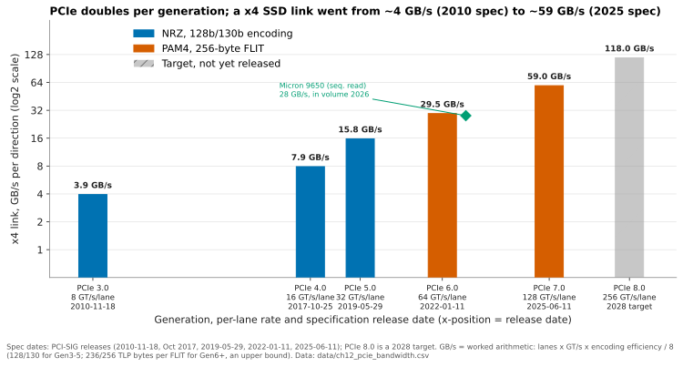
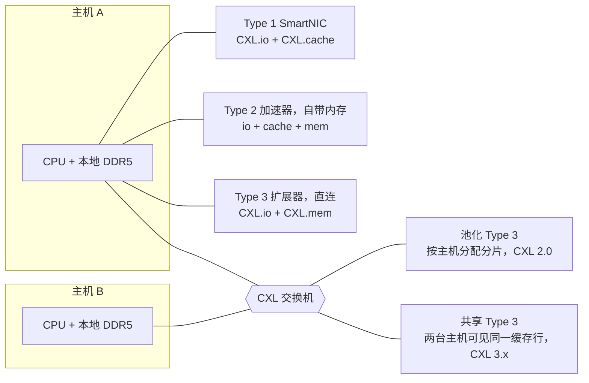
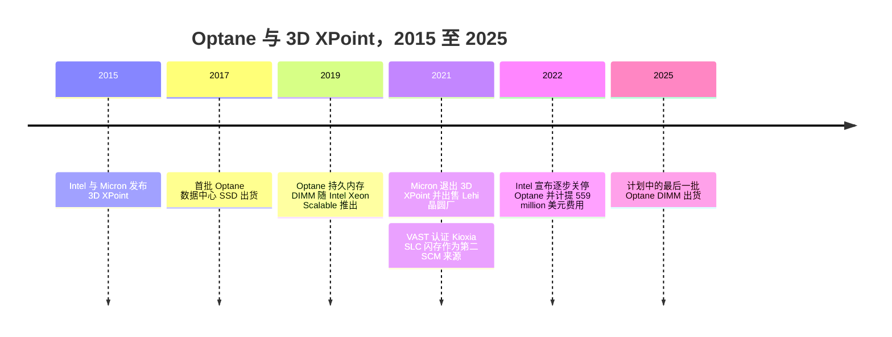

# 12. 接口与新兴技术

> 📄 英文原文：[docs/02-protocols-and-networking/12-interfaces-and-emerging-tech.md](../../../docs/02-protocols-and-networking/12-interfaces-and-emerging-tech.md) · 本文为简体中文参考译本，如有出入以英文原文为准。

> **深度：** L2 · **阅读时间：** 约 10 分钟 · **最后核实：** 2026-11-01
> **前置阅读：** [写给半导体从业者的介质物理](../01-storage-fundamentals/02-media-physics.md) · [SSD 内部](../01-storage-fundamentals/03-inside-an-ssd.md) · [块协议与 NVMe-oF](07-block-protocols.md) · [GPU 数据路径](11-gpu-data-path.md)

## 要点速览（TL;DR）

- **PCIe 每一代带宽翻倍；硬盘链路很少成为瓶颈。** 一条 PCIe 6.0 x4 链路单向约 29.5 GB/s，因此在共享存储中，决定吞吐量的是网络和软件。
- **CXL 把 PCIe 线路变成了 load/store 内存总线。** 内存扩展器已在出货；内存池化刚刚起步；多主机共享仍处于实验室阶段。
- **在超大规模云厂商和 AI 服务器中，EDSFF 取代了 2.5 英寸硬盘**，并固定了每个盘位的功耗和 NAND 数量。Everpure 的专有 DirectFlash Module（DFM）绕开了其中部分限制。
- **FDP 是通用闪存在向主机管理闪存看齐。** 它在不破坏软件兼容性的前提下降低写放大；而自 DirectFlash 推出以来，Purity 一直在直接管理裸 NAND。
- **Optane 是任何新内存层级的案例教材：** 物理特性出色，但价格差距太窄、生态被单一 CPU 平台锁定，而且只有一座晶圆厂。CXL 内存和 KV 缓存层面临同样的考验。

## 对 Everpure 战略的意义

接口决定了什么可以被商品化。有了标准外形规格（form factor）和数据放置提示，超大规模云厂商可以从四家 NAND 厂商采购闪存，并运行自己的软件。这正是 Everpure 的 DirectFlash 授权在 Meta 以及在 2026 年 8 月宣布的第二家前五大超大规模云厂商那里必须击败的替代方案[^1]。FDP 和 EDSFF 正在缩小专有模块与通用 SSD 之间的差距。

AI 推理又带来第二场竞争：位于 GPU HBM 与网络化闪存之间的 KV 缓存层，CXL 内存、本地 NVMe 和 PureKVA 这类共享闪存在此角逐（[第 32 章](../05-ai-storage/32-inference-and-kv-cache.md)）。Optane 展示了这类层级如何失败。

## 核心概念

### PCIe：翻倍机器

PCIe 是由 SerDes 通道（lane）组成的串行链路：SSD 用 x4，GPU 和网卡用 x16。每一代将单通道速率翻倍。这一节奏在 PCIe 3.0（2010 年 11 月）之后停滞[^2]。PCIe 4.0 直到 2017 年 10 月才发布[^3]，因为 16 GT/s 需要重定时器（retimer）和更好的板材。此后云和 AI 需求恢复了三年一代的节奏：5.0 于 2019 年 5 月[^4]，6.0 于 2022 年 1 月[^5]，7.0 于 2025 年 6 月[^6]。PCIe 8.0 速率为 256 GT/s，目标发布时间为 2028 年[^7]。

*图 12.1 — 硬盘所用的 x4 链路每一代翻倍；首款量产的 PCIe 6.0 SSD 在规范发布四年后，读取速度达到链路带宽的约 95%。*
数据：`data/ch12_pcie_bandwidth.csv`

单向带宽 = 通道数 × 速率 × 编码效率 ÷ 8。PCIe 6.0 x4 原始带宽为 32 GB/s，扣除 flit 开销后约 29.5 GB/s。Micron 9650 是首款量产的 Gen6 数据中心 SSD，读取速度为 28 GB/s[^8]。

**结论有些反直觉。** 一台装有 24 块此类硬盘的 2U 服务器，硬盘带宽合计 24 × 29.5 ≈ 708 GB/s；而两个 400 GbE 端口只能承载约 100 GB/s。在阵列中，网络（[第 10 章](10-datacenter-networking.md)）、CPU 和软件远早于硬盘链路成为约束。更快的链路主要对 GPU 本地 NVMe 有意义，用于存放检查点和 KV 缓存（[第 11 章](11-gpu-data-path.md)）。

### 再深入一层看 PCIe 6.0：PAM4 与 FLIT

若使用 NRZ（每符号 1 比特），64 GT/s 会把奈奎斯特频率推到 32 GHz，此时板级损耗无法控制。PCIe 6.0 因此采用了 **PAM4**（每符号 2 比特），此前 56G/112G 以太网 SerDes 已经这样做了。符号率仍为 32 GBaud，因此信道特性与 PCIe 5.0 相似，但三个叠放的眼图每个只有原来高度的三分之一。原始误码率升至约 10⁻⁶，而 NRZ 各代约为 10⁻¹²。

前向纠错（FEC）需要固定大小的数据块，因此 PCIe 6.0 引入了 **FLIT**。每个 256 字节的 flit 携带 236 字节事务数据、6 字节链路字段、8 字节 CRC 和 6 字节 FEC[^9]。FEC 被刻意设计得很轻量——在三路交织上各纠正单个符号——因此只增加几纳秒。剩余错误由 CRC 检出并触发 flit 重传[^10]。对存储而言，去掉逐包封帧意味着小型传输（门铃、完成消息、64 字节 CXL 缓存行）浪费的链路更少；而且 PCIe 与 CXL 如今共享同一个 PHY 和路线图。

| | PCIe 5.0 | PCIe 6.0 | PCIe 7.0 |
|---|---|---|---|
| 单通道速率 | 32 GT/s | 64 GT/s | 128 GT/s |
| 信号调制 | NRZ | PAM4 | PAM4 |
| 编码 | 128b/130b + 封帧令牌 | 256 字节 FLIT，FEC + CRC | 256 字节 FLIT |
| x16，原始带宽，双向 | 128 GB/s | 256 GB/s | 512 GB/s |
| x4 SSD，单向 | ~15.75 GB/s | ~29.5 GB/s | ~59 GB/s |

*表 12.1 — PCIe 6.0 同时改变了调制和编码；PCIe 7.0 两者均保留，并将符号率翻倍（x16 数据来自 PCI-SIG[^4][^5][^6]；x4 为推算）。*

### CXL：在 PCIe 线路上实现内存语义

Compute Express Link 在 PCIe PHY 上运行三种协议[^11]：**CXL.io**（普通 PCIe）、**CXL.cache**（设备以一致性方式缓存主机内存）和 **CXL.mem**（主机对设备内存执行 load 和 store）。**Type 1** 设备（io + cache）是带缓存的 SmartNIC；**Type 2**（三者兼具）是其内存加入一致性地址空间的加速器；**Type 3**（io + mem）是内存扩展器。

**写给半导体读者的 CXL.mem。** 主机的 home agent 发出 64 字节缓存行读写，设备返回数据或完成消息。设备的 DRAM 作为*主机管理的设备内存*（host-managed device memory，HDM）映射进物理地址空间，通常以一个没有 CPU 的 NUMA 节点形式暴露，软件用普通的 load 和 store 即可访问。被动式扩展器为主机一致性（HDM-H）。CXL 3.0 增加了**反向失效**（back-invalidate，HDM-DB）。设备维护一个监听过滤器（snoop filter），可以从主机缓存中召回缓存行，这正是多个主机能够一致性地共享同一内存区域的关键[^11]。Microsoft 的 Pond 团队测得，直连 CXL 内存比本地 DRAM 多约 70–90 ns 延迟。这相当于一次 NUMA 跳转的代价，而非存储级的代价；经过交换机还会更多[^12]。

*图 12.2 — 直连扩展已在出货，基于交换机的池化刚刚起步，而多主机共享（需要 CXL 3.x 反向失效）仍是前沿。*

**规范远远领先于部署。** CXL 4.0（2025 年 11 月）在 PCIe 7.0 PHY 上达到 128 GT/s，即 x16 链路单向 256 GB/s，并新增了*捆绑端口*（bundled ports），把多条链路合并为一个逻辑端口（联盟白皮书示例为单向 768 GB/s）[^13]。部署则滞后：

- **直连：** Azure 的 M 系列预览版（2025 年 11 月）采用 Astera Labs 的 CXL 2.0 控制器，每个最多 2 TB[^14]。
- **池化：** Marvell 已有一款 CXL 2.0 交换机量产，下一代产品于 2026 年第三季度送样[^15]。
- **机架级 AI 内存池化：** 仍为演示阶段，例如 Samsung 与 AMD 在 OCP 2026 上的演示[^16]。

经济效益有限：Pond 估算，一个 16 路的内存池可将 DRAM 需求削减约 7%[^17]。CXL 内存就是按 DRAM 价格出售的 DRAM。

### EDSFF：外形规格就是一份功耗契约

SNIA 的 EDSFF 系列以一系列为气流而设计的外形取代了 2.5 英寸 U.2，其功耗包络随厚度增加。外形规格决定了**每个盘位的功耗和 NAND 封装数量**，进而决定了每机架单元的 TB 数。

| 外形规格 | 尺寸（宽 × 长；厚度） | 最大持续功耗（风冷） | 已见最大容量（2026） | 典型用途 |
|---|---|---|---|---|
| U.2（2.5 英寸） | 70 × 100 mm；15 mm | ~25 W [VERIFY: U.2 功耗等级] | 245.76 TB（Micron 6600 ION）[^18] | 每 2U 约 24 个盘位；传统服务器和阵列 |
| E1.S | 33.75 × 118.75 mm；9.5 / 15 / 25 mm | ~12 W（5.9 mm）至 ~25 W（25 mm 散热片）[^19] | [VERIFY: 已出货的最大 E1.S] | 高密度计算和 GPU 节点，例如 Meta 的 GenAI 集群[^20] |
| E1.L（"标尺"型） | 38.4 × 318.75 mm；9.5 / 18 mm | ~25–40 W[^21] | 122.88 TB（Solidigm D5-P5336）[^22] | 每 1U 最多约 32 个盘位 [VERIFY]；容量型 JBOF |
| E3.S | 76 × 112.75 mm；7.5 mm（1T）/ 16.8 mm（2T） | 25 W（1T）/ 40 W（2T）[^23] | [VERIFY: 已出货的最大 E3.S] | 主流 PCIe 5/6 服务器；CXL 内存模块 |
| E3.L | 76 × 142.2 mm；7.5 / 16.8 mm | 40 W（1T）/ 70 W（2T）[^23] | 245.76 TB（Micron 6600 ION）[^18] | 存储服务器中的容量型 QLC |

*表 12.2 — EDSFF 用按功耗包络设计的多种外形取代了单一通用盘位；容量如今集中在 E3.L 和 U.2，密度则集中在 E1.S。*

在高端有两个约束。第一是**控制器 DRAM**：传统 SSD 的闪存转换层（FTL）每 4 KiB 页需约 4 字节映射，即每 TB 需 1 GB DRAM，一块 245 TB 的硬盘就需约 245 GB。因此大容量 QLC 硬盘以更粗的粒度做映射，小块随机写则要为读-改-写放大付出代价。第二是标准规定的**每盘位功耗与体积**。

Everpure 的 **DirectFlash Module** 能同时摆脱这两个约束，因为它不是 SSD。Purity 运行一个全局 FTL，把模块当作裸 NAND 对待，因此不需要与硬盘容量成比例的 DRAM 映射表，而且模块的外形和散热由 Everpure 自行决定（[第 26 章](../04-everpure/26-purity-and-directflash.md)）。DFM 到 2026 年已达 300 TB[^24]，这一路线图最早于 2023 年设定[^25]；而最大的标准硬盘出货容量为 245.76 TB。代价是：只有 Purity 能驱动 DFM。与此同时，SFF TA 于 2025 年 7 月重新开启了 E1/E3 功耗和散热规范的修订[^26]。

### 数据放置：ZNS、FDP 与主机管理闪存

NAND 以大块为单位擦除，因此当生命周期不同的数据共处一个块时，垃圾回收（GC）必须先复制仍然有效的页。如果一个块在回收时仍有 75% 有效，那么每次主机写入要付出 1 ÷ (1 − 0.75) = 4 次 NAND 写入，即写放大系数（WAF）为 4。解决办法是按生命周期对数据分组，让整个块同时失效，而这需要主机告诉硬盘。

*图 12.3 — ZNS 和 FDP 将数据放置的知识逐步从硬盘转移到主机；DirectFlash 这类主机管理闪存则把它全部转移。*

**ZNS**（NVMe TP4053，2020 年 6 月批准[^27]）暴露必须顺序写入的分区（zone）。软件必须感知分区，因此其采用一直局限于小众。**FDP**（NVMe TP4146，2022 年底批准）由 Meta 和 Google 联合 Samsung 推动。写入携带一个放置标识符，硬盘把不同标识符的数据保存在独立的回收单元中。忽略这些提示的硬盘照样可以工作[^28][^29]，这正是超大规模云厂商选择 FDP 的原因。

**半导体类比。** ZNS 相当于软件管理的暂存器（scratchpad）；FDP 相当于带提示的硬件缓存，类似非临时存储（non-temporal stores）；DirectFlash 则是由一个内存控制器管理所有存储体（bank）。对 Everpure 而言，FDP 让通用 SSD 获得了 DirectFlash 在 WAF 方面的大部分好处，同时保留了硬盘的多来源采购。

### 计算存储：为何停滞

计算存储（computational storage）把 FPGA 或 Arm 核心放进硬盘，在数据穿过 PCIe 之前进行过滤、压缩或搜索。SNIA 为其定义了架构，NVM Express 也增加了计算程序命令集 [VERIFY: SNIA CS 架构 v1.0（2022）与 NVMe 计算命令集（2024）]。除了透明的盘内压缩，以及 IBM FlashCore Modules 这类由厂商集成的模块（在阵列自有模块内完成压缩并提供勒索软件检测统计[^30]）之外，采用率很低：

1. **数据被条带化。** 纠删码把一条记录分散到 10 块以上的硬盘上，任何单块硬盘都无法独立完成过滤。
2. **碎片化。** 每家厂商都推出了自己的加速器和工具链。
3. **采购逻辑。** 硬盘买家为 $/TB 和可靠性付费，而不是为锁定性功能付费。
4. **计算上移。** 控制器、DPU 和 GPU 承接了卸载任务；NVIDIA 的 BlueField-4 上下文内存平台就是系统级的计算存储[^31]。

近数据计算的胜场在阵列或 DPU 中——那里能看到完整对象——而不是在硬盘里。

### Optane：任何新内存层级都应吸取的教训

*图 12.4 — Optane 从推出到关停大约只用了七年；拥有第二供应来源的存储厂商挺了过来。*

2022 年 7 月的关停决定和 US$559 million 的费用均有文件记载[^32][^33]，Micron 于 2021 年 3 月退出、并于 2021 年 6 月以 US$900 million 将 Lehi 晶圆厂出售给 Texas Instruments 一事亦然[^34]；2015–2019 年的里程碑来自背景知识 [VERIFY: Optane 2015–2019 年里程碑日期]。Optane 未能通过三项非技术性考验：

1. **价格差距。** 相对 NAND 太贵，相对 DRAM 太慢，而 NAND 的 $/GB 还在持续下降。
2. **生态。** DIMM 必须搭配 Intel Xeon，而要充分发挥价值，还需要针对持久内存重写软件，真正这样做的应用寥寥无几。
3. **单一供应商。** 只有一座晶圆厂，实际上也只有一家平台厂商。Micron 于 2021 年退出时并没有第二来源；VAST 此前已认证了 Kioxia SLC 闪存[^35]。

**这对 CXL 内存和 KV 缓存层意味着什么。**

- **价格差距。** CXL 内存就是 DRAM：它是一个*更大*的层级，而不是*更便宜*的层级。闪存相对 DRAM 仍保持着很大的价格差距，TrendForce 将 4Q26 部分 SSD 需求归因于超大规模云厂商为 KV 缓存采购 QLC[^36]。Synopsys 宣称 CXL 卸载 KV 的速度比 SSD 快 3.6×[^37]；真正的检验标准是每 token 成本。
- **生态。** CXL 可在 Intel 和 AMD 平台上运行，这是一个进步。KV 缓存框架（Dynamo、KVBM、LMCache）就是这一轮周期里的"持久内存软件重写"：一个层级的价值取决于驱动它的软件。
- **单一供应商。** 风险从介质转移到了平台：NVIDIA 的 BlueField-4 设计确立了 KV 层的参考标准[^31]，每家厂商的 KV 产品——包括 PureKVA[^38]——都必须适配它。

## Everpure 的做法与竞争对手对比

| 主题 | Everpure | VAST | WEKA / DDN | 超大规模云厂商自建 |
|---|---|---|---|---|
| 硬盘外形规格 | 专有 DFM，最高 300 TB[^24] | DBox 中的标准 QLC SSD | 合作伙伴服务器中的标准 NVMe | E1.S / E3 标准硬盘[^20] |
| 数据放置 | Purity 在裸 NAND 上运行全局 FTL | SCM 写缓冲，再写成宽顺序条带 | 文件系统布局叠加在硬盘 FTL 之上 | 在通用硬盘上使用 FDP 提示[^28] |
| SCM / Optane 依赖 | DirectMemory Cache（2019）在 FlashArray//X70/X90 中使用 Intel Optane SSD 作为可选读缓存[^39]；如今不依赖 Optane | 起初使用 Optane；自 2021 年起以 Kioxia SLC 作为第二来源[^35] | 无 | DRAM + 闪存 |
| KV 缓存层 | FlashBlade 上的 PureKVA，RDMA 直接写入 GPU 显存[^38] | 运行在 BlueField-4 DPU 上的 CNode 软件[^31] | WEKA Augmented Memory Grid；DDN Infinia | 本地 NVMe；CXL 试点（Azure）[^14] |
| 供应链 | NAND 来自 Micron 和 Kioxia；在超大规模云厂商处采用授权模式[^1] | 合作伙伴硬件，多厂商 SSD | 任意经认证的服务器/SSD | 多来源标准 SSD |

*表 12.3 — Everpure 是唯一一家自有闪存模块不含硬盘级 FTL 的主要厂商（IBM 也自行设计 FlashCore Modules，但模块内仍保留控制器）；这换来了容量、功耗和写放大方面的优势，代价是使用非标准部件。*

**为标准路线构建最强论证（steelman）。** EDSFF 加 FDP 能以四家供应商、无需授权的方式获得 DirectFlash 的大部分好处；代价是每块硬盘都需要 DRAM 和控制器。300 TB 对 245 TB 的领先必须每一代重新争取，而 Sandisk 的路线图显示 2027 年将推出 512 TB[^40]。**为 DirectFlash 构建最强论证。** 全局 FTL 省去了每块硬盘的 DRAM、控制器和预留空间，这一优势随容量增长而不断放大。已有两家前五大超大规模云厂商签约[^1]。

## 历史与发展轨迹

NVMe 闪存阵列（包括 DirectFlash）成长于 PCIe 3.0 时代；随后 GPU 拉动了 2017–2025 年的快速迭代。Optane 在这一窗口期内兴起又衰落，Intel 将其内存层级的雄心转向了 CXL[^33]。CXL 从直连（1.0，2019 年 3 月）发展到池化（2.0，2020 年 11 月）[^41]，再到网络结构/共享（3.0，2022 年 8 月[^42]；3.1，2023 年 11 月 [VERIFY: 3.1 具体发布日]），并于 2025 年 11 月发布 4.0[^13]。2022 年之后，FDP 在超大规模场景中取代了 ZNS。

到 2027 年需要关注：Gen6 平台的出货量、CXL 3.x 交换机走出送样阶段、更大的 E3 功耗包络、512 TB 标准硬盘，以及 KV 层向 NVIDIA 接口收敛（[第 53 章](../07-history-and-future/53-future-trends.md)）。

## 关键数字

| 指标 | 数值 | 背景 | 来源 / 日期 |
|---|---|---|---|
| PCIe 6.0 | 64 GT/s；x16 原始带宽 256 GB/s，双向 | PAM4 + FLIT | PCI-SIG，2022-01-11[^5] |
| PCIe 7.0 | 128 GT/s；x16 512 GB/s，双向 | 2025-06-11 发布 | PCI-SIG[^6] |
| PCIe 8.0 目标 | 256 GT/s，x16 约 1 TB/s，2028 年前 | 预研阶段 | The Register，2025-08-08[^7] |
| x4 Gen6 链路，单向 | ~29.5 GB/s | 4 × 64 Gb/s ÷ 8 × 236/256 | 算例 |
| 首款量产 Gen6 SSD | 读取 28 GB/s，5.5M IOPS | Micron 9650 | Tom's Hardware（经 Borecraft 转载），2026-02-14[^8] |
| CXL 4.0 x16 | 单向原始带宽 256 GB/s；捆绑端口可更高 | 128 GT/s，2025 年 11 月 | CXL Consortium[^13]；推算 |
| CXL 直连额外延迟 | 比本地 DRAM 多约 70–90 ns | 经交换机会更多 | Pond（Microsoft），ASPLOS '23[^12] |
| CXL 池化节省的 DRAM | 16 路内存池约 7% | Azure 轨迹研究 | Pond，ASPLOS '23[^17] |
| E3.L 2T 功耗包络 | 70 W | E3.S 1T：25 W | KIOXIA / SFF-TA-1008[^23] |
| 最大标准 SSD vs DFM | 245.76 TB vs 300 TB | Micron 6600 ION vs Everpure DFM | Micron，2026-05-05[^18]；B&F，2026-08-11[^24] |
| Optane 关停费用 | US$559 M | Q2 2022 | Intel 10-Q[^32] |

## 对话手册

**向产品经理提的问题**

1. *"如果超大规模云厂商能从四家供应商买到支持 FDP 的 245 TB E3.L 硬盘，下一代周期里 DirectFlash 靠什么保持领先？"* 高质量回答：量化每一代的差距（每模块 TB 数、每 TB 瓦数、省去的 DRAM），并说明为何差距随容量扩大。
2. *"按每 token 成本衡量，PureKVA 相对于 CXL 内存和本地 NVMe 处于什么位置？"* 高质量回答：给出各层级的 $/GB 和延迟，以及让共享闪存物有所值的命中率。
3. *"目前哪些部件是单一来源？Optane 给了我们什么教训？"* 高质量回答：点名 NAND、控制器和 DPU，并逐一给出缓解措施。

**向工程师提的问题**

1. *"PCIe 6.0 会改变阵列内部的什么？"* 高质量回答：每 GB/s 所需的通道、交换机和功耗更少，而不是标称吞吐量更高，因为网络先成为约束。
2. *"CXL 内存对存放去重表或元数据的控制器有帮助吗？"* 高质量回答：区分容量问题（表随 TB 增长）与持久性问题（CXL DRAM 是易失性的）。
3. *"在混合负载下，Purity 的 WAF 与 FDP 硬盘相比如何？"* 高质量回答：给出实测 WAF，并说明系统级 GC 调度带来了什么。

**不要这样说：**

- "PCIe 6.0 让阵列性能翻倍。"通常网络和软件先成为约束。
- "CXL 让内存变便宜。"它让内存变得*可池化*，比特本身仍是 DRAM。
- "Optane 败在技术上。"它败在经济性、生态和供应上。
- "DFM 只是大容量 SSD。"它们没有硬盘级 FTL。
- "ZNS 是数据放置的标准。"超大规模云厂商选择的是 FDP。

## 深入阅读（可选，L3 指引）

- PCIe 6.0 flit 布局与 FEC：Cadence 的 flit 模式详解[^9]与 Lockwood 的笔记[^10]。
- CXL 内部机制：Das Sharma、Blankenship 和 Berger 的论文[^43]；Linux 反向失效相关工作[^11]。
- CXL 池化经济性：Pond[^17]。FDP 设计：NVM Express 博客[^28]。

## 关键术语

- **PAM4** — 四电平信号调制，每符号 2 比特。
- **FLIT** — PCIe 6.0 及以后版本中固定为 256 字节、带 FEC 和 CRC 的传输单元。
- **CXL Type 1/2/3** — 缓存设备、带内存的加速器、内存扩展器。
- **CXL.mem / HDM** — load/store 协议及其映射的设备内存。
- **反向失效（back-invalidate）** — CXL 3.0 中实现多主机共享的机制。
- **内存池化（memory pooling）** — 将交换式内存的分片分配给各主机。
- **EDSFF** — 数据中心 SSD 外形规格（E1.S/E1.L/E3.S/E3.L）。
- **FDP / ZNS** — NVMe 数据放置提示 / 顺序写入分区。
- **WAF** — 每次主机写入对应的 NAND 写入次数。
- **SCM** — 介于 DRAM 和 NAND 之间的持久性介质，如 Optane。

## 资料来源

[^1]: Everpure, "Everpure Lands New Design Win with Second Top-Five Hyperscaler," 2026-08-10. https://www.everpuredata.com/company/newsroom/press-releases/everpure-lands-new-design-win-with-second-top-five-hyperscaler.html (retrieved 2026-11-01).
[^2]: PCI-SIG (via Design-Reuse), "PCI-SIG Releases PCI Express 3.0 Specification," 2010-11-18. https://design-reuse.com/news/24978/pci-express-3-0-specification.html (retrieved 2026-11-01).
[^3]: PCI-SIG (via Design-Reuse), "PCI-SIG Releases PCIe 4.0, Version 1.0," 2017-10. https://us.design-reuse.com/news/42959/pcie-4-0-version-1-0.html (retrieved 2026-11-01).
[^4]: PCI-SIG (via Design-Reuse), "PCI-SIG Achieves 32GT/s with New PCI Express 5.0 Specification," 2019-05-29. https://us.design-reuse.com/news/46222/32gt-s-pci-express-5-0-specification.html (retrieved 2026-11-01).
[^5]: PCI-SIG via Business Wire, "PCI-SIG Releases PCIe 6.0 Specification Delivering Record Performance to Power Big Data Applications," 2022-01-11. https://www.businesswire.com/news/home/20220111005011/en (retrieved 2026-11-01).
[^6]: PCI-SIG via Business Wire, "PCI-SIG Releases PCIe 7.0 Specification," 2025-06-11. https://www.businesswire.com/news/home/20250611299049/en (retrieved 2026-11-01).
[^7]: The Register, "Confirmed: PCIe 8.0 will double version 7.0's speed and reach 256.0 GT/s," 2025-08-08. https://www.theregister.com/2025/08/08/pcie_8_spec_speed_announced/ (retrieved 2026-11-01).
[^8]: Borecraft (syndicating Tom's Hardware), "First PCIe 6.0 SSD enters mass production with 28GB/s speeds, 5.5 million IOPS and liquid cooling," 2026-02-14. https://borecraft.com/2026/02/14/first-pcie-6-0-ssd-enters-mass-production-with-28gb-s-speeds-5-5-million-iops-and-liquid-cooling-micron-9650-series-ssds-support-air-and-liquid-cooling/ (retrieved 2026-11-01).
[^9]: Cadence Community Blog, "Unravelling PCIe 6.0 Flit Mode Challenges," n.d. https://community.cadence.com/cadence_blogs_8/b/fv/posts/unravelling-pcie-6-0-flit-mode-challenges (retrieved 2026-11-01).
[^10]: G. K. Lockwood, "PCIe Gen6," n.d. https://www.glennklockwood.com/garden/pcie-gen6 (retrieved 2026-11-01).
[^11]: D. Bueso, "CXL Back-Invalidate," Linux Plumbers Conference 2025. https://lpc.events/event/19/contributions/2062/attachments/1810/3891/lpc25-dbueso-cxl-backinvalidate.pdf (retrieved 2026-11-01).
[^12]: H. Li et al., "Pond: CXL-Based Memory Pooling Systems for Cloud Platforms" (ASPLOS '23 slides), 2023. https://people.cs.vt.edu/huaicheng/s/asplos23-pond-slides-a.pdf (retrieved 2026-11-01).
[^13]: CXL Consortium, "CXL 4.0 White Paper," 2025-11. https://computeexpresslink.org/wp-content/uploads/2025/11/CXL_4.0-White-Paper_FINAL.pdf (retrieved 2026-11-01).
[^14]: Astera Labs, "Astera Labs' Leo CXL Smart Memory Controllers on Microsoft Azure M-series Virtual Machines Overcome the Memory Wall," 2025-11-18. https://www.asteralabs.com/news/astera-labs-leo-cxl-smart-memory-controllers-on-microsoft-azure-m-series-virtual-machines-overcome-the-memory-wall/ (retrieved 2026-11-01).
[^15]: Marvell, "Marvell Launches Next-generation CXL Switch, Enabling Memory Pooling to Break Through the AI 'Memory Wall'," 2026. https://www.marvell.com/company/newsroom/marvell-next-gen-cxl-switch-memory-pooling-breaks-ai-memory-wall.html (retrieved 2026-11-01). [VERIFY: search-summary only]
[^16]: StorageReview, "Samsung CXL Memory Pooling Demo With AMD at OCP 2026 Claims 38 Percent Lower TTFT and 3.3x Goodput for Agentic AI," 2026-10. https://www.storagereview.com/news/samsung-cxl-memory-pooling-amd-ocp-2026-cmm-d-agentic-ai (retrieved 2026-11-01).
[^17]: H. Li et al., "Pond: CXL-Based Memory Pooling Systems for Cloud Platforms," ASPLOS '23, 2023. https://www.microsoft.com/en-us/research/publication/pond-cxl-based-memory-pooling-systems-for-cloud-platforms/ (retrieved 2026-11-01).
[^18]: Micron Technology, "Industry-Leading 245TB Micron 6600 ION Data Center SSD Now Shipping," 2026-05-05. https://investors.micron.com/news/press-release/2026/Industry-Leading-245TB-Micron-6600-ION-Data-Center-SSD-Now-Shipping/default.aspx (retrieved 2026-11-01).
[^19]: SNIA, "EDSFF for Storage, Memory and Acceleration," SDC EMEA 2021. https://snia.org/sites/default/files/SDCEMEA/2021/snia-edsff.pdf (retrieved 2026-11-01).
[^20]: Meta Engineering, "Building Meta's GenAI Infrastructure," 2024-03-12. https://engineering.fb.com/2024/03/12/data-center-engineering/building-metas-genai-infrastructure/ (retrieved 2026-11-01).
[^21]: J. Hands (Intel), "EDSFF Overview," SNIA, 2018-12-07. https://www.snia.org/sites/default/files/SSSI/2%20-%202018-12-07%20EDSFF%20Overview.pdf (retrieved 2026-11-01).
[^22]: StorageReview, "Solidigm 122.88TB D5-P5336 Review," 2025. https://www.storagereview.com/review/solidigm-122-88tb-d5-p5336-review-high-capacity-storage-meets-operational-efficiency (retrieved 2026-11-01).
[^23]: KIOXIA, "EDSFF E3 Form Factor," n.d. https://europe.kioxia.com/en-mea/business/ssd/solution/edsff/e3.html (retrieved 2026-11-01).
[^24]: Blocks & Files, "Second hyperscaler plumps for Everpure's flash technology," 2026-08-11. https://www.blocksandfiles.com/flash/2026/08/11/second-hyperscaler-plumps-for-everpures-flash-technology/5285903 (retrieved 2026-11-01).
[^25]: Gigazine, "Pure Storage sets goal of realizing 300 TB SSD by 2026," 2023-03-08. https://gigazine.net/gsc_news/en/20230308-pure-storage-300-tb-ssd (retrieved 2026-11-01).
[^26]: SNIA, "EDSFF Taking Center Stage in the Data Center," n.d. https://www.snia.org/sites/default/files/SSSI/EDSFF%20Taking%20Center%20Stage%20in%20the%20Data%20Center.pdf (retrieved 2026-11-01).
[^27]: NVM Express, "New NVMe Command Sets: Zoned Namespace (ZNS) and Key Value (KV)" (presentation; TP4053 ratified June 2020), n.d. https://nvmexpress.org/wp-content/uploads/New-NVMe%C2%AE-Command-Sets-Zoned-Namespace-ZNS-Key-Value-KV.pdf (retrieved 2026-11-01; search-summary only).
[^28]: NVM Express, "Overcoming the Write Amplification Problem with NVM Express Flexible Data Placement," n.d. https://nvmexpress.org/nvmeflexible-data-placement-fdp-blog/ (retrieved 2026-11-01).
[^29]: Samsung Semiconductor, "Hyperscalers Embrace Flexible Data Placement (FDP) to Increase Performance and Lower TCO," n.d. https://semiconductor.samsung.com/news-events/tech-blog/hyperscalers-embrace-flexible-data-placement-fdp-to-increase-performance-and-lower-tco/ (retrieved 2026-11-01).
[^30]: IBM, "IBM FlashSystem," product page, n.d. https://www.ibm.com/flashsystem (retrieved 2026-11-01; search-summary only).
[^31]: NVIDIA Newsroom, "NVIDIA BlueField-4 Powers New Class of AI-Native Storage Infrastructure for the Next Frontier of AI," 2026-01-05. https://nvidianews.nvidia.com/news/nvidia-bluefield-4-powers-new-class-of-ai-native-storage-infrastructure-for-the-next-frontier-of-ai (retrieved 2026-11-01).
[^32]: Intel Corporation, "Form 10-Q for the quarter ended July 2, 2022," 2022-07. https://www.sec.gov/Archives/edgar/data/50863/000005086322000030/intc-20220702.htm (retrieved 2026-11-01).
[^33]: AnandTech, "Intel To Wind Down Optane Memory Business – 3D XPoint Storage Tech Reaches Its End," 2022-07-28. https://www.anandtech.com/show/17515 (retrieved 2026-11-01).
[^34]: TechTarget, "Micron 3D XPoint supply will end with $900M fab sale to TI," 2021-06/07. https://www.techtarget.com/searchstorage/news/252503484/Micron-3D-XPoint-supply-will-end-with-900M-fab-sale-to-TI (retrieved 2026-11-01; search-summary only).
[^35]: Blocks & Files, "VAST Data lessens Optane SSD dependency," 2021-11-05. https://blocksandfiles.com/2021/11/05/vast-data-lessens-optane-ssd-dependency/ (retrieved 2026-11-01).
[^36]: TrendForce, "AI Server Demand Sustains Memory Contract Price Increases in 4Q26, While Consumer-Side Pressure Persists," 2026-09-30. https://www.trendforce.com/presscenter/news/20260930-13258.html (retrieved 2026-11-01).
[^37]: StorageReview, "Synopsys CXL 4.0 IP hits 128 GT/s, claims 3.6x KV cache offload over SSDs," 2025-12. https://www.storagereview.com/news/synopsys-cxl-4-0-ip-hits-128-gt-s-claims-3-6x-kv-cache-offload-over-ssds (retrieved 2026-11-01).
[^38]: StorageReview, "Everpure Adds PureKVA to FlashBlade, Claims Up to 20x Faster Time to First Token, and Makes DeepReduce Always-On," 2026. https://www.storagereview.com/news/everpure-purekva-flashblade-20x-time-to-first-token-always-on-deepreduce (retrieved 2026-11-01).
[^39]: Pure Storage, "DirectMemory Cache: Fast Just Got Faster" (blog), 2019. https://blog.purestorage.com/?p=77918 ; Pure Storage, "DirectMemory Cache" (data sheet), n.d. https://www.purestorage.com/content/dam/pdf/en/datasheets/ds-direct-memory-cache.pdf (both retrieved 2026-11-01; search-summary only).
[^40]: Blocks & Files, "Sandisk unveils 256 TB SSD for AI workloads, shipping in 2026," 2025-08-05. https://www.blocksandfiles.com/ai-ml/2025/08/05/sandisk-unveils-256-tb-ssd-for-ai-workloads-shipping-in-2026/1589534 (retrieved 2026-11-01).
[^41]: CXL Consortium, "CXL Overview and Evolution," Hot Chips 34 tutorial, 2022-08. https://hc34.hotchips.org/assets/program/tutorials/CXL/Hot%20Chips%202022%20CXL%20Overview%20and%20evolution.pdf (retrieved 2026-11-01; search-summary only).
[^42]: Phoronix, "CXL 3.0 Specification Released - Doubles The Data Rate Of CXL 2.0," 2022-08-02. https://www.phoronix.com/news/CXL-3.0-Specification-Released (retrieved 2026-11-01).
[^43]: D. Das Sharma, R. Blankenship, D. Berger, "An Introduction to the Compute Express Link (CXL) Interconnect," arXiv 2306.11227, 2023. https://arxiv.org/pdf/2306.11227 (retrieved 2026-11-01).
