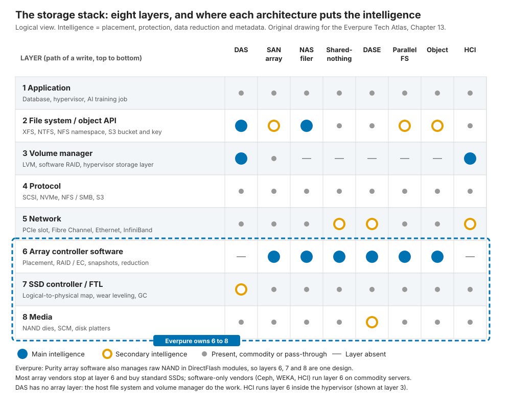
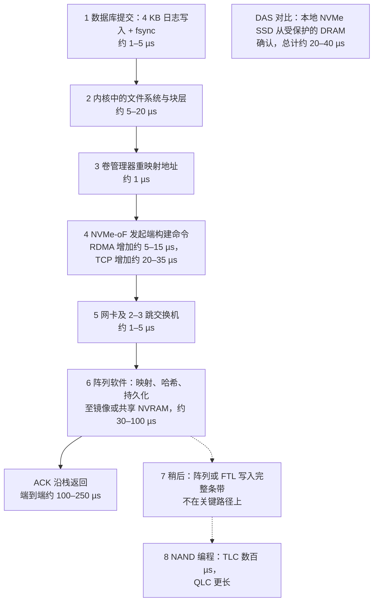
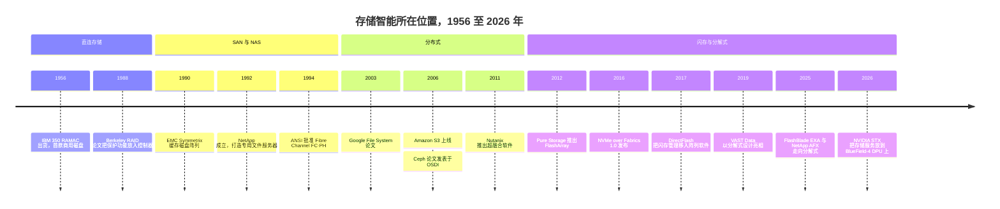

# 13. 逐层解析存储栈

> 📄 英文原文：[docs/03-system-architecture/13-storage-stack.md](../../../docs/03-system-architecture/13-storage-stack.md) · 本文为简体中文参考译本，如有出入以英文原文为准。

> **深度：** L2 · **阅读时间：** 约 7 分钟 · **最后核实：** 2026-11-01
> **前置阅读：** [存储的作用](../01-storage-fundamentals/01-what-storage-does.md) · [SSD 内部结构](../01-storage-fundamentals/03-inside-an-ssd.md) · [块协议与 NVMe-oF](../02-protocols-and-networking/07-block-protocols.md) · [文件协议](../02-protocols-and-networking/08-file-protocols.md) · [数据中心网络](../02-protocols-and-networking/10-datacenter-networking.md)

## 要点速览（TL;DR）

- **每一次 I/O 都要穿越八个层次**：应用、文件系统或对象 API、卷管理器、协议、网络、阵列软件、SSD 控制器/FTL、介质。各种架构的区别在于"智能"放在哪一层：数据放置、保护、缩减和元数据。
- **存储的历史就是这份智能的迁移史**：从主机（DAS），到共享的网络化设备（SAN 与 NAS，1990 年代），再到通用服务器集群（2000 年代），最后到基于共享闪存的无状态计算节点（2010 年代末至今）。
- **每多穿越一层就多付一份延迟；每多掌控一层就多赚一份利润**。一次 4 KB 数据库写入在本地 SSD 上约需 20–40 µs，在网络化阵列上约需 100–250 µs。多出来的这些微秒换来的是共享、受保护、经过缩减的数据。
- **Everpure 掌控三个相邻层**。Purity 阵列软件同时在 DirectFlash 模块内部直接管理裸 NAND，承担了 FTL 的职能。多数竞争对手止步于阵列软件层；纯软件厂商则停留在更高的层次。
- **垂直整合是一种押注，而非默认选项**。它带来密度、效率以及一个可单独授权的层（即超大规模云厂商订单），代价是更高的研发投入和对 NAND 供应的敞口。

## 对 Everpure 战略的意义

第 3 部分比较各类架构：双控制器阵列、无共享集群、DASE、并行文件系统、对象存储和 HCI。理解每种架构的最佳方式，是把它看作对同一个问题的回答：哪一层承担巧妙的工作，跑在谁的硬件上？这个问题直接映射到商业层面。掌控稀缺层的厂商拥有定价权；组装通用层的厂商只能拼成本。Everpure（NYSE: P，原 PSTG）2026 财年 GAAP 毛利率为 70.4%[^1]；而主要用外购零部件组装服务器的 Supermicro，2025 财年毛利率为 11.1%[^2]。

存储栈也是一张相邻业务地图。Everpure 的超大规模云厂商订单授权的是底部几层（DirectFlash 模块与闪存管理），不含阵列软件，运行在客户自行采购的硬件上[^3][^4]。WEKA 则从顶部切入，销售运行在合作伙伴服务器上的软件[^5]。

## 核心概念

### 八个层次，一次 I/O

从上到下把存储栈当作一次写入的路径来读：

1. **应用**。数据库、虚拟化管理程序或训练任务决定哪些数据必须持久化、何时持久化（对数据库而言，是在提交时）。
2. **文件系统或对象 API**。把名称（`/db/redo01.log`、一个存储桶和键）转换为块或对象，并维护命名空间，即元数据（[第 21 章](21-metadata.md)）。
3. **卷管理器**。对块地址进行池化和重映射：LVM、软件 RAID、虚拟化管理程序的存储层。
4. **协议**。块用 SCSI 或 NVMe，文件用 NFS 或 SMB，对象用 S3（[第 7](../02-protocols-and-networking/07-block-protocols.md)–[9 章](../02-protocols-and-networking/09-object-storage-and-s3.md)）。
5. **网络**。Fibre Channel、以太网或 InfiniBand；在 DAS 中则是一个 PCIe 插槽（[第 10 章](../02-protocols-and-networking/10-datacenter-networking.md)）。
6. **阵列控制器软件**。Purity、ONTAP、VAST 等：数据放置、RAID 或纠删码、快照、复制、数据缩减。
7. **SSD 控制器与 FTL**。把逻辑块映射到 NAND 页、进行磨损均衡、执行垃圾回收（[第 3 章](../01-storage-fundamentals/03-inside-an-ssd.md)）。
8. **介质**。NAND、存储级内存或磁盘（[第 2 章](../01-storage-fundamentals/02-media-physics.md)）。

*图 13.1 — 所有架构都由相同的层次构成，区别在于哪一行承载智能；Everpure 的特别之处在于把第 6 至第 8 行作为一个整体来设计。*

"智能"指四项工作：放置、保护、压缩（缩减）和追踪数据。一种架构把这些工作放在哪里，决定了其网络承载什么流量，以及它在何处撞上扩展瓶颈。

**半导体类比：计算栈**。计算从应用到编译器、到 ISA、到微架构、到内存控制器、再到 DRAM 存储单元，利润跟随层次的掌控权分布。NVIDIA 掌控 CUDA、编译器和芯片，2026 财年 GAAP 毛利率为 71.1%[^6]；一个不掌控其中任何一层的服务器组装商，毛利率只有其约六分之一。在存储中，FTL 扮演内存控制器的角色：通过地址映射和磨损管理，把介质物理特性隐藏在简洁的接口背后。谁掌控它，谁就决定有多少裸 NAND 能力能传递给客户，以及要付出多少 DRAM 和预留容量成本。（层次并不能解释全部利润差异；研发强度和规模同样重要。）

### 追踪一次 4 KB 数据库写入

*图 13.2 — 示意性的数量级延迟：在网络化阵列上，小写入的延迟主要由网络、协议和控制器软件决定，NAND 编程被隐藏在 NVRAM 之后。*

逐项看数字。网络化阵列在写入数据落到两个 NVRAM 位置后即确认（镜像到伙伴控制器，或者像 FlashArray 那样写入两个控制器都能访问的 NVRAM 模块；见[第 14 章](14-scale-up-dual-controller.md)），而不是等写入 NAND 之后。关键路径各步骤单程合计约 45–165 µs；加上返回路径和排队，一次 4 KB 写入落在约 100–250 µs，与 FlashArray//XL170 所称的 150 µs 一致（公司自述，测试条件未说明）[^7]。本地 NVMe SSD 跳过第 4–6 层，从带掉电保护的 DRAM 确认。

由此得出三点结论。**NAND 不在写入的关键路径上**：NVRAM 或 SSD DRAM 吸收写入，缓慢的编程操作随后进行。**小 I/O 延迟由网络和软件主导**，这正是传输协议对数据库至关重要的原因：基于 RDMA 的 NVMe-oF 比本地 NVMe 多约 5–15 µs[^8]，NVMe/TCP 在早期测试中多约 20–35 µs[^9]，而在极快的 SSD 上，主机内核路径会占据延迟的很大一部分[^10]**。多出的约 100 µs 换来了 DAS 所缺少的能力**：一份数据被多台主机共享、在控制器故障时幸存、经过去重、拥有快照并被复制。

### 智能位于何处

| 架构 | 数据服务运行位置 | 元数据与状态所在位置 | 网络承载内容 | 示例 | 章节 |
|---|---|---|---|---|---|
| DAS | 主机文件系统、卷管理器、RAID | 在主机内 | 无（服务器内部的 PCIe） | 数据库服务器中的本地 NVMe | [1](../01-storage-fundamentals/01-what-storage-does.md) |
| SAN 阵列（纵向扩展） | 阵列中的双控制器 | 控制器 DRAM 加镜像或共享 NVRAM | 块命令（FC、NVMe-oF、iSCSI） | FlashArray、PowerStore、PowerMax、ONTAP AFF | [14](14-scale-up-dual-controller.md) |
| NAS 文件服务器 | 控制器，同时掌管文件系统 | 在文件服务器内 | 文件操作（NFS、SMB） | ONTAP、FlashBlade、PowerScale | [8](../02-protocols-and-networking/08-file-protocols.md) |
| 无共享 | 每个节点上的分布式软件 | 分区分布在各节点 | 客户端流量加东西向复制 | PowerScale、WEKA、Ceph | [15](15-scale-out-shared-nothing.md) |
| DASE | 无状态计算节点 | 共享 SCM 与闪存机箱 | 前端流量加全部后端介质 I/O | VAST、NetApp AFX、HPE X10000 | [16](16-disaggregated-shared-everything.md) |
| 并行文件系统 | 元数据服务器加客户端库 | 元数据服务器 | 布局信息来自元数据服务器，数据直达存储节点 | Lustre、Storage Scale、FlashBlade//EXA | [17](17-parallel-file-systems.md) |
| 对象存储 | 网关与元数据数据库 | 跨节点的元数据数据库 | 基于 HTTP 的 S3；东西向传输纠删码分片 | S3、Ceph RGW、MinIO、FlashBlade | [18](18-object-storage-architecture.md) |
| HCI / SDS | 每台虚拟化主机内的软件 | 分散在各主机 | 虚拟机 I/O 加主机间副本 | Nutanix、vSAN | [19](19-software-defined-and-hci.md) |

*表 13.1 — 智能所在的位置决定了什么流量要穿越网络，以及每种架构在何处撞上扩展瓶颈。*

对任何架构，都可以用两个诊断性问题来审视：元数据存放在哪里？一次写入在安全落盘之前要经过多少跳？

## Everpure 的做法与竞争对手对比

| 厂商 | 掌控的层次 | 硬件模式 | 战略含义 |
|---|---|---|---|
| Everpure FlashArray / FlashBlade | 第 6、7 层及第 8 层的模块设计（Purity + DirectFlash）；外购 NAND | 自有控制器与模块 | 获得密度与效率优势；承担 NAND 供应敞口 |
| Everpure 超大规模云厂商订单 | 第 7 层及模块设计（DirectFlash、闪存管理） | 客户自行采购硬件；Everpure 不采购 NAND[^4] | 一个脱离阵列单独销售的层 |
| IBM FlashSystem | 第 6、7 层（自有 FlashCore Modules） | 自有模块，模块内置压缩[^11] | 最接近的整合型竞争对手 |
| Dell、NetApp 阵列 | 第 6 层 | 标准第三方 SSD（TechTarget 指出了 Dell 的这一差异[^11]） | 硬盘可多源采购；可快速采用每一代 SSD |
| VAST | 第 6 层，外加机箱设计 | 通用 SSD；服务器经由 Supermicro、HPE、Cisco 提供[^12] | 在合作伙伴硬件上赚取软件利润 |
| WEKA、Ceph、Nutanix | 第 6 层（HCI 中为第 3 层） | 运行在通用服务器上的软件[^5][^13][^14] | 搭乘服务器成本曲线；无硬件库存 |
| AWS | 全部八层 | 自有 Nitro SSD，重写了 FTL[^15] | 证明最大的买家能够自建第 7 层 |

*表 13.2 — Everpure 和 IBM 一路整合到闪存层；多数竞争对手止步于阵列软件，纯软件厂商则完全停留在硬件之上。*

**为什么要合并第 6 层和第 7 层**？标准 SSD 的 FTL 是"盲目"工作的：它不知道阵列即将覆盖哪些块，因此可能在垃圾回收时搬运即将失效的数据，而且它还自带预留空间和 DRAM。借助 DirectFlash，Purity 直接驱动裸 NAND，对所有模块统一进行数据放置、垃圾回收和磨损均衡[^16]。随着单盘容量增长，DRAM 的算术变得关键：每 4 KB 页对应一个 4 字节映射条目，即 1 TB ÷ 4 KB × 4 B ≈ 每 TB 1 GB DRAM，一块 150 TB 的盘就需要约 150 GB。把映射并入阵列软件（它本来就为去重和快照维护元数据），模块容量就能扩展而无需承担这笔 DRAM 成本。DFM 容量从 2023 年的 75 TB 增长到 150 TB，2026 年 8 月有报道称已达 300 TB[^17][^18] [VERIFY: 300 TB DFM 正式 GA 日期]。

**为替代方案构建最强版本论证（steelman）**。纯软件厂商免费搭乘服务器和 SSD 的成本曲线，可在任何云中运行，并把研发集中在单一层次上。采用标准 SSD 的阵列厂商可以多源采购硬盘，每一代 SSD 通过认证即可采用；而 Everpure 必须为每一代 NAND 设计模块，并承担供应风险：2026 年 2 月 NAND 成本飙升时，它上调了价格[^19]。AWS 的 Nitro SSD 号称延迟比 OEM 硬盘低 60%，证明超大规模云厂商能够自建第 7 层[^15]。因此，授权业务的逻辑建立在保持容量上市时间（time-to-capacity）领先之上，而不是建立在该层无法被复制之上。

基于公开信息，战略团队可能评估的选项包括：对第 7、8 层的授权应走多远；FlashBlade//EXA 采用第三方数据节点（[第 16 章](16-disaggregated-shared-everything.md)）是稀释了整合逻辑，还是扩展了 Purity 的覆盖范围；以及随着 DPU 吸收存储服务，哪一层会变得可被争夺。

## 历史与发展轨迹

*图 13.3 — 每个时代都把智能迁移到新的层次；当前时代把元数据、数据和网络结构拆分成可独立扩展的部分。*

图 13.3 的资料来源：[^20][^21][^22][^23][^24][^25][^26][^13][^14][^27][^28][^29][^30][^31][^32][^33]。

每一次迁移都是对某个瓶颈的回应：先是 DAS 容量被困在单机中，然后是控制器的限制，再后来（随着闪存出现）瓶颈变成了网络和软件本身。有两个信号预示着下一次重新切分。NVIDIA 2026 年的 STX 设计在 DPU 上运行存储服务，把第 6 层的部分功能拉进网卡[^33]。NVMe 灵活数据放置（Flexible Data Placement）让任何阵列都能在标准 SSD 上引导数据放置，从而缩小（而非消除）掌控第 7 层的优势（[第 12 章](../02-protocols-and-networking/12-interfaces-and-emerging-tech.md)）。

## 关键数字

| 指标 | 数值 | 背景 | 来源 / 日期 |
|---|---|---|---|
| 4 KB 写入，网络化全闪存阵列 | 约 100–250 µs | 数量级；FlashArray//XL170 所称为 150 µs（公司自述） | 算例；Futurum[^7] |
| 4 KB 写入，本地 NVMe SSD | 约 20–40 µs | 从带掉电保护的 DRAM 确认 | 算例 |
| RDMA NVMe-oF 延迟增量 | 约 5–15 µs | 每次 I/O，相对本地 NVMe | SNIA 2016[^8] |
| NVMe/TCP 延迟增量 | 约 20–35 µs | 早期 Linux 测试 | SNIA 2019[^9] |
| FTL 映射所需 DRAM | 约每 TB 1 GB | 每 4 KB 页一个 4 字节条目 | 算例 |
| 按掌控层次看毛利率 | NVIDIA 71.1%（FY26）；Everpure 70.4%（FY26）；Supermicro 11.1%（FY25） | GAAP；行业不同，结论相同 | SEC 文件[^6][^1][^2] |
| AWS Nitro SSD 对比 OEM 硬盘 | 延迟低 60%（公司自述） | 重写了 FTL | Datanami, 2021-12-02[^15] |

## 对话手册

**向产品经理提的问题**

1. *"在超大规模云厂商订单中，我们变现的是哪一层？什么能阻止客户自建？"* 高质量回答：闪存管理和模块设计；AWS Nitro 证明内部自建是可能的；护城河在于每一代 NAND 的容量上市时间，以及 EB 级规模的认证经验。
2. *"当客户坚持只要软件时，我们提供什么、放弃什么？"* 高质量回答：点明具体场景（主权云、标准服务器机群、公有云）、服务这些场景的产品，以及脱离 DirectFlash 后损失的密度。
3. *"在由延迟决定胜负的交易中，瓶颈在哪一层？"* 高质量回答：主机协议栈、传输协议和控制器软件，并给出 NVMe/TCP 与 RDMA 的对比数字；而不是 NAND。

**向工程师提的问题**

1. *"走一遍 4 KB 写入：持久化点在哪里？每一层对 p99 的贡献是多少？"* 高质量回答：指出 NVRAM 镜像点、各层的微秒数，以及哪一层在负载下最先劣化。
2. *"Purity 知道哪些驱动器 FTL 无法知道的信息？这对 90% 满载时的写放大有什么影响？"* 高质量回答：给出量化的写放大或预留空间对比，并说明机制。
3. *"如果灵活数据放置（FDP）让任何阵列都能在标准 SSD 上引导放置，DirectFlash 还剩下什么优势？"* 高质量回答：区分 FDP 能弥补的部分（数据放置）与无法弥补的部分（DRAM、密度、功耗、全局磨损管理）。

**不要这样说：**

- "闪存延迟是瓶颈。"在网络化阵列上，小写入由网络和软件主导；NAND 编程不在关键路径上。
- "DirectFlash 就是去掉外壳的 SSD。"它去掉的是盘级 FTL；闪存管理移入了 Purity。
- "软件定义意味着没有硬件。"总要有人的硬件来运行它；问题在于谁承担库存、谁赚取利润。
- "SAN 和 NAS 是不同的硬件。"二者的主要区别在于由谁掌管文件系统：主机还是阵列。
- "分解式架构是新事物。"每个时代都在重新切分存储栈。

## 深入阅读（可选，L3 指引）

- Patterson、Gibson 和 Katz，RAID 论文，SIGMOD 1988[^21]。
- Lee 等，"Asynchronous I/O Stack"，USENIX ATC 2019，讨论主机协议栈延迟[^10]。
- The Google File System（SOSP 2003）与 Ceph（OSDI 2006）论文[^25][^13]。
- NVM Express 灵活数据放置（Flexible Data Placement，TP4146）。

## 关键术语

- **存储栈（storage stack）**——从应用到介质的八个层次。
- **数据服务（"智能"）**——数据放置、保护、缩减、元数据。
- **持久化点（persistence point）**——写入可以安全确认的位置。
- **垂直整合（vertical integration）**——掌控相邻的多个层次，例如阵列软件、FTL 和模块。
- 参见[术语表](../glossary.md)。

## 资料来源

[^1]: Everpure, "Q4 FY2026 Press Release (Exhibit 99.1 to Form 8-K)," 2026-02-25. https://www.sec.gov/Archives/edgar/data/1474432/000147443226000015/pstg-ex991q4fy2026.htm (retrieved 2026-11-01).
[^2]: Super Micro Computer, Inc., "Form 10-K for fiscal year ended June 30, 2025," 2025-08. https://www.sec.gov/Archives/edgar/data/1375365/000137536525000027/smci-20250630.htm (retrieved 2026-11-01).
[^3]: SiliconANGLE, "Shares of Pure Storage jump on impressive earnings beat and strong guidance," 2024-12-03. https://siliconangle.com/2024/12/03/shares-pure-storage-jump-impressive-earnings-beat-strong-guidance/ (retrieved 2026-11-01).
[^4]: Everpure, "Everpure Lands New Design Win with Second Top-Five Hyperscaler," 2026-08-10. https://www.everpuredata.com/company/newsroom/press-releases/everpure-lands-new-design-win-with-second-top-five-hyperscaler.html (retrieved 2026-11-01); NAND procurement per Motley Fool, "Everpure (P) Q2 2027 Earnings Call Transcript," 2026-08-31. https://www.fool.com/earnings/call-transcripts/2026/08/31/everpure-p-q2-2027-earnings-call-transcript/ (retrieved 2026-11-01).
[^5]: WEKA, "Hardware + System Partners," n.d. https://www.weka.io/partners/system-partners/ (retrieved 2026-11-01).
[^6]: NVIDIA Corporation, "Form 10-K for fiscal year ended January 25, 2026," 2026-02-25. https://www.sec.gov/Archives/edgar/data/1045810/000104581026000021/nvda-20260125.htm (retrieved 2026-11-01).
[^7]: Futurum Group (Evaluator Group), "Pure Storage FlashArray product brief," n.d. https://futurumgroup.com/wp-content/uploads/documents/EGPR_PureStorage_FlashArray-5.pdf (retrieved 2026-11-01).
[^8]: R. Davis (Mellanox), "Demonstrating NVMe Performance over Ethernet," SNIA Data Storage Innovation Conference, 2016. https://www.snia.org/sites/default/files/DSI/2016/presentations/stor_networks/Rob_Davis_Demonstrating_NVMe_Performance_Ethernet.pdf (retrieved 2026-11-01).
[^9]: SNIA, "Author of NVMe/TCP Spec Answers Your Questions," 2019. https://snia.org/blog/2019/author-nvmetm-tcp-spec-answers-your-questions (retrieved 2026-11-01).
[^10]: G. Lee et al., "Asynchronous I/O Stack: A Low-latency Kernel I/O Stack for Ultra-Low Latency SSDs," USENIX ATC 2019. https://www.usenix.net/system/files/atc19-lee-gyusun.pdf (retrieved 2026-11-01).
[^11]: TechTarget, "IBM FlashSystem adds 105 TB modules with agentic AI smarts," 2026. https://www.techtarget.com/searchstorage/news/366639135/IBM-FlashSystem-adds-105-TB-modules-with-agentic-AI-smarts (retrieved 2026-11-01).
[^12]: VAST Data, "Supported Platforms," n.d. https://www.vastdata.com/specifications (retrieved 2026-11-01).
[^13]: S. Weil et al., "Ceph: A Scalable, High-Performance Distributed File System," OSDI 2006. https://www.ssrc.ucsc.edu/papers/weil-osdi06.pdf (retrieved 2026-11-01).
[^14]: Nutanix, Inc., "Form S-1 Registration Statement," 2015-12. https://www.sec.gov/Archives/edgar/data/0001618732/000119312515411021/d937439ds1.htm (retrieved 2026-11-01).
[^15]: Datanami, "AWS Adds a Little More Nitro to Its SSDs," 2021-12-02. https://www.datanami.com/2021/12/02/aws-adds-a-little-more-nitro-to-its-ssds/ (retrieved 2026-11-01).
[^16]: Everpure, "What Is DirectFlash and How Does It Work?," n.d. https://www.everpuredata.com/knowledge/what-is-directflash-and-how-does-it-work.html (retrieved 2026-11-01).
[^17]: Gigazine, "Pure Storage sets goal of realizing 300 TB SSD by 2026," 2023-03-08. https://gigazine.net/gsc_news/en/20230308-pure-storage-300-tb-ssd (retrieved 2026-11-01).
[^18]: Blocks & Files, "Second hyperscaler plumps for Everpure's flash technology," 2026-08-11. https://www.blocksandfiles.com/flash/2026/08/11/second-hyperscaler-plumps-for-everpures-flash-technology/5285903 (retrieved 2026-11-01).
[^19]: Alpha Spread, "P Q4-2026 Earnings Call," 2026-02-25. https://www.alphaspread.com/security/nyse/p/investor-relations/earnings-call/q4-2026 (retrieved 2026-11-01).
[^20]: Computer History Museum, "1956: First commercial hard disk drive shipped," n.d. https://www.computerhistory.org/storageengine/first-commercial-hard-disk-drive-shipped/ (retrieved 2026-11-01).
[^21]: D. Patterson, G. Gibson, R. Katz, "A Case for Redundant Arrays of Inexpensive Disks (RAID)," SIGMOD 1988. https://dl.acm.org/doi/10.1145/50202.50214 (retrieved 2026-11-01).
[^22]: StorageNewsletter, "History 1990: EMC Symmetrix 4200," 2018-08-24. https://www.storagenewsletter.com/2018/08/24/history-1990-emc-symmetrix-4200/ (retrieved 2026-11-01).
[^23]: S. Kleiman (NetApp), "About NetApp," USENIX WIESS 2000 invited talk slides, 2000. https://static.usenix.org/events/wiess2000/invitedtalks/kleiman_html/tsld003.htm (retrieved 2026-11-01).
[^24]: ANSI, "ANSI X3.230-1994, Fibre Channel Physical and Signaling Interface (FC-PH)," 1994. https://webstore.ansi.org/standards/incits/ansiincits2301994am1996r2001 (retrieved 2026-11-01).
[^25]: S. Ghemawat, H. Gobioff, S.-T. Leung, "The Google File System," SOSP 2003. https://www.cs.rochester.edu/meetings/sosp2003/papers/p125-ghemawat.pdf (retrieved 2026-11-01).
[^26]: Amazon Web Services, "Announcing Amazon S3 - Simple Storage Service," 2006-03-14. https://aws.amazon.com/about-aws/whats-new/2006/03/announcing-amazon-s3---simple-storage-service (retrieved 2026-11-01).
[^27]: Pure Storage, Inc., "Form S-1 Registration Statement," 2015-08-27. https://www.sec.gov/Archives/edgar/data/0001474432/000119312515287576/d895532ds1.htm (retrieved 2026-11-01).
[^28]: NVM Express, "NVM Express over Fabrics Specification Released," 2016-06-09. https://nvmexpress.org/nvm-express-over-fabrics-specification-released/ (retrieved 2026-11-01).
[^29]: Pure Storage, "Pure Storage Announces First Enterprise-Class All-NVMe Flash Array, FlashArray//X," 2017-04-11. https://investor.everpuredata.com/news-and-events/press-releases/press-release-details/2017/Pure-Storage-Announces-First-Enterprise-Class-All-NVMe-Flash-Array-FlashArrayX/default.aspx (retrieved 2026-11-01).
[^30]: Blocks & Files, "VAST Data's universal filesystem," 2019-02-26. https://blocksandfiles.com/2019/02/26/vast-datas-universal-filesystem/ (retrieved 2026-11-01).
[^31]: Everpure, "Technical Brief: FlashBlade//EXA," n.d. (2025). https://www.everpuredata.com/content/dam/pdf/en/technical-briefs/tb-flashblade-exa.pdf (retrieved 2026-11-01).
[^32]: Blocks & Files, "NetApp disaggregates ONTAP storage and provides an AI Data Engine," 2025-10-14. https://blocksandfiles.com/2025/10/14/netapp-disaggregates-ontap-storage-and-provides-an-ai-data-engine/ (retrieved 2026-11-01).
[^33]: StorageNewsletter, "Nvidia GTC 2026: Nvidia Launches BlueField-4 STX Storage Architecture With Broad Industry Adoption," 2026-03-17. https://www.storagenewsletter.com/2026/03/17/nvidia-gtc-2026-nvidia-launches-bluefield-4-stx-storage-architecture-with-broad-industry-adoption/ (retrieved 2026-11-01).
