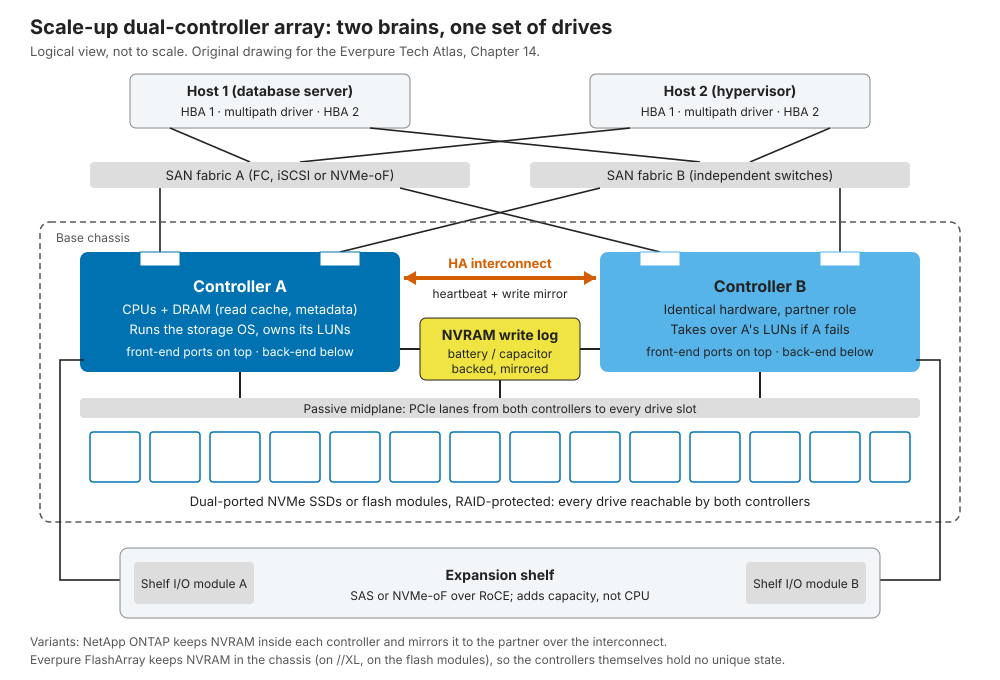
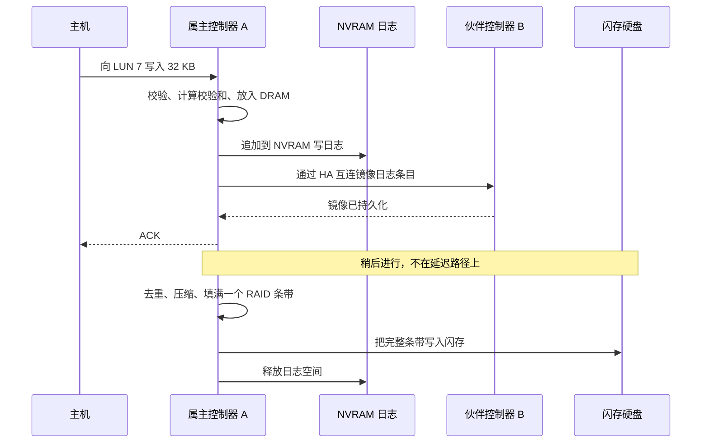
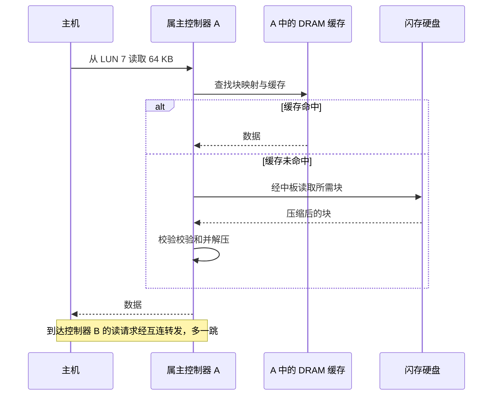
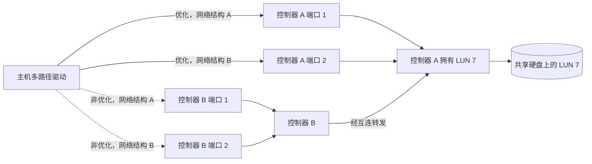
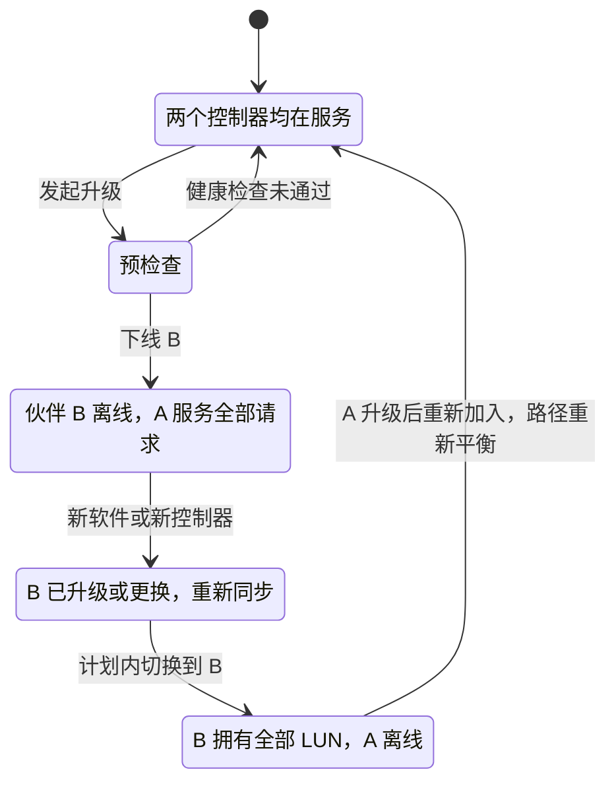
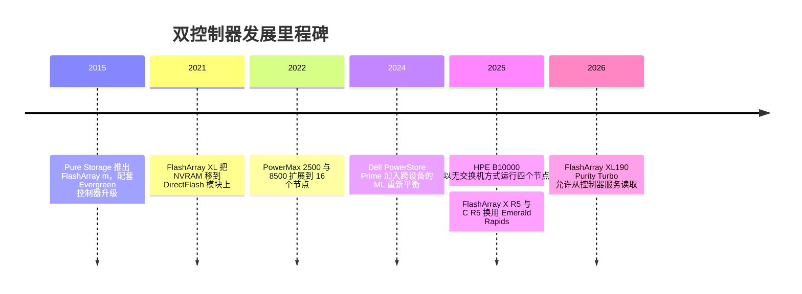

# 14. 纵向扩展双控制器阵列

> 📄 英文原文：[docs/03-system-architecture/14-scale-up-dual-controller.md](../../../docs/03-system-architecture/14-scale-up-dual-controller.md) · 本文为简体中文参考译本，如有出入以英文原文为准。

> **深度：** L2 · **阅读时间：** 约 9 分钟 · **最后核实：** 2026-11-01
> **前置阅读：** [存储栈](13-storage-stack.md) · [SSD 内部结构](../01-storage-fundamentals/03-inside-an-ssd.md) · [数据保护与韧性](../01-storage-fundamentals/06-data-protection-and-resilience.md) · [块协议](../02-protocols-and-networking/07-block-protocols.md)

## 要点速览（TL;DR）

- **双控制器阵列就是两台服务器共享一组双端口硬盘**。一台故障，另一台接管。FlashArray、PowerStore、NetApp AFF、IBM FlashSystem 和 HPE Alletra 都采用这种方式。
- **写入在落到两个持久化位置后即被确认，而不是写入闪存后**。数据先进入镜像或共享的 NVRAM；闪存随后批量写入。
- **"双活（active/active）"是一个连续谱；ALUA 告诉主机阵列处于谱上的哪个位置**。真正的问题是：一个控制器失效后，还剩多少性能。
- **不停机升级就是两次计划内的故障切换**。Everpure 的无状态控制器把这一点变成了一个商业产品：Evergreen。
- **瓶颈在于一对控制器的 CPU 和内存**。超出这一上限后，厂商会把多对控制器联合（federate）起来，但这并不等同于一个更大的系统。

## 对 Everpure 战略的意义

FlashArray 是 Everpure 的起家产品，采用双控制器设计，其主要块存储竞争对手也是如此。企业级块存储交易的胜负取决于 p99 延迟、故障期间的表现、升级带来的中断以及更新换代的经济性。Evergreen//Forever 承诺在每三年续约时提供新控制器[^1]，这之所以可行，完全是因为控制器不保存数据：商业模式本身就是一种架构属性。

矛盾在于，AI 和大型文件工作负载正把支出引向没有中心控制器对的设计（[第 15 章](15-scale-out-shared-nothing.md)、[第 16 章](16-disaggregated-shared-everything.md)）。弄清纵向扩展在哪些场景仍然胜出，是判断 FlashArray 发展空间和 FlashBlade 定位的关键（[第 27 章](../04-everpure/27-flasharray-and-flashblade.md)）。

## 核心概念

### 一张图看懂

每个控制器都是一台服务器，配有 x86 CPU、DRAM、前端端口（FC、iSCSI 或 NVMe-oF）以及连接硬盘的后端链路。主机连接到两个相互独立的网络结构（fabric），因此任何单个组件故障都不会导致访问中断。只有无源中板和软件没有冗余。

*图 14.1 — 两个控制器，一组硬盘：每条路径、每个控制器和每个硬盘连接都有冗余，但软件和机箱是共享的。*

**半导体类比：热备，而非锁步**。ASIL-D 级汽车 SoC 让两个核心锁步运行，由比较器标记差异。控制器对并不比较任何东西；伙伴控制器只保存恰好足以接续工作的状态（镜像的写日志）。锁步换来的是故障检测，HA 换来的是可用性；二者有一个共同弱点：一个软件缺陷会同时击中两份副本。

### 状态存放在哪里

数据和元数据存放在受 RAID 保护的硬盘上（[第 6 章](../01-storage-fundamentals/06-data-protection-and-resilience.md)），在途写入存放在容量小但持久的 NVRAM 中，可重建的缓存存放在控制器 DRAM 中。关键的设计选择是 NVRAM 放在哪里。

- **放在每个控制器内部，并镜像到伙伴控制器**。ONTAP 把每次写入记录在本地 NVRAM 中，并镜像到 HA 伙伴，伙伴在接管时重放日志[^2]。如果镜像失去同步，ONTAP 会阻止接管[^3]。入门级 PowerStore 500 则镜像到对端的 DRAM 中[^4]。
- **放在机箱中，两个控制器都能访问**。FlashArray//m 通过 PCIe 把 NVRAM 模块双归属连接到两个控制器[^5]。FlashArray//XL 把它移到了 DirectFlash 模块上（"DFMD"），因此日志容量和带宽随模块数量增长[^6]。较大的 PowerStore 型号在基础机箱中保留成对镜像的 NVRAM 硬盘[^4]。由于控制器中没有任何独有数据，Pure Storage 称这种设计为"无状态"：更换控制器无需先把任何数据下刷（destage）[^5]。

**半导体类比**。NVRAM 是阵列级的掉电保护：由电容或电池供电维持的 DRAM 或 SRAM，坚持足够长的时间把数据转储到闪存，与 SSD 中的做法相同（[第 3 章](../01-storage-fundamentals/03-inside-an-ssd.md)）。

### 追踪一次写入 ★

*图 14.2 — ACK 等待的是写日志的两份持久化副本，而从不等待闪存。在机箱内 NVRAM 的设计中（如 FlashArray），镜像这一步变成写入两个控制器都能读取的 NVRAM。*

**算例（示意）**。线路与协议约 20 µs，NVRAM 追加约 10 µs，镜像跳转约 15 µs，软件约 50 µs：ACK 大约在 100 µs 后发出。一次 TLC 页编程就需要数百微秒，因此如果等待 NAND，写入延迟会成倍增加。NVRAM 是缓冲区，而不是缓存。在 4 GB/s 的持续写入下，32 GB 的日志可容纳 32 ÷ 4 = 8 秒；如果下刷跟不上，日志写满，主机就会被限速到闪存的速度，形成延迟断崖。这 4 GB/s 同样要穿过镜像路径，这就是互连采用 PCIe 或 100 Gb 级 RDMA 的原因。

### 追踪一次读取

*图 14.3 — 除非数据仍在日志中，读取会绕过 NVRAM。请求到达"错误"的控制器会多付出一次互连跳转的代价，而 ALUA 路径状态通告的正是这一点。*

闪存阵列的多数读取都无法命中 DRAM：延迟由一次元数据查找、一次 NAND 读取和解压构成；在高 IOPS 下，控制器 CPU 成为瓶颈。

### 双活、主备与 ALUA

| 模式 | 工作方式 | 示例 |
|---|---|---|
| 主备（active/passive） | 一个控制器处理全部请求；另一个待命 | 较早的中端阵列 |
| 非对称双活 | 每个控制器拥有部分 LUN；发往非属主控制器的 I/O 会被转发 | 9.19.1 之前的 NetApp AFF；IBM FlashSystem 首选节点；Dell PowerStore，其两个节点都处理 I/O[^7] [VERIFY: PowerStore 按卷的节点亲和性及 ALUA 路径状态] |
| 对称双活 | 所有路径均为优化路径；任一控制器都可通过一致性共享缓存服务任一 LUN | NetApp ASA[^8] 及 9.19.1 起的 AFF[^9]；HPE Alletra 9000 "all-active"[^10]；PowerMax 全局缓存[^11] |
| 单控制器包络（FlashArray） | 所有端口都处于活动状态，但只有主控制器处理 I/O；从控制器转发其端口上的 I/O，并在 DRAM 中保存事务镜像[^12][^13] | FlashArray；自 2026 年 1 月起，XL190 Purity Turbo 允许从控制器服务读取[^14] |

*表 14.1 — "双活"涵盖三种不同的设计；FlashArray 自成一类。*

FlashArray 是个例外，而且 Everpure 当前的资料仍是这样描述它的：在主机连接上是双活，工作负载处理则在一个控制器上进行[^12]。Pure 自己的分类把 Purity//FA 称为"单写者（single-writer）"设计，与 FlashBlade 中"分区写者（partitioned-writer）"的 Purity//FB 相对[^15]。批评者称它是变相的主备[^16]；Pure Storage 的回应是：把性能上限设定为一个控制器的能力，意味着故障时不会有任何性能损失[^17]。

**ALUA 的工作原理**。非对称逻辑单元访问（Asymmetric Logical Unit Access，ALUA）是一项 SCSI 标准（SPC-3）。每个端口组针对每个 LUN 报告一种状态：活动/优化、活动/非优化、待机或不可用。主机使用优化路径，只在必要时回退；故障切换时，阵列翻转这些状态。NVMe 中的对应机制是 ANA[^18]，ONTAP 自 9.5 起支持[^19]。对称设计把所有路径都标记为优化，因此主机永远无需等待状态转换[^8]。

*图 14.4 — 主机把 I/O 分散到各条优化路径上，并把非优化路径留作备用。如果控制器 A 失效，阵列把 B 的路径标记为优化，由 B 接管所有权。*

**半导体类比**。ALUA 就是向主机通告的 NUMA：非优化路径相当于经 UPI 访问远端插槽，而端口组报告则扮演 SRAT/SLIT 距离表的角色。

**算例（余量陷阱）**。两个控制器各提供 500k IOPS，于是厂商可以宣传 1M。如果以 800k 运行时失去一个控制器：幸存者要面对 800k 的负载而只有 500k 的能力，延迟呈曲棍球棒式飙升（[第 4 章](../01-storage-fundamentals/04-performance-and-economics-metrics.md)）。要在故障期间不降级，总负载必须 ≤500k，即每个控制器 50%。*任何双控制器阵列的故障安全性能，都等于一个控制器的能力。* 双活让客户可以跑得更"热"并接受降级；FlashArray 则替客户做了这个选择。

### 故障处理

| 故障 | 发生什么 | 爆炸半径 / 代价 |
|---|---|---|
| 硬盘 | 通过 RAID 或纠删码重建到预留容量；两个控制器都能读取每块硬盘 | 小。重建占用的 CPU 与主机 I/O 竞争 |
| 控制器 | 伙伴接管所有权并重放镜像日志。ONTAP 的 I/O 暂停"通常以秒计"[^2]；Everpure 称本地 HA 故障切换期间会有短暂暂停[^20] | 主机必须能容忍暂停。若双活系统跑得过"热"，性能会下降 |
| NVRAM 模块或镜像链路 | 冗余模块或镜像继续工作。日志未同步时 ONTAP 拒绝接管[^3] | 存在保护能力下降的窗口期 |
| 路径（HBA、线缆、交换机、端口） | 多路径驱动在幸存路径上重试。ONTAP SAN LIF 不会迁移，因此主机必须切换路径[^2] | 若主机采用双网络结构且超时设置正确，则无影响 |
| 扩展柜或扩展柜模块 | 第二个扩展柜 I/O 模块保持硬盘可访问。整个扩展柜丢失的影响取决于 RAID 组如何跨扩展柜分布 | 大：一个扩展柜可容纳数百 TB |
| 软件缺陷、机箱、站点 | 两个控制器共享代码和机箱。需要第二台阵列来保护（同步复制，如 ActiveCluster） | 整台阵列 |

*表 14.2 — 控制器对消除了硬件单点故障；但共享的软件和机箱依然存在，这正是阵列间同步复制存在的原因。*

HPE 以此为卖点，为 Alletra 9000 和 B10000 提供 100% 可用性保证，条件是签有支持合同并在七天内提交服务请求[^21]。作为参照，六个九意味着 1e-6 × 31.5M s ≈ 每年 32 秒，大约相当于一次接管。

### 不停机升级

*图 14.5 — 一次升级就是两次计划内的故障切换。主机会看到两次路径翻转，风险窗口是一个控制器离线、阵列失去冗余的那段时间。*

同样的流程既适用于软件升级，也适用于硬件升级。采用无状态控制器时，技术人员拔出从控制器，插入更新的控制器，执行故障切换，然后重复一遍；硬盘、NVRAM 和配置始终留在机箱内[^22]。一家集成商报告曾在工作时间、业务负载在线的情况下完成 //X90R2 到 R4 的更换[^23]。PowerStore 的数据原位（data-in-place）升级一次处理一个节点[^4]；ONTAP 更换控制器时则在节点之间迁移聚合（aggregate）[^24]。

### 如何扩展，以及在何处碰壁

- **容量**。通过扩展柜增加硬盘，直到后端端口或控制器 DRAM（必须容纳块映射和去重表）耗尽。FlashArray//XL R5 的上限约为 1.9 PB 原始容量、7.4 PB 有效容量[^25]。
- **性能**。一对控制器的 CPU、内存带宽和 PCIe 通道数决定了上限。FlashArray//X R5 和 //C R5 换用 Intel Emerald Rapids 后，性能分别提升约 30% 和约 40%[^35]：阵列的路线图在很大程度上就是 Intel 的路线图。纵向扩展好比依赖制程节点进步的单片芯片（monolithic die）；横向扩展则是多芯粒（multi-die）的答案。
- **联合（federation）**。PowerStore 最多可把四台设备组成集群并在其间迁移卷[^4]，Prime 版本还加入了基于 ML 的重新平衡[^26]。ONTAP ASA 集群可达 12 个节点[^27]，HPE 的 B10000 可达六个节点[^28]。IBM 则反其道而行之：从 Storage Virtualize 8.7.1 起，FlashSystem 不再能通过增加控制机箱进行横向扩展，IBM 引导客户使用 FlashSystem grid，把多个独立系统联合起来（据一份经销商数据表，FlashSystem 7600 最多 32 个）[^29]。一个卷仍然只驻留在一对控制器上；联合带来的是数据可迁移性和统一的管理平面，而不是更大的卷。
- **例外**。PowerMax 8500 可扩展到 16 个节点，通过 100 Gb/s NVMe/InfiniBand 网络结构共享全局缓存[^30][^11]，是一台由多个控制器构建而成的纵向扩展机器。

### 优缺点与适用场景

| | 优势 | 劣势 |
|---|---|---|
| 延迟 | 亚毫秒级且稳定；从 NVRAM 确认 | 每次 I/O 都要经过一对控制器的 CPU |
| 简洁性 | 无集群网络、无仲裁（quorum）、占地小 | 超出一对控制器后的扩展意味着联合与数据迁移 |
| 韧性 | 故障切换机制成熟；硬件完全冗余 | 软件和机箱共享；升级期间无冗余 |
| 经济性 | 入门成本低；无状态设计支持原位更新换代 | 故障安全设计让一半 CPU 闲置 |
| 规模 | 每台阵列有效容量可达数 PB | 吞吐量远低于 TB/s 级的横向扩展系统 |

*表 14.3 — 纵向扩展以一个硬性上限换取低延迟、低入门成本和运维简洁性。*

**最适合**：OLTP 数据库、虚拟化环境、VDI、SAP 以及中等规模的 Kubernetes 卷。**最不适合**：被 GPU 集群以 TB/s 速度读取的多 PB 级命名空间（[第 31 章](../05-ai-storage/31-training-storage.md)）、低成本大容量归档，以及终将超出一对控制器能力的工作负载。

### 成本与运维影响

入门便宜，运维简单。隐性成本是"余量税"：为两个控制器付费，只换来一个控制器的故障安全性能。传统的更新换代每三到五年替换一次阵列并迁移数据；Evergreen 式的更换把这一资本性事件变成了一项订阅支出（[第 23 章](23-consumption-models.md)）。许多故障始于主机端：单网络结构布线，或超时设置短于一次接管所需时间。

## Everpure 的做法与竞争对手对比

| 系统 | 控制器 | 写日志 | 路径模式 | 超出一对控制器之后 |
|---|---|---|---|---|
| Everpure FlashArray //X、//C、//XL | 2 个，无状态 | 机箱内 NVRAM；//XL 上位于 DFMD[^6] | 所有端口活动；一个控制器承担后端工作；XL190 Turbo 允许从控制器服务读取[^14] | 无集群；阵列间通过 ActiveCluster 同步复制；集群（设备群）管理 |
| Dell PowerStore T | 每台设备 2 个节点 | 镜像 NVRAM 硬盘；500 镜像到对端 DRAM[^4] | 两个节点都处理 I/O[^7]；ALUA | 每个集群最多 4 台设备[^4] |
| Dell PowerMax 2500/8500 | 2–16 个节点 | 经 RDMA 共享的全局缓存[^11] | All-active | Dynamic Fabric 上 8 对节点[^30] |
| NetApp AFF / ASA | HA 对 | 每节点 NVRAM 镜像到伙伴[^2] | AFF 在 9.19.1 之前为 ALUA；ASA 为对称[^8][^9] | 由多个 HA 对组成的 ONTAP 集群[^27] |
| HPE Alletra 9000 / MP B10000 | 2–4 个（9000）[^10]；最多 6 个（B10000）[^28] | 未核实 | All-active | 100% 可用性保证[^21] |
| IBM FlashSystem | 每个 I/O 组 2 个控制罐（canister） | 写缓存在控制器对之间镜像[^31] | 每卷首选节点 | 自 8.7.1 起每系统一个 I/O 组；FlashSystem grid 联合多个系统[^29] |

*表 14.4 — 各家都出货双控制器；差异在于写日志放在哪里、两个控制器是否都承担实际工作，以及能联合多少对控制器。*

Everpure 押注的是单控制器包络加无状态控制器：在故障期间性能可预测，更换成本低到足以打包进订阅。代价是单台阵列的上限更低，而且伙伴 CPU 只负责转发前端 I/O 和镜像事务，不承担后端工作；Purity Turbo 在读取上放宽了这一点。为竞争对手构建最强版本论证：PowerMax 拥有最高的单系统上限，NetApp 用一个操作系统同时覆盖 NAS 和 SAN 并具备集群内迁移能力，HPE 则以保证条款把风险转移给厂商。基于公开信息，战略团队可能评估的选项包括：Turbo 式双活能走多远，才需要给"故障切换无损失"加上限定条件；以及对于超出一台 //XL 能力的客户，集群（设备群）管理和 FlashBlade 哪个是更好的方案。

## 历史与发展轨迹

*图 14.6 — 这种架构由来已久；近来的变化在于 NVRAM 放在哪里，以及第二个控制器承担多少工作。*

这种模式可追溯到 1990 年代的 RAID 阵列；闪存把瓶颈从硬盘转移到了控制器。2015 年，Pure Storage 把 FlashArray//m 与 Evergreen 搭配推出，把无状态性作为一种更新换代模式来销售[^32]。展望未来，对称双活正在成为默认选项（先是 ASA，然后是 AFF 9.19.1[^9]），而 NVMe-oF 扩展柜正在模糊纵向扩展与全共享架构的边界：HPE 的 B10000 被描述为分解式架构[^33]，FlashArray 则通过 NVMe-oF/RoCE 连接 DirectFlash 扩展柜[^34]。

## 关键数字

| 指标 | 数值 | 背景 | 来源 / 日期 |
|---|---|---|---|
| FlashArray//XL R5 上限 | 约 1.9 PB 原始容量 / 7.4 PB 有效容量 | 单台阵列的纵向扩展上限 | Techzine, 2025-06[^25] |
| //X R5、//C R5 CPU 换代带来的提升 | 约 30% / 约 40% | 性能跟随 Intel 的代际节奏 | Blocks & Files, 2025-09-26[^35] |
| Evergreen//Forever 控制器更新 | 每 3 年（//E：6 年） | Ever Modern 条款 | Everpure 计划说明[^1] |
| ONTAP 接管时的 I/O 暂停 | "通常以秒计" | 主机端检测会增加时间 | NetApp 文档[^2] |
| PowerStore 集群 | 最多 4 台设备 | 联合，而非一个大卷 | StorageReview[^4] |
| PowerMax 8500 | 最多 16 个节点（8 对） | 通过网络结构共享全局缓存 | Dell 规格表[^30] |
| HPE B10000 | 最多 6 个节点（10.6.0） | 每次增加一个节点 | StorageReview[^28] |
| 六个九的停机预算 | ≈每年 32 秒 | 1e-6 × 31.5M s | 算例 |
| 每个控制器的故障安全负载 | ≤50% | 幸存者必须吸收伙伴的负载 | 算例 |

## 对话手册

**向产品经理提的问题**

1. *"在 Evergreen 更换期间一个控制器离线时，客户在 IOPS 和 p99 上会损失多少？持续多久？"* 高质量回答："设计上没有损失"、以分钟计的窗口期，以及故障切换期间 Purity Turbo 的哪些读取增益会消失。
2. *"当块存储客户的需求超出一台 //XL 时，我们卖什么？"* 高质量回答：给出转向第二台阵列、ActiveCluster 或 FlashBlade 的门槛，并坦承不存在横向扩展的块命名空间。
3. *"Dell、NetApp 和 HPE 的升级计划与 Evergreen//Forever 有何不同？"* 高质量回答：更新周期、以旧换新抵扣、由谁执行更换，以及各自背后的架构。

**向工程师提的问题**

1. *"持久化点在哪里？有几份副本？分别位于哪些故障域？"* 高质量回答：NVRAM 的位置、副本数量、掉电时的行为、单设备故障。
2. *"在 Purity Turbo 下，从控制器的读缓存如何与主控制器的写入保持一致？"* 高质量回答：失效（invalidation）协议、互连开销、故障切换时的行为。
3. *"每次 I/O 的 CPU 开销是多少？下一个上限是 CPU、内存带宽还是 PCIe？"* 高质量回答：指出瓶颈所在，以及下一代 CPU 如何改变它。

**不要这样说：**

- "双活让性能翻倍。"按故障安全标准，它只相当于一个控制器的能力。
- "阵列要等写入闪存后才确认。"ACK 来自镜像的 NVRAM。
- "双控制器意味着没有单点故障。"软件、机箱和升级窗口都是共享的。
- "FlashArray 是横向扩展的。"它是纵向扩展的。
- "ALUA 是 NetApp 的功能。"它是一项 SCSI 标准；NVMe 中称为 ANA。

## 深入阅读（可选，L3 指引）

- T10 SPC-3/SPC-4 中关于非对称访问的部分（REPORT TARGET PORT GROUPS）；NVMe ANA 日志页；Linux `dm-multipath` 的 ALUA/ANA 优先级插件。
- NetApp ONTAP HA 文档；Dell PowerStore 集群与 PowerMax RAS 白皮书；FlashArray//XL 数据表中关于 DFMD 的内容。

## 关键术语

- **NVRAM 写日志**、**ALUA / ANA**、**无状态控制器**、**接管 / 交还（takeover / giveback）**、**联合（federation）**。参见[术语表](../glossary.md)。

## 资料来源

[^1]: Everpure, "Evergreen Program Description," n.d. https://www.everpuredata.com/legal/evergreen-program-description.html (retrieved 2026-11-01).
[^2]: NetApp, "Database availability" (ONTAP for Oracle), n.d. https://docs.netapp.com/us-en/ontap-apps-dbs/oracle/oracle-dp-data-availability.html (retrieved 2026-11-01).
[^3]: NetApp Knowledge Base, "Takeover Disabled Due to Unsynchronized NVRAM Log," n.d. https://kb.netapp.com/on-prem/ontap/Ontap_OS/OS-KBs/Takeover_Disabled_Due_to_Unsynchronized_NVRAM_Log (retrieved 2026-11-01).
[^4]: StorageReview, "Dell PowerStore delivers Gen2 with massive software, hardware update," n.d. (2022). https://www.storagereview.com/review/dell-powerstore-delivers-gen2-with-massive-software-hardware-update (retrieved 2026-11-01). [VERIFY: search-summary only — NVRAM drive pairing, PowerStore 500 DRAM mirroring, four-appliance cluster limit and data-in-place upgrade details]
[^5]: Pure Storage, blog post on FlashArray//m NVRAM and stateless controllers, 2015. https://blog.purestorage.com/products/flasharraym-nvram/ (retrieved 2026-11-01).
[^6]: Pure Storage, "FlashArray//XL data sheet," n.d. https://www.purestorage.com/content/dam/pdf/en/datasheets/ds-flasharray-xl.pdf (retrieved 2026-11-01).
[^7]: Dell Technologies, "Dell PowerStore: Introduction to the Platform (H18149)," n.d. https://www.delltechnologies.com/asset/en-us/products/storage/industry-market/h18149-dell-powerstore-platform-introduction.pdf (retrieved 2026-11-01).
[^8]: NetApp, "All-Flash SAN Array software configuration overview," n.d. https://docs.netapp.com/us-en/ontap/asa/overview.html (retrieved 2026-11-01).
[^9]: NetApp Community, "NetApp extends symmetric active-active SAN pathing to unified AFF," n.d. https://community.netapp.com/community/discussion/468316/netapp-extends-symmetric-active-active-san-pathing-to-unified-aff (retrieved 2026-11-01).
[^10]: HPE, "HPE Alletra Storage 9000 QuickSpecs," n.d. https://cdn.blueally.com/servercomputeworks/datasheets/alletra/hpe-alletra-storage-9000-quickspecs.pdf (retrieved 2026-11-01).
[^11]: Dell Technologies Info Hub, "PowerMax 2500 and 8500 Dynamic Fabric—A High-Performance Clustered Architecture for Enterprise Storage," 2023-04. https://infohub.delltechnologies.com/p/powermax-2500-and-8500-dynamic-fabric-a-high-performance-clustered-architecture-for-enterprise-storage (retrieved 2026-11-01).
[^12]: Everpure, "Why FlashArray Only Needs Two Storage Controllers," n.d. https://blog.everpuredata.com/products/why-flasharray-only-needs-two-storage-controllers/ (retrieved 2026-11-01; seen via search summary, host not fetchable).
[^13]: C. Hogan, "Pure Storage revisited – a chat with Vaughn Stewart," 2014-04-24 (including reader discussion). https://cormachogan.com/2014/04/24/pure-storage-revisited-a-chat-with-vaughn-stewart/ (retrieved 2026-11-01).
[^14]: Everpure, "Pure Launch Blog: January 2026 Edition," 2026-01. https://blog.everpuredata.com/products/pure-launch-blog-january-2026-edition/ (retrieved 2026-11-01).
[^15]: J. Emerson (Pure Storage), "The Storage Architecture Spectrum: Why 'Shared-nothing' Means Nothing," n.d. https://blog.everpuredata.com/perspectives/the-storage-architecture-spectrum-why-shared-nothing-means-nothing/ (retrieved 2026-11-01; seen via search summary, host not fetchable).
[^16]: flashdba, "All Flash Arrays: Active/Active versus Active/Passive," 2016-10-19. https://flashdba.com/2016/10/19/all-flash-arrays-activeactive-versus-activepassive/ (retrieved 2026-11-01).
[^17]: Pure Storage, "Pure Storage 101: Ensuring 100% Performance," n.d. https://blog.everpuredata.com/purely-technical/pure-storage-101-ensuring-100-performance/ (retrieved 2026-11-01).
[^18]: Everpure Support, "FAQ: NVMe-oF and VMware," n.d. https://support.everpuredata.com/r/howtos-for-vmware-solutions/faq-nvmeof-and-vmware (retrieved 2026-11-01).
[^19]: NetApp, "Host support for multipathing overview," n.d. https://docs.netapp.com/us-en/ontap/san-config/host-support-multipathing-concept.html (retrieved 2026-11-01).
[^20]: Everpure Support, "Array, Replication Network, and Site Failures" (ActiveCluster), n.d. https://support.everpuredata.com/r/activecluster/array-replication-network-and-site-failures (retrieved 2026-11-01).
[^21]: HPE, "Uptime guarantees that deliver" (a50003574enw), n.d. https://structuredweb.com/sw/swchannel/CustomerCenter/documents/113094/257371/Uptime_guarantees_that_deliver-a50003574enw.pdf (retrieved 2026-11-01).
[^22]: Pure Storage, "What Are Non-Disruptive Upgrades?," n.d. https://www.purestorage.com/es/knowledge/what-are-non-disruptive-upgrades.html (retrieved 2026-11-01).
[^23]: World Wide Technology, "Pure Storage's Evergreen architecture," n.d. https://www.wwt.com/blog/pure-storages-evergreen-architecture (retrieved 2026-11-01).
[^24]: NetApp, "Replace node1 (AFF A700 / FAS9000 aggregate relocation upgrade)," n.d. https://docs.netapp.com/us-en/ontap-systems-upgrade/upgrade-arl-auto-affa900/replace-node1-aff700-fas900.html (retrieved 2026-11-01).
[^25]: Techzine, "Pure surprises: FlashArray gets S3 support, FlashArray//ST without DFMs," 2025-06. https://www.techzine.eu/blogs/infrastructure/132388/pure-surprises-flasharray-gets-s3-support-flasharray-st-without-dfms/ (retrieved 2026-11-01).
[^26]: Blocks & Files, "Dell unveils PowerStore Prime," 2024-05-21. https://blocksandfiles.com/2024/05/21/dell-powerstore-prime/ (retrieved 2026-11-01).
[^27]: NetApp, "All-Flash SAN Array configuration limits and support," n.d. https://docs.netapp.com/us-en/ontap/asa/support-limitations.html (retrieved 2026-11-01).
[^28]: StorageReview, "HPE Alletra Storage MP B10000 10.6.0 arrives with six-node scale-out and agentic support automation," n.d. https://storagereview.com/news/hpe-alletra-storage-mp-b10000-10-6-0-arrives-with-six-node-scale-out-and-agentic-support-automation (retrieved 2026-11-01).
[^29]: IBM Support, "FlashSystem clustering interoperability," n.d. https://www.ibm.com/support/pages/node/6469491 (retrieved 2026-11-01; seen via search summary); Midland Infosys, "IBM FlashSystem 7600 datasheet," n.d. https://www.midlandinfosys.com/pdf/ibm-fs7600-5075-a30-flashsystem-7600-datasheet.pdf (retrieved 2026-11-01).
[^30]: Dell Technologies, "PowerMax 2500 and 8500 spec sheet," n.d. https://www.delltechnologies.com/asset/en-us/products/storage/technical-support/powermax-2500-8500-spec-sheet.pdf; Dell Technologies, "Next-Generation PowerMax Family Overview (H19312)," 2022-09. https://delltechnologies.com/asset/en-my/products/storage/industry-market/h19312-next-generation-powermax-wp.pdf (both retrieved 2026-11-01).
[^31]: IBM, "System overview" (FlashSystem 5000 documentation), n.d. https://www.ibm.com/docs/en/STHGUJ/com.ibm.flashsystem.5000h.841.doc/tbv_tech_overview.html; IBM Redbooks, Redpaper REDP-5593, n.d. https://www.redbooks.ibm.com/redpapers/pdfs/redp5593.pdf (both retrieved 2026-11-01).
[^32]: StorageReview, "Pure Storage unveils new flash array and upgrade model," 2015. https://www.storagereview.com/pure_storage_unveils_new_flash_array_and_upgrade_model (retrieved 2026-11-01).
[^33]: Blocks & Files, "HPE doubles switchless Alletra block storage node count," 2025-11-04. https://blocksandfiles.com/2025/11/04/hpe-doubles-switchless-alletra-block-storage-node-count/ (retrieved 2026-11-01).
[^34]: Pure Storage, "Extending NVMe Leadership: DirectFlash Shelf and Previewing NVMe/F," n.d. https://blog.everpuredata.com/?p=39448 (retrieved 2026-11-01).
[^35]: Blocks & Files, "Pure Enterprise Data Cloud updates," 2025-09-26. https://blocksandfiles.com/2025/09/26/pure-enterprise-data-cloud-updates/ (retrieved 2026-11-01).
