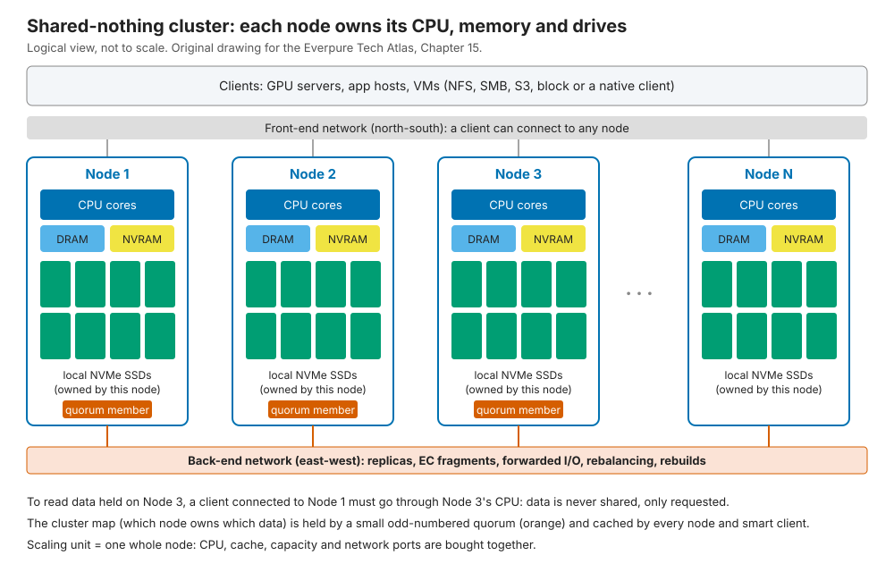
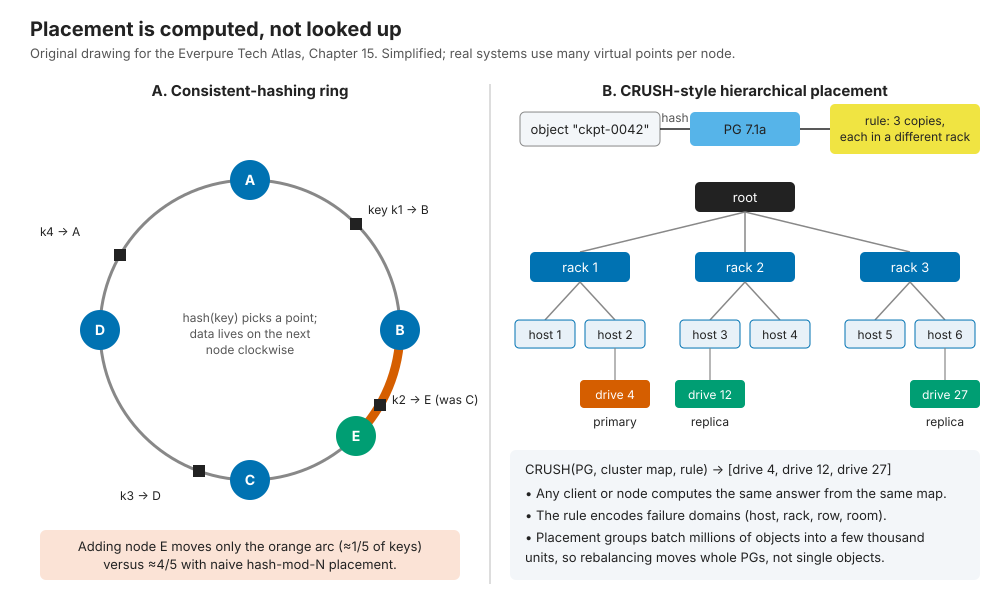
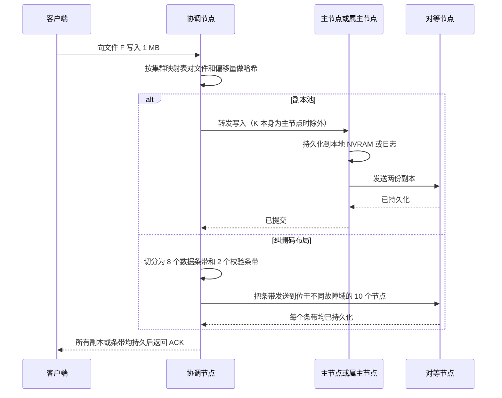
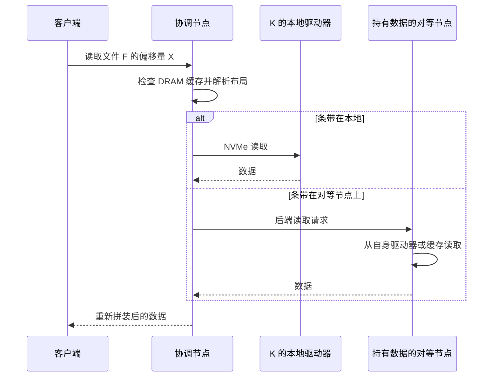
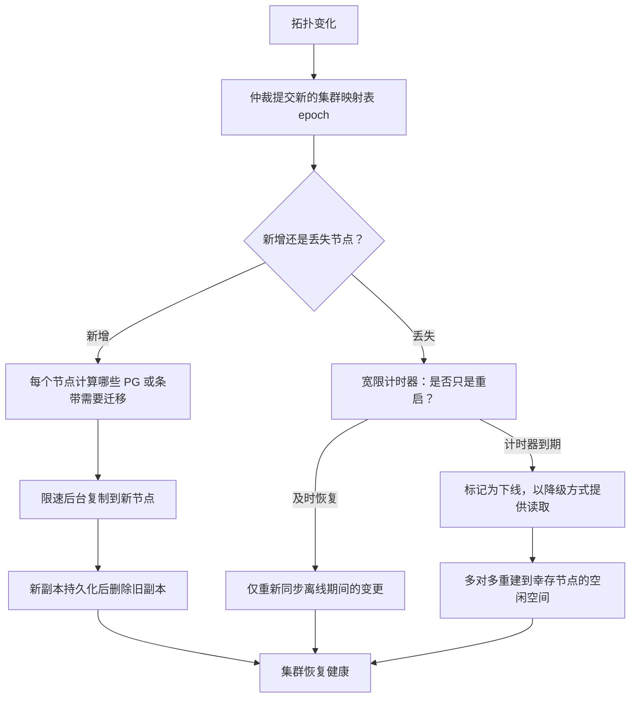
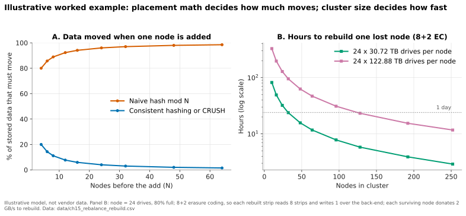
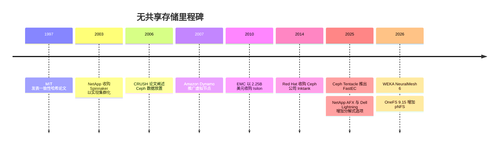

# 15. 横向扩展无共享集群

> 📄 英文原文：[docs/03-system-architecture/15-scale-out-shared-nothing.md](../../../docs/03-system-architecture/15-scale-out-shared-nothing.md) · 本文为简体中文参考译本，如有出入以英文原文为准。

> **深度：** L2 · **阅读时间：** 约 9 分钟 · **最后核实：** 2026-11-01
> **前置阅读：** [数据保护与韧性](../01-storage-fundamentals/06-data-protection-and-resilience.md) · [数据中心网络](../02-protocols-and-networking/10-datacenter-networking.md) · [纵向扩展双控制器阵列](14-scale-up-dual-controller.md)

## 要点速览（TL;DR）

- **无共享（shared-nothing）集群由一组相同的服务器组成，每台服务器各自拥有 CPU、内存和驱动器。** 扩展单位是一整个节点。PowerScale（Isilon）、WEKA、Ceph、Qumulo 和 Nutanix 都采用这种方式；ONTAP 则在 HA 对（HA pair）层面采用。
- **数据放置靠计算，而不是查表。** 一致性哈希环或类 CRUSH 函数把数据映射到节点，因此新增一个节点只需迁移约 1/(N+1) 的数据。
- **真正干活的是网络。** 副本、纠删码分片、转发读取和重建都在东西向流动。在 16 个节点时，约 94% 的读取字节来自对等节点。
- **集群自我修复。** 由奇数个成员组成的仲裁（quorum）掌管集群映射表（cluster map），丢失的节点以多对多方式重建，网络分区中处于少数的一侧停止写入。
- **其瓶颈在于捆绑式扩展、重建风暴、热点和节点数上限。** 这是传统厂商的主流设计，[分解式系统](16-disaggregated-shared-everything.md)正是以它为对照来定义自身的。

## 对 Everpure 战略的意义

Everpure 所面对的横向扩展文件与对象存储竞品大多是无共享架构。PowerScale 是非结构化数据领域的传统厂商（在位者），WEKA 是 GPU 集群中的软件定义挑战者，Ceph 则是自建存储运营者的开源默认选择。与 PowerScale、WEKA 或"用我们自己的服务器跑 Ceph"方案竞争的交易，胜负往往取决于本章讨论的优势与瓶颈。

该架构也解释了一项合作。Nutanix 之类的超融合（HCI）集群是无共享架构，因此存储只能随计算一起扩展。2025 年，Pure Storage 与 Nutanix 宣布将 FlashArray 作为 Nutanix AHV 的外部存储，这是 Nutanix 首个重要的经认证外部存储集成[^1]。这笔合作所针对的正是捆绑式扩展这一瓶颈。

## 核心概念

### 一图看懂

每个节点都是一台完整的服务器：CPU、DRAM 缓存、一个 NVRAM 或日志（journal）设备，以及其他节点无法直接寻址的 NVMe 驱动器。客户端通过**前端**网络连接任一节点；节点之间通过**后端**网络通信。少数节点运行**仲裁服务**，即成员关系与归属关系的权威记录。

*图 15.1 — 数据从不共享，只能请求：要访问另一个节点上的字节，必须通过后端网络请求该节点的 CPU。*

**半导体类比：多路 NUMA 服务器。** 每个插槽（socket）都有本地 DRAM；远程访问需经 UPI 或 Infinity Fabric 到达另一插槽的内存控制器，速度更慢且消耗带宽。无共享存储就是数据中心规模的 NUMA。与缓存一致性的类比更加贴切：在基于目录的一致性协议中，每条缓存行都有一个*归属节点（home node）*，其目录跟踪所有共享者，存在争用的缓存行会在那里被串行化。在集群中，每个对象都有一个属主或主节点，热点键（hot key）也会以同样方式在该节点上串行化。[第 16 章](16-disaggregated-shared-everything.md)讲的则是 UMA 式的替代方案。

### 状态与元数据存放在哪里

一切都存放在节点上。数据在复制或纠删码（EC）保护下跨节点条带化；OneFS 将数据、元数据和校验分布到各节点，数据使用 Reed-Solomon 纠删码，元数据使用镜像[^2]。元数据（inode、目录、块映射）同样分片存放，但各家设计不同：WEKA 将其分布到所有节点[^3]，而 Ceph 的文件层另设独立的元数据服务器。

唯一无法分片的状态是**集群映射表**：成员关系、健康状况和放置规则。Ceph 将其保存在少数几个监视器（monitor）中，这些监视器通过 Paxos 和多数投票对变更达成一致[^4]。节点和智能客户端会缓存这张映射表，并在请求中标注其版本号（*epoch*），从而发现过期视图。

### 数据放置：靠哈希计算，不靠查表

一张记录每个对象位置的中心表会成为瓶颈，因此无共享系统改为通过计算确定放置位置。

- **一致性哈希**（Karger 等，1997[^5]）把节点和键放在一个环上；每个键归属于顺时针方向的下一个节点。Amazon 的 Dynamo（2007）为每台服务器增加大量"虚拟节点"以均衡负载[^6]。
- **CRUSH**（Weil 等，2006[^7]）先把对象哈希到**放置组**（PG），再按照诸如"三份副本放在三个机架"之类的规则，沿主机—机架层级把每个 PG 映射到驱动器。任何持有同一张映射表的一方都会算出相同结果，映射表变化时迁移的数据也很少[^7]。

*图 15.2 — 计算式放置无需目录，迁移的数据量约等于新节点应分担的份额。*

**半导体类比：地址交织（interleaving）。** 内存控制器把物理地址哈希到各通道、存储体（bank）和 LLC 切片上，避免任何通道成为热点；集群把键哈希到各节点上，原因相同。区别在于：内存系统从不在运行时重新交织，而集群必须在承载在线 I/O 的同时完成这件事。

### 追踪一次写入

*图 15.3 — ACK 要等到每份副本或每个条带在对等节点上持久化后才返回，因此写入延迟至少包含一次后端往返。*

OneFS 走的是纠删码分支：客户端所连接的节点计算校验，把条带提交到对等节点，并在 NVRAM 中记日志。Ceph 则省去协调节点：客户端自行运行 CRUSH，直接写入主 OSD（管理单个驱动器的守护进程），主 OSD 负责复制，并在所有副本存储完成后确认[^4]。

**算例（写入的东西向流量）。** 客户端以 1 GB/s 写入。在三副本下，主节点向副本发送 2 GB/s，若协调节点先行转发，还要再加最多 1 GB/s：后端流量为 2–3 GB/s。在 8+2 纠删码下，协调节点发送 10/8 = 1.25 GB/s 的条带。与 [DASE](16-disaggregated-shared-everything.md) 中约 4× 的放大相比，无共享在写入上*更省*；其代价体现在读取上。

### 追踪一次读取

*图 15.4 — 数据在哪个节点上，就由哪个节点提供；协调节点的主要工作是把对等节点返回的结果拼接起来。*

当数据均匀分布在 N 个节点上时，客户端只能在本地找到 1/N 的数据。在 16 个节点时，15/16 ≈ **94% 的读取字节要穿越后端网络**，因此后端网络的规格至少要与前端相当。智能客户端（Ceph、WEKA 的客户端）直接从属主节点读取，省掉这一跳；Nutanix 的数据本地性（data locality）则让虚拟机的数据留在其所在节点上。

### 再平衡：新增节点与丢失节点

*图 15.5 — 新增节点是一次限速迁移；丢失节点则开启一场赛跑——必须在第二次故障发生前恢复冗余。*

*图 15.6 — 示意：计算式放置使新增节点的代价很低，但重建时间随节点容量增长，只有集群变宽时才会缩短。*
数据：`data/ch15_rebalance_rebuild.csv`

B 栏的计算：一个装有 24 × 30.72 TB 驱动器、80% 已满的节点存有 590 TB。在 8+2 纠删码下，每重建一个条带要读取 8 个条带、写入 1 个，因此每恢复 1 字节就有 9 字节穿越网络。若每个幸存节点贡献 2 GB/s，10 节点集群的恢复速率为 9 × 2 ÷ 9 = 2 GB/s：约 **82 小时**。64 个节点时约 12 小时；若使用 122.88 TB 驱动器，耗时为四倍。

### 扩展方式与瓶颈所在

1. **捆绑式扩展。** 每个节点都会带来固定比例的 CPU、缓存、容量和端口。容量密集型负载要为闲置的 CPU 付费；吞吐密集型负载要为闲置的 TB 付费。混合节点池只能缓解这一问题。
2. **东西向放大。** 读取有 (N−1)/N 的概率要穿越后端；重建会按编码宽度成倍放大流量。
3. **重建风暴。** 驱动器越大，每次节点丢失的恢复时间就越长、干扰就越大。在 Facebook，恢复 Reed-Solomon 编码的数据每天增加了超过 100 TB 的跨机架网络流量[^8]；局部可修复码（locally repairable codes）可使修复流量大致减半[^9]。
4. **热点。** 哈希分散的是键，而不是负载。一个包含百万文件的目录，或一个被 1,000 块 GPU 同时读取的检查点，都会落到其属主节点上，就像存在争用的缓存行在其归属目录处停滞一样。
5. **成员数上限。** 故障检测和全互联连接随节点数增长。PowerScale 在以太网叶脊（leaf-spine）后端上最多支持 252 个节点[^10]；ONTAP 的 NAS 最多 24 个节点、SAN 最多 12 个节点[^11]。

### 故障处理

| 故障 | 发生什么 | 爆炸半径（影响范围）/ 代价 |
|---|---|---|
| 驱动器 | 从对等节点重建条带，写入多个节点的空闲空间 | 小。并行重建；短暂增加东西向负载 |
| 节点 | 先走宽限计时器，然后多对多重建。OneFS +2d:1n 可容忍 2 块驱动器*或* 1 个节点故障；N+M 纠删码需要 ≥2M+1 个节点[^2] | 损失 1/N 的容量和性能；重建需数小时至数天（图 15.6） |
| 后端链路或交换机 | 双后端网络并支持故障切换；与对等节点失联的节点会被隔离（fence）出集群 | 链路抖动可能反复触发下线标记和重新同步 |
| 前端链路 | 客户端 IP 迁移到幸存节点（例如 OneFS SmartConnect） | 连接该节点的客户端出现短暂停顿或重连 |
| 网络分区（脑裂） | 只有持有仲裁多数的一侧保留映射表并接受写入。5 个监视器可容忍 2 个故障 | 少数一侧按设计转为只读或离线 |

*表 15.1 — 这种设计中没有对端控制器：集群自我修复，代价是重建流量以及一个必须受到保护的仲裁。*

### 优缺点与适用场景

| | 无共享的优势 | 无共享的劣势 |
|---|---|---|
| 扩展 | 加节点即线性增长；通用服务器；无需专用网络 | 容量与性能捆绑；成员数上限（24–252 个节点） |
| 性能 | 可本地读取；写入的网络开销低于 DASE | 除非使用智能客户端，否则大多数读取要经对等节点中转 |
| 韧性 | 没有单一控制器对；并行、多对多重建 | 丢失节点意味着大规模重建；网络分区需要严格的仲裁纪律 |
| 效率 | 跨节点纠删码；按 TB 计价的软件 | 小集群需要窄条带或复制（≥2M+1 个节点） |
| 生命周期 | 逐节点滚动升级；可混用多代硬件 | 每次重启都会产生一个冗余降低的窗口期 |

*表 15.2 — 无共享以捆绑式扩展和高网络开销的恢复为代价，换取简洁性、通用硬件以及没有控制器瓶颈。*

**最佳适用：**大型文件共享、媒体与基因组归档、分析数据湖、HCI 虚拟机环境，以及吞吐与容量需求比恰好与服务器内置比例相符的 GPU 集群；软件定义版本适合自选服务器的运营者。**最不适用：**对延迟极为敏感的块存储数据库（[双控制器阵列](14-scale-up-dual-controller.md)更简单）、极度偏重容量的归档（CPU 闲置；参见[对象存储](18-object-storage-architecture.md)）、规模低于约 3–5 个节点的站点，以及必须突破节点数上限的命名空间。

### 成本与运维影响

通用硬件使价值转移到软件上，这就是 WEKA、Qumulo 和 Ceph 厂商按 TB 或按节点计价的原因。运维难度在三个方面上升：后端网络规格设计、空闲空间预留（通常预留一个节点的容量以吸收重建），以及逐个重启节点的滚动升级。增量扩容是其强项：加一个节点、再平衡，日后再淘汰最旧的节点。

## Everpure 的做法与竞争对手对比

| 系统 | 节点模型 | 放置与保护 | 备注 |
|---|---|---|---|
| Dell PowerScale（OneFS） | 3–252 个节点，各自拥有驱动器 | 跨节点 Reed-Solomon 纠删码；元数据镜像[^2][^10] | OneFS 9.15 宣称新一代节点每节点读取最高 35 GB/s，并使 pNFS 正式可用（GA）[^12] |
| WEKA NeuralMesh | 运行在通用服务器或云服务器上的软件 | 条带由 3–16 个数据条带加 2–4 个校验条带组成；N+4 面向 100 台以上服务器[^13] | 数据和元数据分布在所有节点上；NeuralMesh 6 于 2026 年 7 月发布[^3][^14] |
| Ceph RADOS | 每块驱动器一个 OSD，监视器负责仲裁 | CRUSH 放置；副本或纠删码；Tentacle（2025）引入 "FastEC"[^7][^15] | 开源；Red Hat 于 2014 年以约 US$175M 收购 Inktank[^16] |
| NetApp ONTAP 集群 | 通过集群互连联合起来的 HA 对 | 每个 HA 对拥有自己的聚合（aggregate）；卷可在 HA 对之间迁移 | 最多 24 个 NAS 节点[^11]；AFX（2025）使 ONTAP 转向共享介质[^17] |
| Qumulo | 运行在通用节点或云节点上的软件 | 跨节点的纠删码块层 [VERIFY: 当前的保护方案] | 在 CEO Doug Gourlay 领导下转为纯软件（2024）[^18] |
| Nutanix | 每个 HCI 节点一个控制器虚拟机 | 跨节点复制因子 2 或 3[^19] | 自 2025 年起支持 FlashArray 作为外部存储[^1] |
| Everpure FlashBlade//S | 每个机箱 7–10 个刀片；每个刀片可装 1–4 个 DirectFlash Module，因此计算与容量可分别配置 | Purity//FB 中的全局纠删码与闪存管理；命名空间被划分为运行在刀片上的"authority"[^20][^21] | Pure 将 Purity//FB 称为"partitioned-writer（分区写入者）"设计，并拒绝二元标签[^22] [VERIFY: 多机箱数据放置方式] |

*表 15.3 — 每个主要的横向扩展传统厂商本质上都是无共享架构；Everpure 的文件平台介于几种模式之间，而非归属于其中任何一种。*

Everpure 没有销售经典的无共享产品。FlashArray 是双控制器架构（[第 14 章](14-scale-up-dual-controller.md)）。FlashBlade//S 在机箱内横向扩展刀片。Pure Storage 将 Purity//FB 描述为"partitioned-writer"设计，并认为"无共享 vs. 全共享"的标签遮蔽的多于揭示的[^22]。元数据和写入归属被划分为运行在各刀片上的"authority"，这与无共享的属主节点十分相似，而 Purity 则对 DFM 闪存和 NVRAM 进行全局管理[^21][^20]。Pure 的一份数据表甚至把 FlashBlade 称为"shared-nothing"[^23]。较公允的概括是：一种带有池化介质管理的分区式横向扩展设计，而不是 DASE 意义上的全共享。FlashBlade//EXA 将元数据与数据分离，但其数据节点各自拥有 NVMe，使数据层带有无共享色彩（[第 16 章](16-disaggregated-shared-everything.md)）。

PowerScale 的最强版本论证（steelman）是成熟度：OneFS 二十年的积累、庞大的装机基础，以及如今在通用硬件上推出的 pNFS 和并行 "Lightning" 层[^24]。WEKA 和 Ceph 的最强论证则是硬件和云的选择自由。基于公开信息，战略团队可评估的选项包括：在 HCI 环境中攻击捆绑式扩展这一瓶颈，以及针对大容量驱动器集群以重建时间和故障域的算账为主打。

## 历史与发展轨迹

*图 15.7 — 相关算法诞生于 1997–2007 年；自 2025 年起，传统厂商在其旁边增加了分解式或并行层。*

EMC 于 2010 年以约 US$2.25 billion 收购 Isilon[^25]；NetApp 于 2003 年以约 US$300 million 的股票收购 Spinnaker，以实现超过两个节点的集群[^26]。自 2025 年以来的趋势是混合化：NetApp AFX[^17] 和 Dell Lightning[^24] 在无共享核心旁增加共享介质或并行路径，而 WEKA 的 NeuralMesh 则对网格本身进行改进[^3]。

## 关键数字

| 指标 | 数值 | 背景 | 来源 / 日期 |
|---|---|---|---|
| PowerScale 最大集群规模 | 252 个节点 | 以太网叶脊后端 | Dell InfoHub[^10]，retrieved 2026-11 |
| ONTAP 集群上限 | NAS 24 个节点 / SAN 12 个节点 | 由 HA 对构建 | NetApp 文档[^11] |
| WEKA 条带范围 | 3–16 个数据条带 + 2–4 个校验条带 | 在集群组建时固定 | WEKA 文档[^13] |
| OneFS N+M 最少节点数 | 2M+1 | 例如 +2 需要 ≥5 个节点 | Dell InfoHub[^2] |
| 新增节点时迁移的数据 | ≈1/(N+1) | 对比 hash-mod-N 的 ≈N/(N+1) | 算例 |
| 穿越后端的读取字节 | (N−1)/N；16 个节点时为 94% | 非智能客户端、均匀分布 | 算例 |
| 节点重建时间（590 TB 节点） | 10 个节点约 82 h，64 个节点约 12 h | 8+2 纠删码，每个幸存节点 2 GB/s | 算例（图 15.6） |
| Facebook 纠删码恢复流量 | >100 TB/天 | 跨机架，(10,4) Reed-Solomon 数据仓库集群 | Rashmi 等，2013[^8] |
| PowerScale 每节点读取 | 最高 35 GB/s | 公司自述，新一代节点，OneFS 9.15 | Dell 博客[^12] |

## 对话手册

**向产品经理提的问题**

1. *"与 PowerScale 相比，FlashBlade 在架构上（而不是价格上）赢在哪里？"* 高质量回答：大容量驱动器上的重建时间、捆绑式扩展的浪费、后端成本；同时承认 PowerScale 的装机基础和 pNFS 动作。
2. *"HCI 的捆绑式扩展阻碍了哪些客户？Nutanix 外部存储的机会有多大？"* 高质量回答：按容量与计算的比例以及 VMware 迁出时点做客户细分。
3. *"一家新兴 GPU 云（neocloud）说'我们直接跑 Ceph 就行'。我们的 TCO 反驳是什么？"* 高质量回答：人员、重建窗口、空闲空间预留以及每可用 TB 的功耗，而不是标价。

**向工程师提的问题**

1. *"写入的持久化点在哪里？ACK 之前要经过多少次后端跳转？"* 高质量回答：指明 NVRAM 或日志、扇出方式以及故障域规则。
2. *"一个 1 PB 的节点在 80% 已满时宕机。恢复冗余需要多久？期间客户端会看到什么？"* 高质量回答：小时数、重建限速、降级吞吐百分比。
3. *"你们如何处理一个被数千块 GPU 同时读取的文件？"* 高质量回答：元数据分片、客户端缓存或热数据复制，而不是"我们做了哈希"。

**不要这样说：**

- "无共享没有网络瓶颈。"大多数读取和每一次重建都要穿越后端。
- "加一个节点，就能获得线性扩展。"只在热点键、节点数上限或后端带宽成为制约之前成立。
- "Ceph 是免费的。"运维人员、备用容量和重建风险都不免费。
- "ONTAP 是完全的无共享。"驱动器属于 HA 对，HA 对之间是联合关系。
- "一致性哈希能均衡负载。"它均衡的是*键*，而不是倾斜的访问。
- "FlashBlade//S 和 VAST 一样是全共享。"Pure 将 Purity//FB 称为 partitioned-writer 设计：刀片各自拥有命名空间的一部分，而介质管理是全局的。

## 深入阅读（可选，L3 指引）

- Weil 等，"CRUSH"（SC'06）；Ceph 架构指南中关于 peering 和 backfill 的部分。
- DeCandia 等，"Dynamo"（SOSP'07），关于虚拟节点和宽松仲裁（sloppy quorum）。
- Dell 的 OneFS 技术概览；WEKA 的冗余文档；"XORing Elephants"（VLDB 2013）。

## 关键术语

- **无共享（shared-nothing）** — 节点各自拥有 CPU、内存和驱动器，仅通过网络协作。
- **协调节点（coordinator node）** — 客户端所联系的节点，负责计算放置位置并扇出 I/O。
- **放置组（PG）** — Ceph 的放置与再平衡单位。
- **重建风暴（rebuild storm）** — 恢复丢失冗余期间产生的大量东西向流量。
- 其余术语参见[术语表](../glossary.md)。

## 资料来源

[^1]: SDxCentral, "Nutanix partners with Pure Storage in latest VMware assault," 2025-05. https://www.sdxcentral.com/news/nutanix-partners-with-pure-storage-in-latest-vmware-assault/ (retrieved 2026-11-01).
[^2]: Dell Technologies InfoHub, "PowerScale OneFS Technical Overview: Data protection," n.d. https://infohub.delltechnologies.com/en-au/l/powerscale-onefs-technical-overview-1/data-protection-119 (retrieved 2026-11-01).
[^3]: Blocks & Files, "WEKA builds NeuralMesh for exascale AI," 2025-06-18. https://blocksandfiles.com/2025/06/18/weka-builds-neuralmesh-for-exascale-ai/ (retrieved 2026-11-01).
[^4]: Ceph documentation, "Architecture" (Reef), n.d. https://docs.ceph.com/en/reef/architecture/ (retrieved 2026-11-01).
[^5]: D. Karger et al., "Consistent Hashing and Random Trees: Distributed Caching Protocols for Relieving Hot Spots on the World Wide Web," STOC 1997. https://cs.brown.edu/courses/csci2950-u/f09/papers/chash97stoc.pdf (retrieved 2026-11-01).
[^6]: G. DeCandia et al., "Dynamo: Amazon's Highly Available Key-value Store," SOSP 2007. https://www.allthingsdistributed.com/files/amazon-dynamo-sosp2007.pdf (retrieved 2026-11-01).
[^7]: S. A. Weil, S. A. Brandt, E. L. Miller, C. Maltzahn, "CRUSH: Controlled, Scalable, Decentralized Placement of Replicated Data," SC'06, 2006-11. https://www.ssrc.ucsc.edu/Papers/weil-sc06.pdf (retrieved 2026-11-01).
[^8]: K. V. Rashmi et al., "A Solution to the Network Challenges of Data Recovery in Erasure-coded Distributed Storage Systems: A Study on the Facebook Warehouse Cluster," USENIX HotStorage 2013. https://www.usenix.org/conference/hotstorage13/workshop-program/presentation/rashmi (retrieved 2026-11-01).
[^9]: M. Sathiamoorthy et al., "XORing Elephants: Novel Erasure Codes for Big Data," VLDB 2013 (arXiv 1301.3791). https://arxiv.org/pdf/1301.3791 (retrieved 2026-11-01).
[^10]: Dell Technologies InfoHub, "Dell PowerScale: Considerations and Best Practices for Large Clusters — Cluster definitions," n.d. https://infohub.delltechnologies.com/en-au/l/dell-powerscale-considerations-and-best-practices-for-large-clusters/cluster-definitions (retrieved 2026-11-01).
[^11]: NetApp, "Cluster storage" (ONTAP concepts), n.d. https://docs.netapp.com/us-en/ontap/concepts/cluster-storage-concept.html (retrieved 2026-11-01).
[^12]: Dell Technologies, "PowerScale OneFS 9.15 strengthens Dell AI Data Platform foundations," n.d. (2026). https://www.dell.com/en-us/blog/powerscale-onefs-9-15-strengthens-dell-ai-data-platform-foundations/ (retrieved 2026-11-01).
[^13]: WEKA documentation, "Cluster capacity and redundancy management," n.d. https://docs.weka.io/weka-system-overview/cluster-capacity-and-redundancy-management (retrieved 2026-11-01).
[^14]: WEKA, "WEKA Debuts NeuralMesh 6 to Power Enterprise and Agentic AI Workloads at Production Scale," 2026-07-21. https://www.weka.io/news/neuralmesh-6-enterprise-agentic-ai (retrieved 2026-11-01).
[^15]: Ceph, "v20.2.0 Tentacle released," 2025. https://ceph.io/en/news/blog/2025/v20-2-0-tentacle-released (retrieved 2026-11-01).
[^16]: Data Center Knowledge, "Red Hat Acquires Ceph Open Storage Provider Inktank for $175 million," 2014-04-30. https://www.datacenterknowledge.com/data-storage/red-hat-acquires-ceph-open-storage-provider-inktank-for-175-million (retrieved 2026-11-01).
[^17]: Blocks & Files, "NetApp disaggregates ONTAP storage and provides an AI Data Engine," 2025-10-14. https://blocksandfiles.com/2025/10/14/netapp-disaggregates-ontap-storage-and-provides-an-ai-data-engine/ (retrieved 2026-11-01).
[^18]: GeekWire, "Former Arista and Cisco exec Douglas Gourlay named new CEO of data storage company Qumulo," 2024-07. https://www.geekwire.com/2024/former-arista-and-cisco-exec-douglas-gourlay-named-new-ceo-of-data-storage-company-qumulo/ (retrieved 2026-11-01).
[^19]: Nutanix Community, "Redundancy Factor vs Replication Factor," n.d. https://next.nutanix.com/how-it-works-22/redundancy-factor-vs-replication-factor-37486 (retrieved 2026-11-01).
[^20]: StorageNewsletter, "Pure Accelerate Techfest22: Pure Storage FlashBlade//S Platform," 2022-06-10. https://www.storagenewsletter.com/2022/06/10/pure-accelerate-techfest22-pure-storage-flashblade-s-platform/ (retrieved 2026-11-01).
[^21]: Everpure, "The Metadata Advantage: Scaling I/O performance for AI and HPC" (white paper), n.d. https://www.everpuredata.com/content/dam/pdf/en/white-papers/wp-meta-advantage-scaling-io-performance-flashblade-exa.pdf (retrieved 2026-11-01; seen via search summary).
[^22]: J. Emerson (Pure Storage), "The Storage Architecture Spectrum: Why 'Shared-nothing' Means Nothing," n.d. https://blog.everpuredata.com/perspectives/the-storage-architecture-spectrum-why-shared-nothing-means-nothing/ (retrieved 2026-11-01; seen via search summary, host not fetchable).
[^23]: Pure Storage, "FlashBlade for Media and Entertainment" (data sheet), n.d. https://www.purestorage.com/content/dam/pdf/en/datasheets/ds-flashblade-for-media-and-entertainment.pdf (retrieved 2026-11-01; seen via search summary).
[^24]: Blocks & Files, "Dell PowerScale gets struck by Lightning and goes parallel," 2025-11-17. https://www.blocksandfiles.com/ai-ml/2025/11/17/dell-powerscale-gets-struck-by-lightning-and-goes-parallel/1711291 (retrieved 2026-11-01).
[^25]: eWeek, "EMC Acquires Scale-Out NAS Maker Isilon for $2.25 Billion," 2010-11-15. https://www.eweek.com/storage/emc-acquires-scale-out-nas-maker-isilon-for-2.25-billion/ (retrieved 2026-11-01).
[^26]: The Register, "NetApp hoists $300m for Spinnaker," 2003-11-05. https://www.theregister.co.uk/2003/11/05/netapp_hoists_300m_for_spinnaker/ (retrieved 2026-11-01).
