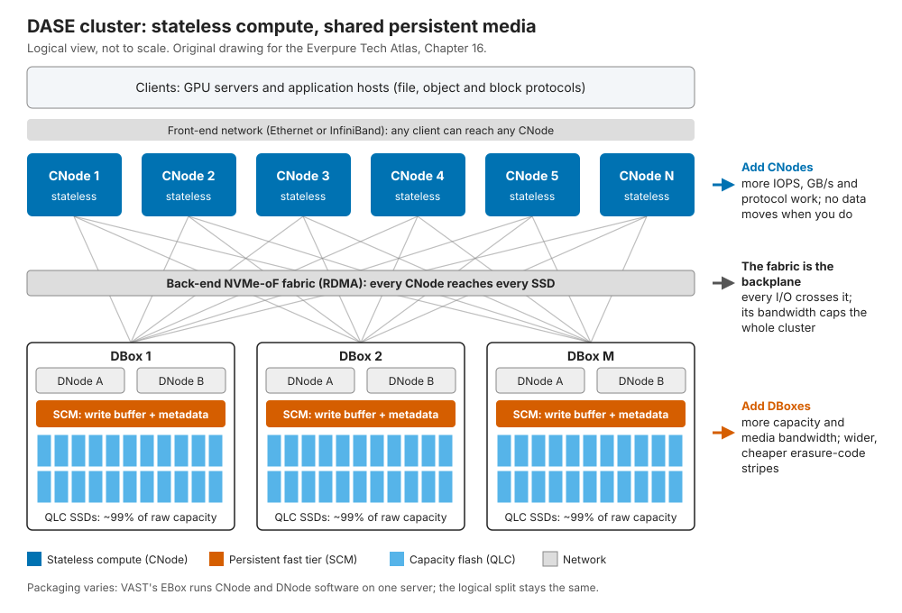
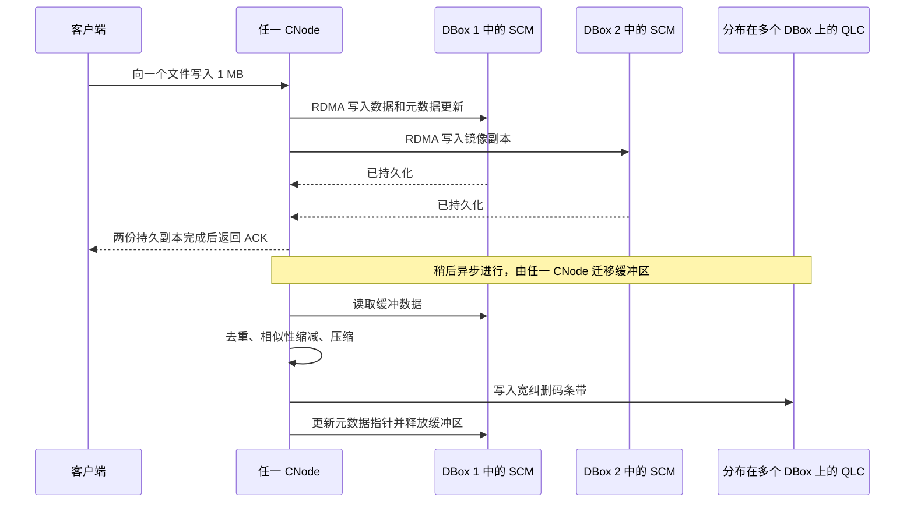
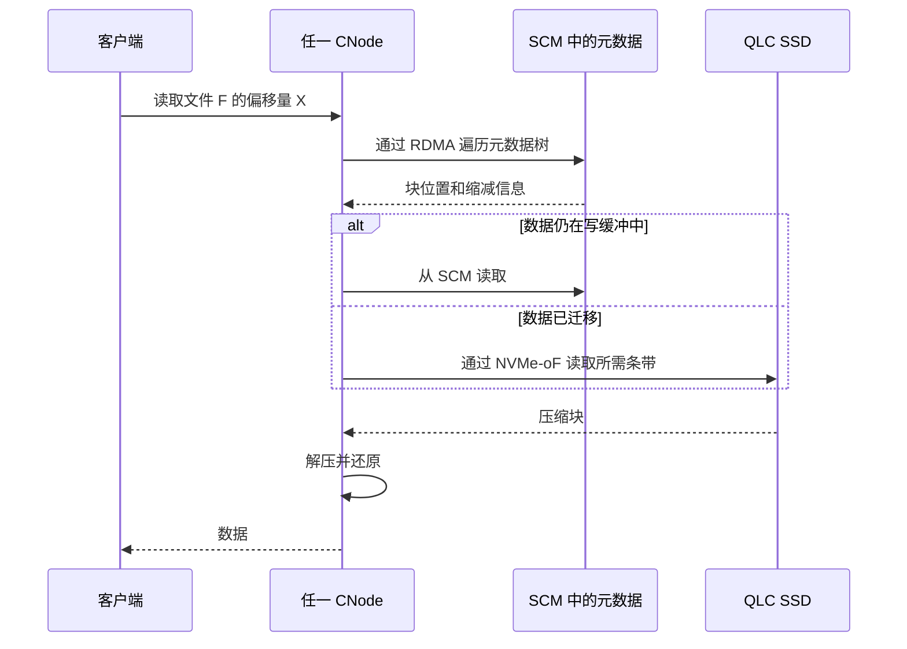
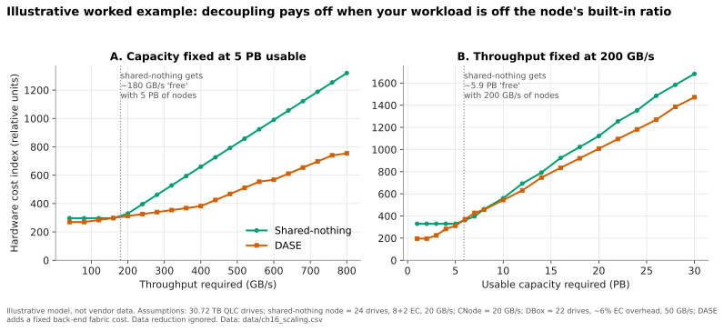
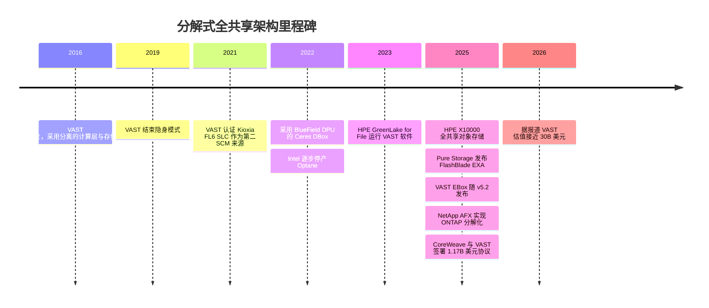

# 16. 分解式全共享架构

> 📄 英文原文：[docs/03-system-architecture/16-disaggregated-shared-everything.md](../../../docs/03-system-architecture/16-disaggregated-shared-everything.md) · 本文为简体中文参考译本，如有出入以英文原文为准。

> **深度：** L2 · **阅读时间：** 约 10 分钟 · **最后核实：** 2026-11-01
> **前置阅读：** [SSD 内部结构](../01-storage-fundamentals/03-inside-an-ssd.md) · [块协议与 NVMe-oF](../02-protocols-and-networking/07-block-protocols.md) · [纵向扩展双控制器阵列](14-scale-up-dual-controller.md) · [横向扩展无共享集群](15-scale-out-shared-nothing.md)

## 要点速览（TL;DR）

- **分解式全共享架构（DASE）把存储系统拆分为无状态计算节点和共享的闪存机柜，两者通过 NVMe-oF 网络连接。** 每个计算节点都能读写每块 SSD，因此没有任何节点"拥有"任何数据。VAST Data 开创了这一品类并创造了这个缩略语。
- **诀窍在于状态存放在哪里。** 数据和全部元数据都位于所有节点共享的持久化介质上：一个小容量的存储级内存（SCM）层用作写缓冲和元数据存储，其余一切都放在 QLC 闪存上。计算节点可以故障、新增或替换，而无需迁移数据。
- **性能与容量独立扩展。** 当某个负载的吞吐与容量配比远离固定服务器所捆绑的比例时，这一点最为重要；在接近该比例时，优势很小。
- **其瓶颈在于网络、机柜和最小规模。** 每次 I/O 都要穿越后端网络。整个机柜就是一个故障域。宽而廉价的纠删码只有在规模足够大时才能发挥作用。
- **分解式正在成为基本门槛，但各厂商的实现方式不同。** NetApp（AFX）和 HPE（X10000）推出了共享介质设计。Everpure 的 FlashBlade//EXA 将元数据与数据分离，但让客户端直接访问数据节点，因此它更接近并行文件系统，而非纯粹的 DASE。

## 对 Everpure 战略的意义

VAST 伴随新兴 GPU 云（neocloud）的 AI 集群成长起来，这类买家希望以数百 GB/s 至数 TB/s 的速度访问单一命名空间，又不想为用不上的 CPU 付费。2025 年 11 月，CoreWeave 据报道与 VAST 签署了一份 US$1.17 billion 的商业协议[^1]；2026 年 4 月，路透社报道 VAST 估值约 US$30 billion[^2]（两者均为*媒体报道*）。Everpure 参与竞争的每一笔企业 AI 交易，如今在一定程度上都是围绕这一架构的争论。

Everpure 的回应是 FlashBlade//EXA，由 Pure Storage 于 2025 年 3 月发布。它采用了不同的分解方式[^3]。要评判这一押注，需要了解 DASE 做对了什么、哪里脆弱，以及"元数据/数据分离 + 直连数据路径"究竟是更优的取舍，还是仅仅是另一种取舍。[第 42 章](../06-industry-and-competition/42-vast-data.md)介绍 VAST 这家公司，[第 45 章](../06-industry-and-competition/45-head-to-head.md)进行正面对比。

## 核心概念

### 一图看懂

早期架构把计算与介质绑定在一起。[双控制器阵列](14-scale-up-dual-controller.md)在一个驱动器柜前放置两个控制器。[无共享集群](15-scale-out-shared-nothing.md)由各自拥有驱动器的服务器构成，因此访问另一个节点的数据就意味着要请求该节点的 CPU。DASE 取消了这种归属关系：

- **计算节点（VAST 称为 "CNode"）** 运行文件、对象和块协议，执行数据缩减和纠删码。它们不持有任何权威状态。
- **数据机柜（"DBox"）** 在小型、刻意设计得"简单"的网络端点（"DNode"）后面容纳 SSD。每个 DBox 至少有两个 DNode 以实现冗余。最初的 DBox 使用两个 x86 DNode；1U 的 Ceres DBox 使用四个 NVIDIA BlueField DPU，每个负责约四分之一的 SSD[^4]。
- **后端网络**采用基于 RDMA 的 NVMe-oF，使每块 SSD 对每个 CNode 而言都近似于本地盘[^5]。

*图 16.1 — 在 DASE 中，计算是一个无状态资源池，全部状态都位于共享介质上，因此每个 CNode 到每个字节都只有一跳网络距离。*

**半导体类比：NUMA 与 UMA。** 无共享是 NUMA。每个插槽（节点）都有本地内存（驱动器），远程访问要经过属主。DASE 是 UMA。每个核心到每个内存存储体的距离都相同，代价是永远不是本地访问。与 UMA 一样，互连成为关键资源。芯粒（chiplet）的类比同样有用。AMD 把计算裸片与 I/O 裸片分开，使核心与内存/IO 能按不同节奏、不同工艺扩展和更新。DASE 对 CPU 和 NAND 做了同样的事：前者跟随 Intel/AMD 的路线图，后者跟随闪存成本曲线。

### 状态与元数据存放在哪里

DASE 之所以可行，是因为有一个由所有节点共享的小容量、高速、持久化层。VAST 最初使用 Intel Optane SSD 作为 SCM，并于 2021 年认证了 Kioxia 基于 SLC 的 FL6 作为第二供应来源[^6]，这比 Intel 宣布逐步停产 Optane 早了一年[^7]。SCM 存放两类内容。第一类是**写缓冲**。第二类是**全部元数据**：文件系统树、块映射和锁[^8]。这一层非常小。当前的 DF-3060V2 DBox 配置 12 TB SCM 和 1,352 TB QLC[^9]，因此 SCM 占 12 ÷ 1,364 ≈ **原始容量的 0.9%**。

由于元数据位于共享的持久化介质中，CNode 通过介质而不是彼此之间直接协调：一把锁就是一次对 SCM 的写入，就像多个核心通过共享末级缓存上的原子操作进行协调一样。不存在需要随规模扩展的 CNode 间缓存一致性流量。代价是每次元数据查找都需要一次网络往返。与本地驱动器相比，RDMA NVMe-oF 每次访问大约增加 5–15 µs[^5]。与 QLC 读取（量级约为 100 µs）相比这不算多，但在元数据密集型的小文件工作负载中会显现出来（参见[第 21 章](21-metadata.md)）。

### 追踪一次写入

*图 16.2 — 写入在两个机柜的 SCM 中完成镜像后即被确认；数据缩减和宽条带纠删码稍后进行，不在延迟路径上。*

持久化点是镜像的 SCM 副本，两份副本分别放在不同的 DBox 和 DNode 中[^8][^10]。高开销的工作发生在**迁移**阶段：CNode 对数据进行缩减，并以大条带写入 QLC[^11]。大的顺序条带与 QLC 较大的编程和擦除单元相匹配，从而保持较低的写放大（参见[第 3 章](../01-storage-fundamentals/03-inside-an-ssd.md)）。这相当于存储版的写合并缓冲区（write-combining buffer）。

**算例（网络放大）。** 客户端以 1 GB/s 写入。前端网络承载 1 GB/s。后端承载：为两份镜像副本写入 SCM 的 2 GB/s，迁移时读出的约 1 GB/s，以及加上 146+4 条带校验后写入 QLC 的约 1.03 GB/s。合计约为**每 1 GB/s 客户端写入产生 4 GB/s 后端流量**，这还是在数据缩减之前，而数据缩减只能减少写入 QLC 的那一段。因此，持续写入的上限取决于 SCM 写带宽和网络容量，而不是 QLC。

### 追踪一次读取

*图 16.3 — 任一 CNode 都能独立处理任意读取，无需其他 CNode 协助，因此在网络或介质饱和之前，增加 CNode 几乎能线性提升读取性能。*

### 扩展方式与瓶颈所在

增加 CNode 可以在不迁移数据的情况下获得更多协议处理和数据缩减算力。增加 DBox 可以获得更多容量和介质带宽，同时使纠删码更省。启用机柜级保护时，VAST 将条带宽度上限设为 DBox 数量的两倍。因此，20 个 DBox 的集群运行 36+4 条带（10% 开销），达到 75 个以上 DBox 时可达 146+4（2.7%）[^10][^12]。对比典型无共享系统的 8+2（20%）。若要 10 PB 可用容量，8+2 需要 10 ÷ 0.8 = 12.5 PB 原始容量，而 146+4 只需 10 ÷ 0.973 ≈ 10.3 PB。这意味着**驱动器数量减少约 18%**，是容量侧最大的单项节省。

*图 16.4 — 示意：当负载的吞吐与容量配比远离固定服务器所捆绑的比例时，解耦才划算；在接近该比例时，无共享可能同样便宜甚至更便宜。*
数据：`data/ch16_scaling.csv`

在 A 栏中，5 PB 上要求 800 GB/s，迫使无共享方案购买 40 个完整节点（成本 1,320）；DASE 购买 40 个 CNode 加 16 个提供介质带宽的 DBox（754）。在 B 栏中，30 PB 时的差距约为 13%，几乎全部来自纠删码效率。瓶颈包括：

1. **网络带宽。** 所有流量都是后端上的东西向流量。1 TB/s 的读取目标除了前端带宽，还需要 ≥1 TB/s 的后端对分带宽（bisection bandwidth），这意味着需要数十个 400 GbE 交换机端口。
2. **网络成本与锁定。** 后端交换机通常由厂商指定，有时由厂商供货。NetApp 的 AFX 后端只支持经批准的交换机[^13]。
3. **机柜爆炸半径。** 一个 DBox 容纳数百 TB 数据。要承受其丢失，必须把每个条带稀疏地分散开（见下文）。
4. **最小规模。** 廉价的宽条带和机柜级保护需要大量 DBox。小集群要么承担更高开销，要么接受更低的韧性。
5. **SCM 写入上限。** 持久化层是一个共享的写入漏斗，而且其供应已经中断过一次。

### 故障处理

| 故障 | 发生什么 | 爆炸半径（影响范围）/ 代价 |
|---|---|---|
| SSD | 从纠删码条带重建。局部可解码码只需读取条带的约 1/4，而非全部[^14]。每个 CNode 都参与重建。 | 小。重建是多对多的，速度快。 |
| CNode | 客户端故障切换到另一个 CNode 的地址。由于该节点不持有权威状态，不会丢失数据。 | 进行中的操作需重试。损失 1/N 的计算能力。 |
| DNode / DPU | 同一 DBox 中的另一个 DNode 接管其 SSD。 | 在更换前机柜带宽下降。 |
| 整个 DBox | 只有当每个条带在每个 DBox 中最多 ≤2 个条带分片时才能承受（"DBox-HA"，≥8 个 DBox）[^12]。机架级保护需要 ≥7 个机架[^15]。 | 无 HA：数据不可用。有 HA：小集群的纠删码开销更高。 |
| 网络链路 / 交换机 | 双网络和多路径重新路由。计算与介质之间发生网络分区时，受影响一侧的 I/O 停止。 | 一对交换机是所有组件的共同依赖。 |

*表 16.1 — DASE 让计算故障变得无足轻重，同时把风险转移到机柜和网络上。*

### 优缺点与适用场景

| | DASE 的优势 | DASE 的劣势 |
|---|---|---|
| 扩展 | 计算与容量相互独立；增加计算时无需再平衡 | 固定的成本下限：网络和最少机柜数量 |
| 效率 | 宽条带（约 3–10% 开销），对全部数据进行全局缩减 | 收益依赖规模；小系统获益甚微 |
| 韧性 | 计算故障代价低；重建并行进行 | 机柜和网络是大型共享故障域 |
| 性能 | 均匀：任意节点、任意数据、一跳可达 | 永远不是本地访问；每次元数据访问多出若干 µs；写入时存在后端网络放大 |
| 生命周期 | CPU 与 NAND 可按不同周期更新 | 专有的机柜/网络规格；依赖 SCM 供应 |

*表 16.2 — 该架构以牺牲本地性和更高的入门成本为代价，换取均匀性、规模化效率以及低代价的计算故障。*

**最佳适用**：由大量 GPU 节点读取的大型共享命名空间（训练数据、检查点、模型仓库），全局缩减能带来回报的文件与对象混合环境，以及需求在吞吐与容量之间不断变化的多租户新兴 GPU 云存储。**最不适用**：约 1 PB 以下的小规模部署，双控制器阵列能以更低成本下限服务的延迟敏感型块存储数据库（[第 14 章](14-scale-up-dual-controller.md)），以及没有专用网络的边缘站点。

### 成本与运维影响

稳态运维变得更简单（增加计算时无需再平衡；CNode 升级从不触及介质），而网络工程变得更难，因为后端网络如今就是存储的一部分。其商业影响较为微妙。由于计算是无状态的，它可以作为软件运行在别人的服务器上出售，这正是 VAST 的 EBox 及其 OEM 和云渠道的做法[^16]。毛利率因此取决于软件定价，而不是机柜加价。

## Everpure 的做法与竞争对手对比

| 系统 | 计算 / 元数据层 | 数据层 | 是否全共享？ | 备注 |
|---|---|---|---|---|
| VAST（CBox + DBox） | 无状态 CNode | DBox：DPU 后面的 SCM + QLC | 是，参考设计 | 元数据位于共享 SCM；任一 CNode 可访问任一 SSD[^8] |
| VAST EBox | CNode 和 DNode 软件运行在同一台服务器上 | 同一服务器上的 SSD，池化 | 逻辑上是；物理上为融合式 | 放弃独立扩展，以适配超大规模云厂商/云环境[^16] |
| Everpure FlashBlade//EXA | 运行 Purity//FB 的 FlashBlade 作为元数据核心 | 由 Purity//DN 工具管理的现成 Linux/NVMe 数据节点；计划推出 DirectFlash 节点 | **否**。元数据/数据分离；客户端直接读取数据节点 | pNFS：元数据走 TCP，数据走 NFSv3/RDMA[^3][^17] |
| NetApp AFX | 运行 ONTAP 的 AFX 1K 控制器 | 单一共享池中的 NX224 NVMe-oF 柜 | 是（共享池） | 设计上限 128 个控制器、52 个机柜[^18][^13]；据 WWT，ONTAP 9.19.1 支持 32 个控制器[^19] |
| HPE Alletra MP X10000 | 容器化计算节点 | JBOF 节点 | 是（HPE 称"shared-everything"） | 日志结构 KV 存储；自 Release 4 起支持对象及原生 NFS[^20][^21] |
| HPE GreenLake for File | 在 Alletra MP 计算节点上运行 VAST 软件 | Alletra MP JBOF | 是（基于 VAST） | 2023 年推出[^22] |
| Dell Lightning FS / PowerScale pNFS | 元数据服务器 + 存储节点 | 服务器直连闪存 | 否，并行文件系统 | 采用 Flex Files 布局的 pNFS[^23] |

*表 16.3 — "分解式"涵盖两种截然不同的设计：共享介质（VAST、NetApp、HPE）以及元数据分离 + 直连数据路径（FlashBlade//EXA、Dell）。*

**FlashBlade//EXA 与 DASE 有多接近？** 两者动机相同：让元数据性能独立于数据容量和带宽扩展。但在关键属性上有所不同。在 EXA 中，没有任何计算层能访问全部介质。客户端从元数据核心获取布局（layout），然后通过 RDMA 直接与数据节点通信[^17]。从架构上看，这就是 Lustre 的 MDS/OSS 模式（[第 17 章](17-parallel-file-systems.md)），只是元数据引擎强大得多。EXA 的最强版本论证（steelman）是它去掉了一跳。VAST 的数据路径是客户端 → CNode → DBox；EXA 的是客户端 → 数据节点。EXA 还复用了多年打磨的 Purity 元数据代码，并允许客户自行采购数据节点硬件。Pure Storage 报告称，60 个数据节点的读取性能超过 5 TB/s（每节点约 83 GB/s；技术简报引用的是每节点"upwards of" 85 GB/s），并呈线性扩展[^3]。常被引用的 ">10 TB/s" 数字是发布时基于初步测试的宣称，而不是已公开的配置[^24]。

VAST 的最强版本论证：共享介质使全集群范围的数据缩减、宽纠删码和多协议访问变得自然而然。EXA 的数据节点保护机制似乎也仍在成熟之中。一篇上手评测报告称其采用硬件 HA，软件纠删码尚在规划中[^25] [VERIFY: FlashBlade//EXA 数据节点当前的保护方案及发布版本]。基于公开信息，战略团队可评估的选项包括：基于 DirectFlash 的数据节点能以多快速度缩小介质效率差距，以及 EXA 的设计能否赢得 >1 TB/s 的单一命名空间交易，同时由 FlashBlade//S 和 FlashArray 守住企业市场。

## 历史与发展轨迹

*图 16.5 — 一家初创公司的设计（2016–2019）在 2025 年成为行业范式，当年三家传统厂商在八个月内相继推出分解式系统。*

其渊源更早：VAXcluster 和 Oracle RAC 都是"共享磁盘（shared-disk）"设计，曾受困于锁流量和缓慢的 SAN。改变局面的是 NVMe-oF 使远程闪存几乎等同于本地，以及 SCM 为元数据提供了一个共享的持久化存放位置[^26][^6]。有两个趋势指向未来。其一是封装形态趋同：VAST 的 EBox[^16] 和 Dell 在通用 PowerEdge 硬件上的 Exascale "personality"[^27] 模糊了硬件边界，同时保留了逻辑上的分离。其二是 [CXL 内存池化](../02-protocols-and-networking/12-interfaces-and-emerging-tech.md)，它在更低一层——服务器内部——应用了同样的分解逻辑。

## 关键数字

| 指标 | 数值 | 背景 | 来源 / 日期 |
|---|---|---|---|
| SCM 占 DBox 原始容量的比例 | 约 0.9%（12 TB vs 1,352 TB） | VAST DF-3060V2 | VAST KB[^9]，retrieved 2026-11 |
| VAST 最宽条带 / 开销 | 146+4 / 2.7% | 启用 DBox-HA 时需 ≥75 个 DBox | VAST 博客[^10] |
| DBox-HA 最低要求 | 8 个 DBox | 条带 ≤ 2× DBox 数量 | VAST KB[^12] |
| RDMA NVMe-oF 延迟增量 | 约 5–15 µs | 每次访问，相对于本地 NVMe | SNIA 2016[^5] |
| FlashBlade//EXA 测试吞吐 | 60 个数据节点 >5 TB/s | 公司自述；每节点 ≥83 GB/s | Everpure 技术简报[^3] |
| NetApp AFX 最大规模 | 128 个控制器、52 个 NX224 机柜 | 公司自述的设计上限，有效容量 >1 EB；9.19.1 支持 32 个控制器 | Blocks & Files，2025-10-14[^18]；WWT[^19] |
| 每次客户端写入的后端流量 | 约 4× | 见上文算例（2× 镜像 + 迁移） | 算例 |
| VAST–CoreWeave 协议 | US$1.17 B | 媒体报道 | Reuters，2025-11-06[^1] |

## 对话手册

**向产品经理提的问题**

1. *"在哪些交易中 EXA 能胜过共享介质设计？又在哪些交易中会输？"* 高质量回答会给出门槛（吞吐、GPU 数量、命名空间规模）。它会肯定直连数据路径和元数据性能的价值，并坦率说明哪些功能适用于元数据核心、但尚未覆盖数据节点。
2. *"在 2 TB/s 的物料清单中，后端网络占多大比例？交换机由谁供货？"* 高质量回答会给出百分比、端口数量和供应商，并说明客户现有网络能否复用。
3. *"面对 VAST EBox，我们能盈利销售的最小配置是多少？"* 高质量回答了解双方的最少节点数，以及纠删码开销和固定网络成本在何处开始产生影响。

**向工程师提的问题**

1. *"追踪一次从客户端到持久化的写入：要穿越几次网络？两份副本落在哪些故障域？"* 高质量回答：给出持久化点、反亲和（anti-affinity）规则和放大系数。
2. *"在检查点保存期间，一个 80% 已满的机柜或数据节点宕机。客户端会看到什么？持续多久？"* 高质量回答：给出降级吞吐百分比、重建时间，以及结果是不可用还是仅仅变慢。
3. *"元数据的串行化点在哪里：分片、共享内存中的锁，还是属主节点？"* 高质量回答：给出小文件每秒创建数（create/s）以及限制因素。

**不要这样说：**

- "DASE 消除了东西向流量。"它把所有流量都转移到后端网络上，并在写入时成倍放大。
- "无状态计算意味着节点故障毫无代价。"代价低，但并非为零：进行中的操作需重试，容量下降 1/N。
- "FlashBlade//EXA 是 Everpure 版的 VAST。"它将元数据与数据分解开来，但客户端直接访问数据节点。应改说"元数据/数据分离"。
- "分解式总是更便宜。"只有当负载远离服务器内置配比，或规模大到可以采用宽纠删码时，它才更便宜。
- "这是新东西。"共享磁盘集群已有 40 年历史。新的是 NVMe-oF 加上共享的持久化元数据。

## 深入阅读（可选，L3 指引）

- VAST 的架构白皮书及其关于 DBox-HA 和机架韧性的 KB 页面（相似性缩减、局部可解码码、条带规则）。
- Lockwood 等，PDSW'21，对 VAST 系统进行了独立基准测试[^8]。
- Everpure 的 FlashBlade//EXA 技术简报和 "Metadata Advantage" 白皮书。NetApp 关于 Storage Availability Zone 的 AFX 技术报告。
- 编码理论方面：Huang 等，"Erasure Coding in Windows Azure Storage"（USENIX ATC 2012），关于局部重构码（local reconstruction codes）。

## 关键术语

- **DASE** — 分解式全共享架构：无状态计算通过网络共享全部介质。
- **CNode / DNode / DBox** — VAST 的计算节点、机柜网络端点和存储机柜。
- **存储级内存（SCM）** — 比 NAND 快得多的持久化介质，在此用作写缓冲和元数据存储。
- **局部可解码码（locally decodable code）** — 只需条带中一部分分片即可重建某个分片的纠删码。
- **机柜爆炸半径（enclosure blast radius）** — 整个驱动器柜故障时受影响的数据。
- 其余术语参见[术语表](../glossary.md)。

## 资料来源

[^1]: Reuters (via AOL), "Exclusive: Nvidia-backed Vast Data inks $1.17 billion AI deal with CoreWeave," 2025-11-06. https://www.aol.com/articles/exclusive-nvidia-backed-vast-data-120456403.html (retrieved 2026-11-01).
[^2]: Reuters (via Yahoo Finance), "Nvidia-backed VAST Data valued at $30 billion in latest funding round," 2026-04. https://finance.yahoo.com/sectors/technology/articles/vast-data-valued-30-billion-151520245.html (retrieved 2026-11-01).
[^3]: Everpure, "Technical Brief: FlashBlade//EXA," n.d. (2025). https://www.everpuredata.com/content/dam/pdf/en/technical-briefs/tb-flashblade-exa.pdf (retrieved 2026-11-01).
[^4]: Blocks & Files, "VAST Data launches Ceres storage drive enclosure," 2022-03-22. https://blocksandfiles.com/?p=37064 (retrieved 2026-11-01).
[^5]: R. Davis (Mellanox), "Demonstrating NVMe Performance over Ethernet," SNIA Data Storage Innovation Conference, 2016. https://www.snia.org/sites/default/files/DSI/2016/presentations/stor_networks/Rob_Davis_Demonstrating_NVMe_Performance_Ethernet.pdf (retrieved 2026-11-01).
[^6]: Blocks & Files, "VAST Data lessens Optane SSD dependency," 2021-11-05. https://blocksandfiles.com/2021/11/05/vast-data-lessens-optane-ssd-dependency/ (retrieved 2026-11-01).
[^7]: Intel Corporation, "Form 10-Q for the quarter ended July 2, 2022," 2022-07. https://www.sec.gov/Archives/edgar/data/50863/000005086322000030/intc-20220702.htm (retrieved 2026-11-01).
[^8]: G. K. Lockwood et al., "New Challenges of Benchmarking All-Flash Storage for HPC," PDSW'21, 2021. https://pdsw.org/pdsw21/papers/ws_pdsw_paper_S2_P1_paper-lockwood.pdf (retrieved 2026-11-01).
[^9]: VAST Data Knowledge Base, "DBox DF-3015V2/DF-3060V2 Ceres Datasheet," n.d. https://kb.vastdata.com/docs/dbox-df-3015v2df-3060v2-ceres-datasheet (retrieved 2026-11-01).
[^10]: VAST Data, "Bringing rack-level resilience to VAST, part one," n.d. https://www.vastdata.com/blog/bringing-rack-level-resilience-to-vast-part-one (retrieved 2026-11-01).
[^11]: VAST Data Knowledge Base, "Data Reduction," n.d. https://kb.vastdata.com/documentation/docs/data-reduction (retrieved 2026-11-01).
[^12]: VAST Data Knowledge Base, "DBox High Availability," n.d. https://kb.vastdata.com/documentation/docs/dbox-high-availability (retrieved 2026-11-01).
[^13]: NetApp, "FAQ for AFX storage systems," n.d. https://docs.netapp.com/us-en/ontap-afx/faq-ontap-afx.html (retrieved 2026-11-01).
[^14]: VAST Data, "Glossary," n.d. https://vastdata.com/glossary (retrieved 2026-11-01).
[^15]: VAST Data Knowledge Base, "Rack Resiliency," n.d. https://kb.vastdata.com/documentation/docs/rack-resiliency (retrieved 2026-11-01).
[^16]: Blocks & Files, "VAST enters 2025 with consolidated EBox and GCP support," 2025-01-15. https://blocksandfiles.com/2025/01/15/vast-enters-2015-with-consolidated-ebox-and-gcp-support/ (retrieved 2026-11-01).
[^17]: Blocks & Files, "How Pure Storage developed its disaggregated FlashBlade//EXA system," 2025-04-17. https://blocksandfiles.com/2025/04/17/how-pure-storage-developed-its-disaggregated-flashblade-exa-system/ (retrieved 2026-11-01).
[^18]: Blocks & Files, "NetApp disaggregates ONTAP storage and provides an AI Data Engine," 2025-10-14. https://blocksandfiles.com/2025/10/14/netapp-disaggregates-ontap-storage-and-provides-an-ai-data-engine/ (retrieved 2026-11-01).
[^19]: World Wide Technology, "NetApp AFX 2K: What's New in AFX for Scalable AI Storage," n.d. https://www.wwt.com/blog/netapp-afx-2k-whats-new-in-afx-for-scalable-ai-storage (retrieved 2026-11-01; seen via search summary).
[^20]: Blocks & Files, "HPE Alletra X10000 analysis," 2025-02-13. https://blocksandfiles.com/2025/02/13/hpe-alletra-x10000-analysis/ (retrieved 2026-11-01).
[^21]: StorageReview, "HPE Alletra Storage MP X10000 Release 4 is GA, doubling to 16 nodes and 23PB raw and adding native NFS beside object," n.d. https://www.storagereview.com/news/hpe-alletra-storage-mp-x10000-release-4-is-ga-doubling-to-16-nodes-and-23pb-raw-and-adding-native-nfs-beside-object (retrieved 2026-11-01).
[^22]: HPCwire, "HPE taps VAST Data for fast file storage on GreenLake," 2023-04-04. https://www.hpcwire.com/2023/04/04/hpe-taps-vast-data-for-fast-file-storage-on-greenlake/ (retrieved 2026-11-01).
[^23]: Blocks & Files, "Dell PowerScale gets struck by Lightning and goes parallel," 2025-11-17. https://www.blocksandfiles.com/ai-ml/2025/11/17/dell-powerscale-gets-struck-by-lightning-and-goes-parallel/1711291 (retrieved 2026-11-01).
[^24]: StorageReview, "FlashBlade//EXA: Pure Storage's New AI & HPC Powerhouse with 10+ TB/s Performance," 2025-03-11. https://www.storagereview.com/news/flashblade-exa-pure-storages-new-ai-hpc-powerhouse-with-10-tb-s-performance (retrieved 2026-11-01).
[^25]: World Wide Technology, "Hands-on with Everpure's FlashBlade//EXA," n.d. https://www.wwt.com/blog/hands-on-with-everpures-flashblade-exa (retrieved 2026-11-01).
[^26]: Blocks & Files, "VAST Data's universal filesystem," 2019-02-26. https://blocksandfiles.com/2019/02/26/vast-datas-universal-filesystem/ (retrieved 2026-11-01).
[^27]: StorageNewsletter, "Scale your AI ambitions with Dell storage and NVIDIA," 2026-03-27. https://www.storagenewsletter.com/2026/03/27/scale-your-ai-ambitions-with-dell-storage-and-nvidia/ (retrieved 2026-11-01).
