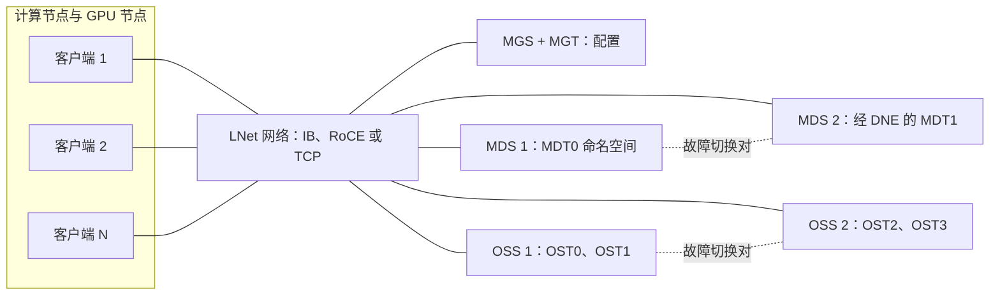
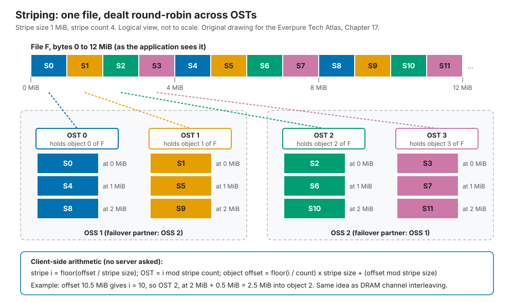
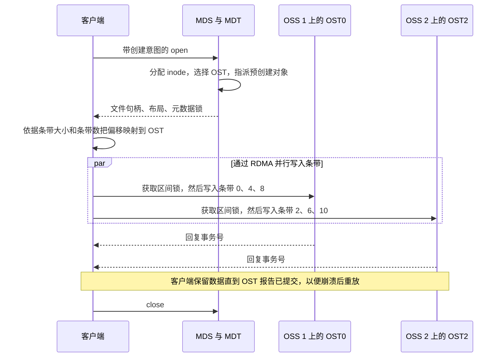
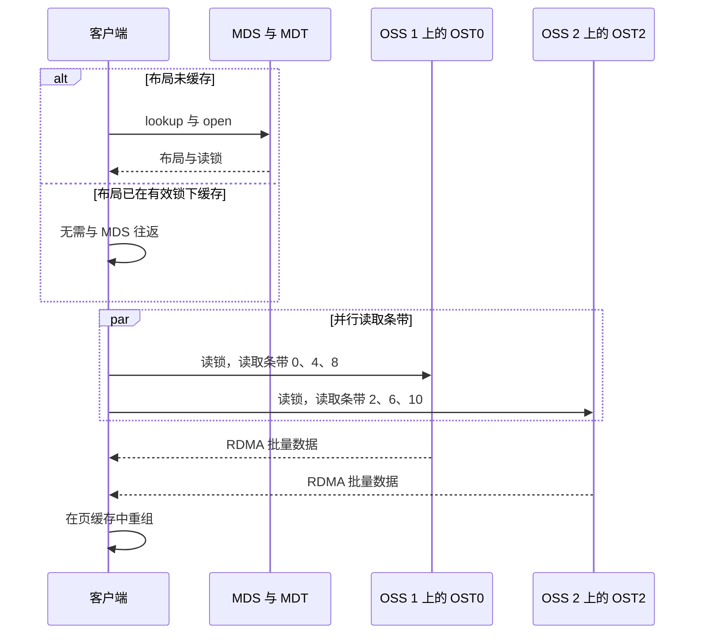
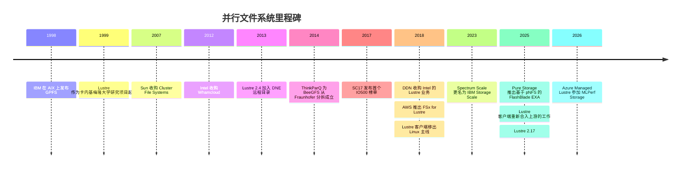

# 17. 并行与分布式文件系统

> 📄 英文原文：[docs/03-system-architecture/17-parallel-file-systems.md](../../../docs/03-system-architecture/17-parallel-file-systems.md) · 本文为简体中文参考译本，如有出入以英文原文为准。

> **深度：** L2 · **阅读时间：** 约 8 分钟 · **最后核实：** 2026-11-01
> **前置阅读：** [文件协议](../02-protocols-and-networking/08-file-protocols.md) · [横向扩展无共享集群](15-scale-out-shared-nothing.md) · [分解式全共享架构](16-disaggregated-shared-everything.md)

## 要点速览（TL;DR）

- **并行文件系统把"数据在哪里？"与"把字节给我"拆分开来。** 元数据服务器（MDS）对每个文件只需应答一次；之后客户端直接把数据条带化地分布到众多对象存储服务器（OSS）上。
- **客户端才是"聪明"的那一端。** 每个节点上的内核模块负责条带化、加锁并使用 RDMA 通信。这让 Lustre 和 IBM Storage Scale（GPFS）达到数 TB/s 的带宽，同时也让它们难以运维。
- **HPC 造就了它们，至今仍依赖它们。** Lustre 运行在 Top500 中超过 60% 的系统上[^1]。早期 GPU 集群从 HPC 团队那里继承了这类系统。
- **瓶颈在于元数据、小文件和客户端管理。** 单个 MDS 会把其命名空间上的操作串行化，而每次内核升级都要等待匹配的客户端版本。
- **这一模式正在基于标准客户端重建。** Everpure 的 FlashBlade//EXA 和 Hammerspace 等 pNFS 设计保留了这种拆分，但使用原生 NFS 客户端[^2]，以牺牲部分一致性换取更简便的运维。

## 对 Everpure 战略的意义

每一笔大型 AI 存储交易，在某种程度上都是对并行文件系统的一次"公投"。DDN（以 EXAScaler 形式提供 Lustre）、IBM（Storage Scale）和 WEKA 都在销售具备 NVIDIA 认证和 HPC 参考案例的并行文件系统。在 Lustre 环境中成长起来的买家，会以 Lustre 的带宽为标尺衡量一切；而那些真正*运维过*它的人，则记得客户端驱逐、MDS 热点和客户端编译构建之苦。

FlashBlade//EXA 照搬了 Lustre 的架构（一个元数据层，数据直接从数据节点流出），但用 pNFS 替换了专有客户端[^2]。买家更看重哪一种痛点，决定了交易的走向。[第 8 章](../02-protocols-and-networking/08-file-protocols.md)介绍 pNFS 协议；[第 44 章](../06-industry-and-competition/44-ddn.md)介绍 DDN。

## 核心概念

### 组成部分

Lustre 是参考设计，由五个部分组成[^29]：

- **客户端（Clients）** 运行一个内核模块，对外呈现为普通的 POSIX 挂载点。
- **MGS**（管理服务器）保存配置信息；客户端在挂载时读取。
- **MDS** 为 **MDT**（元数据目标）提供服务，MDT 保存命名空间：目录、inode、权限以及每个文件的**布局（layout）**，即存放该文件数据的 OST 对象列表。
- **OSS** 为 **OST**（对象存储目标）提供服务：OST 是建立在 RAID 保护设备之上的本地 ldiskfs 或 ZFS 文件系统，以对象形式保存文件数据。
- **LNet** 是网络层：基于 InfiniBand 或 RoCE 的 RDMA，或 TCP，并支持在不同网络之间路由。

*图 17.1 — Lustre 把规模较小的元数据层与规模宽大的数据层分开，二者都位于同一 RDMA 网络之后，客户端可直接访问。*

比例本身就是设计：Frontier 的 679 PB Orion 文件系统有 40 台元数据服务器和 450 台存储服务器[^3]。

### 条带化：文件层面的内存交织

布局有两个主要参数：**条带大小（stripe size）**，即分块大小（默认通常为 1 MiB）；以及**条带数（stripe count）**，即这些分块被分发到多少个 OST 上（默认通常为 1）[^4]。二者都可以按文件或目录设置；渐进式文件布局（Progressive File Layouts，2.10 版引入）会随着文件增大而扩展条带数[^5]。

*图 17.2 — 客户端无需询问服务器即可算出任意字节位于哪个 OST，这与内存控制器根据地址位选择 DRAM 通道完全相同。*

**半导体类比。** 这就是通道交织（channel interleaving）：连续的缓存行分散到各个通道上，使一个数据流能够用满所有通道。失效模式也一样。交织粒度太细，每次访问都会触及所有 bank；访问步长若与交织模式对齐，所有客户端就会集中冲击同一个 OST——也就是 GPU 程序员熟知的"分区驻留（partition camping）"。

**算例（为何条带数很重要）。** 假设每个 OST 可持续提供 5 GB/s（示意）。一个 405B 参数模型的检查点约为 6.5 TB。若作为一个共享文件且条带数为 1，它会落在单个 OST 上：6.5 TB ÷ 5 GB/s ≈ 1,300 s，即 GPU 空转 22 分钟。条带数设为 64 可得到 320 GB/s，耗时约 20 s。但条带更宽并非没有代价：此时每个客户端都要锁定每个 OST，任何一个慢速 OST 都会拖住整个写入，因此检查点库通常让每个 rank 各写一个文件。

### 追踪一次写入

*图 17.3 — 只有在 open 和 close 时才会访问 MDS；字节直接从客户端同时流向多个 OSS。*

OST 通过 Lustre 的分布式锁管理器授予字节范围的**区间锁（extent locks）**，因此写入同一文件不同范围的客户端可以并行推进并保持一致。共享文件写入时的这种 POSIX 一致性，正是内核模块换来的东西；NFS 的"关闭到打开（close-to-open）"一致性模型则较弱（[第 8 章](../02-protocols-and-networking/08-file-protocols.md)）。

### 追踪一次读取

*图 17.4 — 布局一旦缓存，读取就完全不会触及元数据服务器，这就是大块顺序读几乎随 OSS 数量线性扩展的原因。*

**半导体类比。** MDS 相当于数据访问之前的目录或标签（tag）查找；缓存的布局就是一个 TLB 表项，而锁回调就是一次 TLB 击落（TLB shootdown）。

### 故障处理

| 故障 | 发生什么 | 爆炸半径（影响范围）/ 代价 |
|---|---|---|
| 驱动器 | OST 底层的 RAID 或 ZFS 在本地重建。Lustre 本身感知不到。 | 重建期间 OST 带宽降级；一个慢速 OST 会拖慢所有条带化到它上面的文件。 |
| OSS 服务器 | 故障切换对中的伙伴从共享的双端口存储上挂载这些 OST。客户端重新连接并重放未提交的请求[^6]。 | 恢复窗口期间，对这些 OST 的 I/O 暂停。服务器对需要共享机柜（enclosure）和隔离（fencing）机制。 |
| MDS | 模式相同，由备用节点或 DNE 对等节点接管 MDT。 | 恢复期间，全集群的命名空间操作停滞。 |
| 客户端或其链路 | 如果客户端在计时器到期前未响应锁回调，服务器会**驱逐（evict）**它并收回其锁[^7]。 | 该客户端缓存中的脏数据丢失，应用会看到 I/O 错误，这是运维中常见的抱怨。 |
| 整个 OST 丢失 | 除非文件做了镜像，否则条带化到其上的数据将丢失。文件级冗余（File Level Redundancy）自 Lustre 2.11 起就已存在，但需要主动启用[^5]。 | 保护是按服务器进行的，而非像[无共享系统](15-scale-out-shared-nothing.md)那样跨服务器做纠删码。 |

*表 17.1 — 传统 Lustre 在每个服务器对内部保护数据，并依赖快速故障切换。在日常运维中，最薄弱的环节是客户端，而不是硬件。*

### 瓶颈所在

1. **元数据串行化。** 一个 MDT 处理其命名空间分片内的每一次 create、open 和 stat。分布式命名空间（DNE）在 2.4 版加入了远程目录，在 2.8 版加入了跨 MDT 条带化的目录[^5]，但 ORNL 仍发现共享目录类负载会卡在单个 MDT 上[^8]。要扩展，就需要负载本身足够分散。
2. **小文件。** **算例：** 十亿张 100 KB 的图片（100 TB），以 1 TB/s 读取需要 100 s。若按每个 MDT 每秒 50,000 次 open（示意）计算 [VERIFY: 当前硬件上具有代表性的单 MDT open 速率]，仅 open 就需要 20,000 s（5.6 小时），是数据读取时间的 200 倍。Data-on-MDT（2.11 版）把极小的文件直接存放在 MDT 上，以省去一次往返[^5]。AI 训练恰恰就是这种形态（[第 21 章](21-metadata.md)）。
3. **客户端软件管理。** 客户端于 2018 年被移出 Linux 主线；2025 年有一项工作旨在将其重新合入上游[^9]。在此期间，每次内核更新都要等待匹配的客户端版本。
4. **内核依赖与多租户。** 在数千个 GPU 节点上部署内核模块，是新兴 GPU 云（neocloud）所厌恶的安全与变更管控负担；而且多租户能力来得较晚：Lustre 2.17（2025 年 12 月）的主打特性是动态 nodemap[^10]。

### 优劣与适用场景

| | 优势 | 劣势 |
|---|---|---|
| 带宽 | 随 OSS 数量近线性扩展；端到端 RDMA | 对条带设置和最慢的 OST 敏感 |
| 语义 | 完整 POSIX，共享文件写入保持一致 | 锁机制需要靠驱逐来处理失联客户端 |
| 元数据 | 每个 MDT 简单且快速 | 串行化点；DNE 需要负载配合 |
| 成本 | 开源（Lustre），可运行于通用硬件或一体机硬件 | 需要专业人员；成对的高可用硬件；数据缩减能力很弱 |
| 运维 | 工具成熟，拥有 25 年 HPC 经验 | 内核客户端的生命周期管理；调优是一门手艺 |

*表 17.2 — 并行文件系统以运维简便性为代价，换取原始且一致的带宽。*

**最适合：** 大文件流式读写（仿真输出、检查点、视频）、多个 rank 写同一个文件、拥有 HPC 运维团队的站点。**最不适合：** 数十亿个极小文件、内核版本混杂的多租户云、需要 SMB、快照和数据缩减的企业共享，以及固定的 MDS 与故障切换对成本占主导的小型集群。

### 为何由 HPC 打造、又被 AI 继承

1990 年代末，运行在数千个节点上的仿真会同时转储内存，压垮了 NFS 的单一机头。Lustre 于 1999 年作为卡内基梅隆大学（Carnegie Mellon）的研究项目起步[^1]；IBM 的 GPFS 于 1998 年发布[^11]。IO500 榜单始于 SC17，按带宽得分与元数据得分的几何平均值对系统排名[^12]；Lustre 约占其中近一半的条目 [VERIFY: 仅见于搜索摘要][^13]。

早期的 AI 训练看起来与 HPC 很像：同步作业、巨型检查点、InfiniBand，以及在实验室环境中成长的买家。NVIDIA 参考架构和各大云厂商随之跟进：AWS 于 2018 年推出 FSx for Lustre[^14]，Google 的 Managed Lustre 运行的是 DDN EXAScaler[^15]，Azure Managed Lustre 则于 2026 年参加了 MLPerf Storage[^16]。AI 带来了 HPC 难以很好应对的东西：数十亿个小文件、频繁变动的推理集群，以及拒绝安装内核模块的租户。WEKA、VAST 和各类 pNFS 设计正是在这一缺口中竞争。

### 成本与运维影响

Lustre 是免费的，专业能力却不是。各站点要为一体机支持或托管服务付费，购买部署在共享机柜上的成对服务器，接受 RAID 开销（8+2 为 20%）且几乎没有数据缩减，还要承担隐性成本：因客户端驱逐和 MDS 停滞而损失的 GPU 时间，以及调优条带所耗费的人力。

## Everpure 的做法与竞争对手对比

| 系统 | 元数据设计 | 客户端 / 数据路径 | 保护 | AI 定位 |
|---|---|---|---|---|
| Lustre / DDN EXAScaler | MDS/MDT，通过 DNE 扩展 | 内核客户端，LNet RDMA | OST 底层 RAID，故障切换对 | AI400X 系列一体机；Google Cloud Managed Lustre[^17][^15] |
| IBM Storage Scale (GPFS) | 分布式：任意节点均可管理元数据，采用基于令牌（token）的加锁 | 内核客户端；共享磁盘（NSD）或无共享 | RAID 或纠删码 | 获 NVIDIA 认证的"AI Data Platform"（6.0.1，2026 年 6 月）[^11][^18] |
| BeeGFS (ThinkParQ) | 独立的元数据服务，命名空间按目录切分 | 内核客户端 | 目标的伙伴镜像（buddy mirroring） | v8.2（2025 年 11 月）新增后台再均衡[^19] |
| WEKA NeuralMesh | 元数据分片为"桶（buckets）"分布在所有节点上，没有专用 MDS | 专有客户端：用户态 DPDK 数据路径，外加用于 POSIX 挂载的 WEKA 内核驱动 | 分布式纠删码 | 融合模式与云模式；KV 缓存扩展[^20][^21] |
| Hammerspace | Anvil 元数据服务器 | pNFS Flex Files，原生 Linux 客户端 | 委托给底层 NFS 存储 | 为 Meta 的 GenAI 集群共同开发的 Parallel NFS[^22] |
| Everpure FlashBlade//EXA | 运行 Purity 的 FlashBlade 元数据核心 | pNFS：元数据走 NFSv4.1/TCP，数据经 NFSv3/RDMA 直达数据节点；原生客户端 | 数据节点保护方案仍在完善 [VERIFY: 当前数据节点的保护方式] | MLPerf Storage v3.0 检查点成绩[^2][^16] |

*表 17.3 — 所有设计都保留了元数据/数据的拆分。差异在于元数据放在哪里、客户端有多重，以及由谁来保护数据。*

**FlashBlade//EXA 算不算并行文件系统？** 从架构上看，算：元数据核心扮演 MDS 的角色，数据节点扮演 OSS 的角色，客户端直接与数据节点之间传输字节[^2]。差异是有意为之的：元数据运行在横跨横向扩展刀片集群的 Purity 上，而不是单个 MDT 上，客户端则是原生 Linux NFS。在 MLPerf Storage v3.0 中，30 个 EXA 数据节点取得了 877.5 GiB/s 的检查点写入成绩（10 个数据节点时为 327.6 GiB/s），而 Azure Managed Lustre 以 128 个客户端取得 642.2 GiB/s，二者配置不同[^16][^23]。

**为传统厂商构建最强版本论证（steelman）。** Lustre 和 Storage Scale 提供了 NFS 所缺乏的共享文件一致性写入，并拥有数十年的百亿亿次（exascale）级参考案例；Lustre 的开源许可证对主权类和实验室类买家颇具吸引力；WEKA 则通过把元数据分片到每个节点上，绕开了 MDS 瓶颈。基于公开信息，战略团队可能评估的选项包括：瞄准具有 HPC 背景、痛点在于客户端管理和元数据的 AI 买家；在公布带宽的同时公布 IO500 式的元数据成绩；在共享文件写入语义成为后期异议之前就予以解决。

## 历史与发展轨迹

*图 17.5 — Lustre 历经四次易主仍保持在 HPC 领域的领先地位；如今托管云服务在延伸它，而基于标准客户端的设计则从下方发起冲击。*

IBM 于 2023 年弃用 Spectrum 品牌，GPFS 由此更名为"IBM Storage Scale"[^24]。Lustre 四度易手：从 Cluster File Systems 到 Sun（2007 年）、Oracle（2010 年，随 Sun 一并被收购）、Intel（2012 年，通过 Whamcloud）以及 DDN（2018 年）[^25][^26][^27]。2020 年，前 100 名系统中有 77 套运行 Lustre，23 套运行 Spectrum Scale[^28]。展望未来：云厂商将吸收运维负担，合入上游可能终结"内核模块税"，而 pNFS 则在标准客户端之上重建这一架构。

## 关键数字

| 指标 | 数值 | 背景 | 来源 / 日期 |
|---|---|---|---|
| Lustre 在 Top500 中的占比 | 前 500 名中 >60%；前 100 名中 >65% | ACM Transactions on Storage | ORNL 等，2025-06[^1] |
| Orion（Frontier）命名空间 | 679 PB；40 台 MDS 对 450 台存储服务器 | 容量层读取 5.5 TB/s；NVMe 层约 10 TB/s | OLCF[^3] |
| 默认条带大小 / 条带数 | 1 MiB / 1 | 常见站点默认值；按目录调优 | HPE，Lustre wiki[^4] |
| 单 OST 与 64 个 OST 的检查点耗时 | 约 22 分钟 vs 约 20 s | 6.5 TB，每个 OST 5 GB/s（示意） | 算例 |
| 10 亿个小文件的元数据与数据耗时 | 约 5.6 小时 vs 100 s | 每个 MDT 每秒 5 万次 open（示意）；1 TB/s | 算例 |
| EXA 检查点写入，MLPerf v3.0 | 877.5 GiB/s | 30 个数据节点；Azure Managed Lustre 为 642.2 GiB/s | StorageReview，2026-09[^16] |
| 前 100 名中的 Lustre（2020 年） | 77 套系统；Spectrum Scale 23 套 | HPE 分析 | HPE，2020-11[^28] |

## 对话手册

**向产品经理提的问题**

1. *"当一家使用 Lustre 的客户评估 EXA 时，第一个异议是什么？"* 高质量回答：点出共享文件写入问题，说明在哪些场景下"关闭到打开"语义是安全的（按 rank 保存的检查点、以读为主的数据），并引用一个参考案例。
2. *"买家更看重元数据速率还是带宽？"* 高质量回答：在给出带宽的同时，给出 EXA 在指定文件大小下每秒的 create 和 open 次数，并与一个十亿文件级的数据集挂钩。
3. *"面对靠近云端的买家，我们如何胜过 Google 或 Azure Managed Lustre？"* 高质量回答：数据引力、出口流量费用、每 TB/s 的价格、即服务模式。

**向工程师提的问题**

1. *"EXA 中与 Lustre 驱逐相对应的是什么？客户端在写入中途挂起时会看到什么？"* 高质量回答：布局召回（layout recall）、租约到期、恢复时间、在途写入的结局。
2. *"单个热点目录能否在整个元数据核心上扩展？"* 高质量回答：说明单个目录是否跨越多个刀片，这与 Lustre 的单 MDT 限制不同。
3. *"谁来设置条带宽度？用户的错误设置会不会殃及邻居？"* 高质量回答：服务器选定的布局与 Lustre 式用户调优之间的对比。

**不要这样说：**

- "Lustre 是过时的遗留系统。"它运行着大多数最大规模的系统，而且三家超大规模云厂商都把它作为托管服务出售。
- "并行文件系统无法扩展元数据。"DNE、GPFS 和 WEKA 都实现了元数据分布；问题在于负载分布得有多均匀。
- "pNFS 就是套了 NFS 的 Lustre。"它去掉了内核模块，但同时也失去了 Lustre 的共享文件一致性加锁。
- "条带越宽总是越快。"它会成倍增加锁的数量，并让最慢的 OST 成为所有人的问题。
- "GPFS 就是 IBM 版的 Lustre。"GPFS 没有专用的元数据服务器；它在共享磁盘的传统架构之上使用分布式令牌。

## 深入阅读（可选，L3 指引）

- George 等，"Lustre Unveiled"，ACM Transactions on Storage，2025[^1]；ORNL，*Understanding Lustre Internals*，第 2 版[^29]。
- Schmuck 与 Haskin，"GPFS: A Shared-Disk File System for Large Computing Clusters"，FAST 2002[^11]。
- Lustre 的 LDLM 锁管理器、强制恢复（imperative recovery）和渐进式文件布局；IOR 和 mdtest，即 IO500 所用工具。

## 关键术语

- **MDS / MDT** — 元数据服务器及其保存命名空间和布局的目标。
- **OSS / OST** — 对象存储服务器及其保存文件数据的目标。
- **MGS** — Lustre 的配置服务器。
- **LNet** — Lustre 支持 RDMA 的网络层。
- **条带大小 / 条带数** — 分块大小；一个文件跨越的 OST 数量。
- **DNE** — 分布在多个 MDT 上的命名空间。
- **客户端驱逐（Client eviction）** — 服务器丢弃无响应客户端所持有的锁。
- 其余术语见[术语表](../glossary.md)。

## 资料来源

[^1]: R. S. George, A. Dilger et al. (ORNL and others), "Lustre Unveiled: Evolution, Design, Advancements, and Current Trends," *ACM Transactions on Storage* 21(3), 2025-06. DOI 10.1145/3736583. https://www.ornl.gov/publication/lustre-unveiled-evolution-design-advancements-and-current-trends (retrieved 2026-11-01).
[^2]: Everpure, "Technical Brief: FlashBlade//EXA," n.d. (2025). https://www.everpuredata.com/content/dam/pdf/en/technical-briefs/tb-flashblade-exa.pdf (retrieved 2026-11-01); Blocks & Files, "How Pure Storage developed its disaggregated FlashBlade//EXA system," 2025-04-17. https://blocksandfiles.com/2025/04/17/how-pure-storage-developed-its-disaggregated-flashblade-exa-system/ (retrieved 2026-11-01).
[^3]: Oak Ridge Leadership Computing Facility, "Frontier User Guide" (Orion file system), n.d. https://docs.olcf.ornl.gov/systems/frontier_user_guide.html (retrieved 2026-11-01); S. Brim (ORNL), "Deep dive," ATPESC 2023 Track 7, 2023-08. https://extremecomputingtraining.anl.gov/wp-content/uploads/sites/96/2023/08/ATPESC-2023-Track-7-Talk-4-Brim-deep-dive.pdf (retrieved 2026-11-01).
[^4]: HPE, "Configure Striping on Lustre File Systems," n.d. https://www.hpe.com/psnow/resources/ebooks/a00113982en_us_v2/Configure_Striping_on_Lustre_File_Systems.html (retrieved 2026-11-01); Lustre Wiki, "Understanding Lustre Internals," n.d. https://wiki.lustre.org/index.php?diff=4077&oldid=4072&title=Understanding_Lustre_Internals (retrieved 2026-11-01).
[^5]: A. Dilger, "Lustre 2.8 and Beyond," OpenSFS LUG, 2015-04. https://www.opensfs.org/wp-content/uploads/2015/04/Lustre-2.8-and-Beyond_Dilger.pdf; A. Dilger, "Lustre 2.11 and Beyond," LUG 2017, 2017-06. https://opensfs.org/wp-content/uploads/2017/06/Thur05-DilgerAndreas-LUG2017-Lustre202.1120and20Beyond-FINAL.pdf (both retrieved 2026-11-01).
[^6]: Lustre Wiki, "Lustre Recovery Overview," n.d. https://wiki.lustre.org/Lustre_Recovery_Overview (retrieved 2026-11-01).
[^7]: Lustre Wiki, "Lustre Client Eviction Guide," n.d. https://wiki.lustre.org/Lustre_Client_Eviction_Guide (retrieved 2026-11-01); Lustre Wiki, "Lustre Resiliency: Understanding Lustre Message Loss and Tuning for Resiliency," n.d. https://wiki.lustre.org/Lustre_Resiliency:_Understanding_Lustre_Message_Loss_and_Tuning_for_Resiliency (retrieved 2026-11-01).
[^8]: J. Simmons et al. (ORNL), "Evaluation of DoM and DNE scaling," OpenSFS, 2021-05. https://www.opensfs.org/wp-content/uploads/Evaluation-of-DoM-SNE-scaling_Simmons_revised051821.pdf (retrieved 2026-11-01).
[^9]: The Register, "Linux 4.18-rc1 removes Lustre filesystem," 2018-06-18. https://www.theregister.com/2018/06/18/linux_4_18_rc_1_removes_lustre_filesystem/ (retrieved 2026-11-01); J. Edge, LWN.net, "Getting Lustre upstream," 2025-06-18. https://lwn.net/Articles/1025268 (retrieved 2026-11-01).
[^10]: Lustre.org, "Lustre 2.17.0 released," 2025-12. https://www.lustre.org/?p=777 (retrieved 2026-11-01).
[^11]: F. Schmuck and R. Haskin (IBM Almaden), "GPFS: A Shared-Disk File System for Large Computing Clusters," USENIX FAST 2002. https://www.usenix.org/legacy/events/fast02/full_papers/schmuck/schmuck.pdf (retrieved 2026-11-01); IBM, "Storage Scale 101: Basics and architecture," 2025. https://www.ibm.com/support/pages/system/files/inline-files/Storage%20Scale%20101%20-%20Basics%20and%20architecture%20(1).pdf (retrieved 2026-11-01).
[^12]: S. Ihara (DDN), "IO500 update," LAD 2023, 2023-10. https://www.eofs.eu/wp-content/uploads/2024/02/07-LAD2023-ShuichiIhara-1005-1.pdf (retrieved 2026-11-01); LANL et al., "IO-500 proposal," ISC 2017 BoF, 2017-06. https://www.vi4io.org/_media/17-isc-bof-io-500-proposal.pdf (retrieved 2026-11-01).
[^13]: SC25 Birds-of-a-Feather, "Lustre community BoF" abstract (OpenSFS), 2025-11. https://sc25.supercomputing.org/proceedings/bof/bof_pages/bof197.html (retrieved 2026-11-01; seen via search summary only).
[^14]: AWS, "Introducing Amazon FSx for Lustre," 2018-11-28. https://aws.amazon.com/about-aws/whats-new/2018/11/amazon-fsx-lustre/ (retrieved 2026-11-01).
[^15]: DDN via Business Wire, "DDN Announces Collaboration with Google Cloud to Advance AI Initiatives with Google Cloud Managed Lustre and Infinia at Google Cloud Next 2025," 2025-04-09. https://www.businesswire.com/news/home/20250409046523/en/ (retrieved 2026-11-01).
[^16]: StorageReview, "MLPerf Storage v3.0: 877 GiB/s Checkpoints, a Cloud First, and a Leaderboard Turned Over," 2026-09. https://www.storagereview.com/news/mlperf-storage-v3-0-877-gib-s-checkpoints-a-cloud-first-and-a-leaderboard-turned-over (retrieved 2026-11-01); HPCwire, "Everpure Leads MLPerf Storage Tests for Large Model Checkpointing and KV Cache," 2026-09-02. https://hpcwire.com/off-the-wire/everpure-leads-mlperf-storage-tests-for-large-model-checkpointing-and-kv-cache (retrieved 2026-11-01).
[^17]: DDN, "DDN Boosts AI Storage Leadership with EXAScaler 6," n.d. https://www.ddn.com/press-releases/ddn-boosts-ai-leadership-with-exascaler-6 (retrieved 2026-11-01); DDN, "DDN launches AI400X3 and Infinia 2.1 at ISC 2025," 2025-06. https://www.ddn.com/blog/ddn-launches-ai400x3-and-infinia-2.1-at-isc-2025/ (retrieved 2026-11-01).
[^18]: IBM Community, "Introducing IBM Storage Scale 6.0.1 and Storage Scale System 7.0.1: An AI-Ready Data Platform," 2026-06-08. https://community.ibm.com/community/user/blogs/mike-kieran/2026/06/08/introducing-ibm-storage-scale-601-and-storage-scal (retrieved 2026-11-01).
[^19]: ThinkParQ, "ThinkParQ launches BeeGFS 8.2," 2025-11-12. https://thinkparq.com/wp-content/uploads/2025/11/ThinkParQ-launches-BeeGFS-8.2-.pdf (retrieved 2026-11-01).
[^20]: WEKA, "The WEKA Data Platform" (architecture white paper), n.d. https://weka.io/?p=39534 (retrieved 2026-11-01); WEKA, "Networking in WEKA" (docs v5.0), n.d. https://docs.weka.io/5.0/weka-system-overview/networking-in-wekaio (retrieved 2026-11-01).
[^21]: WEKA, "WEKA Introduces NeuralMesh," 2025-06-17. https://www.weka.io/company/weka-newsroom/press-releases/weka-introduces-neuralmesh/ (retrieved 2026-11-01).
[^22]: Hammerspace, "Hyperscale NAS," n.d. https://hammerspace.com/hyperscale-nas/ (retrieved 2026-11-01); Meta Engineering, "Building Meta's GenAI Infrastructure," 2024-03-12. https://engineering.fb.com/2024/03/12/data-center-engineering/building-metas-genai-infrastructure/ (retrieved 2026-11-01).
[^23]: Microsoft, "Azure Managed Lustre MLPerf Storage v3.0 results," n.d. (2026). https://docs.azure.cn/en-us/azure-managed-lustre/mlperf-storage-v3-results (retrieved 2026-11-01).
[^24]: Blocks & Files, "Spectrum no more: IBM dropping brand name for storage products," 2023-02-24. https://blocksandfiles.com/2023/02/24/spectrum-no-more-ibm-dropping-brand-name-for-storage-products/ (retrieved 2026-11-01).
[^25]: InfoWorld, "Oracle to continue supporting Lustre" (Lustre acquired with Sun; Sun bought Cluster File Systems in 2007), 2010. https://www.infoworld.com/article/2624999/oracle-to-continue-supporting-lustre.html (retrieved 2026-11-01).
[^26]: The Register, "Intel buys Whamcloud," 2012-07-16. https://www.theregister.com/2012/07/16/intel_buys_whamcloud/ (retrieved 2026-11-01).
[^27]: TOP500.org, "DDN Acquires Lustre Business from Intel," 2018-06. https://www.top500.org/news/ddn-acquires-lustre-business-from-intel/ (retrieved 2026-11-01).
[^28]: HPE Community, "It's lonely at the top: Lustre continues to dominate top 100," 2020-11. https://community.hpe.com/t5/servers-systems-the-right/it-s-lonely-at-the-top-lustre-continues-to-dominate-top-100/ba-p/7109668 (retrieved 2026-11-01).
[^29]: Oak Ridge National Laboratory, "Understanding Lustre Internals, Second Edition" (covers Lustre 2.15), n.d. https://www.ornl.gov/publication/understanding-lustre-internals-second-edition (retrieved 2026-11-01); Lustre Wiki, "Lustre Architecture for Admins," n.d. https://wiki.lustre.org/index.php?oldid=5478&title=Lustre_Architecture_for_Admins (retrieved 2026-11-01).
