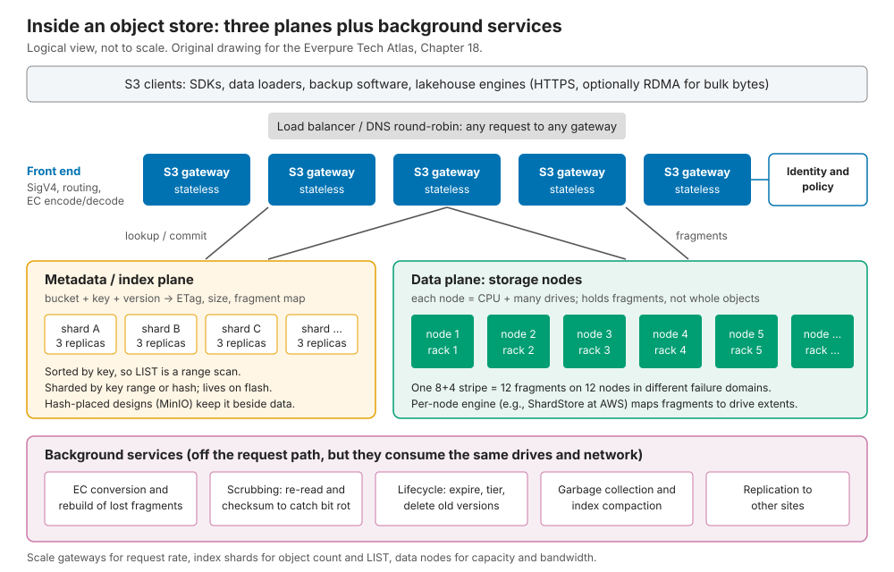
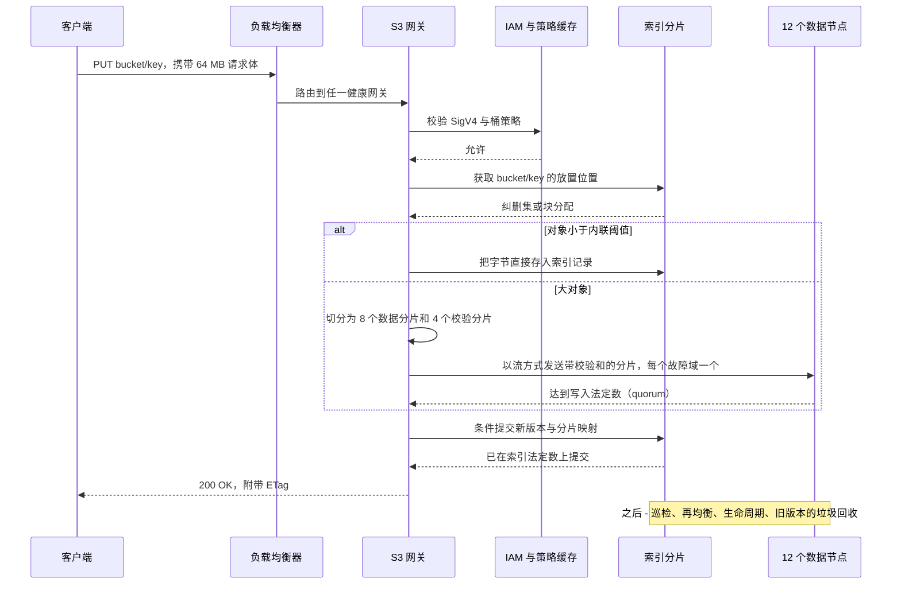
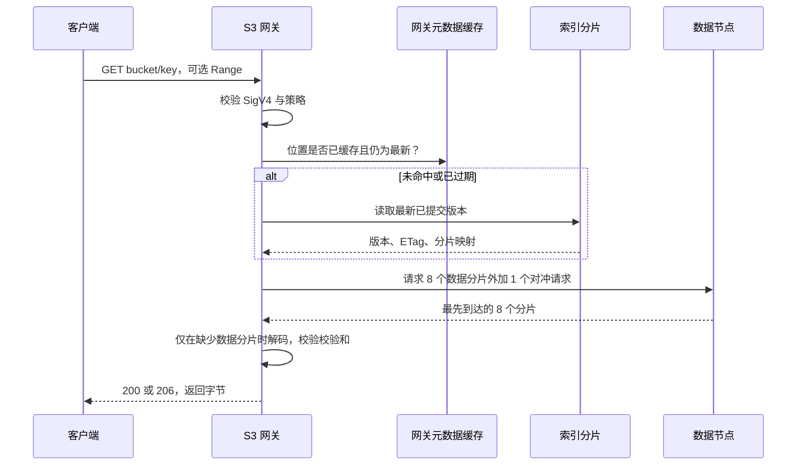
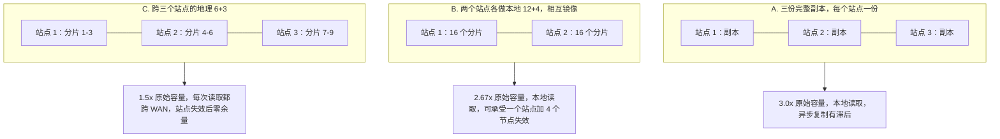
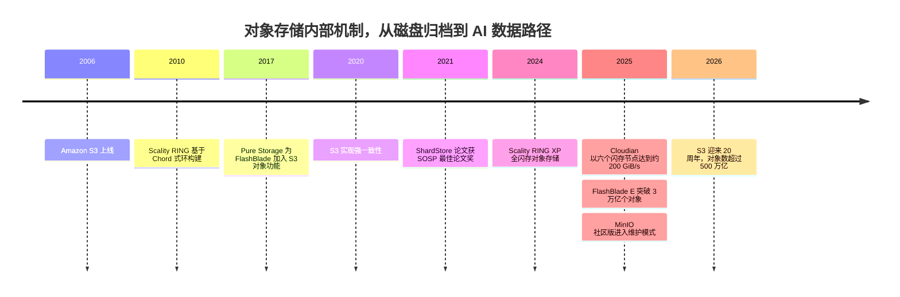

# 18. 对象存储架构

> 📄 英文原文：[docs/03-system-architecture/18-object-storage-architecture.md](../../../docs/03-system-architecture/18-object-storage-architecture.md) · 本文为简体中文参考译本，如有出入以英文原文为准。

> **深度：** L2 · **阅读时间：** 约 8 分钟 · **最后核实：** 2026-11-01
> **前置阅读：** [对象存储与 S3](../02-protocols-and-networking/09-object-storage-and-s3.md) · [数据保护与韧性](../01-storage-fundamentals/06-data-protection-and-resilience.md) · [横向扩展无共享集群](15-scale-out-shared-nothing.md)

## 要点速览（TL;DR）

- **对象存储有三个平面：** 无状态的 S3 网关、把键（key）映射到分片（fragment）的索引，以及保存纠删码分片的数据节点，背后还有一组后台服务。
- **索引决定了大部分结果。** 分片化的元数据数据库让 LIST 操作很廉价。通过对键做哈希来计算放置位置（MinIO）消除了数据库瓶颈，却把 LIST 变成了全集群范围的扇出（fan-out）查询。
- **跨站点纠删码是容量的杠杆。** 跨三个站点的 6+3 编码只需 1.5 倍原始容量，而复制需要 2–3 倍；代价是跨广域网（WAN）读取以及长达数天的站点重建。
- **扩展的瓶颈在于对象数量、小对象和尾延迟。** 磁盘本身很少成为限制。
- **对象存储正从"廉价大容量（cheap-and-deep）"转向"高性能"。** 在全闪存对象存储上，元数据引擎比 $/TB 更重要。

## 对 Everpure 战略的意义

[第 9 章](../02-protocols-and-networking/09-object-storage-and-s3.md)说明了 S3 如何成为 AI 数据的默认接口。而在 API 背后，各系统差异巨大：慢速索引之上的快速端点，列出十亿个键时依然很慢。当一位 AI 买家在 FlashBlade 与 MinIO AIStor、Cloudian 或 Dell ObjectScale 之间权衡时，交易取决于内部机制：每个桶（bucket）的对象数、LIST 速率、一次小 PUT 的成本，以及节点宕机时会发生什么。

在对象存储还意味着磁盘归档的年代，Pure Storage 就把 FlashBlade 打造为全闪存对象存储。如今竞争对手也都转向了闪存，它的元数据引擎还能构成差异化吗？

## 核心概念

### 一图看懂

*图 18.1 — 网关、索引和数据节点各自独立扩展：网关随请求速率扩展，索引随对象数量和 LIST 扩展，数据节点随容量和带宽扩展。*

- **网关（Gateways）** 终结 HTTPS 连接，校验 SigV4 签名和策略，选择放置位置并执行纠删编码；它们不保存持久状态。
- **索引（index）** 是一张多副本、分片化的表，以"桶 + 键 + 版本"为键，保存大小、ETag 和分片映射，并保持有序，因此 LIST 就是一次范围扫描。
- **数据节点（Data nodes）** 通过本地引擎把分片映射到磁盘区段（extent）。AWS 的引擎 **ShardStore** 是一个约 40,000 行 Rust 代码的键值存储，并通过轻量级形式化方法进行了验证[^1]。它基于 LSM，但把分片数据保存在树之外，以限制写放大[^2]。

S3 的索引设计并未公开，但其规模是公开的：超过 500 万亿个对象，每秒 2 亿次请求（2026 年 3 月）[^3]。

### 元数据存放在哪里：数据库还是哈希

1. **独立的元数据数据库。** Cloudian HyperStore 使用 Cassandra 保存元数据和小对象[^4]。StorageGRID 使用 Cassandra，每个站点保存三份副本[^5]。Ceph RGW 把桶索引保存在基于 RocksDB 的 omap 中，当每个分片超过 100,000 个对象时进行重分片（resharding）[^6][^7]。FlashBlade 在其各刀片之上运行一个分布式键值数据库[^8]。
2. **计算出放置位置，元数据与数据存放在一起。** MinIO 对对象名做哈希，选出一个由 2–16 块驱动器组成的**纠删集（erasure set）**，并且没有元数据数据库[^9][^10]。约 128 KiB 以下的对象直接内联存储在元数据文件中[^11]。Scality RING 把键放置在一个 Chord 式的环上[^12]。Ceph 的 CRUSH 也是如此（[第 15 章](15-scale-out-shared-nothing.md)）。

**半导体类比：页表与组相联缓存。** 索引数据库相当于页表，网关缓存相当于它的 TLB：数据可以放在任何地方，但一次未命中就要付出一次页表遍历的代价。哈希放置则是组相联缓存：由地址位选出组，不需要任何表。但缓存无法按地址顺序枚举，因此在哈希放置的存储上执行 LIST，需要查询每一个纠删集并对返回结果做归并排序。

### 追踪一次 PUT

*图 18.2 — 数据先变得持久，再变得可见：索引提交是新版本对所有读者可见的唯一时点。*

**算例（写放大）。** 一个 64 MB 的 PUT 在 8+4 编码下写入十二个 8 MB 分片，共 96 MB（1.5 倍）。网关网卡要承载 64 MB 入流量和 96 MB 出流量，相当于客户端带宽的 2.5 倍。同样的编码下，一个 4 KB 对象会产生 512 B 的分片，每个都被填充到 4 KiB 扇区：磁盘上占用 48 KiB（12 倍），并需要 12 次驱动器写入。因此，各系统要么把小对象内联存储（MinIO、Cloudian），要么先做镜像、之后再做纠删编码。Dell ObjectScale 先做三副本镜像，直到一个 128 MB 的块（chunk）写满，再把它转换为 12+4 编码[^13]。

### 追踪一次 GET

*图 18.3 — 一次 GET 要等待 k 个分片读取中最慢的那一个，因此尾延迟来自宽条带，而不是驱动器的平均表现。*

**算例（尾延迟）。** 假设每个节点有 1% 的时间会卡顿。如果必须等待 8 个特定分片，则有 1 − 0.99⁸ ≈ 7.7% 的 GET 会卡顿。如果向 9 个节点发起请求并采用最先返回的 8 个，只有当两个节点同时变慢时 GET 才会卡顿：1 − (0.99⁹ + 9 × 0.01 × 0.99⁸) ≈ 0.34%。多花 12% 的读取，换来约 20 倍的尾延迟改善。

### 跨节点与跨站点的纠删码

**半导体类比：chipkill。** 服务器 ECC 把每个码字分散到多颗 DRAM 芯片上，从而可以纠正一颗芯片失效；对象存储则把条带分散到节点、机架或站点上。分散得越广，保护越便宜，重建越昂贵。

*图 18.4 — 地理分散式纠删码相比复制可将原始容量减半，但每次读取和每次重建都要经过 WAN。*

| 10 PB 可用容量 | 原始容量 | 能否承受站点失效？ | 正常 GET | 站点失效后的重建 |
|---|---|---|---|---|
| A. 3 份副本，3 个站点 | 30 PB | 能，剩余 2 份副本 | 本地 | 重新复制 10 PB |
| B. 每站点 12+4，2 个站点 | 26.7 PB | 能，另可承受 4 个节点失效 | 本地 | 从一个站点重新复制 10 PB |
| C. 跨 3 个站点的 6+3 | 15 PB | 能，但余量为零 | 6 个分片中 ≥3 个经 WAN 读取 | 经 WAN 读取 10 PB 以重建 5 PB |

*表 18.1 — 算例：地理纠删码每 10 PB 可用容量可节省 15 PB 原始容量，但在长达数天的重建期间数据处于无保护状态。*

StorageGRID 的文档给出跨三个站点 6+3 编码为 1.5 倍，并建议在站点间延迟超过 100 ms 时不要采用[^14][^15]。一次站点重建需要经 WAN 拉取两倍于丢失量的数据[^16]。在方案 C 中，重建 5 PB 需要搬运 10 PB：在 100 Gb/s 下需 800,000 s（**约 9.3 天**）。AWS 把 S3 Standard 分散到至少三个可用区（Availability Zones），目标为 11 个 9 的持久性[^17]；城域级的距离使这一代价保持在较小水平。

### 如何扩展，瓶颈在哪里

1. **索引与 LIST。** 索引大小随对象数量而非字节数增长。按每条记录约 500 字节（示意）、3 个副本计算，1000 亿个对象需要约 150 TB 的索引闪存。LIST 速度取决于索引设计和客户端并行度：Pure Storage 使用一个并行 Go 客户端，在约 43 小时内列出了一个含 670 亿个对象的 FlashBlade 桶[^18]，折合 67e9 ÷ 154,800 s ≈ **每秒 433,000 个键**。若单线程以每页 1,000 个键、每页 20 ms 的速度执行，则需要约 15.5 天。
2. **小对象**会成倍增加记录数、驱动器 I/O 和请求开销（见上文 12 倍的例子）。
3. **热点分片。** 时间戳之类的顺序键会集中堆积到同一个索引范围。Ceph 在对某个桶重分片时会短暂阻塞该桶的写入[^6]。
4. **后台任务欠账。** 巡检、重建、过期清理和垃圾回收都在与客户端争夺资源。

### 故障处理

| 故障 | 发生什么 | 代价 |
|---|---|---|
| 驱动器 | 由 k 个存活分片并行重建到多块驱动器上 | 占用后台带宽；降级读取时实时解码 |
| 数据节点 | 其分片在别处重建；期间 GET 读取其他分片 | 重建流量 ≈ k × 丢失数据量 |
| 网关 | 负载均衡器将其摘除；客户端重试 | 在途请求被重试；数据无风险 |
| 索引副本 | 法定数在剩余副本上继续运作 | 一旦失去法定数，该分片的键将无法写入，尽管数据完好 |
| 网络分区 | 少数派一侧无法提交；法定数机制防止脑裂 | 一侧写入失败，这就是实践中的 CAP（[第 20 章](20-distributed-systems-fundamentals.md)） |
| 站点 | 复制方案执行故障切换；地理纠删码提供降级读取 | 见表 18.1 |

*表 18.2 — 数据节点故障是例行事件；真正要紧的停机是失去索引法定数。*

### 优劣与适用场景

| | 优势 | 劣势 |
|---|---|---|
| 规模 | 数百万亿个对象、EB 级容量，无需锁定目录树 | 对象数量给索引带来压力；LIST 是最慢的操作 |
| 效率 | 在通用服务器上实现宽条带与地理纠删码（1.3–1.5 倍） | 小对象使纠删码失效；需要内联或打包 |
| 韧性 | 设计上可承受节点和站点失效 | 重建耗时长、范围广；索引法定数是一个逻辑上的单点 |
| 性能 | 带宽随节点扩展；可并行执行范围 GET | 每次请求有固定开销；宽条带带来尾延迟 |
| 语义 | 不可变的整体对象，一致性简单 | 不支持原地更新，不支持重命名，元数据单薄 |

*表 18.3 — 对象存储以丰富的语义为代价，换取规模和容量效率。*

**最适合：** 分片化的 AI 数据集、检查点、湖仓（lakehouse）表、备份、归档、媒体。**最不适合：** 原地写入的数据库和虚拟机、频繁重命名的极小文件、需要目录结构的 POSIX 工具。

### 从"廉价大容量"到"高性能"

HDD 时代的对象存储围绕磁盘约 100–200 次随机 IOPS 来设计：大块、元数据放在一小片闪存上、数十毫秒的延迟。闪存消除了"每 TB IOPS"的约束，使元数据与小对象可以共享高速介质。不断下降的 QLC $/TB、S3 原生的 AI 数据管道以及直达 GPU 内存的 RDMA，让这一转变变得划算（[第 9 章](../02-protocols-and-networking/09-object-storage-and-s3.md)）。

| 信号（厂商自述，不可直接比较） | 宣称 | 来源 |
|---|---|---|
| 基于 NVMe 的 MinIO | 32 个节点 GET 达 325 GiB/s | MinIO[^19] |
| 基于闪存的 Cloudian HyperStore | 6 个节点约 200 GiB/s（每节点约 35 GiB/s） | Cloudian[^20] |
| Scality RING XP | 4 KB PUT/GET 延迟达微秒级 | Scality，2024-10-30[^21] |
| Dell ObjectScale XF960 | 定位于 AI 的全闪存一体机 | Dell，2025[^22] |
| FlashBlade//E | 单个阵列超过 3 万亿个对象 | Pure Storage[^23] |

*表 18.4 — 各主要对象存储厂商如今都在宣传闪存性能；对象数量和延迟宣称成为新的战场。*

### 成本与运维影响

运行在高密度 HDD 服务器上的软件定义对象存储，仍然拥有最低的 $/TB。其隐性成本在于运维：索引修复与压缩（compaction）、再均衡、巡检以及多站点网络。在 StorageGRID 中，最小的节点决定了一个站点的元数据容量上限[^5]。许可条款也可能变化：MinIO 社区版于 2025 年 12 月进入维护模式[^24]。一体机每 TB 成本更高，但能消除其中大部分运维负担（[第 19 章](19-software-defined-and-hci.md)）。

## Everpure 的做法与竞争对手对比

| 系统 | 索引 / 元数据 | 放置与保护 | 介质 | 公开数据点 |
|---|---|---|---|---|
| Everpure FlashBlade | 跨刀片的分布式键值元数据，与 NFS/SMB 共享 | 先在 NVRAM 中暂存写入，再跨刀片做宽条带 N+2 纠删码[^8][^25] | 全闪存（DirectFlash） | 单台 //E 达 3 T 个对象[^23]；约 43 小时完成 67 B 键的 LIST[^18] |
| AWS S3 | 未公开 | ≥3 个可用区；存储节点上运行 ShardStore[^1][^17] | 未披露 | 500 T+ 个对象，每秒 200 M+ 次请求[^3] |
| MinIO AIStor | 无；`xl.meta` 与数据放在一起 | 哈希到由 2–16 块驱动器组成的纠删集[^10] | NVMe 或 HDD | 32 个节点 GET 达 325 GiB/s[^19] |
| Cloudian HyperStore | Cassandra；小对象内联[^4] | 按策略选择复制或纠删码 | HDD 与闪存 | 宣称每节点约 35 GiB/s[^20] |
| Ceph RGW | RocksDB omap 中的分片化桶索引[^7] | 4 MB RADOS 对象；复制池或纠删码池[^7] | 任意 | 每个索引分片 100 k 个对象[^6] |
| NetApp StorageGRID | Cassandra，每站点 3 份副本[^5] | ILM 规则；跨 3 个站点的 6+3[^14] | HDD 与闪存一体机 | 地理纠删码要求延迟低于 100 ms[^14] |
| Dell ObjectScale | 基于块（chunk）的存储 | 128 MB 块，12+4 或 10+2[^13] | XF960 全闪存[^22] | 源自 ECS |
| Scality RING | Chord 式键环[^12] | 复制或纠删码 | RING XP 全闪存[^21] | 宣称 4 KB 延迟达微秒级 |

*表 18.5 — 如今每家厂商都有闪存对象存储的故事；区别在于索引放在哪里，以及保护如何跨越故障域。*

FlashBlade 押注的是：对象元数据本质上是一个数据库问题，应在闪存和 NVRAM 中解决，并与文件共享。一份 2023 年的分析师报告描述，写入在确认之前会先镜像到另外两个刀片的 NVRAM 上[^8]。对于当前基于 DFM 的系统，Everpure 表示 Purity 把各 DFM 的 NVRAM 和闪存分配给运行在每个刀片上的"authority"进程，每个进程负责命名空间的一个切片[^26] [VERIFY: 当前 Purity//FB 的 PUT 写入路径与副本数]。为软件定义竞争对手构建最强版本论证：容量更便宜、支持地理纠删码、服务器可自由选择。FlashBlade 的多站点保护看起来是阵列之间的复制，而非地理纠删码 [VERIFY: 2026 年 FlashBlade 的多站点对象存储选项]。基于公开信息，战略团队可能评估的选项包括：公布 LIST 和小对象基准测试结果；检验搭载 DeepReduce 的 FlashBlade//E 能否赢回目前输给基于 HDD 的 Ceph 或 MinIO 的容量型交易。

## 历史与发展轨迹

*图 18.5 — 对象存储花了 15 年时间针对廉价磁盘做优化；自 2024 年起，竞争焦点已转向闪存、延迟和对象数量。*

S3 在 2020 年实现的强一致性（[第 9 章](../02-protocols-and-networking/09-object-storage-and-s3.md)）推动兼容厂商转向可线性化（linearisable）的索引。Pure Storage 于 2017 年发布了 FlashBlade 的对象功能[^27]。下一步，索引将吸纳表、向量和更丰富的元数据（[第 33 章](../05-ai-storage/33-rag-vector-lakehouse.md)）：索引正在成为产品本身。

## 关键数字

| 指标 | 数值 | 背景 | 来源 / 日期 |
|---|---|---|---|
| S3 规模 | >500 T 个对象，每秒 >200 M 次请求 | 数百 EB | AWS，2026-03[^3] |
| S3 Standard 持久性设计 | 11 个 9，≥3 个可用区 | 区域级分散 | AWS 文档[^17] |
| ShardStore 规模 | 约 40,000 行 Rust 代码 | S3 存储节点引擎 | SOSP 2021[^1] |
| MinIO 纠删集 | 2–16 块驱动器；约 128 KiB 以下内联 | 哈希放置，无元数据数据库 | MinIO 文档/博客[^10][^11] |
| Ceph RGW 重分片触发点 | 每个索引分片 100,000 个对象 | 动态重分片 | Ceph 文档[^6] |
| 跨 3 个站点的地理纠删码 6+3 | 1.5 倍原始容量；站点间延迟低于 100 ms | 对比双站点复制的 2 倍 | NetApp 文档[^14] |
| FlashBlade LIST | 约 43 小时列出 67 B 个键 ≈ 每秒 433 k 个键 | 并行客户端，单个桶 | Pure Storage 博客[^18] |
| 地理纠删码站点重建 | 100 Gb/s 下约 9.3 天 | 丢失 5 PB，搬运 10 PB | 算例 |
| 对冲读取的尾延迟 | 卡顿 GET 比例 7.7% → 0.34% | 9 取 8 个分片，节点卡顿率 1% | 算例 |

## 对话手册

**向产品经理提的问题**

1. *"按对象数量计，我们最大的生产环境桶有多大？它的 LIST 速率是多少？"* 高质量回答：对象数、每秒键数、客户端并行度，以及与竞争对手的对比。
2. *"我们在哪些对象存储交易中输给了 MinIO、Ceph 或 Cloudian？"* 高质量回答：$/TB、地理纠删码和服务器选择自由度，然后说明在哪些情况下小对象和 LIST 速度能扭转局面。
3. *"FlashBlade 容量中有多大比例是通过 S3 而非 NFS 访问的？"* 高质量回答：给出趋势及其对应负载（湖仓、检查点、KV 缓存）。

**向工程师提的问题**

1. *"追踪一次 4 KB PUT：字节落在哪里？需要多少次驱动器写入？何时进行纠删编码？"* 高质量回答：内联或暂存路径、放大倍数、转换触发条件。
2. *"某个索引分片变热时会发生什么？"* 高质量回答：如何拆分、写入是否被阻塞、阻塞多久。
3. *"我们如何在宽条带上限制尾延迟？"* 高质量回答：对冲读取、分片大小设定、按对象大小划分的 p99。

**不要这样说：**

- "对象存储便宜但慢。"它越来越多地运行在闪存上，并直接为 GPU 供数。
- "地理纠删码是免费的持久性。"它让每次读取都经过 WAN，并留下长达数天、处于暴露状态的重建期。
- "对象存储没有元数据瓶颈。"索引就是瓶颈，而 LIST 会把它暴露出来。
- "MinIO 有元数据数据库。"它刻意没有；这正是其写入扩展能力和 LIST 成本的共同根源。
- "AWS S3 运行在 X 之上。"其内部机制大多未公开；引用 ShardStore 即可，到此为止。

## 深入阅读（可选，L3 指引）

- ShardStore 论文（SOSP 2021）[^1]，以及 Andy Warfield 在 FAST '23 上关于 S3 运维的主题演讲。
- MinIO 的 `DESIGN.md`（纠删集、SipHash 放置）；Ceph RGW 深度解析系列；StorageGRID 的纠删码指南。

## 关键术语

- **网关（Gateway）**、**元数据索引（metadata index）**、**纠删集（erasure set）**、**内联对象（inline object）**、**桶索引分片（bucket index sharding）**、**地理分布式纠删码（geo-distributed erasure coding）**、**对冲读取（hedged read）**、**巡检（scrubbing）**、**生命周期策略（lifecycle policy）**、**ShardStore**。定义见[术语表](../glossary.md)。

## 资料来源

[^1]: J. Bornholt et al., "Using Lightweight Formal Methods to Validate a Key-Value Storage Node in Amazon S3," SOSP 2021, 2021-10. https://www.cs.utexas.edu/~bornholt/papers/shardstore-sosp21.pdf ; Amazon Science, "AWS team wins best-paper award for work on automated reasoning," 2021. https://amazon.science/blog/aws-team-wins-best-paper-award-for-work-on-automated-reasoning (both retrieved 2026-11-01).
[^2]: The Stack, "AWS ShardStore and S3," n.d. https://www.thestack.technology/aws-shardstore-s3/ (retrieved 2026-11-01).
[^3]: AWS News Blog, "Twenty years of Amazon S3 and building what's next," 2026-03. https://aws.amazon.com/blogs/aws/twenty-years-of-amazon-s3-and-building-whats-next/ (retrieved 2026-11-01).
[^4]: Evaluator Group (Futurum), "Cloudian HyperStore," product brief, n.d. https://futurumgroup.com/wp-content/uploads/documents/EGPR_Cloudian_HyperStore.pdf (retrieved 2026-11-01).
[^5]: NetApp, "What is a Storage Node?" and "Manage object metadata storage," StorageGRID documentation, n.d. https://docs.netapp.com/us-en/storagegrid/primer/what-storage-node-is.html ; https://docs.netapp.com/us-en/storagegrid-120/admin/managing-object-metadata-storage.html (both retrieved 2026-11-01).
[^6]: Ceph, "RGW Dynamic Bucket Index Resharding," Squid documentation, n.d. https://docs.ceph.com/en/squid/radosgw/dynamicresharding/ (retrieved 2026-11-01).
[^7]: Ceph.io, "Ceph Object Storage Deep Dive Series, Parts 1 and 2," 2025. https://ceph.io/en/news/blog/2025/rgw-deep-dive-1/ ; https://ceph.io/en/news/blog/2025/rgw-deep-dive-2 (both retrieved 2026-11-01).
[^8]: Evaluator Group (Futurum), "Pure Storage FlashBlade," product brief, n.d. (2023). https://futurumgroup.com/wp-content/uploads/documents/EGPR_PureStorage_FlashBlade-6.pdf (retrieved 2026-11-01).
[^9]: MinIO, "Deployment Architecture," documentation, n.d. https://docs.min.io/community/minio-object-store/operations/concepts/architecture.html ; MinIO, "Enterprise architecture," n.d. https://min.io/product/enterprisearchitecture (both retrieved 2026-11-01).
[^10]: MinIO, "Distributed server design guide," GitHub `docs/distributed/DESIGN.md`, n.d. https://github.com/minio/minio/blob/master/docs/distributed/DESIGN.md (retrieved 2026-11-01).
[^11]: MinIO, "Working with Small Objects in AI/ML workloads," n.d. https://www.min.io/blog/minio-optimizes-small-objects (retrieved 2026-11-01).
[^12]: The Register, "Scality RING technology," 2010-11-02. https://www.theregister.com/2010/11/02/scality_ring_technology/ (retrieved 2026-11-01).
[^13]: Dell Technologies Info Hub, "Erasure coding," Dell ObjectScale Overview and Architecture, n.d. https://infohub.delltechnologies.com/en-us/l/dell-objectscale-overview-and-architecture/erasure-coding-7/ (retrieved 2026-11-01).
[^14]: NetApp, "Advantages, disadvantages, and requirements for erasure coding," StorageGRID documentation, n.d. https://docs.netapp.com/us-en/storagegrid/ilm/advantages-disadvantages-and-requirements-for-ec.html (retrieved 2026-11-01).
[^15]: NetApp, "Guidelines for creating storage pools," StorageGRID documentation, n.d. https://docs.netapp.com/us-en/storagegrid/ilm/guidelines-for-creating-storage-pools.html (retrieved 2026-11-01).
[^16]: USPTO, "Restoration of erasure-coded data via data shuttle in distributed storage system," US Patent 9,830,221, n.d. https://image-ppubs.uspto.gov/dirsearch-public/print/downloadPdf/9830221 (retrieved 2026-11-01).
[^17]: AWS, "Data protection in Amazon S3," Amazon S3 User Guide, n.d. https://docs.aws.amazon.com/AmazonS3/latest/userguide/DataDurability.html (retrieved 2026-11-01).
[^18]: Pure Storage (republished by Everpure), "How to List 67 Billion Objects in 1 Bucket," n.d. https://blog.purestorage.com/purely-technical/listing-67-billion-objects-in-1-bucket ; https://blog.everpuredata.com/purely-technical/listing-67-billion-objects-in-1-bucket/ (both retrieved 2026-11-01).
[^19]: MinIO, "Updated NVMe Benchmark: 2.6Tbps+ for READS," n.d. https://www.min.io/blog/nvme-benchmark (retrieved 2026-11-01).
[^20]: Cloudian, "Breakthrough: Cloudian HyperStore Delivers 200GB/s Object Storage Performance for AI Workloads," n.d. (2025). https://cloudian.com/blog/object-storage-performance-for-ai-workloads/ (retrieved 2026-11-01).
[^21]: Scality, "Scality RING XP: the fastest object storage," press release, 2024-10-30. https://www.scality.com/press-releases/scality-ring-xp-fastest-object-storage (retrieved 2026-11-01).
[^22]: Dell Technologies, "Power AI Innovation: All-Flash ObjectScale XF960 with 4.1," 2025. https://www.dell.com/en-us/blog/power-ai-innovation-all-flash-objectscale-xf960-with-4-1/ (retrieved 2026-11-01).
[^23]: Pure Storage, "FlashBlade Surpasses 3 Trillion Objects, Reimagining What's Possible for Scale," n.d. (reported October 2025 [VERIFY: publication date]). https://blog.purestorage.com/products/flashblade-surpasses-3-trillion-pure-storage/ (retrieved 2026-11-01).
[^24]: Linuxiac, "MinIO Ends Active Development, Steers Users Toward Paid AIStor," 2025-12. https://linuxiac.com/minio-ends-active-development/ (retrieved 2026-11-01).
[^25]: StorageNewsletter, "Pure Accelerate Techfest22: Pure Storage FlashBlade//S Platform," 2022-06-10. https://www.storagenewsletter.com/2022/06/10/pure-accelerate-techfest22-pure-storage-flashblade-s-platform/ (retrieved 2026-11-01).
[^26]: Everpure, "The Metadata Advantage: Scaling I/O performance for AI and HPC" (white paper), n.d. https://www.everpuredata.com/content/dam/pdf/en/white-papers/wp-meta-advantage-scaling-io-performance-flashblade-exa.pdf (retrieved 2026-11-01; seen via search summary).
[^27]: ChannelBuzz, "Pure Storage makes multiple object storage announcements around FlashBlades," 2017-06. https://channelbuzz.ca/2017/06/pure-storage-makes-multiple-object-storage-announcements-around-flashblades-21750/ (retrieved 2026-11-01).
