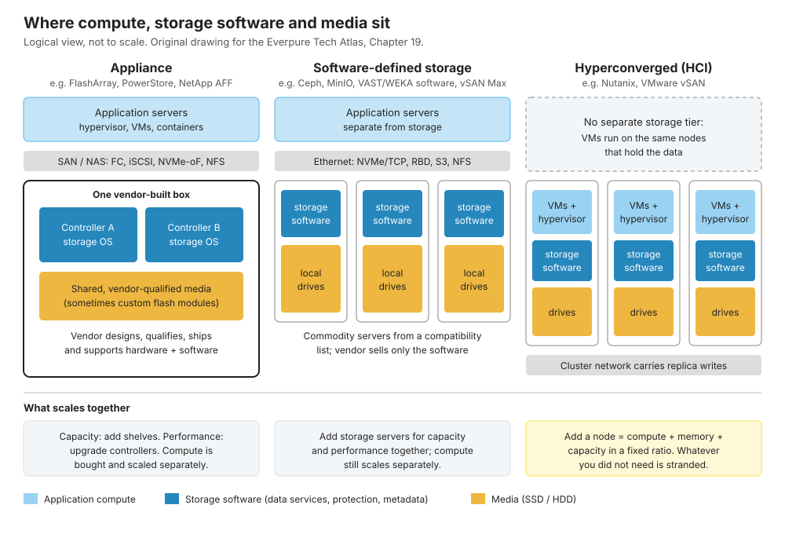
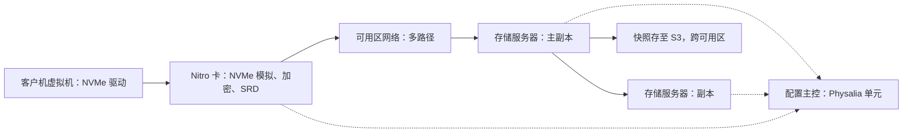
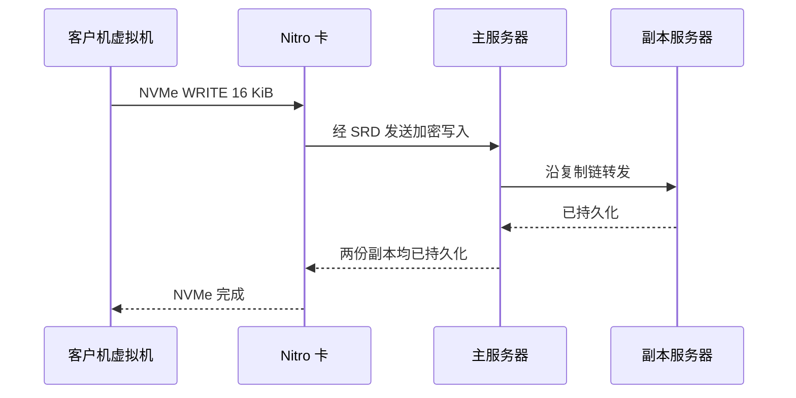
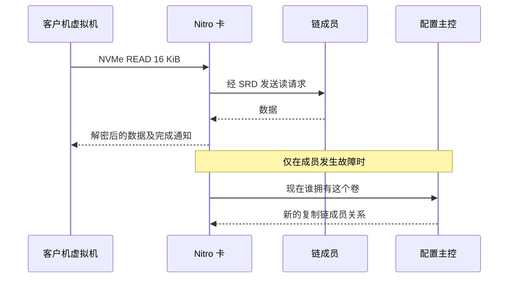
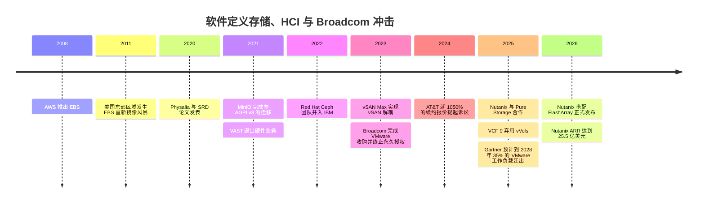

# 19. 软件定义存储与 HCI

> 📄 英文原文：[docs/03-system-architecture/19-software-defined-and-hci.md](../../../docs/03-system-architecture/19-software-defined-and-hci.md) · 本文为简体中文参考译本，如有出入以英文原文为准。

> **深度：** L2 · **阅读时间：** 约 7 分钟 · **最后核实：** 2026-11-01
> **前置阅读：** [纵向扩展双控制器阵列](14-scale-up-dual-controller.md) · [横向扩展无共享集群](15-scale-out-shared-nothing.md) · [块协议与 NVMe-oF](../02-protocols-and-networking/07-block-protocols.md) · [数据保护与韧性](../01-storage-fundamentals/06-data-protection-and-resilience.md)

## 要点速览（TL;DR）

- **软件定义存储（SDS）卖的是不带硬件盒子的存储操作系统**（Ceph、MinIO、VAST、WEKA）。**超融合基础设施（HCI）**则把它与虚拟机运行在同一批节点上（Nutanix、vSAN）。
- **HCI 的瓶颈在于耦合扩展。** 每增加一个节点，计算与容量都按固定比例增加，环境用不上的那部分资源就被闲置（stranded）。
- **云块存储就是超大规模的 SDS。** EBS 在单个可用区（Availability Zone）内复制卷，配有独立的配置服务，并依靠 Nitro 卡卸载。
- **Broadcom 对 VMware 授权的重置（自 2023 年 12 月起）重新开启了"HCI 还是阵列"之争**，并把客户推向 Nutanix、公有云和外置阵列。
- **纯软件模式换来的是毛利率百分比、零 NAND 库存和快速迭代；一体机（appliance）模式换来的是单笔交易的毛利润额和对介质的控制权。**

## 对 Everpure 战略的意义

Everpure（NYSE: P，原 PSTG）主要销售基于自有 DirectFlash 模块的一体机。但本章涉及的其他模式它其实都已在运营：Portworx（Kubernetes SDS）、运行在云实例上的 Purity，以及一项不含任何 Everpure 硬件的 Meta DirectFlash 技术授权[^1]。

Broadcom 迫使客户做出选择：每一次 VMware 续约都必须在继续使用 vSAN、更换 HCI 技术栈、或将计算与存储拆分之间三选一。Everpure 于 2025 年 5 月与 Nutanix 建立合作，以 FlashArray 作为 AHV 虚拟化管理程序的外置存储，押注的正是第三种[^2]。

## 核心概念

### 同一套软件的三种包装方式

*图 19.1 — 三种模式中的软件大同小异；变化的是由谁提供硬件，以及哪些资源必须一起扩展。*

在**一体机**模式下（[第 14 章](14-scale-up-dual-controller.md)），由一家厂商负责整台设备的设计、认证、交付和支持。**SDS** 运行在**硬件兼容性列表（HCL）**所列的通用服务器上，通常以[无共享集群](15-scale-out-shared-nothing.md)形式部署。**HCI** 把存储并入虚拟化集群：每个节点把一部分 CPU 和内存分给存储服务（Nutanix 的控制器虚拟机，或 ESXi 内核中的 vSAN），由它把每台虚拟机的写入复制到其他节点的硬盘上。

**半导体类比。** 一体机厂商相当于 IDM：掌握设计与集成，承担库存，赚取集成利润。纯软件厂商相当于 Arm 这样的 IP 授权商，在他人制造的硬件上收取高毛利的授权费。VAST 的 "Gemini" 模式则类似 fabless：VAST 规定硬件规格，由制造合作伙伴以成本价把硬件卖给客户，VAST 只确认软件收入[^3]。

### HCI 的瓶颈在哪里

**状态与元数据。** 数据存放在节点本地硬盘上（复制因子 2–3，或跨节点纠删码）；元数据分布在整个集群中。一个节点同时是计算主机、存储目标和元数据参与者，因此失去一个节点会同时波及这三方面。

**算例：闲置资源。** 设一个示意节点有 64 个核心和 8 × 15.36 TB SSD（原始容量 123 TB，在 RF2 下可用约 61 TB）。某环境需要 400 个核心和 2 PB 可用容量。按计算需求配置，⌈400 ÷ 64⌉ = 7 个节点只能提供约 430 TB。按容量需求配置，⌈2,000 ÷ 61⌉ = 33 个节点会带来 2,112 个核心，其中 81% 闲置。在 VMware Cloud Foundation（VCF）这类按核心订阅的模式下，闲置核心同样需要授权；VCF 为每个已授权核心捆绑 1 TiB vSAN 容量[^4]，能缓解但无法解决这一问题。解决办法是"去融合"：Nutanix 的纯存储节点和纯计算节点；vSAN Max（2023 年），一个最大 8.6 PB、可供其他集群挂载的纯存储集群[^5]；或在 HCI 计算节点后面接外置阵列[^2]。每一种方案都意味着放弃 HCI"单一构建模块"的承诺。

随之而来的还有两个瓶颈。**东西向流量放大：** 在 RF2 下，每次写入都要再跨一次集群网络；以约 5 GB/s 的富余带宽重建一个故障的 123 TB 节点，需要 123,000 ÷ 5 ≈ 6.8 小时。**嘈杂邻居：** 繁忙的虚拟机会挤占所在节点存储服务的资源。

| 故障类型 | HCI（Nutanix / vSAN 类） | EBS 类云块存储 |
|---|---|---|
| 硬盘 | 从其他节点上的副本重建该盘数据；虚拟机持续运行 | 租户无感知；存储集群重新复制 |
| 节点 | 虚拟机在别处重启（虚拟化高可用）**并且**其数据重新复制；两种恢复同时进行 | 存储服务器丢失：重新配置复制链，新副本重新镜像；I/O 短暂暂停 |
| 存储控制器 | CVM 或内核模块故障：I/O 被重定向到另一节点的存储服务 | Nitro 卡故障即主机故障；卷可挂载到新实例 |
| 网络链路 / 分区 | 少数派一侧失去法定人数（quorum）；集群分裂可能导致写入停止 | 在配置服务选出新的副本集之前，复制链无法完成写入[^6] |

*表 19.1 — HCI 把应用恢复和数据恢复耦合在同一批节点上；云块存储把这种复杂性转移到了控制平面。*

### EBS 类云块存储服务的内部结构

根据 AWS 公开的论文和文档：一个 EBS 卷位于单个可用区内，并在该可用区的多台服务器之间复制[^7]。在 Nitro 实例上，客户机看到的是一个普通 NVMe 设备[^8]，由 Nitro 卡模拟，Nitro 卡把块命令转换成网络请求。经典 EBS 把每个卷放在一条**复制链（replication chain）**上（客户端 → 主副本 → 副本）。另有一个独立的**配置主控（configuration master）**——Physalia——以每卷一个七节点 Paxos "单元（cell）"的方式记录链成员关系，因此单一故障不会导致大量卷的配置同时失联[^6]。io2 Block Express 后端通过**可扩展可靠数据报（Scalable Reliable Datagram，SRD）**与 Nitro 通信[^9]，这是 Nitro 卡中的一种多路径传输协议，会把数据包分散到大量网络路径上[^10]。

*图 19.2 — 配置主控位于数据路径之外，只在复制链发生变化时才起作用。*

*图 19.3 — 只有在复制链上的两份副本都持久化之后，写入才会被确认；主导延迟的是网络往返，而非闪存。*

*图 19.4 — 读取只需一份副本；当成员关系变化时，配置主控必须能在网络分区中存活。*

Block Express 的内部细节只在较高层面公开，因此读取示意图没有具体指明由哪份副本提供服务。AWS 给出的 io2 Block Express 单卷指标为 256,000 IOPS、4,000 MB/s、64 TiB，16 KiB I/O 平均延迟低于 500 µs，持久性 99.999%[^9]。集群层面的教训出现在 2011 年 4 月：一次网络变更使大量卷与其副本断开，所有卷同时重新镜像，这场"重新镜像风暴（re-mirroring storm）"耗尽了整个可用区的富余容量[^11]。这正是云规模下的 HCI 重建问题：要么对修复限速并预留容量，要么恢复过程本身就会演变成故障。

### 优劣与适用场景

| | 一体机 | 通用服务器上的 SDS | HCI | 云块存储服务 |
|---|---|---|---|---|
| 优势 | 延迟可预测；单一支持责任方；介质协同设计 | 硬件可选；横向扩展；无厂商硬件加价 | 单一构建模块；虚拟机环境运维简单 | 无需硬件；弹性；API 驱动 |
| 劣势 | 硬件加价；介质被厂商锁定 | 客户自负集成责任，并承担 HCL 漂移 | 耦合扩展；重建影响应用 | 卷局限于单可用区；出口流量费及按 IOPS 计价 |
| 最佳适用 | 数据库、混合企业块存储、整合 | 大规模对象与文件、AI 数据湖、超大规模 | 边缘、远程/分支机构（ROBO）、中型虚拟机集群 | 弹性云应用；开发/测试 |
| 最不适用 | 极小型站点；超大规模廉价容量 | 缺乏存储技能的小团队 | 容量密集或 GPU 密集型环境 | 稳定、大规模、高 IOPS 的环境（成本） |
| 示例 | FlashArray、PowerStore、NetApp AFF | Ceph、MinIO、VAST、WEKA、Portworx | Nutanix、vSAN | EBS、Azure Disk、Pure Storage Cloud Azure Native |

*表 19.2 — 没有哪种模式全面占优；适用性取决于计算与容量的比例有多稳定，以及由谁承担集成风险。*

### 商业模式的权衡

| 维度 | 纯软件订阅 | 一体机 | 云服务 |
|---|---|---|---|
| 毛利结构 | 百分比极高，但仅针对软件收入（Nutanix 非 GAAP 88.0%，FY2026）[^12] | 百分比较低，但针对整机收入（Everpure 产品 66.2%、订阅 74.9%，Q2 FY27，非 GAAP，据财报摘要）[^13] | 并入云厂商的服务毛利；按 GB-月和按 IOPS 计价 |
| 支持负担 | 最重：任何 HCL 服务器、固件和网卡组合都可能出故障 | 单系统最轻：厂商掌控整个物料清单 | 由云厂商承担；客户只看到 SLA |
| 硬件认证矩阵 | 庞大（服务器 × 硬盘 × 网卡 × 固件），或通过"认证节点（ready node）"计划收窄 | 规模小，由厂商掌控 | 每一代只有一种集群设计 |
| NAND / 元器件风险敞口 | 转嫁给客户或 OEM | 计入厂商损益表（Everpure 于 2026 年 2 月初及之后再次提价，理由是 NAND 和元器件成本）[^14][^15] | 计入云厂商资本开支 |
| 定价能力 | 取决于锁定程度：VMware（VCF）高，基于开源的产品被削弱 | 靠效率（TB/W、数据缩减）和生命周期计划赢得 | 对小用户强；对可以回迁（repatriate）的大客户弱 |
| 公开案例 | Nutanix；VAST Gemini[^3]；WEKA；MinIO AIStor；IBM Storage Ceph | Everpure FlashArray/FlashBlade；Dell；NetApp；DDN 一体机 | AWS EBS；Pure Storage Cloud Azure Native[^16] |

*表 19.3 — 纯软件模式最大化毛利率百分比和迭代速度；一体机模式最大化单笔交易毛利润额和介质控制权。*

**算例（示意性拆分）。** 对于一套 US$1M 的系统，一体机厂商按 66% 毛利率确认 US$1M 收入：**毛利润 US$660k**。纯软件厂商可能按 88% 毛利率确认 US$400k：**US$352k**，另外 US$600k 硬件收入归 OEM。作为交换，它不承担库存或 NAND 风险，并能在新 CPU 上市后立即支持。开源从下方压制定价；"够用"的免费版本必须加以隔离，MinIO 的做法是 2021 年改用 AGPLv3[^17]、2025 年精简社区版控制台[^18]、2025 年 12 月进入维护模式[^19]。

## Everpure 的做法与竞争对手对比

Everpure 的重心在一体机，其依据是 DirectFlash 相对通用 SSD 的密度和功耗优势（[第 26 章](../04-everpure/26-purity-and-directflash.md)）。在边缘地带，它也开展纯软件业务：Portworx，2020 年以约 US$370M 收购的容器原生 SDS[^20]；运行在云基础设施上的 Purity[^16]；采用现成硬件的 FlashBlade//EXA 数据节点（[第 16 章](16-disaggregated-shared-everything.md)）；以及 Meta 技术授权[^1]。

为替代方案构建最强版本论证（steelman）：Nutanix 以约 88% 的毛利率运营 US$2.55B ARR，增速 16%[^12]；VAST 依托 OEM 供应链扩张，无需承担库存[^3]；IBM 于 2022 年吸收 Red Hat 的 Ceph 团队[^21]，让"免费且够用"的选项得以延续。一体机阵营的回应是：HCL 支持成本高昂，而 AI 时代的功耗约束有利于协同设计的介质。基于公开信息，战略团队可能评估的选项包括：更多"在他人 HCI 后面接阵列"的合作；把 DirectFlash 授权做成可复制的 IP 业务；以及在虚拟机迁往 Kubernetes 的过程中，以 Portworx 对抗 VMware。

## 历史与发展轨迹

*图 19.5 — SDS 和 HCI 在悄无声息中走向成熟；Broadcom 2023 年的授权重置让平台选择变成了董事会层面的成本决策。*

Broadcom 于 2023 年 11 月 22 日完成对 VMware 的收购，随后终止永久授权，并把数千个 SKU 合并为两个套件：VCF 和 vSphere Foundation[^22]。AT&T 在 2024 年的诉讼中援引了一项拟议的 1,050% 涨价；该案后来和解[^23]。大部分客户选择了付费：Broadcom 报告 FY2025 基础设施软件收入约 US$27B[^24] [VERIFY: FY2025 基础设施软件收入总额，仅见于电话会议记录摘要]；2025 年 6 月，其 CEO 表示前 10,000 大客户中超过 87% 已采用 VCF[^25]。

存储领域也感受到了冲击。Gartner 预计到 2028 年将有超过三分之一的 VMware 工作负载迁出[^26]。Nutanix 与 FlashArray 的集成在 2026 年前后正式发布（GA）[^2][^27]。这并不是 Nutanix 首个外置存储：Dell PowerFlex 在 2025 年 5 月率先占据这一位置，Dell PowerStore 于 2026 年跟进[^28]。VCF 9 弃用了外置阵列最主要的接入点 vVols，并计划在 9.1 中移除[^29][^30]。大趋势是"去融合"：拆分节点类型、在 HCI 后面接阵列、用 Kubernetes 原生 SDS 承载虚拟机。而云块存储自 2008 年 EBS 诞生起就是 SDS[^31]。

## 关键数字

| 指标 | 数值 | 背景 | 来源 / 日期 |
|---|---|---|---|
| Nutanix ARR / 非 GAAP 毛利率 | US$2.55B（+16%）/ 88.0% | FY2026，纯软件 HCI | Nutanix 8-K，2026-08-26[^12] |
| Everpure 产品 / 订阅毛利率 | 66.2% / 74.9% | Q2 FY27，非 GAAP；以一体机为主 | Q2 FY27 业绩，2026-08[^13] |
| io2 Block Express 单卷上限 | 256K IOPS、4,000 MB/s、64 TiB | 16 KiB 平均 <500 µs；持久性 99.999% | AWS 文档[^9] |
| Physalia 单元规模 | 每卷 7 个节点 | Paxos 复制的配置 | NSDI 2020[^6] |
| EBS 每日 I/O 操作数 | >140 trillion（超过 140 万亿） | 集群总量 | AWS（Olson），2024-08-22[^31] |
| AT&T 所称 VMware 拟涨幅 | 1,050% | 诉讼文件中的主张；已和解 | CIO Dive，2024-09[^23] |
| 到 2028 年迁出的 VMware 工作负载 | >35% | Gartner 预测 | The Register，2025-09-11[^26] |
| 按容量配置的 HCI 集群闲置核心 | 约 81% | 400 个核心、2 PB、64 核节点 | 算例 |

## 对话手册

**向产品经理提的问题**

1. *"在 VMware 续约中，什么情况下我们能站在 Nutanix 身后取胜，而不是与 vSAN 正面竞争？"* 高质量回答：容量密集型环境、闲置核心的授权成本、数据缩减；同时承认边缘和小型集群是 HCI 的地盘。
2. *"与纯软件对手相比，我们的单笔交易毛利润额（而非毛利率百分比）是多少？"* 高质量回答：拆分软件与硬件金额以及 NAND 风险。
3. *"如果 Purity 以软件形式运行在客户自选的服务器上，最先出问题的是什么？"* 高质量回答：HCL 支持成本、失去 DirectFlash 密度优势、Evergreen 的经济模型。

**向工程师提的问题**

1. *"HCI 节点重建期间，数据库虚拟机的 p99 延迟会怎样？"* 高质量回答：重建带宽上限、限流策略、恢复完全冗余所需时间。
2. *"云块存储服务如何避免重新镜像风暴？"* 高质量回答：预留富余容量、限速修复、爆炸半径小的配置服务。
3. *"通过 NVMe/TCP 访问外置阵列，相比 HCI 本地读取要付出什么代价？"* 高质量回答：几十微秒，但可由省去的副本写入抵消。

**不要这样说：**

- "HCI 不过就是 SDS。"它是与应用共享节点的 SDS；这种耦合正是其决定性弱点。
- "纯软件的经济性总是更好。"百分比更高，但收入基数更小，支持负担转移到了 HCL 上。
- "EBS 就是云上的 SAN。"它是一项带有独立配置平面、范围限于单个可用区的复制服务。
- "Broadcom 扼杀了 vSAN。"VCF 捆绑了 vSAN 容量，许多客户如今反而拥有更多 vSAN。
- "Ceph 是免费的。"软件免费；人力、测试和硬件认证并不免费。

## 深入阅读（可选，L3 指引）

- Brooker 等，NSDI 2020（Physalia）[^6]；Shalev 等，IEEE Micro 2020（SRD）[^10]。
- AWS 2011 年 4 月关于修复流量引发故障的事后总结[^11]。
- Weil 等，OSDI 2006，关于 Ceph 与 CRUSH（参见[第 15 章](15-scale-out-shared-nothing.md)）。

## 关键术语

- **SDS** — 与硬件分开销售的存储软件。
- **HCI** — 每个节点都包含计算、存储软件和介质。
- **闲置资源（stranded resources）** — 仅因节点捆绑而被迫购买的容量或计算资源。
- **链式复制（chain replication）** — 写入沿一条有序的服务器链传递；由配置主控跟踪成员关系。
- 其余术语见[术语表](../glossary.md)。

## 资料来源

[^1]: SiliconANGLE, "Shares of Pure Storage jump on impressive earnings beat and strong guidance," 2024-12-03. https://siliconangle.com/2024/12/03/shares-pure-storage-jump-impressive-earnings-beat-strong-guidance/ (retrieved 2026-11-01).
[^2]: SDxCentral, "Nutanix partners with Pure Storage in latest VMware assault," 2025-05. https://www.sdxcentral.com/news/nutanix-partners-with-pure-storage-in-latest-vmware-assault/ (retrieved 2026-11-01).
[^3]: Blocks & Files, "VAST Data exits hardware business, pivots to software subscriptions," 2021-04-06. https://blocksandfiles.com/2021/04/06/vast-data-software-subscriptions-pivot/ (retrieved 2026-11-01); VAST Data, "What is Gemini," n.d. https://vastdata.com/what-is-gemini (retrieved 2026-11-01).
[^4]: Broadcom Knowledge Base, "Counting Cores for VMware Cloud Foundation and vSphere Foundation and TiBs for vSAN," article 313548, n.d. https://knowledge.broadcom.com/external/article/313548 (retrieved 2026-11-01; seen via search summary); Stackscale, "VMware licensing in 2026: what changed and what still applies," 2026. https://www.stackscale.com/blog/vmware-licensing-2026/ (retrieved 2026-11-01).
[^5]: TechTarget, "VMware vSAN Max disaggregates storage for hybrid cloud," 2023-08. https://www.techtarget.com/searchstorage/news/366549173/VMware-vSAN-Max-disaggregates-storage-for-hybrid-cloud (retrieved 2026-11-01).
[^6]: M. Brooker, T. Chen, F. Ping (AWS), "Millions of Tiny Databases," USENIX NSDI '20, 2020-02. https://www.usenix.org/conference/nsdi20/presentation/brooker (retrieved 2026-11-01).
[^7]: AWS, "Features and benefits of Amazon EBS volumes," Amazon EBS User Guide, n.d. https://docs.aws.amazon.com/ebs/latest/userguide/EBSFeatures.html (retrieved 2026-11-01).
[^8]: AWS, "Amazon EBS volumes and NVMe," Amazon EBS User Guide, n.d. https://docs.aws.amazon.com/ebs/latest/userguide/nvme-ebs-volumes.html (retrieved 2026-11-01).
[^9]: AWS, "Amazon EBS Provisioned IOPS SSD volumes," Amazon EBS User Guide, n.d. https://docs.aws.amazon.com/ebs/latest/userguide/provisioned-iops.html (retrieved 2026-11-01).
[^10]: L. Shalev, H. Ayoub, N. Bshara, E. Sabbag (AWS Annapurna Labs), "A Cloud-Optimized Transport Protocol for Elastic and Scalable HPC," IEEE Micro 40(6), 2020. https://doi.org/10.1109/MM.2020.3016891 (retrieved 2026-11-01).
[^11]: AWS, "Summary of the Amazon EC2 and Amazon RDS Service Disruption in the US East Region," 2011-04-29. https://aws.amazon.com/message/65648/ (retrieved 2026-11-01).
[^12]: Nutanix, "Form 8-K, Exhibit 99.1: Fourth quarter and fiscal 2026 financial results," 2026-08-26. https://www.sec.gov/Archives/edgar/data/0001618732/000117184326005752/exh_991.htm (retrieved 2026-11-01); Pulse 2.0, "Nutanix: Q4 operating margin nearly doubles to 9.2% as revenue and ARR grow 16%," 2026-08. https://pulse2.com/nutanix-q4-operating-margin-nearly-doubles-to-9-2-as-revenue-and-arr-grow-16/ (retrieved 2026-11-01).
[^13]: Everpure, "Everpure Announces Second Quarter Fiscal 2027 Financial Results," 2026-08-26. https://investor.everpuredata.com/news-and-events/press-releases/press-release-details/2026/Everpure-Announces-Second-Quarter-Fiscal-2027-Financial-Results/default.aspx (retrieved 2026-11-01); Investing.com, "Everpure Q2 FY27 slides," 2026-08. https://www.investing.com/news/company-news/everpure-q2-fy27-slides-38-revenue-growth-guidance-raised-sharply-93CH-4878054 (retrieved 2026-11-01).
[^14]: Alpha Spread, "P Q4-2026 Earnings Call," 2026-02-25. https://www.alphaspread.com/security/nyse/p/investor-relations/earnings-call/q4-2026 (retrieved 2026-11-01).
[^15]: Blocks & Files, "Everpure reveals supply chain issues, warns customers," 2026-04-23. https://blocksandfiles.com/flash/2026/04/23/everpure-reveals-supply-chain-issues-warns-customers/5218662 (retrieved 2026-11-01; seen via search summary).
[^16]: Blocks & Files, "Pure Enterprise Data Cloud updates," 2025-09-26. https://blocksandfiles.com/2025/09/26/pure-enterprise-data-cloud-updates/ (retrieved 2026-11-01); Microsoft Learn, "Pure Storage Cloud overview," n.d. https://learn.microsoft.com/en-us/azure/partner-solutions/pure-storage/overview (retrieved 2026-11-01).
[^17]: MinIO, "From Open Source to Free and Open Source, MinIO is now fully licensed under GNU AGPLv3," 2021-05. https://blog.min.io/from-open-source-to-free-and-open-source-minio-is-now-fully-licensed-under-gnu-agplv3 (retrieved 2026-11-01).
[^18]: Blocks & Files, "MinIO removes management features from basic community edition object storage code," 2025-06-19. https://blocksandfiles.com/2025/06/19/minio-removes-management-features-from-basic-community-edition-object-storage-code/ (retrieved 2026-11-01).
[^19]: Linuxiac, "MinIO Ends Active Development, Steers Users Toward Paid AIStor," 2025-12. https://linuxiac.com/minio-ends-active-development/ (retrieved 2026-11-01).
[^20]: TechTarget, "Pure Storage acquires Portworx for container management," 2020-09. https://www.techtarget.com/searchstorage/news/252489099/Pure-Storage-acquires-Portworx-for-container-management (retrieved 2026-11-01).
[^21]: Ceph, "Red Hat's Ceph team is moving to IBM," 2022-10. https://ceph.io/en/news/blog/2022/red-hats-ceph-team-is-moving-to-ibm/ (retrieved 2026-11-01); IBM Newsroom, "IBM Redefines Hybrid Cloud Application and Data Storage Adding Red Hat Storage to IBM Offerings," 2022-10-04. https://newsroom.ibm.com/2022-10-04-IBM-Redefines-Hybrid-Cloud-Application-and-Data-Storage-Adding-Red-Hat-Storage-to-IBM-Offerings (retrieved 2026-11-01).
[^22]: SiliconANGLE, "Broadcom accelerates VMware transformation, killing off perpetual software licenses," 2023-12-12. https://siliconangle.com/2023/12/12/broadcom-accelerates-vmware-transformation-killing-off-perpetual-software-licenses/ (retrieved 2026-11-01); Computer Weekly, "Broadcom drops VMware perpetual licences and support," 2023-12. https://www.computerweekly.com/news/366563072/Broadcom-drops-VMware-perpetual-licences-and-support (retrieved 2026-11-01).
[^23]: CIO Dive, "AT&T, Broadcom spar over VMware price hikes in court battle," 2024-09. https://www.ciodive.com/news/att-broadcom-vmware-price-hikes-court-battle/728603/ (retrieved 2026-11-01); Channel Futures, "AT&T, VMware settle," 2024-11. https://channelfutures.com/channel-business/at-t-vmware-lawsuit-settled-vmware-loses-ingram-micro (retrieved 2026-11-01).
[^24]: Earnings-call summaries of Broadcom Q2 FY2025 and Q4 FY2025, via ROIC.ai transcripts, 2025. https://www.roic.ai/quote/AVGO/transcripts/2025-year/2-quarter (retrieved 2026-11-01).
[^25]: The Register, "Broadcom sends VMware to record revenue, margins, as most big customers sign for private cloud bundles," 2025-06-06. https://www.theregister.com/2025/06/06/broadcom_q2_2025/ (retrieved 2026-11-01; seen via search summary).
[^26]: The Register, "VMware to lose 35 percent of workloads in three years," 2025-09-11. https://www.theregister.com/2025/09/11/gartner_vmware_migration_advice/ (retrieved 2026-11-01).
[^27]: StorageNewsletter, "Availability of Nutanix with Pure Storage FlashArray," 2026-01-02. https://www.storagenewsletter.com/2026/01/02/availability-of-nutanix-with-pure-storage-flasharray/ (retrieved 2026-11-01).
[^28]: StorageReview, "Dell PowerFlex with Nutanix Cloud Platform is now generally available," 2025-05. https://www.storagereview.com/news/dell-powerflex-with-nutanix-cloud-platform-is-now-generally-available (retrieved 2026-11-01; seen via search summary); Virtualization Review, "Nutanix NCI 7.6 adds Dell PowerStore support," 2026-07-28. https://virtualizationreview.com/articles/2026/07/28/nutanix-nci-7-6-adds-dell-powerstore-support.aspx (retrieved 2026-11-01; seen via search summary).
[^29]: TechTarget, "Broadcom discontinues vVols storage capability for VMware," 2025. https://www.techtarget.com/it-infrastructure/news/366627334/Broadcom-discontinues-vVols-storage-capability-for-VMware (retrieved 2026-11-01).
[^30]: Dell Technologies, "Dell Unity: vVols Support Ending - Upgrade and Migration Considerations" (KB 000414330), updated 2026-01-12. https://www.dell.com/support/kbdoc/en-us/000414330/dell-unity-vvols-support-ending-upgrade-and-migration-considerations (retrieved 2026-11-01; seen via search summary).
[^31]: M. Olson (AWS), "Continuous reinvention: A brief history of block storage at AWS," All Things Distributed, 2024-08. https://www.allthingsdistributed.com/2024/08/continuous-reinvention-a-brief-history-of-block-storage-at-aws.html (retrieved 2026-11-01; seen via search summaries, which agree on >140 trillion operations a day).
