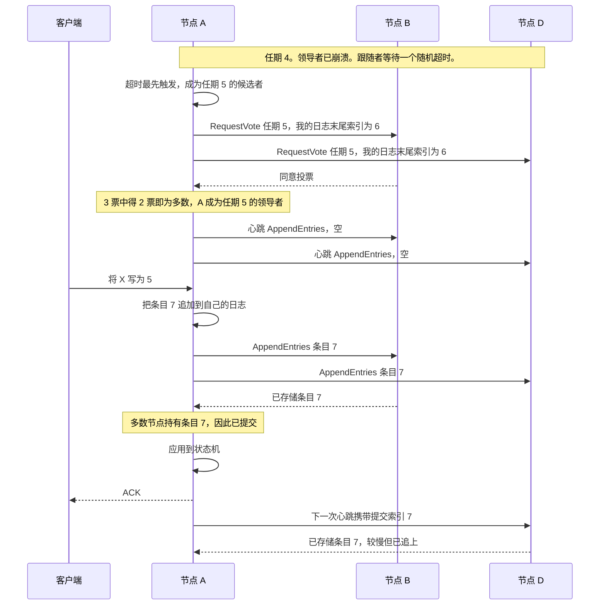
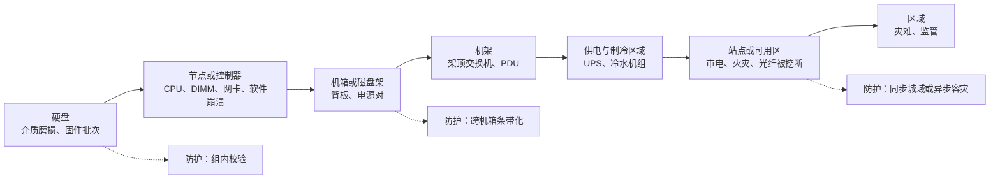
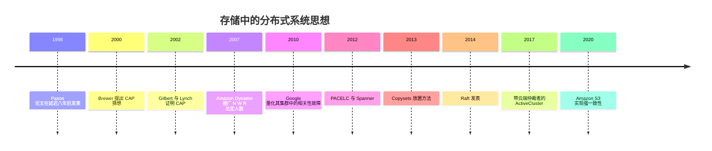

# 20. 面向存储的分布式系统基础

> 📄 英文原文：[docs/03-system-architecture/20-distributed-systems-fundamentals.md](../../../docs/03-system-architecture/20-distributed-systems-fundamentals.md) · 本文为简体中文参考译本，如有出入以英文原文为准。

> **深度：** L2 · **阅读时间：** 约 8 分钟 · **最后核实：** 2026-11-01
> **前置阅读：** [数据保护与韧性](../01-storage-fundamentals/06-data-protection-and-resilience.md) · [对象存储与 S3](../02-protocols-and-networking/09-object-storage-and-s3.md) · [横向扩展无共享集群](15-scale-out-shared-nothing.md)

## 要点速览（TL;DR）

- **一旦存在多个副本，系统就必须定义什么是"最新的写入"：这就是它的一致性模型。** 主存储选择强一致性，并以延迟为代价。
- **共识（Paxos、Raft）需要 2f+1 个投票者才能容忍 f 个故障。** 因此双站点集群需要第三票——见证者（witness）——来防止脑裂。
- **CAP 在实践中其实是 PACELC。** 日常的权衡是延迟与一致性之间的取舍，且按功能逐一选择：同步城域复制选择一致性，异步容灾选择延迟。
- **"11 个 9"的持久性是模型输出，而非实测结果。** 它由校验冗余、重建时间和假定的故障独立性决定；实践中真正导致数据丢失的是相关性故障。
- **可用性的 9 是测量出来的；持久性的 9 是建模出来的。** 要问清楚引用的是哪一种。

## 对 Everpure 战略的意义

"零 RPO"、"六个 9"、"11 个 9 持久性"、"强一致性 S3"之类的宣传口径，每一项背后都有一条法定人数（quorum）规则、一个故障模型和一种一致性选择。弄清楚是哪一种，才能区分工程保证与营销数字。这件事的分量正在上升：分解式与并行系统（[第 16 章](16-disaggregated-shared-everything.md)和[第 17 章](17-parallel-file-systems.md)）把元数据和纠删码分散到数百个节点上，而真正困难的工程问题和故障风险如今就集中在那里。

## 核心概念

### 一致性模型：向读取方承诺什么

一致性模型是一份契约，规定当各副本不一致时读取方可能看到什么。

| 模型 | 对读取方的承诺 | 代价 | 使用者 |
|---|---|---|---|
| **强一致 / 线性一致（linearizable）** | 每次读取都能看到最近一次已确认的写入，仿佛只有一份副本 | 每次写入都要等待法定人数或同步镜像；发生分区时少数派一侧停止服务 | 块存储阵列（FlashArray、PowerMax、ONTAP）；城域集群；Spanner；DynamoDB 强一致读[^1] |
| **强读后写一致（按对象）** | PUT 或 DELETE 一经确认，此后任何客户端的 GET 或 LIST 都能反映出来；不支持多对象事务 | 每个键的索引提交必须是单一线性化点 | 2020 年 12 月起的 Amazon S3、Azure Blob、GCS（[第 9 章](../02-protocols-and-networking/09-object-storage-and-s3.md)） |
| **因果一致（causal）** | 若写入 B 依赖写入 A，则任何人都不会只看到 B 而看不到 A | 需跟踪依赖关系（版本向量） | 部分地理分布式数据库；作为存储产品的保证很少见 |
| **关闭后打开一致（close-to-open）** | 另一客户端关闭文件后，重新打开该文件即可看到该客户端的写入 | 打开时重新验证客户端缓存 | NFS（[第 8 章](../02-protocols-and-networking/08-file-protocols.md)） |
| **最终一致（eventual）** | 写入停止后所有副本最终收敛；在此期间读取可能是旧数据 | 最便宜、最快；冲突需要解决（最后写入者胜出） | 跨区域和异步复制；低法定人数设置下的 Dynamo 类存储[^2] |

*表 20.1 — 在单一系统或单一城域内，强一致性是常态；跨区域的几乎都是最终一致。*

**半导体类比：MESI 与共识。** MESI 已经在每条缓存行上强制实现"单写者、多读者"，这恰恰就是强一致性的不变式。但一致性互连假设消息不会丢失、核心不会独立故障；存储集群则必须同时扛住这两种情况。共识就是能容错的缓存一致性。目录（directory）对应元数据服务器；Exclusive 状态的缓存行对应租约（lease）或 NFS 委托（delegation）。

### L2 层面的共识：在白板上讲 Raft

Paxos（1998 年发表）[^3]和 Raft（2014 年）[^4]解决的是同一个问题：各副本就一份有序日志达成一致，从而都以相同顺序执行相同的命令。Ceph 的 monitor 运行 Paxos，需要严格多数[^5]；DynamoDB 使用 Multi-Paxos 复制每个分区[^1]。

*图 20.1 — Raft 分两个阶段：随机化超时让每个任期通过多数投票选出一个领导者；之后一次写入只要被多数节点记入日志即告提交，因此最慢的副本永远不会决定延迟。*

一个高质量的白板讲解包含三点。**任期（term）**是一种逻辑时钟：节点一旦看到更高的任期就会退位，因此过时的领导者无法提交。**投票者会拒绝日志比自己更旧的候选者**，因此新领导者必然持有所有已提交的条目。**提交只需多数，而非全部**，因此三个节点可容忍一个故障。

### 法定人数算术：N、W、R

无领导者的 Dynamo 类系统直接使用法定人数[^2]。在 N 个副本中，写入等待 W 个确认，读取查询 R 个副本。**W + R > N** 保证每次读取都与最新写入有交集（N=3、W=2、R=2 是经典配置）。**W > N/2** 防止两次冲突写入同时成功。N=3、W=1、R=1 速度快，但只能做到最终一致。

容忍 f 个故障需要 2f+1 个投票者，因此四个投票者并不比三个更好[^5]。没有多数就会出现**脑裂（split brain）**：被分区隔开的两半各自接受写入，数据随之分叉。双站点集群会增加一个**见证者（witness）**（或称**仲裁者（mediator）**）：一个不存数据的第三票，位于两个站点的故障域之外，由它决定哪一侧继续提供服务。

### CAP 与 PACELC：存储实际上如何选择

CAP（Brewer，2000 年提出；Gilbert 和 Lynch 于 2002 年证明[^6]）指出，在网络分区期间，系统必须放弃一致性或可用性之一。分区并非可选项，所以它并不是"三选二"。Abadi 的 PACELC[^7] 补充道：*否则*（无分区时），要在延迟与一致性之间权衡。

存储按功能逐一选择。同步城域集群属于 **PC/EC**：每次写入都要付出一次站点间往返，发生分区时，在仲裁竞争中落败的一侧停止服务。异步容灾属于 **PA/EL**：本地确认，远端副本落后的程度即 RPO。Spanner 在形式上是 CP，但 Brewer 认为由于 Google 的网络极少分区，它的可用性超过五个 9[^8]。

### 持久性的 9 与可用性的 9

**可用性**是数据可被访问的时间占比；六个 9 相当于每年约 31.5 秒停机，可以从遥测数据中测得。Pure Storage（现 Everpure）在 2016 年宣称 FlashArray//m 装机群（含升级期间）达到 99.9999%，并对后续的 FlashArray 重申六个 9[^9]（公司自述）。

**持久性**是一年内不丢失数据的概率。S3 按 11 个 9 设计[^10]；Azure 对本地冗余、可用区冗余和地理冗余存储分别给出 11、12 和 16 个 9[^11]。没有人能在单一系统上观测到 10⁻¹¹ 量级的事件，所以这些都是模型输出。（在 100 万亿个对象的规模下，这仍意味着每年约 1,000 次丢失。）

标准模型是**平均数据丢失时间（MTTDL）**。一组可容忍 m 个故障的 n 块硬盘，当 m+1 个故障在时间上重叠时就会丢失数据。设 λ = AFR ÷ 8,766 h，μ = 1 ÷ 重建时间，则 MTTDL ≈ μᵐ ÷ [n(n−1)…(n−m) λᵐ⁺¹]。

*图 20.2 — 示意模型：增加校验冗余可使持久性提升许多个 9，降低 AFR 和缩短重建时间的作用较小，而相关性故障可能抹掉这些收益。*
数据：`data/ch20_durability.csv`

**算例**（10 PB 可用容量，30 TB 硬盘，采用 Backblaze 2025 年 1.36% 的 HDD AFR[^12]）。采用单一热备盘、重建需 42 小时的 RAID 6（8+2），模型结果为 **5.8 个 9**。同一编码若以分散式（declustered）方式在 4 小时内重建，可达 **7.8**：RAID 6 与 8+2 EC 的数学完全相同，区别只在重建速度。三副本复制达到 **9.0**；EC 16+4 达到 **15.1**。设备可靠性的帮助较小。Backblaze 的 SSD AFR 为 0.9%[^13]；Everpure 称 DirectFlash Module 为 0.15%[^14]（NetApp 对此提出异议[^15]）。把 AFR 从 1.36% 降到 0.15%，可为 RAID 6 增加 2.9 个 9；而从 8+2 改为 16+4 可增加 7.3 个。经验法则：AFR 每降低十倍值 m+1 个 9，重建时间每缩短十倍值 m 个 9。关于分散式重建的几条曲线有一点需要注意：模型把每组 k+m 块硬盘视为相互独立。而在分散式布局中，几乎任意 m+1 块故障盘都会共享某个条带，在本例中这会让 8+2 损失约三个 9、16+4 损失约五个 9。优先重建那些丢失条块最多的少数条带可以挽回其中大部分，分散式系统一般也都这样做。

### 相关性故障与故障域

上述模型假定故障相互独立。如果因为硬盘来自同一批次、使用同一固件或共用同一路供电，重建期间每多一次故障的概率都高出十倍，MTTDL 就会下降 10ᵐ 倍：图 20.2 中的虚线显示 16+4 因此损失了四个 9。2019 年，HPE 警告某些 SAS SSD 若不更新固件，将在通电恰好 32,768 小时时失效[^16]。一起安装的硬盘会一起失效。Google 2010 年的集群研究指出，计划内的内核升级是相关性故障的主要来源之一[^17]。随机放置副本会加剧这一问题；copyset 放置方法把 5,000 节点电力中断场景下建模的数据丢失概率从 99.99% 降到了 0.15%[^18]。

*图 20.3 — 每往上一级，故障越罕见，但会连带摧毁其下的一切；防护能力取决于条带或副本集所跨越的最高一级故障域。*

设计规则是反亲和（anti-affinity）：在任何你希望能扛过的故障域内，一个条带最多只放 m 个条块。Ceph 的 CRUSH map 编码了这一层级结构；VAST 的 DBox-HA 限制每个机箱内的条块数（[第 16 章](16-disaggregated-shared-everything.md)）。

**半导体类比：FIT、AFR 与 chipkill。** 1 FIT 指每 10⁹ 器件小时发生一次故障，因此 1% AFR ≈ 0.01 ÷ 8,766 × 10⁹ ≈ **1,140 FIT**：Backblaze 的 1.36% 约为 1,550 FIT，0.15% 的模块约为 170。纠删码就是上升一个层级的 chipkill：跨设备的 Reed–Solomon 编码可以扛住一颗芯片或一块硬盘的失效，直到那些"独立"的设备共享同一个缺陷。

### 缓存与分层设计

存储缓存面临的是与 CPU 相同的回写（write-back）与直写（write-through）之选，只是多了持久性这一维度。

| 策略 | 何时确认 | 风险 | 典型用途 |
|---|---|---|---|
| 直写 | 较慢的层级已持久化 | 慢速层级的延迟 | 简单缓存、客户端读缓存 |
| 回写，易失性 | 数据进入 DRAM 缓存 | 断电或节点故障时丢失 | 不适用于主存储 |
| 回写，持久化且镜像 | 已存在两份 NVRAM/SCM 副本 | 镜像链路与 NVRAM 容量 | 双控制器阵列（[第 14 章](14-scale-up-dual-controller.md)）；DASE SCM（[第 16 章](16-disaggregated-shared-everything.md)） |
| 分层（移动，而非复制） | 按数据冷热放置 | 快速层可能持有唯一副本 | 冷热闪存层，以及 HDD/云层 |

*表 20.2 — 只有当缓存本身就是一份持久、镜像的副本时，回写才是安全的；持有唯一副本的层级需要与其他层级同等的校验保护。*

读缓存会带来一致性成本：每个客户端或节点缓存都需要失效通知、租约或超时机制，这正是 NFS 退而求其次采用关闭后打开一致性的原因。

## Everpure 的做法与竞争对手对比

| 系统 | 协商一致机制 | 分区 / PACELC 行为 | 持久性或可用性声明 |
|---|---|---|---|
| Everpure ActiveCluster（FlashArray） | 同步镜像，Pure1 Cloud Mediator 或本地部署仲裁者；仲裁者丢失时采用预选举 | PC/EC：阵列间 RTT 最高 11 ms；在仲裁竞争中落败的一方停止为该 pod 提供服务[^19] | 装机群六个 9 可用性（公司自述）[^9] |
| NetApp SnapMirror active sync / MetroCluster | ONTAP Mediator；自 ONTAP 9.17.1 起 SnapMirror active sync 支持 ONTAP Cloud Mediator[^20] | PC/EC；通过仲裁者实现计划外自动故障切换[^21] | 见[第 6 章](../01-storage-fundamentals/06-data-protection-and-resilience.md) |
| Ceph | Paxos monitor 持有集群映射；CRUSH 按故障域放置数据 | 集群内 PC/EC；多站点异步 | 取决于存储池规则和 EC 配置[^5] |
| Amazon S3 / DynamoDB | 复制的元数据；DynamoDB 每分区 Multi-Paxos | 区域内强一致；跨区域异步 | S3：按 11 个 9 设计[^10][^1] |
| Dynamo 类（Cassandra） | 无领导者法定人数，N/W/R 可调 | 默认 PA/EL；使用 QUORUM 设置时为 PC | 由运维方自行定义 |

*表 20.3 — 几乎所有系统都在站点内收敛于强一致性，并为双站点集群配置见证者；各家声明的区别在于是实测（可用性）还是建模（持久性）。*

Everpure 的独特选择是云端托管的见证者，从而省去了第三个站点[^19]。为竞争对手构建最强版本论证（steelman）：NetApp 自 ONTAP 9.17.1 起已提供云端仲裁者[^20]，而 Dell 的 SRDF 系列有长达三十年的部署经验。基于公开信息，战略团队可能评估的一个选项是：在可用性遥测数据旁一并公布持久性假设，使建模得出的数字站得住脚。

## 历史与发展轨迹

*图 20.4 — 理论先行；当网络让延迟代价变得可以承受，产品才采纳强一致性和云端见证者。*

方向：在延迟允许之处一律采用强一致性，更宽的编码配合分散式重建，以及云端见证者。AI 规模把元数据共识和租约管理器推上了关键路径（[第 21 章](21-metadata.md)）。

## 关键数字

| 指标 | 数值 | 背景 | 来源 / 日期 |
|---|---|---|---|
| HDD 集群 AFR，2025 年 | 1.36% | 344,196 块硬盘；2024 年为 1.55% | Backblaze，2026-02-12[^12] |
| SSD 全生命周期 AFR | 0.9% | Backblaze 启动盘 SSD，截至 2023 年年中 | The Register，2023-09-26[^13] |
| DirectFlash Module AFR | 0.15% | 公司自述；NetApp 有异议 | Everpure 博客[^14][^15] |
| ActiveCluster 最大 RTT | 11 ms | 同步，由仲裁者裁决 | Everpure 文档[^19] |
| S3 / Azure LRS / ZRS / GRS 持久性 | 11 / 11 / 12 / 16 个 9 | 设计目标，并非 SLA | AWS[^10]，Microsoft[^11] |
| FlashArray 可用性 | 99.9999%（约 31.5 s/yr） | 公司自述，基于装机群测量 | Pure Storage，2016[^9] |
| AFR 换算为 FIT | 1% ≈ 1,140 FIT | 0.01 ÷ 8,766 h × 10⁹ | 算例 |
| RAID 6 与 16+4 的 9 的个数 | 约 5.8 vs 约 15.1 | 10 PB，1.36% AFR，42 h 与 4 h 重建 | 算例（图 20.2） |

## 对话手册

**向产品经理提的问题**

1. *"我们的六个 9 的分母是什么？"* 高质量回答：装机群遥测、故障的定义、升级是否计入、统计窗口。
2. *"客户问我们的持久性数字时，我们怎么回答？"* 高质量回答：给出一个注明校验冗余和重建时间的模型，并说明实际数据丢失主要源于软件缺陷和人为操作，因此才有 SafeMode 快照。
3. *"对于没有互联网出口的客户，仲裁者部署在哪里？"* 高质量回答：部署在第三个故障域中的本地仲裁者虚拟机；若其丢失则采用预选举。

**向工程师提的问题**

1. *"FlashBlade 或 EXA 中哪些组件运行共识，有多少个投票者？"* 高质量回答：说出具体服务、法定人数规模，以及失去多数时哪些功能会停滞。
2. *"在负载下、80% 满时重建我们最大的 DirectFlash Module 需要多久？"* 高质量回答：以小时计、限流策略、是否为分散式重建。
3. *"我们如何防范相关性故障？"* 高质量回答：基于遥测的分阶段固件推送、混合批次、反亲和。

**不要这样说：**

- "CAP 就是三选二。"分区并非可选项。
- "11 个 9 意味着我们永远不会丢数据。"它建模的是相互独立的硬盘故障，而非软件缺陷或人为失误。
- "双节点集群可以投票。"它需要一个见证者。
- "RAID 6 与 8+2 纠删码的持久性不同。"编码相同；不同的是重建速度和数据放置。
- "最终一致性是个缺陷。"它是一种刻意的延迟权衡。

## 深入阅读（可选，L3 指引）

- Raft 论文[^4]与 Lamport 的 "Paxos Made Simple"。
- Ford 等[^17]和 Cidon 等[^18]关于相关性故障与数据放置的研究；Abadi[^7] 和 Brewer[^8] 关于 CAP 的论述。
- Greenan、Plank 和 Wylie（HotStorage 2010）关于 MTTDL 局限性的讨论。

## 关键术语

- **Raft / Paxos** — 基于多数、针对一份有序日志的共识算法。
- **法定人数（Quorum，N/W/R）** — W + R > N 保证读取能看到最新写入。
- **线性一致性（Linearizability）** — 表现得仿佛只有一份副本。
- **PACELC** — 分区时：可用性或一致性；否则：延迟或一致性。
- **见证者 / 仲裁者（Witness / mediator）** — 不存数据、用于防止脑裂的第三票。
- **MTTDL** — 建模得出的平均数据丢失时间。
- **FIT** — 每 10⁹ 器件小时的故障次数。
- **Copyset** — 持有某些数据块全部副本的节点组。
- 参见[术语表](../glossary.md)。

## 资料来源

[^1]: M. Elhemali et al., "Amazon DynamoDB: A Scalable, Predictably Performant, and Fully Managed NoSQL Database Service," USENIX ATC 2022, 2022-07. https://www.usenix.org/conference/atc22/presentation/elhemali (retrieved via search 2026-11-01).
[^2]: G. DeCandia et al., "Dynamo: Amazon's Highly Available Key-value Store," ACM SOSP 2007, 2007-10. https://www.allthingsdistributed.com/files/amazon-dynamo-sosp2007.pdf (retrieved 2026-11-01).
[^3]: L. Lamport, "The Part-Time Parliament," ACM Transactions on Computer Systems 16(2), 1998-05. https://www.microsoft.com/en-us/research/publication/part-time-parliament/ (retrieved 2026-11-01).
[^4]: D. Ongaro and J. Ousterhout, "In Search of an Understandable Consensus Algorithm," USENIX ATC 2014, 2014-06. https://www.usenix.org/conference/atc14/technical-sessions/presentation/ongaro (retrieved 2026-11-01).
[^5]: Ceph documentation (Reef), "Adding/Removing Monitors," n.d. https://docs.ceph.com/en/reef/rados/operations/add-or-rm-mons (retrieved via search 2026-11-01).
[^6]: S. Gilbert and N. Lynch, "Brewer's Conjecture and the Feasibility of Consistent, Available, Partition-Tolerant Web Services," ACM SIGACT News 33(2), 2002. https://dl.acm.org/doi/10.1145/564585.564601 (retrieved via search 2026-11-01).
[^7]: D. Abadi, "Consistency Tradeoffs in Modern Distributed Database System Design: CAP is Only Part of the Story," IEEE Computer, 2012-02. https://cs.umd.edu/~abadi/papers/abadi-pacelc.pdf (retrieved via search 2026-11-01).
[^8]: E. Brewer, "Spanner, TrueTime and the CAP Theorem," Google, 2017-02. https://research.google/pubs/pub45855/ (retrieved via search 2026-11-01).
[^9]: Pure Storage, "Pure Storage Introduces Petabyte-Scale Flash Storage for Cloud IT" (press release, FlashArray//m 99.9999% availability), 2016-10. https://www.everpuredata.com/company/news-and-events/press/ps_introduce_petabyte_scale_flash_storage_for_cloud.html (retrieved via search 2026-11-01).
[^10]: Amazon Web Services, "Data protection in Amazon S3" (S3 User Guide), n.d. https://docs.aws.amazon.com/AmazonS3/latest/userguide/DataDurability.html (retrieved via search 2026-11-01).
[^11]: Microsoft, "Azure Storage redundancy," n.d. https://learn.microsoft.com/en-us/azure/storage/common/storage-redundancy (retrieved via search 2026-11-01).
[^12]: Backblaze, "Backblaze Drive Stats for 2025," 2026-02-12. https://www.backblaze.com/blog/backblaze-drive-stats-for-2025/ ; corroborated by StorageReview, "Backblaze 2025 year-end drive stats: annual AFR falls to 1.36%," 2026-02. https://www.storagereview.com/news/backblaze-2025-year-end-drive-stats-annual-afr-falls-to-1-36-as-high-capacity-drives-dominate-fleet (retrieved via search 2026-11-01).
[^13]: The Register, "Backblaze SSD failure report," 2023-09-26. https://www.theregister.com/2023/09/26/ssd_failure_report_backblaze (retrieved via search 2026-11-01).
[^14]: Pure Storage blog, DirectFlash Module reliability post (DFM AFR 0.15% vs 0.90% for COTS SSDs), n.d. https://blog.purestorage.com/?p=143164 (retrieved via search 2026-11-01).
[^15]: NetApp, "Direct flash vs SSDs," n.d. https://www.netapp.com/blog/direct-flash-vs-ssds/ (retrieved via search 2026-11-01).
[^16]: Blocks & Files, "HPE issues firmware fix to stop SSD failure," 2019-11-25. https://www.blocksandfiles.com/flash/2019/11/25/hpe-issues-firmware-fix-to-to-stop-ssd-failure/1607574 (retrieved via search 2026-11-01).
[^17]: D. Ford et al., "Availability in Globally Distributed Storage Systems," USENIX OSDI 2010, 2010-10. https://www.usenix.org/conference/osdi10/availability-globally-distributed-storage-systems (retrieved via search 2026-11-01).
[^18]: A. Cidon et al., "Copysets: Reducing the Frequency of Data Loss in Cloud Storage," USENIX ATC 2013, 2013-06. https://www.usenix.org/conference/atc13/technical-sessions/presentation/cidon (retrieved via search 2026-11-01).
[^19]: Everpure Support, "ActiveCluster Introduction," n.d. https://support.everpuredata.com/r/activecluster/activecluster-introduction (retrieved via search 2026-11-01).
[^20]: NetApp, "What's new in ONTAP 9.17.1" (ONTAP release notes), n.d. https://docs.netapp.com/us-en/ontap/release-notes/whats-new-9171.html (retrieved 2026-11-01; seen via search summary).
[^21]: NetApp, "SnapMirror active sync overview" (ONTAP documentation), n.d. https://docs.netapp.com/us-en/ontap/snapmirror-active-sync/ (retrieved via search 2026-11-01).
