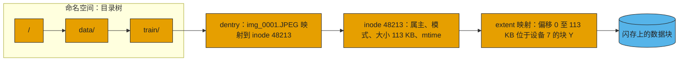
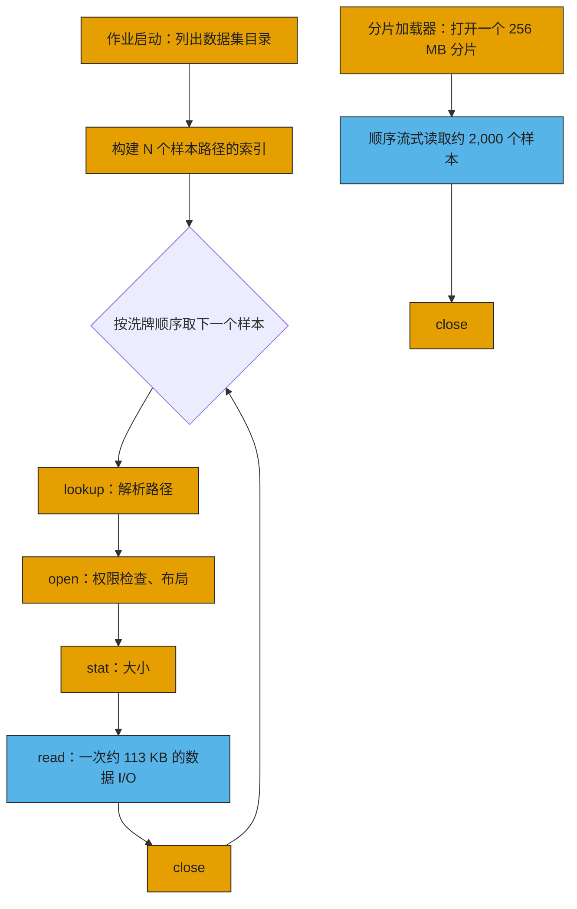
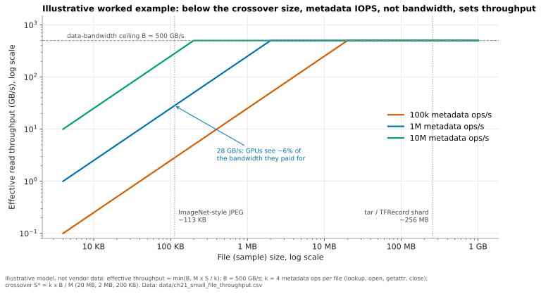
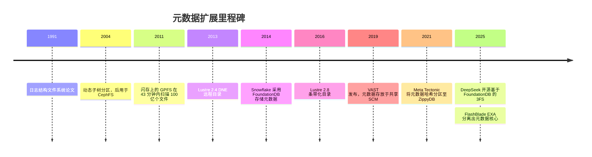

# 21. 元数据：隐藏的瓶颈

> 📄 英文原文：[docs/03-system-architecture/21-metadata.md](../../../docs/03-system-architecture/21-metadata.md) · 本文为简体中文参考译本，如有出入以英文原文为准。

> **深度：** L2 · **阅读时间：** 约 6 分钟 · **最后核实：** 2026-11-01
> **前置阅读：** [文件协议](../02-protocols-and-networking/08-file-protocols.md) · [对象存储与 S3](../02-protocols-and-networking/09-object-storage-and-s3.md) · [分解式全共享架构](16-disaggregated-shared-everything.md) · [并行文件系统](17-parallel-file-systems.md)

## 要点速览（TL;DR）

- **元数据是关于数据的数据：** 名称、目录、权限、大小和块映射。open、stat、list、create 和 rename 都是元数据操作；只有 read 和 write 才搬运有效载荷。
- **元数据操作体量小、受延迟约束，并且在目录锁等共享结构上串行执行。** 按 GB/s 选型的系统经常卡在每秒操作数上。
- **AI 是元数据密集型负载。** 数以百万计约 100 KB 的样本，以及每块 GPU 创建一个文件的检查点，把带宽问题变成了元数据问题。
- **元数据已从单台服务器转向分布式数据库：** 哈希化目录、共享 SCM（VAST）、闪存上的键值存储（Everpure FlashBlade）、FoundationDB（DeepSeek 的 3FS）。
- **元数据性能如今已成为采购标准。** 要问每秒创建数（creates/s）和每秒 stat 数（stats/s），而不只是 TB/s。

## 对 Everpure 战略的意义

Everpure 的顶级 AI 系统 FlashBlade//EXA，其核心论点就是元数据。命名空间存放在基于分布式键值存储构建的 FlashBlade "元数据核心（metadata core）"中，而通用数据节点负责传输字节流（[第 8 章](../02-protocols-and-networking/08-file-protocols.md)、[第 16 章](16-disaggregated-shared-everything.md)）。Pure Storage 宣传该核心可服务数千个客户端和数十亿个条目[^1]。如果 AI 流水线持续受元数据约束，这就是一项持久的差异化优势。如果数据团队把样本打包成大分片（shard），优势就会收窄到检查点、数据整理（curation）、推理缓存和企业文件环境。哪些负载仍受元数据约束，决定了这块市场有多大。

## 核心概念

### 名称、inode 与映射

POSIX 文件系统维护三层元数据。**命名空间**是目录树，其中的 **dentry**（目录项）把名称映射到 inode 编号。**inode** 保存属主、权限、大小和时间戳。**extent 映射（extent map**）把文件偏移量转换为物理位置；一个 extent 可以替代数千个按 4 KB 粒度的指针。

*图 21.1 — 要访问一个文件的字节，需要先经过一串相互依赖的元数据查找，然后才是一次数据访问。*

分布式系统还要增加布局（layout）、租约、锁、去重表和引用计数。在现代闪存系统中，元数据是一个庞大、高热度、持续变化的数据库。

**半导体类比。** 元数据服务就是文件系统的标签阵列（tag array）和页表遍历器（page-table walker）。数据读取类似 DRAM 突发传输：宽、受带宽约束。元数据查找则是指针追逐（pointer chasing）：每一步都依赖上一步的结果，因此延迟串行累加，额外的带宽毫无用处。客户端元数据缓存相当于 TLB；在十亿个文件上做随机洗牌（shuffle）会把它彻底击穿，每一次未命中都变成一次跨网络的页表遍历。一次 rename 需要发出失效通知，相当于 TLB shootdown。

### 为什么 AI 训练是元数据密集型的

*图 21.2 — 逐文件的数据加载器每读一次数据（蓝色）约需付出四次元数据操作（橙色）；分片加载器则每数千个样本才付出一次。*

ImageNet-1k 是典型案例：1,281,167 张训练用 JPEG，共 144.8 GB，平均约 113 KB[^2]。一个 epoch 约需 510 万次元数据操作，而随机洗牌使其顺序无法预取。

*图 21.3 — 示意：在交叉点文件大小 S\* = k × B / M 以下，有效吞吐量等于元数据 IOPS 乘以文件大小，带宽处于闲置状态。*
数据：`data/ch21_small_file_throughput.csv`

**算例。** 有效吞吐量 = min(B, M × S / k)：B 为数据带宽，M 为每秒元数据操作数，S 为文件大小，k 为每个文件所需的元数据操作数。取 B = 500 GB/s、M = 100 万、k = 4，集群每秒可打开 250,000 个文件；250,000 × 113 KB ≈ **28 GB/s，仅为所购带宽的 6%**。要用 113 KB 的文件跑满 500 GB/s，需要每秒约 1,770 万次元数据操作。

**缓解措施。** 把样本打包进大型顺序容器。WebDataset 使用普通的 tar 分片，按文件基本名（basename）把一个样本的各个文件归为一组[^3]；TFRecord 和 Parquet 的做法相同，LLM 语料则被分词（tokenize）成大型二进制分片。一个 256 MB 的分片约可容纳 2,265 张此类图片，使元数据操作减少约 2,000 倍，代价是洗牌粒度变粗，并需要一个重新打包的步骤。数据整理和去重仍需在原始文件上运行，而 RAG 语料和企业数据往往无法重新打包。

### 检查点元数据风暴

PyTorch Distributed Checkpoint 为每个 rank 至少写一个文件，外加一个 `.metadata` 文件[^4]。一个 16,384 GPU 的作业几乎同时在一个目录中创建 16,384 个文件；在单个元数据服务器上，这些操作会在目录锁上串行排队，而"每个张量一个文件"的模式还会使文件数成倍增加。关闭文件同样有成本：3FS 指出，条带化文件的精确长度必须在关闭时向存储查询[^5]。405B 模型约 6.5 TB 检查点所需的带宽是最受关注的指标（[第 31 章](../05-ai-storage/31-training-storage.md)）；而创建文件的突发流量决定了第一秒是否被白白浪费。

### 为什么在十亿个文件上执行 `ls` 很难

`ls -l` 按批读取目录项，对每一项执行 stat，然后在客户端内存中排序。若串行执行，每次往返约 100 µs，10⁹ 次 stat 需要 10⁵ 秒，约 28 小时。若以每秒 100 万次 stat 并行执行，约需 17 分钟，而对 10⁹ 个约 50 字节的名称排序需要约 50 GB 客户端内存。解决办法是并行扫描元数据存储，而不是遍历目录树。2011 年，元数据放在闪存上的 IBM GPFS 在 43 分钟内扫描了 100 亿个文件，而 2007 年在磁盘上扫描 10 亿个文件约需三小时[^6]。单服务器会先撞上内存墙：HDFS NameNode 为每个文件、目录或块花费约 150 字节堆内存[^7]，因此十亿个单块文件需要约 300 GB。

### 日志结构设计

元数据更新是小型随机写，这是对闪存最不友好的模式（[第 3 章](../01-storage-fundamentals/03-inside-an-ssd.md)）。日志结构设计把每次变更都以追加方式写入，为最新版本建立索引，并对其余部分做垃圾回收，这一思想可追溯到 1991 年[^8]。Pure Storage 曾把 Purity 的元数据描述为一个尽量减少覆盖写、并按擦除块整数倍写入的键值存储[^9]。其收益是顺序写、廉价快照和简单的崩溃恢复；代价是读放大、压实（compaction），以及与前台 I/O 争抢资源的后台工作。SSD 的 FTL 本身就是日志结构的元数据；在阵列层面只做一次而不是做两次，是 DirectFlash 论证的一部分（[第 26 章](../04-everpure/26-purity-and-directflash.md)）。

### 元数据扩展策略

| 策略 | 工作方式 | 瓶颈 / 权衡 | 示例 |
|---|---|---|---|
| 单一元数据服务器 | 一台服务器持有整个命名空间，通常放在内存中 | 内存容量和单 CPU 的锁吞吐量；HDFS 每对象约 150 B[^7] | HDFS NameNode、传统 NAS 机头 |
| 主备（Active/standby） | 同上，外加一个故障切换伙伴 | 提升可用性，而非性能 | 带故障切换的 Lustre 单 MDT |
| 静态子树分区 | 管理员把各目录固定到不同服务器 | 热点目录仍集中在一台服务器上 | Lustre DNE1 远程目录（2.4）[^10] |
| 动态子树分区 | 服务器之间自行迁移繁忙子树 | 均衡器复杂；保留了局部性 | CephFS MDS 集群[^11] |
| 哈希分布式目录 | 目录项经哈希分散到各服务器或虚拟分片 | rename 和 readdir 跨越多个分片 | Lustre DNE2 条带化目录（2.8）[^12]；WEKA 虚拟元数据服务器[^13]；Meta Tectonic[^14] |
| 元数据放在共享 SCM 中 | 无状态节点通过 RDMA 读写同一棵持久化树 | 每次查找一次网络往返；SCM 容量 | VAST V-tree[^15] |
| 闪存上的分布式 KV 存储 | 命名空间作为键值记录分布在各刀片上 | 压实；需要购买专用元数据层 | Everpure Purity//FB、FlashBlade//EXA 核心[^16][^17] |
| 事务型 KV 数据库 + 无状态服务器 | inode 和 dentry 以键的形式存储在可串行化数据库中 | 事务冲突与重试；数据库运维 | 基于 FoundationDB 的 DeepSeek 3FS[^5]；Snowflake[^18]；基于 Bigtable 的 Google Colossus[^19] |

*表 21.1 — 元数据扩展的路径是：从更大的服务器，到分区的服务器，再到无状态服务器之下的数据库。*

核心权衡在于局部性与分散度。子树分区让目录列举和 rename 保持在本地，但会在热点目录上形成瓶颈；哈希分散了负载，却让这些操作变成多服务器操作。Weil 2004 年的仿真更倾向于动态子树[^11]。较新的系统把一致性下沉到事务型数据库中：在 3FS 中，一个目录是一段连续的键区间，因此列举目录就是一次范围扫描，冲突的写入则重试[^5]。

## Everpure 的做法与竞争对手对比

| 系统 | 元数据存放位置 | 扩展方式 | 与 AI 相关的要点 |
|---|---|---|---|
| Everpure FlashBlade//S、//E | 跨刀片的分布式键值数据库 | 增加刀片 | 公司自述"数十亿个文件"[^16][^17] |
| Everpure FlashBlade//EXA | FlashBlade 元数据核心；独立的数据节点 | 元数据核心与数据节点独立扩展 | MLPerf Storage v3.0 配置：30 个 EXA 刀片配 120 个 DFM 用于元数据，30 个数据节点[^20]；公司自述每个命名空间的文件数比"领先的并行文件系统"多">20×"，这是关于命名空间规模的声明，而非每秒元数据操作数的倍数[^21] |
| VAST | 存放在 SCM 中、由无状态 CNode 共享的 V-tree | 任何 CNode 都可处理任何操作 | 没有锁管理器；锁就是 SCM 写入[^15] |
| WEKA | 运行在所有核心上的数千个虚拟元数据服务器 | 按哈希分片的桶（bucket） | 日志写入自身存储[^13] |
| DDN EXAScaler（Lustre） | MDS/MDT 服务器 | DNE 远程目录与条带化目录 | Data-on-MDT 把小文件保存在元数据目标上[^22] |
| DDN Infinia | 键值对象平台 | 软件定义 | 宣称查找延迟低于 1 ms，而对比方超过 10 ms（厂商数据）[^23] |

*表 21.2 — 每一家面向 AI 的竞争者如今都把元数据当作分布式数据库；区别在于它放在哪里，以及离数据有多远。*

**最强版本论证（steelman）。** VAST 无需做分区决策，因为任何节点都能处理任何操作，代价是每次查找一次网络往返。WEKA 在所有核心上做哈希，使创建性能随集群扩展。Lustre 曾是小文件默认性能最弱的一方，但 DNE 加上 Data-on-MDT 弥补了大部分差距；2025 年的一场用户组演讲称小文件问题是一个迷思（*站点自述*）[^24]。EXA 的论点是一个经过加固、与数据分开扩展的元数据引擎；其待解问题是高变动（churn）下的 pNFS 布局召回（layout recall），以及专用的 FlashBlade 核心在成本上能否胜过纯软件对手。基于公开信息，战略团队可能评估的选项包括：公布每机箱的 create/stat 曲线（IO500 中元数据与带宽权重相同[^25]），以及开放元数据数据库用于搜索和治理（[第 39 章](../05-ai-storage/39-agentic-ai-and-data-intelligence.md)）。

## 历史与发展轨迹

*图 21.4 — 元数据从单台服务器走向分区，再走向无状态服务器背后的事务型数据库。*

DeepSeek 于 2025 年 2 月开源 3FS[^26]。据报道，Meta 把 Tectonic 的分层元数据扁平化为单一 ZippyDB 模式以减少查找次数[^27] [VERIFY: 仅见于搜索摘要]。下一步：推理 KV 缓存会产生数以百万计的小对象（[第 32 章](../05-ai-storage/32-inference-and-kv-cache.md)），而智能体 AI 会把元数据当作可查询的数据。

## 关键数字

| 指标 | 数值 | 背景 | 来源 / 日期 |
|---|---|---|---|
| ImageNet-1k 训练集 | 1,281,167 个文件，144.8 GB，平均约 113 KB | 典型小文件数据集 | Dell InfoHub[^2] |
| 113 KB 时的有效吞吐量 | 500 GB/s 中约 28 GB/s | 每秒 100 万次元数据操作，每文件 4 次操作 | 算例 |
| 交叉点文件大小 | 每秒 100 万次操作时为 2 MB | S\* = k × B / M | 算例 |
| HDFS NameNode 堆内存 | 每个文件、目录或块约 150 B | 单服务器上限 | Cloudera 文档[^7] |
| GPFS 元数据扫描 | 闪存上 43 分钟扫描 10 B 个文件 | 对比 2007 年磁盘上约 3 小时扫描 1 B 个文件 | HPCwire，2011-07-22[^6] |
| DCP 检查点文件数 | 每个 rank ≥1 个 + `.metadata` | 16,384 个 rank → 16,384 次创建 | PyTorch 文档[^4] |
| VAST V-tree | 7 层，每层 512× 扇出 | 公司自述，经 Blocks & Files 转述；约 100 万亿个对象 | Blocks & Files[^15] |
| IO500 权重 | 最终得分中元数据 = 带宽 | 两者的几何平均 | LLNL IO500 页面[^25] |

## 对话手册

**向产品经理提的问题**

1. *"客户对数据集做了分片之后，哪些负载仍受元数据约束？"* 高质量回答：检查点突发、在原始文件上的数据整理、RAG 语料、KV 缓存，并给出真实交易中的每秒操作数。
2. *"每个元数据机箱的 creates/s 和 stats/s 是多少，单目录和多目录下分别如何？"* 高质量回答：给出两种情形下的扩展曲线，而不是一个"英雄数字"。
3. *"元数据引擎能否变成一个搜索与治理产品？"* 高质量回答：目前哪些内容可查询，以及对前台延迟的代价。

**向工程师提的问题**

1. *"16,384 个 rank 在同一秒内在同一目录中创建文件，会发生什么？"* 高质量回答：目录是否经过哈希、锁粒度、creates/s 和 p99 延迟。
2. *"请带我走一遍跨元数据分片的 rename 过程。"* 高质量回答：事务协议，以及 rename 中途崩溃后的恢复。
3. *"在持续的创建/删除高变动下，元数据压实表现如何？"* 高质量回答：给出写放大数字和最坏情况延迟。

**不要这样说：**

- "我们能做到 X TB/s，所以小文件没问题。"在交叉点文件大小以下，带宽无关紧要。
- "对象存储没有元数据问题。"它有 LIST 开销和每次请求的开销（[第 9 章](../02-protocols-and-networking/09-object-storage-and-s3.md)）。
- "更快的闪存能解决元数据问题。"难点在于串行化和分布式，而不是介质延迟。
- "分片就能解决。"对检查点、数据整理或推理并不适用。

## 深入阅读（可选，L3 指引）

- 3FS 设计说明（FoundationDB 键模式）[^5]；Tectonic，FAST '21[^14]；Weil，SC '04[^11]。
- OpenSFS DNE 文档[^10][^12]；Lustre Data-on-MDT[^22]；Purity，SIGMOD 2015[^9]。

## 关键术语

- **Inode**、**dentry**、**extent**：文件记录、名称到 inode 的映射条目、连续的块区段。
- **元数据风暴（metadata storm）**：使元数据层饱和的一波创建或打开操作突发。
- 其余术语见[术语表](../glossary.md)。

## 资料来源

[^1]: Pure Storage, "The Metadata Advantage: Scaling I/O Performance for AI and HPC with FlashBlade//EXA" (white paper), n.d. (2025). https://www.purestorage.com/content/dam/pdf/en/white-papers/wp-meta-advantage-scaling-io-performance-flashblade-exa.pdf (retrieved 2026-11-01).
[^2]: Dell Technologies InfoHub, "Deep Learning with Dell EMC Isilon: Introduction," n.d. https://infohub.delltechnologies.com/en-au/l/deep-learning-with-dell-emc-isilon-1/introduction-2011 (retrieved 2026-11-01).
[^3]: WebDataset project, "webdataset" (GitHub repository README), n.d. https://github.com/webdataset/webdataset (retrieved 2026-11-01).
[^4]: PyTorch, "Distributed Checkpoint — torch.distributed.checkpoint," n.d. https://docs.pytorch.org/docs/stable/distributed.checkpoint.html (retrieved 2026-11-01).
[^5]: DeepSeek, "3FS Design Notes" (GitHub), n.d. (2025). https://github.com/deepseek-ai/3FS/blob/main/docs/design_notes.md (retrieved 2026-11-01).
[^6]: HPCwire, "IBM Demos Record-Breaking Parallel File System Performance," 2011-07-22. https://www.hpcwire.com/2011/07/22/ibm_demos_record-breaking_parallel_file_system_performance/ (retrieved 2026-11-01).
[^7]: Cloudera, "Disk space versus namespace" (CDP Private Cloud Base 7.1.8 documentation), n.d. https://docs.cloudera.com/cdp-private-cloud-base/7.1.8/hdfs-overview/topics/hdfs-disk-space-versus-namespace.html (retrieved 2026-11-01).
[^8]: M. Rosenblum and J. K. Ousterhout, "The Design and Implementation of a Log-Structured File System," SOSP 1991 / ACM TOCS 1992. https://people.eecs.berkeley.edu/~brewer/cs262/LFS.pdf (retrieved 2026-11-01).
[^9]: J. Colgrove et al., "Purity: Building Fast, Highly-Available Enterprise Flash Storage from Commodity Components," ACM SIGMOD 2015. https://doi.org/10.1145/2723372.2742798 (retrieved 2026-11-01).
[^10]: OpenSFS, "DNE Remote Directories Solution Architecture," n.d. https://wiki.opensfs.org/DNE_RemoteDirectories_SolutionArchitecture_wiki_version (retrieved 2026-11-01).
[^11]: S. Weil, K. Pollack, S. Brandt and E. Miller, "Dynamic Metadata Management for Petabyte-Scale File Systems," SC '04, 2004-11. https://www.crss.ucsc.edu/pub/weil-sc04.html (retrieved 2026-11-01).
[^12]: OpenSFS, "DNE Striped Directories Final Report," n.d. https://wiki.opensfs.org/images/1/10/DNE_StripedDirectories_FinalReport.pdf (retrieved 2026-11-01).
[^13]: WEKA, "WEKA Architecture Key Concepts," n.d. https://www.weka.io/wp-content/uploads/files/resources/WEKA-Architecture-Key-Concepts.pdf (retrieved 2026-11-01).
[^14]: S. Pan et al., "Facebook's Tectonic Filesystem: Efficiency from Exascale," USENIX FAST '21, 2021-02. https://www.usenix.org/system/files/fast21-pan.pdf (retrieved 2026-11-01).
[^15]: Blocks & Files, "V-tree" (glossary), 2022-04-23. https://blocksandfiles.com/2022/04/23/v-tree/ (retrieved 2026-11-01).
[^16]: Pure Storage, "FlashBlade data sheet," n.d. https://purestorage.com/products/file-and-object/flashblade/data-sheet.html (retrieved 2026-11-01).
[^17]: TechTarget SearchStorage, "Pure FlashBlade," n.d. https://searchstorage.techtarget.com/feature/Pure-FlashBlade (retrieved 2026-11-01).
[^18]: Snowflake, "How FoundationDB Powers Snowflake Metadata Forward," 2018. https://www.snowflake.com/en/blog/how-foundationdb-powers-snowflake-metadata-forward (retrieved 2026-11-01).
[^19]: Google Cloud Blog, "How Colossus optimizes data placement for performance," 2025-03. https://cloud.google.com/blog/products/storage-data-transfer/how-colossus-optimizes-data-placement-for-performance (retrieved 2026-11-01).
[^20]: StorageReview, "MLPerf Storage v3.0: 877 GiB/s checkpoints, a cloud first and a leaderboard turned over," 2026-09. https://storagereview.com/news/mlperf-storage-v3-0-877-gib-s-checkpoints-a-cloud-first-and-a-leaderboard-turned-over (retrieved 2026-11-01).
[^21]: iTWire, "Pure Storage announces FlashBlade//EXA, the most powerful storage platform ever, built for AI," 2025-03. https://itwire.com/business-it-news/storage/pure-storage-announces-flashblade-exa-the-most-powerful-storage-platform-ever,-built-for-ai.html (retrieved 2026-11-01; seen via search summary); Pure Storage, "Pure AI" (product page, ">20X more files per namespace"), n.d. https://www.purestorage.com/pure-ai.html (retrieved 2026-11-01; seen via search summary); CDOTrends, "FlashBlade//EXA: data storage for AI" (Pure Storage white paper listing), n.d. https://cdotrends.com/white-paper/4890/flashbladeexa-data-storage-ai (retrieved 2026-11-01).
[^22]: Lustre Wiki, "Data on MDT," n.d. https://wiki.lustre.org/Data_on_MDT (retrieved 2026-11-01).
[^23]: DDN via Business Wire, "DDN Unveils Infinia 2.0, The AI Data Intelligence Platform…," 2025-02-20. https://www.businesswire.com/news/home/20250220891434/en/DDN-Unveils-Infinia-2.0-The-AI-Data-Intelligence-Platform-to-Maximize-Value-for-Enterprises-AI-Factories-and-Sovereign-AI (retrieved 2026-11-01).
[^24]: S. Crusan and B. Johnson (Hudson River Trading), "Lustre DNE3: Busting the Small Files Myth," Lustre User Group 2025. https://wiki.lustre.org/images/f/f9/LUG2025-Lustre_DNE3-Busting_the_Small_Files_Myth-Crusan.pdf (retrieved 2026-11-01).
[^25]: Lawrence Livermore National Laboratory, "IO500" (benchmark documentation), n.d. https://software.llnl.gov/benchmarks/80_io500/io500.html (retrieved 2026-11-01).
[^26]: Analytics Vidhya, "DeepSeek Releases 3FS & Smallpond Framework," 2025-02. https://www.analyticsvidhya.com/blog/2025/02/deepseek-3fs-and-smallpond-framework/ (retrieved 2026-11-01).
[^27]: Blocks & Files, "Meta reinvents AI metadata flow and KV caching," 2026-07-27. https://www.blocksandfiles.com/object/2026/07/27/meta-reinvents-ai-metadata-flow-and-kv-caching/5278805 (retrieved 2026-11-01).
