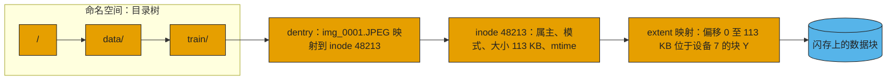
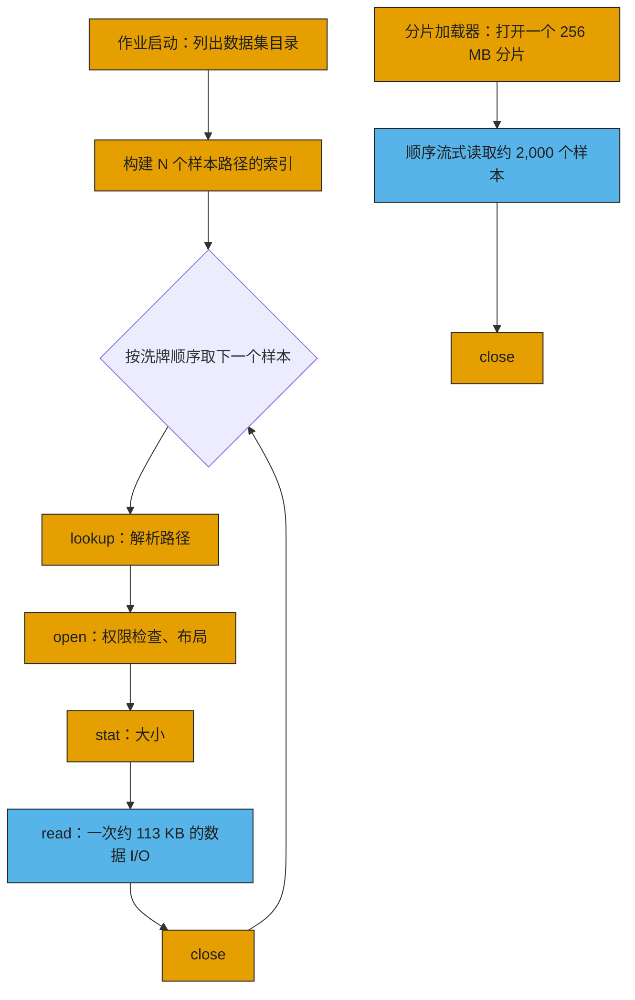

# 21. 元数据：隐藏的瓶颈

> 📄 英文原文：[docs/03-system-architecture/21-metadata.md](../../../docs/03-system-architecture/21-metadata.md) · 本文为简体中文参考译本，如有出入以英文原文为准。

> **深度：** L2 · **阅读时间：** 约 6 分钟 · **最后核实：** 2026-11-01
> **前置阅读：** [文件协议](../02-protocols-and-networking/08-file-protocols.md) · [对象存储与 S3](../02-protocols-and-networking/09-object-storage-and-s3.md) · [分解式全共享架构](16-disaggregated-shared-everything.md) · [并行文件系统](17-parallel-file-systems.md)

## 要点速览（TL;DR）

- **元数据是关于数据的数据：** 名称、目录、权限、大小和块映射。open、stat、list、create 和 rename 都是元数据操作；只有 read 和 write 才搬运有效载荷。
- **元数据操作体量小、受延迟约束，并且在目录锁等共享结构上串行执行。** 按 GB/s 选型的系统经常卡在每秒操作数上。
- **AI 是元数据密集型负载。** 数以百万计约 100 KB 的样本，以及每块 GPU 创建一个文件的检查点，把带宽问题变成了元数据问题。
- **元数据已从单台服务器转向分布式数据库：** 哈希化目录、共享 SCM（VAST）、闪存上的键值存储（Everpure FlashBlade）、FoundationDB（DeepSeek 的 3FS）。
- **元数据性能如今已成为采购标准。** 要问每秒创建数（creates/s）和每秒 stat 数（stats/s），而不只是 TB/s。

## 对 Everpure 战略的意义

Everpure 的顶级 AI 系统 FlashBlade//EXA，其核心论点就是元数据。命名空间存放在基于分布式键值存储构建的 FlashBlade "元数据核心（metadata core）"中，而通用数据节点负责传输字节流（[第 8 章](../02-protocols-and-networking/08-file-protocols.md)、[第 16 章](16-disaggregated-shared-everything.md)）。Pure Storage 宣传该核心可服务数千个客户端和数十亿个条目[^1]。如果 AI 流水线持续受元数据约束，这就是一项持久的差异化优势。如果数据团队把样本打包成大分片（shard），优势就会收窄到检查点、数据整理（curation）、推理缓存和企业文件环境。哪些负载仍受元数据约束，决定了这块市场有多大。

## 核心概念

### 名称、inode 与映射

POSIX 文件系统维护三层元数据。**命名空间**是目录树，其中的 **dentry**（目录项）把名称映射到 inode 编号。**inode** 保存属主、权限、大小和时间戳。**extent 映射（extent map）**把文件偏移量转换为物理位置；一个 extent 可以替代数千个按 4 KB 粒度的指针。

*图 21.1 — 要访问一个文件的字节，需要先经过一串相互依赖的元数据查找，然后才是一次数据访问。*

分布式系统还要增加布局（layout）、租约、锁、去重表和引用计数。在现代闪存系统中，元数据是一个庞大、高热度、持续变化的数据库。

**半导体类比。** 元数据服务就是文件系统的标签阵列（tag array）和页表遍历器（page-table walker）。数据读取类似 DRAM 突发传输：宽、受带宽约束。元数据查找则是指针追逐（pointer chasing）：每一步都依赖上一步的结果，因此延迟串行累加，额外的带宽毫无用处。客户端元数据缓存相当于 TLB；在十亿个文件上做随机洗牌（shuffle）会把它彻底击穿，每一次未命中都变成一次跨网络的页表遍历。一次 rename 需要发出失效通知，相当于 TLB shootdown。

### 为什么 AI 训练是元数据密集型的

*图 21.2 — 逐文件的数据加载器每读一次数据（蓝色）约需付出四次元数据操作（橙色）；分片加载器则每数千个样本才付出一次。*

ImageNet-1k 是典型案例：1,281,167 张训练用 JPEG，共 144.8 GB，平均约 113 KB[^2]。一个 epoch 约需 510 万次元数据操作，而随机洗牌使其顺序无法预取。

*图 21.3 — 示意：在交叉点文件大小 S\* = k × B / M 以下，有效吞吐量等于元数据 IOPS 乘以文件大小，带宽处于闲置状态。*
数据：`data/ch21_small_file_throughput.csv`

**算例。** 有效吞吐量 = min(B, M × S / k)：B 为数据带宽，M 为每秒元数据操作数，S 为文件大小，k 为每个文件所需的元数据操作数。取 B = 500 GB/s、M = 100 万、k = 4，集群每秒可打开 250,000 个文件；250,000 × 113 KB ≈ **28 GB/s，仅为所购带宽的 6%**。要用 113 KB 的文件跑满 500 GB/s，需要每秒约 1,770 万次元数据操作。

**缓解措施。** 把样本打包进大型顺序容器。WebDataset 使用普通的 tar 分片，按文件基本名（basename）把一个样本的各个文件归为一组[^3]；TFRecord 和 Parquet 的做法相同，LLM 语料则被分词（tokenize）成大型二进制分片。一个 256 MB 的分片约可容纳 2,265 张此类图片，使元数据操作减少约 2,000 倍，代价是洗牌粒度变粗，并需要一个重新打包的步骤。数据整理和去重仍需在原始文件上运行，而 RAG 语料和企业数据往往无法重新打包。

### 检查点元数据风暴

PyTorch Distributed Checkpoint 为每个 rank 至少写一个文件，外加一个 `.metadata` 文件[^4]。一个 16,384 GPU 的作业几乎同时在一个目录中创建 16,384 个文件；在单个元数据服务器上，这些操作会在目录锁上串行排队，而"每个张量一个文件"的模式还会使文件数成倍增加。关闭文件同样有成本：3FS 指出，条带化文件的精确长度必须在关闭时向存储查询[^5]。405B 模型约 6.5 TB 检查点所需的带宽是最受关注的指标（[第 31 章](../05-ai-storage/31-training-storage.md)）；而创建文件的突发流量决定了第一秒是否被白白浪费。

### 为什么在十亿个文件上执行 `ls` 很难

`ls -l` 按批读取目录项，对每一项执行 stat，然后在客户端内存中排序。若串行执行，每次往返约 100 µs，10⁹ 次 stat 需要 10⁵ 秒，约 28 小时。若以每秒 100 万次 stat 并行执行，约需 17 分钟，而对 10⁹ 个约 50 字节的名称排序需要约 50 GB 客户端内存。解决办法是并行扫描元数据存储，而不是遍历目录树。2011 年，元数据放在闪存上的 IBM GPFS 在 43 分钟内扫描了 100 亿个文件，而 2007 年在磁盘上扫描 10 亿个文件约需三小时[^6]。单服务器会先撞上内存墙：HDFS NameNode 为每个文件、目录或块花费约 150 字节堆内存[^7]，因此十亿个单块文件需要约 300 GB。

### 日志结构设计

元数据更新是小型随机写，这是对闪存最不友好的模式（[第 3 章](../01-storage-fundamentals/03-inside-an-ssd.md)）。日志结构设计把每次变更都以追加方式写入，为最新版本建立索引，并对其余部分做垃圾回收，这一思想可追溯到 1991 年[^8]。Pure Storage 曾把 Purity 的元数据描述为一个尽量减少覆盖写、并按擦除块整数倍写入的键值存储[^9]。其收益是顺序写、廉价快照和简单的崩溃恢复；代价是读放大、压实（compaction），以及与前台 I/O 争抢资源的后台工作。SSD 的 FTL 本身就是日志结构的元数据；在阵列层面只做一次而不是做两次，是 DirectFlash 论证的一部分（[第 26 章](../04-everpure/26-purity-and-directflash.md)）。

### 元数据扩展策略

| 策略 | 工作方式 | 瓶颈 / 权衡 | 示例 |
|---|---|---|---|
| 单一元数据服务器 | 一台服务器持有整个命名空间，通常放在内存中 | 内存容量和单 CPU 的锁吞吐量；HDFS 每对象约 150 B[^7] | HDFS NameNode、传统 NAS 机头 |
| 主备（Active/standby） | 同上，外加一个故障切换伙伴 | 提升可用性，而非性能 | 带故障切换的 Lustre 单 MDT |
| 静态子树分区 | 管理员把各目录固定到不同服务器 | 热点目录仍集中在一台服务器上 | Lustre DNE1 远程目录（2.4）[^10] |
| 动态子树分区 | 服务器之间自行迁移繁忙子树 | 均衡器复杂；保留了局部性 | CephFS MDS 集群[^11] |
| 哈希分布式目录 | 目录项经哈希分散到各服务器或虚拟分片 | rename 和 readdir 跨越多个分片 | Lustre DNE2 条带化目录（2.8）[^12]；WEKA 虚拟元数据服务器[^13]；Meta Tectonic[^14] |
| 元数据放在共享 SCM 中 | 无状态节点通过 RDMA 读写同一棵持久化树 | 每次查找一次网络往返；SCM 容量 | VAST V-tree[^15] |
| 闪存上的分布式 KV 存储 | 命名空间作为键值记录分布在各刀片上 | 压实；需要购买专用元数据层 | Everpure Purity//FB、FlashBlade//EXA 核心[^16][^17] |
| 事务型 KV 数据库 + 无状态服务器 | inode 和 dentry 以键的形式存储在可串行化数据库中 | 事务冲突与重试；数据库运维 | 基于 FoundationDB 的 DeepSeek 3FS[^5]；Snowflake[^18]；基于 Bigtable 的 Google Colossus[^19] |

*表 21.1 — 元数据扩展的路径是：从更大的服务器，到分区的服务器，再到无状态服务器之下的数据库。*

核心权衡在于局部性与分散度。子树分区让目录列举和 rename 保持在本地，但会在热点目录上形成瓶颈；哈希分散了负载，却让这些操作变成多服务器操作。Weil 2004 年的仿真更倾向于动态子树[^11]。较新的系统把一致性下沉到事务型数据库中：在 3FS 中，一个目录是一段连续的键区间，因此列举目录就是一次范围扫描，冲突的写入则重试[^5]。
