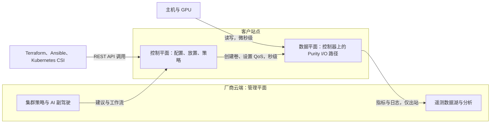
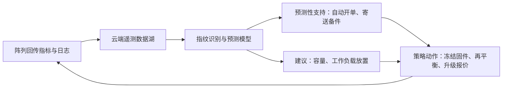
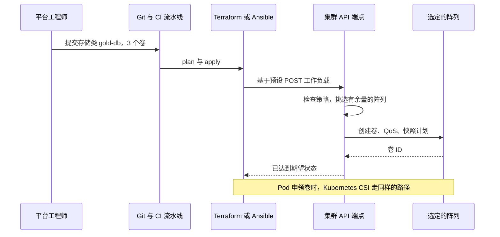

# 22. 控制平面与集群（设备群）管理

> 📄 英文原文：[docs/03-system-architecture/22-control-planes.md](../../../docs/03-system-architecture/22-control-planes.md) · 本文为简体中文参考译本，如有出入以英文原文为准。

> **深度：** L2 · **阅读时间：** 约 5 分钟 · **最后核实：** 2026-11-01
> **前置阅读：** [存储栈](13-storage-stack.md) · [纵向扩展双控制器阵列](14-scale-up-dual-controller.md) · [消费模式](23-consumption-models.md)

## 要点速览（TL;DR）

- **数据平面以微秒级搬运字节；控制平面决定"应该存在什么"（卷、策略、数据放置），以秒级运行。** 良好的设计会把控制平面排除在 I/O 路径之外，因此云端故障永远不会让存储停摆。
- **集群管理在 2010 年代中期迁移到了云端。** 阵列向厂商回传（phone home）遥测数据；厂商的分析系统会在客户察觉之前预测故障、自动开工单并测算升级规模。
- **遥测的价值随集群规模复利增长。** 罕见故障只有在观察大量系统时才能被学习，因此装机量最大的厂商学得最快。这既是支持成本上的护城河，也是销售信号上的护城河。
- **"存储即代码"改变了买方。** 平台工程师在 Terraform、Ansible 或 Kubernetes 清单中以声明方式定义存储；过去靠 GUI 赢下的订单，如今由 API 质量决定。
- **Everpure 押注的是 Pure1（云端分析）加 Fusion（内置于 Purity 的策略控制平面）。** Dell、NetApp 和 HPE 都有对应产品，四家目前都在加入 AI 副驾驶（copilot）。

## 对 Everpure 战略的意义

控制平面是硬件转变为服务的地方。Evergreen//One 的 SLA（[第 23 章](23-consumption-models.md)）之所以可以承保，正是因为 Everpure 能近乎实时地看到每台阵列的容量、性能和健康状况。控制平面也是 Everpure 平台叙事的集成界面——即 2025 年 6 月发布、以 Fusion 为核心的 Enterprise Data Cloud[^1]（[第 28 章](../04-everpure/28-platform-and-software.md)）。如果客户基于 Everpure 的 API 构建自动化，转换成本就会从设备本身迁移到策略层，而策略层能跨越每一次硬件更新换代而留存下来。

## 核心概念

### 三个平面，三种时钟

*图 22.1 — 即使通往云端的每一条箭头都被切断，数据平面也必须继续提供服务；控制平面负责决策，数据平面负责执行。*

**数据平面**即 I/O 路径：协议处理、重复数据删除、RAID 和闪存管理（[第 14 章](14-scale-up-dual-controller.md)）。**控制平面**保存期望状态，例如"这个数据库获得三个卷、50,000 IOPS 上限，以及每小时快照并复制到站点 B"，并将其下发给数据平面。**管理平面**则汇聚众多控制平面。**半导体类比：** 数据平面相当于芯片的数据通路；控制平面相当于片上的电源管理微控制器，负责设定电压和时钟；管理平面则是集群运维人员用脚本操控的带外 BMC。没有人会把 BMC 放在一条 load 指令的关键路径上。

云服务不可达时必须平稳降级。Pure1 的条款允许关闭回传功能的"暗站点"（dark sites），代价是需要人工收集日志[^2]。

### 遥测闭环

*图 22.2 — 每一起事件都会变成一个保护整个集群其余部分的指纹，因此每多接入一台阵列，这个闭环就改进一分。*

Pure Storage 于 2017 年推出 Pure1 META，声称每天处理超过一万亿个遥测数据点，数据湖规模约 7 PB[^3]，并称截至当时已预防超过 500 起 Severity-1 事件[^4]（公司自述）。如今，一旦检测到硬件故障，系统会自动创建支持工单，并可触发备件寄送[^5]。HPE 于 2017 年收购 Nimble Storage，很大程度上是为了 InfoSight[^6]，并声称其可预测并自动解决 86% 的问题（公司自述，基于 Nimble 装机基础）[^7]。

**为什么规模是护城河（算例）。** 设想一种固件与硬盘交互的故障，每年在 10,000 台阵列中出现 1 次。拥有 1,000 台联网阵列的厂商每十年才遇到一次，罕见到无法建模。拥有 50,000 台的厂商每年遇到五次，在第一次之后即可提取指纹，并在全集群范围内拦截该固件。这与晶圆厂的**良率学习**如出一辙：投片越多，缺陷特征浮现得越早。同样的数据还能降低支持成本（每台装机阵列所需工程师更少）、支撑容量规划（预测每台阵列的写满日期），并为销售提供一份即将耗尽空间的客户名单。

### 存储即代码

*图 22.3 — 声明式自动化意味着工程师只需指定结果，由控制平面来选择阵列，因此放置逻辑本身成为厂商的产品。*

Pure Fusion 的预设（presets）把 QoS、保护和标签打包为一个全集群通用的模板[^8]。2025 年 9 月，Pure Storage（现 Everpure）宣布通过存储类实现跨阵列配置[^9]。自动化接口包括 Fusion 的 Terraform provider（检索到的最新版本发布于 2023 年，面向的是最初的 Fusion 服务）[^10]、经认证的 Ansible collections[^11]，以及面向 Kubernetes 的 Portworx CSI[^12]。买方随之改变：平台工程团队评估的是 API 覆盖度、幂等性和 provider 成熟度；精美的 GUI 变得没那么重要。CSI 是一把双刃剑：它让阵列在统一的 Kubernetes 接口背后变得可相互替代，因此差异化必须建立在它之上，即集群策略层。

## Everpure 的做法与竞争对手对比

| 厂商 | 遥测 / AIOps | 集群控制平面 | 自动化接口 | AI 层（2024–26） |
|---|---|---|---|---|
| Everpure | Pure1；自 2017 年起提供 META 分析[^3] | Fusion，自 2024 年起内置于 Purity[^13]；覆盖 FlashArray、FlashBlade、Cloud Dedicated[^14] | REST、Terraform、Ansible、Portworx CSI[^10][^11][^12] | Pure1 AI Copilot（2024）[^15]；2025 年宣布支持 MCP[^9]；面向第三方 AI 客户端的 Pure1 Manage MCP server（2026）[^16] |
| Dell | Dell AIOps（原 CloudIQ；2024 年起品牌为 APEX AIOps Infrastructure Observability）[^17][^18] | 各平台独立管理器加 APEX AIOps | Terraform providers、开源 CSI 与 CSM 模块[^19] | AIOps Incident Management（原 Moogsoft）[^20] |
| NetApp | Data Infrastructure Insights（原 Cloud Insights，2024 年 9 月）[^21] | NetApp Console（原 BlueXP，2025 年 10 月）[^22]，覆盖本地与超大规模云厂商上的 ONTAP | ONTAP REST、Ansible、Trident CSI | 集成于 Console 的服务 |
| HPE | InfoSight（来自 Nimble，2017）[^6] | GreenLake 云控制台（Data Services Cloud Console，2021）[^23] | 统一 API、CSI 驱动 | GreenLake Intelligence，具备智能体能力并支持 MCP（2025 年 6 月）[^24] |

*表 22.1 — 如今每家主要厂商都具备云端遥测、集群控制台、IaC 接口和副驾驶；差别在于策略层的统一程度。*

Everpure 与众不同的选择是把 Fusion 放进阵列操作系统内部，因此无需单独授权或部署一个控制平面[^13]。NetApp 的最强版本论证（steelman）：其控制台可管理三大超大规模云厂商内部的 ONTAP，混合云覆盖面比 Everpure 的云产品更广。HPE 的 InfoSight 宣称可进行跨栈（服务器与存储）关联分析，这是纯存储厂商无法匹敌的。Dell 的硬件产品组合最宽，因此一个 AIOps 控制台即可覆盖服务器、存储和网络。

## 历史与发展轨迹

单阵列的元素管理器（element manager）先让位于云端分析（Nimble InfoSight、Pure1）和机器学习预测（Pure1 META，2017），随后是云控制台（HPE 2021），再到策略控制平面（Fusion 于 2024 年内置；Enterprise Data Cloud 于 2025 年）。2025–26 年的信号是智能体化（agentic）：Pure1 的副驾驶和 HPE 的 GreenLake Intelligence 都开放了 MCP，使 AI 智能体可以查询并操作集群[^9][^24]。悬而未决的问题是：客户愿意授予智能体多大的写权限。

## 关键数字

| 指标 | 数值 | 背景 | 来源 / 日期 |
|---|---|---|---|
| Pure1 META 发布时的遥测规模 | >1 trillion 数据点/天（超过一万亿）；约 7 PB 数据湖 | 公司自述 | Pure Storage，2017[^3] |
| 预防的 Sev-1 事件 | >500 | 公司自述，截至 2017 年累计 | BigDATAwire，2017[^4] |
| HPE InfoSight 自动解决率 | 86% 的问题 | 公司自述；Nimble 装机基础 | HPE[^7] |
| HPE 收购 Nimble 的价格 | 约 $1.0B 净现金 | InfoSight 是核心收购理由 | HPE，2017-04-17[^6] |
| 回传间隔 | 约 30 秒 | 第三方评测 [VERIFY: Everpure 文档中未见] | iThome[^25] |
| 罕见故障观测次数 | 每年 0.1 次 vs 5 次 | 1,000 台 vs 50,000 台阵列集群，万分之一故障率 | 算例 |

## 对话手册

**向产品经理提的问题**

1. *"Sev-1 工单中有多大比例是在客户来电之前由 Pure1 主动开出的？"* 高质量回答：给出实测百分比、趋势以及对单工单成本的影响。
2. *"哪些 Evergreen//One SLA 依赖遥测？暗站点的情况如何处理？"* 高质量回答：点名需要回传的 SLA 以及合同层面的兜底安排。
3. *"Fusion 预设在 Terraform 中如何体现？provider 由谁负责维护？"* 高质量回答：有官方支持、带版本管理的 provider，并列出发布节奏和覆盖缺口。

**向工程师提的问题**

1. *"如果 Pure1 和 Fusion 都不可达，哪些功能仍可用？"* 高质量回答：所有 I/O 和本地管理均正常；只有集群级放置和分析会暂停。
2. *"Fusion 如何为新工作负载挑选阵列？"* 高质量回答：具体的输入项（余量、预测写满时间、延迟等级、故障域）以及冲突处理方式。
3. *"有什么机制能阻止副驾驶或智能体删除生产卷？"* 高质量回答：限定范围的令牌、审批关卡，以及底层类似 SafeMode 的不可变性。

**不要这样说：**

- "AIOps 只是监控。"它会采取行动：开工单、寄送备件、冻结固件。
- "云端在管理阵列。"云端提供建议；阵列独立运行。
- "支持 CSI 是一项差异化优势。"每家主要厂商都支持。

## 深入阅读（可选，L3 指引）

- Kubernetes CSI 规范（StorageClass、PVC、CreateVolume RPC）。
- Everpure Fusion 白皮书；Pure1 安全技术简报。
- HPE InfoSight 与 NetApp DII 文档，了解竞争对手的遥测范围。

## 关键术语

- **控制平面 / 数据平面 / 管理平面** — 分别负责决策、执行和全集群监管。
- **回传遥测（Phone-home telemetry）** — 发送到厂商云端的出站指标和日志。
- **问题指纹（Issue fingerprint）** — 已知故障的遥测特征，用于在整个集群中匹配。
- **存储类 / 预设（Storage class / preset）** — 一个具名的策略包，自动化工具按名称调用。
- 参见[术语表](../glossary.md)。

## 资料来源

[^1]: Blocks & Files, "Pure debuts Enterprise Data Cloud with Fusion updates and new FlashArray systems," 2025-06-18. https://www.blocksandfiles.com/ai-ml/2025/06/18/pure-debuts-enterprise-data-cloud-with-fusion-updates-and-new-flasharray-systems/100996 (retrieved 2026-11-01).
[^2]: Pure Storage, "Pure1 Terms of Use," n.d. https://www.purestorage.com/la/legal/pure1-terms-of-use.html (retrieved 2026-11-01).
[^3]: Pure Storage, "Pure Storage Delivers Industry-First Performance and Capacity Prediction Capabilities Powered by Machine Learning" (Pure1 META press release), 2017-06. https://www.everpuredata.com/company/news-and-events/press/ps_release_accelerate2017_meta.html (retrieved 2026-11-01); corroborated by TechTarget, "Pure1 META analytics bolsters Pure Storage software," 2017-06. https://www.techtarget.com/searchstorage/news/450421016/Pure1-META-analytics-bolsters-Pure-Storage-software (retrieved 2026-11-01).
[^4]: BigDATAwire, "Pure Storage Announces Pure1 META AI Platform," 2017-06. https://www.bigdatawire.com/this-just-in/pure-storage-announces-pure1-meta-ai-platform (retrieved 2026-11-01).
[^5]: Everpure blog, post on Pure1 proactive support and automated RMA, n.d. https://blog.everpuredata.com/?p=174167 (retrieved 2026-11-01).
[^6]: HPE, "HPE Completes Acquisition of Nimble Storage," 2017-04-17. https://www.hpe.com/us/en/newsroom/press-release/2017/04/hpe-completes-acquisition-of-nimble-storage.html (retrieved 2026-11-01); eWEEK, "HPE Completes Acquisition of Nimble Storage Earlier Than Planned," 2017-04. https://www.eweek.com/storage/hpe-completes-acquisition-of-nimble-storage-earlier-than-planned (retrieved 2026-11-01).
[^7]: HPE, "HPE InfoSight," n.d. https://www.hpe.com/infosight (retrieved 2026-11-01).
[^8]: Everpure, "Presets and Workloads in Pure Fusion" (demo), n.d. https://www.everpuredata.com/demos/platform/managing-at-scale/presets-and-workloads-in-pure-fusion/6368000113112.html (retrieved 2026-11-01).
[^9]: Blocks & Files, "Pure's control plane gets more intelligent, more secure," 2025-09-26. https://blocksandfiles.com/2025/09/26/pures-control-plane-gets-more-intelligent-more-secure/ (retrieved 2026-11-01).
[^10]: Go package index, "terraform-provider-fusion v1.0.16 (PureStorage-OpenConnect)," 2023-08-02. https://pkg.go.dev/github.com/PureStorage-OpenConnect/terraform-provider-fusion@v1.0.16 (retrieved 2026-11-01).
[^11]: Pure Storage Ansible team, "FlashArray Collection" (GitHub repository), n.d. https://github.com/Pure-Storage-Ansible/FlashArray-Collection (retrieved 2026-11-01).
[^12]: Portworx documentation, "Pure FlashArray Direct Access volumes," n.d. https://docs.portworx.com/portworx-enterprise/operations/operate-kubernetes/storage-operations/create-pvcs/pure-flasharray (retrieved 2026-11-01).
[^13]: TechTarget, "Pure Storage adds AI and automation, extends SLAs," 2024-06. https://www.techtarget.com/searchStorage/news/366589453/Pure-Storage-adds-AI-and-automation-extends-SLAs (retrieved 2026-11-01).
[^14]: Pure Storage, "Pure Fusion: Powering the Enterprise Data Cloud" (white paper), 2025. https://www.purestorage.com/content/dam/pdf/en/white-papers/wp-pure-fusion-powering-the-enterprise-data-cloud.pdf (retrieved 2026-11-01).
[^15]: ITPro, "Pure Storage looks to 'fundamentally change' cloud storage management with new AI copilot tool," 2024-06. https://itpro.com/cloud/cloud-storage/pure-storage-looks-to-fundamentally-change-cloud-storage-management-with-new-ai-copilot-tool (retrieved 2026-11-01).
[^16]: Everpure blog, "Pure1, now agentic," n.d. (2026). https://blog.everpuredata.com/products/pure1-now-agentic/ (retrieved 2026-11-01; seen via search summary, host not fetchable).
[^17]: Dell Technologies Info Hub, "Talking CloudIQ: Now we're talking APEX AIOps Infrastructure Observability," 2024-07. https://infohub.delltechnologies.com/en-au/p/talking-cloudiq-now-we-re-talking-apex-aiops-infrastructure-observability (retrieved 2026-11-01).
[^18]: Dell Technologies Support, "Dell AIOps (formerly CloudIQ)" product support articles, n.d. (2026). https://www.dell.com/support/product-details/en-us/product/cloud-iq/resources/articles (retrieved 2026-11-01; seen via search summary).
[^19]: Dell Technologies, "Terraform Providers" (solution brief), n.d. https://www.delltechnologies.com/asset/en-ie/solutions/infrastructure-solutions/briefs-summaries/terraform-providers-solution-brief.pdf (retrieved 2026-11-01); Dell, "terraform-provider-powerscale" (GitHub), n.d. https://github.com/dell/terraform-provider-powerscale (retrieved 2026-11-01).
[^20]: Dell Technologies, "Moogsoft APEX AIOps rebranding notice," 2024-05-21. https://www.delltechnologies.com/asset/en-us/solutions/apex/templates-forms/moogsoft-apex-aiops-rebranding-notice.pdf (retrieved 2026-11-01).
[^21]: NetApp, "Cloud Insights is now Data Infrastructure Insights," 2024-09. https://www.netapp.com/blog/cloud-insights-now-data-infrastructure-insights/ (retrieved 2026-11-01).
[^22]: NetApp, "BlueXP is now NetApp Console," 2025-10-14. https://www.netapp.com/product-updates/new-console-centralized-data-management (retrieved 2026-11-01).
[^23]: HPE, "Hewlett Packard Enterprise expands HPE GreenLake with breakthrough storage as-a-service business transformation," 2021-05-04. https://www.hpe.com/us/en/newsroom/press-release/2021/05/hewlett-packard-enterprise-expands-hpe-greenlake-with-breakthrough-storage-as-a-service-business-transformation.html (retrieved 2026-11-01).
[^24]: HPE, "HPE reimagines hybrid IT operations with GreenLake Intelligence," 2025-06. https://www.hpe.com/us/en/newsroom/press-release/2025/06/hpe-reimagines-hybrid-it-operations-with-greenlake-intelligence.html (retrieved 2026-11-01).
[^25]: iThome, review of Pure Storage FlashArray and Pure1 (Traditional Chinese), n.d. https://www.ithome.com.tw/review/129885 (retrieved 2026-11-01).
