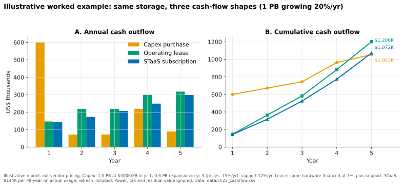
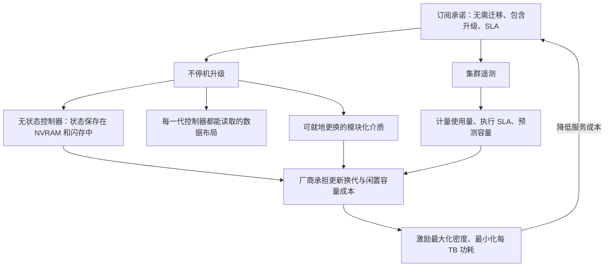
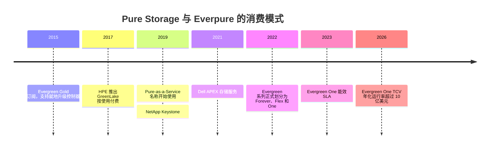

# 23. 消费模式

> 📄 英文原文：[docs/03-system-architecture/23-consumption-models.md](../../../docs/03-system-architecture/23-consumption-models.md) · 本文为简体中文参考译本，如有出入以英文原文为准。

> **深度：** L2 · **阅读时间：** 约 6 分钟 · **最后核实：** 2026-11-01
> **前置阅读：** [性能与经济性指标](../01-storage-fundamentals/04-performance-and-economics-metrics.md) · [纵向扩展双控制器阵列](14-scale-up-dual-controller.md) · [控制平面与集群管理](22-control-planes.md)

## 要点速览（TL;DR）

- **存储有四种购买方式：** 一次性资本支出（capex）、租赁、资本支出加升级订阅（Evergreen//Forever 式），或存储即服务（STaaS）——由厂商拥有硬件，按消费量并依据 SLA 计费。
- **五年总成本可能相近；不同之处在于现金流形态、资产负债表处理和风险分配。** STaaS 把一次性的大额采购变成随使用量变化的费用，并把超额配置和更新换代的风险转移给厂商。
- **对厂商而言，STaaS 是用前期产品收入换取按期确认（ratable）的收入。** 收入结构向 STaaS 倾斜会压低报告的增长率，同时抬升 ARR、RPO 和 TCV，这正是 Everpure 优先披露这些指标的原因。
- **商业模式本身就是一项架构要求。** 可信的订阅需要不停机升级、无状态控制器和集群遥测；把订阅硬套在需要整机替换（forklift upgrade）的阵列上，只不过是为整机替换提供融资而已。
- **Everpure 起步早（Evergreen，2015 年）。** Dell、NetApp 和 HPE 如今已在合同条款上跟进；但在架构上跟进要难得多。

## 对 Everpure 战略的意义

订阅服务占 Everpure FY2026 收入的 46%，订阅 ARR 达到 $1,924.3M，净美元留存率为 113%[^1]。到 Q2 FY2027，ARR 为 $2.13B（+20%），RPO 为 $4.1B（+44%）[^2]。以 Evergreen//One 为主的存储即服务 TCV 在该季度增长 121%，达到 $277M，年化运行率超过 $1B[^3]。管理层表示，这种加速"会稀释近期报告的收入增长"[^3]。要读懂 Everpure 的财务报表，或在与 Dell APEX 竞争时为交易定价，就必须了解每种模式对现金、收入和架构的影响。

## 核心概念

### 为同一个 PB 付费的四种方式

| 模式 | 资产归属 | 升级方式 | 厂商收入（ASC 606） | 客户会计处理（US GAAP） | 示例 |
|---|---|---|---|---|---|
| 资本支出采购 + 维保 | 客户 | 每 4–6 年整机替换，伴随数据迁移 | 产品收入在控制权转移时一次性确认；支持服务按期确认 | 计入 PP&E 并折旧；支持服务为运营支出（opex） | 任何阵列 |
| 经营租赁 | 出租方（银行或厂商自有融资部门） | 同资本支出；租期结束时归还资产或再融资 | 若出售给第三方出租方，则一次性确认 | 资产负债表上确认使用权资产和租赁负债（ASC 842）；成本直线法分摊 | 任何阵列（通过租赁合作伙伴） |
| 资本支出 + 升级订阅 | 客户 | 续约时就地更换控制器；以抵扣额度扩充介质 | 产品收入一次性确认；订阅按期确认[^4] | PP&E 加运营支出性质的订阅 | Evergreen//Forever[^5]；NetApp Storage Lifecycle Program / Advance[^6]；Dell Future-Proof[^7] |
| 存储即服务 | 厂商 | 由厂商负责；有 SLA 保障 | 按消费量在服务期内确认；合同通常设定最低使用承诺，并对超出部分另行收费[^8] | 通常为服务合同，因此计入运营支出且不入表——前提是厂商的替换权具有实质性[^9] | Evergreen//One；Dell APEX；NetApp Keystone；HPE GreenLake |

*表 23.1 — 沿表格向下，资产所有权、更新换代风险和收入确认时点逐步从客户账本转移到厂商账本。*

租赁与服务之间的界线取决于审计判断。根据 ASC 842，如果合同中存在一项由客户主导使用的已识别资产，则该合同包含租赁。只有当替换硬件对厂商而言切实可行且具有经济性时，厂商的替换权才算"具有实质性"[^9]。STaaS 合同出售的是容量和性能，而非特定的设备。关于 EBITDA 有一个细节：STaaS 费用与 US GAAP 下的经营租赁成本都位于 EBITDA 之上，而所购硬件的折旧则位于其下。

### 现金流形态

*图 23.1 — 示意：三种模式的五年名义成本相差约 15% 以内；真正不同的是支付时点、由谁承担闲置容量，以及由谁为更新换代买单。*
数据：`data/ch23_cashflow.csv`

**假设。** 需求起点为 1.0 PB 有效容量，每年增长 20%。资本支出买方按第 3 年的需求配置（1.5 PB，假设单价 $400K per PB），第 4 年以每年降价 15% 后的价格扩容 0.6 PB，并每年支付 12% 的支持费用。租赁模式以 7% 的利率为同样的硬件融资。STaaS 按实际使用量收费，假设为 $144K per PB-year。以 8% 折现、每年年初付款，现值成本分别为：资本支出约 $969K，租赁约 $1,007K，STaaS 约 $899K。名义总额掩盖了三件事：资本支出买方第 1 年有三分之一容量闲置（1.5 PB 中仅用 1.0 PB）；期末其控制器已使用五年，面临整机替换，而 STaaS 已包含这一成本；STaaS 费率是决定胜负的谈判变量。**半导体类比：** STaaS 相当于晶圆代工的产能预订。客户承诺最低采购量，而厂商拥有晶圆厂，承担产能利用率风险和制程节点升级。

### 厂商损益表看到的是什么

以一笔三年期、$1.2M 的交易为例。若以资本支出方式出售，可能有 $0.9M 在发货当季确认为产品收入，$0.3M 的支持服务按每季度 $25K 确认，因此第一年收入约 $1.0M。若以 STaaS 方式出售，则约为每季度 $100K，第一年 $0.4M。经济实质相同，第一年收入却少 60%，而厂商还要预先支付硬件成本。因此 Everpure 强调 ARR、RPO 和 TCV，其 CEO 也声称，剔除向 Evergreen//One 转移的影响后，增长率超过 40%[^3]。其订阅毛利率（Q2 FY2027 为 74.9%，非 GAAP）高于产品毛利率（66.2%）[^10]，但 STaaS 的硬件成本计入订阅这一行。

### 商业模式为何塑造架构

*图 23.2 — 只有升级成本低廉且风险可量化，订阅才能盈利，因此合同会推动工程走向无状态控制器、模块化介质和遥测。*

承诺"永不再迁移"的订阅是一项负债，除非更换控制器已成为例行操作。这只有在控制器不持有任何独有状态（[第 14 章](14-scale-up-dual-controller.md)）且新控制器能读取旧数据布局时才行得通。可以类比为跨代保持兼容的 CPU 插槽：机箱是主板，控制器是芯片。截至 2022 年，Pure Storage 已为超过 3,000 家客户完成超过 10,000 次不停机控制器升级[^11]。SLA 需要度量，因此 Evergreen//One 的保障依托 Pure1 遥测运行（[第 22 章](22-control-planes.md)），其中包括 2023 年 1 月推出的每 TiB 功耗（watts-per-TiB）能效保障[^12]。一旦由厂商承担电力和硬件费用，密度就等于利润率，这把 DirectFlash 与订阅模式联系在了一起（[第 26 章](../04-everpure/26-purity-and-directflash.md)）。

## Everpure 的做法与竞争对手对比

Everpure 的 Evergreen 系列分为三档。Evergreen//Forever 是客户自有硬件加订阅，每三年续约时更换控制器（"Ever Modern"；//E 系列为六年）[^13]。Evergreen//Flex 按整个集群的容量使用量计费；其产品收入在订阅开始时确认，订阅费用按期确认，与 Forever 相同[^8]。Evergreen//One 是完整的 STaaS，前身为 Pure-as-a-Service[^5]。其 SLA 涵盖性能、可用性、容量、能效和网络攻击恢复[^14]。Gartner 在 2025 年消费服务魔力象限中将 Pure Storage 评为领导者（Leader）[^15]。

为竞争对手做最强版本论证（steelman）。HPE 于 2017 年推出 GreenLake 按使用付费服务[^16]，早于多数同行，且覆盖计算和网络以及存储。NetApp Keystone（2019）[^17] 可横跨本地和超大规模云厂商上的 ONTAP 运行。Dell APEX（2021）[^18] 可包装最广泛的硬件产品组合。在合同层面，NetApp 和 Dell 的控制器更新计划如今已与 Evergreen//Forever 如出一辙[^6][^7]。Everpure 的优势在于架构和过往记录，而非合同条款：一条为就地升级而设计的操作系统谱系，以及十年来兑现的更新换代。一家必须迁移数据才能更新换代的厂商，会在每一份 STaaS 合同中背负这笔成本。

## 历史与发展轨迹

*图 23.3 — 订阅从 Pure Storage 的差异化优势（2015）演变为行业常态（2021）；竞争焦点转向 SLA 和架构。*

下一步：允许客户在订阅水平之上突发使用的 Evergreen//One Overdrive 已于 2026 年发布[^19] [VERIFY: 条款与正式上市（GA）时间]。据报道，合同期限为三到四年[^3]。

## 关键数字

| 指标 | 数值 | 背景 | 来源 / 日期 |
|---|---|---|---|
| 订阅 ARR | $2.13B（+20%） | Q2 FY2027 | Everpure，2026-08-26[^2] |
| RPO | $4.1B（+44%） | Q2 FY2027 | Everpure，2026-08-26[^2] |
| STaaS TCV（主要为 Evergreen//One） | $277M（+121%） | Q2 FY2027；年化运行率 >$1B | 财报电话会，2026-08[^3] |
| STaaS TCV，FY2026 | $520M（+32%） | 仅 Q4 FY2026：$179M（+28%） | 财报电话会，2026-02[^20] |
| 订阅净美元留存率 | 113% | FY2026（FY2025：117%） | 10-K[^1] |
| 不停机控制器升级 | 为 >3,000 家客户完成 >10,000 次 | 截至 2022 年累计 | Blocks & Files[^11] |
| 第一年收入，STaaS vs 资本支出 | 约 40% | 同一笔 $1.2M 交易 | 算例 |

## 对话手册

**向产品经理提的问题**

1. *"Evergreen//One 按合同年份划分的毛利率是多少？"* 高质量回答：一条曲线，显示早期年份的硬件拖累和后期回本，并说明产能利用率假设。
2. *"我们在承诺量之上部署多少余量？闲置时由谁买单？"* 高质量回答：一个百分比、预测模型以及再部署做法。
3. *"客户为什么选择 Forever 而不是 One？"* 高质量回答：按细分市场列出会计、数据主权和采购方面的原因。

**向工程师提的问题**

1. *"什么会导致不停机升级失败？"* 高质量回答：具体的代际边界约束以及如何测试。
2. *"哪项 SLA 最难达成？"* 高质量回答：点名该指标以及用来监控它的遥测数据。
3. *"消费量如何计量：按配置容量、写入容量还是有效容量？"* 高质量回答：确切的计数器，以及数据缩减如何计入其中。

**不要这样说：**

- "STaaS 总是更便宜。"它转移的是风险；价格才是决定因素。
- "订阅就意味着不入表。"只有在不存在嵌入式租赁时才成立。
- "收入增长放缓意味着需求疲软。"先看 TCV 和 RPO。

## 深入阅读（可选，L3 指引）

- Everpure 10-K 中的收入确认附注；ASC 606 和 ASC 842 中关于已识别资产和替换权的指引。
- Evergreen 计划说明和 Evergreen//One 产品指南（SLA 定义、计量方式）。

## 关键术语

- **STaaS** — 厂商拥有的存储，依据 SLA 按消费量计费。
- **TCV / RPO / ARR** — 已签署的合同价值、已签约但尚未确认的收入、年化订阅运行率。
- **按期确认（Ratable recognition）** — 收入在服务期内平均分摊确认。
- 参见[术语表](../glossary.md)。

## 资料来源

[^1]: Everpure, "Form 10-K for fiscal year ended February 1, 2026," 2026-03-24. https://www.sec.gov/Archives/edgar/data/1474432/000147443226000027/pstg-20260201.htm (retrieved 2026-11-01).
[^2]: Everpure, "Everpure Announces Second Quarter Fiscal 2027 Financial Results," 2026-08-26. https://investor.everpuredata.com/news-and-events/press-releases/press-release-details/2026/Everpure-Announces-Second-Quarter-Fiscal-2027-Financial-Results/default.aspx (retrieved 2026-11-01).
[^3]: Quartr, "Everpure (P) Q2 2027 earnings summary," 2026-08. https://quartr.com/events/everpure-inc-p-q2-2027_3girLLYP (retrieved 2026-11-01); corroborated by Statementdog, "Everpure Inc (P) 2027 Q2 earnings call transcript," 2026-08. https://statementdog.com/analysis/P/earnings_calls/318913 (retrieved 2026-11-01); Nasdaq, "Everpure Q2 Earnings Call Highlights," 2026-08. https://www.nasdaq.com/articles/everpure-q2-earnings-call-highlights (retrieved 2026-11-01; seen via search summary).
[^4]: Pure Storage, "Form 10-K for fiscal year ended February 6, 2022," 2022-04. https://www.sec.gov/Archives/edgar/data/1474432/000162828022008643/pstg-20220206.htm (retrieved 2026-11-01).
[^5]: Blocks & Files, "Pure Storage Evergreen rework," 2022-06-08. https://blocksandfiles.com/2022/06/08/pure-storage-evergreen-rework/ (retrieved 2026-11-01).
[^6]: NetApp, "Storage Lifecycle Program" (additional terms), n.d. https://www.netapp.com/how-to-buy/sales-terms-and-conditions/additional-terms/storage-lifecycle-program/ (retrieved 2026-11-01); StorageNewsletter, "NetApp Advance," 2023. https://www.storagenewsletter.com/?p=258667 (retrieved 2026-11-01).
[^7]: Dell Technologies, "Future-Proof Program," n.d. https://www.dell.com/en-uk/dt/products/future-proof-program.htm (retrieved 2026-11-01).
[^8]: Pure Storage, "Form 10-K for fiscal year ended February 2, 2025," 2025-04. https://www.sec.gov/Archives/edgar/data/1474432/000162828025015044/pstg-20250202.htm (retrieved 2026-11-01).
[^9]: PwC Viewpoint, "Leases guide, 2.3 Definition of a lease," n.d. https://viewpoint.pwc.com/dt/us/en/pwc/accounting_guides/leases/leases__4_US/chapter_2_scope__1_US/23_definition_of_a_l_US.html (retrieved 2026-11-01).
[^10]: Investing.com, "Everpure Q2 FY27 slides: 38% revenue growth, guidance raised sharply," 2026-08. https://www.investing.com/news/company-news/everpure-q2-fy27-slides-38-revenue-growth-guidance-raised-sharply-93CH-4878054 (retrieved 2026-11-01).
[^11]: Blocks & Files, "Pure Storage reworks Evergreen subscription service," 2022-06-08. https://www.blocksandfiles.com/block/2022/06/08/pure-storage-reworks-evergreen-subscription-service/1591308 (retrieved 2026-11-01).
[^12]: Pure Storage, "With industry-first energy efficiency guarantee, Pure Storage further expands SLA offerings for Evergreen//One," 2023-01-18. https://www.purestorage.com/company/newsroom/press-releases/pure-expands-sla-offerings-evergreen-one.html (retrieved 2026-11-01).
[^13]: Everpure, "Evergreen Program Description," n.d. https://www.everpuredata.com/legal/evergreen-program-description.html (retrieved 2026-11-01).
[^14]: Everpure, "Evergreen//One Storage as a Service" (solution brief), n.d. https://www.everpuredata.com/content/dam/pdf/en/solution-briefs/sb-evergreen-one-storage-as-a-service.pdf (retrieved 2026-11-01).
[^15]: Nasdaq / PR Newswire, "Pure Storage Named a Leader in the 2025 Gartner Magic Quadrant for Infrastructure Platform Consumption Services," 2025. https://www.nasdaq.com/press-release/pure-storage-named-leader-2025-gartnerr-magic-quadranttm-infrastructure-platform (retrieved 2026-11-01).
[^16]: StorageNewsletter, "HPE GreenLake, suite of pay-per-use solutions," 2017-12-06. https://www.storagenewsletter.com/2017/12/06/hpe-greenlake-suite-of-pay-per-use-solutions/ (retrieved 2026-11-01).
[^17]: Blocks & Files, "NetApp adds Keystone subscription billing," 2019-10-29. https://blocksandfiles.com/2019/10/29/netapp-adds-keystone-subscription-billing/ (retrieved 2026-11-01).
[^18]: TechTarget, "Dell Apex launches data storage, cloud as-a-service options," 2021-05. https://www.techtarget.com/searchstorage/news/252500268/Dell-Apex-launches-data-storage-cloud-as-a-service-options (retrieved 2026-11-01).
[^19]: Coolspirit, "Pure Accelerate 2026: What the latest announcements mean for enterprise storage," 2026-06. https://www.coolspirit.co.uk/blogs/pure-accelerate-2026-what-the-latest-announcements-mean-for-enterprise-storage (retrieved 2026-11-01).
[^20]: ROIC.ai, "Everpure Q4 FY2026 earnings call transcript," 2026-02-25. https://www.roic.ai/quote/P/transcripts/2026-year/4-quarter (retrieved 2026-11-01); corroborated by Quartr, "Everpure (PSTG) Q4 2026 earnings summary," 2026-02. https://quartr.com/events/everpure-pstg-q4-2026_3gir9PxI (retrieved 2026-11-01; seen via search summary).
