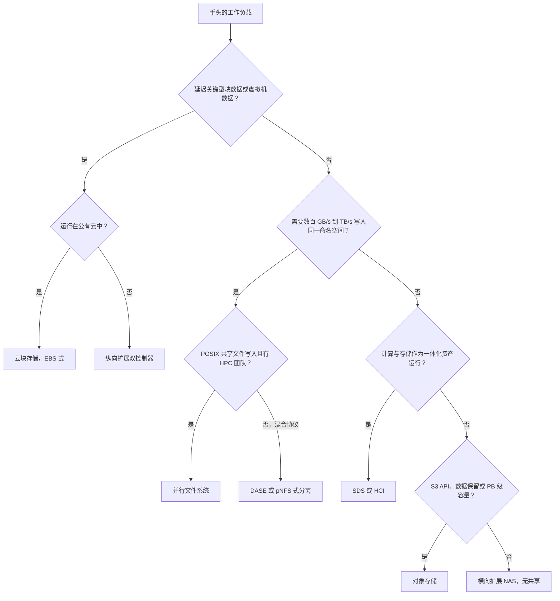
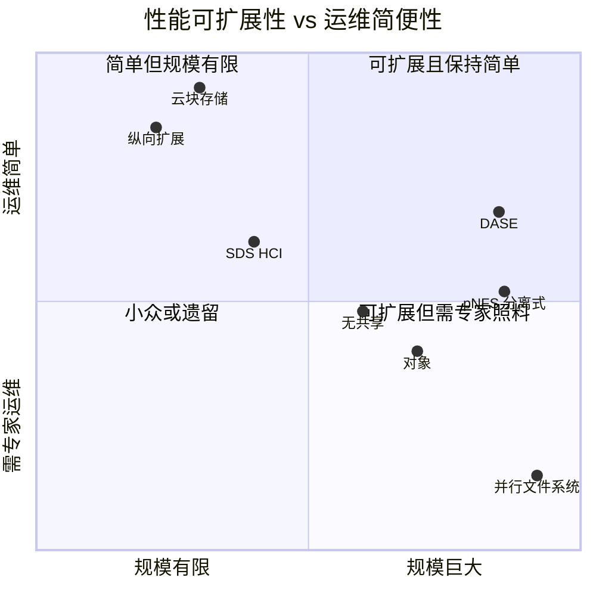

# 24. 架构决策矩阵

> 📄 英文原文：[docs/03-system-architecture/24-architecture-decision-matrix.md](../../../docs/03-system-architecture/24-architecture-decision-matrix.md) · 本文为简体中文参考译本，如有出入以英文原文为准。

> **深度：** L2 · **阅读时间：** 约 8 分钟 · **最后核实：** 2026-11-01
> **前置阅读：** [存储栈](13-storage-stack.md) · [纵向扩展双控制器](14-scale-up-dual-controller.md) · [横向扩展无共享](15-scale-out-shared-nothing.md) · [DASE](16-disaggregated-shared-everything.md) · [并行文件系统](17-parallel-file-systems.md) · [对象存储](18-object-storage-architecture.md) · [SDS 与 HCI](19-software-defined-and-hci.md)

## 要点速览（TL;DR）

- **七种架构几乎覆盖所有交易。** 每种架构都有其主场工作负载和难以逾越的"墙"（第 14–19 章）。
- **五个问题决定了大多数交易：** 规模多大、采用什么协议、看重延迟还是吞吐量、客户能接受多大的故障域，以及由谁运维、成本几何。厂商功能排在其后。
- **最深的分野是延迟受限与吞吐量受限。** 数据库和虚拟机需要亚毫秒级的块存储；AI 训练和 HPC 需要以 TB/s 级带宽写入同一个命名空间。
- **AI 并非单一工作负载。** 数据加载、检查点保存、KV 缓存服务和 RAG 分别落在不同的单元格中，因此"AI 存储"是一个产品组合问题。
- **边界正在模糊。** 如今人人都在卖"统一"的块、文件和对象存储，Gartner 的 2025 年魔力象限也把它们合并为一个类别[^1]。但在底层，各架构及其"墙"并未趋同。

## 对 Everpure 战略的意义

Everpure 销售三种架构：纵向扩展（FlashArray）；分区式刀片横向扩展（FlashBlade//S 和 //E）——Everpure 的工程师称之为"分区写入者"（partitioned-writer），认为无共享和全共享这两个标签都不贴切[^2]（[第 15 章](15-scale-out-shared-nothing.md)）；以及将元数据与数据分离的 pNFS 式并行设计（FlashBlade//EXA，[第 17 章](17-parallel-file-systems.md)）。此外还有容器原生的 SDS（Portworx）以及运行在公有云中的 Purity。它不销售 DASE 系统，因为在 EXA 中没有任何计算层能访问全部介质（[第 16 章](16-disaggregated-shared-everything.md)）；也不销售通用 HCI。战略团队需要知道哪些单元格由 Everpure 原生覆盖、哪些靠合作伙伴、哪些单元格竞争对手在设计上更契合——因为在后者中，靠折扣是赢不下来的。

该矩阵也能防止类别误判：企业提出的"AI 存储"需求，往往主要是容量和治理问题。

## 核心概念

### 热力图

| 架构 | OLTP 数据库 | 虚拟机 / VDI | 容器 | 备份 / 恢复 | HPC 仿真 | AI 训练（数据加载） | AI 检查点保存 | AI 推理 / KV 缓存 | RAG / 向量 | 归档 |
|---|---|---|---|---|---|---|---|---|---|---|
| **纵向扩展双控制器** | ● 亚毫秒、同步复制、成熟 | ● 克隆可去重、与虚拟化平台深度集成 | ◐ CSI 可用，受单阵列上限约束 | ◐ 恢复快，每 TB 价格高 | ○ 单个控制器对限制带宽 | ○ 单个控制器对限制 GB/s | ◐ 小集群够用 | ◐ 延迟低，共享规模有限 | ● 向量数据库本质上是数据库 | ○ $/TB 过高 |
| **横向扩展无共享（含分区式）** | ◐ 东西向跳转增加延迟 | ◐ 可用；重建会冲击尾延迟 | ◐ Ceph/Rook 常见，运维负担重 | ● 容量逐节点增长 | ◐ WEKA 强，NAS 较弱 | ● 带宽随节点增长 | ● 每个节点都能吸收写入 | ◐ NVMe 靠近 GPU，取决于厂商 | ◐ 语料没问题，索引放别处 | ◐ HDD 节点，扩展捆绑 |
| **DASE** | ◐ 块存储较新，需经网络跳转 | ◐ NFS 数据存储；块存储尚年轻 | ◐ CSI 没问题，最小规模大 | ● QLC 加数据缩减，恢复快 | ● 单一命名空间，数 TB/s | ● 专为 GPU 集群读取而建 | ● SCM 缓冲吸收突发写入 | ● 任一节点都能访问共享闪存 | ◐ 语料适配；引擎因厂商而异 | ◐ 只有规模足够大时才便宜 |
| **并行文件系统（含 pNFS 分离式）** | ○ 语义和延迟都不对 | ○ 不适合作数据存储（datastore） | ◐ 共享挂载，客户端有摩擦 | ○ 作为备份目标昂贵且复杂 | ● 它的主场 | ● 条带化可喂饱数千块 GPU | ● 客户端直接写入服务器 | ◐ 带宽够，集成仍在成熟中 | ○ 小文件给元数据带来压力 | ○ 闪存层成本过高 |
| **对象** | ○ 不支持原地更新 | ○ 不是块存储 | ◐ 云原生应用使用 S3 | ● 不可变性、低成本、跨地域 EC | ○ 无 POSIX，需要数据暂存 | ◐ 配合流式加载器可用 | ◐ 异步上传可行，同步写入慢 | ◐ 适合容忍延迟的 KV 层 | ● 数据湖语料、原生向量 | ● $/TB 最低、跨地域 EC |
| **SDS / HCI** | ◐ 本地读取，扩展耦合 | ● HCI 最初的用例 | ● 容器原生数据服务 | ◐ 仅限小型站点 | ○ 节点耦合，无条带化 | ○ GPU 服务器不是 HCI | ○ 并非为突发写入而建 | ○ 不在 GPU 网络上 | ◐ 向量数据库 Pod 没问题 | ○ 全闪存 HCI 每 TB 成本高 |
| **云块存储（EBS 式）** | ● 亚毫秒 io2，按 IOPS 付费 | ● 原生启动卷 | ◐ CSI 可用，卷绑定可用区 | ◐ 快照存入 S3，有出口流量费 | ○ 单卷吞吐量上限 | ○ 单挂载，卷容量上限 | ○ 单卷约 4 GB/s | ○ 无共享命名空间 | ◐ 向量数据库运行在卷上 | ○ 应改用对象存储层 |

**图例：** ● 天然契合，即该架构的设计初衷 · ◐ 可用但有附加条件，或取决于厂商 · ○ 契合度差，通常是选错了工具。评级为本图谱对 2026 年典型部署的判断，并非基准测试结果；强势产品可以超越其所在行的水平。SDS / HCI 一行评价的是 HCI 和容器原生 SDS；以软件形式出售、运行于通用服务器的 SDS（WEKA、Ceph、VAST 的纯软件路线）按其所属架构的行评级（[第 19 章](19-software-defined-and-hci.md)）。

*图 24.1 — 按行阅读热力图可看出某种架构的主场，按列阅读可看出哪些架构在争夺同一工作负载。大多数列都有两三个可信答案，而非唯一答案。*

**Everpure 产品的位置。** FlashBlade//S 和 //E 属于横向扩展这一行。命名空间和写入所有权被划分为运行在刀片上的"authorities"，与无共享架构中的所有者非常相似，同时 Purity 在整个机箱范围内管理 DFM 闪存和 NVRAM（[第 15 章](15-scale-out-shared-nothing.md)）。池化的介质管理缓解了该行在重建和热点方面的附加条件，但并不改变其 OLTP 和归档单元格的评级。FlashBlade//EXA 属于并行文件系统这一行，而非 DASE。客户端先从元数据核心获取布局，然后直接与数据节点之间传输数据，即 Lustre 的 MDS/OSS 模式（[第 17 章](17-parallel-file-systems.md)）。其标准 pNFS 客户端缓解了该行"客户端有摩擦"的附加条件，其 Purity 元数据核心则针对小文件这一弱点（公司自述，[第 21 章](21-metadata.md)）。其故障域方面的说法较弱：数据节点的保护机制尚未公开记录。

### 决定一笔真实交易的五个问题

| 问题 | 要问什么 | 倾向于 |
|---|---|---|
| **规模** | 当前和三年后的容量；有多少客户端 | <~2 PB、数十台主机 → 纵向扩展；多 PB、数千个客户端 → 横向扩展、DASE、并行文件系统、对象 |
| **协议** | 块、NFS/SMB、POSIX 共享文件、S3 | 块 → 纵向扩展或云块存储；S3 → 对象；多节点共享文件写入 → 并行文件系统 |
| **延迟 vs 吞吐量** | p99 延迟目标，还是聚合 GB/s | 延迟 → 跳数最少（纵向扩展）；吞吐量 → 并行路径最多（并行文件系统、DASE） |
| **故障域** | 单个故障可能拖垮什么？重建需要多久？ | 爆炸半径小 → 多个小阵列；宽 EC → 大型共享池 |
| **运维模式与经济性** | 由谁运维、是否允许内核客户端、资本支出还是服务 | 团队精简 → 一体机或云；有 HPC 团队 → 并行文件系统；看重每 TB 成本 → 对象/QLC |

*图 24.2 — 前三个问题把矩阵缩小到一两行；后两个问题通常在其中做出选择。*

**延迟与吞吐量**是最深的分野，而这是物理规律。在联网的全闪存阵列上，一次 4 KB 的数据库写入大约在 100–250 µs 内完成（[第 13 章](13-storage-stack.md)）。每多一次网络跳转或请求转发，就会增加数十微秒，因此延迟上的赢家是主机与 NVRAM 之间跳数最少的设计。吞吐量则是相反的问题。一个 405B 参数模型的检查点约为 405e9 × 16 bytes ≈ 6.5 TB。按 20 GB/s（示意性的单阵列数值）计算，写入需要 6.5e12 ÷ 20e9 ≈ 325 s。而按 30 个 FlashBlade//EXA 数据节点在 MLPerf Storage v3.0 中取得的 877.5 GiB/s[^3]（≈ 942 GB/s）计算，仅需 ≈ 7 s。这一差距就是并行路径的全部理由。半导体类比是 HBM 与 DRAM 的取舍：HBM 靠加宽接口赢得带宽，DDR 在成本和容量上胜出，没有任何单一接口能两者兼得。

**故障域**的代价是规格表所掩盖的。双控制器阵列最多只损失它自身；而一个 DASE 机柜或无共享节点故障，会让一个巨型命名空间中的一部分进入重建（[第 20 章](20-distributed-systems-fundamentals.md)）。

### 决策树

*图 24.3 — 决策树给出起始行；随后用故障域和经济性问题加以检验，实际的 IT 环境通常最终会用到两三行。*

### 为有争议的单元格提供依据

- **纵向扩展在 RAG/向量上得 ●。** 向量数据库本质上是数据库。其热索引驻留在 DRAM 或低延迟块存储上，而阵列很擅长提供这类服务。源语料则应放在对象或文件存储中，这也是对象存储同样得 ● 的原因——AWS 于 2025 年 12 月正式推出 S3 Vectors，每个索引最多支持二十亿个向量，进一步助推了这一点[^4]。
- **无共享和 DASE 在 OLTP 上得 ◐ 而非 ○**，尽管第 15 章和第 16 章都把延迟关键型块存储列为其最不适合的场景之一。Dell PowerFlex 等块 SDS 在运行生产数据库，VAST 也于 2025 年加入了 NVMe/TCP 块存储[^5]。但每次 I/O 仍要经过一次后端跳转，目前也很少有银行在这两者上运行一级（tier-1）数据库。
- **对象在训练和检查点保存上得 ◐**，尽管第 18 章把分片数据集和检查点列为其最适合的场景之一。许多实验室通过带缓存的加载器从 S3 流式读取分片，并从本地 NVMe 异步上传检查点。◐ 反映的是同步检查点写入和小文件随机访问的问题——后者会使训练降为 ○。
- **并行文件系统在 KV 缓存上得 ◐。** 带宽是够的，EXA 也在 v3.0 的 KV 缓存读取测试中领先[^3]，但服务数以百万计、对延迟敏感的小型 KV 块，相比流式写入检查点仍属较新的领域（[第 32 章](../05-ai-storage/32-inference-and-kv-cache.md)）。
- **云块存储虽然成本高，在 OLTP 上仍得 ●。** io2 Block Express 承诺在 16 KiB 下平均延迟低于 500 µs，单卷 256K IOPS[^6]。异议在于每 IOPS 的价格，而非契合度。

### 象限视图

*图 24.4 — 各点位置为本图谱的判断：商业上的最大奖赏位于右上象限，DASE 已占据该象限，pNFS 式分离设计正试图进入，因此 AI 时代的竞争集中于此。*

对象存储位置偏低，是因为自行运维 PB 级对象存储需要专业能力；托管的 S3 则会落在云块存储附近。DASE 得分较高，是因为无状态计算节点让升级成为例行操作。pNFS 分离式（FlashBlade//EXA 的设计）介于 DASE 与经典并行文件系统之间。标准 NFS 客户端免去了 Lustre 内核模块的生命周期管理，但客户仍需运行 RDMA 数据网络，而对于 EXA，还要自行采购并运维数据节点服务器（[第 17 章](17-parallel-file-systems.md)）。

### 边界正在何处模糊

三股力量正在模糊各行之间的界限。其一，**协议统一**：FlashArray 于 2025 年获得 S3 支持[^7]，VAST 加入了块存储[^5]，WEKA 的 NeuralMesh 6 统一了文件和对象[^8]，HPE 则把 Alletra Storage MP 系列定位为同时承载块（B10000）以及文件和对象（X10000）的单一平台[^9]。其二，**控制平面统一**：Everpure 的 Enterprise Data Cloud[^10] 和 DDN 架设在 EXAScaler 与 Infinia 之上的 CORE 层[^11]，都把多种架构呈现为一个资源池。其三，**混合架构**：FlashBlade//EXA 是构建在横向扩展元数据引擎之上的并行文件系统（[第 17 章](17-parallel-file-systems.md)）。NetApp 的 AFX 采用共享介质，但其文档面向的是 NAS 和对象，而非块存储[^12]。

用矩阵检验任何"统一"的说法：该协议是为哪一列*追加*的？它的延迟和故障域能否与原生设计相匹配？

## Everpure 的做法与竞争对手对比

| 架构 | Everpure | 传统厂商（在位者）竞争对手 | AI 原生、软件及云竞争对手 |
|---|---|---|---|
| 纵向扩展双控制器 | FlashArray //X、//C、//XL、//E、//ST[^7] | Dell PowerStore、PowerMax；NetApp AFF/ASA；HPE Alletra MP B10000；IBM FlashSystem | — |
| 横向扩展无共享或分区式 | FlashBlade//S、//E（分区式横向扩展：每个刀片拥有各自的 authorities，介质管理池化；Everpure 称之为"partitioned-writer"[^2]） | Dell PowerScale；NetApp ONTAP 集群 | WEKA NeuralMesh、Qumulo、Ceph |
| DASE | 无；EXA 改为将元数据与数据分离（[第 16 章](16-disaggregated-shared-everything.md)） | NetApp AFX[^12]；HPE Alletra MP X10000[^9] | VAST Data |
| 并行文件系统 | FlashBlade//EXA（pNFS 元数据/数据分离）[^13] | Dell PowerScale pNFS / Lightning；HPE Cray E2000（Lustre）[^14]；IBM Storage Scale | DDN EXAScaler、BeeGFS、Hammerspace |
| 对象 | FlashBlade S3；FlashArray S3[^7] | Dell ObjectScale；NetApp StorageGRID；HPE X10000 | AWS S3、MinIO AIStor、Cloudian、Scality、DDN Infinia |
| SDS / HCI | Portworx；作为 Nutanix 后端的 FlashArray[^15] | Nutanix；VMware vSAN（Broadcom） | Ceph，Red Hat 和 IBM 发行版 |
| 云块存储 | Pure Storage Cloud Dedicated（原 Cloud Block Store）及 Azure Native[^16] | 超大规模云中的 NetApp ONTAP | AWS EBS、Azure Managed Disks、Google Hyperdisk |

*表 24.5 — Everpure 原生覆盖七行中的五行，另外以 Portworx 覆盖 SDS / HCI 行中的 SDS 部分，并通过合作覆盖其中的 HCI 部分；DASE 是它与之竞争、而非身处其中的一行。*

VAST 的最强版本论证（steelman）：一套 DASE 系统以单一命名空间和单一数据缩减域覆盖热力图右半部分的大部分，非常适合新兴 GPU 云（neocloud）。Dell 和 NetApp 的最强版本论证：在一份合同下，几乎每一行都有原生产品。Everpure 的反驳是：在 FlashArray 和 FlashBlade 上运行同一个操作系统家族（Purity）——包括 EXA 的元数据核心，但不包括其 Linux 数据节点——加上一个统一的控制平面（Pure1、Fusion），以及来自 DirectFlash 的介质经济性（[第 26 章](../04-everpure/26-purity-and-directflash.md)）。基于公开信息，战略团队可能评估的选项包括：更快地补齐 KV 缓存单元格（面向 FlashBlade 的 PureKVA 已于 2026 年 9 月发布，计划 10 月上市[^17]）；利用 Portworx 在 Kubernetes 虚拟机迁移单元格中的优势带动阵列销售；以及让"统一"的营销话术以逐个工作负载的实证为支撑。

## 历史与发展轨迹

大约在 2010 年以前，矩阵只有三行：SAN 阵列、NAS 文件服务器和磁带。无共享和对象存储随网络规模（web-scale）数据而来，HCI 随 2010 年代的虚拟化而来，DASE 和 pNFS 的复兴则随 GPU 而来。2025 年，市场开始合并各行：Gartner 新设的企业存储平台（Enterprise Storage Platforms）类别[^1]、2025 年 10 月的 NetApp AFX[^12]，以及 2025 年 11 月的 DDN CORE[^11]。2027 年值得关注的信号是：买方会跨列运行单一平台——正如据报道 CoreWeave 与 VAST 签订的 US$1.17B 协议对新兴 GPU 云所预示的那样[^18]——还是像大多数企业目前那样，继续在每一列选用最佳单品（best-of-breed）。

## 关键数字

| 指标 | 数值 | 背景 | 来源 / 日期 |
|---|---|---|---|
| 联网全闪存阵列的 4 KB 写入 | 约 100–250 µs | 纵向扩展为何主导 OLTP | 算例，[第 13 章](13-storage-stack.md) |
| io2 Block Express 单卷 | 256K IOPS、4,000 MB/s、平均 <500 µs（16 KiB） | 云块存储适合 OLTP，但不适合大批量吞吐 | AWS 文档[^6] |
| FlashBlade//EXA 检查点写入 | 877.5 GiB/s，30 个数据节点 | 标准基准测试中的并行路径上限 | MLPerf Storage v3.0，2026-09[^3] |
| 405B 模型检查点，20 GB/s vs 约 942 GB/s | 约 325 s vs 约 7 s | 吞吐量受限型工作为何需要横向扩展路径 | 算例 |
| Lustre 在 Top500 中的占比 | >60% | 并行文件系统仍主导 HPC | ACM TOS，2025-06[^19] |
| 每个 S3 Vectors 索引的规模 | 最多 2 billion（二十亿）个向量 | 对象存储正在进入 RAG 这一列 | AWS，2025-12[^4] |
| NetApp AFX 规模 | 最多 128 个控制器 | 设计上限；早期 ONTAP 版本支持的数量更少（[第 16 章](16-disaggregated-shared-everything.md)） | NetApp 文档[^20] |

## 对话手册

**向产品经理提的问题**
1. *"哪些单元格我们输在架构而非价格上？"* 高质量回答：点名这些单元格（共享文件写入型 HPC、多站点跨地域 EC 对象存储），并为每个单元格给出方案：合作、纳入路线图或主动放弃。
2. *"'统一'在哪些方面真正帮到买方？"* 高质量回答：单一控制平面和单一支持合同，同时坦诚说明哪个协议是原生的。
3. *"按单元格划分，我们的 AI 推理叙事是什么？"* 高质量回答：把 KV 缓存（PureKVA）、RAG 语料（FlashBlade S3/NFS）和向量数据库块存储（FlashArray）区分开来。

**向工程师提的问题**
1. *"通过横向扩展设计提供块存储，p99 延迟要付出多少代价？"* 高质量回答：以微秒计的额外跳转开销，再加上重建对尾延迟的影响。
2. *"目前 EXA 数据层的故障域有多大？"* 高质量回答：说明当前的数据节点保护方案 [VERIFY: FlashBlade//EXA 当前的数据节点保护方案] 以及每个节点的重建时间。
3. *"决策树在哪里会失效？"* 高质量回答：小文件 AI 数据集看似受吞吐量限制，实则受元数据限制（[第 21 章](21-metadata.md)）。

**不要这样说：**
- "一个平台通吃所有工作负载。"没有哪种架构能在每一列都得 ●，Everpure 的也不例外。
- "对象存储只用于归档。"它是 RAG 和数据湖的默认底座。
- "并行文件系统是过时的 HPC 技术。"它们在 AI 检查点保存基准测试中处于领先。
- "DASE 做不了块存储。"它能做；问题在于延迟和成熟度。
- "FlashBlade 是 Everpure 用来对抗 VAST 的全共享方案。"FlashBlade//S 是分区式横向扩展设计，EXA 是元数据/数据分离设计；两者都不是 DASE。

## 深入阅读（可选，L3 指引）

- 用针对具体工作负载的基准测试检验各单元格：MLPerf Storage、SPECstorage 和 IO500（[第 37 章](../05-ai-storage/37-reading-benchmarks.md)）。
- 逐厂商的对比矩阵见[第 45 章](../06-industry-and-competition/45-head-to-head.md)和[第 49 章](../06-industry-and-competition/49-competitive-matrices.md)；AI 各列背后的 AI 流水线阶段见[第 30 章](../05-ai-storage/30-ai-data-pipeline.md)。

## 关键术语

架构决策矩阵（architecture decision matrix）· 工作负载契合度（workload fit）· 延迟受限（latency-bound）· 吞吐量受限（throughput-bound）· 故障域 · 爆炸半径（影响范围） · 统一存储平台（unified storage platform）· 企业存储平台（enterprise storage platform）· 云块存储（cloud block storage）· S3 Vectors · PureKVA。参见[术语表](../glossary.md)。

## 资料来源

[^1]: Gartner, "Magic Quadrant for Enterprise Storage Platforms" (abstract), 2025-09-02. https://www.gartner.com/en/documents/6908066 (retrieved 2026-11-01).
[^2]: J. Emerson (Pure Storage), "The Storage Architecture Spectrum: Why 'Shared-nothing' Means Nothing," n.d. https://blog.everpuredata.com/perspectives/the-storage-architecture-spectrum-why-shared-nothing-means-nothing/ (retrieved 2026-11-01; seen via search summary, host not fetchable).
[^3]: StorageReview, "MLPerf Storage v3.0: 877 GiB/s Checkpoints, a Cloud First, and a Leaderboard Turned Over," 2026-09. https://www.storagereview.com/news/mlperf-storage-v3-0-877-gib-s-checkpoints-a-cloud-first-and-a-leaderboard-turned-over (retrieved 2026-11-01); HPCwire, "Everpure Leads MLPerf Storage Tests for Large Model Checkpointing and KV Cache," 2026-09-02. https://hpcwire.com/off-the-wire/everpure-leads-mlperf-storage-tests-for-large-model-checkpointing-and-kv-cache (retrieved 2026-11-01).
[^4]: AWS, "Amazon S3 Vectors is now generally available with 40 times the scale of preview," 2025-12-02. https://aws.amazon.com/about-aws/whats-new/2025/12/amazon-s3-vectors-generally-available/ (retrieved 2026-11-01).
[^5]: VAST Data, "The latest VAST release is all about the protocols," 2025-02. https://vastdata.com/blog/the-latest-vast-release-is-all-about-the-protocols (retrieved 2026-11-01); Blocks & Files, "VAST Data expands into block storage and event broking," 2025-02-19. https://www.blocksandfiles.com/ai-ml/2025/02/19/vast-data-expands-into-block-storage-and-event-broking/1600470 (retrieved 2026-11-01).
[^6]: AWS, "Amazon EBS Provisioned IOPS SSD volumes," Amazon EBS User Guide, n.d. https://docs.aws.amazon.com/ebs/latest/userguide/provisioned-iops.html (retrieved 2026-11-01).
[^7]: Techzine, "Pure surprises: FlashArray gets S3 support, FlashArray//ST without DFMs," 2025-06. https://www.techzine.eu/blogs/infrastructure/132388/pure-surprises-flasharray-gets-s3-support-flasharray-st-without-dfms/ (retrieved 2026-11-01).
[^8]: HPCwire, "WEKA Launches NeuralMesh 6 and WEKApod as AI Inference Pushes Infrastructure Limits," 2026-07-22. https://www.hpcwire.com/2026/07/22/weka-launches-neuralmesh-6-and-wekapod-as-ai-inference-pushes-infrastructure-limits/ (retrieved 2026-11-01).
[^9]: HPE via Business Wire, "HPE Named a Leader in 2025 Gartner Magic Quadrant for Enterprise Storage Platforms," 2025-09-05. https://www.businesswire.com/news/home/20250905961275/en/HPE-Named-a-Leader-in-2025-Gartner-Magic-Quadrant-for-Enterprise-Storage-Platforms (retrieved 2026-11-01).
[^10]: Blocks & Files, "Pure debuts Enterprise Data Cloud with Fusion updates and new FlashArray systems," 2025-06-18. https://www.blocksandfiles.com/ai-ml/2025/06/18/pure-debuts-enterprise-data-cloud-with-fusion-updates-and-new-flasharray-systems/100996 (retrieved 2026-11-01).
[^11]: Blocks & Files, "DDN goes hard CORE," 2025-11-18. https://www.blocksandfiles.com/ai-ml/2025/11/18/ddn-goes-hard-core/1718766 (retrieved 2026-11-01).
[^12]: NetApp, "AFX overview: capabilities," ONTAP technical reports, n.d. https://docs.netapp.com/us-en/ontap-technical-reports/afx-overview/afx-overview-capabilities.html (retrieved 2026-11-01); Blocks & Files, "NetApp disaggregates ONTAP storage and provides an AI Data Engine," 2025-10-14. https://blocksandfiles.com/2025/10/14/netapp-disaggregates-ontap-storage-and-provides-an-ai-data-engine/ (retrieved 2026-11-01).
[^13]: Everpure, "Technical Brief: FlashBlade//EXA," n.d. (2025). https://www.everpuredata.com/content/dam/pdf/en/technical-briefs/tb-flashblade-exa.pdf (retrieved 2026-11-01).
[^14]: Cray User Group, CUG 2025 proceedings paper on HPE Cray Supercomputing Storage Systems E2000, 2025. https://cug.org/proceedings/cug2025_proceedings/includes/files/pap108s2-file1.pdf (retrieved 2026-11-01).
[^15]: StorageNewsletter, "Availability of Nutanix with Pure Storage FlashArray," 2026-01-02. https://www.storagenewsletter.com/2026/01/02/availability-of-nutanix-with-pure-storage-flasharray/ (retrieved 2026-11-01).
[^16]: Pure Community, "Pure Cloud Block Store is now Pure Storage Cloud Dedicated," n.d. https://purecommunity.purestorage.com/tag/cloud (retrieved 2026-11-01); Microsoft Learn, "Pure Storage Cloud overview," n.d. https://learn.microsoft.com/en-us/azure/partner-solutions/pure-storage/overview (retrieved 2026-11-01).
[^17]: Blocks & Files, "Everpure bulks up AI offer," 2026-09-30. https://blocksandfiles.com/flash/2026/09/30/everpure-bulks-up-ai-offer/5300162 (retrieved 2026-11-01).
[^18]: StorageNewsletter, "Vast Data Secures Commercial Partnership Deal with CoreWeave for $1.17 Billion to Power the Next Generation of AI," 2025-11-07. https://www.storagenewsletter.com/2025/11/07/vast-data-secures-commercial-partnership-deal-with-coreweave-for-1-17-billion-to-power-the-next-generation-of-ai/ (retrieved 2026-11-01).
[^19]: R. S. George, A. Dilger et al. (ORNL and others), "Lustre Unveiled: Evolution, Design, Advancements, and Current Trends," *ACM Transactions on Storage* 21(3), 2025-06. DOI 10.1145/3736583. https://www.ornl.gov/publication/lustre-unveiled-evolution-design-advancements-and-current-trends (retrieved 2026-11-01).
[^20]: NetApp, "FAQ for AFX storage systems," n.d. https://docs.netapp.com/us-en/ontap-afx/faq-ontap-afx.html (retrieved 2026-11-01).
