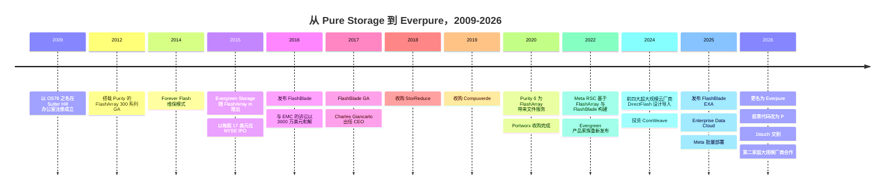
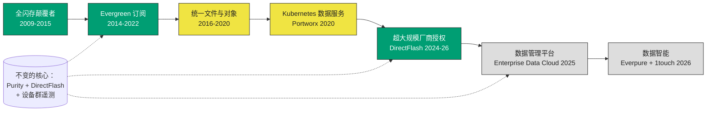
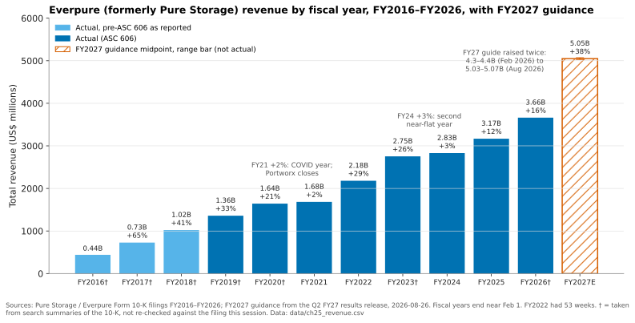

# 25. 公司历史与战略，2009–2026

> 📄 英文原文：[docs/04-everpure/25-company-history-and-strategy.md](../../../docs/04-everpure/25-company-history-and-strategy.md) · 本文为简体中文参考译本，如有出入以英文原文为准。

> **深度：** L2 · **阅读时间：** 约 9 分钟 · **最后核实：** 2026-11-01
> **前置阅读：** [数据缩减](../01-storage-fundamentals/05-data-reduction.md) · [消费模式](../03-system-architecture/23-consumption-models.md) · [Purity 与 DirectFlash](26-purity-and-directflash.md)

## 要点速览（TL;DR）

- **Pure Storage 于 2009 年创立，立足于一个洞见**：消费级闪存加上激进的数据缩减，可以在每可用 TB 成本上追平磁盘。FlashArray 于 2012 年 5 月正式发布（GA）；IPO 随后于 2015 年 10 月完成。
- **其持久的护城河是商业模式，而非硬件本身**。Forever Flash（2014）和 Evergreen（2015）把控制器升级变成了订阅；FY2026 订阅 ARR 为 $1.92B。
- **收购规模小、以获取能力为导向**。StorReduce、Compuverde、Portworx 和 1touch 合计已披露对价约 $0.6B，不到一年的自由现金流。其中一笔（StorReduce）形成的产品后来被悄然撤下。
- **最新的增长引擎是出售 IP 而非阵列**。与 Meta（2024 年 12 月）以及第二家前五大超大规模云厂商（2026 年 8 月）达成的 DirectFlash 授权合作是实打实的，但超大规模业务在 FY2027 收入指引 $5.03–5.07B（约 +38%）中仍只占一小部分。
- **2026 年 2 月更名为 Everpure（NYSE: P，原 PSTG）是一种主张，尚未成为结果**。它在争取数据平台式的估值，而收入仍主要来自阵列及其附带订阅。

## 对 Everpure 战略的意义

Everpure 内部的战略讨论都带着这段历史的印记。产品经理为 Evergreen 辩护，因为它建立了装机基础；工程师信任 Purity，因为它挺过了 14 年的多代 NAND 演进；企业发展团队则继承了一种以小型补强收购（tuck-in）购买能力而非收入的模式。哪些押注成功、哪些迟到、哪些夭折，能告诉你这个组织会如何权衡新的押注。

更名、1touch 收购和超大规模厂商授权，都在远离"我们卖最好的闪存阵列"这一定位。这是同一条主线上的第五次转型，还是一次断裂？过往记录指向前者，但有一个前提：以往的转型都由阵列现金流托底，最新的转型同样如此。

## 核心概念

### 一图看十七年

*图 25.1 — 每个时代都在同一套 Purity 与 DirectFlash 核心之上叠加一层：阵列（2012）、商业模式（2014–15）、文件与对象（2016–20）、云原生软件（2020）、IP 授权（2024）和数据智能（2026）。*

### 第一阶段，2009–2015：全闪存颠覆者

公司于 2009 年 10 月以 OS76, Inc. 之名在特拉华州注册成立，并于 2010 年 1 月更名为 Pure Storage[^1]。创始人 John Colgrove（来自 Veritas）和 John Hayes（来自 Yahoo）由 Sutter Hill Ventures 孵化[^2]。2009 年，企业级闪存意味着只用于少数热点数据库的昂贵 SLC 硬盘。Pure 押注：由软件进行重复数据删除、压缩并保护存储单元的消费级 MLC 闪存，可以在主存储中取代磁盘。示意：如果 5:1 的数据缩减率能让每 TB 价格为磁盘五倍的原始闪存在每*有效* TB 上与磁盘持平，那么速度优势几乎是白送的（[第 5 章](../01-storage-fundamentals/05-data-reduction.md)）。

可以类比为一家无晶圆厂（fabless）初创公司靠设计能力在廉价成熟制程上胜出。经过两年 beta 测试，FlashArray 300 系列于 2012 年 5 月正式发布，运行 Purity 操作环境[^3]。它采用"所有软件均包含在内"（All Software Included）的授权方式[^1]。

第二个洞见是商业层面的。传统厂商的大部分利润来自每三到五年一次的整机替换式升级（forklift upgrade）。2014 年 2 月，Pure 推出 *Forever Flash*，在续签维保时包含控制器更新[^4]。2015 年 6 月，它将其扩展为 *Evergreen Storage* 计划，与 FlashArray//m 同时发布[^5]。四个月后，IPO 定价 $17，募资 $425M（25M 股）[^6]。股价首日收于 $16.01[^7]。传统厂商则诉诸法庭反击：2016 年 10 月，Pure 向 EMC 的新东家 Dell 支付 $30M，了结了 EMC 提起的专利与商业秘密诉讼[^8]。

### 第二阶段，2016–2020：第二款产品、新 CEO、首批交易

FlashBlade 是面向非结构化数据的横向扩展（scale-out）文件与对象系统，于 2016 年 3 月发布，2017 年 1 月 25 日 GA[^9]。2017 年 8 月，董事会任命原 Cisco CTO Charles Giancarlo 为 CEO，接替 Scott Dietzen[^10]。DirectFlash 模块让原始 NAND 直接受 Purity 控制，而非藏在 SSD 控制器之后，它随 FlashArray//X 于 2017 年 4 月推出[^11]（[第 26 章](26-purity-and-directflash.md)）。

随后 26 个月内完成了三笔收购（表 25.1）。

| 标的 | 宣布 → 交割 | 价格（已披露） | 逻辑 | 后续结果 |
|---|---|---|---|---|
| StorReduce | 2018 年 8 月 | 现金 $20.5M，扣除所获现金后净额[^12] | 面向对象与备份数据的云原生去重 | 成为 ObjectEngine 备份一体机（2019）。到 2020 年年中已从 Pure 的产品页面消失，未找到正式的停产（EOL）公告[^13] |
| Compuverde（瑞典） | 2019 年 4 月 | 净额 $47.9M，另在两年内向原股东支付 $15.9M[^14] | 为 FlashArray 获取文件系统软件与团队 | 成为 Purity//FA 6.0（2020 年 6 月）原生文件服务的基础[^15] |
| Portworx | 2020 年 9 月 → 2020 年 10 月 | 对价 $352.9M，另加 $32.2M 留任激励（宣布时约 $370M）[^14][^16] | Kubernetes 持久化存储与数据服务 | 以 Portworx by Everpure 名义销售。3.6 版（2026 年 3 月）面向在 Kubernetes 上运行虚拟机（KubeVirt）[^17] |
| CoreWeave（少数股权） | 2024 年 11 月 | 未披露 | 打入 GPU 云的渠道 | 成为 CoreWeave 的首选存储选项之一[^18]。CoreWeave 后来与 VAST 签署了 $1.17B 的平台协议[^19] |
| 1touch | 2026 年 2 月 23 日 → 2026 年 5 月 7 日 | 现金 $125.0M；其中 $101.2M 计入商誉[^20] | 数据发现、分类与语义上下文 | 重新发布为 Everpure Data Intelligence，2026 年 6 月 GA[^21] |

*表 25.1 — Everpure 购买的是能力而非收入；唯一明确失败的一笔（StorReduce）也是最便宜的一笔。*

四笔收购的已披露对价为 20.5 + 47.9 + 15.9 + 352.9 + 32.2 + 125.0 ≈ $594M，跨越八年，低于 FY2026 自由现金流 $616M[^22]。没有一笔交易买来了大规模装机基础；每一笔都必须融入 Purity，或与之并列。

### 第三阶段，2020–2023：订阅化与首次 Meta 合作

FY2021 收入仅增长 2%，公司将其归因于 COVID-19。FY2022 随后增长 29% 至 $2.18B[^23]。Meta 成为标杆 AI 客户：其 2022 年 1 月发布的 AI Research SuperCluster 使用了 175 PB 的 FlashArray 和 10 PB 的 FlashBlade[^24]。2022 年 6 月，Pure 将 Evergreen 重组为 //Forever、//Flex 和 //One（存储即服务）[^25]（[第 23 章](../03-system-architecture/23-consumption-models.md)）。

2023 年 5 月，一位 Pure 高管预言 2028 年之后将不再有新的硬盘售出。Coughlin Associates 等分析机构对此提出异议[^26][^27]。这是一句营销口号，但指向了真正的战略：超大规模场景下的 QLC DirectFlash。

### 第四阶段，2024–2025：从阵列厂商到 IP 授权方

2024 年 12 月 3 日，Pure 宣布与一家"前四大超大规模云厂商"达成 DirectFlash 设计导入（design win）[^28]。FY2025 10-K 随后披露该客户为 Meta[^29]。该超大规模厂商自行采购硬件和 NAND；Pure 授权 Purity 与 DirectFlash 技术并提供支持[^28]。这是一种 Arm 式 IP 授权：Pure 以硬件收入换取利润率与覆盖面。批量部署于 FY2026 第二季度开始，CFO 的目标是到该财年末出货 1–2 EB[^30]。

2025 年又新增了面向 AI 级吞吐量的 FlashBlade//EXA（3 月）[^31]，以及 *Enterprise Data Cloud*——借助 Fusion 将整个设备群作为一个策略驱动的资源池来运营（6 月）[^32]（[第 28 章](28-platform-and-software.md)）。

*图 25.2 — 战略演进。绿色的押注已明确见效，黄色的见效较晚或范围比最初设想更窄，灰色的尚未得到验证。它们都复用同一个核心。*

### 第五阶段，2026：Everpure

2026 年 2 月 23 日，Pure Storage 更名为 Everpure，并于同日宣布收购 1touch[^33]。4 月 7 日，公司宣布 NYSE 股票代码将从 PSTG 改为 **P**，自 2026 年 4 月 17 日起生效[^34]。在 6 月的 Pure//Accelerate 大会上，公司宣布 Data Intelligence（原 1touch）和 Data Stream（一条从 GPU 数据摄取到推理的流水线）正式可用[^21]。8 月 10 日，第二家未具名的前五大超大规模云厂商签署了 DirectFlash 设计导入与供货协议。预计自 FY2028 起产生有意义的收入[^35]。

### 各阶段背后的数字

*图 25.3 — 十年间收入以约 24% 的年复合增速增长，但并不均匀。两个几乎持平的年份体现了转型的代价；而 FY2027 指引一年新增的收入，将超过 FY2021–FY2024 三年的增量。*
数据：`data/ch25_revenue.csv`

算例：FY2016 收入为 $440.3M，FY2026 为 $3,662.8M[^36][^37]。即 (3,662.8 ÷ 440.3)^(1/10) ≈ 8.32^0.1 ≈ 1.236，**约 23.6% 的 CAGR**。FY2027 指引 $5.03–5.07B[^38] 意味着按中值计算约新增 $1.39B 收入。而 FY2021 至 FY2024 仅新增 $1.15B（2,830.6 − 1,684.2）。FY2017–FY2018 按原始报告口径列示，早于 ASC 606 会计准则变更，因此并不严格可比。

### 哪些成功、哪些耗时更久、更名意味着什么

**成功的**：Evergreen——它让订阅服务收入达到 $1,691M，占 FY2026 收入的 46%，ARR 为 $1,924M[^37]；Purity 在 FlashArray 与 FlashBlade 之间共用单一代码库；以及超大规模厂商授权——它在一个财年内就实现了批量出货，尽管收入目前仍然较小。

**耗时更久或落地范围更窄的**：FlashArray 的原生文件服务从 Compuverde 交易到 Purity 6.0 用了一年，另有报道称又花了两年才成熟 [VERIFY: Purity//FA 6.4 是否为文件服务成熟的版本]。Portworx 没有单独披露的收入项，其定位也从容器转向了从 VMware 迁出虚拟机。超大规模业务收入在 FY2027 第一季度被描述为规模较小且集中在下半年[^39]。2028 年"磁盘终结"的论断仍未得到验证。

**更名的信号**：旧名称把公司与闪存介质绑定，而此时其定位正转向软件、数据服务和授权。基于公开信息，战略团队可能评估的选项包括：数据智能收入能否足够独立地披露，以支撑平台型估值倍数；是否需要更多 1touch 规模的交易（数据治理、向量、湖仓连接器），才能让"数据至上"（data primacy）在面对 VAST 的 AI OS 时具备可信度；以及在 NAND 成本上升之际，如何让阵列业务继续为这一切提供资金。Everpure 于 2026 年 2 月提价[^40]，而在战略性采购 NAND 和元器件之后，FY2027 第二季度自由现金流为 −$238M[^41]。

## Everpure 的做法与竞争对手对比

| 公司 | 起点 | 平台化举措 | AI 举措 | 资本模式 |
|---|---|---|---|---|
| Everpure | 全闪存阵列，单一操作系统（Purity） | Evergreen 订阅；Fusion/EDC；借助 1touch 实现数据智能 | FlashBlade//EXA；向超大规模厂商授权 DFM | 上市公司；以 FCF 支持小型补强收购 |
| NetApp | 统一文件/块存储（ONTAP），先混合后全闪存 | 云原生 ONTAP 服务 | AFX 分解式 ONTAP 加 AI Data Engine（2025 年 10 月）[^42] | 上市公司；有软件收购历史 |
| Dell | 收购 EMC 后拥有最广泛的产品组合 | 各产品线使用不同操作系统 | PowerScale 并行 NFS（"Lightning"）[^43] | 上市综合集团；渠道规模 |
| VAST Data | 分解式软件平台（2016） | 重新定位为"AI Operating System"（2025 年 5 月）[^44] | GPU 云与新兴 GPU 云（neocloud） | 私营；估值 $30B（2026 年 4 月，*CNBC 报道*）[^45] |
| DDN | HPC 并行文件系统 | "AI 与数据智能"定位 | NVIDIA SuperPOD 在位优势 | Blackstone 以 $5B 估值投资 $300M（2025 年 1 月）[^46] |

*表 25.2 — 各家都在向"面向 AI 的数据平台"收敛。Everpure 的独特之处在于，它依靠单一操作系统和订阅基础到达这一点，而非依靠产品组合（Dell）或从零设计的 AI 架构（VAST）。*

替代路线的最强版本论证（steelman）：VAST 的单一命名空间、存储内置数据库设计本就是为 AI 流水线而生，而 Everpure 是通过 EXA 和 Data Stream 事后补齐同类功能。Dell 和 NetApp 拥有更大的装机基础和渠道覆盖，且 NetApp 的 ONTAP 早在 Purity 6.0 之前就已用单一操作系统同时提供文件和块服务。Everpure 的反驳论点是一致性：一个操作系统、一种升级模式，以及覆盖 14 年装机系统的设备群遥测（[第 46 章](../06-industry-and-competition/46-incumbents.md)、[第 42 章](../06-industry-and-competition/42-vast-data.md)）。

## 历史与发展轨迹

截至 2027 年值得关注的、有明确日期的公开信号：

- **FY2027 第三季度**业绩将于 2026 年 11 月下旬发布，这是管理层预期超大规模业务收入显著增长的第一个季度[^39]。
- **第二家超大规模厂商**的收入预计自 FY2028 起体现[^35]。第三家合作将证明这一模式可复制。
- **NAND 定价**：2026 年的元器件价格飙升，将检验 Evergreen 合同究竟是保护还是挤压产品毛利率（[第 48 章](../06-industry-and-competition/48-media-suppliers-and-nand-cycle.md)）。
- **Data Intelligence 的采用情况**：目前尚未披露任何指标；首个客户数或 ARR 数据将是对更名的真正检验（[第 39 章](../05-ai-storage/39-agentic-ai-and-data-intelligence.md)）。

## 关键数字

| 指标 | 数值 | 背景 | 来源 / 日期 |
|---|---|---|---|
| IPO | $17/股；募资 $425M | 2015 年 10 月，NYSE: PSTG | 新闻稿，2015-10-06[^6] |
| FY2016 → FY2026 收入 | $440.3M → $3,662.8M | ≈23.6% CAGR（见上文算例） | 10-K[^36][^37] |
| FY2026 订阅 ARR | $1,924.3M（+16%） | 约占收入的 52% | FY2026 10-K[^37] |
| FY2026 自由现金流 | $616M | 高于已披露并购总支出 | Q4 FY26 新闻稿[^22] |
| 已披露并购对价 | 4 笔交易合计 ≈$594M | 2018–2026 | 基于表 25.1 的算例 |
| Portworx 价格 | $352.9M + $32.2M 留任激励 | 迄今最大一笔交易 | FY2021 10-K[^14] |
| 1touch 价格 | 现金 $125.0M | 2026-05-07 交割 | Q1 FY27 10-Q[^20] |
| FY2027 收入指引 | $5.03–5.07B（≈+38%） | 初始指引（2026 年 2 月）为 $4.3–4.4B | Q2 FY27 新闻稿，2026-08-26[^38] |
| Meta DirectFlash 目标 | FY2026 末前 1–2 EB | 首次批量部署于 Q2 FY26 | Blocks & Files，2025-08-29[^30] |

## 对话手册

**向产品经理提的问题**

1. *"在 NAND 上行周期中，哪项 Evergreen 承诺让我们付出的成本最高？它是如何定价的？"* 高质量回答：点明具体权益（控制器更新、容量保障、//One 按有效容量计量），量化风险敞口，并说明合同中的保护条款。
2. *"要让 Data Intelligence 成为单独披露的业务线，需要什么条件？何时能实现？"* 高质量回答：给出附加销售率（attach rate）、单独定价与捆绑定价的对比，以及一个可报告的指标，而不只是"平台"二字。
3. *"Portworx 在 FY2026 赢在哪里：容器、虚拟机迁移，还是两者兼有？"* 高质量回答：把 KubeVirt 和 VMware 迁出类交易与云原生类交易区分开，并给出客户数量。

**向工程师提的问题**

1. *"为了服务一家自有硬件的超大规模厂商，Purity 做了哪些改变？"* 高质量回答：说明授权固件/软件与客户自建系统之间的分工，以及故障分析由谁负责。
2. *"FlashArray 文件服务中仍有多少 Compuverde 的代码在运行？"* 高质量回答：坦率说明重写的比例以及保留了哪些部分。
3. *"StorReduce/ObjectEngine 的退出，对整合收购来的数据路径有什么启示？"* 高质量回答：点明整合成本，以及与备份 ISV 的重叠如何使其变得多余。

**不要这样说：**

- "Pure 发明了全闪存存储。"在 FlashArray GA 之前，其他闪存系统厂商已在销售产品（[第 52 章](../07-history-and-future/52-history-of-flash.md)）。Pure 的优势在于以闪存替代磁盘的经济性加上商业模式。
- "Everpure 是一家新公司。"这只是更名。法律实体、CUSIP 和产品均延续不变。
- "Meta 交易是硬件销售。"它是技术授权加支持服务。Meta 自行采购硬件和 NAND。
- "Pure 是一家热衷收购的公司。"它在 17 年里只做了四笔小型交易。

## 深入阅读（可选，L3 指引）

- 2015 年 Form S-1（风险因素及早期 Evergreen 描述），以及 FY2021 和 FY2026 10-K（Portworx 与 1touch 的购买会计处理）。
- 收入结构与毛利率驱动因素见[第 29 章](29-hyperscaler-ecosystem-financials.md)，选项地图见[第 54 章](../07-history-and-future/54-strategic-option-map.md)。

## 关键术语

- **Evergreen** — Everpure 的订阅产品家族（//Forever、//Flex、//One），取代整机替换式升级。
- **Forever Flash** — 2014 年推出的前身计划，将控制器更新与维保捆绑。
- **设计导入（design win，超大规模厂商）** — 客户承诺基于某供应商的技术进行构建，此处指授权的 DirectFlash 与 Purity。
- **Enterprise Data Cloud（EDC）** — Everpure 2025 年推出的架构，将整个设备群作为一个策略驱动的资源池来管理。
- **Data Intelligence** — 源自 1touch 的数据发现与分类产品。
- **ASC 606** — 导致 FY2019 之前数据重述的收入确认准则。
- 其余术语见[术语表](../glossary.md)。

## 资料来源

[^1]: SEC, "Pure Storage, Inc. Form S-1," 2015-08-27. https://www.sec.gov/Archives/edgar/data/0001474432/000119312515287576/d895532ds1.htm (retrieved 2026-11-01).
[^2]: CNBC, "Disruptors in 2014: Pure Storage," 2014-06-17. https://www.cnbc.com/2014/06/17/disruptors-in-2014-pure-storage.html (retrieved 2026-11-01).
[^3]: The Register, article on the FlashArray 300-series general availability (title not retrieved), 2012-05-16. https://www.theregister.com/2012/05/16/pue_storage_flash_array/ (retrieved 2026-11-01).
[^4]: Pure Storage, "Pure Storage Reinvents the Enterprise Storage Business Model with Forever Flash," 2014-02. https://purestorage.com/company/news-and-events/press/pure-storage-reinvents-the-enterprise-storage-business-model-with-forever-flash.html (retrieved 2026-11-01) [VERIFY: search-summary only].
[^5]: GeekFluent, "Pure Storage Announces New Program, New Hardware, New Software Services," 2015-06-01. https://geekfluent.com/2015/06/01/pure-storage-announces-new-program-new-hardware-new-software-services/ (retrieved 2026-11-01) [VERIFY: search-summary only].
[^6]: Pure Storage / Business Wire, "Pure Storage Prices Initial Public Offering," 2015-10-06. https://investor.purestorage.com/news-and-events/press-releases/press-release-details/2015/Pure-Storage-Prices-Initial-Public-Offering/default.aspx (retrieved 2026-11-01).
[^7]: eWeek, "Pure Storage Goes Public, Stock Whiffs on First Day," 2015-10-07. https://www.eweek.com/storage/pure-storage-goes-public-stock-whiffs-on-first-day/ (retrieved 2026-11-01).
[^8]: SEC, "Pure Storage, Inc. Form 8-K (settlement with Dell/EMC)," 2016-10. https://www.sec.gov/Archives/edgar/data/1474432/000119312516741316/d275548d8k.htm (retrieved 2026-11-01).
[^9]: ChannelBuzz, "Pure Storage announces GA for FlashBlade unstructured workload solution," 2017-01. https://channelbuzz.ca/2017/01/pure-storage-announces-ga-for-flashblade-unstructured-workload-solution-20061/ (retrieved 2026-11-01).
[^10]: SEC, "Pure Storage Form 8-K (CEO appointment)," 2017-08. https://www.sec.gov/Archives/edgar/data/0001474432/000162828017008861/pstg-8kq22017.htm (retrieved 2026-11-01).
[^11]: The Register, "Pure becomes a direct flasher," 2017-04-11. https://www.theregister.com/2017/04/11/pure_becomes_a_direct_flasher/ (retrieved 2026-11-01); Pure Storage, "Pure Storage Announces First Enterprise-Class All-NVMe Flash Array, FlashArray//X," 2017-04-11. https://investor.everpuredata.com/news-and-events/press-releases/press-release-details/2017/Pure-Storage-Announces-First-Enterprise-Class-All-NVMe-Flash-Array-FlashArrayX/default.aspx (retrieved 2026-11-01).
[^12]: SEC, "Pure Storage, Inc. Form 10-K for fiscal 2020," 2020-03. https://www.sec.gov/Archives/edgar/data/1474432/000162828020004133/pstg-20200202.htm (retrieved 2026-11-01).
[^13]: Blocks & Files, "Pure Storage ObjectEngine backup is toast," 2020-07-02. https://www.blocksandfiles.com/flash/2020/07/02/pure-storage-objectengine-backup-is-toast/1615009 (retrieved 2026-11-01).
[^14]: SEC, "Pure Storage, Inc. Form 10-K for fiscal 2021," 2021-03. https://www.sec.gov/Archives/edgar/data/1474432/000162828021005538/pstg-20210131.htm (retrieved 2026-11-01).
[^15]: SiliconANGLE, "Pure Storage converges block and file storage on flagship FlashArray systems," 2020-06-10. https://siliconangle.com/2020/06/10/pure-storage-converges-block-file-storage-flagship-flasharray-systems/ (retrieved 2026-11-01).
[^16]: TechTarget, "Pure Storage acquires Portworx for container management," 2020-09. https://www.techtarget.com/searchstorage/news/252489099/Pure-Storage-acquires-Portworx-for-container-management (retrieved 2026-11-01).
[^17]: IT Brief NZ, "Everpure adds VM storage tools for Kubernetes estates," 2026-03. https://itbrief.co.nz/story/everpure-adds-vm-storage-tools-for-kubernetes-estates (retrieved 2026-11-01).
[^18]: Pure Storage, "Pure Storage Announces Strategic Investment and Technology Partnership with CoreWeave," 2024-11. https://www.purestorage.com/company/newsroom/press-releases/pure-announces-strategic-investment-and-tech-partnership-with-coreweave.html (retrieved 2026-11-01).
[^19]: Reuters (via AOL), "Exclusive: Nvidia-backed Vast Data inks $1.17 billion AI deal with CoreWeave," 2025-11-06. https://www.aol.com/articles/exclusive-nvidia-backed-vast-data-120456403.html (retrieved 2026-11-01).
[^20]: SEC, "Everpure, Inc. Form 10-Q for the quarter ended May 3, 2026," 2026-06. https://www.sec.gov/Archives/edgar/data/0001474432/000147443226000061/pstg-20260503.htm (retrieved 2026-11-01).
[^21]: HPCwire/BigDATAwire, "Everpure Announces Data Stream to Expand AI-Ready Data Offerings," 2026-06-17. https://www.hpcwire.com/bigdatawire/this-just-in/everpure-announces-data-stream-to-expand-ai-ready-data-offerings/ (retrieved 2026-11-01).
[^22]: SEC, "Everpure Q4 FY2026 press release (Exhibit 99.1)," 2026-02-25. https://www.sec.gov/Archives/edgar/data/1474432/000147443226000015/pstg-ex991q4fy2026.htm (retrieved 2026-11-01).
[^23]: SEC, "Pure Storage, Inc. Form 10-K for fiscal 2022," 2022-04. https://www.sec.gov/Archives/edgar/data/1474432/000162828022008643/pstg-20220206.htm (retrieved 2026-11-01).
[^24]: Meta AI, "Introducing the AI Research SuperCluster," 2022-01-24. https://ai.facebook.com/blog/ai-rsc (retrieved 2026-11-01).
[^25]: Blocks & Files, "Pure Storage Evergreen rework," 2022-06-08. https://blocksandfiles.com/2022/06/08/pure-storage-evergreen-rework/ (retrieved 2026-11-01).
[^26]: Blocks & Files, "Pure: no more hard drives will be sold after 2028," 2023-05-09. https://blocksandfiles.com/2023/05/09/pure-no-more-hard-drives-2028/ (retrieved 2026-11-01).
[^27]: Blocks & Files, "Analyst forecasts continued HDD sales beyond 2028," 2024-05-13. https://blocksandfiles.com/2024/05/13/coughlin-associates-hdd/ (retrieved 2026-11-01).
[^28]: SiliconANGLE, "Shares of Pure Storage jump on impressive earnings beat and strong guidance," 2024-12-03. https://siliconangle.com/2024/12/03/shares-pure-storage-jump-impressive-earnings-beat-strong-guidance/ (retrieved 2026-11-01).
[^29]: SEC, "Pure Storage, Inc. Form 10-K for fiscal year ended February 2, 2025," 2025-04. https://www.sec.gov/Archives/edgar/data/1474432/000162828025015044/pstg-20250202.htm (retrieved 2026-11-01; Meta named as the December 2024 design win, seen via search summary); also in the FY2025 Form ARS, https://www.sec.gov/Archives/edgar/data/1474432/000162828025021855/a10kfy2025.htm.
[^30]: Blocks & Files, "Pure knocking it out of the park," 2025-08-29. https://blocksandfiles.com/2025/08/29/pure-knocking-it-out-of-the-park/ (retrieved 2026-11-01).
[^31]: SiliconANGLE, "FlashBlade//EXA: Pure Storage helps enterprises avoid starving data-hungry GPUs," 2025-03-11. https://siliconangle.com/2025/03/11/flashblade-exa-pure-storage-helps-enterprises-avoid-starving-data-hungry-gpus-accelerate-ai-workloads/ (retrieved 2026-11-01).
[^32]: Blocks & Files, "Pure debuts Enterprise Data Cloud with Fusion updates and new FlashArray systems," 2025-06-18. https://www.blocksandfiles.com/ai-ml/2025/06/18/pure-debuts-enterprise-data-cloud-with-fusion-updates-and-new-flasharray-systems/100996 (retrieved 2026-11-01).
[^33]: World Wide Technology, "Pure Storage Rebrands To Everpure And Announces Intent To Acquire 1touch," 2026-02-23. https://www.wwt.com/news/pure-storage-rebrands-to-everpure-and-announces-intent-to-acquire-1touch (retrieved 2026-11-01).
[^34]: Nasdaq / PR Newswire, "Everpure to Change Ticker Symbol to 'P'," 2026-04-07. https://www.nasdaq.com/press-release/everpure-change-ticker-symbol-p-2026-04-07 (retrieved 2026-11-01).
[^35]: Everpure, "Everpure Lands New Design Win with Second Top-Five Hyperscaler," 2026-08-10. https://www.everpuredata.com/company/newsroom/press-releases/everpure-lands-new-design-win-with-second-top-five-hyperscaler.html (retrieved 2026-11-01).
[^36]: SEC, "Pure Storage, Inc. Form 10-K for fiscal 2016," 2016-03. https://www.sec.gov/Archives/edgar/data/0001474432/000156459016015322/pstg-10k_20160131.htm (retrieved 2026-11-01) [VERIFY: search-summary only].
[^37]: SEC, "Everpure, Inc. Form 10-K for fiscal 2026," 2026-03-24. https://www.sec.gov/Archives/edgar/data/1474432/000147443226000027/pstg-20260201.htm (retrieved 2026-11-01).
[^38]: Everpure, "Everpure Announces Second Quarter Fiscal 2027 Financial Results," 2026-08-26. https://investor.everpuredata.com/news-and-events/press-releases/press-release-details/2026/Everpure-Announces-Second-Quarter-Fiscal-2027-Financial-Results/default.aspx (retrieved 2026-11-01).
[^39]: Everpure, "Q1 FY27 Prepared Remarks," 2026-05-27. https://s21.q4cdn.com/687136699/files/doc_financials/2027/q1/Everpure-Q1FY27-Prepared-Remarks.pdf (retrieved 2026-11-01).
[^40]: Alpha Spread, "Everpure (P) Q4-2026 Earnings Call," 2026-02-25. https://www.alphaspread.com/security/nyse/p/investor-relations/earnings-call/q4-2026 (retrieved 2026-11-01).
[^41]: Yahoo Finance, "Everpure (P) Grew Revenue 38% but Free Cash Flow Was Negative," 2026-08. https://finance.yahoo.com/markets/stocks/articles/everpure-p-grew-revenue-38-023544268.html (retrieved 2026-11-01).
[^42]: Blocks & Files, "NetApp disaggregates ONTAP storage and provides an AI Data Engine," 2025-10-14. https://blocksandfiles.com/2025/10/14/netapp-disaggregates-ontap-storage-and-provides-an-ai-data-engine/ (retrieved 2026-11-01).
[^43]: Blocks & Files, "Dell PowerScale gets struck by Lightning and goes parallel," 2025-11-17. https://www.blocksandfiles.com/ai-ml/2025/11/17/dell-powerscale-gets-struck-by-lightning-and-goes-parallel/1711291 (retrieved 2026-11-01).
[^44]: Blocks & Files, "VAST Data launches AI operating system," 2025-05-21. https://www.blocksandfiles.com/ai-ml/2025/05/21/vast-data-launches-ai-operating-system/1613219 (retrieved 2026-11-01).
[^45]: CNBC, "Nvidia backs AI company Vast Data at $30 billion valuation," 2026-04-22. https://www.cnbc.com/2026/04/22/nvidia-backs-ai-company-vast-data.html (retrieved 2026-11-01).
[^46]: Blackstone, "Blackstone Invests $300 Million at a $5 Billion Valuation in DDN," 2025-01-08. https://www.blackstone.com/news/press/blackstone-invests-300-million-at-a-5-billion-valuation-in-ddn-ai-and-data-intelligence-solutions-leader-to-fuel-further-rapid-growth/ (retrieved 2026-11-01).
