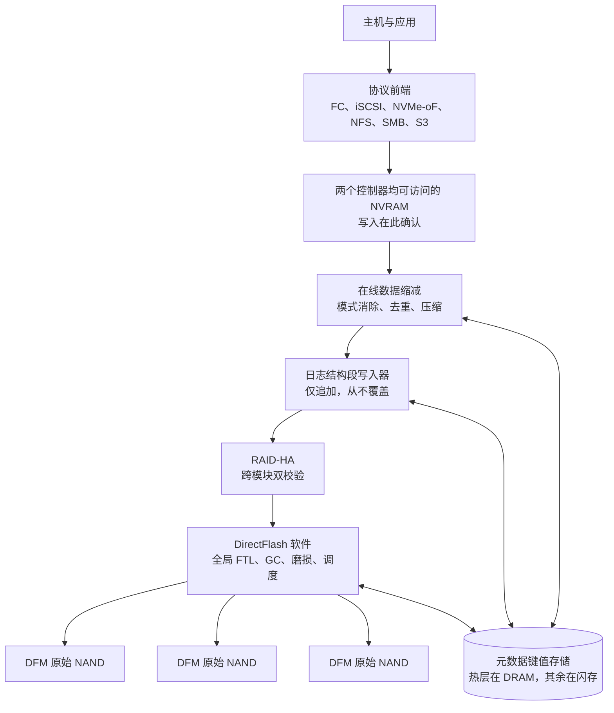
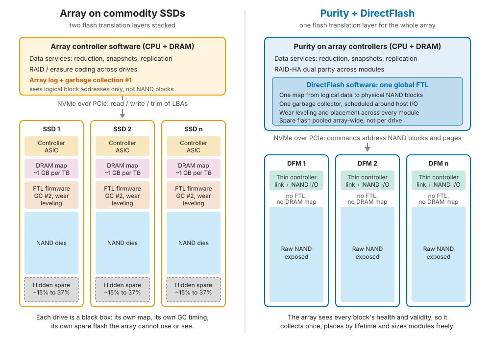
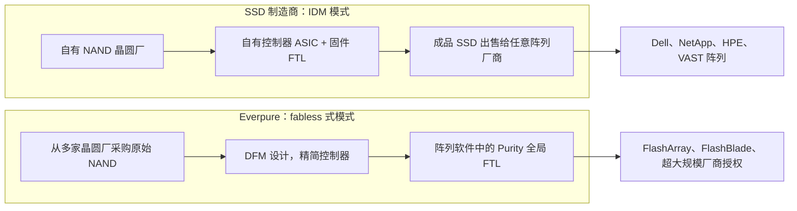
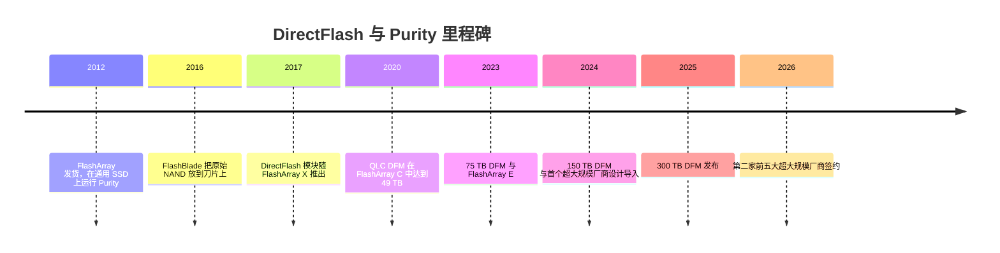

# 26. 核心技术：Purity 与 DirectFlash

> 📄 英文原文：[docs/04-everpure/26-purity-and-directflash.md](../../../docs/04-everpure/26-purity-and-directflash.md) · 本文为简体中文参考译本，如有出入以英文原文为准。

> **深度：** L2 · **阅读时间：** 约 11 分钟 · **最后核实：** 2026-11-01
> **前置阅读：** [写给半导体从业者的介质物理](../01-storage-fundamentals/02-media-physics.md) · [SSD 内部结构](../01-storage-fundamentals/03-inside-an-ssd.md) · [数据缩减](../01-storage-fundamentals/05-data-reduction.md) · [接口与新兴技术](../02-protocols-and-networking/12-interfaces-and-emerging-tech.md) · [术语表](../glossary.md)

## 要点速览（TL;DR）

- **Purity 是一个日志结构、类数据库的存储操作系统。**它以追加代替覆盖写，在线（inline）缩减数据，并把所有映射关系保存在一个键值元数据存储中。
- **DirectFlash 拿掉了 SSD 自己的"大脑"。**Purity 在多个原始 NAND 模块之上运行一个统一的闪存转换层（FTL）。这意味着只有一个日志、一个垃圾回收器和一个备用闪存池，而基于 SSD 的阵列每块硬盘都各有一套。
- **这就是 DFM 容量比 SSD 更大的原因：**到 2026 年每个模块达 300 TB[^1]，而已确认出货的最大标准 SSD 为 245.76 TB[^2]（Sandisk 已宣布 256 TB[^3]）。Everpure 的功耗优势属于厂商自述，最好在系统层面核验。
- **半导体类比：**这相当于由一家 fabless 式厂商完成的"集成内存控制器"之举。收益是全局调度；代价是要自己认证每一代 NAND，而 NAND 又是从同时销售成品 SSD 的 IDM 那里采购的。
- **风险敞口是双向的。**Everpure 为其企业级阵列采购 NAND，战略性 NAND 采购使 Q2 FY27 经营现金流转负[^4]。它不为超大规模厂商授权业务采购 NAND[^5]。灵活数据放置（Flexible Data Placement，FDP）SSD 和超大规模厂商的自研（DIY）设计，是对这条护城河的主要威胁。

## 对 Everpure 战略的意义

DirectFlash 是投资者为 Everpure（NYSE: P，原 PSTG）买单的三件事的技术根基。第一是产品毛利率——较低的物料成本（BOM）对其有支撑，但并不能保护它：随着 NAND 成本上升，非 GAAP 产品毛利率从 Q3 FY26 受特许权使用费抬高的 72.9% 降至 Q2 FY27 的 66.2%[^6][^7]。第二是超大规模厂商授权业务：先是 Meta，然后是 2026 年 8 月第二家未具名的前五大超大规模云厂商[^8]。第三是在电力受限的 AI 数据中心中以功耗和密度优势取代磁盘的卖点（[第 38 章](../05-ai-storage/38-power-and-density.md)）。如果 FDP 让通用 SSD 获得大部分同等收益，或者某家超大规模厂商自建了同类方案，这三者会一起被削弱。

战略问题在于：哪一层护城河是持久的——全局 FTL、模块设计、NAND 认证诀窍，还是供应关系。自有模块也让 Everpure 在 2026 年的短缺中成为原始 NAND 的直接买家，与 IDM 自家的 SSD 业务争夺配额。

## 核心概念

### 一图看懂 Purity

Purity 于 2009–2012 年构建，目的是让通用 SSD 表现得像企业级存储，借鉴了数据库和键值存储的设计。每次写入都是单调的（仅追加），删除则被记录为谓词（predicate），用以隐藏旧记录，而不是覆盖它们[^9]。这一个选择解释了产品的大部分特性。

*图 26.1 — Purity 是一条从协议到原始 NAND 的流水线。重心在元数据存储而非数据布局，DirectFlash 是其最底层。*

写入先落到两个控制器都能访问的持久化 NVRAM 中（早期型号使用双归属的机箱模块，//XL 则使用 DirectFlash 模块上的 NVRAM），并在此确认[^10]（[第 14 章](../03-system-architecture/14-scale-up-dual-controller.md)）。随后 Purity 消除零值等模式、去重，并压缩为约 4–32 KB 的可变大小数据块，以 512 字节对齐来匹配重复数据[^11]（[第 5 章](../01-storage-fundamentals/05-data-reduction.md)）。缩减后的数据被打包成大的段（segment），以双校验（RAID-HA）跨模块顺序写入[^12]。覆盖写从不原地发生：较新的版本只需在元数据映射中"胜出"，这正是快照几乎零成本的原因（[第 6 章](../01-storage-fundamentals/06-data-protection-and-resilience.md)）。

元数据存储才是难点。Everpure 将其描述为一个分层"金字塔"：热元数据位于控制器 DRAM，进行中的变更记入 NVRAM 日志，主体位于闪存[^13]。Purity//FB 将同样的思路扩展到 FlashBlade 的各个刀片上（[第 27 章](27-flasharray-and-flashblade.md)）。

### DirectFlash 解决的问题：日志叠日志

SSD 本身就是一个日志结构系统。NAND 以页为单位编程，却只能整块擦除，因此硬盘的 FTL 会追加写入、在 DRAM 中重映射地址，并对失效页进行垃圾回收（GC）（[第 3 章](../01-storage-fundamentals/03-inside-an-ssd.md)）。在其上再放 Purity，就有了两层日志。每层都有自己的映射表、自己的 GC 和自己的预留备用空间，且彼此看不到对方的状态。学术研究称之为"日志叠日志"（log-on-log），并表明各层的写放大会相互叠加[^14]。

*图 26.2 — 基于通用 SSD 的阵列要为控制器、DRAM 映射、垃圾回收和备用闪存在每块硬盘上付一次成本，在阵列层面再付一次；DirectFlash 只付一次。*

三组算例说明了这种堆叠的代价：

- **备用闪存，付两次钱。**一块由 8 TiB NAND（8.80 TB）构成、按 7.68 TB 出售的硬盘隐藏了 1.12 TB，即用户容量的 14.5%。若作为 6.4 TB 混合用途硬盘出售，则隐藏 2.40 TB，即 37%。阵列还要在此之上为段清理保留自己的空闲空间。
- **写放大相乘。***示意：*如果阵列 GC 每个主机字节要重写 1.5 字节，而硬盘 GC 又独立地将其翻倍，NAND 就要承受每主机字节 3 字节的写入。耐久度大约只有 TLC 三分之一的 QLC 承受不起。
- **DRAM 随容量扩张。**页级 FTL 每个 4 KiB 页存储约 4 字节，即每 TB 需要 1 GB DRAM。一块以如此精细粒度映射的 245 TB SSD 将需要约 245 GB 的盘载 DRAM。因此大容量 QLC 硬盘采用更粗的映射单元，并在小写入时付出读-改-写的代价。一个以 4 KiB 映射的 10 PB 阵列将携带约 10 TB 的硬盘 DRAM——这是 Everpure 自己的论点[^15]。

DirectFlash 删掉了内层。DirectFlash 模块（DFM）是一块 PCIe/NVMe 卡，上面是位于精简控制器之后的原始 NAND。它本身没有逻辑地址抽象[^10]，因此 Purity 直接寻址 NAND 块。随后 Purity 在阵列层面一次性完成磨损均衡、GC 和预留空间（OP）[^15]。纠错等功能在模块与 Purity 之间如何具体分工并未公开 [VERIFY: 哪些 NAND 功能运行在 DFM 控制器上、哪些在 Purity 中]。

### 半导体视角：片上内存控制器，以及 IDM 与 fabless

**把内存控制器搬到片上。**直到 2000 年代中期，x86 CPU 都要通过北桥芯片访问 DRAM。AMD（2003）和 Intel（2008）先后把内存控制器集成到 CPU 裸片上。延迟下降，CPU 也能在了解自身请求流的前提下调度 DRAM bank。DirectFlash 是同样的举措：每块 SSD 内部的"闪存北桥"被并入阵列 CPU。代价也一样：正如片上控制器把 CPU 与 DRAM 世代绑定，DirectFlash 把 Purity 版本与 NAND 世代绑定，每一代都必须在软件中完成特性表征。

**IDM 与 fabless。**SSD 制造商（Samsung、SK hynix/Solidigm、Micron、Kioxia、Sandisk）都是 IDM。它们拥有 NAND 晶圆厂，自行设计控制器，并利用独占的工艺数据调校固件。Everpure 的行为类似 fabless 系统厂商：购买"晶圆"（原始 NAND），设计模块，在软件上做差异化，并省掉 SSD 厂商在控制器、DRAM 和固件上的利润。经典的 fabless 取舍同样适用：

- **优势：**可在同一设计上认证多家供应商，架构迭代更快，规模扩张资本占用轻。
- **劣势：**缺乏工艺洞察，依赖同时销售竞争性成品的供应商，短缺时争取配额的议价能力较弱。

*图 26.3 — SSD 制造商从晶圆厂到固件垂直整合；Everpure 从模块到软件整合，并向这些 IDM 采购 NAND。*

### 掌控 FTL 带来什么

**密度。**没有每盘 DRAM 映射表，模块容量受限于 NAND 封装和功耗，而非控制器内存，这就是 DFM 在每个阶段都领先最大标准 SSD 的原因（图 26.4）。

**功耗。**Everpure 的 CTO 称 75 TB DFM 功耗低于 10 W，而 61.44 TB Solidigm SSD 的最大功耗为 25 W[^22]：约 0.13 W/TB 对 0.41 W/TB，不过拿典型功耗与最大功耗比较对 DFM 有所美化。在系统层面，Everpure 声称基于 HDD 和 15.36 TB SSD 的系统所需功耗是其 75 TB DFM 系统的 2.4 倍、150 TB DFM 系统的 4.8 倍[^16]，并称在超大规模场景中比磁盘最多节省 75% 的功耗[^17]。NetApp 的反驳是公允的：应比较整个系统，而非模块[^18]。

**耐久度与 QLC 的可行性。**由于只有一个知道哪些数据是冷数据的 GC，Purity 可以按生命周期对数据分组，让整块数据同时失效。这使低耐久度的 QLC 可用于企业级主存储。

**故障行为。**Purity 能看到每个块的健康状况，因此可以在模块失效之前退役坏块、迁空正在劣化的模块，而不是事后重建[^19]。通用 SSD 则以黑盒方式失效。其固件是整个设备群范围内的相关性风险：2019 年 HPE 曾警告，某些 SAS SSD 若不更新固件，将在恰好 32,768 个通电小时时失效[^20]。DirectFlash 并未消除这种风险，而是把它集中到了 Everpure 自己的代码里。

**一致性。**硬盘 GC 按自己的节奏触发，造成延迟尖峰；统一的调度器则可以避开主机 I/O 推迟 GC。

### DFM 容量路线图

*图 26.4 — DFM 用约两年时间从 75 TB 增至 300 TB，并始终高于最大标准 SSD；下一步的 600 TB 和 1 PB 是尚无日期的目标。*
数据：`data/ch26_dfm_capacity.csv`

75 TB QLC DFM 于 2023 年随 FlashArray//E 推出[^21]。2023 年 3 月，Pure Storage 设定了 2024 年 150 TB、2026 年 300 TB 的目标[^22]。150 TB 模块于 2024 年 9 月发布，并于年底前供货[^23]。Everpure 的 FY2026 10-K 称 300 TB DFM 已于 2025 年发布，早于目标[^24] [VERIFY: 仅见于搜索摘要]，行业媒体也于 2026 年 8 月证实了 300 TB 模块[^1]。一位联合创始人曾提及 600 TB、继而 1 PB 以上的模块，但未给出时间[^25]。通用产品阵营正在逼近：Sandisk 在其 2027 年路线图上列出了 512 TB[^3]，Meta 也计划采用最高 512 TB 的 QLC 硬盘[^26]。

### NAND 供应商风险敞口与 2026 年短缺

Everpure 已为 150 TB DFM 认证了 Micron 的 G8 QLC，并正将 Micron G9 QLC 引入未来的 DFM，包括面向超大规模厂商的模块[^27]。Kioxia 是长期合作伙伴，其 BiCS8 世代包括一款 2 Tb QLC 裸片[^28]。两家供应商带来了议价能力和韧性，代价是每款新裸片都要认证。

Everpure 于 2026 年 2 月 9 日以元器件成本为由提价[^29]。Q2 FY27 的战略性 NAND 与元器件采购使经营现金流降至 −$136M、自由现金流降至 −$238M；约 $577M 的预付费用增加被解读为提前采购 NAND[^30] [VERIFY: 预付费用数字来自第三方对 10-Q 的解读]。管理层表示现金流应在两个季度内恢复正常[^4]。TrendForce 预测 2026 年第四季度 NAND 合约价将再环比上涨 15–20%，据报道企业级 SSD 上涨 23–28%[^31][^32]。

超大规模厂商模式绕开了这一问题：客户授权使用设计，并自行采购 NAND 和硬件，因此 Everpure 无需为其采购 NAND[^1][^5]。这更接近 Arm，而不是 fabless 芯片厂商（[第 29 章](29-hyperscaler-ecosystem-financials.md)）。

## Everpure 的做法与竞争对手对比

| 维度 | Everpure DirectFlash | 通用 SSD 阵列（Dell、NetApp、HPE、VAST） | 超大规模厂商基于 FDP SSD 自研 |
|---|---|---|---|
| 闪存映射所需 DRAM | 模块上没有；阵列级元数据位于控制器 DRAM（容量未公开） | 4 KiB 映射下每块硬盘每 TB 约 1 GB，粗粒度映射则更少 | 与通用 SSD 相同 |
| 预留空间（OP） | 在阵列层面统一池化一次 | 每块硬盘内隐藏（约 15–37%），另加阵列预留 | 每块硬盘各自预留，但 FDP 减少了需求 |
| 写放大 | 单层 GC；按生命周期放置数据 | 阵列 GC × 硬盘 GC（日志叠日志） | FDP 让主机区分数据生命周期；用得好时接近 1[^33] |
| 功耗与密度 | 300 TB 模块；厂商声称系统功耗优势 2.4–4.8 倍[^16] | 61–245 TB 标准硬盘；标准功耗包络 | 同样的硬盘；主机软件经过调优 |
| 故障行为 | 块级可见性；失效前迁空 | 硬盘整体失效；固件缺陷在设备群中相关 | 相同，但借助规模和多样性缓解 |
| 供应灵活性 | 可认证任意 NAND 裸片，但每款都需 Purity 支持 | 四家以上硬盘供应商，即插即用兼容 | 四家以上供应商；议价能力最强 |
| NAND 认证由谁承担 | Everpure | 硬盘厂商 | 硬盘厂商 |

*表 26.1 — DirectFlash 在 DRAM、备用闪存和写放大上胜出；通用 SSD 在供应灵活性以及认证负担由谁承担上胜出。*

中间路线也存在。IBM 为 FlashSystem 自研 FlashCore 模块，把压缩、加密和威胁检测放进模块内部，因此它保留了模块内 FTL 并增加算力，而不是将其移除[^34]。Everpure 自己也在 FlashArray//ST[^35] 和 FlashBlade//EXA 首发的数据节点[^36] 中使用商用 SSD。DirectFlash 是按产品做出的选择，而非教条。

**反方论点的最强版本（steelman）：**

1. **FDP 在不锁定厂商的情况下弥合了大部分差距。**NVMe FDP 于 2022 年批准，由 Meta 和 Google 联合 Samsung 推动，允许主机为写入打标签，使硬盘将不同生命周期的数据分开存放，在硬盘保持标准化的同时降低写放大[^33][^37]。Meta 正在 DFM 之外同时部署标准 QLC SSD[^38]。
2. **研发规模。**每家 NAND IDM 都以大得多的 SSD 收入基础供养控制器和固件团队，并且最先拿到工艺数据。
3. **单一设计风险与认证负担。**一套模块设计和一个 FTL 同时服务 FlashArray、FlashBlade 和两家超大规模厂商，因此潜在缺陷或某代 NAND 的瑕疵会在整个装机基础中相关传导；而且每款新裸片都要在没有晶圆厂数据的情况下完成特性表征。
4. **超大规模厂商有能力自建。**开放通道 SSD（Open-channel SSD，LightNVM）是业界在主机管理闪存方面的尝试，但它已被分区（zoned）和放置提示类设计所取代[^39]。然而，当 Meta 想要大规模掌控原始闪存时，它选择了授权而非自建[^38]。

## 历史与发展轨迹

*图 26.5 — Purity 起步于驯服通用 SSD，随后用十年时间取代它们，如今正把替代方案授权给超大规模厂商。*

时间线来源：FlashBlade 在 2016 年的刀片上就已搭载原始 NAND 芯片而非 SSD[^40]；DirectFlash 于 2017 年 4 月随 FlashArray//X 推出[^41]；QLC DFM 在 FlashArray//C 中先后达到 24.7 TB 和 49 TB[^42][^43]。2024 年 12 月，一家"前四大超大规模云厂商"获得 DirectFlash 授权[^44]，FY2025 10-K 随后披露其为 Meta[^45]。第二家前五大厂商的合作（2026 年 8 月）预计自 FY2028 起产生影响[^8]。

值得关注的信号：600 TB DFM 的时间表、标准 SSD 达到 512 TB、FDP 的普及程度，以及 NAND 成本在产品毛利率中的体现。

## 关键数字

| 指标 | 数值 | 背景 | 来源 / 日期 |
|---|---|---|---|
| 最大 DFM | 300 TB | 据 10-K 于 2025 年发布；"目前最高 300 TB" | Everpure 10-K FY26[^24]；B&F 2026-08-11[^1] |
| 已出货的最大标准 SSD | 245.76 TB | Micron 6600 ION，G9 QLC | Micron，2026-05-05[^2] |
| 75 TB DFM 功耗 | < 10 W（对比 61.44 TB SSD 最大 25 W） | 约 0.13 对约 0.41 W/TB；典型值对最大值 | B&F，2023-03-01[^22] |
| 系统功耗对比 HDD / 小容量 SSD 系统 | 2.4 倍（75 TB DFM）、4.8 倍（150 TB DFM） | 厂商自述 | B&F，2025-08-11[^16] |
| 4 KiB 映射下的 SSD DRAM | 每 TB 约 1 GB | 每 4 KiB 页 4 B | 算例 |
| 标准 SSD 中的隐藏备用容量 | 约占用户容量的 15–37% | 8 TiB 原始容量按 7.68 或 6.4 TB 出售 | 算例 |
| Q2 FY27 经营现金流 | −$136M | 战略性 NAND 与元器件采购 | Yahoo Finance，2026-08[^30] |
| Q2 FY27 产品毛利率 | 66.2%（非 GAAP） | 低于 Q3 FY26 的 72.9% | Investing.com，2026-08[^6] |

## 对话手册

**向产品经理提的问题**

1. *"当 512 TB 标准 SSD 出货时，什么能让 DFM 保持领先？"* 高质量回答：给出有明确日期的下一代模块规划，以及在 W/TB、TB/RU 和所节省 DRAM 上的系统级差距。
2. *"NAND 涨价如何分别传导到 Evergreen//One 定价和资本支出（capex）类销售中？"* 高质量回答：区分新销售中的价格转嫁与固定价格订阅中的成本消化，并说明 Q2 FY27 的 NAND 采购如何对冲这一缺口。
3. *"为什么 FlashArray//ST 使用商用 SSD？"* 高质量回答：这是针对延迟优化的小型配置，DFM 的容量在此属于大材小用；并给出 DirectFlash 何时胜出的清晰规则。

**向工程师提的问题**

1. *"认证一款新 NAND 裸片需要多长时间？最常见的失败点是什么？"* 高质量回答：数月，并具体谈到读重试（read-retry）、数据保持和纠错余量。
2. *"在 FDP 下，通用 SSD 阵列能达到多少写放大？Purity 又是多少？"* 高质量回答：给出实测的设备群数据，并指出 FDP 无法解决的部分（每盘 DRAM、隐藏备用空间、不透明的故障处理）。
3. *"DFM 固件或 FTL 缺陷的爆炸半径（影响范围）有多大？"* 高质量回答：分阶段发布、设备群内的版本多样性，以及某批 NAND 表现异常时的回退方案。

**不要这样说：**

- "DFM 只是大容量 SSD。"它们没有硬盘级 FTL；这恰恰是全部要点所在。
- "DirectFlash 让 Everpure 不受 NAND 价格影响。"企业级阵列仍消耗外购 NAND；只有超大规模厂商授权模式能避开。
- "Everpure 自己制造闪存。"它设计模块和软件；NAND 由 Micron 和 Kioxia 制造。
- 把"最多节省 75% 功耗"当作事实。这是厂商以磁盘为基准的自述，对基准选择很敏感。

## 深入阅读（可选，L3 指引）

- Colgrove 等，SIGMOD 2015[^9]：Purity 的单调写入、谓词删除与元数据设计。
- Yang 等，INFLOW 2014[^14]：日志叠日志的论证。
- Bjørling 等，FAST 2017[^39]：开放通道 SSD，ZNS 与 FDP 的前身。

## 关键术语

- **DirectFlash 模块（DFM）** — Everpure 的原始 NAND 模块，没有硬盘级 FTL。
- **全局 FTL** — 阵列中所有模块共用的一个闪存转换层。
- **日志叠日志（log-on-log）** — 多层日志结构堆叠，其 GC 和写放大相互叠加。
- **RAID-HA** — Purity 跨模块的双校验保护。
- **FDP** — NVMe 灵活数据放置（Flexible Data Placement）：让硬盘区分数据生命周期的主机提示机制。
- **间接映射单元（indirection unit）** — SSD 映射表跟踪的粒度；单元越大越省 DRAM，但会惩罚小写入。
- **NAND 认证（qualification）** — 对新 NAND 裸片进行特性表征，使固件或软件能够可靠地驱动它。

## 资料来源

[^1]: Blocks & Files, "Second hyperscaler plumps for Everpure's flash technology," 2026-08-11. https://www.blocksandfiles.com/flash/2026/08/11/second-hyperscaler-plumps-for-everpures-flash-technology/5285903 (retrieved 2026-11-01).
[^2]: Micron Technology, "Industry-Leading 245TB Micron 6600 ION Data Center SSD Now Shipping," 2026-05-05. https://investors.micron.com/news/press-release/2026/Industry-Leading-245TB-Micron-6600-ION-Data-Center-SSD-Now-Shipping/default.aspx (retrieved 2026-11-01).
[^3]: Blocks & Files, "Sandisk unveils 256 TB SSD for AI workloads, shipping in 2026," 2025-08-05. https://www.blocksandfiles.com/ai-ml/2025/08/05/sandisk-unveils-256-tb-ssd-for-ai-workloads-shipping-in-2026/1589534 (retrieved 2026-11-01).
[^4]: Nasdaq, "Everpure Q2 Earnings Call Highlights," 2026-08. https://www.nasdaq.com/articles/everpure-q2-earnings-call-highlights (retrieved 2026-11-01).
[^5]: Motley Fool, "Everpure (P) Q2 2027 Earnings Call Transcript," 2026-08-31. https://www.fool.com/earnings/call-transcripts/2026/08/31/everpure-p-q2-2027-earnings-call-transcript/ (retrieved 2026-11-01).
[^6]: Investing.com, "Everpure Q2 FY27 slides: 38% revenue growth, guidance raised sharply," 2026-08. https://www.investing.com/news/company-news/everpure-q2-fy27-slides-38-revenue-growth-guidance-raised-sharply-93CH-4878054 (retrieved 2026-11-01).
[^7]: Futurum Group, "Pure Storage Q3 FY 2026 Results: Revenue Up 16% YoY, Guidance Raised," 2025-12. https://futurumgroup.com/insights/pure-storage-q3-fy-2026-results-revenue-up-16-yoy-guidance-raised/ (retrieved via search summary 2026-11-01).
[^8]: Everpure, "Everpure Lands New Design Win with Second Top-Five Hyperscaler," 2026-08-10. https://www.everpuredata.com/company/newsroom/press-releases/everpure-lands-new-design-win-with-second-top-five-hyperscaler.html (retrieved 2026-11-01).
[^9]: J. Colgrove, J. Davis, J. Hayes, E. L. Miller, C. Sandvig, R. Sears, A. Tamches, N. Vachharajani, F. Wang, "Purity: Building Fast, Highly-Available Enterprise Flash Storage from Commodity Components," ACM SIGMOD 2015 (Industrial Track), doi:10.1145/2723372.2742798. https://www.crss.ucsc.edu/pub/colgrove-sigmod15.html (retrieved 2026-11-01).
[^10]: Pure Storage blog, "A Pure Storage Engineer Explains FlashArray//X," n.d. https://blog.purestorage.com/?p=13930 (retrieved via search 2026-11-01).
[^11]: Pure Storage, "Purity Data Sheet" (via Insight), n.d. https://ie.insight.com/content/dam/insight-web/emea/partner/pure-storage/Pure_Purity_Data_Sheet.pdf (retrieved 2026-11-01).
[^12]: Everpure blog, "The Three Rs of Data Storage: Resiliency, Redundancy, and Rebuilds," n.d. https://blog.everpuredata.com/perspectives/the-three-rs-of-data-storage-resiliency-redundancy-and-rebuilds/ (retrieved 2026-11-01).
[^13]: Pure Storage blog, "NetApp Is Livin' La Vida Loca" (vendor comparison describing Purity's metadata tiers), n.d. https://blog.purestorage.com/?p=163330 (retrieved via search 2026-11-01).
[^14]: J. Yang, N. Plasson, G. Gillis, N. Talagala, S. Sundararaman, "Don't Stack Your Log On My Log," USENIX INFLOW 2014. https://www.usenix.org/conference/inflow14/workshop-program/presentation/yang (retrieved 2026-11-01).
[^15]: Everpure, "What Is DirectFlash and How Does It Work?," n.d. https://www.everpuredata.com/knowledge/what-is-directflash-and-how-does-it-work.html (retrieved via search 2026-11-01).
[^16]: Blocks & Files, "Pure Storage claims its flash beats SSDs and disks on power and carbon metrics," 2025-08-11. https://blocksandfiles.com/2025/08/11/pure-storage-flash-beats-ssds-and-disks-on-power-and-carbon-metrics/ (retrieved via search 2026-11-01).
[^17]: Pure Storage, "Hyperscaler," n.d. https://purestorage.com/pure-advantage/platform/hyperscaler.html (retrieved 2026-11-01).
[^18]: NetApp blog, "Direct flash vs SSDs," n.d. https://www.netapp.com/blog/direct-flash-vs-ssds/ (retrieved via search 2026-11-01).
[^19]: Pure Storage / Everpure blog post on DFM evacuation versus rebuild, n.d. https://blog.purestorage.com/?p=143164 (seen via search summary, 2026-11-01).
[^20]: Hewlett Packard Enterprise, "Customer Bulletin: HPE SAS Solid State Drives - Critical Firmware Upgrade Required for Certain HPE SAS Solid State Drive Models to Prevent Drive Failure at 32,768 Hours of Operation," 2019-11. https://support.hpe.com/hpesc/public/docDisplay?docId=emr_na-a00092491en_us (retrieved 2026-11-01).
[^21]: StorageReview, "Pure Storage adds 75TB flash module, FlashArray//E and new FlashArray//X, //C R4 nodes," 2023. https://www.storagereview.com/news/pure-storage-adds-75tb-flash-module-flasharray-e-and-new-flasharray-x-c-r4-nodes (retrieved 2026-11-01).
[^22]: Blocks & Files, "300TB flash drives coming from Pure Storage," 2023-03-01. https://blocksandfiles.com/2023/03/01/300tb-flash-drives-coming-from-pure-storage/ (retrieved via search 2026-11-01); roadmap corroborated by Gigazine, "Pure Storage sets goal of realizing 300 TB SSD by 2026," 2023-03-08. https://gigazine.net/gsc_news/en/20230308-pure-storage-300-tb-ssd (retrieved 2026-11-01).
[^23]: Blocks & Files, "Pure extends FlashBlade file services and adds 150TB flash drive," 2024-09-24. https://blocksandfiles.com/2024/09/24/pure-extends-flashblade-file-services-and-adds-150tb-flash-drive/ (retrieved via search 2026-11-01).
[^24]: Everpure, "Form 10-K for fiscal year ended February 1, 2026," 2026-03-24. https://www.sec.gov/Archives/edgar/data/1474432/000147443226000027/pstg-20260201.htm (seen via search summary of the annual report, 2026-11-01).
[^25]: Pure Storage, "Eliminating Disk for Good" (webinar with co-founder John Colgrove), 2025. https://www.everpuredata.com/video/webinars/eliinating-disk-for-good/6374611414112.html (seen via search summary, 2026-11-01).
[^26]: TechRadar Pro, "Facebook engineers say bigger hard disk drives is making one critical metric far, far worse," 2025. https://www.techradar.com/pro/facebook-engineers-say-that-bigger-hard-disk-drives-is-making-one-critical-metric-far-far-worse (retrieved via search 2026-11-01).
[^27]: Blocks & Files, "Pure qualifies Micron's 276-layer flash," 2025-01-08. https://blocksandfiles.com/2025/01/08/pure-qualifies-microns-276-layer-flash/ (retrieved 2026-11-01); TechTarget, "Pure Storage, Micron expand QLC NAND partnership," 2025. https://techtarget.com/searchstorage/news/366617703/Pure-Storage-Micron-expand-QLC-NAND-partnership (retrieved 2026-11-01).
[^28]: Blocks & Files, "Kioxia 2 terabit NAND," 2024-07-03. https://blocksandfiles.com/2024/07/03/kioxia-2-terabit-nand/ (retrieved 2026-11-01).
[^29]: Alpha Spread, "P Q4-2026 Earnings Call," 2026-02-25. https://www.alphaspread.com/security/nyse/p/investor-relations/earnings-call/q4-2026 (retrieved 2026-11-01).
[^30]: Yahoo Finance, "Everpure (P) Grew Revenue 38% but Free Cash Flow Was Negative," 2026-08. https://finance.yahoo.com/markets/stocks/articles/everpure-p-grew-revenue-38-023544268.html (retrieved 2026-11-01); prepaid-expense reading from Finsee, "Everpure (P) Q2 2027 earnings review," 2026-08. https://finsee.ai/earnings/p/2027/q2/en/ (seen via search summary, 2026-11-01).
[^31]: TrendForce, "AI Server Demand Sustains Memory Contract Price Increases in 4Q26, While Consumer-Side Pressure Persists," 2026-09-30. https://www.trendforce.com/presscenter/news/20260930-13258.html (retrieved 2026-11-01; enterprise SSD range from secondary coverage).
[^32]: Tech Insider, "Enterprise SSD prices Q4 2026: the NAND supplier race," 2026-09/10, reporting a TrendForce forecast. https://tech-insider.org/enterprise-ssd-prices-q4-2026-nand-supplier-race/ (seen via search summary, 2026-11-01).
[^33]: NVM Express, "Overcoming the Write Amplification Problem with NVM Express Flexible Data Placement," n.d. https://nvmexpress.org/nvmeflexible-data-placement-fdp-blog/ (retrieved 2026-11-01).
[^34]: IBM, "IBM FlashSystem," n.d. https://www.ibm.com/flashsystem (retrieved via search 2026-11-01); Blocks & Files, "IBM FlashSystem 5300," 2024-04-25. https://blocksandfiles.com/2024/04/25/ibm-flashsystem-5300/ (retrieved via search 2026-11-01).
[^35]: Techzine, "Pure surprises: FlashArray gets S3 support, FlashArray//ST without DFMs," 2025-06. https://www.techzine.eu/blogs/infrastructure/132388/pure-surprises-flasharray-gets-s3-support-flasharray-st-without-dfms/ (retrieved 2026-11-01).
[^36]: Architecting IT, FlashBlade//EXA analysis, 2025-03. https://www.architecting.it/?p=7294 (retrieved 2026-11-01).
[^37]: Samsung Semiconductor, "Hyperscalers Embrace Flexible Data Placement (FDP) to Increase Performance and Lower TCO," n.d. https://semiconductor.samsung.com/news-events/tech-blog/hyperscalers-embrace-flexible-data-placement-fdp-to-increase-performance-and-lower-tco/ (retrieved 2026-11-01).
[^38]: Blocks & Files, "Meta's positive assessment of Pure Storage's flash mettle," 2025-04-07. https://blocksandfiles.com/2025/04/07/metas-positive-assessment-of-pure-storages-flash-mettle/ (retrieved via search 2026-11-01).
[^39]: M. Bjørling, J. González, P. Bonnet, "LightNVM: The Linux Open-Channel SSD Subsystem," USENIX FAST 2017. https://www.usenix.org/conference/fast17/technical-sessions/presentation/bjorling (retrieved 2026-11-01).
[^40]: The Register, "FlashBlade back story notes," 2016-03-15. https://www.theregister.com/2016/03/15/flashblade_back_story_notes/ (retrieved via search 2026-11-01); Computer Weekly, "Pure Storage drips out more of its all-flash analytics FlashBlade," 2016. https://computerweekly.com/news/450299856/Pure-Storage-drips-out-more-of-its-all-flash-analytics-FlashBlade (retrieved via search 2026-11-01).
[^41]: The Register, "Pure becomes a direct flasher," 2017-04-11. https://www.theregister.com/2017/04/11/pure_becomes_a_direct_flasher/ (retrieved via search 2026-11-01).
[^42]: TechTarget, "Pure Storage FlashArray//C set sights on hybrid flash market," 2020. https://www.techtarget.com/searchstorage/news/252488188/Pure-Storage-FlashArray-C-set-sights-on-hybrid-flash-market (retrieved via search 2026-11-01).
[^43]: Everpure blog, "FlashArray//C Capacity: The 49TB Milestone Revisited," n.d. https://blog.everpuredata.com/products/capacity-workloads-49tb-qlc/ (retrieved via search 2026-11-01).
[^44]: SiliconANGLE, "Shares of Pure Storage jump on impressive earnings beat and strong guidance," 2024-12-03. https://siliconangle.com/2024/12/03/shares-pure-storage-jump-impressive-earnings-beat-strong-guidance/ (retrieved 2026-11-01).
[^45]: SEC, "Pure Storage, Inc. Form 10-K for fiscal year ended February 2, 2025," 2025-04. https://www.sec.gov/Archives/edgar/data/1474432/000162828025015044/pstg-20250202.htm (seen via search summary, 2026-11-01).
