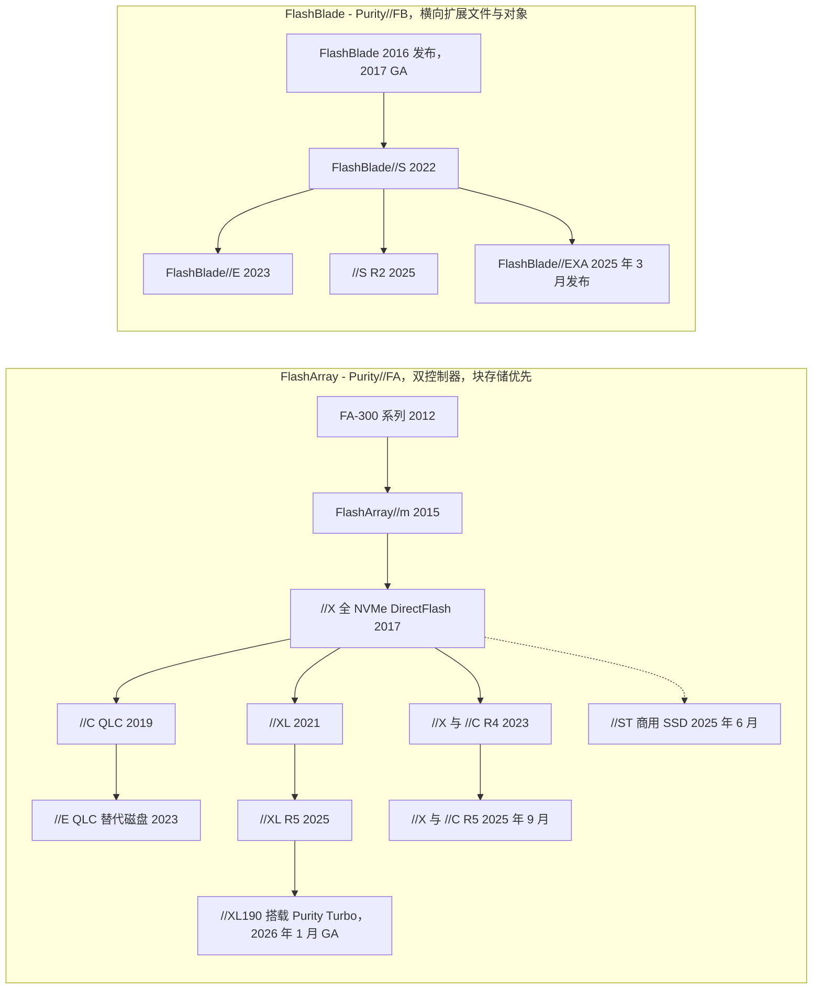
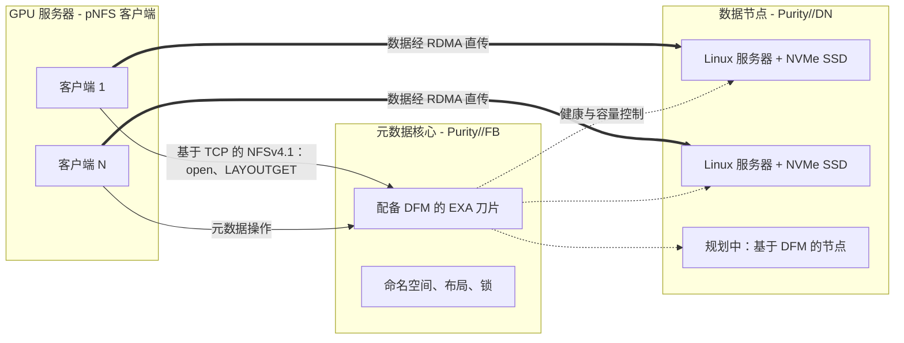
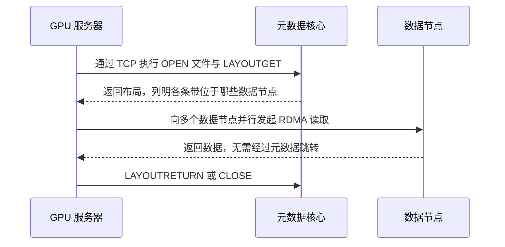
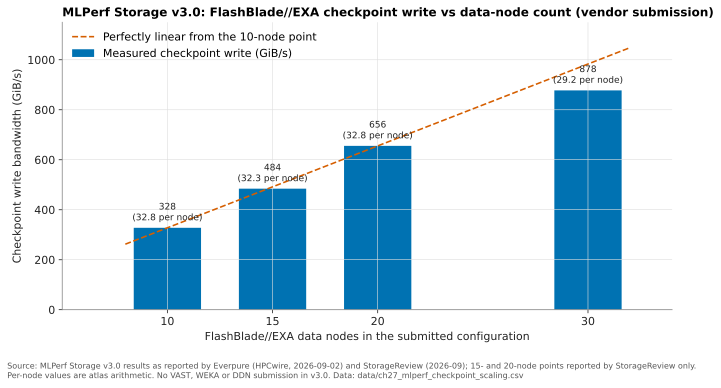

# 27. 产品组合：FlashArray 与 FlashBlade

> 📄 英文原文：[docs/04-everpure/27-flasharray-and-flashblade.md](../../../docs/04-everpure/27-flasharray-and-flashblade.md) · 本文为简体中文参考译本，如有出入以英文原文为准。

> **深度：** L2 · **阅读时间：** 约 11 分钟 · **最后核实：** 2026-11-01
> **前置阅读：** [核心技术：Purity 与 DirectFlash](26-purity-and-directflash.md) · [纵向扩展双控制器阵列](../03-system-architecture/14-scale-up-dual-controller.md) · [横向扩展无共享集群](../03-system-architecture/15-scale-out-shared-nothing.md) · [分解式全共享架构](../03-system-architecture/16-disaggregated-shared-everything.md)

## 要点速览（TL;DR）

- **两个产品家族、两套操作系统、一套介质战略。** FlashArray 运行 Purity//FA，采用双控制器、纵向扩展（scale-up）设计，以块存储为主（文件和 S3 是后来加入的）。FlashBlade 运行 Purity//FB，基于横向扩展（scale-out）的刀片，面向文件和对象存储。几乎所有型号都使用 Everpure 自研的 DirectFlash 模块（DFM），例外是 FlashArray//ST 和 FlashBlade//EXA 的数据节点。
- **各型号的差异主要在介质和控制器规格。** //XL、//X 和 //ST 是 TLC 性能层；//C 和 //E 是 QLC 容量层。FlashBlade//S 是性能层，FlashBlade//E 是容量层。"R 编号"（R4、R5）是控制器换代，客户可以原地升级。
- **FlashBlade//EXA 是面向 AI 规模的特例。** Purity//FB 元数据核心运行在 DFM 刀片上，数据则存放在独立的第三方 Linux/NVMe 数据节点上。客户端通过 pNFS 从元数据核心获取文件布局（layout），然后直接与数据节点收发数据。[第 16 章](../03-system-architecture/16-disaggregated-shared-everything.md)解释了为什么这是元数据/数据分离，而不是 DASE。
- **EXA 在 MLPerf Storage v3.0（2026 年 9 月）中取得最高成绩，** 检查点写入为 877.5 GiB/s，KV 缓存读取为 1,623.4 GiB/s。VAST、WEKA、DDN、Dell、IBM 和 NetApp 均未参加该轮测试，因此"第一"只是参测系统中的第一。
- **AI 认证差距已缩小但尚未弥合。** FlashBlade//S 持有 DGX SuperPOD 和 NCP 高性能存储认证。对于 EXA，Everpure 于 2026 年 3 月宣布将 NVIDIA-Certified Storage 验证扩展到该平台，作为迈向 NCP 级别的一步；截至 2026 年 11 月，尚未公布任何已完成的 EXA 认证。

## 对 Everpure 战略的意义

产品组合是收入引擎：Q2 FY27 产品收入同比增长 54%，达到 US$687 million[^1]，而增长内部的结构显示了业务的走向。每个 FlashArray 层级面对不同的传统厂商（在位者），每个 FlashBlade 层级面对不同的挑战者。EXA 是进入 GPU 集群交易的入场券，而这类交易此前一直由 VAST、WEKA 和 DDN 拿下（[第 41 章](../06-industry-and-competition/41-why-ai-native-vendors-won.md)）。

能把型号与工作负载对应起来，是与产品经理进行可信对话的最低要求；知道*基准测试究竟测了什么*，则是与 Office of the CTO 对话的最低要求。底层技术见[第 26 章](26-purity-and-directflash.md)，上层软件见[第 28 章](28-platform-and-software.md)。

## 核心概念

### 一张图看懂产品谱系

Pure Storage 于 2012 年 5 月推出 FlashArray[^2]。在最初五年里，它只有一条基于 SAS SSD 的产品线。两次变革重塑了它。第一次是 **DirectFlash**：FlashArray//X（2017 年 4 月）通过 NVMe 直接访问 Pure 自研模块上的裸 NAND[^3]。第二次是**介质分层**：基于 QLC 的 //C 于 2019 年 9 月推出[^4]，使同一套控制器设计可以同时服务性能和容量需求。FlashBlade 最初是一个独立的横向扩展文件与对象系统，2016 年发布，2017 年 1 月正式上市（GA）[^5]。后来它也以同样方式分化：//S 面向性能（2022 年 6 月）[^6]，//E 面向容量（2023 年 3 月）[^7]。

*图 27.1 — 两个家族如今都在共享软件之上覆盖性能层和容量层；各型号的介质见表 27.1。//ST（虚线）是唯一脱离 DirectFlash 的 FlashArray，EXA 是唯一引入第三方硬件的 FlashBlade。*

各节点来源：FA-300 与 //m[^8]；//XL[^9]；//E、//X R4 与 //C R4[^10]；//XL R5、//ST 与 //S R2[^11]；//X R5 与 //C R5[^12]；//XL190[^13]；EXA[^14]。

**半导体类比。** 可以把 R 编号理解为在稳定指令集上的制程微缩（die shrink）。Purity 是指令集架构（ISA），新一代控制器（更新的 Intel Xeon、更多 PCIe 通道）则是新的步进（stepping）。由于 Evergreen 订阅可以原地更换控制器而无需迁移数据（[第 23 章](../03-system-architecture/23-consumption-models.md)），一位 2019 年购买 //X 的客户如今可能已在运行 R5 控制器。

### FlashArray：一套控制器设计，五种介质性格

每一台 FlashArray 都是双控制器、纵向扩展系统（[第 14 章](../03-system-architecture/14-scale-up-dual-controller.md)）。各型号在三方面有所不同：控制器算力、介质，以及哪些数据服务保持开启。

- **//X 与 //C 共用控制器。** 在 R5 换代（2025 年 9 月）中，两者都迁移到 Intel Emerald Rapids。Pure 公布 //X 比 R4 快约 30%，//C 快约 40%。默认 3RU 机箱的驱动器槽位增至 28 个[^12]。//X 使用 TLC DFM，承担亚毫秒级的一级（tier-1）工作负载；//C 使用 QLC，以毫秒级延迟提供容量。
- **//XL 是大控制器版本。** 它于 2021 年 12 月推出，有效容量最高 5.78 PB，NVRAM 被移到闪存模块上[^9]。R5 数据表给出的指标为有效容量最高 7.4 PB、45 GB/s（大块 512 KB 读取）[^15]。2026 年 1 月 GA 的 XL190 新增 **Purity Turbo**，允许*备用（secondary）*控制器服务读请求[^13]。对于一个主备（active/passive）式设计而言，这是一个值得注意的变化（[第 14 章](../03-system-architecture/14-scale-up-dual-controller.md)）。
- **//E 是替代磁盘的层级。** 它于 2023 年 6 月推出，采用 75 TB QLC DFM，入门容量约 1 PB[^10]。
- **//ST 是刻意为之的例外。** 它使用商用 PCIe SSD 而非 DFM，仅支持块存储，并关闭重复数据删除、压缩和同步复制，以缩短 I/O 路径。Everpure 声称每 5RU 超过 1,000 万（10 million）IOPS[^16]。

**算例：//ST 的设计取舍代价几何。** 假设有 400 TB 逻辑数据库数据，在普通 FlashArray 上可实现 4:1 缩减。//X 大约需要 100 TB 物理闪存来存放。//ST 不做数据缩减，需要完整的 400 TB，NAND 用量约为四倍。在 2026 年 NAND 价格大幅上涨的背景下（[第 48 章](../06-industry-and-competition/48-media-suppliers-and-nand-cycle.md)），//ST 只适合本来就几乎无法缩减的数据（缩减比接近 1:1 的加密或已压缩表空间），或每一微秒都有美元价值的场景（交易、大型 OLTP、日志写入）。

| 型号 | 目标工作负载 | 介质 | 性能 / 容量层级 | 最常遇到的竞争对手 |
|---|---|---|---|---|
| FlashArray//XL（R5、XL190） | 整合的 tier-0/1 数据库、大型虚拟化环境 | TLC DFM，NVRAM 位于模块上 | 纵向扩展块存储的顶端；有效容量最高 7.4 PB（R5） | Dell PowerMax、Hitachi VSP、NetApp 高端 AFF/ASA |
| FlashArray//X（R5） | 主流 tier-1 块和文件：虚拟机、数据库、VDI | TLC DFM | 亚毫秒性能，中端到中高端 | Dell PowerStore、NetApp AFF/ASA、HPE Alletra MP |
| FlashArray//ST | 内存数据库、大型 OLTP、日志 | 商用 PCIe SSD，无数据缩减 | 延迟与 IOPS 密度专精型 | 服务器本地 NVMe；高端 PowerMax/VSP |
| FlashArray//C（R5） | Tier-2 整合、开发/测试、虚拟机容量、备份 | QLC DFM | 容量型块/文件，毫秒级延迟 | NetApp AFF C-Series、Dell PowerStore、混合阵列 |
| FlashArray//E | 替代磁盘、备份与二级副本 | QLC DFM（75 TB 及以上） | $/TB 最低的 FlashArray，入门约 1 PB | 混合阵列与 HDD 阵列 |
| FlashBlade//S（S100/S200/S500 R2） | 分析、EDA、快速恢复、基于 SuperPOD 的 AI 训练和推理 | QLC DFM | 横向扩展文件与对象的性能层 | Dell PowerScale、NetApp ONTAP NAS、VAST |
| FlashBlade//E | 数据湖、归档、备份存储库 | QLC DFM；控制机箱后挂纯存储机箱 | 容量型文件与对象 | Dell PowerScale 归档层、HDD 对象存储（Cloudian、Scality）、Qumulo |
| FlashBlade//EXA | GPU 集群、新兴 GPU 云（neocloud）、HPC：检查点、训练读取、KV 缓存 | DFM 元数据刀片加第三方 NVMe 数据节点 | 多 TB/s 单一命名空间 | VAST、WEKA、DDN EXAScaler、IBM Storage Scale |

*表 27.1 — 按工作负载定位。竞争对手配对是本图谱根据公开定位做出的判断，并非 Everpure 的赢单/丢单数据。规格来源：[^15][^16][^10][^13][^7][^17]。*

### FlashBlade//S 与 //E：带容量分支的横向扩展

FlashBlade//S 在 5U 机箱内将每块刀片的计算与 DirectFlash 容量分离，使客户可以通过增加刀片提升性能，或通过更大的 DFM 扩充容量[^6]。合作伙伴对 R2 代的介绍称，使用 300 TB DFM 时每块刀片最高 1,200 TB，并配备 400GbE 网络[^13] [VERIFY: 单刀片容量数据为合作伙伴说法]。FlashBlade//E 仅在控制机箱中保留 CPU，在其后挂接纯存储机箱，这种设计降低了冷非结构化数据的 $/TB[^7]。Purity DeepReduce 于 2026 年初登陆 //E[^13]。2026 年 9 月，Everpure 将其改为始终开启，预计在 //E 和 //S200 R2 上实现中位数 2:1 的全局缩减[^18]。

在 AI 领域，FlashBlade//S 是主力产品。FlashBlade//S500 于 2024 年 11 月获得基于以太网的 DGX SuperPOD 认证[^19]。2025 年 3 月，FlashBlade 获得 Foundation 和 Enterprise 级别的 NVIDIA-Certified Storage，以及面向 HGX B200/H200 参考架构的 NCP 高性能存储认证[^20]。Everpure 称 //S R2 平台已通过 GB200 和 GB300 SuperPOD 认证[^21] [VERIFY: 仅见于搜索摘要]。

### FlashBlade//EXA：元数据核心加数据节点

EXA 于 2025 年 3 月 11 日发布，面向超出 FlashBlade//S 集群所能达到规模的 AI 和 HPC 场景[^14]，并于 2025 年 6 月的 Accelerate 大会上宣布正式上市[^22]。其设计源自一个判断：在数千块 GPU 的规模下，瓶颈在于元数据与协调，而不是原始介质带宽（[第 21 章](../03-system-architecture/21-metadata.md)）。因此，EXA 把系统拆分为两个可独立扩展的层级[^17][^22]：

*图 27.2 — 客户端只为获取"地图"才访问元数据核心。大块数据直接在 GPU 服务器与数据节点之间传输，因此吞吐量随数据节点数量扩展，而元数据能力随刀片数量扩展。*

1. **元数据核心**是运行 Purity//FB 的 FlashBlade 硬件，在 DFM 刀片上保存命名空间、文件布局和锁。Pure Storage 的发布材料描述为一到十个机箱、每箱十块刀片[^17]。
2. **数据节点**在发布时是配备 NVMe SSD 的现成 Linux 服务器，运行 Everpure 的 Purity//DN 软件栈[^17][^23]。根据 EXA 使用条款，数据节点是与元数据核心配对的第三方服务器。每个节点附带 160 TiB 可用容量授权，超出部分按 TB 授权[^24]。SPECstorage 提交使用 Supermicro ASG-1115S-NE316R 服务器作为数据节点[^23]。
3. **基于 DFM 的数据节点**原计划于 2025 年下半年（2H 2025）推出，采用 75 TB 和 150 TB 模块，每台服务器最多 24 个[^25]。截至 2026 年 11 月，未找到公开来源确认其已 GA：使用条款仍描述为第三方服务器[^24]，2026 年 9 月的 MLPerf 提交也使用 Linux/NVMe 数据节点[^26] [VERIFY: DFM 数据节点的 GA 状态]。

*图 27.3 — pNFS 读路径：一次元数据往返，随后是大量并行直接传输。这正是[第 17 章](../03-system-architecture/17-parallel-file-systems.md)中的并行文件系统模式，只是由 Purity 担任元数据服务器。*

客户端使用标准 pNFS。元数据以基于 TCP 的 NFSv4.1 传输，数据则通过 RDMA 传输[^27]。无需专有客户端驱动，这在锁定的 GPU 镜像环境中颇有帮助。这是针对 WEKA 和 Lustre 的一个合理论点——二者的客户端以此换取更精细的客户端侧控制；VAST 则以 NFS over RDMA 提出同样的标准客户端论点。对产品组合而言有两点影响。第一，EXA 的数据节点硬件可由客户自行采购，这有利于已有服务器供货协议的新兴 GPU 云。第二，EXA 的数据服务（包括保护、缩减和多租户）在一条独立于 Purity//FB 的发布线（Purity//DN）上成熟[^23]。面向新兴 GPU 云的多租户和 QoS 功能于 2026 年 6 月的 Accelerate 2026 上推出[^28]。

### 基准测试究竟测了什么

MLPerf Storage 以软件模拟加速器。只要存储能让每块模拟 GPU 的利用率保持在阈值以上，测试即为通过。整个过程不涉及真实 GPU（[第 37 章](../05-ai-storage/37-reading-benchmarks.md)）[^29]。2026 年 9 月 1 日发布的 v3.0 轮次将模拟加速器从 H100 换成 B200，并新增 KV 缓存和向量数据库工作负载[^30]。Everpure 是 11 家首次提交者之一[^30]；DDN、Dell、Huawei、IBM、NetApp、VAST 和 WEKA 均未参加[^31]。Pure Storage 早先的"v2.0 结果"是一份白皮书，而非 MLCommons 列表中的正式条目[^32] [VERIFY: 是否有任何 v2.0 结果曾正式提交]。

*图 27.4 — 检查点写入随数据节点数量近乎线性扩展，但在 30 个节点时，单节点吞吐量比 10 节点时低约 11%。*
数据：`data/ch27_mlperf_checkpoint_scaling.csv`

**对头条数字的验算。** Everpure 公布在最大的检查点模型上以 877.52 GiB/s 持续 17.74 秒[^33]。即 877.52 × 17.74 ≈ 15,570 GiB，约 16.7 TB。这与该轮测试中 1.25 万亿（1.25-trillion）参数检查点的规模吻合——按权重加优化器状态约每参数 13 字节计算（[第 31 章](../05-ai-storage/31-training-storage.md)）。扩展效率为 (877.52 ÷ 30) ÷ (327.65 ÷ 10) = 29.25 ÷ 32.77 ≈ **89%**。换算单位后，877.52 GiB/s × 1.074 ≈ 942 GB/s。一个每 30 分钟做一次检查点的集群，在不考虑任何异步检查点的情况下，大约会停顿 17.74 ÷ 1,800 ≈ 1% 的墙钟时间。

| 声明 | 基准测试 | 日期 | 配置 | 注意事项 |
|---|---|---|---|---|
| 877.5 GiB/s 检查点写入，本轮第一 | MLPerf Storage v3.0，检查点 | 2026-09-01 | 30 块 EXA 刀片（120 个 DFM，元数据）+ 30 个 Linux/NVMe 数据节点，约 866 TB 可用[^26] | VAST、WEKA、DDN 未参加。数据节点不是 DFM。公布的读取数据存在矛盾（588.3 vs 833.0 GiB/s）[^26][^33] |
| 近线性扩展，327.6 → 877.5 GiB/s | 同上 | 2026-09-01 | 10 → 30 个数据节点 | 单节点速率下降约 11%。15 和 20 节点数据点来自单一二手来源 |
| 1,623.4 GiB/s KV 缓存读取 | MLPerf Storage v3.0，KV 缓存 | 2026-09-01 | 51 台主机的 EXA 配置[^26] | 新工作负载的首轮测试。次优成绩约 443 GiB/s（UBIX、FarmGPU）。主机数与节点数关系不明 |
| 85,736 tokens/s（Llama 3.1 8B）、33,403（70B），仅存储 | MLPerf Storage v3.0，KV 缓存 | 2026-09-01 | 报道中未说明[^34] | 这是存储系统能够供给的 token 数，而非 GPU 服务速率。"参测项目全部第一"是 Everpure 的表述 |
| 6,300 AI_Jobs，0.97 ms，第一 | SPECstorage Solution 2020 AI_IMAGE | 2026 年 1 月测试，2026-02-17 发布 | 30 块 S500R1-EXA 刀片、60 个数据节点、80 台主机[^23] | 取代 HPE/WEKA（5,000）[^35]。图像训练代理测试，提交者很少 |
| >10 TB/s 读取，单一命名空间 | Everpure 初步测试 | 2025-03-11 | 未披露[^36] | 厂商测试，未经审计 |
| 60 个数据节点时 >5 TB/s 读取 | Everpure 技术简报 | 2025 | 60 个数据节点[^37] | 厂商测试。每节点 ≥83 GB/s |
| 首 token 延迟（TTFT）最高快 20×（PureKVA） | Everpure 内部 | 2026-09-30 | 未公布[^18] | "最高"；基线推测为重新计算 |

*表 27.2 — FlashBlade//EXA 的基准测试声明。经同行评审的结果很亮眼，但它们来自主要 AI 原生竞争对手缺席的轮次，且使用第三方数据节点。*

## Everpure 的做法与竞争对手对比

Everpure 的产品组合论点是：*每个家族一条软件谱系、全线自研介质、原地升级*。竞争对手在特定领域胜过它：

| 产品线 | Everpure 最有力的论点 | 竞争对手真正占优之处 | 竞争对手 |
|---|---|---|---|
| FlashArray//XL | 原地控制器升级、高缩减比、运维简单 | 大型机（FICON）连接以及数十年的多站点复制实践；FlashArray 没有大型机方案 | Dell PowerMax、Hitachi VSP、IBM DS8000 |
| FlashArray//X、//C | DFM 密度、共用控制器、一套操作系统支持块 + 文件 + S3 | NAS 深度与装机量（ONTAP 复制、缓存、多协议）；FlashArray 的文件服务更年轻 | NetApp |
| FlashArray//ST | 微秒级延迟，同时具备阵列级可用性 | 对单一应用而言，服务器本地 NVMe 加数据库原生复制在延迟和成本上胜过任何网络化阵列 | DIY / HCI |
| //E 与 FlashBlade//E | "冷"数据场景下的功耗、占地与闪存可靠性 | 原始 $/TB。据 TrendForce，2026 年 QLC 每 GB 价格约为 HDD 的 15×[^38] [VERIFY: 源自单一厂商的指数] | HDD 对象存储与混合阵列 |
| FlashBlade//S | 获 SuperPOD 认证、带 Evergreen 的横向扩展文件/对象存储 | PowerScale 的装机量以及在单一集群中混合闪存/HDD 分层；VAST 的全局相似性缩减和数据库功能 | Dell、VAST |
| FlashBlade//EXA | Purity 元数据引擎、标准 pNFS 客户端、客户自购数据节点、v3.0 最高成绩 | NVIDIA 旗舰参考案例（DDN 在 Eos 上约 4 TB/s）[^39]；WEKA 的"软件随处运行"与云端覆盖；VAST 的新兴 GPU 云规模（US$1.17B CoreWeave 交易，*媒体报道*）[^40]；三家均持有 SuperPOD 认证 | VAST、WEKA、DDN |

*表 27.3 — 按产品线给出最强版本论证（steelman）。FlashArray 的软肋在覆盖广度（大型机、NAS 传统）；FlashBlade//EXA 的软肋在参考案例和认证成熟度。*

Everpure 最强的地方在于一套操作系统横跨多个层级（FlashArray 从 //ST 到 //E）；最薄弱的地方在于买家首先要求生态徽章或参考客户：在 EXA 的规模上，"谁在 10,000 块 GPU 上跑这个？"比速度更先被问到。基于公开信息，战略团队可能评估的选项包括：对新兴 GPU 云的赢单率而言，DFM 数据节点（弥合介质成本差距）与 EXA 的 NCP/SuperPOD 认证（弥合徽章差距）哪个更重要；以及 //ST 和 //E 是否值得其 SKU 复杂度，还是应随时间并入 //X 和 //C。

## 历史与发展轨迹

产品组合通过分化而非收购来扩张（图 27.1），而分化轨迹与 NAND 路线图同步：QLC 密度让 //C 和 //E 成为可能，75 → 150 → 300 TB 的 DFM 演进（[第 26 章](26-purity-and-directflash.md)）让容量层能够与磁盘竞争。

2026–2027 年的信号：2026 年 3 月，Everpure 表示正将 NVIDIA-Certified Storage 验证扩展到 EXA，这是迈向 NCP 级别的一步，Blocks & Files 报道称将在"今年晚些时候"（later this year）实现[^41]；同时 Everpure 将 EXA 与 NVIDIA 的 BlueField-4 STX 参考架构对齐[^42]。截至 2026-11-01，既未在 NVIDIA 认证存储列表中找到 EXA 条目，也未发现 NCP 认证。PureKVA 和始终开启的 DeepReduce 于 2026 年 9 月 30 日发布[^18]。首个企业级 EXA 客户见诸 Q4 FY26 的报道[^43]。值得关注三件事：DFM 数据节点 GA、EXA 获得 NCP 和 SuperPOD 徽章，以及 VAST、WEKA 或 DDN 真正参加的 MLPerf v4.0 轮次。

## 关键数字

| 指标 | 数值 | 背景 | 来源 / 日期 |
|---|---|---|---|
| FlashArray 推出 | 2012 年 5 月 | 首款产品，采用"All Software Included"授权 | S-1，2015[^2] |
| FlashArray//XL R5 | 有效容量最高 7.4 PB；45 GB/s（512 KB 读取） | 纵向扩展块存储的顶端 | 数据表[^15] |
| FlashArray//ST | 每 5RU >10 M IOPS | 无去重或压缩 | Everpure，2025[^16] |
| EXA 检查点写入 | 877.52 GiB/s（≈942 GB/s） | 30 个数据节点，MLPerf v3.0 | 2026-09[^33] |
| EXA 扩展效率，10 → 30 节点 | ≈89% | 单节点 29.25 vs 32.77 GiB/s | 算例 |
| EXA KV 缓存读取 | 1,623.4 GiB/s | 51 台主机配置 | 2026-09[^26] |
| SPECstorage AI_IMAGE | 6,300 AI_Jobs，0.97 ms | 60 个数据节点 | SPEC，2026-02[^23] |
| EXA 数据节点容量授权 | 每节点 160 TiB 可用 | 超出部分按 TB 授权 | 使用条款[^24] |
| 产品收入，Q2 FY27 | US$687M（+54%） | 总收入 US$1.19B | Everpure，2026-08-26[^1] |

## 对话手册

**向产品经理提的问题**

1. *"//ST 在哪些交易中能赢，而搭载 Purity Turbo 的 //XL190 会输？这个市场池有多大？"* 高质量回答：区分受延迟约束和受 IOPS 约束的买家，给出 //ST 不做缩减不再构成劣势的缩减比阈值，并承认与 //XL 存在重叠。
2. *"EXA 销售管线中有多大比例需要先有 DFM 数据节点或 NCP 认证才能签约？"* 高质量回答：区分企业买家和新兴 GPU 云买家，分别给出卡点要求和时间表。
3. *"与 FlashBlade//E 竞争最频繁的对手是谁？我们在哪个指标上输？"* 高质量回答：在 $/TB 上输给基于 HDD 的对象存储，并给出在特定容量和期限下扭转 TCO 的功耗、机架和换代数据。

**向工程师提的问题**

1. *"在 30 节点的 MLPerf 测试中，限制单节点吞吐量的是什么：数据节点网卡、SSD 还是元数据？"* 高质量回答：指出瓶颈所在，说明换成 DFM 节点后会有什么变化，并解释读取数据不一致的原因。
2. *"目前数据节点如何保护？检查点过程中丢失一个数据节点，在客户端看来是什么情况？"* 高质量回答：说出保护方案、降级模式下的吞吐量和重建时间。
3. *"当备用控制器服务读请求时，Purity Turbo 对控制器缓存一致性做了哪些改变？"* 高质量回答：解释两份缓存如何保持一致、故障切换如何表现，以及为何这仅限 XL190。

**不要这样说：**

- "EXA 在 MLPerf 中击败了 VAST 和 WEKA。"它们没有参加 v3.0。
- "Everpure 的每款产品都运行在 DirectFlash 上。"//ST 和 EXA 数据节点使用商用 SSD。
- "FlashBlade//EXA 已获 SuperPOD 认证。"截至本文撰写时，公开记录显示获认证的是 //S，而非 EXA。
- "R5 是新产品。"它是控制器换代，Evergreen 客户可以原地升级。
- "877 GiB/s 就是 877 GB/s。"GiB 大约大 7%，所以该数字约为 942 GB/s。

## 深入阅读（可选，L3 指引）

- MLCommons v3.0 结果表以及 Everpure 提交的系统描述（closed 组别，各工作负载配置）。
- EXA 成绩的 SPECstorage Solution 2020 完整披露文件（Purity//FB 4.6.4、Purity//DN 1.0、网络拓扑）。
- RFC 8881（NFSv4.1）中关于 pNFS 布局的部分，以及 RFC 8435（Flex Files），对应图 27.3 中的客户端路径。

## 关键术语

- **R 代（R-generation）** — FlashArray 的控制器换代（例如 R5），可原地升级。
- **Purity Turbo** — XL190 的功能，允许备用控制器服务读请求。
- **元数据核心 / 数据节点** — EXA 的 Purity//FB 刀片层，以及运行 Purity//DN 的 Linux 数据服务器。
- **pNFS 布局（layout）** — 元数据服务器返回的映射图，使客户端可以直接读取数据服务器。
- **MLPerf Storage 检查点 / KV 缓存工作负载** — 对检查点带宽和推理上下文读取的模拟测试。
- 其余术语见[术语表](../glossary.md)。

## 资料来源

[^1]: Everpure, "Everpure Announces Second Quarter Fiscal 2027 Financial Results," 2026-08-26. https://investor.everpuredata.com/news-and-events/press-releases/press-release-details/2026/Everpure-Announces-Second-Quarter-Fiscal-2027-Financial-Results/default.aspx (retrieved 2026-11-01).
[^2]: SEC, "Pure Storage, Inc. Form S-1," 2015-08-27. https://www.sec.gov/Archives/edgar/data/0001474432/000119312515287576/d895532ds1.htm (retrieved 2026-11-01).
[^3]: Pure Storage, "Pure Storage Announces First Enterprise-Class All-NVMe Flash Array, FlashArray//X," 2017-04-11. https://investor.everpuredata.com/news-and-events/press-releases/press-release-details/2017/Pure-Storage-Announces-First-Enterprise-Class-All-NVMe-Flash-Array-FlashArrayX/default.aspx (retrieved 2026-11-01).
[^4]: Blocks & Files, "Pure Storage speeds, enlarges and extends systems, embraces subscriptions and heads for the clouds," 2019-09-17. https://blocksandfiles.com/2019/09/17/pure-storage-accelerate-launches/ (retrieved 2026-11-01).
[^5]: GeekFluent, "Pure Storage's FlashBlade is now GA," 2017-01-25. https://geekfluent.com/2017/01/25/pure-storages-flashblade-is-now-ga/ (retrieved 2026-11-01).
[^6]: Blocks & Files, "Pure extends FlashBlade with more capacity and faster compute," 2022-06-08. https://blocksandfiles.com/2022/06/08/pure-extends-flashblade-with-more-capacity-and-faster-compute/ (retrieved 2026-11-01).
[^7]: StorageNewsletter, "Pure Storage Ushers in New Era of Unstructured Storage with FlashBlade//E," 2023-03-02. https://www.storagenewsletter.com/2023/03/02/pure-storage-ushers-in-new-era-of-unstructured-storage-with-flashblade-e/ (retrieved 2026-11-01).
[^8]: ChannelBuzz, "Pure Storage moves into hardware with its next-gen FlashArray," 2015-06. https://channelbuzz.ca/2015/06/pure-storage-moves-into-hardware-with-its-next-gen-flasharray-13569/ (retrieved 2026-11-01).
[^9]: Pure Storage via Nasdaq, "Pure Storage Introduces New Top-End FlashArray Model Bringing Power and Scale with Unparalleled Simplicity to the Enterprise," 2021-12-08. https://www.nasdaq.com/press-release/pure-storage-introduces-new-top-end-flasharray-model-bringing-power-and-scale-with (retrieved 2026-11-01).
[^10]: Pure Storage, "Pure Storage Expands Pure//E Family, Enabling Customers to Choose Flash For Any Workload," 2023-06. https://investor.everpuredata.com/news-and-events/press-releases/press-release-details/2023/Pure-Storage-Expands-PureE-Family-Enabling-Customers-to-Choose-Flash-For-Any-Workload/default.aspx (retrieved 2026-11-01); StorageReview, "Pure Storage adds 75TB flash module, FlashArray//E and new FlashArray//X, //C R4 nodes," 2023. https://www.storagereview.com/news/pure-storage-adds-75tb-flash-module-flasharray-e-and-new-flasharray-x-c-r4-nodes (retrieved 2026-11-01).
[^11]: Techzine, "Pure surprises: FlashArray gets S3 support, FlashArray//ST without DFMs," 2025-06. https://www.techzine.eu/blogs/infrastructure/132388/pure-surprises-flasharray-gets-s3-support-flasharray-st-without-dfms/ (retrieved 2026-11-01).
[^12]: Blocks & Files, "Pure Enterprise Data Cloud updates," 2025-09-26. https://blocksandfiles.com/2025/09/26/pure-enterprise-data-cloud-updates/ (retrieved 2026-11-01).
[^13]: Everpure, "Pure Launch Blog: January 2026 Edition," 2026-01. https://blog.everpuredata.com/products/pure-launch-blog-january-2026-edition/ (retrieved 2026-11-01).
[^14]: SiliconANGLE, "FlashBlade//EXA: Pure Storage helps enterprises avoid starving data-hungry GPUs," 2025-03-11. https://siliconangle.com/2025/03/11/flashblade-exa-pure-storage-helps-enterprises-avoid-starving-data-hungry-gpus-accelerate-ai-workloads/ (retrieved 2026-11-01).
[^15]: Pure Storage, "FlashArray//XL datasheet," n.d. (R5 edition). https://www.purestorage.com/content/dam/pdf/en/datasheets/ds-flasharray-xl.pdf (retrieved 2026-11-01).
[^16]: Pure Storage, "FlashArray//ST" product page and datasheet, 2025. https://www.purestorage.com/products/unified-block-file-storage/flasharray-st.html (retrieved 2026-11-01); Pure Storage via Nasdaq, "Pure Storage Unveils Next-Generation Storage Products to Deliver Performance at Any Scale," 2025-06. https://www.nasdaq.com/press-release/pure-storage-unveils-next-generation-storage-products-deliver-performance-any-scale (retrieved 2026-11-01).
[^17]: Architecting IT, "FlashBlade//EXA analysis," 2025-03. https://www.architecting.it/?p=7294 (retrieved 2026-11-01); Pure Storage, "FlashBlade//EXA for AI" (solution brief), 2025. https://www.purestorage.com/content/dam/pdf/en/solution-briefs/sb-flashblade-exa-ai.pdf (retrieved 2026-11-01).
[^18]: Blocks & Files, "Everpure bulks up AI offer," 2026-09-30. https://blocksandfiles.com/flash/2026/09/30/everpure-bulks-up-ai-offer/5300162 (retrieved 2026-11-01).
[^19]: Blocks & Files, "Pure Storage's FlashBlade//S500 gains Nvidia SuperPOD certification," 2024-11-18. https://www.blocksandfiles.com/ai-ml/2024/11/18/pure-storages-flashblade/s500-gains-nvidia-superpod-certification/1598641 (retrieved 2026-11-01).
[^20]: Blocks & Files, "Pure Storage expands AI capabilities with Nvidia certification," 2025-03-19. https://www.blocksandfiles.com/ai-ml/2025/03/19/pure-storage-expands-ai-capabilities-with-nvidia-certification/1595136 (retrieved 2026-11-01).
[^21]: Everpure blog, "Pure Storage NVIDIA certification for DGX GB200 and GB300 SuperPODs," n.d. https://blog.everpuredata.com/purely-technical/pure-storage-nvidia-certification-dgx-gb200-gb300-superpods/ (retrieved 2026-11-01).
[^22]: TechRepublic, "Pure Storage is 'Reinventing Storage for AI'" (Accelerate 2025 keynote, FlashBlade//EXA general availability), 2025-06-19. https://www.techrepublic.com/article/news-pure-storage-event-keynote-flashblade-exa/ (retrieved via search 2026-11-01).
[^23]: SPEC, "SPECstorage Solution 2020_ai_image Result: Pure Storage FlashBlade//EXA (storage2020-20260130-00145)," published 2026-02-17. https://www.spec.org/storage2020/results/res2026q1/storage2020-20260130-00145.html (retrieved 2026-11-01).
[^24]: Everpure, "FlashBlade//EXA Terms of Use," n.d. https://www.everpuredata.com/legal/flashblade-exa-terms-of-use.html (retrieved 2026-11-01).
[^25]: NAND Research, "Research Note: Pure Storage FlashBlade//EXA," 2025-03. https://nand-research.com/research-note-pure-storage-flashblade-exa/ (retrieved 2026-11-01).
[^26]: StorageReview, "MLPerf Storage v3.0: 877 GiB/s checkpoints, a cloud first and a leaderboard turned over," 2026-09. https://storagereview.com/news/mlperf-storage-v3-0-877-gib-s-checkpoints-a-cloud-first-and-a-leaderboard-turned-over (retrieved 2026-11-01).
[^27]: Blocks & Files, "How Pure Storage developed its disaggregated FlashBlade//EXA system," 2025-04-17. https://blocksandfiles.com/2025/04/17/how-pure-storage-developed-its-disaggregated-flashblade-exa-system/ (retrieved 2026-11-01).
[^28]: TechTarget, "7 highlights from Pure Accelerate 2026," 2026-06. https://www.techtarget.com/it-infrastructure/opinion/7-highlights-from-Pure-Accelerate-2026 (retrieved 2026-11-01); Everpure blog, "Meet FlashBlade//EXA: the AI Data Platform for Scale," 2026-06. https://blog.everpuredata.com/products/meet-flashblade-exa-the-ai-data-platform-for-scale/ (retrieved 2026-11-01).
[^29]: HPCwire, "The New MLPerf Storage Benchmark Runs Without ML Accelerators," 2024-10-03. https://www.hpcwire.com/2024/10/03/the-new-mlperf-storage-benchmark-runs-without-ml-accelerators/ (retrieved 2026-11-01).
[^30]: MLCommons via GlobeNewswire, "MLCommons Releases New MLPerf Storage v3.0 Benchmark Results," 2026-09-01. https://www.globenewswire.com/news-release/2026/09/01/3354412/0/en/mlcommons-releases-new-mlperf-storage-v3-0-benchmark-results.html (retrieved 2026-11-01).
[^31]: Blocks & Files, "MLPerf Storage benchmark updated for modern AI," 2026-09-01. https://www.blocksandfiles.com/ai-ml/2026/09/01/mlperf-storage-benchmark-updated-for-modern-ai/5293617 (retrieved via search 2026-11-01).
[^32]: Everpure, "FlashBlade//EXA MLPerf Storage v2.0 Test Results" (white paper), n.d. https://www.everpuredata.com/content/dam/pdf/en/white-papers/twp-flashblade-exa-mlperf-storage-v2-0-test-results.pdf (retrieved 2026-11-01).
[^33]: HPCwire (Everpure release), "Everpure Leads MLPerf Storage Tests for Large Model Checkpointing and KV Cache," 2026-09-02. https://hpcwire.com/off-the-wire/everpure-leads-mlperf-storage-tests-for-large-model-checkpointing-and-kv-cache (retrieved 2026-11-01).
[^34]: Everpure blog, "Everpure FlashBlade//EXA Tops MLPerf Storage v3.0 Checkpointing and KV cache Benchmarks," 2026-09. https://blog.everpuredata.com/purely-technical/everpure-flashblade-exa-tops-mlperf-storage-v3-benchmarks/ (retrieved 2026-11-01).
[^35]: Blocks & Files, "Everpure tops SPECstorage Solution 2020 AI IMAGE benchmark charts," 2026-03-13. https://www.blocksandfiles.com/flash/2026/03/13/everpure-tops-specstorage-solution-2020-ai-image-benchmark-charts/5209245 (retrieved 2026-11-01).
[^36]: StorageReview, "FlashBlade//EXA: Pure Storage's new AI/HPC powerhouse with 10 TB/s performance," 2025-03-11. https://www.storagereview.com/news/flashblade-exa-pure-storages-new-ai-hpc-powerhouse-with-10-tb-s-performance (retrieved 2026-11-01).
[^37]: Everpure, "Technical Brief: FlashBlade//EXA," n.d. (2025). https://www.everpuredata.com/content/dam/pdf/en/technical-briefs/tb-flashblade-exa.pdf (retrieved 2026-11-01).
[^38]: DatacenterDisk, "The SSD/HDD Price Divergence Report 2026," 2026 (citing TrendForce). https://datacenterdisk.com/reports/ssd-hdd-price-divergence-2026 (retrieved 2026-11-01).
[^39]: DDN, "DDN Delivers 4 Terabytes/Second of Accelerated Storage Performance in Groundbreaking NVIDIA Eos AI Supercomputer," 2024-03. https://www.ddn.com/press-releases/ddn-delivers-4-terabytes-second-of-accelerated-storage-performance-in-groundbreaking-nvidia-eos-ai-supercomputer/ (retrieved 2026-11-01).
[^40]: Reuters (via AOL), "Exclusive: Nvidia-backed Vast Data inks $1.17 billion AI deal with CoreWeave," 2025-11-06. https://www.aol.com/articles/exclusive-nvidia-backed-vast-data-120456403.html (retrieved 2026-11-01).
[^41]: Blocks & Files, "Everpure dives deeper into AI," 2026-03-16. https://www.blocksandfiles.com/ai-ml/2026/03/16/everpure-dives-deeper-into-ai/5209351 (retrieved 2026-11-01).
[^42]: StorageReview, "Everpure aligns FlashBlade//EXA with NVIDIA AI Factory architectures, previews Data Stream," 2026-03-16. https://www.storagereview.com/news/everpure-aligns-flashblade-exa-with-nvidia-ai-factory-architectures-previews-data-stream (retrieved 2026-11-01).
[^43]: Futurum, "Everpure Q4 FY 2026 Revenue Passes $1 Billion as Platform Strategy Scales," 2026-02. https://futurumgroup.com/insights/everpure-q4-fy-2026-revenue-passes-1-billion-as-platform-strategy-scales (retrieved 2026-11-01).
