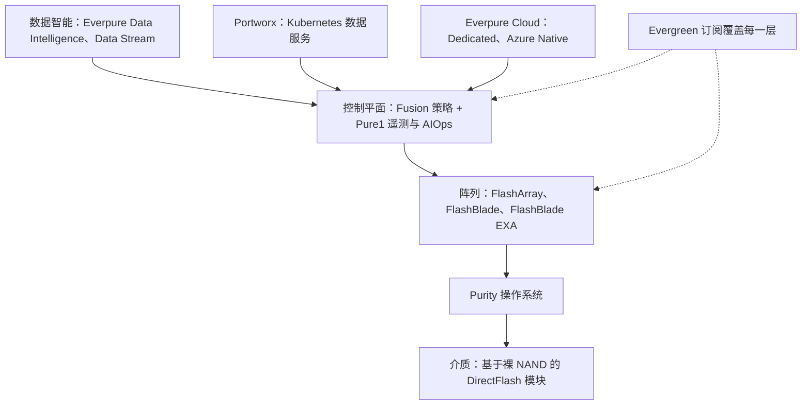
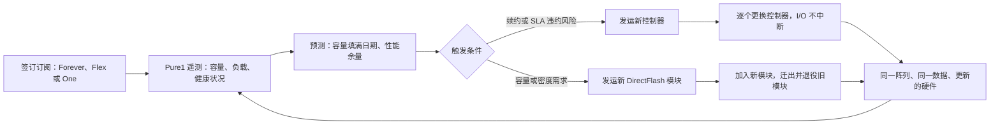
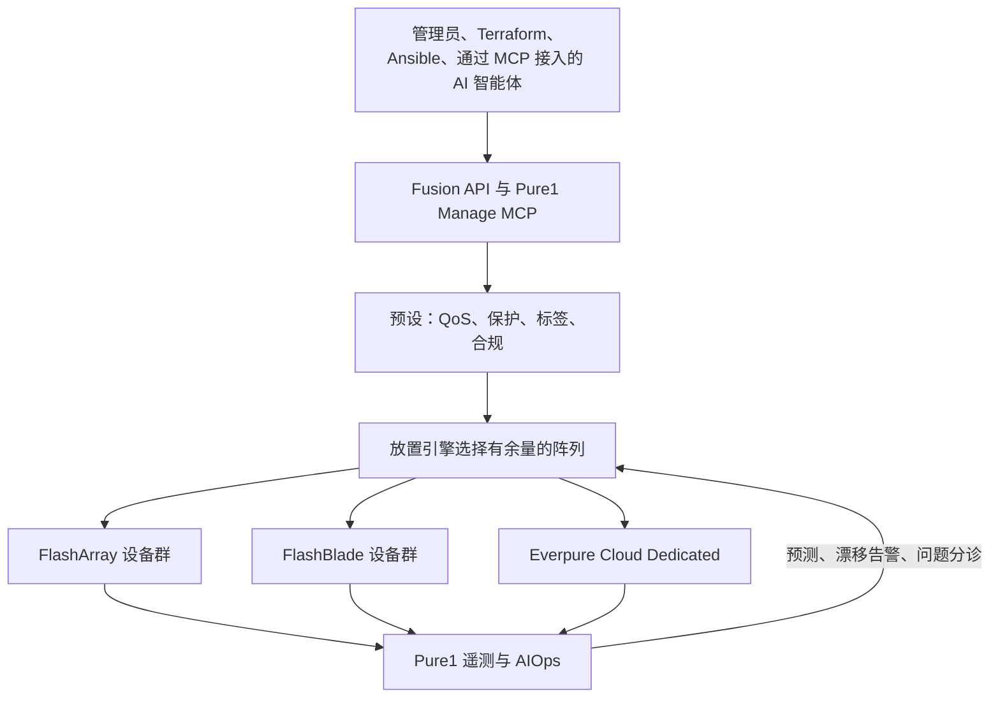
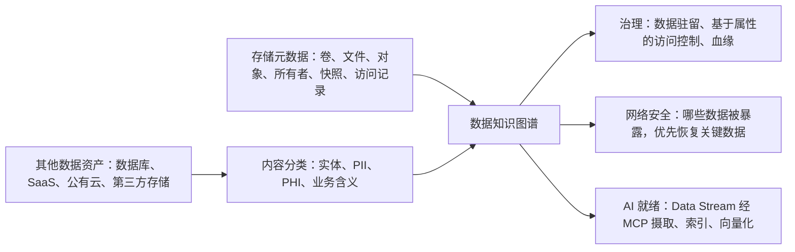
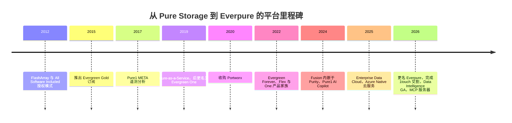

# 28. 平台与软件

> 📄 英文原文：[docs/04-everpure/28-platform-and-software.md](../../../docs/04-everpure/28-platform-and-software.md) · 本文为简体中文参考译本，如有出入以英文原文为准。

> **深度：** L2 · **阅读时间：** 约 10 分钟 · **最后核实：** 2026-11-01
> **前置阅读：** [控制平面与集群管理](../03-system-architecture/22-control-planes.md) · [消费模式](../03-system-architecture/23-consumption-models.md) · [Purity 与 DirectFlash](26-purity-and-directflash.md) · [FlashArray 与 FlashBlade](27-flasharray-and-flashblade.md)

## 要点速览（TL;DR）

- **一套软件栈，多种硬件。** Purity 运行在每一台阵列上；Fusion 和 Pure1 管理设备群；Portworx 和 Everpure Cloud 将其延伸到 Kubernetes 和公有云；Data Intelligence（原 1touch）则识别数据*是什么*。统称品牌：Enterprise Data Cloud（2025）、"Data Primacy"（2026）。
- **Evergreen 是让平台成立的商业模式。** 客户订阅的是一种架构；控制器和介质原地更新，无需迁移数据。Q2 FY27 订阅 ARR 达到 $2.13B（+20%）[^1]。
- **转换成本如今存在于控制平面。** Fusion 预设（preset）和自动化比任何一次硬件换代都更持久。截至 Q1 FY27，使用 Fusion 的客户超过 1,200 家，较上一季度翻倍[^2]，但仍不到客户总数的十分之一。
- **1touch（$125.0M，2026-05-07 完成交割）[^3] 押注的是：存储元数据加内容分类将成为一款治理与 AI 就绪（AI-readiness）产品。** 与 Portworx（约 $353M，2020）[^4] 相比规模较小，但它进入的是由数据目录和数据安全厂商主导的品类。
- **每家传统厂商都在讲同一个故事。** Dell、NetApp、HPE 和 VAST 都在销售"数据平台"；区别在于底层是什么（一套操作系统还是一个产品组合）、能否覆盖自家硬件之外，以及客户是否购买上层软件。

## 对 Everpure 战略的意义

硬件利润率随 NAND 周期起伏；随着零部件成本飙升，Everpure 于 2026 年 2 月提价（[第 29 章](29-hyperscaler-ecosystem-financials.md)）。Q2 FY27 订阅毛利率为 74.9%，产品毛利率为 66.2%（均为非 GAAP）[^5]。平台的目标是通过附加销售（attach）和扩展让收入实现复利增长。FY26 订阅净美元留存率为 113%[^6]，即某个客户群第一年支付 $100，第二年支付 $113。

风险在于：如果 Fusion、Portworx 和 Data Intelligence 主要是随阵列交易一起出货，而不是赢得独立预算，那么"数据管理公司"只不过是在存储业务损益表上换了块招牌。基于公开信息，战略团队可能评估的选项都取决于这一区别。

## 核心概念

### 逐层拆解软件栈

*图 28.1 — 每台阵列一套操作系统，所有阵列之上一个控制平面；最新的几层（Portworx、云、数据智能）接入的是这个控制平面，而不是单台设备。*

底部三层分别见[第 26 章](26-purity-and-directflash.md)、[第 27 章](27-flasharray-and-flashblade.md)和[第 22 章](../03-system-architecture/22-control-planes.md)。上面各层不需要 Everpure 硬件：**Portworx** 可在任何环境中服务 Kubernetes，**Everpure Cloud** 在 AWS 和 Azure 中运行 Purity，**Data Intelligence** 则对任何位置的数据进行分类。

**半导体类比：** 这就像 Synopsys 和 Cadence 从单点工具走向完整流程（flow）。仿真器很容易替换；而一套积累了多年脚本和已验证配方的签核（sign-off）流程则不然。Fusion 预设和自动化就是 Everpure 的"流程"，阵列则是工具。

命名几经变化，表述务必准确。**Enterprise Data Cloud**（2025 年 6 月）是一个以 Fusion 为核心、统一本地与云端的控制平面[^7]；CEO 将 2026 年 2 月启用的 Everpure 新名称与它及 Evergreen 联系在一起[^8]。法律顾问文件和监管申报现在使用"Everpure Platform"[^9]。在 Accelerate 2026 上，定位变成了 **Data Primacy**——以可信数据而非应用为中心[^10]，支柱包括数据管理、统一数据平面和智能控制平面[^11]。"Pure Storage Cloud"现已更名为 **Everpure Cloud**[^12]。

### Evergreen：订阅一种架构

Evergreen 始于 2015 年；在 2022 年的重组中，Evergreen Gold 更名为 Evergreen//Forever[^13]，并形成了如今的三个层级[^14]。

| 层级 | 硬件归属 | 付费内容 | 更新机制 | 主要保障（公司自述） |
|---|---|---|---|---|
| Evergreen//Forever | 客户 | 购买阵列加经常性订阅 | 控制器更新与三年续约挂钩，受计划条款约束[^15][^16] | 不停机升级；已拥有的容量无需重复购买 |
| Evergreen//Flex | 客户 | 实际使用的容量，可在设备群层面汇集 | 与 //Forever 相同；容量可在设备群内调配 | 在自有阵列上按用量付费[^15] |
| Evergreen//One | Everpure | 按已用容量单位计价的性能层级，设有最低承诺量 | 由 Everpure 负责，客户无感知 | 最多十项 SLA，包括 99.9999% 可用性、25% 容量缓冲、能效、零计划停机和零数据丢失[^17][^18] |

*表 28.1 — 三个 Evergreen 层级逐步把风险从客户（拥有并规划）转移到 Everpure（拥有、规划并提供保障）。*

其前提是架构层面的。在 Purity 双控制器阵列中，持久状态（数据、元数据、写日志）位于机箱内的闪存模块和 NVRAM 上，而不在控制器中（[第 14 章](../03-system-architecture/14-scale-up-dual-controller.md)）。因此控制器可以逐个更换，期间由另一台控制器继续服务 I/O；介质的更换则通过加入新模块并迁出旧模块完成。

*图 28.2 — Evergreen 循环：遥测告诉 Everpure 何时发运硬件，架构则让这些硬件无需数据迁移即可上线——这正是订阅得以续约的原因。*

截至 2021 年 7 月，Pure Storage 称自 2015 年以来已为超过 2,700 家客户完成超过 7,000 次不停机控制器升级（公司自述）[^19]。Evergreen//One 的 SLA 之所以能够承保，完全是因为 Pure1 监控着每一台阵列；缓冲容量依据 Pure1 工作负载规划器（workload planner）中的历史增长确定[^17]。**Overdrive** 宣布于 2026 年第三季度（Q3 2026）推出，允许突发用量最多超出订阅水平 25%[^20] [VERIFY: Overdrive 条款仅见于二手摘要]。

**算例（示意）。** 某客户在 Evergreen//One 下使用 800 TiB。按 25% 缓冲，Everpure 需在客户现场、在其自有硬件上保持至少 1,000 TiB 有效容量；如果数据缩减效果不及预期，Everpure 自费追加闪存。厂商承担了原本由资本支出型买家承担的利用率和数据缩减风险，这些风险已计入每 TiB 价格，且只有在遥测保证预测准确时才能盈利。现金流方面见[第 23 章](../03-system-architecture/23-consumption-models.md)。

Evergreen//One 订单（bookings）增长情况见[第 29 章](29-hyperscaler-ecosystem-financials.md)。

### Fusion 与 Pure1：控制平面即产品

*图 28.3 — 用户和智能体通过同一个 API 提出期望结果；预设编码策略，Pure1 遥测为放置决策提供依据，其后的阵列则成为可互换的容量。*

自 2024 年起，Fusion 已内嵌于 Purity，无需单独部署[^21]。其核心对象是**预设（preset）**——一个覆盖整个设备群的模板，包含性能上限、快照与复制策略以及标签[^22]，与 Kubernetes 的存储类（storage class）十分相似。Pure1 提供预测、工作负载规划和预测性支持。2026 年，两者都可以被智能体调用：Everpure 提供 **Pure1 Manage MCP 服务器**和 **Fusion MCP 服务器**，使 AI 工具能够查询设备群状态并执行受监督的操作[^23]。Fusion Compliance 与 Agentic Triage（配置漂移检测，并给出 AI 根因建议），以及 Workload Rebalance and Mobility，原定于 2026 年第四季度（Q4 2026）推出[^24] [VERIFY: GA 状态]。

关注采用率：超过 1,200 家 Fusion 客户，相对约 14,500–15,000 家客户总数 [VERIFY: 存在两个不同的客户总数数据]，约为 8%；控制平面锁定效应只对这部分客户真正成立。

### Portworx：先服务 Kubernetes，再服务虚拟机

Portworx（2020 年 10 月收购[^4]）把 Kubernetes 集群下的任何磁盘或云卷汇集成池，为容器提供持久卷、复制、快照、备份和灾备（DR），可运行在任何硬件或云上，也可直接运行在 FlashArray 上。Everpure 将 Portworx 的定期许可（term licence）计入产品收入，其他产品计入订阅服务收入[^3]，因此没有公开的 Portworx 独立收入数据。

Portworx 的"第二幕"源自 Broadcom：其 2023 年后的 VMware 许可变更推高了许多续约账单[^25]，促使企业评估 **KubeVirt**——它把虚拟机作为 Kubernetes 对象运行（通常通过 OpenShift Virtualization）。Portworx Enterprise 3.6（2026 年 3 月）新增了经过验证的 KubeVirt 框架和一个虚拟机就绪评估工具；客户在其上运行的虚拟机卷超过 100,000 个（公司自述）[^26]。Everpure 自身的 IT 部门已将超过 5,000 台虚拟机迁移到运行于 Portworx 之上的 KubeVirt（公司自述）[^27]。随后在 Red Hat Summit 2026 上又推出了 OpenShift 插件和 Edge SKU[^28]。

Everpure 对 VMware 迁出采取两头下注：面向 Kubernetes 的 Portworx，以及 2025 年 5 月与 Nutanix 的合作（FlashArray 作为 AHV 的外部存储）以覆盖另一种虚拟化平台[^29]。无论哪种方式，阵列都可以继续是 Everpure 的。

### Everpure Cloud

**Everpure Cloud Dedicated**（原 Cloud Block Store）是在客户自己的 AWS 或 Azure 账户中由客户管理的 Purity，其复制和快照功能与本地阵列一致[^12]。**Everpure Cloud Azure Native** 与 Microsoft 联合开发，于 2025 年 9 月推出[^30]，是一项完全托管的 Azure Native ISV 服务，首先面向 Azure VMware Solution[^31]，自 2026 年 6 月起支持 Azure VM 并已 GA[^20] [VERIFY: Azure VM 的 GA 日期]。其作用主要是防御性的：迁往云端的工作负载可以继续留在 Fusion 和 Evergreen 式计费之下，而不是转用原生的 EBS 或 Azure Disk。与 NetApp 在三大超大规模云厂商中均提供的第一方 ONTAP 服务相比，Everpure 的覆盖面更窄（[第 46 章](../06-industry-and-competition/46-incumbents.md)）。

### 1touch 与数据智能论点

*图 28.4 — 核心论点：存储层已经知道每个字节在哪里、谁访问过它；再加上对这些字节含义的理解，就能从同一张图谱出发销售治理、网络恢复和 AI 就绪数据。*

1touch 于 2026-05-07 完成交割，$125.0M 对价可能因调整和托管（escrow）安排而变化[^3]。作为 **Everpure Data Intelligence**（2026 年 6 月 GA）[^10]，它发现结构化和非结构化数据，在实体级别对其分类（标记 PII 和 PHI）并纳入语义知识图谱，追踪数据血缘，并执行基于属性的访问控制和数据驻留策略[^32]。分析师还称它可覆盖数据库、SaaS 和第三方存储，而不仅限于 Everpure 阵列[^11]。原生 MCP 支持（2026 年 9 月）使智能体可以查询它[^33]。**Data Stream** 运行在配备 NVIDIA GPU 的 FlashBlade 上，基于 NVIDIA 的 AI Data Platform 参考设计，对这些数据进行摄取、索引和向量化，用于 RAG 和推理[^34]（[第 39 章](../05-ai-storage/39-agentic-ai-and-data-intelligence.md)、[第 33 章](../05-ai-storage/33-rag-vector-lakehouse.md)）。

为什么是存储公司来做？阵列已经掌握了**清单**（每一个卷、文件、对象、快照和访问记录），并且位于**写路径**上，因此可以在数据落盘时触发分类，而不必像存储之上的数据目录那样依赖每周一次的爬取。**半导体类比：** 片上遥测能看到每一笔事务，而外部测试设备只能抽样。

### "存储厂商 → 数据平台"在商业上应如何运作

该模式有三个杠杆：

1. **附加销售（attach）。** 每一层都可以卖给约 15,000 家已经信任该厂商并在使用 Pure1 的客户。*示意：* 若 15,000 家客户中有 5% 按假设的 $150k ARR 附加购买 Data Intelligence，即 750 × $150k ≈ $113M ARR，约为 $2.13B 基数之上再增加 5%。这大致相当于用一年的收入收回 $125M 的收购价。
2. **ARR 质量。** 软件可以提升订阅占比、利润率和净留存率，而不仅仅依赖容量增长。
3. **转换成本。** 转换成本从设备本身（Evergreen 让其易于更新）转移到策略、自动化和知识图谱上，而这些在别处重建的成本很高。

**可能行不通的地方。** 第一，赛道拥挤：数据目录和湖仓（lakehouse）治理（Databricks Unity Catalog、Snowflake 的治理功能、Microsoft Purview）主导着分析场景中"这是什么数据"的问题，而数据安全厂商（BigID、Varonis、Cyera）则把数据发现卖给 CISO——这是另一类买家。第二，中立性尚未得到证明。一位分析师表示，在 Everpure 硬件之外的应用场景"是个更大的问号"（a bigger question mark），并指出 Everpure 未参与 Open Semantic Interchange 元数据计划[^11] [VERIFY: 仅见于搜索摘要]。第三，存储销售人员按阵列拿提成；覆盖竞争对手存储的软件需要单独的激励机制。Futurum 提出的待解问题是：客户会以多快的速度跟进[^32]。

## Everpure 的做法与竞争对手对比

| 厂商 | 平台定位（2025–26） | 底层是什么 | 数据智能 / AI 层 | 消费模式 | 最强版本论证（steelman） | 薄弱环节 |
|---|---|---|---|---|---|---|
| Everpure | Enterprise Data Cloud → Data Primacy[^7][^10] | 一套操作系统（Purity）覆盖所有阵列和云 | Data Intelligence（原 1touch）、Data Stream[^34] | Evergreen //Forever、//Flex、//One | 最简单的单一操作系统软件栈；成熟的不停机更新 | 云覆盖面窄；DI 在非 Everpure 设备上尚未得到验证；软件主要随阵列销售 |
| Dell | 与 NVIDIA 合作的 AI Data Platform[^35] | 多套操作系统：PowerScale、Lightning FS、ObjectScale、PowerStore、PowerMax | AI Data Platform 内的数据编排 | APEX[^36] | 一张采购订单即可购买服务器、网络和存储 | 产品组合庞杂；控制平面统一程度较低 |
| NetApp | 智能数据基础设施；AFX + AI Data Engine[^37] | ONTAP 本地部署，并在三大超大规模云厂商中作为第一方服务提供 | AI Data Engine（基于 NVIDIA AI Data Platform 的 ONTAP 扩展） | Keystone[^36] | 混合云覆盖最深；长期的数据管理积淀 | AFX/AIDE 较新；ONTAP 复杂 |
| HPE | 搭载 GreenLake Intelligence 的 GreenLake 云[^38] | Alletra MP（块、文件、对象）、Zerto、Data Fabric[^39] | X10000 上的内联元数据增强；智能体式运维 | GreenLake[^36] | 在一个云控制台下提供全栈（计算、经由 Juniper 的网络） | 存储只占 HPE 的一小部分；产品众多 |
| VAST | AI Operating System[^40] | 运行在合作伙伴硬件上的一套软件栈（DASE） | 平台内置 DataBase、DataEngine、InsightEngine、AgentEngine、PolicyEngine | 软件订阅 | 集成度最高：数据库和计算都位于存储层 | 要求客户连分析工具也一并替换；作为私营公司信息披露有限 |

*表 28.2 — 五家厂商都自称数据平台；Everpure 的独特主张是一套操作系统加不停机订阅，而 VAST 在软件栈上走得最高，NetApp 在跨云方面走得最远。*

Dell 和 HPE 把多套操作系统缝合在一个控制台之下；NetApp 只有一套操作系统，但其更新订阅不够简洁；VAST 把数据库和函数放进存储内部（[第 42 章](../06-industry-and-competition/42-vast-data.md)），而 Everpure 止步于此之前。最强的竞争对手论证来自 NetApp：它在三大超大规模云厂商中均有第一方 ONTAP 服务，而 Everpure 只有一项原生服务加一个由客户管理的虚拟阵列。

## 历史与发展轨迹

*图 28.5 — 每一步都把价值从硬件推向订阅和软件，但 2026 年数据层这一步是第一次覆盖到 Everpure 自有设备之外。*

时间线来源：All Software Included[^41]、Pure1 META[^42]、Evergreen//One[^14]、AI copilot[^43]。Portworx 是第一款不需要 Pure 硬件的产品。未来 12–18 个月的信号：Fusion 采用率能否继续翻倍；Data Intelligence 是否单独定价、单独披露，并赢得非 Everpure 数据资产；以及 Everpure 是否加入元数据互操作计划。

## 关键数字

| 指标 | 数值 | 背景 | 来源 / 日期 |
|---|---|---|---|
| 订阅 ARR | $2.13B（同比 +20%） | Evergreen、Portworx、Pure1、云订阅 | Q2 FY27 财报新闻稿[^1] |
| 订阅净美元留存率 | 113%（FY25：117%） | 现有订阅客户内部的扩展 | FY26 10-K[^6] |
| Fusion 客户 | >1,200，环比翻倍 | 约占 ~15k 客户的 ≈8%（推算） | Q1 FY27 业绩说明稿，2026-05-27[^2] |
| Evergreen//One 可用性 SLA | 99.9999% | 另有 25% 容量缓冲，最高 1 PiB | Everpure SLA 简报[^17] |
| 不停机控制器升级 | 为 >2,700 家客户完成 >7,000 次 | 2015 年至 2021 年 7 月累计，公司自述 | Pure 新闻稿，2021[^19] |
| 1touch 收购价 | $125.0M 现金 | 2026-05-07 完成交割 | 10-Q Q1 FY27[^3] |
| Portworx 收购对价 | $352.9M（+$32.2M 留任激励） | 2020 年 10 月完成交割 | FY21 10-K[^4] |
| Portworx 上的虚拟机卷 | >100,000 | 公司自述，2026 年 3 月 | IT Brief[^26] |
| 附加销售示意 | 约 $113M ARR | 5% × 15,000 × $150k，示意 | 算例 |

## 对话手册

**向产品经理提的问题**

1. *"Data Intelligence 交易中有多大比例覆盖的数据不在 Everpure 存储上？"* 高质量回答：给出一个数字，点名数据资产类型（Oracle、SaaS、竞争对手的 NAS），并说明如何与现有数据目录或 DSPM 工具集成。
2. *"Fusion 的采用数是按启用它的客户计算，还是按在生产环境中运行预设的客户计算？"* 高质量回答：区分"已开启"和"基于它做自动化"，并把后者与续约和 NDR 联系起来。
3. *"Evergreen//One 的 25% 缓冲在已部署容量上让我们付出了多少成本？NAND 涨价对此有何影响？"* 高质量回答：量化缓冲和数据缩减风险，并说明定价或 Overdrive 如何弥补这些成本。

**向工程师提的问题**

1. *"Data Intelligence 如何在写路径上做分类，而不给 Purity 增加延迟？"* 高质量回答：异步执行、不在 I/O 路径上、由快照或元数据事件触发，并限定控制器资源占用。
2. *"智能体通过 Fusion MCP 服务器，在无人审批的情况下能做什么？"* 高质量回答：限定范围的凭据、默认只读、破坏性操作需审批把关，并以不可变快照作为最后防线。
3. *"当 Portworx 运行在非 Everpure 磁盘上时，与运行在 FlashArray 上相比，客户会失去什么？"* 高质量回答：坦率说明数据缩减、快照卸载和复制效率方面的差异。

**不要这样说：**

- "Evergreen 意味着免费硬件。"订阅为升级提供资金，并附有资格条款。
- "Everpure 现在是像 Databricks 那样的数据管理公司。"它管理的是数据基础设施和元数据，而不是分析引擎。
- "Portworx 只能配合 Everpure 阵列使用。"它在设计上与硬件无关。
- "1touch 是 Everpure 最大的软件交易。"Portworx 的花费几乎是它的三倍。

## 深入阅读（可选，L3 指引）

- Evergreen//One Product Guide 与 Evergreen Program Description（SLA 定义、补救措施、资格条件）。
- Fusion 白皮书与开源的 Fusion MCP 服务器（预设模式、API 对象）。
- Portworx 关于 KubeVirt 热迁移的文档；KubeVirt 与 CSI 规范。

## 关键术语

- **Everpure Platform / Enterprise Data Cloud / Data Primacy** — 软件栈与战略的名称。
- **Evergreen//Forever、//Flex、//One** — 自有、自有按用量付费、以及即服务（as-a-service）三种订阅层级。
- **Fusion 预设（preset）** — 覆盖整个设备群的资源配置策略模板。
- **Portworx** — 可在任何基础设施上运行的 Kubernetes 数据服务。
- **KubeVirt** — 将虚拟机作为 Kubernetes 对象运行。
- **Everpure Cloud Dedicated / Azure Native** — 分别为客户管理和完全托管的云上 Purity。
- **Everpure Data Intelligence** — 源自 1touch 的数据发现与分类产品。
- 参见[术语表](../glossary.md)。

## 资料来源

[^1]: Everpure, "Everpure Announces Second Quarter Fiscal 2027 Financial Results," 2026-08-26. https://investor.everpuredata.com/news-and-events/press-releases/press-release-details/2026/Everpure-Announces-Second-Quarter-Fiscal-2027-Financial-Results/default.aspx (retrieved 2026-11-01).
[^2]: Everpure, "Q1 FY27 Prepared Remarks," 2026-05-27. https://s21.q4cdn.com/687136699/files/doc_financials/2027/q1/Everpure-Q1FY27-Prepared-Remarks.pdf (retrieved 2026-11-01); prior figure (>600 customers) from Everpure, "Q4FY26 Prepared Remarks," 2026-02-25. https://s21.q4cdn.com/687136699/files/doc_financials/2026/q4/Q4FY26-Everpure-Prepared-Remarks.pdf (retrieved 2026-11-01).
[^3]: SEC, "Everpure, Inc. Form 10-Q for the quarter ended May 3, 2026," 2026-06. https://www.sec.gov/Archives/edgar/data/0001474432/000147443226000061/pstg-20260503.htm (retrieved 2026-11-01).
[^4]: SEC, "Pure Storage, Inc. Form 10-K for fiscal year 2021," 2021-03. https://www.sec.gov/Archives/edgar/data/1474432/000162828021005538/pstg-20210131.htm (retrieved 2026-11-01).
[^5]: Investing.com, "Everpure Q2 FY27 slides: 38% revenue growth, guidance raised sharply," 2026-08. https://www.investing.com/news/company-news/everpure-q2-fy27-slides-38-revenue-growth-guidance-raised-sharply-93CH-4878054 (retrieved 2026-11-01).
[^6]: SEC, "Everpure, Inc. Form 10-K for fiscal year ended February 1, 2026," 2026-03-24. https://www.sec.gov/Archives/edgar/data/1474432/000147443226000027/pstg-20260201.htm (retrieved 2026-11-01).
[^7]: Blocks & Files, "Pure debuts Enterprise Data Cloud with Fusion updates and new FlashArray systems," 2025-06-18. https://www.blocksandfiles.com/ai-ml/2025/06/18/pure-debuts-enterprise-data-cloud-with-fusion-updates-and-new-flasharray-systems/100996 (retrieved 2026-11-01).
[^8]: WWT, "Pure Storage Rebrands To Everpure And Announces Intent To Acquire 1touch," 2026-02-23. https://www.wwt.com/news/pure-storage-rebrands-to-everpure-and-announces-intent-to-acquire-1touch (retrieved 2026-11-01).
[^9]: Cleary Gottlieb, "Everpure Completes Acquisition of 1touch," 2026-05-11. https://www.clearygottlieb.com/news-and-insights/news-listing/everpure-completes-acquisition-of-1touch (retrieved 2026-11-01).
[^10]: HPCwire, "Everpure Wants to Improve Data Management for the Coming AI Wave," 2026-06-20. https://www.hpcwire.com/aiwire/2026/06/20/everpure-wants-to-improve-data-management-for-the-coming-ai-wave/ (retrieved 2026-11-01).
[^11]: TechTarget, "Everpure grows into data management with Data Intelligence update," 2026-06. https://www.techtarget.com/searchstorage/news/366644759/Everpure-grows-into-data-management-with-Data-Intelligence-update (retrieved 2026-11-01; read via search summary, page not fetchable); corroborated in part by IT Brief Australia, "Storage to strategy: Everpure pivots to data intelligence," 2026. https://itbrief.com.au/story/storage-to-strategy-everpure-pivots-to-data-intelligence (retrieved 2026-11-01).
[^12]: Everpure Support, "White Paper: Everpure Cloud Dedicated for AWS," n.d. https://support.everpuredata.com/r/bHp_RInmbnRr219God~wDA/vvUbjhwU28Xj07IMH9rE6w (retrieved 2026-11-01); Pure Community, "Pure Cloud Block Store is now Pure Storage Cloud Dedicated," n.d. https://purecommunity.purestorage.com/tag/cloud (retrieved 2026-11-01).
[^13]: IDC / Pure Storage, "Evergreen//Forever Subscription Ushers in New FlashBlade//S" (white paper), 2022. https://www.purestorage.com/content/dam/pdf/de-de/white-papers/wp-idc-evergreen-forever-subscription-ushers-in-new-flashblade-s-de-de.pdf (retrieved 2026-11-01).
[^14]: Blocks & Files, "Pure Storage Evergreen rework," 2022-06-08. https://blocksandfiles.com/2022/06/08/pure-storage-evergreen-rework/ (retrieved 2026-11-01).
[^15]: Everpure, "Evergreen subscriptions" (product page), n.d. https://www.everpuredata.com/products/staas/evergreen.html (retrieved 2026-11-01).
[^16]: Everpure, "Evergreen Program Description" (legal), n.d. https://www.purestorage.com/legal/evergreen-program-description.html (retrieved 2026-11-01).
[^17]: Everpure, "Evergreen//One Advanced SLAs" (solution brief), n.d. https://www.everpuredata.com/content/dam/pdf/en/solution-briefs/sb-evergreen-one-advanced-slas.pdf (retrieved 2026-11-01).
[^18]: Everpure, "Evergreen//One Product Guide" (subscriptions commencing on or after 2025-08-18), n.d. https://www.everpuredata.com/legal/evergreen-one-product-guide.html (retrieved 2026-11-01).
[^19]: Pure Storage, "Pure's Evergreen Subscription to Innovation Reaches New Milestone," 2021-07. https://www.purestorage.com/company/newsroom/press-releases/pure-evergreen-subscription-reaches-new-milestone.html (retrieved 2026-11-01); corroborated by ITWeb, 2021-07. https://www.itweb.co.za/article/pures-evergreen-subscription-to-innovation-reaches-new-milestone-delivers-over-7-000-non-disruptive-controller-upgrades-since-2015/raYAyModA85qJ38N (retrieved 2026-11-01).
[^20]: Coolspirit, "Pure Accelerate 2026: What the Latest Announcements Mean for Enterprise Storage," 2026-06. https://www.coolspirit.co.uk/blogs/pure-accelerate-2026-what-the-latest-announcements-mean-for-enterprise-storage (retrieved 2026-11-01).
[^21]: TechTarget, "Pure Storage adds AI and automation, extends SLAs," 2024-06. https://www.techtarget.com/searchStorage/news/366589453/Pure-Storage-adds-AI-and-automation-extends-SLAs (retrieved 2026-11-01).
[^22]: Everpure, "Presets and Workloads in Pure Fusion" (demo), n.d. https://www.everpuredata.com/demos/platform/managing-at-scale/presets-and-workloads-in-pure-fusion/6368000113112.html (retrieved 2026-11-01).
[^23]: Everpure blog, "Pure1, now agentic," 2026. https://blog.everpuredata.com/products/pure1-now-agentic/ (retrieved 2026-11-01).
[^24]: Blocks & Files, "Everpure extends data and control planes for agentic AI," 2026-06-17. https://www.blocksandfiles.com/data-management/2026/06/17/everpure-extends-data-and-control-planes-for-agentic-ai/5257407 (retrieved 2026-11-01; read via search summary).
[^25]: CIO Dive, "Broadcom's VMware acquisition and VCF private cloud strategy," 2024. https://ciodive.com/news/broadcom-vmware-acquistion-vcf-private-cloud/733800/ (retrieved 2026-11-01); Data Center Knowledge, "Broadcom Explains VMware Strategy Amid Product 'Confusion'," 2024. https://www.datacenterknowledge.com/management/broadcom-explains-vmware-strategy-amid-product-confusion- (retrieved 2026-11-01).
[^26]: IT Brief New Zealand, "Everpure adds VM storage tools for Kubernetes estates," 2026-03. https://itbrief.co.nz/story/everpure-adds-vm-storage-tools-for-kubernetes-estates (retrieved 2026-11-01).
[^27]: Intelligent CIO, "Portworx by Everpure is redefining modern virtualisation for customers with proven, enterprise-ready solutions," 2026-04-02. https://www.intelligentcio.com/me/2026/04/02/portworx-by-everpure-is-redefining-modern-virtualisation-for-customers-with-proven-enterprise-ready-solutions/ (retrieved 2026-11-01).
[^28]: Efficiently Connected, "Portworx at Red Hat Summit 2026," 2026-05. https://www.efficientlyconnected.com/portworx-edge-kubernetes-storage-red-hat-summit-2026/ (retrieved 2026-11-01).
[^29]: SDxCentral, "Nutanix partners with Pure Storage in latest VMware assault," 2025-05. https://www.sdxcentral.com/news/nutanix-partners-with-pure-storage-in-latest-vmware-assault/ (retrieved 2026-11-01).
[^30]: Blocks & Files, "Pure Enterprise Data Cloud updates," 2025-09-26. https://blocksandfiles.com/2025/09/26/pure-enterprise-data-cloud-updates/ (retrieved 2026-11-01).
[^31]: Microsoft Learn, "Pure Storage Cloud overview" (Azure Native ISV Services), n.d. https://learn.microsoft.com/en-us/azure/partner-solutions/pure-storage/overview (retrieved 2026-11-01).
[^32]: Futurum Group, "Everpure's Data Primacy Bet: From Storage to System of Record," 2026. https://futurumgroup.com/insights/everpures-data-primacy-bet-from-storage-to-system-of-record/ (retrieved 2026-11-01; read via search summary).
[^33]: Blocks & Files, "Everpure bulks up AI offer," 2026-09-30. https://blocksandfiles.com/flash/2026/09/30/everpure-bulks-up-ai-offer/5300162 (retrieved 2026-11-01).
[^34]: BigDATAwire / HPCwire, "Everpure Announces Data Stream to Expand AI-Ready Data Offerings," 2026-06-17. https://www.hpcwire.com/bigdatawire/this-just-in/everpure-announces-data-stream-to-expand-ai-ready-data-offerings/ (retrieved 2026-11-01).
[^35]: Dell Technologies, "Dell AI Data Platform with NVIDIA Supercharges Enterprise AI with Breakthrough Data Orchestration and Storage Innovations," 2026-03-16. https://www.dell.com/en-us/dt/corporate/newsroom/announcements/detailpage.press-releases~usa~2026~03~dell-ai-data-platform-with-nvidia-supercharges-enterprise-ai-with-breakthrough-data-orchestration-and-storage-innovations.htm (retrieved 2026-11-01).
[^36]: Gartner Peer Insights, "Platform-Native Consumption Services" market comparisons (Evergreen//One, NetApp Keystone, Dell APEX, HPE GreenLake Flex Capacity), n.d. https://www.gartner.com/reviews/market/platform-native-consumption-services/compare/product/evergreenone-vs-hpe-greenlake-flex-capacity (retrieved 2026-11-01).
[^37]: Blocks & Files, "NetApp disaggregates ONTAP storage and provides an AI Data Engine," 2025-10-14. https://blocksandfiles.com/2025/10/14/netapp-disaggregates-ontap-storage-and-provides-an-ai-data-engine/ (retrieved 2026-11-01).
[^38]: HPE, "HPE reimagines hybrid IT operations with GreenLake Intelligence," 2025-06. https://www.hpe.com/us/en/newsroom/press-release/2025/06/hpe-reimagines-hybrid-it-operations-with-greenlake-intelligence.html (retrieved 2026-11-01).
[^39]: Blocks & Files, "HPE updates Alletras X and B10000, Zerto and Data Fabric in GreenLake private cloud update blast," 2026-05-12. https://www.blocksandfiles.com/file/2026/05/12/hpe-updates-alletras-x-and-b10000-zerto-and-data-fabric-in-greenlake-private-cloud-update-blast/5239011 (retrieved 2026-11-01).
[^40]: HPCwire, "VAST Data Expands AI Data Stack, Keeps Eye on North Star," 2026-02-25. https://www.hpcwire.com/2026/02/25/vast-data-expands-ai-data-stack-keeps-eye-on-north-star/ (retrieved 2026-11-01).
[^41]: SEC, "Pure Storage, Inc. Form S-1," 2015-08-27. https://www.sec.gov/Archives/edgar/data/0001474432/000119312515287576/d895532ds1.htm (retrieved 2026-11-01).
[^42]: Pure Storage, "Pure Storage Delivers Industry-First Performance and Capacity Prediction Capabilities Powered by Machine Learning" (Pure1 META), 2017-06. https://www.everpuredata.com/company/news-and-events/press/ps_release_accelerate2017_meta.html (retrieved 2026-11-01).
[^43]: ITPro, "Pure Storage looks to 'fundamentally change' cloud storage management with new AI copilot tool," 2024-06. https://itpro.com/cloud/cloud-storage/pure-storage-looks-to-fundamentally-change-cloud-storage-management-with-new-ai-copilot-tool (retrieved 2026-11-01).
