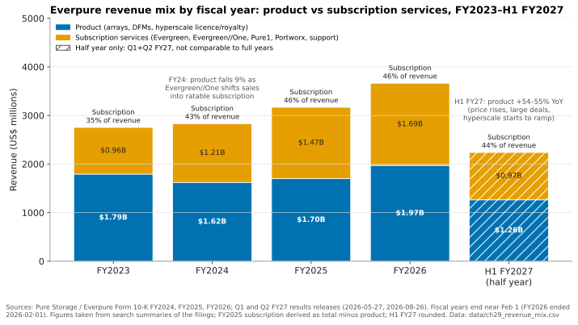
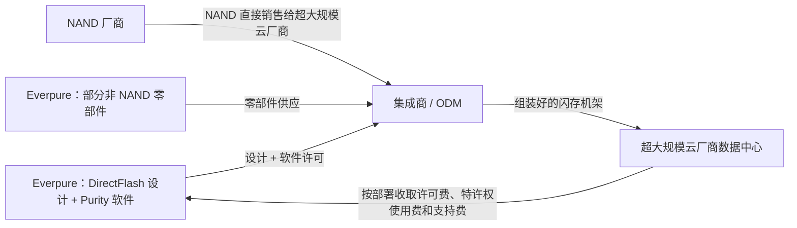
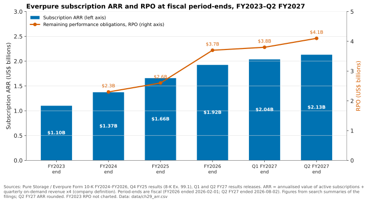
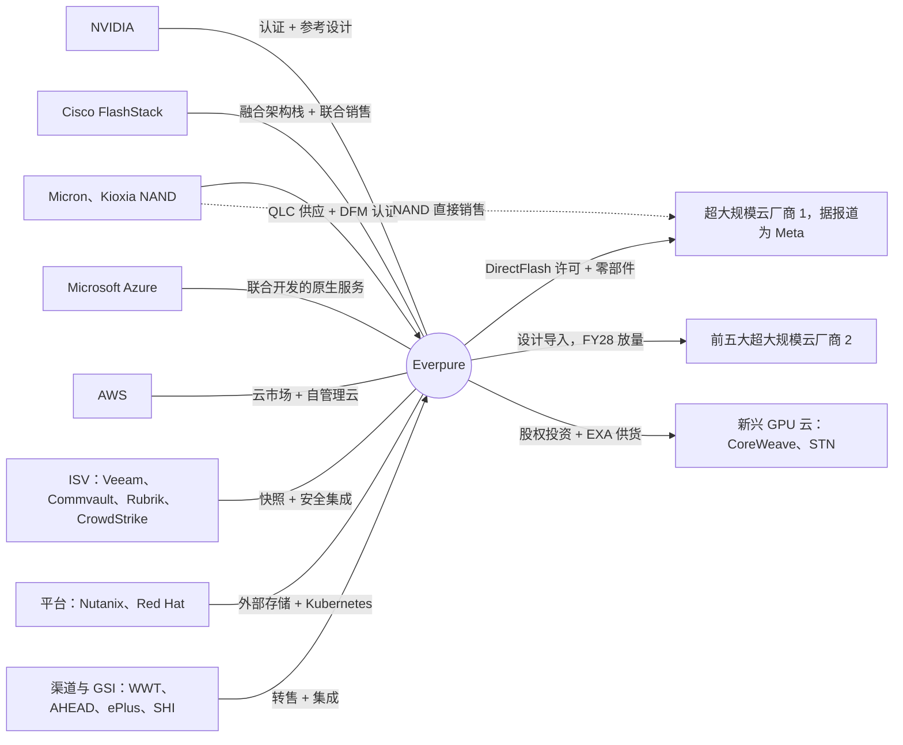

# 29. 从技术视角看超大规模业务、生态系统与财务

> 📄 英文原文：[docs/04-everpure/29-hyperscaler-ecosystem-financials.md](../../../docs/04-everpure/29-hyperscaler-ecosystem-financials.md) · 本文为简体中文参考译本，如有出入以英文原文为准。

> **深度：** L2 · **阅读时间：** 约 9 分钟 · **最后核实：** 2026-11-01
> **前置阅读：** [Purity 与 DirectFlash](26-purity-and-directflash.md) · [消费模式](../03-system-architecture/23-consumption-models.md) · [公司历史与战略](25-company-history-and-strategy.md)

## 要点速览（TL;DR）

- **两条收入线，三项业务。** Everpure（NYSE: P，原 PSTG）销售阵列并将 NAND 计入自身账目；Evergreen 订阅按期（ratably）确认收入；超大规模 DirectFlash 许可则由客户自行采购 NAND。三者利润率结构各不相同。
- **超大规模模式授权的是闪存管理 IP，而不是卖设备。** 首个客户 Meta（在 FY25 10-K 中被点名）在 FY26 部署量突破 2 EB。第二家前五大超大规模云厂商于 2026-08-10 签约，收入自 FY28 起贡献。
- **经常性收入持续复利增长。** 截至 Q2 FY27（2026-08-02 结束），订阅 ARR 为 $2.13B（+20%），RPO 为 $4.1B（+44%）。
- **技术选择决定利润率。** DirectFlash 从物料清单中去掉了 SSD 控制器和 DRAM。2026 年 NAND 价格飙升使非 GAAP 产品毛利率（GM）降至 65–66%；订阅毛利率约 75%；超大规模许可业务能拉高利润率，但收入起伏不均。
- **生态系统主要是分销渠道。** NVIDIA 认证是 AI 交易的门槛，Cisco 和全球系统集成商（GSI）承载企业级销量，NAND 厂商则直接向 Everpure 的超大规模客户供货。

## 对 Everpure 战略的意义

Everpure 将 FY27 收入指引从 2026 年 2 月的 $4.3–4.4B 上调至 8 月的 $5.03–5.07B。新指引中值比 FY26 的 $3.66B 高出约 38%[^1][^2]。超大规模许可、FlashArray//C 或 Evergreen//One 各自贡献的一美元收入，在成本、现金流时点和持久性上都不相同，因此增长来源很重要。本章把[第 26 章](26-purity-and-directflash.md)中的架构与分析师建模所用的数字联系起来。

许可模式能否扩展到两家以上的超大规模云厂商，以及它与阵列业务是互补还是相互蚕食，处于这只股票投资逻辑的核心位置。

## 核心概念

### 同一技术栈上的三台收入引擎

10-K 中有两条收入线：**产品**和**订阅服务**。为其供血的是三台引擎：

1. **直接销售的阵列**（FlashArray、FlashBlade、FlashBlade//EXA）。Everpure 采购 NAND，制造 DirectFlash 模块（DFM），在发货时确认产品收入；随附的 Evergreen//Forever 支持与升级订阅则按期确认。
2. **消费型服务**，主要是 Evergreen//One——一种由 SLA 背书、按已用容量计价的存储即服务（STaaS）。硬件归 Everpure 所有，收入按期确认。这正是 FY24 产品收入下降 9%、而订阅收入增长 26% 的原因；10-K 将部分原因归于 Evergreen//One 的消费模式[^3]。
3. **超大规模业务。** DirectFlash 与 Purity 技术授权给自行采购 NAND 的超大规模云厂商，收入计入*产品*。Q3 FY26 产品收入为 $534.8M（+17.6%），其中包含来自超大规模出货的特许权使用费（royalty）[^4]。

*图 29.1 — 截至 FY25，Evergreen//One 把收入结构拉向订阅。到 FY27，在价格、大额交易和超大规模业务推动下，产品收入再度增长更快。*
数据：`data/ch29_revenue_mix.csv`

订阅收入占比从 FY23 的 35% 升至 FY25 和 FY26 的 46%，随后在 H1 FY27 回落至 44%，仅 Q2 单季为 42%[^5]，原因是产品收入在 Q1 增长 55%、Q2 增长 54%[^6][^1]。驱动因素包括：NAND 成本飙升后的提价（标价于 2026-02-09 上调[^7]）、更大规模的交易，以及自 H2 FY27 起的超大规模业务。经常性收入基础并未走弱；订阅服务在 Q1 和 Q2 仍分别增长 17% 和 20%。

### 超大规模模式：授权一颗控制器，而不是卖一台设备

**半导体类比。** DirectFlash 把 SSD 的控制器 ASIC 和 FTL DRAM 从硬盘中拿掉，把闪存管理移入 Purity（[第 26 章](26-purity-and-directflash.md)）。超大规模交易出售这一能力的方式，与 IP 厂商出售设计的方式相同：客户购买"晶圆"（NAND）；Everpure 提供设计、软件和部分非 NAND 零部件，并随容量部署收取费用。

*图 29.2 — 在超大规模业务中，NAND 从不出现在 Everpure 的账目上。Everpure 收取的是 IP、软件、支持和部分零部件的费用，因此每 EB 收入较低，但毛利率较高。*

按时间顺序，已公开的信息如下：

- **设计导入（2024 年 12 月）。** Pure Storage 在发布 Q3 FY25 业绩时宣布，与一家未具名的前四大超大规模云厂商达成 DirectFlash 设计导入（design win）。硬件不在其中：客户从其集成商处采购，Pure 赚取许可、软件和支持费用[^8][^9]。分析师判断该客户为 Meta，FY25 10-K 随后点名了 Meta[^11]；CEO 在 2025 年 3 月 FlashBlade//EXA 发布会上提到 Meta 选择了 DFM[^10]，FY2025 10-K 也点名了 Meta[^11]。
- **规模（FY26）。** Pure 在 Q2 FY26 确认了首笔收入。FY26 计划假设部署 1–2 EB DirectFlash[^12]；到 Q3 FY26，Pure 表示已超过其 2 EB 的预测[^4]。作为参照，2 EB 约相当于 26,700 个 75 TB 模块，或 13,300 个 150 TB 模块（实际部署的容量规格未披露）。
- **模式标准化（2026 年 2 月）。** 管理层表示超大规模合同条款现已标准化：Everpure 采购部分零部件，超大规模云厂商继续通过自己的供应链采购 NAND。收入跟随数据中心建设节奏，FY27 预期收入大部分落在 Q3–Q4[^13]。[VERIFY: 仅见于搜索摘要]
- **第二家超大规模云厂商（2026-08-10）。** Everpure 宣布与第二家未具名的前五大超大规模云厂商达成基于 DirectFlash 的设计导入和供货协议。其对 FY27 贡献很小，预计从 FY28 起产生实质影响[^14][^15]。管理层表示该交易与第一家如出一辙，并称目前 DirectFlash 主要替代的是 SSD 而非磁盘[^16]。新闻稿本身也提示，该客户可能不会订购或部署所设想的数量[^14]。

**算例（示意）：为什么超大规模业务只有在达到规模后才能拉高利润率。** Everpure 未披露超大规模业务毛利率。分析师评论认为约为 75–85%（部分报告称纯特许权使用费部分超过 90%）[^17] [VERIFY: 分析师估算，仅见于搜索摘要]。假设超大规模业务占季度收入的 5%、毛利率 85%，其余业务按 Q2 FY27 的 69.9% 非 GAAP 毛利率计算[^18]。综合毛利率 = 0.95 × 69.9% + 0.05 × 85% = 66.4% + 4.25% ≈ **70.7%**，提升约 0.8 个百分点。若占比为 10%，则为 0.90 × 69.9% + 0.10 × 85% ≈ **71.4%**。只有当收入占比达到两位数时，超大规模业务才会明显拉动综合毛利率。Q3 FY26 就是现实版本：特许权使用费帮助非 GAAP 产品毛利率升至 72.9%（此前为 67.4%），GAAP 毛利率达到 72.3%[^4][^19]。但管理层表示，在新模式下 Everpure 供应零部件，超大规模业务的利润率会更接近公司平均水平[^19]，因此 85% 只是乐观情形。

### 订阅 ARR 与 RPO：积压订单透露了什么

Everpure 对**订阅 ARR** 的定义是：季末有效订阅的年化合同价值，加上该季度按需（on-demand）收入 × 4[^3]。**RPO**（剩余履约义务）是已签约但尚未确认的收入：包括尚未交付的产品，以及多年期订阅中尚未到期的年份。

*图 29.3 — ARR 以每年约 21% 的速度复利增长，而 RPO 在 FY26 大幅跃升，因为大额交易和更长的 Evergreen 合同期限扩充了积压订单。*
数据：`data/ch29_arr.csv`

如何解读：

- **增长率。** (2.13 ÷ 1.10)^(1/3.5 years) ≈ 1.21，即每年约 21%[^3][^1]。
- **RPO 的跃升。** 受大额交易和更长 Evergreen 合同推动，RPO 在 FY26 增长 40%（FY25 为 14%）[^20]。部分增长是"借来的"：更长的续约期使 ARR 增速放缓至 16%，净美元留存率从 117% 降至 113%[^21]。
- **合理性检查。** Q2 订阅收入 $499M × 4 ≈ $2.0B，略低于 $2.13B 的 ARR；ARR 中包含按需收入的年化值和季末才开始的合同。RPO 约为 ARR 的 1.9 倍。

**技术视角。** 在 Evergreen//One 中，硬件归 Everpure 所有，按已用 TB 收费，因此 DFM 密度、数据缩减率和每 TB 功耗决定其利润率，而不停机升级让多年期 SLA 得以成立。Evergreen//One 销售额在 Q1 FY27 增长 73%[^6]，Q2 存储即服务的合同总价值（TCV）为 $277M（+121%）[^16] [VERIFY: TCV 来自电话会议摘要]。

### 与技术挂钩的毛利率驱动因素

| 驱动因素 | 技术机制 | 利润率影响 | 公开证据 |
|---|---|---|---|
| DirectFlash 与 SSD 物料清单对比 | 无需每块盘配备控制器 ASIC 或 FTL DRAM。SSD 每 TB 约需 1 GB DRAM，因为它为每个 4 KiB 页保存一条 4 字节映射条目。Purity 全局管理 NAND，隐藏的预留空间更少 | 每 TB 成本低于采购成品 SSD，使 Everpure 在激进定价的同时仍能支撑产品毛利率 | Q4 FY26 产品毛利率 67.3%，受产品组合推动提升超过 400 bp[^22] |
| NAND 价格传导 | Everpure 为企业级阵列采购 NAND。NAND 合约价格在 2026 年全年大幅上涨，TrendForce 预测 4Q26 环比再涨 +15–20%（企业级 SSD 据报道上涨 +23–28%）[^23] | 成本先于价目表上涨。利润率先滞后、后恢复。保障供应会占用现金 | 2026-02-09 提价[^7]；FY27 Q1 和 Q2 非 GAAP 产品毛利率分别为 65.5% 和 66.2%[^6][^18]；Q2 自由现金流（FCF）为 –$238M，源于战略性 NAND 采购[^24] |
| Evergreen//Forever 与 //One | 以软件为主的支持服务加不停机升级。在 //One 中，Everpure 还承担硬件 | 订阅毛利率约 75%。硬件占比高的 //One 组合相对于纯支持服务可能稀释利润率 [VERIFY: //One 的成本构成] | FY27 Q1 和 Q2 非 GAAP 订阅毛利率分别为 75.6% 和 74.9%[^6][^18] |
| 超大规模许可 | 客户采购 NAND。Everpure 提供 IP、软件、支持和部分非 NAND 零部件 | 类似特许权使用费，能拉高利润率，但收入起伏不均，且与客户的建设节奏挂钩 | Q3 FY26 GAAP 毛利率 72.3%，得益于特许权使用费[^4]；模式于 2026 年 2 月标准化[^13] |
| 交易与产品组合 | 大型 AI 和企业交易；以磁盘为定价参照的 QLC 容量层（//C、//E） | 管理层表示有意将产品毛利率维持在 65–70% 区间的底部附近，以争取份额 | 长期产品毛利率区间 65–70%[^25] |
| 软件附加销售 | Portworx、Fusion、Data Intelligence（原 1touch） | 接近纯软件，但目前规模太小，不足以影响综合毛利率 | 未单独披露 |

*表 29.1 — 每一条利润率线都可以追溯到一项技术选择：谁拥有 NAND，Everpure 设计了硬盘的多少部分，以及售后硬件归谁所有。*

### 生态系统地图

*图 29.4 — 生态系统的大部分是分销与验证，而非收入来源。超大规模云厂商这几条连线是例外：在那里，NAND 厂商绕过 Everpure，直接向其客户供货。*

- **验证（NVIDIA）。** FlashBlade//S 获得 SuperPOD 认证（2024 年 11 月）[^26]、NVIDIA-Certified Storage 和 NCP 高性能存储认证（2025 年 3 月）[^27]；Data Stream 基于 AI Data Platform 设计[^28]；BlueField-4 STX 合作伙伴[^29]。这些不产生费用，但没有它们就进不了候选名单（[第 27 章](27-flasharray-and-flashblade.md)、[第 34 章](../05-ai-storage/34-nvidia-ecosystem.md)）。
- **融合架构分销。** FlashStack 于 2025 年末加入 Cisco 与 NVIDIA 合作的 Secure AI Factory，通过 AHEAD、ePlus、SHI 和 WWT 销售[^30]。
- **超大规模云厂商，双重角色。** 既是 DirectFlash 客户，也是云渠道：与 Microsoft 联合开发的 Everpure Cloud Azure Native[^31]，以及 AWS 和 Azure 上的 Cloud Dedicated[^32]（[第 28 章](28-platform-and-software.md)）。
- **新兴 GPU 云（neocloud）。** 2024 年 11 月对 CoreWeave 的股权投资使 Pure 成为其首选存储方案之一[^33]，但 Evercore 指出投资者对此的评价低于一家一线超大规模云厂商的订单[^34]；CoreWeave 后来与 VAST 签下了规模大得多的协议[^35]。STN 的 GPU 云运行在 FlashBlade//EXA 上[^36]，Evergreen//One 于 2026 年 3 月覆盖 EXA[^37]（[第 35 章](../05-ai-storage/35-ai-factories-and-neoclouds.md)）。
- **NAND。** Micron 和 Kioxia 供应 DFM 所用 NAND 并参与联合认证（[第 26 章](26-purity-and-directflash.md)）[^38]。
- **ISV 与平台。** Veeam（Fusion 插件）[^39]、Commvault（IntelliSnap）[^40]、Rubrik 和 CrowdStrike（Enterprise Data Cloud）[^41]，以及 Nutanix AHV 外部存储（2025 年 5 月）[^42]。

## Everpure 的做法与竞争对手对比

| 维度 | Everpure | VAST Data（私营） | NAND/SSD 厂商（Samsung、SK hynix/Solidigm、Micron、Kioxia） | 传统阵列厂商（Dell、NetApp、HPE） |
|---|---|---|---|---|
| 超大规模云厂商购买什么 | DirectFlash 设计 + Purity 许可 + 部分零部件；两家前五大客户订单 | 运行在合作伙伴硬件上的软件；在新兴 GPU 云中最强 | 标准或定制 SSD，常运行超大规模云厂商自己的固件 | 在超大规模领域份额很小；优势在企业市场 |
| 谁承担 NAND 成本 | Everpure（企业业务）；客户（超大规模业务） | 硬件合作伙伴或客户 | 供应商，并享受 2026 年价格飙升的收益 | 厂商，需采购 SSD |
| 新兴 GPU 云策略 | CoreWeave 股权投资、STN、具备多租户能力的 EXA | 与 CoreWeave 的 $1.17B 协议（*公司自述*）[^35] | 间接，通过服务器 | Dell AI Data Platform；NetApp AFX[^43] |
| 与 NVIDIA 的协同 | SuperPOD、Certified Storage、NCP、STX 合作伙伴 | STX 合作伙伴，与 NVIDIA 关系深厚 | NVIDIA 系统的零部件供应商 | STX 合作伙伴[^29] |
| 收入持久性 | 订阅占 42–46%；RPO $4.1B | 仅有*公司自述*的 ARR | 周期性 | 自有订阅计划（[第 23 章](../03-system-architecture/23-consumption-models.md)） |

*表 29.2 — Everpure 是唯一一家公开已知在超大规模云厂商内部将其闪存设计变现的阵列厂商。VAST 占据新兴 GPU 云的软件位置，NAND 厂商则吃下大宗商品价格周期的收益。*

**替代方案的最强版本论证（steelman）。** 超大规模云厂商拥有深厚的固件团队，并以巨量采购 SSD，因此默认选择是通用硬盘（[第 36 章](../05-ai-storage/36-hyperscaler-ai-storage.md)）；DirectFlash 必须在功耗与密度的 TCO 上胜出。NAND 厂商把 2026 年的价格飙升收入囊中，而 Everpure 的企业业务则要消化这一冲击。VAST 的纯软件模式让新兴 GPU 云自己拥有硬件并为其融资；Everpure 的超大规模许可模式在思路上是对此的部分回应。

## 历史与发展轨迹

值得关注的信号：

- **Q3 FY27**（季度约于 2026-11-01 结束）指引为 $1.325–1.335B，是预计首个有显著超大规模收入的季度[^1][^5]。截至 2026-11-01 尚未公布业绩。
- 在 2026-09-23 的金融分析师大会上，Everpure 重申了 FY27 指引，并给出初步 FY28 展望：收入 $7.0–7.3B（+39–45%），非 GAAP 营业利润 $1.7–1.9B。公司预计三个新方向（Modern Data Software、Scale AI、Hyperscale Solutions）到 FY2030 也仅占收入约 20%[^44][^45]。
- 一份电话会议纪要摘要称，Everpure 将以单一总数报告超大规模业务，而不按客户分别披露[^46]。[VERIFY: 仅见于中文摘要]
- NAND 合约价格在 4Q26 仍在上涨[^23]，因此产品毛利率很可能继续维持在区间底部附近。

## 关键数字

| 指标 | 数值 | 背景 | 来源 / 日期 |
|---|---|---|---|
| FY26 收入（产品 / 订阅） | $3,662.8M（$1,971.7M / $1,691.2M） | 财年于 2026-02-01 结束；+16% | 10-K FY26[^21] |
| Q2 FY27 收入 | $1.19B（+38%）；产品 $687M（+54%） | 季度于 2026-08-02 结束 | 新闻稿，2026-08-26[^1] |
| 订阅 ARR | $2.13B（+20%） | Q2 FY27 末 | 新闻稿，2026-08-26[^1] |
| RPO | $4.1B（+44%） | Q2 FY27 末；FY26 末为 $3.7B | 新闻稿[^1]；ARS FY26[^20] |
| 毛利率，Q2 FY27 | GAAP 68.4% / 非 GAAP 69.9%；产品 66.2%，订阅 74.9%（非 GAAP） | 产品处于 65–70% 区间低端 | 业绩演示材料，2026-08[^18] |
| 超大规模部署量 | FY26 超过 2 EB | 原计划 1–2 EB | B&F，2025-12-03[^4] |
| FY27 收入指引 | $5.03–5.07B | 高于 $4.3–4.4B（2026 年 2 月） | 新闻稿，2026-08-26[^1] |
| Q2 FY27 自由现金流 | –$238M | 战略性 NAND 与零部件采购 | Yahoo Finance，2026-08[^24] |
| 示意性综合毛利率提升 | 超大规模占比 5% 时 +0.8 个百分点 | 假设超大规模毛利率 85% | 算例，本章 |

## 对话手册

**向产品经理提的问题**

1. *"超大规模业务中哪些零部件由我们采购，哪些由客户自行采购？"* 高质量回答：NAND 仍由客户采购；Everpure 在其设计能创造价值的地方供应零部件，以利润率百分比换取每 EB 收入。
2. *"什么决定了 Evergreen//One 的每 TB 成本？DFM 路线图会如何改变它？"* 高质量回答：密度、数据缩减、功耗，以及 SLA 下的硬件更新节奏。
3. *"哪项认证带动的 AI 商机最多？"* 高质量回答：具体到点（面向新兴 GPU 云的 NCP、面向企业的 Cisco Secure AI Factory），并与赢单率挂钩，而不是罗列标志。

**向工程师提的问题**

1. *"当 Purity 运行在超大规模云厂商的硬件和设备群管理工具上时，有什么变化？"* 高质量回答：遥测、固件更新，以及与超大规模云厂商自有存储软件之间的边界。
2. *"为什么在超大规模领域，DirectFlash 先替代 SSD、后替代 HDD？"* 高质量回答：性能层最先采用；与磁盘之间的每 TB 成本差距推迟了对磁盘的替代。
3. *"DFM 认证对单一 NAND 供应商的依赖有多大？"* 高质量回答：Micron 与 Kioxia 双源供应，以及每一代 NAND 的认证周期。

**不要这样说：**

- "Everpure 向 Meta 销售存储阵列。"它授权技术并供应部分零部件，NAND 由 Meta 采购。
- "订阅占比下降了，说明经常性收入在走弱。"订阅收入增长了约 20%，只是产品增长更快。
- "超大规模业务会立刻拉高利润率。"要等到其收入占比达到两位数才会。
- "RPO 全部是订阅。"它还包括尚未交付的产品。
- "Everpure 已经公布了第二家超大规模云厂商的名字。"并没有；只有 Meta 被点名。

## 深入阅读（可选，L3 指引）

- FY26 10-K 和 FY27 各份 10-Q 中，超大规模许可收入的 ASC 606 处理方式（时点确认还是时段确认）。
- Everpure 投资者网站上 Q4 FY26 和 Q2 FY27 的业绩发言稿（prepared remarks），了解有关超大规模模式的措辞[^13][^47]。
- FTL DRAM 与预留空间机制：[固态硬盘（SSD）内部](../01-storage-fundamentals/03-inside-an-ssd.md)；NAND 定价：[第 48 章](../06-industry-and-competition/48-media-suppliers-and-nand-cycle.md)。

## 关键术语

- **订阅 ARR** — 有效订阅的年化价值加上按需收入的年化值。
- **RPO** — 已签约但尚未确认的收入。
- **设计导入（design win）** — 客户承诺围绕某供应商的技术构建其平台。
- **特许权使用费 / 许可收入** — 因使用 IP 而按部署单位支付的费用。
- **TCV** — 合同全生命周期的总价值。
- **NAND 价格传导** — NAND 成本变化传导至客户价格的速度。
- 其余术语见[术语表](../glossary.md)。

## 资料来源

[^1]: Everpure, "Everpure Announces Second Quarter Fiscal 2027 Financial Results," 2026-08-26. https://investor.everpuredata.com/news-and-events/press-releases/press-release-details/2026/Everpure-Announces-Second-Quarter-Fiscal-2027-Financial-Results/default.aspx (retrieved 2026-11-01).
[^2]: Futurum Group, "Everpure Q4 FY 2026 Revenue Passes $1 Billion as Platform Strategy Scales," 2026-02. https://futurumgroup.com/insights/everpure-q4-fy-2026-revenue-passes-1-billion-as-platform-strategy-scales (retrieved 2026-11-01).
[^3]: Pure Storage, "Form 10-K for fiscal year ended February 4, 2024," 2024-04. https://www.sec.gov/Archives/edgar/data/1474432/000162828024013860/pstg-20240204.htm (retrieved 2026-11-01).
[^4]: Blocks & Files, "Pure Storage hikes full-year forecast after solid Q3," 2025-12-03. https://www.blocksandfiles.com/2025/12/03/pure-storage-hikes-full-year-forecast-after-solid-q3/1720082 (retrieved 2026-11-01).
[^5]: Nasdaq, "Everpure Q2 Earnings Call Highlights," 2026-08. https://www.nasdaq.com/articles/everpure-q2-earnings-call-highlights (retrieved 2026-11-01).
[^6]: Nasdaq, "Everpure Q1 Earnings Call Highlights," 2026-05. https://www.nasdaq.com/articles/everpure-q1-earnings-call-highlights (retrieved 2026-11-01).
[^7]: Alpha Spread, "P Q4-2026 Earnings Call," 2026-02-25. https://www.alphaspread.com/security/nyse/p/investor-relations/earnings-call/q4-2026 (retrieved 2026-11-01).
[^8]: SiliconANGLE, "Shares of Pure Storage jump on impressive earnings beat and strong guidance," 2024-12-03. https://siliconangle.com/2024/12/03/shares-pure-storage-jump-impressive-earnings-beat-strong-guidance/ (retrieved 2026-11-01).
[^9]: Blocks & Files, "Pure Storage notches up hyperscaler deal, revenue uptick," 2024-12-04. https://www.blocksandfiles.com/block/2024/12/04/pure-storage-notches-up-hyperscaler-deal-revenue-uptick/1596200 (retrieved 2026-11-01).
[^10]: Futurum Group, "Pure Storage Announces FlashBlade//EXA for the AI Factory," 2025-03. https://futurumgroup.com/insights/pure-storage-announces-flashblade-exa-for-the-ai-factory (retrieved 2026-11-01).
[^11]: SEC, "Pure Storage, Inc. Form 10-K for fiscal year ended February 2, 2025," 2025-04. https://www.sec.gov/Archives/edgar/data/1474432/000162828025015044/pstg-20250202.htm (seen via search summary, 2026-11-01).
[^12]: Blocks & Files, "Pure knocking it out of the park," 2025-08-29. https://blocksandfiles.com/2025/08/29/pure-knocking-it-out-of-the-park/ (retrieved 2026-11-01).
[^13]: Everpure, "Q4 FY26 Prepared Remarks," 2026-02-25. https://s21.q4cdn.com/687136699/files/doc_financials/2026/q4/Q4FY26-Everpure-Prepared-Remarks.pdf (retrieved 2026-11-01; content seen via search summary only).
[^14]: Everpure, "Everpure Lands New Design Win with Second Top-Five Hyperscaler," 2026-08-10. https://www.everpuredata.com/company/newsroom/press-releases/everpure-lands-new-design-win-with-second-top-five-hyperscaler.html (retrieved 2026-11-01).
[^15]: Blocks & Files, "Second hyperscaler plumps for Everpure's flash technology," 2026-08-11. https://www.blocksandfiles.com/flash/2026/08/11/second-hyperscaler-plumps-for-everpures-flash-technology/5285903 (retrieved 2026-11-01).
[^16]: Motley Fool, "Everpure (P) Q2 2027 Earnings Call Transcript," 2026-08-31. https://www.fool.com/earnings/call-transcripts/2026/08/31/everpure-p-q2-2027-earnings-call-transcript/ (retrieved 2026-11-01).
[^17]: Blocks & Files, "Pure Storage hammers revenue guidance as Meta deal boosts bottom-line outlook," 2025-08-29. https://www.blocksandfiles.com/ai-ml/2025/08/29/pure-storage-hammers-revenue-guidance-as-meta-deal-boosts-bottom-line-outlook/1610155 (retrieved 2026-11-01; analyst margin estimates seen via search summary only).
[^18]: Investing.com, "Everpure Q2 FY27 slides: 38% revenue growth, guidance raised sharply," 2026-08. https://www.investing.com/news/company-news/everpure-q2-fy27-slides-38-revenue-growth-guidance-raised-sharply-93CH-4878054 (retrieved 2026-11-01).
[^19]: Futurum Group, "Pure Storage Q3 FY 2026 Results: Revenue Up 16% YoY, Guidance Raised," 2025-12. https://futurumgroup.com/insights/pure-storage-q3-fy-2026-results-revenue-up-16-yoy-guidance-raised/ (retrieved via search summary 2026-11-01); Pure Storage, "Form 10-Q for the quarter ended November 2, 2025." https://www.sec.gov/Archives/edgar/data/1474432/000147443225000065/pstg-20251102.htm (retrieved via search summary 2026-11-01).
[^20]: Everpure, "Form ARS for fiscal year 2026," 2026. https://www.sec.gov/Archives/edgar/data/0001474432/000147443226000043/a10kfy2026.htm (retrieved 2026-11-01).
[^21]: Everpure, "Form 10-K for fiscal year ended February 1, 2026," 2026-03-24. https://www.sec.gov/Archives/edgar/data/1474432/000147443226000027/pstg-20260201.htm (retrieved 2026-11-01).
[^22]: Morningstar / PR Newswire, "Everpure Announces Fiscal Fourth Quarter and Full Year 2026 Financial Results," 2026-02-25. https://www.morningstar.com/news/pr-newswire/20260225sf95343/everpure-announces-fiscal-fourth-quarter-and-full-year-2026-financial-results (retrieved 2026-11-01).
[^23]: TrendForce, "AI Server Demand Sustains Memory Contract Price Increases in 4Q26, While Consumer-Side Pressure Persists," 2026-09-30. https://www.trendforce.com/presscenter/news/20260930-13258.html (retrieved 2026-11-01).
[^24]: Yahoo Finance, "Everpure (P) Grew Revenue 38% but Free Cash Flow Was Negative," 2026-08. https://finance.yahoo.com/markets/stocks/articles/everpure-p-grew-revenue-38-023544268.html (retrieved 2026-11-01).
[^25]: CNHI News, "Everpure" (analyst-meeting coverage), 2026-09. https://www.cnhinews.com/news/article_df7adf0b-e673-56b4-99bf-f49ea5156bf0.html (retrieved 2026-11-01).
[^26]: Blocks & Files, "Pure FlashBlade SuperPOD certification," 2024-11-18. https://blocksandfiles.com/2024/11/18/pure-flashblade-superpod-certification/ (retrieved 2026-11-01).
[^27]: Blocks & Files, "Pure Storage expands AI capabilities with Nvidia certification," 2025-03-19. https://www.blocksandfiles.com/ai-ml/2025/03/19/pure-storage-expands-ai-capabilities-with-nvidia-certification/1595136 (retrieved 2026-11-01).
[^28]: HPCwire / BigDATAwire, "Everpure Announces Data Stream to Expand AI-Ready Data Offerings," 2026-06-17. https://www.hpcwire.com/bigdatawire/this-just-in/everpure-announces-data-stream-to-expand-ai-ready-data-offerings/ (retrieved 2026-11-01).
[^29]: StorageNewsletter, "Nvidia GTC 2026: Nvidia Launches BlueField-4 STX Storage Architecture With Broad Industry Adoption," 2026-03-17. https://www.storagenewsletter.com/2026/03/17/nvidia-gtc-2026-nvidia-launches-bluefield-4-stx-storage-architecture-with-broad-industry-adoption/ (retrieved 2026-11-01).
[^30]: StorageNewsletter, "Pure Storage and Cisco Deliver AI Factories for the Enterprise with Nvidia," 2025-11-07. https://www.storagenewsletter.com/2025/11/07/pure-storage-and-cisco-deliver-ai-factories-for-the-enterprise-with-nvidia/ (retrieved 2026-11-01).
[^31]: Blocks & Files, "Pure Enterprise Data Cloud updates," 2025-09-26. https://blocksandfiles.com/2025/09/26/pure-enterprise-data-cloud-updates/ (retrieved 2026-11-01).
[^32]: Microsoft Learn, "Pure Storage Cloud overview," n.d. https://learn.microsoft.com/en-us/azure/partner-solutions/pure-storage/overview (retrieved 2026-11-01).
[^33]: Pure Storage, "Pure Storage Announces Strategic Investment and Technology Partnership with CoreWeave," 2024-11. https://www.purestorage.com/company/newsroom/press-releases/pure-announces-strategic-investment-and-tech-partnership-with-coreweave.html (retrieved 2026-11-01).
[^34]: TipRanks / The Fly, "Evercore says CoreWeave deal could yield sizable contributions for Pure Storage," 2024-11. https://www.tipranks.com/news/the-fly/evercore-says-coreweave-deal-could-yield-sizable-contributions-for-pure-storage (retrieved 2026-11-01).
[^35]: StorageNewsletter, "Vast Data Secures Commercial Partnership Deal with CoreWeave for $1.17 Billion to Power the Next Generation of AI," 2025-11-07. https://www.storagenewsletter.com/2025/11/07/vast-data-secures-commercial-partnership-deal-with-coreweave-for-1-17-billion-to-power-the-next-generation-of-ai/ (retrieved 2026-11-01).
[^36]: Everpure, "STN customer story," n.d. https://www.everpuredata.com/au/customers/stn.html (retrieved 2026-11-01).
[^37]: IT Brief, "Everpure expands AI storage, adds Data Stream beta," 2026-03. https://itbrief.news/story/everpure-expands-ai-storage-adds-data-stream-beta (retrieved 2026-11-01).
[^38]: Blocks & Files, "Pure qualifies Micron's 276-layer flash," 2025-01-08. https://blocksandfiles.com/2025/01/08/pure-qualifies-microns-276-layer-flash/ (retrieved 2026-11-01).
[^39]: Veeam, "Everpure + Veeam Partnership," n.d. https://www.veeam.com/solutions/alliance-partner/everpure.html (retrieved 2026-11-01).
[^40]: Commvault, "Everpure supported technologies," 2026-02. https://www.commvault.com/supported-technologies/everpure (retrieved 2026-11-01).
[^41]: Blocks & Files, "Pure debuts Enterprise Data Cloud with Fusion updates and new FlashArray systems," 2025-06-18. https://www.blocksandfiles.com/ai-ml/2025/06/18/pure-debuts-enterprise-data-cloud-with-fusion-updates-and-new-flasharray-systems/100996 (retrieved 2026-11-01).
[^42]: SDxCentral, "Nutanix partners with Pure Storage in latest VMware assault," 2025-05. https://www.sdxcentral.com/news/nutanix-partners-with-pure-storage-in-latest-vmware-assault/ (retrieved 2026-11-01).
[^43]: Blocks & Files, "NetApp disaggregates ONTAP storage and provides an AI Data Engine," 2025-10-14. https://blocksandfiles.com/2025/10/14/netapp-disaggregates-ontap-storage-and-provides-an-ai-data-engine/ (retrieved 2026-11-01).
[^44]: Quiver Quantitative, "Why Everpure (P) Stock Is Up Today," 2026-09. https://www.quiverquant.com/news/Why+Everpure+%28P%29+Stock+Is+Up+Today (retrieved 2026-11-01).
[^45]: StorageNewsletter (Everpure release), "Everpure's Expanding Business Model Fuels New Long-Term Outlook," 2026-10-01. https://www.storagenewsletter.com/2026/10/01/everpures-expanding-business-model-fuels-new-long-term-outlook/ (retrieved via search summary 2026-11-01).
[^46]: StatementDog, "Everpure Inc (P) 2027 Q2 earnings call transcript (Chinese)," 2026-08. https://statementdog.com/analysis/P/earnings_calls/318913 (retrieved 2026-11-01).
[^47]: Everpure, "Q2 FY27 Prepared Remarks," 2026-08-26. https://s21.q4cdn.com/687136699/files/doc_financials/2027/q2/Q2FY27-Prepared-Remarks.pdf (retrieved 2026-11-01).
