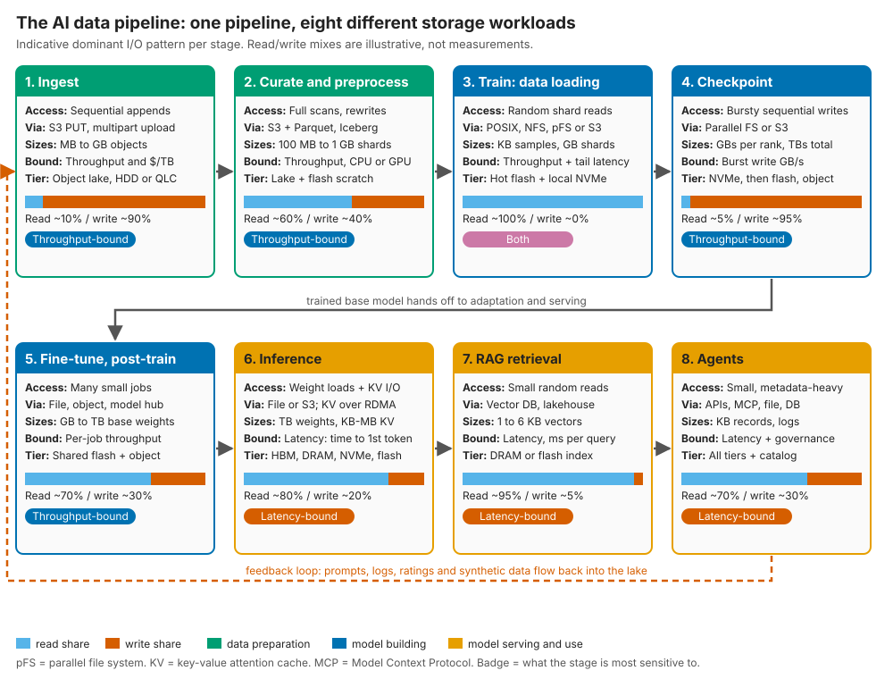
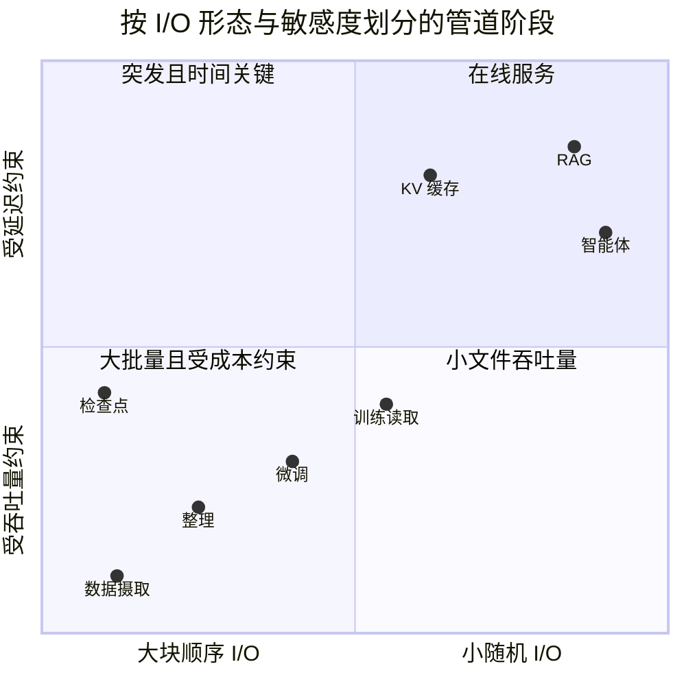
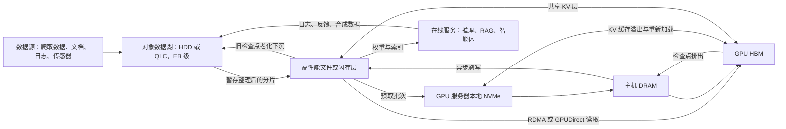
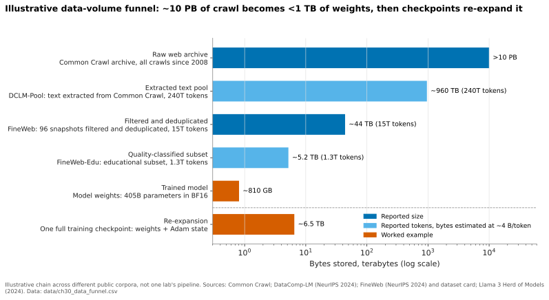
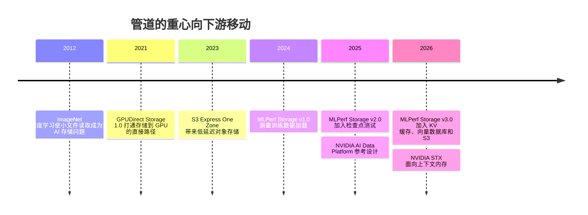

# 30. 端到端 AI 数据管道

> 📄 英文原文：[docs/05-ai-storage/30-ai-data-pipeline.md](../../../docs/05-ai-storage/30-ai-data-pipeline.md) · 本文为简体中文参考译本，如有出入以英文原文为准。

> **深度：** L2 · **阅读时间：** 约 10 分钟 · **最后核实：** 2026-11-01
> **前置阅读：** [存储做什么](../01-storage-fundamentals/01-what-storage-does.md) · [对象存储与 S3](../02-protocols-and-networking/09-object-storage-and-s3.md) · [GPU 数据路径](../02-protocols-and-networking/11-gpu-data-path.md) · [并行文件系统](../03-system-architecture/17-parallel-file-systems.md)

## 要点速览（TL;DR）

- **"AI 存储"至少是八种工作负载，而不是一种。** 数据摄取（ingest）以写为主、受成本约束；训练读取受吞吐量约束；检查点保存是写入突发；推理、RAG 和智能体（agent）则是受延迟约束的小 I/O。
- **数据先缩小，再重新膨胀。** 超过 10 PB 的网页爬取数据[^1]经过过滤后只剩数十 TB 的训练文本，以及不到 1 TB 的权重。随后管道又会产生新数据：数 TB 的检查点、KV 缓存、嵌入向量和日志。
- **容量在对象存储中，性能在 GPU 旁边的文件存储和闪存中。** 对象存储提供最便宜的持久化 TB，且所有工具都支持 S3。训练和检查点代码则期望 POSIX 路径和 RDMA 供给的带宽。两者正在融合。
- **在 LLM 训练中，检查点对存储的压力大于训练数据本身。** 较新的支出位于管道更下游：KV 缓存，以及面向 RAG 和智能体的数据智能（data intelligence）。
- **把管道视为一个带预取器的内存层级。** 训练的访问顺序事先已知；推理和智能体的访问则取决于用户。每一跳都消耗能量。

## 对 Everpure 战略的意义

如今每家存储厂商都在讲"AI"，但在管道的每个阶段，钱落在不同的地方：数据湖为廉价容量买单，训练层为带宽支付溢价，推理和智能体则为新软件付费。Everpure 在大多数阶段都有产品：容量层有 FlashBlade//E 和 S3；训练和检查点有 FlashBlade//S 和 FlashBlade//EXA；推理有 PureKVA；RAG 和智能体有 Data Stream 加 Data Intelligence（原 1touch）[^2][^3][^4]。DDN 和 WEKA 从高性能层起家，超大规模云厂商掌握云上数据湖，VAST 横跨整个栈，数据库厂商则在 RAG 和智能体领域展开争夺。

真正的问题是：在哪些阶段参与竞争？在哪些地方多阶段平台能胜过单点产品？又在哪些地方，数据引力（data gravity）能让数据湖的所有者拿下下游阶段？本章是第 5 部分的总览；后续章节分别讨论[训练](31-training-storage.md)、[推理与 KV 缓存](32-inference-and-kv-cache.md)、[RAG 与湖仓](33-rag-vector-lakehouse.md)、[NVIDIA 生态系统](34-nvidia-ecosystem.md)、[新兴 GPU 云](35-ai-factories-and-neoclouds.md)、[超大规模云厂商](36-hyperscaler-ai-storage.md)、[基准测试](37-reading-benchmarks.md)、[功耗](38-power-and-density.md)和[智能体](39-agentic-ai-and-data-intelligence.md)。

## 核心概念

### 八个阶段，八种 I/O 特征

*图 30.1 — 管道从左侧以写为主、受成本约束的大块 I/O，过渡到右侧以读为主、受延迟约束的小 I/O，然后把自身产出反馈回数据湖。*

**数据摄取。** 爬取数据、文档、图像、视频和日志以大型一次写入对象的形式到达。仅 Common Crawl 2025 年 1 月的一次爬取就包含 30 亿个页面、460 TiB 未压缩数据[^5]。数据摄取需要廉价的持久化容量和聚合写入带宽；延迟几乎无关紧要。

**整理与预处理。** 内容提取、语种识别、质量过滤、去重、个人身份信息（PII）清洗和分词（tokenization）都是反复的全量扫描，会把数据分片重写为 Parquet 等格式。这是 AI 中与分析型负载最接近的环节，受扫描吞吐量和 CPU 或 GPU 约束。它也非常耗电：Meta 发现，对于部分生产环境中的推荐模型，存储加预处理的功耗超过了训练本身[^6]。

**训练：数据加载。** 数千块 GPU 读取经过打乱（shuffle）的样本，几乎从不写入。图像和视频数据集意味着海量小文件读取；LLM 文本则被打包成大分片，负载较轻。危险在于尾延迟，因为同步训练步骤要等待最慢的加载器。

**检查点保存。** 每块 GPU 同时转储其状态：这是一次写入突发，只有在故障后才会被读回（[第 31 章](31-training-storage.md)）。

**微调与后训练。** 监督微调、强化学习和蒸馏会运行许多较小的作业，反复读取基础权重；强化学习甚至在训练过程中运行推理。对存储而言，它看起来像一个繁忙的多租户文件共享。

**推理。** 两类 I/O。*权重加载*是大块顺序读取，在服务自动扩缩容时会成为冷启动问题：以 10 GB/s 加载 810 GB 需要 81 秒。*KV 缓存*是逐 token 的注意力状态，会从 HBM 溢出到 DRAM、本地 NVMe 和共享闪存（[第 32 章](32-inference-and-kv-cache.md)）。

**RAG 与智能体。** 检索在向量索引中搜索并取回文本块（chunk）：毫秒级预算下的小随机读取，外加文档变化时重新生成嵌入向量的写入。智能体把许多这样的步骤串联起来，横跨文件、数据库和 API，又增加了治理需求，并留下状态和日志轨迹。在这里，存储变成了数据管理（[第 39 章](39-agentic-ai-and-data-intelligence.md)）。

| 阶段 | 主导模式 | 读 / 写 | 接口 | 典型 I/O 或文件大小 | 最敏感于 | 典型层级 |
|---|---|---|---|---|---|---|
| 数据摄取 | 顺序、仅追加 | 以写为主 | 对象（S3 PUT、分段上传） | MB–GB 级对象 | 每 TB 成本、聚合写入 GB/s | HDD 或 QLC 上的对象数据湖 |
| 整理 / 预处理 | 反复全量扫描 + 重写 | 以读为主，伴随大块写入 | 对象 + Parquet / 表格式 | 100 MB–1 GB 分片 | 扫描吞吐量、CPU/GPU | 数据湖 + 闪存暂存区 |
| 训练数据加载 | 对打乱后样本/分片的随机读取 | ~100% 读 | POSIX / NFS / 并行文件系统，或带缓存的 S3 | KB 级样本到 GB 级分片 | 吞吐量与尾延迟 | 热闪存 + GPU 本地 NVMe |
| 检查点保存 | 突发的大块顺序写入 | ~95% 写 | 并行文件系统或对象 | 每 GPU 数 GB，每个检查点数 TB | 突发写入带宽 | 本地 NVMe → 闪存 → 对象 |
| 微调 / 后训练 | 许多并发的中等规模作业 | 混合 | 文件、对象、模型仓库（model hub） | GB–TB 级基础权重 | 多租户、QoS | 共享闪存 + 对象 |
| 推理 | 权重加载 + KV 块读写 | 以读为主 | 文件/S3；KV 经 RDMA | GB–TB 级权重；KB–MB 级 KV 块 | 延迟（首 token 延迟） | HBM → DRAM → NVMe → 共享闪存 |
| RAG 检索 | 小随机读取，后台重建索引 | ~95% 读 | 向量数据库、湖仓、对象 | 1–6 KB 向量；KB–MB 级文本块 | 查询延迟（毫秒）、新鲜度 | DRAM/闪存索引；对象语料库 |
| 智能体 | 小规模、元数据密集、多数据源 | 混合（状态、日志） | API、MCP、文件、对象、数据库 | KB 级记录 | 延迟、权限、数据血缘（lineage） | 所有层级 + 元数据目录 |

*表 30.1 — 没有任何两行足够相似，无法用一种调优同时服务全部八个阶段；读/写比例仅供参考。*

### 为什么它不是一种工作负载

*图 30.2 — 各阶段分散在全部四个象限中，这就是为什么"AI 存储"交易实际上是多层级交易。*

各阶段把设计拉向相反的方向：

- **成本与速度。** 数据湖需要最便宜的持久化 TB（HDD 或 QLC、宽条带纠删码）；热层需要闪存、RDMA 和一个元数据引擎，而这些只有在 GPU 保持忙碌时才物有所值。
- **大 I/O 与小 I/O。** 宽条带适合数 MB 的写入，却会惩罚 4 KB 随机更新（[第 6 章](../01-storage-fundamentals/06-data-protection-and-resilience.md)）。
- **元数据。** 一个检查点只是少数几个巨大文件；一个图像数据集则是数十亿个小文件；智能体会产生大量查找操作（[第 21 章](../03-system-architecture/21-metadata.md)）。
- **语义。** POSIX 提供重命名、追加和锁；S3 提供基于 HTTP 的不可变对象。

买方要么运行多个层级，要么购买一个能可信地横跨多个层级的平台；这一选择正是厂商的必争之地。

### 为什么数据湖用对象存储、热层用文件存储

**对象存储凭借成本、规模和覆盖面赢下数据湖。** AWS 表示 S3 存储了超过 500 万亿个对象，每秒处理超过 2 亿次请求[^7]。纠删码让持久性变得便宜，一次写入的数据天然适合不可变对象，而从 Spark 到 PyTorch 数据加载器，所有工具都支持 S3。其弱点在于：毫秒级延迟、不支持追加或重命名，以及对小对象的额外开销（[第 9 章](../02-protocols-and-networking/09-object-storage-and-s3.md)）。

**文件存储和并行文件系统赢下热层**，因为训练和检查点代码写入的是路径。并行文件系统把每个文件条带化分布到许多服务器上，客户端可同时从中读取（[第 17 章](../03-system-architecture/17-parallel-file-systems.md)）；RDMA 和 GPUDirect Storage 则绕过了 CPU 回弹缓冲区（bounce buffer）（[第 11 章](../02-protocols-and-networking/11-gpu-data-path.md)）。

**边界正在模糊。** S3 Express One Zone（2023）宣称访问速度比 S3 Standard 快 10 倍[^8]；CoreWeave 通过 LOTA 在每个 GPU 节点上缓存对象数据[^9]；MLPerf Storage v3.0 增加了 S3 路径，约六分之一的提交结果使用了它[^10]。文件系统纷纷增加 S3 前端，多协议平台（VAST、FlashBlade）则两者兼顾。有意义的区分正在从*协议*变为*层级*。

*图 30.3 — 大批量数据从数据湖向内流向 HBM；检查点和 KV 状态向外回流；数据湖既是循环的起点，也是终点。*

### 算例：字节与压力在哪里

*图 30.4 — 示意：过滤把 PB 级数据缩减到 TB 级，随后训练又产生比模型本身更大的产物。*
数据：`data/ch30_data_funnel.csv`

**从爬取数据到权重。** DataComp-LM 的数据池包含 240T 个来自 Common Crawl 文本的 token[^11]。FineWeb 对 96 个快照进行过滤和去重，得到 15T 个 token，磁盘占用约 44 TB[^12][^13]，另有一个 1.3T token 的教育类子集[^12]。Llama 3 训练使用了约 15.6T 个 token[^14]；按 4 字节 token ID 计算，即 15.6e12 × 4 ≈ 62 TB。真正带来缩减的是过滤，而不是分词，因此整理阶段才是数据湖的容量和扫描带宽体现价值的地方。

**token 的流式传输成本很低。** Llama 3 的批大小增长到每步 16M 个 token[^14]：按每 token 4 字节计算为 64 MB，因此即便每秒一步，整个集群也只需约 64 MB/s。多模态则不同；视频可能需要每节点 GB/s 级带宽。

**检查点的成本并不低。** 一个 405B 模型按每参数 14–16 字节（权重加 Adam 优化器状态）计算，需要 5.7–6.5 TB。Meta 在其 Tectonic 文件系统上构建了 Llama 3 的存储：240 PB，分布在 7,500 台 SSD 服务器上，持续带宽 2 TB/s，峰值 7 TB/s，并将突发的检查点写入列为一大挑战[^14]。以 2 TB/s 计算，6.5 TB 需要约 3.3 秒；以 100 GB/s 计算则需 65 秒，而在此期间，像 Llama 3 那样的 16K GPU 作业[^14]全程空闲。

**推理产生新的状态。** Llama 3 70B 的 KV 缓存开销为 80 层 × 8 个 KV 头 × 128 维 × 2（K 和 V）× 2 字节 = 327,680 字节，即每 token 约 320 KiB。128K token 的上下文约为 40 GiB，相当于一块 80 GB GPU 一半的 HBM。**RAG 还会增加更多**：10 亿个文本块 × 1,024 维 float32 嵌入向量，在计入任何索引开销之前就已是 4 TB 的向量数据。

### 半导体类比：一个带预取器的内存层级

把各层级当作缓存层级来理解：

| AI 管道层级 | CPU 类比 |
|---|---|
| HBM | 寄存器堆 / L1 |
| 主机 DRAM | L2 |
| GPU 本地 NVMe | 末级缓存 |
| 共享闪存 | 主存 |
| 对象数据湖 | 磁盘 |

每向外一层，容量增加，而每块 GPU 可获得的带宽下降；与 CPU 设计一样，关键技艺在于用预取和缓冲来隐藏下一级的延迟。

**训练是友好的情形。** 打乱顺序来自一个随机种子，因此加载器确切知道接下来是哪些样本：这是一个完美的预取器，就像 DMA 引擎沿着已知的描述符列表执行，而不是一个推测式的流预取器。**检查点使用写回缓冲区**：状态在几秒内从 HBM 排出到主机 DRAM 或本地 NVMe，然后异步刷写，就像存储缓冲区（store buffer）那样。

**推理是一个复用距离取决于用户的缓存**：命中率取决于提示词共享前缀的频率。NVIDIA 的 KV Block Manager 将其层级命名为 G1（HBM）到 G4（远程存储）[^15]。智能体是最不可预测的。越往下游，价值越从原始带宽转向缓存策略、数据放置和元数据。

**移动数据要消耗能量。** 在 45 nm 工艺下，Horowitz 给出的 64 位 DRAM 访问能耗约为 1.3–2.6 nJ，而一次浮点运算为 0.4–3.7 pJ，相差数百到数千倍[^16]。每经过一个网卡、交换机或 SSD 都会增加能耗。在数据中心用电量预计于 2026 年达到 565 TWh 的背景下[^17]，有三种应对方式：

1. 让热数据靠近计算，放在本地 NVMe 缓存和 KV 层中。
2. 把计算移到数据旁边。NVIDIA 的 BlueField-4 STX[^18]，以及 VAST 在 BlueField-4 DPU 上运行其存储控制器[^19]，都是这么做的。
3. 通过尽早过滤和数据缩减来减少需要移动的字节（[第 38 章](38-power-and-density.md)）。

## Everpure 的做法与竞争对手对比

| 阶段 | 买方为何付费 | Everpure 产品 | 最强替代方案（steelman） | 目前通常谁胜出 |
|---|---|---|---|---|
| 数据摄取 / 数据湖 | 每 TB 成本、持久性、S3 兼容性 | FlashBlade//E、FlashBlade S3、DirectFlash 密度[^3] | AWS S3 / Azure Blob（数据引力、零运维）；HDD 对象存储（最便宜的 TB） | 云上为超大规模云厂商；本地部署为 HDD 对象存储 |
| 整理 | 扫描吞吐量、表格式、GPU 管道 | Data Stream，基于 NVIDIA 的 AI Data Platform 设计[^4][^20] | 构建在对象存储上的湖仓平台；VAST 的数据库与计算层 | 湖仓软件厂商 |
| 训练 + 检查点 | GB/s 到 TB/s 级带宽、NVIDIA 认证 | FlashBlade//S500、FlashBlade//EXA；MLPerf Storage v3.0 中 877.5 GiB/s 的检查点写入（厂商提交；哪些厂商未参加见[第 31 章](31-training-storage.md)）[^21] | DDN EXAScaler、WEKA、VAST、IBM Storage Scale、Dell Lightning FS[^22] | 与 NVIDIA 深度协同的专业厂商（[第 41 章](../06-industry-and-competition/41-why-ai-native-vendors-won.md)） |
| 微调 | 多租户、QoS、大量作业 | FlashBlade//S；FlashBlade//EXA 多租户与 QoS（2026）[^23] | NetApp AFX、Dell PowerScale、VAST | 企业级传统厂商 |
| 推理 / KV 缓存 | 首 token 延迟（TTFT）、每美元 token 数 | PureKVA，宣称 TTFT 最高快 20 倍，测试细节未公布[^2] | WEKA Augmented Memory Grid[^24]、基于 BlueField-4 的 VAST[^19]、NVIDIA STX/CMX[^18] | 尚难定论 |
| RAG | 向量、新鲜度、权限 | Data Stream 向量数据库集成[^4] | 向量数据库；AWS S3 Vectors[^25]；NetApp AI Data Engine[^26] | 数据库厂商 + 超大规模云厂商 |
| 智能体 | 发现、分类、治理、MCP | Data Intelligence（原 1touch，US$125M）；原生 MCP 支持[^3][^2] | NetApp AIDE、Dell AI Data Platform、治理软件 | 尚无定局 |

*表 30.2 — Everpure 在每个阶段都有产品，但其最强的位置是中间的闪存层；数据湖和智能体层则由不销售阵列的参与者争夺。*

**专业厂商的最强版本论证（steelman）。** DDN 和 WEKA 凭借专注、HPC 传统和早期与 NVIDIA 的协同赢下热层。超大规模云厂商凭借数据引力赢下数据湖：出口流量费（egress fee）和工具链把 PB 级数据留在 S3 中。VAST 主张由一个全共享（shared-everything）平台横跨数据湖、热层和数据库，这是对产品家族式打法最直接的挑战（[第 42 章](../06-industry-and-competition/42-vast-data.md)）。**Everpure 的反向论点**是：用一套操作环境和控制平面横跨各阶段，并借助 DirectFlash 把数据湖容量从 HDD 拉到闪存上。风险在于在每个阶段都只做到第二好。

基于公开信息，战略团队可能评估的选项：

- 以检查点和 KV 缓存性能为突破口，MLPerf v3.0 在这些方面提供了可比证据。
- 借助 Data Intelligence 掌控 RAG 和智能体所依赖的元数据层。
- 在云上数据湖领域选择合作而非竞争。

## 历史与发展轨迹

*图 30.5 — 行业的关注点沿着管道逐阶段下移，从为训练供数转向为推理服务。*

小图像文件是第一个 AI 存储问题；LLM 让检查点成为带宽问题；大规模部署让推理上下文成为延迟问题。MLPerf Storage 也随之演进：v1.0（2024 年 9 月）测量训练读取[^27]，v2.0（2025 年 8 月）加入检查点[^28]，v3.0（2026 年 9 月）加入 KV 缓存、向量数据库和 S3[^10]。硬件亦是如此：2021 年的 GPUDirect Storage 1.0[^29]、2025 年 3 月的 NVIDIA AI Data Platform[^20]、2026 年 3 月的 BlueField-4 STX[^18]。TrendForce 将 4Q26 企业级 SSD 需求的一部分归因于超大规模云厂商为 KV 缓存采购 QLC[^30]。下一步很可能是智能体的记忆与状态成为一类被单独命名的工作负载。

## 关键数字

| 指标 | 数值 | 背景 | 来源 / 日期 |
|---|---|---|---|
| Common Crawl 单月爬取 | 3.0B 个页面，460 TiB 未压缩 | 2025 年 1 月爬取 | Common Crawl[^5]，2025 |
| FineWeb | 来自 96 个快照的 15T token；~44 TB | 经过滤、去重的网页文本 | NeurIPS 2024[^12]；Hugging Face[^13] |
| DCLM-Pool | 240T token | 最大的公开过滤前文本池 | DataComp-LM[^11]，2024 |
| Llama 3 预训练 | ~15.6T token；240 PB Tectonic，持续 2 TB/s，峰值 7 TB/s | Meta 自有的训练存储 | Meta，2024-07[^14] |
| 检查点，405B 模型 | 5.7–6.5 TB | 每参数 14–16 字节 | 算例 |
| KV 缓存，Llama 3 70B | 每 token ~320 KiB；128K token 时 ~40 GiB | BF16，分组查询注意力（GQA） | 算例 |
| S3 规模 | >500T 个对象，>200M 次请求/秒 | 数据湖为何默认采用对象存储 | AWS，经 LMI 报道，2026-03[^7] |
| DRAM 访问与浮点运算能耗对比 | ~1.3–2.6 nJ 对 0.4–3.7 pJ | 45 nm；数据移动占主导 | Horowitz，ISSCC 2014[^16] |
| MLPerf Storage v3.0 中 S3 占比 | ~1/6 的提交结果 | 对象存储进入热层 | MLCommons，2026-09-01[^10] |

## 对话手册

**向产品经理提的问题**

1. *"我们今天的 AI 收入来自哪些阶段？我们又押注在哪些阶段？"* 高质量回答：按阶段拆分收入，说明附加销售发生在哪里（KVA 是否搭载在现有 FlashBlade 交易上），并坦率说明哪些订单仍处于试点阶段。
2. *"如果数据湖已经在 S3 里，我们如何赢下热层？又是否有可能夺回数据湖？"* 高质量回答：数据引力、出口流量费的经济性、缓存或分层机制，以及让 Everpure 进入物料清单的 NVIDIA 认证。
3. *"PureKVA 需要证明什么，才能成为标准层级而不只是一项功能？"* 高质量回答：独立测试结果（MLPerf v3.0 KV 缓存）、集成（Dynamo、vLLM、llm-d）、命中率假设，以及与不做卸载相比的每美元 token 数。

**向工程师提的问题**

1. *"请带我走一遍 FlashBlade//EXA 上一个 6 TB 检查点的过程。突发写入落在哪里？持久化点在哪里？GPU 被阻塞多少秒？"* 高质量回答：经由主机 DRAM 或本地 NVMe 的异步暂存、每个数据节点的写入 GB/s，以及阻塞时间与数据持久化所需时间的区别。
2. *"当一个由数十亿个小文件组成的数据集在每个 epoch 都被重新打乱时，会发生什么？"* 高质量回答：每秒元数据操作数、客户端缓存，以及把数据打包成分片的建议。
3. *"对于一次 KV 块获取，延迟预算是多少？在哪里会失效：网络、元数据还是介质？"* 高质量回答：微秒级数字、RDMA 路径、块大小，以及尾延迟开始攀升时的并发度。

**不要这样说：**

- "AI 存储的关键全在吞吐量。"推理、RAG 和智能体受延迟和元数据约束。
- "LLM 训练需要巨大的读取带宽来读取数据集。"文本 token 很小。驱动带宽的是检查点和多模态数据。
- "对象存储对 AI 来说太慢了。"几乎所有数据湖都是对象存储，而且 S3 现已进入 MLPerf Storage。
- "数据在管道中不断缩小，所以存储需求会下降。"检查点、KV 缓存、嵌入向量、日志和保留的版本会让它重新增长。
- "GPUDirect 让存储延迟变得无关紧要。"它省掉了一次 CPU 拷贝，但并没有消除网络或介质的延迟。

## 深入阅读（可选，L3 指引）

- Meta，"The Llama 3 Herd of Models"，基础设施部分[^14]；Zhao 等，ISCA 2022，关于 Meta 的数据摄取管道[^6]。
- FineWeb 与 DataComp-LM 论文中关于整理过滤器的内容[^12][^11]；NVIDIA Dynamo KVBM 文档[^15]；MLPerf Storage 规则（[第 37 章](37-reading-benchmarks.md)）。

## 关键术语

- **数据湖（data lake）** — 低成本、通常基于对象存储的仓库，用于存放原始数据和整理后的数据。
- **热层（hot tier）** — 为 GPU 供数的高性能文件或闪存层。
- **KV 缓存** — 推理过程中被复用的逐 token 注意力状态。
- **数据引力（data gravity）** — 应用和支出被吸引到大规模数据已经所在位置的效应。
- 更多内容见[术语表](../glossary.md)。

## 资料来源

[^1]: Common Crawl, "Overview," n.d. https://commoncrawl.org/overview (retrieved 2026-11-01). Reports a repository of more than 10 PB collected since 2008. [VERIFY: search-summary only; page not fetchable from this environment]
[^2]: Blocks & Files, "Everpure bulks up AI offer," 2026-09-30. https://blocksandfiles.com/flash/2026/09/30/everpure-bulks-up-ai-offer/5300162 (retrieved 2026-11-01).
[^3]: Everpure, "Pure Launch Blog: January 2026 Edition," 2026-01; and Everpure, "Form 10-Q for the quarter ended May 3, 2026," 2026-06. https://blog.everpuredata.com/products/pure-launch-blog-january-2026-edition/ ; https://www.sec.gov/Archives/edgar/data/0001474432/000147443226000061/pstg-20260503.htm (retrieved 2026-11-01).
[^4]: HPCwire/BigDATAwire, "Everpure Announces Data Stream to Expand AI-Ready Data Offerings," 2026-06-17. https://www.hpcwire.com/bigdatawire/this-just-in/everpure-announces-data-stream-to-expand-ai-ready-data-offerings/ (retrieved 2026-11-01).
[^5]: Common Crawl, "January 2025 Crawl Archive Now Available," 2025-01. https://commoncrawl.org/blog/january-2025-crawl-archive-now-available (retrieved 2026-11-01).
[^6]: M. Zhao et al., "Understanding Data Storage and Ingestion for Large-Scale Deep Recommendation Model Training," ISCA 2022. https://arxiv.org/abs/2108.09373 (retrieved 2026-11-01).
[^7]: Le Monde Informatique, "AWS S3 fête ses 20 ans," 2026-03 (reporting AWS's anniversary figures). https://www.lemondeinformatique.fr/actualites/lire-aws-s3-fete-ses-20-ans-99637.html (retrieved 2026-11-01). [VERIFY: search-summary only; corroborated by Wikipedia, confirm against AWS's own S3 20th-anniversary post]
[^8]: AWS, "Announcing the Amazon S3 Express One Zone storage class," 2023-11-28. https://aws.amazon.com/about-aws/whats-new/2023/11/amazon-s3-express-one-zone-storage-class (retrieved 2026-11-01).
[^9]: CoreWeave, "Storage," product page, n.d. https://coreweave.com/products/storage (retrieved 2026-11-01).
[^10]: MLCommons via GlobeNewswire, "MLCommons Releases New MLPerf Storage v3.0 Benchmark Results," 2026-09-01. https://www.globenewswire.com/news-release/2026/09/01/3354412/0/en/mlcommons-releases-new-mlperf-storage-v3-0-benchmark-results.html (retrieved 2026-11-01).
[^11]: J. Li et al., "DataComp-LM: In search of the next generation of training sets for language models," NeurIPS 2024 Datasets and Benchmarks, 2024-06. https://arxiv.org/abs/2406.11794 (retrieved 2026-11-01).
[^12]: G. Penedo et al., "The FineWeb Datasets: Decanting the Web for the Finest Text Data at Scale," NeurIPS 2024 Datasets and Benchmarks, 2024. https://proceedings.neurips.cc/paper_files/paper/2024/hash/370df50ccfdf8bde18f8f9c2d9151bda-Abstract-Datasets_and_Benchmarks_Track.html (retrieved 2026-11-01).
[^13]: Hugging Face, "FineWeb: decanting the web for the finest text data at scale" (blog), 2024-05-31. https://huggingfacefw-blogpost-fineweb-v1.static.hf.space/ (retrieved 2026-11-01; "15-trillion tokens, 44TB disk space", seen via search result; dataset card HuggingFaceFW/fineweb gives the same figure). Secondary summaries quoting ~50 TB are not the official figure.
[^14]: Meta (Llama Team), "The Llama 3 Herd of Models," arXiv:2407.21783, 2024-07-31. https://arxiv.org/abs/2407.21783 (retrieved 2026-11-01).
[^15]: NVIDIA, "KVBM design," Dynamo documentation v1.3.0, n.d. https://docs.nvidia.com/dynamo/v1.3.0/design-docs/component-design/kvbm-design.md (retrieved 2026-11-01).
[^16]: M. Horowitz, "1.1 Computing's energy problem (and what we can do about it)," ISSCC 2014, 2014-02. https://doi.org/10.1109/ISSCC.2014.6757323 (retrieved 2026-11-01); figures as reproduced in arXiv:1602.04183, https://arxiv.org/pdf/1602.04183 (retrieved 2026-11-01).
[^17]: Gartner, "Gartner Says Data Center Electricity Consumption to Grow 26% in 2026," 2026-06-10. https://www.gartner.com/en/newsroom/press-releases/2026-06-10-gartner-says-data-center-electricity-demand-to-grow-26-percent-in-2026 (retrieved 2026-11-01).
[^18]: NVIDIA, "NVIDIA Launches BlueField-4 STX Storage Architecture With Broad Industry Adoption," 2026-03-16. https://investor.nvidia.com/news/press-release-details/2026/NVIDIA-Launches-BlueField-4-STX-Storage-Architecture-With-Broad-Industry-Adoption/default.aspx (retrieved 2026-11-01).
[^19]: StorageNewsletter, "CES 2026: Vast Data Redesigns AI Inference Architecture for the Agentic Era with Nvidia," 2026-01-07. https://www.storagenewsletter.com/2026/01/07/ces-2026-vast-data-redesigns-ai-inference-architecture-for-the-agentic-era-with-nvidia/ (retrieved 2026-11-01).
[^20]: NVIDIA Newsroom, "NVIDIA and Storage Industry Leaders Unveil New Class of Enterprise Infrastructure for the Age of AI," 2025-03-18. https://nvidianews.nvidia.com/news/nvidia-and-storage-industry-leaders-unveil-new-class-of-enterprise-infrastructure-for-the-age-of-ai (retrieved 2026-11-01).
[^21]: HPCwire, "Everpure Leads MLPerf Storage Tests for Large Model Checkpointing and KV Cache," 2026-09-02. https://hpcwire.com/off-the-wire/everpure-leads-mlperf-storage-tests-for-large-model-checkpointing-and-kv-cache (retrieved 2026-11-01).
[^22]: Dell Technologies, "Dell AI Data Platform with NVIDIA Supercharges Enterprise AI with Breakthrough Data Orchestration and Storage Innovations," 2026-03-16. https://www.dell.com/en-us/dt/corporate/newsroom/announcements/detailpage.press-releases~usa~2026~03~dell-ai-data-platform-with-nvidia-supercharges-enterprise-ai-with-breakthrough-data-orchestration-and-storage-innovations.htm (retrieved 2026-11-01).
[^23]: Everpure Blog, "Meet FlashBlade//EXA: the AI Data Platform for Scale," 2026-06. https://blog.everpuredata.com/products/meet-flashblade-exa-the-ai-data-platform-for-scale/ (retrieved 2026-11-01).
[^24]: WEKA, "WEKA Breaks The AI Memory Barrier With Augmented Memory Grid on NeuralMesh," 2025-11-18. https://www.weka.io/news/weka-breaks-the-ai-memory-barrier-with-augmented-memory-grid (retrieved 2026-11-01).
[^25]: StorageNewsletter, "AWS re:Invent 2025: Amazon S3 Vectors is Now Generally Available with 40 Times the Scale of Preview," 2025-12-05. https://www.storagenewsletter.com/2025/12/05/aws-reinvent-2025-amazon-s3-vectors-is-now-generally-available-with-40-times-the-scale-of-preview/ (retrieved 2026-11-01).
[^26]: Blocks & Files, "NetApp disaggregates ONTAP storage and provides an AI Data Engine," 2025-10-14. https://blocksandfiles.com/2025/10/14/netapp-disaggregates-ontap-storage-and-provides-an-ai-data-engine/ (retrieved 2026-11-01).
[^27]: MLCommons, "New MLPerf Storage v1.0 Benchmark Results Show Storage Systems Play a Critical Role in AI Model Training Performance," 2024-09-25. https://mlcommons.org/2024/09/mlperf-storage-v1-0-benchmark-results/ (retrieved 2026-11-01).
[^28]: StorageNewsletter, "New MLPerf Storage v2.0 Benchmark Results Demonstrate the Critical Role of Storage Performance in AI Training Systems," 2025-08-08. https://www.storagenewsletter.com/2025/08/08/new-mlperf-storage-v2-0-benchmark-results-demonstrate-the-critical-role-of-storage-performance-in-ai-training-systems/ (retrieved 2026-11-01).
[^29]: Blocks & Files, "GPUDirect Storage hitting the streets to VAST acclaim," 2021-06-28. https://www.blocksandfiles.com/file/2021/06/28/gpudirect-storage-hitting-the-streets-to-vast-acclaim/1611092 (retrieved 2026-11-01).
[^30]: TrendForce, "AI Server Demand Sustains Memory Contract Price Increases in 4Q26, While Consumer-Side Pressure Persists," 2026-09-30. https://www.trendforce.com/presscenter/news/20260930-13258.html (retrieved 2026-11-01).
