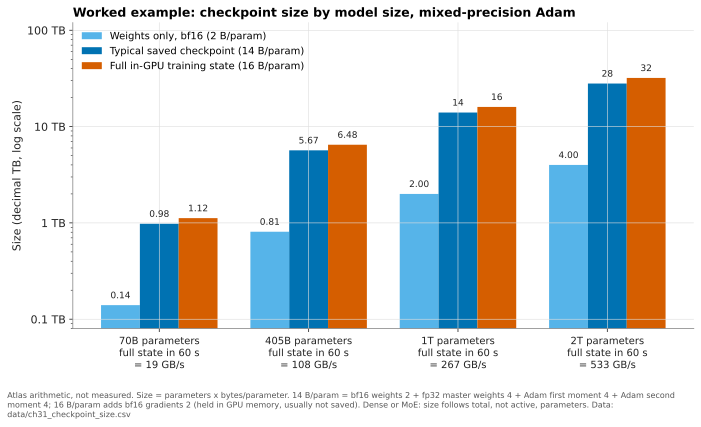
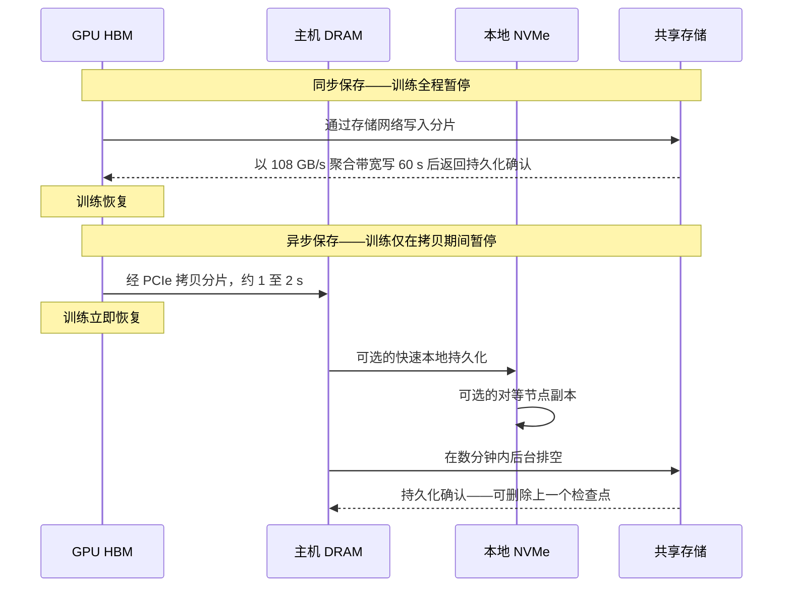

# 31. 训练存储

> 📄 英文原文：[docs/05-ai-storage/31-training-storage.md](../../../docs/05-ai-storage/31-training-storage.md) · 本文为简体中文参考译本，如有出入以英文原文为准。

> **深度：** L2 · **阅读时间：** 约 11 分钟 · **最后核实：** 2026-11-01
> **前置阅读：** [GPU 数据路径](../02-protocols-and-networking/11-gpu-data-path.md) · [端到端 AI 数据管线](30-ai-data-pipeline.md) · [性能与经济性指标](../01-storage-fundamentals/04-performance-and-economics-metrics.md) · [并行文件系统](../03-system-architecture/17-parallel-file-systems.md)

## 要点速览（TL;DR）

- **决定 LLM 训练存储性能规格的是检查点，而不是训练数据。** 一个 405B 参数模型在 16,384 块 GPU 上读取文本 token 的速率合计仅约 11 MB/s，但其完整训练状态约为 6.5 TB。要在 60 秒内写完，需要约 108 GB/s。
- **按每参数约 14–16 字节估算检查点大小，而不是 2 字节。** 混合精度 Adam 在 bf16 权重之外，还保留 fp32 主权重和两个 fp32 优化器动量。仅权重只占保存内容的七分之一。
- **故障决定检查点频率。** Meta 的 Llama 3 训练在 54 天内遭遇 419 次意外中断，约每 3.1 小时一次。采用同步保存时，即便取最优间隔也会浪费约 10% 的集群算力；在 100,000 块 GPU 的规模下，浪费约四分之一。
- **异步与分层检查点把峰值带宽问题转化为持续带宽问题。** GPU 在数秒内把状态转存到主机 DRAM 或本地 NVMe，再在后台排空（drain）到共享存储；软件消除了大部分停顿。
- **最难的时刻是恢复（restore）。** 故障之后所有 GPU 同时读取，在大规模下重启时间的代价高于保存时间。要问冷读带宽和元数据风暴，而不只是写入 GB/s。

## 对 Everpure 战略的意义

在训练集群交易中，检查点这一需求把"每秒几 MB 的 token"变成了"每秒数百 GB 的写入"，并决定了哪些架构能进入候选名单。在其首次 MLPerf Storage 提交（v3.0，2026 年 9 月）中，Everpure 的 FlashBlade//EXA 取得了提交者中最高的检查点写入成绩[^1][^2]，这正是此类论证中一个可信的公开数据点（[第 27 章](../04-everpure/27-flasharray-and-flashblade.md)）。

矛盾在于：异步保存、节点本地层级和内存副本不断压缩存储必须吸收的峰值，因此以突发写入带宽为卖点的方案，面对的是一个正在萎缩的需求。持久的价值转向持续排空带宽、恢复速度以及高效的检查点保留。以下是战略团队基于公开信息可能评估的选项。

## 核心概念

### 两种截然不同的 I/O 任务

**数据加载**是一个稳定、以读为主的数据流，样本往往小而随机。**检查点保存**是周期性的大块、以顺序写为主的突发；它的镜像——**恢复**——则是所有 GPU 同时发起的读突发。[第 30 章](30-ai-data-pipeline.md)把两者放在管线中定位，[第 11 章](../02-protocols-and-networking/11-gpu-data-path.md)解释了字节如何到达 GPU 内存；本章负责给它们定量。

### 检查点有多大？

检查点是精确恢复训练所需的全部内容。采用混合精度的 Adam 优化器时，每个参数携带：

| 组成部分 | 每参数字节数 | 是否驻留 GPU 内存？ | 通常是否保存？ |
|---|---|---|---|
| bf16 工作权重 | 2 | 是 | 是（或在加载时由 fp32 主权重重建） |
| fp32 主权重 | 4 | 是 | 是 |
| Adam 一阶动量（m），fp32 | 4 | 是 | 是 |
| Adam 二阶动量（v），fp32 | 4 | 是 | 是 |
| bf16 梯度 | 2 | 是，临时存在 | 很少 |
| **合计** | **16** | 16 | **~12–14** |

*表 31.1 — 权重只占训练状态的约八分之一；检查点写入的大部分是优化器状态。*

因此，**完整训练状态 = 参数量 × 16 字节**，典型的**已保存检查点 = 参数量 × ~14 字节**。变体包括：梯度是临时的，很少保存；去掉 bf16 副本（加载时由 fp32 重建）得到 12 字节；fp32 梯度会把内存中的状态推高到 18 字节；8 位或 bf16 优化器动量可使优化器部分减半。数据加载器与随机数生成器（RNG）状态只增加几 MB。

MLPerf Storage 的检查点工作负载落在同一区间。IBM 报告 8B 场景为 105 GB，1T 场景为 15 TB，其中 13.2 TB 为优化器状态[^3]。折合每参数约 13–15 字节。

*图 31.1 — 算例：检查点约为模型推理权重的 7–8 倍，因此一个 1T 参数模型每次保存 14–16 TB。*
数据：`data/ch31_checkpoint_size.csv`

一个细节：对于**混合专家（mixture-of-experts，MoE）**模型，检查点大小取决于*总*参数量，而计算量取决于*激活*参数量。一个总参数 1T、每个 token 激活几百亿参数的 MoE 模型，算起来像中等规模模型，存检查点却像 1T 模型，从而提高了单位 GPU 算力所需的存储带宽。

### 吞吐量算术：字节 ÷ 时间窗口

核心公式是**所需带宽 = 检查点字节数 ÷ 允许写入所花的时间**。这个时间窗口是一项业务选择：可容忍的 GPU 空闲时间（同步），或检查点变为安全状态之前的时间（异步）。

| 模型（完整状态） | 假设 GPU 数 | 每 GPU 分片 | 同步，60 s 窗口 | 同步，300 s 窗口 | 异步，30 分钟内排空 | 每 8-GPU 节点，60 s |
|---|---|---|---|---|---|---|
| 70B（1.12 TB） | 1,024 | 1.09 GB | 18.7 GB/s | 3.7 GB/s | 0.6 GB/s | 0.15 GB/s |
| 405B（6.48 TB） | 16,384 | 395 MB | **108 GB/s** | 21.6 GB/s | 3.6 GB/s | 0.05 GB/s |
| 1T（16 TB） | 32,768 | 488 MB | 267 GB/s | 53 GB/s | 8.9 GB/s | 0.07 GB/s |
| 2T（32 TB） | 65,536 | 488 MB | 533 GB/s | 107 GB/s | 17.8 GB/s | 0.07 GB/s |

*表 31.2 — 算例：分片让每个客户端的任务微不足道；难点在于落到共享存储上的聚合突发，而异步排空可将其削减 30 倍。*

由此得出两点。第一，**分片分散了字节，但没有减少字节**。每块 GPU 写自己的切片，因此没有哪一块网卡（NIC）成为瓶颈；Meta 报告 Llama 3 每 GPU 的检查点状态为 1 MB 至 4 GB[^4]，恰好涵盖上表 395 MB 的平均值。如果只由一个模型副本写入（在 Llama 3 405B 的张量 × 流水线并行布局中为 16 个节点[^4]），每个节点要推送 405 GB，即一分钟内 6.75 GB/s。无论哪种方式，存储看到的都是完整的聚合流量，外加数千个同时发生的文件创建——这是一次元数据事件（[第 21 章](../03-system-architecture/21-metadata.md)）。

第二，**对容量规划而言，异步一列最重要**，因为现代框架正倾向于采用它。

### 同步与异步检查点

*图 31.2 — 异步检查点把 GPU 停顿缩短为一次 PCIe 拷贝，并把存储写入移出关键路径，代价是存在一个最新检查点尚未持久化的时间窗口。*

在异步保存中，每块 GPU 把自己的分片拷贝到锁页主机内存（经 PCIe 拷贝几百 MB 约需一秒），然后由 CPU 线程负责写出，训练随即恢复。借助 PyTorch 2024 年推出的异步模式，IBM 测得一个 7B 模型的检查点停机时间从 148.8 秒降至 6.3 秒[^5]。分层变体会增加一个中间站。NVIDIA NeMo 的本地检查点把每个节点的部分写入本地 SSD 或 RAM 盘，并复制到对等节点[^6]。Gemini 研究系统（Rice University 与 AWS）把检查点保存在对等节点的 CPU 内存中，报告恢复速度快 13 倍以上[^7]。

代价在于：排空过程中丢失节点会回退到上一个检查点；主机 DRAM 必须能容纳分片；排空必须在下一次保存之前完成；后台写入会与训练流量争用带宽，除非使用独立的存储网络。

**半导体类比。** 检查点相当于电源门控（power gating）前的状态保存。在某个电源域被关断前，上下文被存入保持触发器（retention flop），设计者要在保存/恢复成本与节省的漏电之间权衡——一个盈亏平衡计算。同步检查点类似 DRAM 的全 bank 刷新，在 tRFC 期间阻塞所有 bank；异步检查点则类似按 bank 刷新，把突发隐藏在有效工作之后。

### 频率与故障率

检查点频率是在保存所花时间与故障后需重做的工作之间做权衡。Young 近似给出的最优间隔为 **τ ≈ √(2 × C × M)**，其中 *C* 是每次检查点的 GPU 停顿时间，*M* 是导致作业中止的故障之间的平均时间[^8]。此时开销约为 C/τ + τ/(2M)，另加每次故障的重启时间。

在 Llama 3 405B 于 16,384 块 H100 上预训练的 54 天快照期间，Meta 记录了 466 次中断：47 次计划内，**419 次意外**。其中约 78% 被归因于已确认或疑似的硬件问题，以故障 GPU 和 HBM3 为首[^4][^9]。即每 54 × 24 ÷ 419 ≈ **3.1 小时**发生一次意外停止。在 Meta 的研究集群中，1,024-GPU 作业的平均故障时间（MTTF）为 7.9 小时，而 8-GPU 作业为 47.7 天[^10]。线性外推可预测 16K GPU 时约为 30 分钟；作者自己的模型预测约为 1.8 小时（据二手资料概述），而 Llama 3 的生产集群实际达到了 3.1 小时。

| 场景（405B，6.48 TB 状态） | MTBF *M* | 每次保存停顿 *C* | 最优间隔 τ | 保存 + 返工开销 | 所需排空带宽 |
|---|---|---|---|---|---|
| 16K GPU，同步，108 GB/s | 3.1 h | 60 s | 19 min | **10.4%** | 108 GB/s 突发 |
| 16K GPU，同步，~1 TB/s | 3.1 h | 6.5 s | 6.3 min | 3.4% | ~1 TB/s 突发 |
| 16K GPU，异步 | 3.1 h | 2 s | 3.5 min | 1.9% | 31 GB/s 持续 |
| 100K GPU，同步，108 GB/s | 30 min* | 60 s | 7.8 min | **25.6%** | 108 GB/s 突发 |
| 100K GPU，异步 | 30 min* | 2 s | 1.4 min | 4.7% | 76 GB/s 持续 |

*表 31.3 — 基于 Young 公式的算例：在 100K GPU 规模下，同步检查点浪费四分之一的集群，而异步保存可将开销控制在 5% 以下，但需要稳定的排空带宽。\*假设故障数按 Llama 3 的故障率随 GPU 数量线性增长。*

在 16K GPU 规模下，10.4% 的开销相当于闲置约 1,700 块 GPU，按[第 11 章](../02-protocols-and-networking/11-gpu-data-path.md)中的租赁价格计算，每年达数千万美元。陷阱在于：无论检查点如何写入，重启时间都是按每次故障支付的。5 分钟的重启在 16K GPU 时的代价为 2.7%，在 100K 时为 16%。

### 恢复风暴

故障发生后，坏节点被替换，每个 rank 同时读取最新的检查点。有三点使恢复比保存更难：

1. **读放大。** 优化器状态是分片的，但 bf16 权重在各数据并行组之间是复制的。朴素做法下，每个副本都读取自己的那一份。对于有 128 个数据并行副本的 Llama 3 405B，这意味着 0.81 TB × 128 的 bf16 权重，加上 4.86 TB 分片的 fp32 主权重与动量 ≈ **用 109 TB 的读取来恢复约 5.7 TB 的唯一检查点数据**。好的框架每个字节只读一次，再通过更快的 GPU 互连网络广播。
2. **冷读与元数据。** 缓存中可能已不再有检查点，数千个 rank 同时打开文件并执行 stat。在 Everpure 自己的 MLPerf Storage v3.0 成绩中，检查点*读取*为 588 GiB/s，而*写入*为 877 GiB/s[^1]。即便对领先者而言，恢复也是较慢的方向。
3. **其他一切也要重启。** 容器镜像和 Python 环境会在同一时刻冲击共享存储；Meta 缩短了作业启动时间，以使有效训练时间保持在 90% 以上[^4]。

一个有用的规划目标是恢复时间，而不是带宽。在两分钟内读取 5.7–6.5 TB 唯一数据需要 47–54 GB/s。同样的恢复若采用朴素的逐副本读取，则需要约 900 GB/s。
