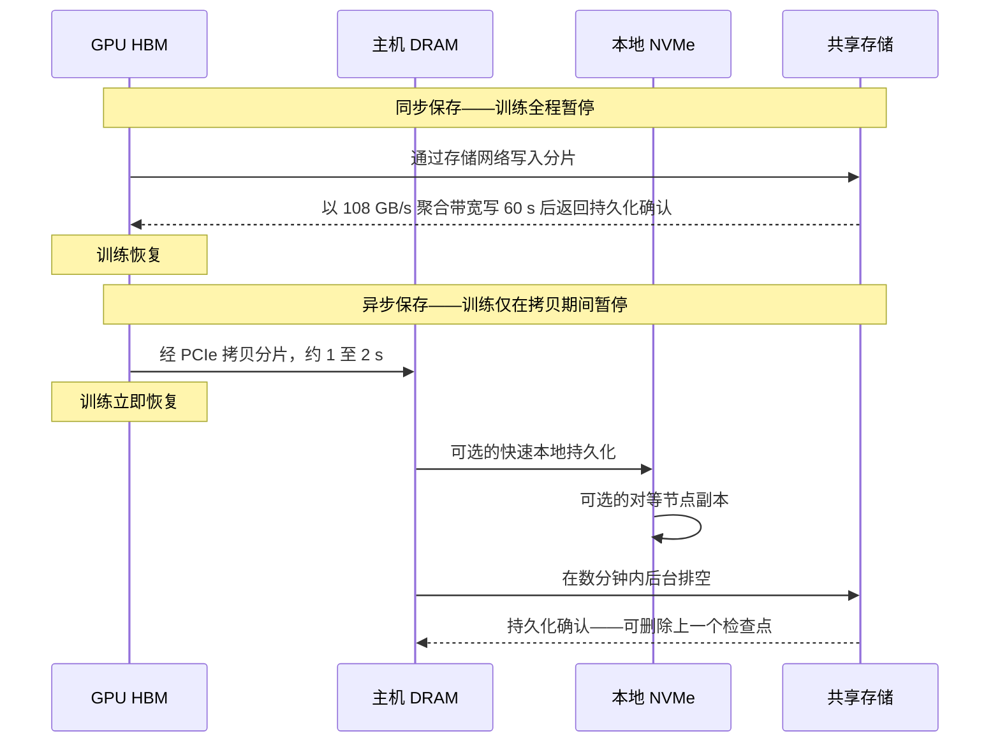
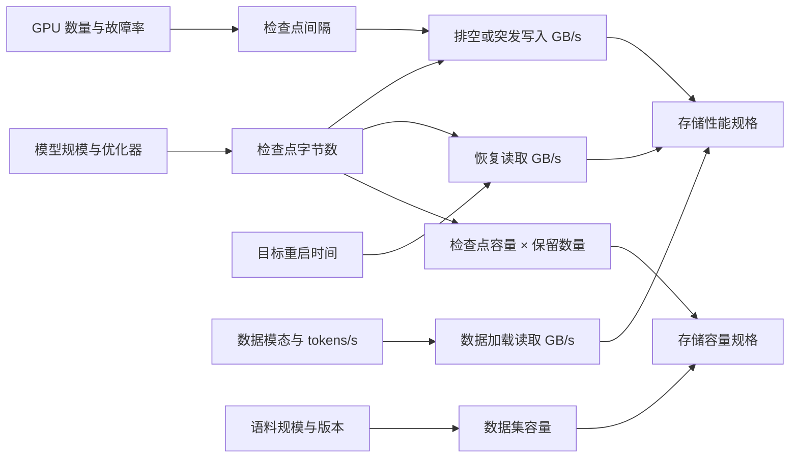
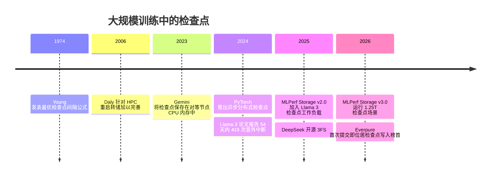

# 31. 训练存储

> 📄 英文原文：[docs/05-ai-storage/31-training-storage.md](../../../docs/05-ai-storage/31-training-storage.md) · 本文为简体中文参考译本，如有出入以英文原文为准。

> **深度：** L2 · **阅读时间：** 约 11 分钟 · **最后核实：** 2026-11-01
> **前置阅读：** [GPU 数据路径](../02-protocols-and-networking/11-gpu-data-path.md) · [端到端 AI 数据管线](30-ai-data-pipeline.md) · [性能与经济性指标](../01-storage-fundamentals/04-performance-and-economics-metrics.md) · [并行文件系统](../03-system-architecture/17-parallel-file-systems.md)

## 要点速览（TL;DR）

- **决定 LLM 训练存储性能规格的是检查点，而不是训练数据。** 一个 405B 参数模型在 16,384 块 GPU 上读取文本 token 的速率合计仅约 11 MB/s，但其完整训练状态约为 6.5 TB。要在 60 秒内写完，需要约 108 GB/s。
- **按每参数约 14–16 字节估算检查点大小，而不是 2 字节。** 混合精度 Adam 在 bf16 权重之外，还保留 fp32 主权重和两个 fp32 优化器动量。仅权重只占保存内容的七分之一。
- **故障决定检查点频率。** Meta 的 Llama 3 训练在 54 天内遭遇 419 次意外中断，约每 3.1 小时一次。采用同步保存时，即便取最优间隔也会浪费约 10% 的集群算力；在 100,000 块 GPU 的规模下，浪费约四分之一。
- **异步与分层检查点把峰值带宽问题转化为持续带宽问题。** GPU 在数秒内把状态转存到主机 DRAM 或本地 NVMe，再在后台排空（drain）到共享存储；软件消除了大部分停顿。
- **最难的时刻是恢复（restore）。** 故障之后所有 GPU 同时读取，在大规模下重启时间的代价高于保存时间。要问冷读带宽和元数据风暴，而不只是写入 GB/s。

## 对 Everpure 战略的意义

在训练集群交易中，检查点这一需求把"每秒几 MB 的 token"变成了"每秒数百 GB 的写入"，并决定了哪些架构能进入候选名单。在其首次 MLPerf Storage 提交（v3.0，2026 年 9 月）中，Everpure 的 FlashBlade//EXA 取得了提交者中最高的检查点写入成绩[^1][^2]，这正是此类论证中一个可信的公开数据点（[第 27 章](../04-everpure/27-flasharray-and-flashblade.md)）。

矛盾在于：异步保存、节点本地层级和内存副本不断压缩存储必须吸收的峰值，因此以突发写入带宽为卖点的方案，面对的是一个正在萎缩的需求。持久的价值转向持续排空带宽、恢复速度以及高效的检查点保留。以下是战略团队基于公开信息可能评估的选项。

## 核心概念

### 两种截然不同的 I/O 任务

**数据加载**是一个稳定、以读为主的数据流，样本往往小而随机。**检查点保存**是周期性的大块、以顺序写为主的突发；它的镜像——**恢复**——则是所有 GPU 同时发起的读突发。[第 30 章](30-ai-data-pipeline.md)把两者放在管线中定位，[第 11 章](../02-protocols-and-networking/11-gpu-data-path.md)解释了字节如何到达 GPU 内存；本章负责给它们定量。

### 检查点有多大？

检查点是精确恢复训练所需的全部内容。采用混合精度的 Adam 优化器时，每个参数携带：

| 组成部分 | 每参数字节数 | 是否驻留 GPU 内存？ | 通常是否保存？ |
|---|---|---|---|
| bf16 工作权重 | 2 | 是 | 是（或在加载时由 fp32 主权重重建） |
| fp32 主权重 | 4 | 是 | 是 |
| Adam 一阶动量（m），fp32 | 4 | 是 | 是 |
| Adam 二阶动量（v），fp32 | 4 | 是 | 是 |
| bf16 梯度 | 2 | 是，临时存在 | 很少 |
| **合计** | **16** | 16 | **~12–14** |

*表 31.1 — 权重只占训练状态的约八分之一；检查点写入的大部分是优化器状态。*

因此，**完整训练状态 = 参数量 × 16 字节**，典型的**已保存检查点 = 参数量 × ~14 字节**。变体包括：梯度是临时的，很少保存；去掉 bf16 副本（加载时由 fp32 重建）得到 12 字节；fp32 梯度会把内存中的状态推高到 18 字节；8 位或 bf16 优化器动量可使优化器部分减半。数据加载器与随机数生成器（RNG）状态只增加几 MB。

MLPerf Storage 的检查点工作负载落在同一区间。IBM 报告 8B 场景为 105 GB，1T 场景为 15 TB，其中 13.2 TB 为优化器状态[^3]。折合每参数约 13–15 字节。

*图 31.1 — 算例：检查点约为模型推理权重的 7–8 倍，因此一个 1T 参数模型每次保存 14–16 TB。*
数据：`data/ch31_checkpoint_size.csv`

一个细节：对于**混合专家（mixture-of-experts，MoE）** 模型，检查点大小取决于*总*参数量，而计算量取决于*激活*参数量。一个总参数 1T、每个 token 激活几百亿参数的 MoE 模型，算起来像中等规模模型，存检查点却像 1T 模型，从而提高了单位 GPU 算力所需的存储带宽。

### 吞吐量算术：字节 ÷ 时间窗口

核心公式是**所需带宽 = 检查点字节数 ÷ 允许写入所花的时间**。这个时间窗口是一项业务选择：可容忍的 GPU 空闲时间（同步），或检查点变为安全状态之前的时间（异步）。

| 模型（完整状态） | 假设 GPU 数 | 每 GPU 分片 | 同步，60 s 窗口 | 同步，300 s 窗口 | 异步，30 分钟内排空 | 每 8-GPU 节点，60 s |
|---|---|---|---|---|---|---|
| 70B（1.12 TB） | 1,024 | 1.09 GB | 18.7 GB/s | 3.7 GB/s | 0.6 GB/s | 0.15 GB/s |
| 405B（6.48 TB） | 16,384 | 395 MB | **108 GB/s** | 21.6 GB/s | 3.6 GB/s | 0.05 GB/s |
| 1T（16 TB） | 32,768 | 488 MB | 267 GB/s | 53 GB/s | 8.9 GB/s | 0.07 GB/s |
| 2T（32 TB） | 65,536 | 488 MB | 533 GB/s | 107 GB/s | 17.8 GB/s | 0.07 GB/s |

*表 31.2 — 算例：分片让每个客户端的任务微不足道；难点在于落到共享存储上的聚合突发，而异步排空可将其削减 30 倍。*

由此得出两点。第一，**分片分散了字节，但没有减少字节**。每块 GPU 写自己的切片，因此没有哪一块网卡（NIC）成为瓶颈；Meta 报告 Llama 3 每 GPU 的检查点状态为 1 MB 至 4 GB[^4]，恰好涵盖上表 395 MB 的平均值。如果只由一个模型副本写入（在 Llama 3 405B 的张量 × 流水线并行布局中为 16 个节点[^4]），每个节点要推送 405 GB，即一分钟内 6.75 GB/s。无论哪种方式，存储看到的都是完整的聚合流量，外加数千个同时发生的文件创建——这是一次元数据事件（[第 21 章](../03-system-architecture/21-metadata.md)）。

第二，**对容量规划而言，异步一列最重要**，因为现代框架正倾向于采用它。

### 同步与异步检查点

*图 31.2 — 异步检查点把 GPU 停顿缩短为一次 PCIe 拷贝，并把存储写入移出关键路径，代价是存在一个最新检查点尚未持久化的时间窗口。*

在异步保存中，每块 GPU 把自己的分片拷贝到锁页主机内存（经 PCIe 拷贝几百 MB 约需一秒），然后由 CPU 线程负责写出，训练随即恢复。借助 PyTorch 2024 年推出的异步模式，IBM 测得一个 7B 模型的检查点停机时间从 148.8 秒降至 6.3 秒[^5]。分层变体会增加一个中间站。NVIDIA NeMo 的本地检查点把每个节点的部分写入本地 SSD 或 RAM 盘，并复制到对等节点[^6]。Gemini 研究系统（Rice University 与 AWS）把检查点保存在对等节点的 CPU 内存中，报告恢复速度快 13 倍以上[^7]。

代价在于：排空过程中丢失节点会回退到上一个检查点；主机 DRAM 必须能容纳分片；排空必须在下一次保存之前完成；后台写入会与训练流量争用带宽，除非使用独立的存储网络。

**半导体类比。** 检查点相当于电源门控（power gating）前的状态保存。在某个电源域被关断前，上下文被存入保持触发器（retention flop），设计者要在保存/恢复成本与节省的漏电之间权衡——一个盈亏平衡计算。同步检查点类似 DRAM 的全 bank 刷新，在 tRFC 期间阻塞所有 bank；异步检查点则类似按 bank 刷新，把突发隐藏在有效工作之后。

### 频率与故障率

检查点频率是在保存所花时间与故障后需重做的工作之间做权衡。Young 近似给出的最优间隔为 **τ ≈ √(2 × C × M)**，其中 *C* 是每次检查点的 GPU 停顿时间，*M* 是导致作业中止的故障之间的平均时间[^8]。此时开销约为 C/τ + τ/(2M)，另加每次故障的重启时间。

在 Llama 3 405B 于 16,384 块 H100 上预训练的 54 天快照期间，Meta 记录了 466 次中断：47 次计划内，**419 次意外**。其中约 78% 被归因于已确认或疑似的硬件问题，以故障 GPU 和 HBM3 为首[^4][^9]。即每 54 × 24 ÷ 419 ≈ **3.1 小时**发生一次意外停止。在 Meta 的研究集群中，1,024-GPU 作业的平均故障时间（MTTF）为 7.9 小时，而 8-GPU 作业为 47.7 天[^10]。线性外推可预测 16K GPU 时约为 30 分钟；作者自己的模型预测约为 1.8 小时（据二手资料概述），而 Llama 3 的生产集群实际达到了 3.1 小时。

| 场景（405B，6.48 TB 状态） | MTBF *M* | 每次保存停顿 *C* | 最优间隔 τ | 保存 + 返工开销 | 所需排空带宽 |
|---|---|---|---|---|---|
| 16K GPU，同步，108 GB/s | 3.1 h | 60 s | 19 min | **10.4%** | 108 GB/s 突发 |
| 16K GPU，同步，~1 TB/s | 3.1 h | 6.5 s | 6.3 min | 3.4% | ~1 TB/s 突发 |
| 16K GPU，异步 | 3.1 h | 2 s | 3.5 min | 1.9% | 31 GB/s 持续 |
| 100K GPU，同步，108 GB/s | 30 min* | 60 s | 7.8 min | **25.6%** | 108 GB/s 突发 |
| 100K GPU，异步 | 30 min* | 2 s | 1.4 min | 4.7% | 76 GB/s 持续 |

*表 31.3 — 基于 Young 公式的算例：在 100K GPU 规模下，同步检查点浪费四分之一的集群，而异步保存可将开销控制在 5% 以下，但需要稳定的排空带宽。\*假设故障数按 Llama 3 的故障率随 GPU 数量线性增长。*

在 16K GPU 规模下，10.4% 的开销相当于闲置约 1,700 块 GPU，按[第 11 章](../02-protocols-and-networking/11-gpu-data-path.md)中的租赁价格计算，每年达数千万美元。陷阱在于：无论检查点如何写入，重启时间都是按每次故障支付的。5 分钟的重启在 16K GPU 时的代价为 2.7%，在 100K 时为 16%。

### 恢复风暴

故障发生后，坏节点被替换，每个 rank 同时读取最新的检查点。有三点使恢复比保存更难：

1. **读放大。** 优化器状态是分片的，但 bf16 权重在各数据并行组之间是复制的。朴素做法下，每个副本都读取自己的那一份。对于有 128 个数据并行副本的 Llama 3 405B，这意味着 0.81 TB × 128 的 bf16 权重，加上 4.86 TB 分片的 fp32 主权重与动量 ≈ **用 109 TB 的读取来恢复约 5.7 TB 的唯一检查点数据**。好的框架每个字节只读一次，再通过更快的 GPU 互连网络广播。
2. **冷读与元数据。** 缓存中可能已不再有检查点，数千个 rank 同时打开文件并执行 stat。在 Everpure 自己的 MLPerf Storage v3.0 成绩中，检查点*读取*为 588 GiB/s，而*写入*为 877 GiB/s[^1]。即便对领先者而言，恢复也是较慢的方向。
3. **其他一切也要重启。** 容器镜像和 Python 环境会在同一时刻冲击共享存储；Meta 缩短了作业启动时间，以使有效训练时间保持在 90% 以上[^4]。

一个有用的规划目标是恢复时间，而不是带宽。在两分钟内读取 5.7–6.5 TB 唯一数据需要 47–54 GB/s。同样的恢复若采用朴素的逐副本读取，则需要约 900 GB/s。

### 数据加载：token 便宜，像素不便宜

数据加载需求为 **每 GPU 每秒 token 数 × 每 token 字节数 × GPU 数**。Llama 3 405B 在 16,384 块 GPU 上的运行效率约为 H100 ~989 稠密 BF16 TFLOPS 的 41%[^4]。按每参数每 token 6 FLOPs 计算，每块 GPU 消耗 989×10¹² × 0.41 ÷ (6 × 405×10⁹) ≈ **167 tokens/s**。按每个 token ID 4 字节计，即每 GPU 0.7 KB/s，**整个集群约 11 MB/s**。（处理 15.6T token 约需 ~66 天，与实际训练相符[^4]。）然而 Meta 为 Llama 3 提供的 Tectonic 存储拥有 7,500 台 SSD 服务器上的 240 PB 容量，持续 2 TB/s、峰值 7 TB/s，Meta 仍称突发的检查点写入是"a major challenge"（一大挑战）[^4]。它是按检查点而不是 token 来规划的。

| 工作负载 | 每 GPU 输入速率 | 每 GPU 每秒字节数 | 1,024 GPU | 依据 |
|---|---|---|---|---|
| 405B 稠密文本 LLM | 167 tokens/s | ~0.7 KB/s | ~0.7 MB/s | 基于 Llama 3 MFU 的算例 |
| 8B 稠密文本 LLM | 8,450 tokens/s | ~34 KB/s | ~35 MB/s | 同一公式，较小模型 |
| 图像模型，~100 KB JPEG | 1,000 images/s（示意） | ~100 MB/s | ~100 GB/s | 示意性假设 |
| 视频模型，20 MB 片段 | 2 clips/s（示意） | ~40 MB/s | ~40 GB/s | 示意性假设 |
| MLPerf Storage 3D U-Net | 每模拟 H100 ~2.7 GiB/s | ~2.7 GiB/s | ~2.8 TiB/s | DDN v1.0 成绩[^11] |

*表 31.4 — 文本训练几乎不触及存储；图像、视频和科学体数据每 GPU 所需字节数可能高出五到六个数量级。*

团队常把视频预编码为紧凑的潜在表示（latent），以一次离线计算换取存储带宽。MLPerf 3D U-Net 一行是刻意设计为受存储限制的（模型极小、体数据很大），是压力测试而非典型工作负载（[第 37 章](37-reading-benchmarks.md)）。

### 这对 AI 工厂的容量规划意味着什么

*图 31.3 — 对文本 LLM 而言，性能规格来自检查点的保存与恢复；对多模态训练而言，数据加载可能占主导。*

容量示例：一次 405B 训练保留最近 10 个检查点外加 20 个评估里程碑，即 30 × 5.67 TB ≈ 170 TB——与多模态语料相比不大，但属于必须以恢复速度读取的热数据。NVIDIA 的 DGX SuperPOD（H100）参考架构中"best"存储层级要求每节点 40 GB/s 读、20 GB/s 写，每个 32 节点可扩展单元（SU）125/62 GB/s 读/写[^12] [VERIFY: 每 SU 125 GB/s 读取出现在该参考架构表 6 的搜索摘要中（good/better/best = 15/40/125 GB/s）；每节点数值与写入数值仍仅见于搜索摘要]。线性扩展到 64 个单元（16,384 块 GPU），约为 4 TB/s 写入，与 Meta 7 TB/s 的峰值处于同一量级。

## Everpure 的做法与竞争对手对比

| 方案 | 检查点突发落在何处 | 优势 | 劣势 | 示例（公开） |
|---|---|---|---|---|
| 共享全闪存，元数据/数据分离 | 共享命名空间，客户端直接写数据节点 | 聚合写入高；单一副本对所有节点可见，便于恢复 | 必须按突发或排空需求来规划容量 | Everpure FlashBlade//EXA：MLPerf Storage v3.0 中检查点写入 877.5 GiB/s[^1][^2] |
| 并行文件系统 | 经条带化写入对象存储目标 | 在 HPC 规模下成熟；流式性能强 | 每 rank 一个文件的风暴受元数据服务器限制 | DDN EXAScaler（检查点加速 >2×，公司自述）[^13]；Azure Managed Lustre 在 v3.0 中为 642.2 GiB/s[^2] |
| 分解式全共享架构 | SCM/闪存写缓冲，之后迁移到 QLC | 用快速层吸收突发；全局数据缩减 | 写路径放大后端流量 | VAST（未提交 MLPerf Storage）[^2][^14] |
| 软件定义并行文件系统 | 通用 NVMe 服务器或云实例 | 按节点扩展；适配云与新兴 GPU 云（neocloud） | 硬件集成由客户负责 | WEKA（公司自述聚焦检查点）[^15] |
| 节点本地层级 | GPU 服务器自身的 NVMe，随后排空 | 把网络移出关键路径 | 持久性依赖复制；容量被困在服务器中 | Hammerspace Tier 0[^16]；NVIDIA NeMo 本地检查点[^6] |
| 自建 | 超大规模云厂商或实验室自有文件系统 | 针对单一工作负载调优；无供应商利润 | 需要工程人力；不对外销售 | Meta Tectonic[^4]；DeepSeek 3FS（180 个存储节点读取 ~6.6 TiB/s）[^17] |

*表 31.5 — 每种架构都能吸收检查点；区别在于突发落在共享闪存、快速缓冲层，还是 GPU 服务器自身。*

**Everpure 的定位。** FlashBlade//EXA 的卖点是通过客户端直连数据节点的路径获得聚合写入能力，并以元数据核心应对大规模文件创建。v3.0 提交中，1,024 个模拟加速器在 17.74 秒内写完一个 1.25T 参数的检查点仿真[^1]。这意味着每个检查点约 16–17 TB（本图谱推算），与图 31.1 一致。Everpure 还将 FlashBlade 与 PyTorch 异步检查点搭配推广，宣称检查点开销至少降低 10 倍（公司自述）[^18]。其中大部分收益来自软件模式，而该模式在任何存储上都适用。

**为替代方案构建最强论证（steelman）。** DDN 的 Lustre 谱系二十年来一直在国家实验室中吸收每进程一个文件的检查点风暴。VAST 的写缓冲无需按突发来配置 QLC 即可吸收突发。节点本地层级直击根源：如果检查点很少离开 GPU 服务器，共享存储只需保存较慢的持久副本。此外，VAST、WEKA 和 DDN 均未提交 v3.0[^2]，因此 Everpure 的领先仅限于提交者之中，而非整个市场。

## 历史与发展轨迹

*图 31.4 — 检查点理论已有 50 年历史；变化的是规模，它把检查点推进了存储基准测试和存储招标书（RFP）。*

HPC 最先解决了这个问题：超级计算机的重启转储推动了 2000 年代的并行文件系统（[第 17 章](../03-system-architecture/17-parallel-file-systems.md)）。MLPerf Storage 在 v2.0（2025 年 8 月）中将检查点列为计分工作负载，使用 Llama 3 8B、70B、405B 和 1T 模型[^19]。其指标刻意偏保守：耗时取最慢进程，吞吐量取所有进程中的最小值，共写入并读取 10 个检查点[^20]。

三个趋势指向未来：**检查点向 GPU 靠近**（主机 DRAM、本地 NVMe、对等副本），共享存储作为持久化兜底；**更低精度的优化器状态**降低每参数字节数，而总参数量持续增长；随着故障数随 GPU 数量增长，**恢复训练所需时间（time-to-resume）成为评判供应商的指标**。

## 关键数字

| 指标 | 数值 | 背景 | 来源 / 日期 |
|---|---|---|---|
| 训练状态，混合精度 Adam | 内存中 ~16 B/参数；保存 ~12–14 B/参数 | 405B → 6.48 TB 完整状态 | 算例 |
| 60 s 内写完 405B 完整状态 | ~108 GB/s | 6.48 TB ÷ 60 s；30 分钟异步排空需 3.6 GB/s | 算例 |
| Llama 3 中断次数 | 54 天 466 次（419 次意外，~78% 为硬件） | 16,384 块 H100；约每 3.1 h 一次 | Meta[^4]，2024-07 |
| Llama 3 存储 | 240 PB、7,500 台服务器、持续 2 TB/s、峰值 7 TB/s | 检查点突发被称为一大挑战 | Meta[^4]，2024-07 |
| Llama 3 每 GPU 检查点状态 | 1 MB 至 4 GB | 分片到 16K 块 GPU | Meta[^4]，2024-07 |
| MTTF，1,024-GPU 作业 | 7.9 h（8 GPU 为 47.7 天） | Meta 研究集群 | Kokolis et al.[^10]，2025-02 |
| 异步检查点停机时间，7B | 148.8 s → 6.3 s | PyTorch DCP 与 IBM 合作 | PyTorch[^5]，2024 |
| MLPerf Storage v3.0 检查点写入最高值 | 877.5 GiB/s（读 588.3 GiB/s） | Everpure FlashBlade//EXA，30 个数据节点，1.25T 场景；供应商提交 | HPCwire[^1]，2026-09-02 |
| 文本 token 输入，405B 于 16K GPU | 全集群 ~11 MB/s | 167 tokens/s/GPU × 4 B | 算例 |

## 对话手册

**向产品经理提的问题**

1. *"在我们最近丢掉的五个训练交易中，检查点需求是以突发 GB/s、排空速率还是恢复训练所需时间来表述的？"* 高质量回答：了解客户的框架（同步还是异步）、检查点大小与间隔，以及招标书中的数字是真实需求还是照抄参考架构。
2. *"对于运行异步检查点到本地 NVMe 的客户，我们如何规划集群容量？"* 高质量回答：持续排空带宽、恢复带宽和保留检查点所需容量，而非峰值写入；以及当这导致交易规模缩小时，定价如何弥补。
3. *"当 VAST 或 WEKA 说 MLPerf Storage 不能反映真实客户时，我们怎么回应？"* 高质量回答：承认它是合成测试，然后援引 1.25T 场景、保守的最小吞吐量指标，以及相近规模的客户案例。

**向工程师提的问题**

1. *"带我走一遍缓存已清空后 16K 个 rank 的恢复过程：每秒打开的文件数、读取 GB/s 以及到第一个训练步的时间。"* 高质量回答：分开给出元数据与数据的数字，区分广播与逐副本读取，以及最慢客户端的尾部。
2. *"当某个数据节点故障时，正在进行的检查点排空会怎样？"* 高质量回答：降级写入带宽的百分比、停顿或重试行为，以及恢复全速所需时间。
3. *"在我们的平台上，检查点的写放大来自哪里：纠删码、元数据还是数据缩减？"* 高质量回答：给出"每客户端字节对应的后端字节数"，并坦承优化器状态几乎无法压缩。

**不要这样说：**

- "LLM 训练需要巨大的读带宽。"文本只需 MB/s。驱动带宽的是检查点、恢复和多模态数据。
- "405B 的检查点是 810 GB。"那只是 bf16 权重。加上优化器状态约为 5.7–6.5 TB。
- "降低检查点开销的唯一办法是更快的存储。"异步与分层检查点通过软件消除了大部分停顿。
- "检查点数据去重效果很好。"相邻检查点之间几乎每个 fp32 值都不同；预期数据缩减很少。
- "MLPerf 榜首就是市场上最快的系统。"主要竞争对手没有提交 v3.0。

## 深入阅读（可选，L3 指引）

- Meta，"The Llama 3 Herd of Models"，§3.3（存储与可靠性）。
- Young（1974）与 Daly（2006）关于最优检查点间隔的论文。
- PyTorch Distributed Checkpoint（DCP）文档：异步保存与加载时重新分片。
- NVIDIA NeMo / Megatron "local checkpointing"（本地检查点），以及关于内存检查点放置的 Gemini（SOSP 2023）论文。
- MLPerf Storage 检查点规则（subset 模式与 default 模式）。

## 关键术语

- **检查点（Checkpoint）**——保存下来的、恢复训练所需的全部训练状态副本。
- **优化器状态（Optimizer state）**——Adam 的逐参数动量与 fp32 主权重，占检查点大小的大部分。
- **异步检查点（Asynchronous checkpointing）**——先把状态拷贝到主机内存，再在训练继续进行的同时于后台写入存储。
- **恢复风暴（Restore storm）**——故障后所有 GPU 同时读取最新检查点。
- **Young 公式（Young's formula）**——最优检查点间隔，√(2 × 保存成本 × MTBF)。
- 其余术语见[术语表](../glossary.md)。

## 资料来源

[^1]: HPCwire (Everpure release), "Everpure Leads MLPerf Storage Tests for Large Model Checkpointing and KV Cache," 2026-09-02. https://hpcwire.com/off-the-wire/everpure-leads-mlperf-storage-tests-for-large-model-checkpointing-and-kv-cache (retrieved 2026-11-01).
[^2]: StorageReview, "MLPerf Storage v3.0: 877 GiB/s Checkpoints, a Cloud First, and a Leaderboard Turned Over," 2026-09. https://www.storagereview.com/news/mlperf-storage-v3-0-877-gib-s-checkpoints-a-cloud-first-and-a-leaderboard-turned-over (retrieved 2026-11-01).
[^3]: IBM Research Blog, "IBM Storage Scale delivers real-world performance: an in-depth analysis," n.d. (2025). https://research.ibm.com/blog/ibm-storage-scale-mlperf (retrieved 2026-11-01).
[^4]: Llama Team, AI @ Meta, "The Llama 3 Herd of Models," arXiv:2407.21783, 2024-07-31. https://arxiv.org/abs/2407.21783 (retrieved 2026-11-01).
[^5]: PyTorch Blog, "Reducing Model Checkpointing Times by Over 10x with PyTorch Distributed Asynchronous Checkpointing," 2024-06. https://pytorch.org/blog/reducing-checkpointing-times/ (retrieved 2026-11-01).
[^6]: NVIDIA, "Resiliency Features," NeMo Framework User Guide 25.04, n.d. https://docs.nvidia.com/nemo-framework/user-guide/25.04/resiliency.html (retrieved 2026-11-01).
[^7]: Z. Wang et al., "Gemini: Fast Failure Recovery in Distributed Training with In-Memory Checkpoints," SOSP '23, 2023-10. https://www.amazon.science/publications/gemini-fast-failure-recovery-in-distributed-training-with-in-memory-checkpoints (retrieved 2026-11-01).
[^8]: J. W. Young, "A first order approximation to the optimum checkpoint interval," Communications of the ACM 17(9), 1974-09. https://doi.org/10.1145/361147.361115 (retrieved 2026-11-01).
[^9]: DatacenterDynamics, "Meta report details hundreds of GPU and HBM3 related interruptions to Llama 3 training run," 2024-07. https://datacenterdynamics.com/en/news/meta-report-details-hundreds-of-gpu-and-hbm3-related-interruptions-to-llama-3-training-run (retrieved 2026-11-01).
[^10]: A. Kokolis et al. (Meta), "Revisiting Reliability in Large-Scale Machine Learning Research Clusters," arXiv:2410.21680v2, 2025-02-06. https://arxiv.org/abs/2410.21680v2 (retrieved 2026-11-01).
[^11]: Blocks & Files, "MLPerf AI benchmark tests how storage systems keep GPUs busy," 2024-09-26. https://www.blocksandfiles.com/ai-ml/2024/09/26/mlperf-ai-benchmark-tests-how-storage-systems-keep-gpus-busy/1605043 (retrieved 2026-11-01).
[^12]: NVIDIA, "Storage Architecture," DGX SuperPOD Reference Architecture (DGX H100), n.d. https://docs.nvidia.com/dgx-superpod/reference-architecture-scalable-infrastructure-h100/latest/storage-architecture.html (retrieved 2026-11-01).
[^13]: DDN, "Understanding the impact of checkpoints on AI efficiency," n.d. https://www.ddn.com/blog/understanding-the-impact-of-checkpoints-on-ai-efficiency/ (retrieved 2026-11-01).
[^14]: VAST Data, "We've got the write stuff, baby," n.d. https://vastdata.com/blog/weve-got-the-write-stuff-baby (retrieved 2026-11-01).
[^15]: WEKA, "WEKA eliminates costly checkpoint bottlenecks" (solution brief), n.d. https://www.weka.io/resources/solution-brief/weka-eliminates-costly-checkpoint-bottlenecks/ (retrieved 2026-11-01).
[^16]: Hammerspace, "Hammerspace Tier 0 Affinitization," 2026. https://hammerspace.com/hammerspace-tier-0-affinitization/ (retrieved 2026-11-01).
[^17]: DeepSeek, "3FS: Fire-Flyer File System" (README), 2025. https://github.com/deepseek-ai/3FS (retrieved 2026-11-01).
[^18]: Everpure Blog, "How to Accelerate Training for Large AI Models with Pure Storage FlashBlade and PyTorch Checkpointing," n.d. https://blog.everpuredata.com/purely-technical/pure-storage-flashblade-and-pytorch-asynchronous-checkpointing/ (retrieved 2026-11-01).
[^19]: MLCommons via GlobeNewswire, "New MLPerf Storage v2.0 Benchmark Results Demonstrate the Critical Role of Storage Performance in AI Training Systems," 2025-08-04. https://www.globenewswire.com/news-release/2025/08/04/3126718/0/en/new-mlperf-storage-v2-0-benchmark-results-demonstrate-the-critical-role-of-storage-performance-in-ai-training-systems.html (retrieved 2026-11-01).
[^20]: Lawrence Livermore National Laboratory, "MLPerf Storage," LLNL Benchmarks documentation, n.d. https://software.llnl.gov/benchmarks/81_mlpstor/mlpstor.html (retrieved 2026-11-01).
