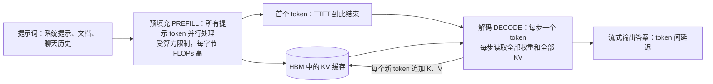
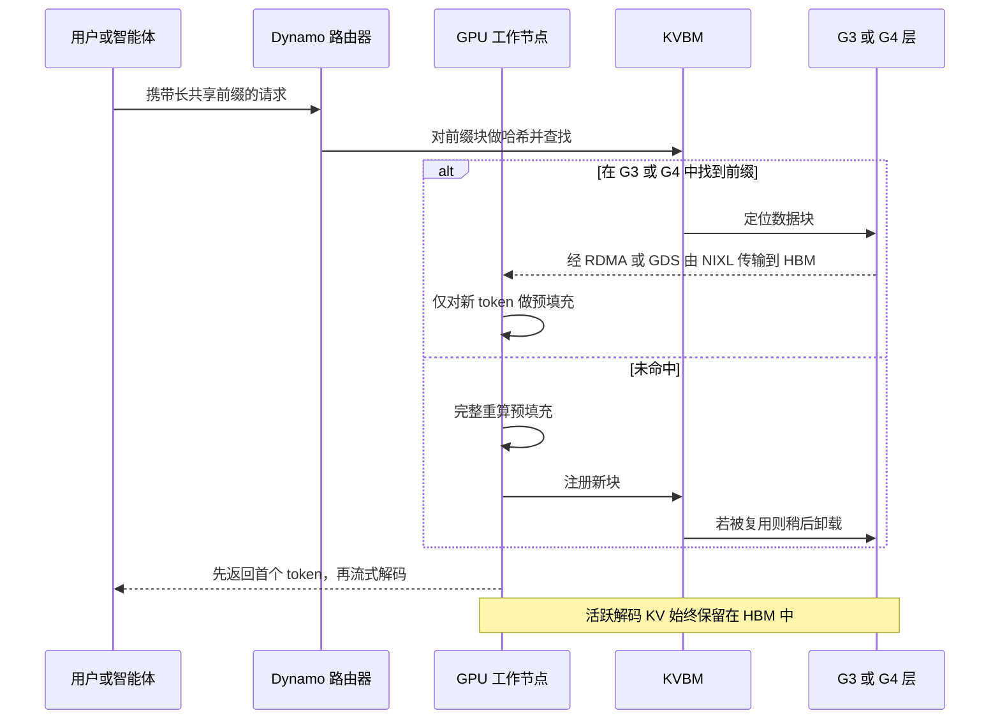
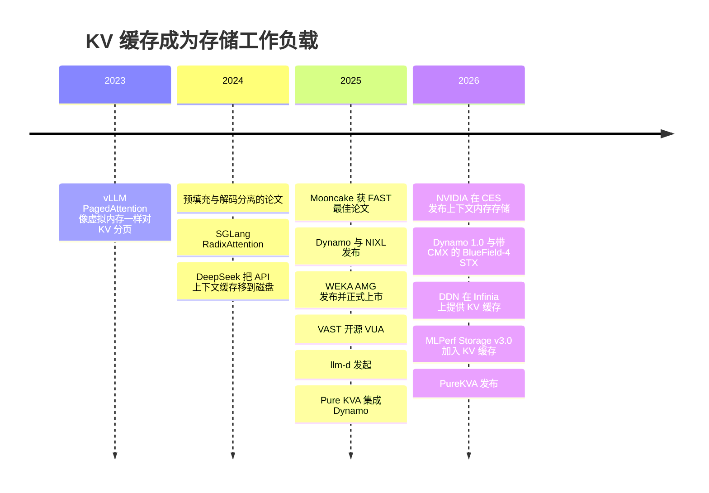

# 32. 推理与 KV 缓存

> 📄 英文原文：[docs/05-ai-storage/32-inference-and-kv-cache.md](../../../docs/05-ai-storage/32-inference-and-kv-cache.md) · 本文为简体中文参考译本，如有出入以英文原文为准。

> **深度：** L2 · **阅读时间：** 约 11 分钟 · **最后核实：** 2026-11-01
> **前置阅读：** [介质物理](../01-storage-fundamentals/02-media-physics.md) · [GPU 数据路径](../02-protocols-and-networking/11-gpu-data-path.md) · [接口与新兴技术（CXL）](../02-protocols-and-networking/12-interfaces-and-emerging-tech.md) · [训练存储](31-training-storage.md)

## 要点速览（TL;DR）

- **KV 缓存是一段对话的工作内存**：即迄今为止每个 token 的注意力键（key）和值（value）。一个 Llama 3.1 70B 级模型需要**每 token 320 KiB**，因此一次 128K token 的会话约为 **43 GB**；一个保留会话的集群可达 PB 级。
- **预填充（prefill）受算力限制；解码（decode）受内存限制。** 解码每生成一个新 token 都要重读整个缓存，因此活跃的 KV 必须驻留在 HBM 中。存储只能保存*当前未在解码*的 KV。
- **这是一道"重算还是读取"的权衡题。** 重建一个 128K 上下文需要一台 8-GPU 节点约 2.6 s 的计算；经 8 × 400 Gb/s 网卡读取只需约 0.13 s。当每 GPU 带宽高于约 2–5 GB/s 时读取胜出，因此命中率和带宽决定经济性。
- **NVIDIA 已将这一层级体系标准化。** Dynamo 的 KV Block Manager（KVBM）定义了从 G1（HBM）到 G4（网络化存储）的层级，NIXL 负责搬运字节，BlueField-4 STX/CMX 增加了一个机柜组（pod）级的"G3.5"闪存层。包括 Everpure 在内的存储供应商竞相成为 G3.5/G4 的后端。
- **对倍数打折看待。** Everpure、WEKA、DDN 和 HPE 都宣称首 token 延迟加快 20 倍或更多，但大多以无缓存为基线；VAST 和 NVIDIA 则宣称功耗与吞吐量的提升。MLPerf Storage v3.0（2026 年 9 月）加入了首个中立的 KV 缓存测试[^1]。

## 对 Everpure 战略的意义

训练存储是每个集群的一次性销售；推理支出则是经常性的，而 KV 缓存是第一个*在每次用户请求时都需要共享存储容量与带宽*的推理工作负载。如果缓存层能让 GPU 集群在每块 GPU 上服务更多对话，存储费用就可以从 GPU 预算中支出——这是存储供应商最有说服力的论点（[第 11 章](../02-protocols-and-networking/11-gpu-data-path.md)）。Everpure 已凭借基于 FlashBlade 的 PureKVA 入场，在其参加的 MLPerf Storage v3.0 KV 缓存测试中领先[^2]（公司自述），并且是 NVIDIA BlueField-4 STX 架构的具名合作伙伴[^3]。

风险同样直接。NVIDIA 正在定义这一层级（名称、软件，以及如今的参考机柜 CMX），在这种架构中，存储可能沦为 NVIDIA DPU 背后的商品化闪存货架。战略问题在于：KV 缓存对 Everpure 而言是一个新的插槽（socket），还是一个将被 NVIDIA、本地 NVMe 和更精简的模型架构吸收掉的功能？

## 核心概念

### KV 缓存是什么，会变得多大

Transformer 每次生成一个 token。在每一步中，每一层的注意力都会把新 token 的*查询（query）* 与所有先前 token 的*键*进行比较，并融合它们的*值*。缓存每个 token 的 K 和 V，可避免每一步都重新计算整个历史。代价是内存：

**每 token KV 字节数 = 2（K 和 V）× 层数 × KV 头数 × 头维度 × 每个值的字节数。**

Llama 3.1 70B 有 80 层，采用分组查询注意力（GQA）：64 个查询头共享 8 个 KV 头，每个头的维度为 128（8,192 ÷ 64）[^4]。在 fp16 下得到 2 × 80 × 8 × 128 × 2 = **每 token 327,680 字节（320 KiB）**。Llama 3.1 405B（126 层，8 个 KV 头）需要每 token 504 KiB。DeepSeek-V3 采用多头潜在注意力（MLA）。它每层缓存一个压缩的 512 维潜在向量外加一个 64 维位置键，因此尽管有 671B 参数，61 层合计每 token 仅约 69 KiB[^5]。如果没有 GQA，70B 模型需要 8 倍的空间（每 token 2.5 MiB）。模型架构师在不断压缩 KV，任何存储方案的论证都必须经得起这一点。

*图 32.1 — 算例：KV 大小与上下文长度和会话数均呈线性关系，因此仅几百个保留的长对话就已超出一台 8-GPU 节点所能容纳的全部容量。*
数据：`data/ch32_kv_size.csv`

对比一下硬件。H200 有 141 GB HBM[^6]；Rubin GPU 有 288 GB HBM4[^7]。DGX B200 节点有 1,440 GB HBM、2 TB 主机 DRAM 和 8 × 3.84 TB 本地 NVMe[^8]。为 70B 模型装入 71 GB 的 fp8 权重后，剩余约 1.37 TB 可用于 KV：**128K 下约 31 个会话**，扣除激活值后更少（fp8 KV 可使其翻倍）。

### 预填充与解码：两台不同的机器

*图 32.2 — 预填充通过一次计算密集的突发生成 KV 缓存；随后解码每生成一个 token 就重读一次，这正是活跃 KV 必须驻留在最快内存中的原因。*

**预填充**一次性处理整个提示，以矩阵乘法为主，接近算力屋顶线（roofline）；其延迟即**首 token 延迟（TTFT）**。**解码**每步产生一个 token，每一步都要读取权重以及*批次中每个序列的全部 KV 缓存*：这是屋顶线图中低算术强度、受内存限制的那一角。算例：70B 模型上 16 个 128K 会话持有 687 GB KV。分布到八块 B200 上，每块 GPU 每步读取约 86 GB KV，按 B200 8 TB/s 的 HBM 带宽约需 11 ms[^8]。读取权重仅需约 1 ms。在长上下文下，KV 字节数决定解码速度，HBM 容量限制批次大小。若从 50 GB/s 链路流式读取这 86 GB，*每个 token* 需要 1.7 s。由此得出硬性限制：**存储只保存非活跃的 KV**（对话轮次之间、智能体等待工具返回时，或尚未使用的共享前缀），而绝不保存工作集。

由于两个阶段需要不同的硬件，**分离式推理服务（disaggregated serving）** 把预填充和解码放在不同的 GPU 池上运行，并在两者之间传送 KV 缓存。这一思路于 2024 年以 DistServe（OSDI）[^9] 和 Splitwise（ISCA）[^10] 发表。Moonshot AI 的 Mooncake（服务于 Kimi）把 KV 汇集到闲置的 CPU DRAM 和 SSD 上，获得 USENIX FAST 2025 最佳论文，副标题为"trading more storage for less computation"（以更多存储换取更少计算）[^11]。分离式架构把 KV 从 GPU 私有缓冲区变成了跨网络流动的数据——而这正是存储供应商的地盘。

### 前缀缓存：命中率之争

请求往往有相同的开头（系统提示、文档、代码仓库、先前的对话轮次）。**前缀缓存（prefix caching）** 以固定大小的块存储 KV，键为截至该块的 token 的哈希值，因此新请求可复用最长的匹配前缀，只需对新 token 做预填充。vLLM 的 PagedAttention（SOSP 2023）通过像虚拟内存那样对 KV 分页实现了这一点，减少了碎片浪费，并将吞吐量提升 2–4 倍[^12]。SGLang 的 RadixAttention 将这一思路扩展到前缀树[^13]。

半导体类比非常直接：块哈希就是缓存标签（tag），淘汰策略是带频率过滤的 LRU，平均访问时间 = 命中率 × 读取时间 + 未命中率 × 重算时间。特殊之处在于未命中是*可重算的*：丢失一个块只损失时间和金钱，而不影响正确性，因此持久性远不如吞吐量和尾延迟重要。命中率很脆弱：上下文截断可使其减半[^14]，而一次模型更新会使整个缓存失效。

### 重算还是读取：盈亏平衡点

**算例（128K token 上下文，Llama 3.1 70B，8-GPU B200 级节点）。** 重算的线性层约需 2 × 70.6×10⁹ × 131,072 ≈ 1.85×10¹⁶ FLOPs，因果注意力另需约 2.25×10¹⁶（2 × n² × 8,192 × 80 层），合计 ≈ 4.1×10¹⁶ FLOPs。假设节点*实际交付* 16 PFLOPS（每 GPU 2 PFLOPS，这一假设远低于峰值）。则重算需要 **≈ 2.6 s 和 ≈ 21 GPU 秒**。经八块 400 Gb/s 网卡以约 80% 效率（320 GB/s）读取 43 GB 需要 **≈ 0.13 s**，且期间 GPU 空闲可用。70B 模型重建每字节 KV 要花费 50 万至 100 万 FLOPs，因此在每 GPU 2 PFLOPS 下，带宽高于**每 GPU ~2–5 GB/s** 时读取胜出：对 RDMA 闪存而言门槛很低，这也正是 KV 卸载之所以可行的原因。

*图 32.3 — KV 层级体系就是一个缓存层级体系，在内存与闪存之间存在约 1,000 倍的延迟断崖；存储供应商在断崖之下竞争，在那里容量和共享比纳秒更重要。*

| 128K 上下文命中的路径（70B，43 GB） | 恢复时间 | 消耗的 GPU 时间 | 该层容量（单节点） | 持有 43 GB 1 小时的成本 |
|---|---|---|---|---|
| 未命中：重算预填充 | ≈ 2.6 s | ≈ 21 GPU-s（按 US$4/GPU-h 假设，≈ US$0.02） | 不适用 | 不适用 |
| G2 主机 DRAM 经 PCIe 5（每节点 ~440 GB/s） | ≈ 0.1 s | ~0 | 2–4 TB → 约 45–90 个会话 | ≈ US$0.01（假设 DRAM 约 US$10/GB，寿命 4 年） |
| G3 本地 NVMe（8 块盘，~56 GB/s） | ≈ 0.8 s | ~0 | ~31 TB → 约 700 个会话，仅限本节点 | ≈ US$0.0006（假设闪存系统约 US$0.50/GB） |
| G3.5 / G4 网络化闪存（到节点 ~320 GB/s） | ≈ 0.13 s + 查找 | ~0 | 每机柜组或集群 PB 级，任意节点可用 | ≈ US$0.0006，另加网络与软件成本 |
| 1M token 上下文未命中（343 GB） | ≈ 100 s 重算（注意力占主导） | ≈ 800 GPU-s | 扣除权重后每节点 HBM 约容纳 4 个会话；超出单块 GPU 的 180 GB | 不适用 |

*表 32.1 — 算例，非供应商数据：一次重算的成本约等于把同样的 KV 在 DRAM 中保存两小时或在闪存中保存约 40 小时，因此经济性归结为命中率和读取带宽。*

三点结论。第一，八块 400G 网卡的速度超过八块本地 U.2 盘，这正是 NVIDIA 把上下文层放在以太网上的原因。第二，对最热的被淘汰块而言，DRAM 和 [CXL 内存](../02-protocols-and-networking/12-interfaces-and-emerging-tech.md)在速度上胜出，但每 GB-小时成本高出约 20 倍；Synopsys 宣称 CXL 卸载 KV 比 SSD 快 3.6 倍[^15]（供应商宣称），但真正的检验标准是每美元 token 数。第三，共享层的主要优势在单节点视角下看不见：**任何 GPU 都能命中任何会话的前缀**，因此路由器可以把回访用户发送到任意空闲节点。

### 为什么长上下文和智能体会把 KV 变成存储问题

智能体（agent）的会话很长，而且走走停停。一个运行 50 轮的编程智能体，上下文增长到 100K token，并在轮次之间等待工具数秒到数分钟；如果没有缓存，它每一轮都要重新预填充其历史：约 50 × 50K ≈ **250 万个预填充 token**，是完美复用情况下工作量的 25 倍。在数千个智能体之上，保留状态就是图 32.1 的右半部分：数十 TB 到 PB 级，在数分钟内被复用，可重算但丢失代价高昂。这正是共享闪存缓存的画像。TrendForce 将 4Q26 企业级 SSD 需求的一部分归因于为 KV 缓存采购 QLC[^16]。DeepSeek 在 2024 年把其 API 缓存移到磁盘，将命中价格定为未命中的十分之一，并报告一个被大量复用的 128K 提示的首 token 延迟从 13 s 降至约 0.5 s[^17]（公司自述）。Anthropic 对缓存读取按基础输入价格的 0.1× 计费[^18]。**提示缓存（prompt cache）定价就是市场自己对一次 KV 命中的估值。**

### 软件栈：Dynamo、KVBM、NIXL、LMCache、llm-d

NVIDIA 于 2025-03-18 在 GTC 上发布了开源分布式推理框架 **Dynamo**[^19]，并于 2026-03-16 宣布其达到生产就绪（1.0）[^20]。它在 TensorRT-LLM、vLLM 和 SGLang 之上实现 KV 感知路由和分离式推理服务。其 **KVBM** 将 KV 块分层存放在 G1（HBM）、G2（主机 DRAM）、G3（本地 SSD）和 G4（远程存储，被视为不透明的 blob 存储）中，在可用时通过 NIXL 和 GPUDirect Storage 完成磁盘 I/O[^21]。为节省 SSD 耐久度，近期版本只有在某个块被复用至少两次之后才把它从 DRAM 写到磁盘（这一默认值随版本而异）[^22]。底层的传输库 **NIXL** 具有插件式后端（UCX/RDMA、POSIX、GDS、对象存储、供应商自有）；这个插槽就是存储供应商进行集成的位置[^23]。

*图 32.4 — 命中时，昂贵的步骤变成一次从闪存到 HBM 的批量 DMA；未命中时，GPU 重新计算，新生成的块成为明天的命中。*

开源层使这一层级保持供应商中立。**LMCache** 把 KV 从 vLLM 和 SGLang 移入共享层级；其作者报告在多轮对话和文档类工作负载上吞吐量最高提升 15 倍[^14]。vLLM 本身现已支持卸载到主机内存、存储和远程对等节点[^24]。**llm-d** 由 Red Hat、Google Cloud、IBM Research、CoreWeave 和 NVIDIA 于 2025 年 5 月发起，自 2026 年 3 月起成为 CNCF Sandbox 项目，把 KV 感知调度带入 Kubernetes[^25]。一家同时支持 NIXL、LMCache 和 llm-d 的供应商几乎可以覆盖所有推理服务栈。

### 存储供应商在哪里能、在哪里不能创造价值

**能做到的**：以闪存成本提供容量；跨节点共享的命名空间（更高的命中率、自由路由）；跨重启的持久化；租户隔离以及对敏感用户上下文的加密；以及为数百块 GPU 供数的带宽（FlashBlade//EXA 的 MLPerf v3.0 提交在 51 台主机上以 1,623.4 GiB/s 读取 KV[^26]，供应商提交；标准规模的领先者 UBIX 和 FarmGPU 以小得多的配置取得约 444 GiB/s，因此应按每主机比较，而非看标题数字）。**做不到的**：介入解码循环；对于数秒内即被复用的块，速度胜过 DRAM 或 CXL；对可重算数据的持久性收费；或阻止模型侧的压缩（MLA、fp8/fp4 KV、混合注意力），这些压缩会把盈亏平衡点推向本地内存。可守住的位置是**共享的、机柜组到集群级的层级**：对 DRAM 来说太大，对本地 NVMe 来说共享需求太强。

## Everpure 的做法与竞争对手对比

| 供应商 | 产品 | 集成路径 | 主打宣称（供应商宣称） | 注意事项 |
|---|---|---|---|---|
| **Everpure** | 基于 FlashBlade 的 PureKVA（S3 与 NFS）；规模化用 EXA | vLLM 与 Dynamo；经 RDMA 预置到 GPU 内存[^27] | TTFT 最高加快 20 倍；DeepReduce 始终开启；宣布于 2026 年 10 月上市[^28] | 测试细节未公开；MLPerf v3.0 KV 成绩是其中立数据点[^2] |
| WEKA | 基于 NeuralMesh 的 Augmented Memory Grid | RDMA + GDS；开源 NIXL 插件；2025-11-18 正式上市（GA），OCI 为首发合作伙伴[^29] | "1000×" GPU 内存扩展；TTFT 最高降低 20 倍[^29] | 商用记录最长；NeuralMesh 6 的宣称缺乏可复现的方法[^30] |
| VAST Data | VUA（开源，2025 年 4 月）；运行于 BlueField-4 的 CNode 软件（CES 2026） | vLLM、LMCache、Dynamo[^31] | KV 操作功耗降低 75%；硬件 2H 2026[^32] | 与 NVIDIA 以 DPU 为中心的 CMX 设计契合度最高 |
| DDN | 经 Dynamo/NIXL 在 Infinia 和 EXAScaler 上提供 KV 缓存 | 自 2026 年 6 月起与 Dynamo 集成[^33] | KV 加载最高快 55 倍（2026）；快 27 倍、输入 token 成本降低 75%（2025）[^33][^34] | 倍数随基线差异很大 |
| HPE | Alletra MP X10000 KV 卸载 | 在 H200 上经 Kamiwaza 验证的测试[^35] | TTFT 最高加快 20 倍，有效吞吐量 17 倍[^35] | 赞助内容 |
| NVIDIA | BlueField-4 STX / CMX "G3.5" 层 | 原生集成于 Dynamo、Spectrum-X、BlueField-4[^3][^36] | 相较传统存储 5 倍 tokens/s、5 倍能效[^37] | 定义插槽；合作伙伴提供软件和闪存 |

*表 32.2 — 此处所有宣称均为供应商报告，大多以无缓存为基线；可比数字只存在于 MLPerf Storage v3.0 中。*

**为替代方案构建最强论证（steelman）。** WEKA 先行一步（在 GTC 2025 发布 AMG，OCI 为首发合作伙伴），拥有 Everpure 仍在积累的生产环境客户案例。VAST 把软件*运行在* GPU 服务器内部的 BlueField-4 DPU 上，最贴合 NVIDIA 的 CMX 蓝图，这可能左右 NVIDIA 主导的交易（[第 34 章](34-nvidia-ecosystem.md)）。最简单的对手是"免费"的那个：DGX 本身已配备约 31 TB 本地 NVMe，LMCache 可以使用它而无需额外的许可费用。

**Everpure 的论据。** PureKVA 复用 FlashBlade 现有的共享、多租户、高带宽定位，而不是新增一个孤岛；其 MLPerf v3.0 KV 成绩是基准测试证据而非营销倍数，尽管 WEKA、VAST 和 DDN 没有参加那一轮[^26]。以下是战略团队基于公开信息可能评估的选项：提供上游 NIXL 后端以及 LMCache/llm-d 连接器，使 PureKVA 覆盖所有推理服务栈；把 EXA 定位为 STX/CMX 机柜的软件层而不是其竞争对手；以及按 GB-小时或所服务的 token 数为 KV 容量定价，正如推理买家已经在为缓存命中定价一样。

## 历史与发展轨迹

*图 32.5 — 三年间，KV 缓存从一种 GPU 内存管理技巧变成了一个有参考机柜和基准测试的具名存储层级。*

三股力量指向未来。**标准化**：NVIDIA 命名了各层级，并推出了软件库和机柜；MLCommons 定义了测试。**商品化**：以 NIXL 为接口，各后端可以互换，除非它们在吞吐量、共享或价格上有所不同。**模型侧压缩**：MLA 式压缩和低精度 KV 把每 token 字节数削减 4–10 倍，而上下文长度和智能体数量都在上升。KV 总需求能否跑赢这种压缩，决定了这一层级会成为一条收入线，还是仍只是一项功能（[第 53 章](../07-history-and-future/53-future-trends.md)）。

## 关键数字

| 指标 | 数值 | 背景 | 来源 / 日期 |
|---|---|---|---|
| 每 token KV，Llama 3.1 70B（fp16） | 320 KiB | 80 层 × 8 个 KV 头 × 128 × 2 × 2 B | 基于配置的算例[^4] |
| 每 token KV，DeepSeek-V3（MLA） | ~69 KiB | 61 层 × 576 个值 × 2 B | 基于配置的算例[^5] |
| 单个 128K token 的 70B 会话 | ≈ 43 GB | 扣除权重后约 31 个会话即可填满 DGX B200 的 HBM | 算例 |
| DGX B200 内存层级 | 1,440 GB HBM；2 TB DRAM；30.7 TB NVMe | G1–G3 的参考节点 | NVIDIA 规格[^8] |
| 重算与读取对比，128K 上下文 | ≈ 2.6 s 对 ≈ 0.13 s | 实际交付 16 PFLOPS 对 320 GB/s 读取 | 算例 |
| 读取盈亏平衡带宽 | 每 GPU ~2–5 GB/s | 低于此值时重算更快 | 算例 |
| DeepSeek 磁盘缓存 | 命中价格为未命中的 1/10；128K 提示 TTFT 13 s → 0.5 s | 公司自述，2024 | DeepSeek，2024-08-02[^17] |
| FlashBlade//EXA MLPerf v3.0 KV | 85,736 tok/s（8B）；33,403 tok/s（70B）；1,623.4 GiB/s 读取 | 公司报告；v3.0 模拟 B200 | Everpure / StorageReview，2026-09[^2][^26] |
| NVIDIA CMX 宣称 | 5 倍 tokens/s、5 倍能效 | 相对"传统存储"；供应商宣称，在 CES 上针对后来命名为 CMX 的平台提出 | NVIDIA，2026-01[^37] |

## 对话手册

**向产品经理提的问题**

1. *"PureKVA 的 20 倍 TTFT 数字假设了怎样的命中率和上下文长度？基线是什么：重算、本地 NVMe，还是 DRAM 上的 LMCache？"* 高质量回答：说明模型、上下文、并发量和基线，以及收益在哪些情况下消失（短上下文、低复用）。
2. *"我们是 NVIDIA CMX 机柜的供应商、竞争对手，还是其后的 G4 层？"* 高质量回答：针对每种 NVIDIA 交易类型给出定位，以及 Everpure 在 BlueField-4 闪存货架之外还能提供什么（共享、多租户、运维）。
3. *"我们应如何为 KV 层定价：按 TB、按 GB-小时，还是按所服务的 token？"* 高质量回答：把价格锚定在客户的重算成本上，这一成本可从 API 提示缓存定价中看到。

**向工程师提的问题**

1. *"在 1,000 个并发会话下，PureKVA 能提供多少每 GPU 恢复带宽、每个 KV 块的 p99 延迟是多少？"* 高质量回答：每 GPU GB/s 远高于约 2–5 GB/s 的盈亏平衡点，给出块大小，以及在卸载与加载混合时的尾延迟。
2. *"当模型更新或节点重启时，缓存会怎样？"* 高质量回答：缓存键中包含模型版本、失效机制、预热，以及丢失意味着重算而非数据丢失。
3. *"我们有没有上游的 NIXL 后端？PureKVA 能否在不用我们自有客户端的情况下与 LMCache 和 llm-d 配合使用？"* 高质量回答：说出插件名称、上游合并状态以及支持的引擎版本。

**不要这样说：**

- "存储扩展了 GPU 内存。"它保存的是非活跃 KV；解码每一步都要重读每个活跃 token，无法从闪存中运行。
- "KV 缓存需要企业级持久性。"它是可重算的。价值来自吞吐量、共享和每 GB-小时成本，而不是 11 个 9。
- "本地 NVMe 就够了。"有时确实够，但只有本节点能看到它，这限制了命中率；而且它的恢复速度也慢于八块 400G 网卡。
- 不说明基线、上下文长度和命中率就说"TTFT 快 20 倍"。
- "CXL 能解决这个问题。"CXL 内存就是 DRAM 价格的 DRAM：更快，但 GB-小时成本约为闪存的 20 倍。

## 深入阅读（可选，L3 指引）

- Dynamo 的 KVBM 设计文档[^21]与 NIXL 代码仓库[^23]。
- Mooncake（FAST 2025），分离式 KV 池的参考生产设计[^11]。
- PagedAttention[^12]，以及关于跨引擎共享与命中率陷阱的 LMCache 论文[^14]。
- MLCommons `kv_cache_benchmark` README：三个封闭工作负载（Llama 3.1 8B，200 个用户；8B，100 个用户外加 4 GB CPU 内存；70B，70 个用户），按 tokens/s、GiB/s 和 p95 读取延迟计分[^38]。

## 关键术语

- **KV 缓存（KV cache）**——存储下来的每 token 注意力键和值。
- **预填充 / 解码（Prefill / decode）**——受算力限制的提示阶段；受内存限制的生成阶段。
- **TTFT**——首 token 延迟。
- **前缀缓存（Prefix caching）**——为相同的开头 token 复用 KV。
- **GQA / MLA**——缩减每 token KV 的注意力设计。
- **KVBM、NIXL、CMX**——分别为 Dynamo 的层级管理器、传输库、机柜组上下文内存层。
- 其余术语见[术语表](../glossary.md)。

## 资料来源

[^1]: MLCommons via GlobeNewswire, "MLCommons Releases New MLPerf Storage v3.0 Benchmark Results," 2026-09-01. https://www.globenewswire.com/news-release/2026/09/01/3354412/0/en/mlcommons-releases-new-mlperf-storage-v3-0-benchmark-results.html (retrieved 2026-11-01).
[^2]: Everpure Blog, "Everpure FlashBlade//EXA Tops MLPerf Storage v3.0 Checkpointing and KV cache Benchmarks," 2026-09. https://blog.everpuredata.com/purely-technical/everpure-flashblade-exa-tops-mlperf-storage-v3-benchmarks/ (retrieved 2026-11-01).
[^3]: NVIDIA Investor Relations, "NVIDIA Launches BlueField-4 STX Storage Architecture With Broad Industry Adoption," 2026-03-16. https://investor.nvidia.com/news/press-release-details/2026/NVIDIA-Launches-BlueField-4-STX-Storage-Architecture-With-Broad-Industry-Adoption/default.aspx (retrieved 2026-11-01).
[^4]: Meta, `llama-models` repository, "models/sku_list.py" (Llama 3.1 8B/70B/405B architecture arguments: dim, n_layers, n_heads, n_kv_heads), n.d. https://github.com/meta-llama/llama-models/blob/main/models/sku_list.py (retrieved 2026-11-01).
[^5]: DeepSeek-AI, `DeepSeek-V3` repository, "inference/configs/config_671B.json" (n_layers 61, kv_lora_rank 512, qk_rope_head_dim 64), n.d. https://github.com/deepseek-ai/DeepSeek-V3/blob/main/inference/configs/config_671B.json (retrieved 2026-11-01).
[^6]: NVIDIA, "NVIDIA H200 Tensor Core GPU," product page, n.d. (141 GB HBM3e, 4.8 TB/s). https://www.nvidia.com/en-us/data-center/h200/ (retrieved 2026-11-01).
[^7]: Tom's Hardware, "Nvidia launches Vera Rubin NVL72 AI supercomputer at CES, promises up to 5x greater inference performance and 10x lower cost per token than Blackwell, coming 2H 2026," 2026-01. https://www.tomshardware.com/pc-components/gpus/nvidia-launches-vera-rubin-nvl72-ai-supercomputer-at-ces-promises-up-to-5x-greater-inference-performance-and-10x-lower-cost-per-token-than-blackwell-coming-2h-2026 (retrieved 2026-11-01).
[^8]: NVIDIA, "NVIDIA DGX B200," product page, n.d. (1,440 GB GPU memory, 64 TB/s aggregate HBM bandwidth; 2 TB system memory configurable to 4 TB; 8 × 3.84 TB NVMe U.2; 8 × ConnectX-7 up to 400 Gb/s). https://www.nvidia.com/en-us/data-center/dgx-b200/ (retrieved 2026-11-01).
[^9]: Y. Zhong et al., "DistServe: Disaggregating Prefill and Decoding for Goodput-optimized Large Language Model Serving," USENIX OSDI 2024. https://www.usenix.org/conference/osdi24/presentation/zhong-yinmin (retrieved 2026-11-01).
[^10]: P. Patel et al., "Splitwise: Efficient Generative LLM Inference Using Phase Splitting," ISCA 2024 (arXiv:2311.18677). https://arxiv.org/abs/2311.18677 (retrieved 2026-11-01).
[^11]: R. Qin et al., "Mooncake: Trading More Storage for Less Computation — A KVCache-centric Architecture for Serving LLM Chatbot," USENIX FAST 2025 (Best Paper). https://www.usenix.org/conference/fast25/presentation/qin (retrieved 2026-11-01).
[^12]: W. Kwon et al., "Efficient Memory Management for Large Language Model Serving with PagedAttention," ACM SOSP 2023 (arXiv:2309.06180). https://arxiv.org/abs/2309.06180 (retrieved 2026-11-01).
[^13]: L. Zheng et al., "SGLang: Efficient Execution of Structured Language Model Programs," NeurIPS 2024 (arXiv:2312.07104). https://arxiv.org/abs/2312.07104 (retrieved 2026-11-01).
[^14]: Y. Cheng et al., "LMCache: An Efficient KV Cache Layer for Enterprise-Scale LLM Inference," arXiv:2510.09665, 2025-10 (rev. 2025-12; MLSys 2026). https://arxiv.org/abs/2510.09665 (retrieved 2026-11-01).
[^15]: StorageReview, "Synopsys CXL 4.0 IP hits 128 GT/s, claims 3.6x KV cache offload over SSDs," 2025-12. https://www.storagereview.com/news/synopsys-cxl-4-0-ip-hits-128-gt-s-claims-3-6x-kv-cache-offload-over-ssds (retrieved 2026-11-01).
[^16]: TrendForce, "AI Server Demand Sustains Memory Contract Price Increases in 4Q26, While Consumer-Side Pressure Persists," 2026-09-30. https://www.trendforce.com/presscenter/news/20260930-13258.html (retrieved 2026-11-01).
[^17]: DeepSeek, "DeepSeek API introduces Context Caching on Disk," 2024-08-02. https://api-docs.deepseek.com/news/news0802 (retrieved 2026-11-01); corroborated by S. Willison, "DeepSeek API context caching," 2024-08-14. https://simonwillison.net/2024/Aug/14/deepseek-context-caching/ (retrieved 2026-11-01).
[^18]: Anthropic, "Prompt caching," Claude developer documentation, n.d. https://docs.claude.com/en/docs/build-with-claude/prompt-caching (retrieved 2026-11-01).
[^19]: NVIDIA Newsroom, "NVIDIA Dynamo Open-Source Library Accelerates and Scales AI Reasoning Models," 2025-03-18. https://nvidianews.nvidia.com/news/nvidia-dynamo-open-source-library-accelerates-and-scales-ai-reasoning-models (retrieved 2026-11-01).
[^20]: NVIDIA Newsroom, "NVIDIA Enters Production With Dynamo, the Broadly Adopted Inference Operating System for AI Factories," 2026-03-16. https://nvidianews.nvidia.com/news/dynamo-1-0 (retrieved 2026-11-01).
[^21]: NVIDIA, "KVBM design," Dynamo documentation v1.3.0, n.d. https://docs.nvidia.com/dynamo/v1.3.0/design-docs/component-design/kvbm-design.md (retrieved 2026-11-01).
[^22]: NVIDIA, "KV cache offloading" (KVBM guide), Dynamo documentation, n.d. https://docs.dynamo.nvidia.com/dynamo/user-guides/kv-cache-offloading (retrieved 2026-11-01).
[^23]: NVIDIA / ai-dynamo, "NIXL: NVIDIA Inference Xfer Library" (GitHub repository), n.d. https://github.com/ai-dynamo/nixl (retrieved 2026-11-01).
[^24]: vLLM Blog, "Tiered KV Cache Offloading in vLLM," 2026-09-10. https://vllm.ai/blog/2026-09-10-tiered-kv-offloading (retrieved 2026-11-01).
[^25]: CNCF Blog, "Welcome llm-d to the CNCF: evolving Kubernetes into SOTA AI infrastructure," 2026-03-24. https://www.cncf.io/blog/2026/03/24/welcome-llm-d-to-the-cncf-evolving-kubernetes-into-sota-ai-infrastructure/ (retrieved 2026-11-01).
[^26]: StorageReview, "MLPerf Storage v3.0: 877 GiB/s Checkpoints, a Cloud First, and a Leaderboard Turned Over," 2026-09. https://www.storagereview.com/news/mlperf-storage-v3-0-877-gib-s-checkpoints-a-cloud-first-and-a-leaderboard-turned-over (retrieved 2026-11-01).
[^27]: Pure Storage Blog, "Pure KVA Now Integrates with NVIDIA Dynamo for Scalable, Low-Latency LLM Inference," 2025. https://blog.purestorage.com/news-events/pure-kva-integrates-nvidia-dynamo-for-scalable-low-latency-llm-inference/ (retrieved 2026-11-01).
[^28]: Blocks & Files, "Everpure bulks up AI offer," 2026-09-30. https://blocksandfiles.com/flash/2026/09/30/everpure-bulks-up-ai-offer/5300162 (retrieved 2026-11-01); StorageReview, "Everpure Adds PureKVA to FlashBlade, Claims Up to 20x Faster Time to First Token, and Makes DeepReduce Always-On," 2026. https://www.storagereview.com/news/everpure-purekva-flashblade-20x-time-to-first-token-always-on-deepreduce (retrieved 2026-11-01).
[^29]: WEKA, "WEKA Breaks The AI Memory Barrier With Augmented Memory Grid on NeuralMesh," 2025-11-18. https://www.weka.io/news/weka-breaks-the-ai-memory-barrier-with-augmented-memory-grid (retrieved 2026-11-01).
[^30]: NAND Research, "WEKA NeuralMesh 6 and WEKApod 3: density, KV cache and AI economics," 2026-07. https://nand-research.com/weka-neuralmesh-6-and-wekapod-3-density-kv-cache-and-ai-economics/ (retrieved 2026-11-01).
[^31]: VAST Data, "Open and Undivided Attention," 2025-04. https://www.vastdata.com/blog/open-and-undivided-attention (retrieved 2026-11-01); Blocks & Files, "VAST's VUA flash caching virtually expands GPU server memory for AI token generation," 2025-04-25. https://blocksandfiles.com/2025/04/25/vasts-vua-flash-caching-virtually-expands-gpu-server-memory-for-ai-token-generation/ (retrieved 2026-11-01).
[^32]: StorageNewsletter, "CES 2026: Vast Data Redesigns AI Inference Architecture for the Agentic Era with Nvidia," 2026-01-07. https://www.storagenewsletter.com/2026/01/07/ces-2026-vast-data-redesigns-ai-inference-architecture-for-the-agentic-era-with-nvidia/ (retrieved 2026-11-01).
[^33]: Blocks & Files, "DDN launches faster array HW and KV cache SW for AI," 2026-06-24. https://www.blocksandfiles.com/ai-ml/2026/06/24/ddn-launches-faster-array-hw-and-kv-cache-sw-for-ai/5261447 (retrieved 2026-11-01).
[^34]: Blocks & Files, "DDN touts Infinia storage as key to faster, cheaper AI inference," 2025-07-19. https://www.blocksandfiles.com/data-management/2025/07/19/ddn-touts-infinia-storage-as-key-to-faster-cheaper-ai-inference/1603774 (retrieved 2026-11-01).
[^35]: Blocks & Files (Partner Content), "HPE puts storage to work on AI's expensive memory problem," 2026-10-29. https://www.blocksandfiles.com/ai-ml/2026/10/29/partner-content-hpe-puts-storage-to-work-on-ais-expensive-memory-problem/5305788 (retrieved 2026-11-01).
[^36]: NAND Research, "NVIDIA STX & CMX: Infrastructure for AI Context Storage (GTC 2026)," 2026-03. https://nand-research.com/nvidia-stx-cmx-infrastructure-for-agentic-ai-context-storage/ (retrieved 2026-11-01).
[^37]: NVIDIA Newsroom, "NVIDIA BlueField-4 Powers New Class of AI-Native Storage Infrastructure for the Next Frontier of AI," 2026-01-05. https://nvidianews.nvidia.com/news/nvidia-bluefield-4-powers-new-class-of-ai-native-storage-infrastructure-for-the-next-frontier-of-ai (retrieved 2026-11-01); NVIDIA Developer Blog, "Introducing NVIDIA BlueField-4-Powered Inference Context Memory Storage Platform for the Next Frontier of AI," 2026-01. https://developer.nvidia.com/blog/introducing-nvidia-bluefield-4-powered-inference-context-memory-storage-platform-for-the-next-frontier-of-ai/ (retrieved 2026-11-01).
[^38]: MLCommons, `storage` repository, "kv_cache_benchmark/README.md," n.d. https://github.com/mlcommons/storage/blob/main/kv_cache_benchmark/README.md (retrieved 2026-11-01).
