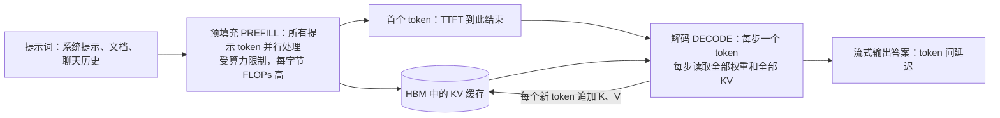
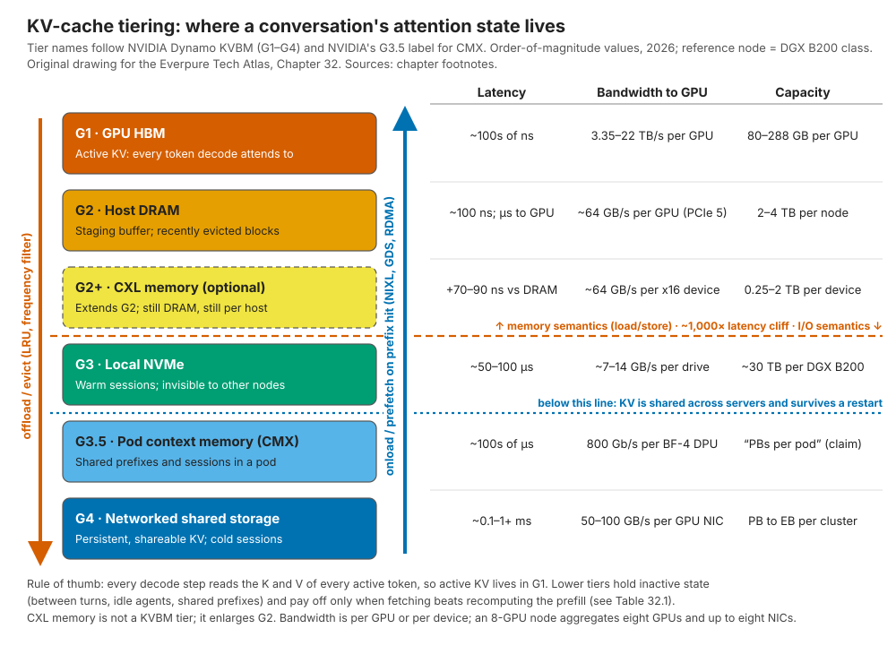

# 32. 推理与 KV 缓存

> 📄 英文原文：[docs/05-ai-storage/32-inference-and-kv-cache.md](../../../docs/05-ai-storage/32-inference-and-kv-cache.md) · 本文为简体中文参考译本，如有出入以英文原文为准。

> **深度：** L2 · **阅读时间：** 约 11 分钟 · **最后核实：** 2026-11-01
> **前置阅读：** [介质物理](../01-storage-fundamentals/02-media-physics.md) · [GPU 数据路径](../02-protocols-and-networking/11-gpu-data-path.md) · [接口与新兴技术（CXL）](../02-protocols-and-networking/12-interfaces-and-emerging-tech.md) · [训练存储](31-training-storage.md)

## 要点速览（TL;DR）

- **KV 缓存是一段对话的工作内存**：即迄今为止每个 token 的注意力键（key）和值（value）。一个 Llama 3.1 70B 级模型需要**每 token 320 KiB**，因此一次 128K token 的会话约为 **43 GB**；一个保留会话的集群可达 PB 级。
- **预填充（prefill）受算力限制；解码（decode）受内存限制。** 解码每生成一个新 token 都要重读整个缓存，因此活跃的 KV 必须驻留在 HBM 中。存储只能保存*当前未在解码*的 KV。
- **这是一道"重算还是读取"的权衡题。** 重建一个 128K 上下文需要一台 8-GPU 节点约 2.6 s 的计算；经 8 × 400 Gb/s 网卡读取只需约 0.13 s。当每 GPU 带宽高于约 2–5 GB/s 时读取胜出，因此命中率和带宽决定经济性。
- **NVIDIA 已将这一层级体系标准化。** Dynamo 的 KV Block Manager（KVBM）定义了从 G1（HBM）到 G4（网络化存储）的层级，NIXL 负责搬运字节，BlueField-4 STX/CMX 增加了一个机柜组（pod）级的"G3.5"闪存层。包括 Everpure 在内的存储供应商竞相成为 G3.5/G4 的后端。
- **对倍数打折看待。** Everpure、WEKA、DDN 和 HPE 都宣称首 token 延迟加快 20 倍或更多，但大多以无缓存为基线；VAST 和 NVIDIA 则宣称功耗与吞吐量的提升。MLPerf Storage v3.0（2026 年 9 月）加入了首个中立的 KV 缓存测试[^1]。

## 对 Everpure 战略的意义

训练存储是每个集群的一次性销售；推理支出则是经常性的，而 KV 缓存是第一个*在每次用户请求时都需要共享存储容量与带宽*的推理工作负载。如果缓存层能让 GPU 集群在每块 GPU 上服务更多对话，存储费用就可以从 GPU 预算中支出——这是存储供应商最有说服力的论点（[第 11 章](../02-protocols-and-networking/11-gpu-data-path.md)）。Everpure 已凭借基于 FlashBlade 的 PureKVA 入场，在其参加的 MLPerf Storage v3.0 KV 缓存测试中领先[^2]（公司自述），并且是 NVIDIA BlueField-4 STX 架构的具名合作伙伴[^3]。

风险同样直接。NVIDIA 正在定义这一层级（名称、软件，以及如今的参考机柜 CMX），在这种架构中，存储可能沦为 NVIDIA DPU 背后的商品化闪存货架。战略问题在于：KV 缓存对 Everpure 而言是一个新的插槽（socket），还是一个将被 NVIDIA、本地 NVMe 和更精简的模型架构吸收掉的功能？

## 核心概念

### KV 缓存是什么，会变得多大

Transformer 每次生成一个 token。在每一步中，每一层的注意力都会把新 token 的*查询（query）* 与所有先前 token 的*键*进行比较，并融合它们的*值*。缓存每个 token 的 K 和 V，可避免每一步都重新计算整个历史。代价是内存：

**每 token KV 字节数 = 2（K 和 V）× 层数 × KV 头数 × 头维度 × 每个值的字节数。**

Llama 3.1 70B 有 80 层，采用分组查询注意力（GQA）：64 个查询头共享 8 个 KV 头，每个头的维度为 128（8,192 ÷ 64）[^4]。在 fp16 下得到 2 × 80 × 8 × 128 × 2 = **每 token 327,680 字节（320 KiB）**。Llama 3.1 405B（126 层，8 个 KV 头）需要每 token 504 KiB。DeepSeek-V3 采用多头潜在注意力（MLA）。它每层缓存一个压缩的 512 维潜在向量外加一个 64 维位置键，因此尽管有 671B 参数，61 层合计每 token 仅约 69 KiB[^5]。如果没有 GQA，70B 模型需要 8 倍的空间（每 token 2.5 MiB）。模型架构师在不断压缩 KV，任何存储方案的论证都必须经得起这一点。

*图 32.1 — 算例：KV 大小与上下文长度和会话数均呈线性关系，因此仅几百个保留的长对话就已超出一台 8-GPU 节点所能容纳的全部容量。*
数据：`data/ch32_kv_size.csv`

对比一下硬件。H200 有 141 GB HBM[^6]；Rubin GPU 有 288 GB HBM4[^7]。DGX B200 节点有 1,440 GB HBM、2 TB 主机 DRAM 和 8 × 3.84 TB 本地 NVMe[^8]。为 70B 模型装入 71 GB 的 fp8 权重后，剩余约 1.37 TB 可用于 KV：**128K 下约 31 个会话**，扣除激活值后更少（fp8 KV 可使其翻倍）。

### 预填充与解码：两台不同的机器

*图 32.2 — 预填充通过一次计算密集的突发生成 KV 缓存；随后解码每生成一个 token 就重读一次，这正是活跃 KV 必须驻留在最快内存中的原因。*

**预填充**一次性处理整个提示，以矩阵乘法为主，接近算力屋顶线（roofline）；其延迟即**首 token 延迟（TTFT）**。**解码**每步产生一个 token，每一步都要读取权重以及*批次中每个序列的全部 KV 缓存*：这是屋顶线图中低算术强度、受内存限制的那一角。算例：70B 模型上 16 个 128K 会话持有 687 GB KV。分布到八块 B200 上，每块 GPU 每步读取约 86 GB KV，按 B200 8 TB/s 的 HBM 带宽约需 11 ms[^8]。读取权重仅需约 1 ms。在长上下文下，KV 字节数决定解码速度，HBM 容量限制批次大小。若从 50 GB/s 链路流式读取这 86 GB，*每个 token* 需要 1.7 s。由此得出硬性限制：**存储只保存非活跃的 KV**（对话轮次之间、智能体等待工具返回时，或尚未使用的共享前缀），而绝不保存工作集。

由于两个阶段需要不同的硬件，**分离式推理服务（disaggregated serving）** 把预填充和解码放在不同的 GPU 池上运行，并在两者之间传送 KV 缓存。这一思路于 2024 年以 DistServe（OSDI）[^9] 和 Splitwise（ISCA）[^10] 发表。Moonshot AI 的 Mooncake（服务于 Kimi）把 KV 汇集到闲置的 CPU DRAM 和 SSD 上，获得 USENIX FAST 2025 最佳论文，副标题为"trading more storage for less computation"（以更多存储换取更少计算）[^11]。分离式架构把 KV 从 GPU 私有缓冲区变成了跨网络流动的数据——而这正是存储供应商的地盘。

### 前缀缓存：命中率之争

请求往往有相同的开头（系统提示、文档、代码仓库、先前的对话轮次）。**前缀缓存（prefix caching）** 以固定大小的块存储 KV，键为截至该块的 token 的哈希值，因此新请求可复用最长的匹配前缀，只需对新 token 做预填充。vLLM 的 PagedAttention（SOSP 2023）通过像虚拟内存那样对 KV 分页实现了这一点，减少了碎片浪费，并将吞吐量提升 2–4 倍[^12]。SGLang 的 RadixAttention 将这一思路扩展到前缀树[^13]。

半导体类比非常直接：块哈希就是缓存标签（tag），淘汰策略是带频率过滤的 LRU，平均访问时间 = 命中率 × 读取时间 + 未命中率 × 重算时间。特殊之处在于未命中是*可重算的*：丢失一个块只损失时间和金钱，而不影响正确性，因此持久性远不如吞吐量和尾延迟重要。命中率很脆弱：上下文截断可使其减半[^14]，而一次模型更新会使整个缓存失效。

### 重算还是读取：盈亏平衡点

**算例（128K token 上下文，Llama 3.1 70B，8-GPU B200 级节点）。** 重算的线性层约需 2 × 70.6×10⁹ × 131,072 ≈ 1.85×10¹⁶ FLOPs，因果注意力另需约 2.25×10¹⁶（2 × n² × 8,192 × 80 层），合计 ≈ 4.1×10¹⁶ FLOPs。假设节点*实际交付* 16 PFLOPS（每 GPU 2 PFLOPS，这一假设远低于峰值）。则重算需要 **≈ 2.6 s 和 ≈ 21 GPU 秒**。经八块 400 Gb/s 网卡以约 80% 效率（320 GB/s）读取 43 GB 需要 **≈ 0.13 s**，且期间 GPU 空闲可用。70B 模型重建每字节 KV 要花费 50 万至 100 万 FLOPs，因此在每 GPU 2 PFLOPS 下，带宽高于**每 GPU ~2–5 GB/s** 时读取胜出：对 RDMA 闪存而言门槛很低，这也正是 KV 卸载之所以可行的原因。

*图 32.3 — KV 层级体系就是一个缓存层级体系，在内存与闪存之间存在约 1,000 倍的延迟断崖；存储供应商在断崖之下竞争，在那里容量和共享比纳秒更重要。*

| 128K 上下文命中的路径（70B，43 GB） | 恢复时间 | 消耗的 GPU 时间 | 该层容量（单节点） | 持有 43 GB 1 小时的成本 |
|---|---|---|---|---|
| 未命中：重算预填充 | ≈ 2.6 s | ≈ 21 GPU-s（按 US$4/GPU-h 假设，≈ US$0.02） | 不适用 | 不适用 |
| G2 主机 DRAM 经 PCIe 5（每节点 ~440 GB/s） | ≈ 0.1 s | ~0 | 2–4 TB → 约 45–90 个会话 | ≈ US$0.01（假设 DRAM 约 US$10/GB，寿命 4 年） |
| G3 本地 NVMe（8 块盘，~56 GB/s） | ≈ 0.8 s | ~0 | ~31 TB → 约 700 个会话，仅限本节点 | ≈ US$0.0006（假设闪存系统约 US$0.50/GB） |
| G3.5 / G4 网络化闪存（到节点 ~320 GB/s） | ≈ 0.13 s + 查找 | ~0 | 每机柜组或集群 PB 级，任意节点可用 | ≈ US$0.0006，另加网络与软件成本 |
| 1M token 上下文未命中（343 GB） | ≈ 100 s 重算（注意力占主导） | ≈ 800 GPU-s | 扣除权重后每节点 HBM 约容纳 4 个会话；超出单块 GPU 的 180 GB | 不适用 |

*表 32.1 — 算例，非供应商数据：一次重算的成本约等于把同样的 KV 在 DRAM 中保存两小时或在闪存中保存约 40 小时，因此经济性归结为命中率和读取带宽。*

三点结论。第一，八块 400G 网卡的速度超过八块本地 U.2 盘，这正是 NVIDIA 把上下文层放在以太网上的原因。第二，对最热的被淘汰块而言，DRAM 和 [CXL 内存](../02-protocols-and-networking/12-interfaces-and-emerging-tech.md)在速度上胜出，但每 GB-小时成本高出约 20 倍；Synopsys 宣称 CXL 卸载 KV 比 SSD 快 3.6 倍[^15]（供应商宣称），但真正的检验标准是每美元 token 数。第三，共享层的主要优势在单节点视角下看不见：**任何 GPU 都能命中任何会话的前缀**，因此路由器可以把回访用户发送到任意空闲节点。
