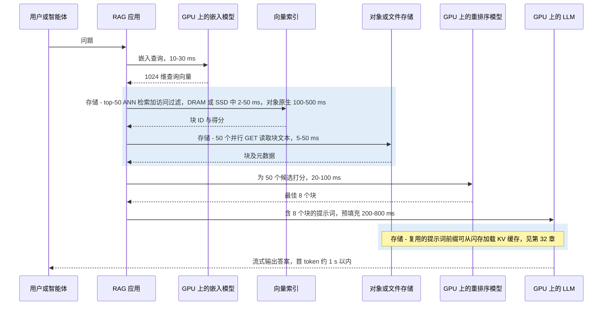
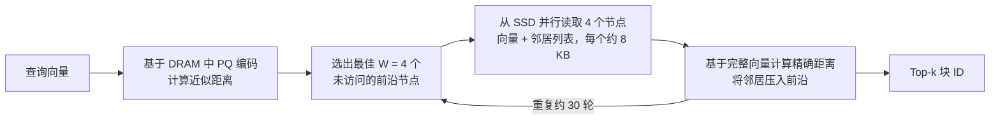
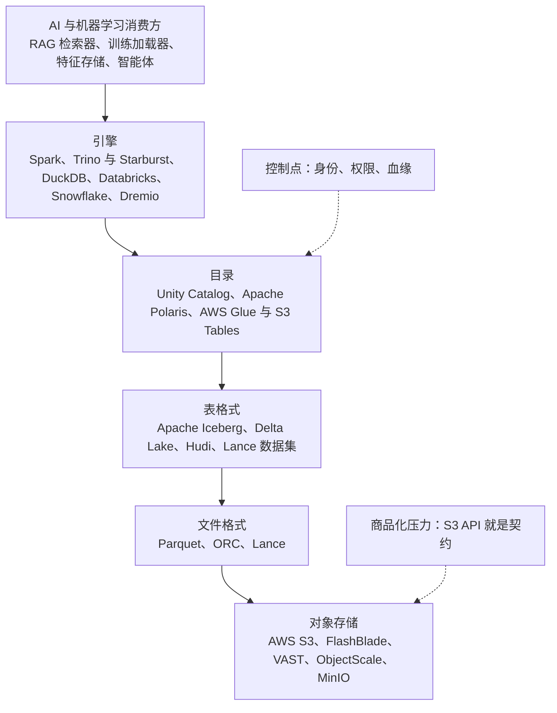
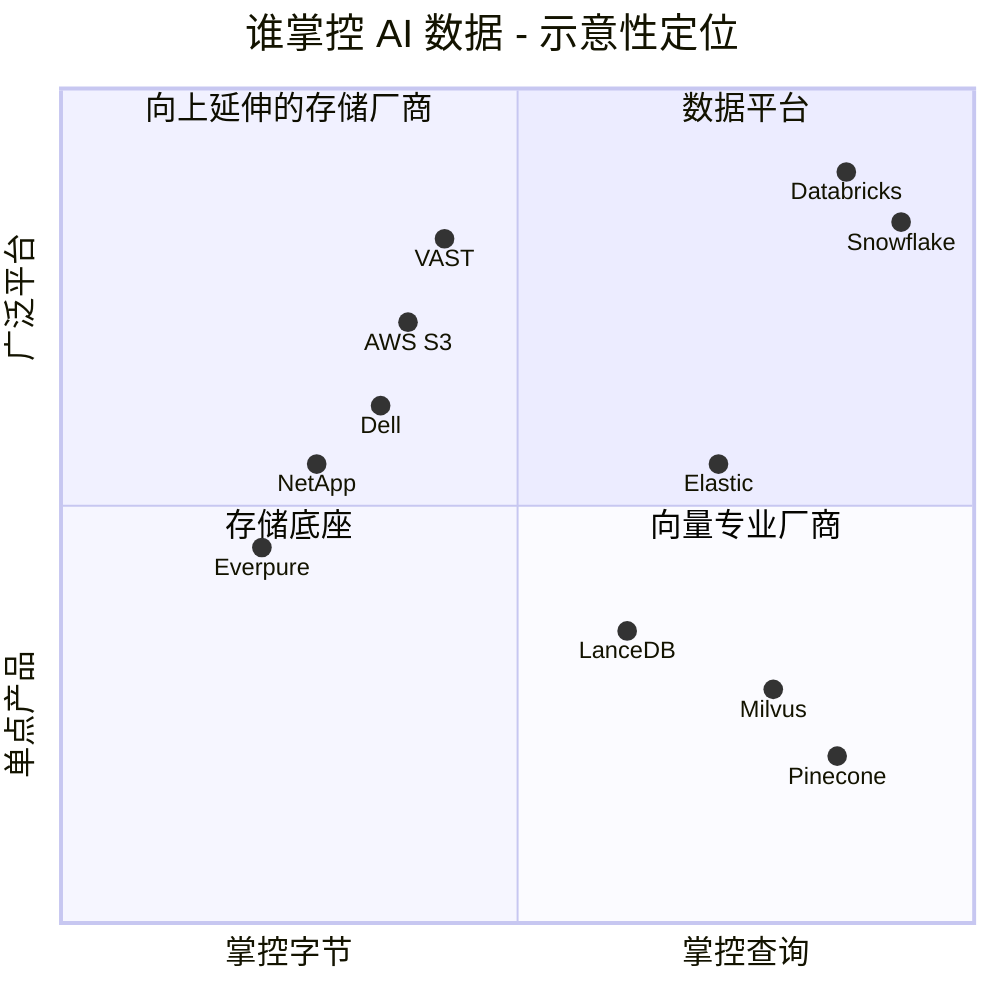
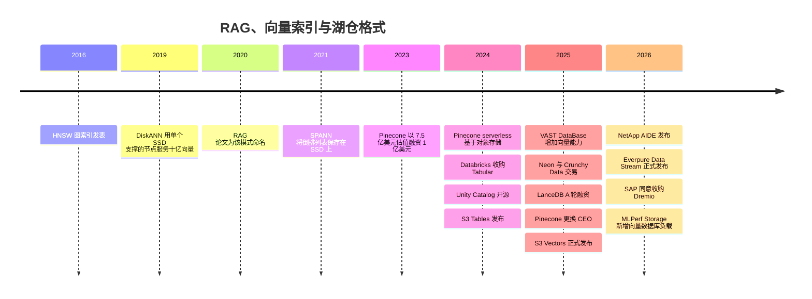

# 33. RAG、向量数据库与 AI 原生数据格式

> 📄 英文原文：[docs/05-ai-storage/33-rag-vector-lakehouse.md](../../../docs/05-ai-storage/33-rag-vector-lakehouse.md) · 本文为简体中文参考译本，如有出入以英文原文为准。

> **深度：** L2 · **阅读时间：** 约 10 分钟 · **最后核实：** 2026-11-01
> **前置阅读：** [对象存储与 S3](../02-protocols-and-networking/09-object-storage-and-s3.md) · [元数据](../03-system-architecture/21-metadata.md) · [端到端的 AI 数据管道](30-ai-data-pipeline.md) · [推理与 KV 缓存](32-inference-and-kv-cache.md)

## 要点速览（TL;DR）

- **RAG 把企业的文档变成大语言模型（LLM）的工作记忆。** 文档切块后被嵌入为向量；提问时，最接近的若干块被粘贴进提示词。存储位于其中三个步骤：向量检索、块读取，以及日益重要的 KV 缓存复用。
- **向量索引是一个内存容量问题。** 10 亿个 1,024 维向量的原始大小约 4.1 TB。若全部放在 DRAM 中，介质成本约为 DiskANN 这类 SSD 常驻设计的 16 倍，因此十亿级索引正迁移到闪存和对象存储上。
- **AI 原生格式改变了 I/O 模式。** Parquet 为扫描而生；Lance 同时面向扫描*和*随机行读取（乱序训练、嵌入向量、多模态二进制对象）。Iceberg 则在对象存储中的普通文件之上增加了事务和目录（catalog）。
- **每家存储厂商如今都在推出"数据引擎"。** VAST、NetApp、Dell、Everpure 和 AWS 都已把嵌入生成、向量检索或表管理移入存储内部或紧邻存储。与此同时，向量检索已成为 Postgres、Elastic、Databricks、Snowflake 乃至 S3 本身的一项*功能*。
- **战略问题在于谁掌握控制点。** 字节可以替换；目录、元数据和治理则具有黏性。价值归于掌控元数据和查询的一方——除非数据不能离开本地机房。

## 对 Everpure 战略的意义

企业 AI 主要是*基于私有数据的推理*，而 RAG 是连接二者的默认方式。这带来了一种存储负载：针对巨大索引的小块随机读取，外加由 S3 存储桶中 Parquet、Lance 和 Iceberg 文件构成的湖仓（lakehouse）。它也引发了一场圈地运动。AWS 把向量检索和 Iceberg 表放进了 S3[^1][^2]。VAST 增加了支持向量的数据库[^3]。NetApp 的 AI Data Engine "在存储层"生成嵌入向量[^4]，Dell 则在其 AI Data Platform 中捆绑了 Elastic 和 Starburst 引擎[^5]。Everpure 的回应是：以 FlashBlade 为底座，辅以 Data Stream（从摄取到向量化的管道，2026 年 6 月正式发布）[^6]和 Data Intelligence（原 1touch）。这些举措究竟是在获取价值，还是仅在守住份额，取决于这样一个市场：数据平台的体量远超任何存储厂商的数据服务业务——Databricks 报告的年化收入超过 70 亿美元（>US$7 billion），估值 1,900 亿美元（US$190 billion）（公司自述，2026 年 8 月）[^7]；Snowflake 2026 财年产品收入为 44.7 亿美元（US$4.47 billion）[^8]。

## 核心概念

### 一段话讲清嵌入向量

**嵌入模型（embedding model）**把一段文本、一张图像或一帧视频映射为一个定长向量（比如 1,024 个浮点数），其训练目标是让语义相近的内容在空间中彼此靠近。于是相似度就变成了几何问题：余弦相似度或点积。对半导体读者而言，嵌入向量就是一种学习得到的指纹，而检索就是一次针对所有已存向量的巨型矩阵-向量乘法（GEMV）——除非有索引让你跳过其中绝大部分。

嵌入向量的体积可能超过源数据。一个 512 token 的文本块约 2 KB（每 token 约 4 字节），但其 1,024 维 fp32 嵌入向量为 4 KB。一个 10 TB 的文本语料库会变成约 50 亿个块和约 20 TB 的向量——**是源数据的两倍**，这还没算索引。对图像和视频而言，这一比例则反过来。

### RAG 请求路径

RAG 这一名称出自 2020 年 Facebook AI 的一篇论文[^9]。文档在离线阶段被切块、嵌入并建立索引；查询时，系统对问题进行嵌入，检索最近邻的块，并以这些块作为 LLM 的条件输入。

*图 33.1 — 示意性延迟预算：在构建良好的 RAG 栈中，受存储约束的步骤占首 token 延迟的 10–30%，但冷的对象存储索引可能使检索成为耗时最长的单一步骤。*

该预算是算例示意，并非基准测试。对象原生检索的延迟区间来自厂商文档：Databricks 给出存储优化型端点约 250 ms[^10]，AWS 给出频繁查询的 S3 Vectors 索引约 100 ms、其他情况亚秒级[^11]，turbopuffer 给出冷查询数百毫秒、从其 NVMe 缓存读取则低于 10 ms[^12]。结论是：**检索受延迟约束，而非受带宽约束**。50 个 2 KB 的块总共只有 100 KB，但每次 GET 都要付出一次完整往返：在全闪存对象存储上约 1 毫秒，在基于机械硬盘的云存储层上则是数十毫秒。

### 向量索引：以内存换召回率

对所有向量做*暴力（flat）*扫描是精确的，但复杂度为 O(N)。**近似最近邻（ANN）**索引放弃几个百分点的*召回率*（返回的真实近邻所占比例），换取数量级的加速。

| 索引 | 工作原理 | 内存占用（1B × 1,024 维） | 召回率 / 延迟 | 是否适合 SSD？ |
|---|---|---|---|---|
| Flat（暴力检索） | 扫描每个向量，常在 GPU 上进行 | fp32 为 4.1 TB，无论放在哪里 | 100% / 1B 规模下每次查询需数秒 | 仅限顺序扫描 |
| IVF（倒排文件） | 对向量聚类；探查最近的少数几个簇 | 质心很小；倒排列表 = 完整数据 | 90–98% 可调 / 列表在内存中时为毫秒级 | 是：簇是连续读取（SPANN 将列表保存在 SSD 上[^13]） |
| HNSW（图） | 多层邻近图；贪心游走 | 向量 + 每向量约 264 B 的连接 ≈ 4.4 TB | 95–99% / DRAM 中约 1 ms | 差：每一跳都是一次相互依赖的随机读取 |
| DiskANN / Vamana | SSD 上的单层图；DRAM 中的 PQ 编码引导游走 | 约 64 GB DRAM + 约 4.4 TB SSD | SIFT1B 上 1-recall@1 >95%，<3 ms[^14] | 专为此设计：束搜索（beam search）并行发出 4 KB 读取 |
| PQ / 二值量化 | 把每个向量压缩为 8–128 B 的编码；ADC 查找表 | 1B 规模为 64–128 GB | 单独使用时较低；重排序可弥补 | 编码在内存中，原始向量在 SSD 上 |

*表 33.1 — 索引选择本质上是数据放置决策：哪些字节必须放在 DRAM 中，哪些可以放在闪存上。*

**算例（4 TB 问题）。** 10 亿个向量 × 1,024 维 × 4 字节 = 4.1 × 10¹² 字节 ≈ **4.1 TB** 原始数据。HNSW 图（M = 32）为每个向量增加最多 64 个 4 字节的邻居 ID，约 264 GB。按 2026 年服务器 DRAM 约 US$14.5/GB 计算[^15]，一个内存副本需承载约 US$63,000 的 DRAM，另加约 US$3,000 用于在 SSD 上持久化 fp32 副本。DiskANN 只在 DRAM 中保留 64 字节的 PQ 编码（64 GB，约 US$900），把 4.4 TB 的图放在约 US$0.75/GB 的 SSD 上[^16]（约 US$3,300）。即**每个副本的介质成本约 US$66k 对约 US$4k**。

*图 33.2 — 算例：将十亿级向量索引的主体从 DRAM 迁到闪存，按 2026 年价格可使每个副本的介质成本降低约 16 倍。*
数据：`data/ch33_vector_memory.csv`

### 为什么图检索能在 SSD 上运行，以及为什么它是指针追逐

*图 33.3 — DiskANN 通过每一跳发出一小批读取来掩盖 SSD 延迟，这与乱序执行核心让多个缓存未命中同时在途的技巧如出一辙。*

**半导体类比。** HNSW 游走就是链表遍历：下一个地址取决于尚未加载的数据，因此预取器无能为力，游走受*延迟*约束。这正是缓存难以应对的图分析类不规则访问特征。DiskANN 的束宽 W 就是内存级并行度（memory-level parallelism）。约 30 轮相互依赖的读取、每次 NVMe 读取约 100 µs，一次查询约需 3 ms，与论文结果一致。在每秒 5,000 次查询下，30 × 4 个节点 × 两个 4 KB 扇区约为每秒 120 万次随机读取，几块数据中心级 NVMe SSD 即可承担。若放在每次往返增加约 0.5 ms 的网络化阵列后面，一次查询约需 15–18 ms；若放在 20 ms 的对象 GET 后面，则约需 600 ms。这就是对象存储原生引擎（turbopuffer、Pinecone serverless）偏好**聚类式** IVF/SPANN 类布局的原因：它们只需少量大块读取，而不是几十次相互依赖的小块读取[^12][^17]。

**PQ 就是向量的权重量化。** 乘积量化（product quantization）把一个 1,024 维向量切成 64 个子向量，每个子向量用 1 字节的码本索引替代：4,096 字节 → 64 字节。距离通过查表得出，就像推理中调色板化或 INT4 权重以精度换内存一样。弥补精度损失的办法是用 SSD 上的全精度向量对排名靠前的候选进行重排序。Elastic 的"BBQ"把这一思路推到每维 1 比特，并声称可减少约 95% 的内存[^18]。

生产系统会组合使用这些技术。Milvus 提供 DiskANN 索引[^19]；Pinecone serverless 把不可变的"slab"保存在对象存储中，并缓存在执行节点的 SSD 上[^17]；S3 Vectors 可扩展到每个索引 20 亿个向量、每个存储桶 20 万亿个向量[^1]。方向很明确：**DRAM 负责引导，闪存承载索引，对象存储保障持久性**。

### 文件格式：Parquet 与 Lance

Parquet 把行组织成大的*行组（row group）*，并把每一列存储在约 1 MB 的压缩*页（page）*中。这适合扫描，但读取一行就意味着要为每一列解压一整页。以这种方式读取 100 万个随机 4 KB 嵌入向量，可能要从存储中拖出约 1 TB 数据才能交付 4 GB：250 倍的读放大。这正是 DRAM 为读取一条缓存行而激活整行的问题。

**Lance** 是由 LanceDB 创始人推出的开放列式格式，会根据数据的宽度调整编码方式。嵌入向量和图像字节等宽值的布局使读取一行只需约一次 I/O；窄值则被打包进小块以便快速扫描。作者 2025 年的论文指出，调优后的 Parquet 随机访问性能可比默认配置提升 60 倍以上，但要付出扫描速度和内存方面的代价；而 Lance 的目标是在不付出这些代价的情况下达到这一随机读取性能[^20]。Lance 还能对数据集进行版本管理，并在不重写整张表的情况下新增列（比如新嵌入模型的输出），因此适合乱序训练加载器和 RAG 存储——它们的小块随机读取正是 NVMe 闪存所擅长的。LanceDB 于 2025 年 6 月完成 3,000 万美元（US$30 million）A 轮融资，由 Theory Ventures 领投、Databricks Ventures 参投，并将自身定位为"多模态湖仓"[^21]（*公司自述*）。

### 表格式、目录与湖仓

一个装满 Parquet 文件的文件夹没有事务、没有模式（schema）约束，也无法安全地支持并发写入。**Apache Iceberg**（与竞争对手 Delta Lake 和 Hudi 一样）增加了一棵元数据树：表指向一个快照，快照列出清单文件（manifest），清单文件再列出带有列统计信息的数据文件。提交时先写入新文件，然后在**目录（catalog）**中原子地替换一个指针。对根指针的这种比较并交换（compare-and-swap）带来了快照隔离、时间回溯（time travel）和引擎无关性，并避免了缓慢的 LIST 调用（[第 9 章](../02-protocols-and-networking/09-object-storage-and-s3.md)）。Iceberg v3 新增了删除向量（deletion vector）和用于半结构化数据的 variant 类型[^22]。

*图 33.4 — 在湖仓中，存储是位于标准 S3 契约之后的最底层；其上的目录才是锁定效应和治理权集中之处。*

目录才是真正的奖品。2024 年 6 月，Snowflake 宣布将 Polaris 作为开放的 Iceberg 目录；一天之后，Databricks 收购了由 Iceberg 创建者创立的 Tabular，据报道价格为 10 亿–20 亿美元（US$1–2 billion）[^23]，随后又开源了 Unity Catalog[^24]。2026 年，SAP 同意收购 Dremio，以使其 Business Data Cloud 原生支持 Iceberg[^25]。存储在其中的作用真实但有限：快速的小对象 GET 和 PUT、高 LIST 速率，以及——正如 S3 Tables 所展示的（声称查询速度比自管 Iceberg 最高快 3 倍、每秒事务数多 10 倍）——对流式写入留下的小文件进行自动合并（compaction）[^2]。

## Everpure 的做法与竞争对手对比

| 厂商 | 存储层 | 提供的向量 / 表层 | 定位 |
|---|---|---|---|
| Everpure | FlashBlade S3/NFS；面向 Kubernetes 数据服务的 Portworx | Data Stream：基于 NVIDIA AI Data Platform 设计的摄取、整理、嵌入与索引，2026 年 6 月正式发布[^6]；据一篇赞助文章称内置搭配 NeMo Retriever 的向量数据库[^26] [VERIFY: Data Stream 搭载的是哪一种向量引擎]；支持 MCP 的 Data Intelligence[^27] | 存储加管道和元数据；引擎依靠合作伙伴 |
| VAST Data | DASE 全闪存（[第 16 章](../03-system-architecture/16-disaggregated-shared-everything.md)） | 原生支持向量的 VAST DataBase 及 InsightEngine（2025）；声称可达万亿向量规模（*公司自述*）[^3]；CNode-X GPU 运行 cuVS[^28] | 存储正在变成数据库 |
| NetApp | ONTAP、AFX | AI Data Engine：Metadata Engine、Data Curator（嵌入与向量检索 API）、Data Guardrails；2026 年 3 月以标杆客户方式发布[^4][^29] | 元数据优先，纳入 ONTAP 许可体系 |
| Dell | PowerScale、ObjectScale、Lightning FS | AI Data Platform：Data Search Engine（Elastic）和 Data Analytics Engine（Starburst/Trino）；计划于 2026 年上半年推出 cuVS 混合检索[^5] | 存储加合作伙伴引擎 |
| AWS | S3 | S3 Vectors（2025 年 12 月正式发布，每索引 2B 向量）[^1]；S3 Tables（托管 Iceberg，2024 年 12 月）[^2] | 把数据库吸收进存储桶 |
| Pinecone | 底层为对象存储（serverless）[^17] | 托管向量数据库 | 承受功能化压力的专业厂商 |
| Milvus / Zilliz、Weaviate | 自带存储或云 | 开源向量数据库；DiskANN 类索引[^19] | 专业厂商，开源驱动 |
| LanceDB | 任意对象存储 | Lance 格式加向量/多模态数据库[^21] | 格式驱动 |
| Elastic、pgvector | 本地 SSD / 任意 | 向量检索作为搜索引擎和 Postgres 的一项功能[^18] | 吸收向量能力的传统数据库 |
| Databricks、Snowflake | 客户的云对象存储 | 向量检索、Iceberg/Delta、目录、Postgres（Neon、Crunchy Data）[^30] | 数据平台；掌控目录与查询 |

*表 33.2 — 存储厂商正向上进入管道和元数据领域，而数据库则在吸收向量检索；二者的重叠处就是争夺的阵地。*

*图 33.5 — 示意性判断，并非实测数据：存储厂商聚集在左侧并向上攀升，数据平台占据右上方，而纯向量数据库则受到两侧挤压。*

**价值归于存储厂商还是数据厂商？** 数据厂商一方的最强版本论证（steelman）很有力。在大约两年内，向量检索就在 Postgres、Elastic、Databricks、Snowflake 和 S3 中变成了一项功能。资金最雄厚的专业厂商 Pinecone（2023 年以 7.5 亿美元（US$750 million）估值完成 1 亿美元（US$100 million）B 轮融资[^31]）于 2025 年 9 月更换了其创始人 CEO[^32]，并据报道正在权衡包括出售在内的多种选择[^33] [VERIFY: 关于 Pinecone 探索出售的报道日期与现状]。双方的收入池相差一个数量级，而承载权限和血缘的是目录，不是字节（[第 39 章](39-agentic-ai-and-data-intelligence.md)）。

存储厂商一方的最强版本论证：大多数企业非结构化数据存放在本地文件和对象系统中，出于主权或成本原因而留在那里。就地嵌入可以避免昂贵的复制，而 SSD 常驻索引会扩大闪存需求。Everpure 将 AWS 2025 年的 S3 新举措解读为企业 AI 正向对象存储汇聚的证据[^34]。

基于公开信息，战略团队可能评估的选项包括：(1) 让 FlashBlade 成为 Iceberg 和 Lance 的最佳本地目标平台，提供托管合并、公布小对象和 LIST 性能，并在 MLPerf Storage v3.0 新增的向量数据库负载上提交结果[^35]；(2) 与引擎和目录厂商合作而非自建数据库，正如此前在 FlashBlade 上支持 Snowflake 外部表（2022）以及与 Dremio 的解决方案简介所做的那样[^36]；(3) 把 Data Intelligence 的元数据视为控制点，使 FlashBlade 成为关于*数据是什么*的记录系统（system of record）；(4) 关注格式类公司——以 LanceDB 的体量，它是合作或投资级别的资产，而非平台级押注。

## 历史与发展轨迹

*图 33.6 — 2016–2021 年的研究构想在 2024–2026 年变成了产品，随后这些产品又从独立数据库迁移进存储平台和数据平台。*

这条演进弧线从 DRAM 常驻的专业数据库（2019–2023），经由存算分离迁到对象存储上（2024），再到被吸收（2025–2026）——向量变成了一种列类型、一种存储桶类型或一项存储功能。值得关注的是 GPU 加速索引（VAST、Dell 和 AI Data Platform 中的 NVIDIA cuVS，见[第 34 章](34-nvidia-ecosystem.md)），以及 IBM 在内容感知存储上进行的 1,000 亿向量演示[^37]——这种规模只有闪存能经济地承载。

## 关键数字

| 指标 | 数值 | 背景 | 来源 / 日期 |
|---|---|---|---|
| 1B × 1,024 维 fp32 向量的原始大小 | 约 4.1 TB | 另加 HNSW 图（M = 32）约 264 GB | 算例 |
| 每副本介质成本，DRAM 中的 HNSW 对 DiskANN | 约 US$66k 对约 US$4k | DRAM 约 $14.5/GB，SSD 约 $0.75/GB | 算例[^15][^16] |
| DiskANN 在 SIFT1B 上的表现 | 1-recall@1 >95%，平均 <3 ms，>5,000 QPS | 64 GB 内存工作站加 SSD | NeurIPS 2019[^14] |
| S3 Vectors 规模 | 每索引 2B 向量，每存储桶 20T | 2025 年 12 月正式发布；热查询约 100 ms | AWS，经 StorageNewsletter[^1][^11] |
| 存储优化型向量检索延迟 | 约 250 ms | Databricks，>1B 个 768 维向量 | Databricks 文档[^10] |
| BBQ 内存缩减 | 约 95% | 1 比特向量，int4 查询 | Elastic，2024-11[^18] |
| Tabular 收购 | US$1–2B（媒体报道） | Iceberg 创建者的公司 | Blocks & Files，2024-06[^23] |
| Databricks 年化收入 / 估值 | >US$7B / US$190B | 公司自述，2026 年 8 月 | TheNextWeb[^7] |

## 对话手册

**向产品经理提的问题**

1. *"客户在 FlashBlade 上运行 RAG 时，向量索引放在哪里？用的是谁的软件？"* 高质量回答：点名经过验证的引擎，说明是 DRAM 常驻还是 SSD 常驻、由谁负责支持，以及 Data Stream 的边界在哪里、合作伙伴从哪里接手。
2. *"哪些引擎在生产环境中读取 FlashBlade S3 上的 Iceberg？我们的小对象 GET 延迟和 LIST 速率与 S3 Tables 相比如何？"* 高质量回答：点名具体引擎、给出实测数字，并阐明对合并（compaction）的看法。
3. *"Data Intelligence 的元数据如何让我们比一个 S3 端点更难被替换？"* 高质量回答：一个具体的工作流（分类结果为 RAG 访问过滤提供输入），以及与 Unity 或 Polaris 的集成。

**向工程师提的问题**

1. *"对于 FlashBlade 上的 1B 向量 DiskANN 索引，每跳读取延迟是多少？每个机箱可持续支撑每秒多少次查询？"* 高质量回答：以 µs 计的延迟、每 TB 的 IOPS，以及网络往返对 30 次相互依赖跳转的影响。
2. *"我们如何在同一个存储桶中同时服务 Lance 式随机读取和 Parquet 扫描，而不让一方饿死另一方？"* 高质量回答：QoS、每请求开销、小 I/O 效率。
3. *"在 Data Stream 中，嵌入运行在哪里？客户更换嵌入模型时会发生什么？"* 高质量回答：GPU 放置位置、重新嵌入的吞吐量，以及采用版本化列而非全量重写。

**不要这样说：**

- "向量数据库是一个新的存储层级。"它们是软件索引；存储只是承载它们的文件。
- "RAG 非常吃带宽。"检索受延迟约束；需要带宽的是摄取和重新嵌入。
- "HNSW 在网络存储上运行良好。"每一跳都是一次相互依赖的读取。
- "Iceberg 是一款存储产品。"它是一种表格式；掌握权力的是目录，而不是存储桶。
- "量化会毁掉召回率。"有了全精度重排序，64 倍压缩通常损失很小。

## 深入阅读（可选，L3 指引）

- DiskANN（NeurIPS 2019）与 SPANN（NeurIPS 2021）：经典的 SSD 常驻设计。
- Malkov 与 Yashunin，HNSW（arXiv 1603.09320）；Jégou 等，乘积量化（IEEE TPAMI，2011）。
- Pace 等，Lance 论文（arXiv 2504.15247）；Apache Iceberg v3 规范及 REST 目录 API。

## 关键术语

- **嵌入向量（Embedding）**——表示一段数据语义的定长向量。
- **ANN 索引**——近似最近邻结构（IVF、HNSW、DiskANN）。
- **乘积量化（PQ）**——压缩为码本索引的方法。
- **Lance**、**Apache Iceberg**、**目录（catalog）**——见[术语表](../glossary.md)。

## 资料来源

[^1]: StorageNewsletter, "AWS re:Invent 2025: Amazon S3 Vectors is Now Generally Available with 40 Times the Scale of Preview," 2025-12-05. https://www.storagenewsletter.com/2025/12/05/aws-reinvent-2025-amazon-s3-vectors-is-now-generally-available-with-40-times-the-scale-of-preview/ (retrieved 2026-11-01).
[^2]: Amazon, "Amazon S3 Expands Capabilities with Managed Apache Iceberg Tables for Faster Data Lake Analytics…," press release, 2024-12-03. https://press.aboutamazon.com/2024/12/amazon-s3-expands-capabilities-with-managed-apache-iceberg-tables-for-faster-data-lake-analytics-and-automatic-metadata-generation-to-simplify-data-discovery-and-understanding (retrieved 2026-11-01).
[^3]: SiliconANGLE, "VAST Data adds vector search and serverless functions to its scalable data platform," 2025-03-12. https://siliconangle.com/2025/03/12/vast-data-adds-vector-search-serverless-functions-scalable-data-platform/ ; HPCwire, "VAST Data Expands AI Data Stack, Keeps Eye on North Star," 2026-02-25. https://www.hpcwire.com/2026/02/25/vast-data-expands-ai-data-stack-keeps-eye-on-north-star/ (both retrieved 2026-11-01).
[^4]: NetApp, "AI Data Engine architecture," NetApp documentation, n.d. https://docs.netapp.com/us-en/ai-data-engine/get-started/aide-architecture.html ; NetApp, "AIDE FAQ," n.d. https://docs.netapp.com/us-en/ai-data-engine/faq-aide.html (both retrieved 2026-11-01).
[^5]: Blocks & Files, "Dell expands AI Data Platform with search and analytics," 2025-10-22. https://www.blocksandfiles.com/ai-ml/2025/10/22/dell-expands-ai-data-platform-with-search-analytics/1607930 ; IT Brief UK, "Dell unveils major AI Data Platform upgrades with NVIDIA, Elastic," 2025-10. https://itbrief.co.uk/story/dell-unveils-major-ai-data-platform-upgrades-with-nvidia-elastic (both retrieved 2026-11-01).
[^6]: Everpure, "Everpure Announces Data Stream," press release, 2026-06-17. https://www.everpuredata.com/company/newsroom/press-releases/everpure-announces-data-stream.html ; HPCwire/BigDATAwire, "Everpure Announces Data Stream to Expand AI-Ready Data Offerings," 2026-06-17. https://www.hpcwire.com/bigdatawire/this-just-in/everpure-announces-data-stream-to-expand-ai-ready-data-offerings/ (both retrieved 2026-11-01).
[^7]: TheNextWeb, "Databricks closes $5 billion round at $190 billion valuation," 2026-08. https://thenextweb.com/news/databricks-closes-5-billion-round-at-190-billion-valuation (retrieved 2026-11-01).
[^8]: Snowflake Inc., "Form 10-K for fiscal year ended January 31, 2026," 2026-03. https://www.sec.gov/Archives/edgar/data/1640147/000164014726000008/snow-20260131.htm ; Snowflake, "Snowflake Reports Financial Results for the Fourth Quarter and Full-Year of Fiscal 2026," 2026-02-25. https://www.businesswire.com/news/home/20260225938648/en/ (both retrieved 2026-11-01; product revenue US$4,472.3M, total revenue US$4,683.9M, seen via search summaries of the filing and release, which agree).
[^9]: P. Lewis et al., "Retrieval-Augmented Generation for Knowledge-Intensive NLP Tasks," NeurIPS 2020 (arXiv 2005.11401), 2020-05. https://arxiv.org/abs/2005.11401 (retrieved 2026-11-01).
[^10]: Databricks, "Mosaic AI Vector Search" and "Vector Search performance guide," Databricks documentation, n.d. https://docs.databricks.com/aws/en/generative-ai/vector-search ; https://docs.databricks.com/aws/en/vector-search/vector-search-best-practices (both retrieved 2026-11-01).
[^11]: InfoQ, "AWS S3 Vectors reaches general availability," 2026-01. https://www.infoq.com/news/2026/01/aws-s3-vectors-ga (retrieved 2026-11-01; latency figure seen via search summary, consistent with AWS What's New 2025-12-02).
[^12]: turbopuffer, "turbopuffer: fast search on object storage," 2024-07-08. https://turbopuffer.com/blog/turbopuffer ; turbopuffer, "Introduction," documentation, n.d. https://turbopuffer.com/docs (both retrieved 2026-11-01).
[^13]: Q. Chen et al., "SPANN: Highly-efficient Billion-scale Approximate Nearest Neighbor Search," NeurIPS 2021 (arXiv 2111.08566). https://arxiv.org/abs/2111.08566 (retrieved 2026-11-01).
[^14]: S. Jayaram Subramanya et al., "DiskANN: Fast Accurate Billion-point Nearest Neighbor Search on a Single Node," NeurIPS 2019. https://papers.nips.cc/paper/2019/hash/09853c7fb1d3f8ee67a61b6bf4a7f8e6-Abstract.html (retrieved 2026-11-01).
[^15]: Counterpoint Research, "Memory Price Tracker, April 2026," 2026-04. https://counterpointresearch.com/de/reports/memory-price-tracker-april-2026 (retrieved 2026-11-01; ~$927 per 64 GB DDR5 RDIMM, seen via search summary).
[^16]: Hardware Busters, "Enterprise SSD Prices Now Run 18.6x Hard Drives, and the Cheap Alternative Is Sold Out Until 2027," 2026. https://hwbusters.com/news/enterprise-ssd-prices-now-run-18-6x-hard-drives-and-the-cheap-alternative-is-sold-out-until-2027/ (retrieved 2026-11-01; 30 TB TLC SSD at ~$22,600).
[^17]: Pinecone, "Pinecone Pods vs. Serverless: Migration Guide," n.d. https://www.pinecone.io/lp/pods-vs-serverless/ ; SiliconANGLE, "Pinecone's vector database goes serverless," 2024-01-16. https://siliconangle.com/2024/01/16/pinecones-vector-database-goes-serverless/ (both retrieved 2026-11-01).
[^18]: Elastic via Business Wire, "Elastic Introduces Better Binary Quantization Technique in Elasticsearch," 2024-11-11. https://www.businesswire.com/news/home/20241111128613/en/Elastic-Introduces-Better-Binary-Quantization-Technique-in-Elasticsearch (retrieved 2026-11-01).
[^19]: Alibaba Cloud, "Storage-Optimized Disk Index (DiskANN)," Milvus user guide, n.d. https://help.aliyun.com/en/milvus/user-guide/capacity-disk-index-diskann (retrieved 2026-11-01).
[^20]: W. Pace, C. She, L. Xu et al., "Lance: Efficient Random Access in Columnar Storage through Adaptive Structural Encodings," arXiv 2504.15247, 2025-04-21. https://arxiv.org/abs/2504.15247 (retrieved 2026-11-01; abstract seen via search summary).
[^21]: LanceDB, "LanceDB Raises $30M Series A to Build the Multimodal Lakehouse," 2025-06-24. https://www.lancedb.com/blog/series-a-funding ; AOL/Yahoo News, "LanceDB raises $30 million for multimodal AI data infrastructure," 2025-06. https://www.aol.com/news/lancedb-raises-30-million-multimodal-100430609.html (both retrieved 2026-11-01).
[^22]: Google Open Source Blog, "What's new in Apache Iceberg v3?," 2025-08. https://opensource.googleblog.com/2025/08/whats-new-in-iceberg-v3.html (retrieved 2026-11-01).
[^23]: Blocks & Files, "Databricks buys Tabular to win the Iceberg war," 2024-06-05. https://blocksandfiles.com/2024/06/05/databricks-buys-tabular-to-win-the-iceberg-war/ ; Starburst, "Snowflake, Databricks, Tabular and Iceberg," 2024-06. https://www.starburst.io/blog/snowflake-databricks-tabular-iceberg/ (both retrieved 2026-11-01).
[^24]: BigDATAwire, "Databricks to Open Source Unity Catalog," 2024-06-12. https://www.bigdatawire.com/2024/06/12/databricks-to-open-source-unity-catalog (retrieved 2026-11-01).
[^25]: Dremio, "SAP to Acquire Dremio to Unify SAP and Non-SAP Data to Power Agentic AI," 2026-05-04. https://www.dremio.com/newsroom/sap-to-acquire-dremio-to-unify-sap-and-non-sap-data-to-power-agentic-ai/ (retrieved 2026-11-01).
[^26]: Blocks & Files (sponsored), "How Everpure plans to stop AI from starving without data," 2026-09-15. https://www.blocksandfiles.com/ai-ml/2026/09/15/sponsored-how-everpure-plans-to-stop-ai-from-starving-without-data/5295582 (retrieved 2026-11-01).
[^27]: Blocks & Files, "Everpure bulks up AI offer," 2026-09-30. https://blocksandfiles.com/flash/2026/09/30/everpure-bulks-up-ai-offer/5300162 (retrieved 2026-11-01).
[^28]: Datacenter Dynamics, "VAST Data integrates AI OS into Nvidia GPU-powered servers," 2026-02-25. https://www.datacenterdynamics.com/en/news/vast-data-integrates-ai-os-into-nvidia-gpu-powered-servers/ (retrieved 2026-11-01).
[^29]: NetApp, "NetApp Accelerates Momentum in AI Leadership with NVIDIA," press release, 2026-03-16. https://www.netapp.com/en/newsroom/press-releases/news-rel-20260316-181478/ (retrieved 2026-11-01).
[^30]: The Register, "Snowflake and Databricks bank on PostgreSQL," 2025-06-10. https://www.theregister.com/2025/06/10/snowflake_and_databricks_bank_postgresql ; SiliconANGLE, "Snowflake buys Crunchy Data to add bite to AI agents," 2025-06-02. https://siliconangle.com/2025/06/02/snowflake-buys-crunchy-data-add-bite-ai-agents/ (both retrieved 2026-11-01).
[^31]: Pinecone via Business Wire, "Pinecone raises $100M Series B," 2023-04-27. https://www.businesswire.com/news/home/20230427005380/en (retrieved 2026-11-01).
[^32]: Pinecone, "Moving Pinecone forward with Ash Ashutosh as CEO and Edo spearheading our growing AI ambitions as Chief Scientist," 2025-09-08. https://www.pinecone.io/blog/growing-ai-ambitions/ ; VentureBeat, "Pinecone founder Edo Liberty steps aside as CEO," 2025-09. https://venturebeat.com/data-management/pinecone-founder-edo-liberty-steps-aside-as-ceo-and-appoints-googler-ash (both retrieved 2026-11-01).
[^33]: Calcalist (Ctech), report citing The Information on Pinecone weighing options, n.d. (2025). https://www.calcalistech.com/ctechnews/article/bjsgtha9gx (retrieved 2026-11-01; seen via search summary only).
[^34]: Everpure, "AWS re:Invent 2025: Five S3 Updates That Signal the Future of Enterprise AI Storage," 2025-12. https://blog.everpuredata.com/news-events/aws-reinvent-2025-future-of-enterprise-ai-storage/ (retrieved 2026-11-01).
[^35]: MLCommons via GlobeNewswire, "MLCommons Releases New MLPerf Storage v3.0 Benchmark Results," 2026-09-01. https://www.globenewswire.com/news-release/2026/09/01/3354412/0/en/mlcommons-releases-new-mlperf-storage-v3-0-benchmark-results.html (retrieved 2026-11-01).
[^36]: Blocks & Files, "Pure gets FlashBlade up close and cloud-adjacent co-lo personal with Snowflake," 2022-05-11. https://blocksandfiles.com/2022/05/11/pure-gets-flashblade-up-close-and-cloud-adjacent-co-lo-personal-with-snowflake/ ; Pure Storage, "Pure Storage and Dremio solution brief," n.d. https://www.purestorage.com/content/dam/pdf/en/solution-briefs/sb-pure-storage-dremio.pdf (both retrieved 2026-11-01).
[^37]: HPCwire, "IBM Demonstrates Extreme Scale for Content-Aware Storage with 100B Vector Database," 2026. https://www.hpcwire.com/off-the-wire/ibm-demonstrates-extreme-scale-for-content-aware-storage-with-100b-vector-database/ (retrieved 2026-11-01).
