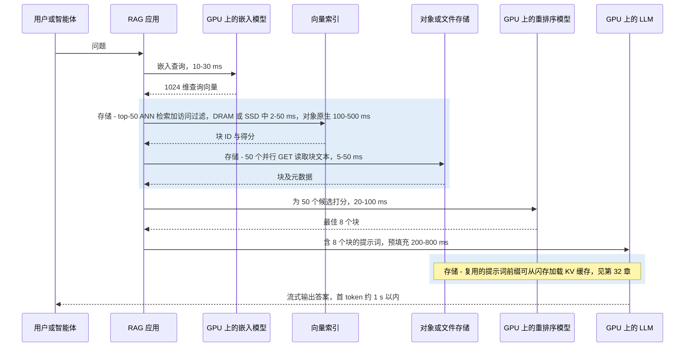
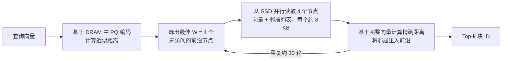

# 33. RAG、向量数据库与 AI 原生数据格式

> 📄 英文原文：[docs/05-ai-storage/33-rag-vector-lakehouse.md](../../../docs/05-ai-storage/33-rag-vector-lakehouse.md) · 本文为简体中文参考译本，如有出入以英文原文为准。

> **深度：** L2 · **阅读时间：** 约 10 分钟 · **最后核实：** 2026-11-01
> **前置阅读：** [对象存储与 S3](../02-protocols-and-networking/09-object-storage-and-s3.md) · [元数据](../03-system-architecture/21-metadata.md) · [端到端的 AI 数据管道](30-ai-data-pipeline.md) · [推理与 KV 缓存](32-inference-and-kv-cache.md)

## 要点速览（TL;DR）

- **RAG 把企业的文档变成大语言模型（LLM）的工作记忆。** 文档切块后被嵌入为向量；提问时，最接近的若干块被粘贴进提示词。存储位于其中三个步骤：向量检索、块读取，以及日益重要的 KV 缓存复用。
- **向量索引是一个内存容量问题。** 10 亿个 1,024 维向量的原始大小约 4.1 TB。若全部放在 DRAM 中，介质成本约为 DiskANN 这类 SSD 常驻设计的 16 倍，因此十亿级索引正迁移到闪存和对象存储上。
- **AI 原生格式改变了 I/O 模式。** Parquet 为扫描而生；Lance 同时面向扫描*和*随机行读取（乱序训练、嵌入向量、多模态二进制对象）。Iceberg 则在对象存储中的普通文件之上增加了事务和目录（catalog）。
- **每家存储厂商如今都在推出"数据引擎"。** VAST、NetApp、Dell、Everpure 和 AWS 都已把嵌入生成、向量检索或表管理移入存储内部或紧邻存储。与此同时，向量检索已成为 Postgres、Elastic、Databricks、Snowflake 乃至 S3 本身的一项*功能*。
- **战略问题在于谁掌握控制点。** 字节可以替换；目录、元数据和治理则具有黏性。价值归于掌控元数据和查询的一方——除非数据不能离开本地机房。

## 对 Everpure 战略的意义

企业 AI 主要是*基于私有数据的推理*，而 RAG 是连接二者的默认方式。这带来了一种存储负载：针对巨大索引的小块随机读取，外加由 S3 存储桶中 Parquet、Lance 和 Iceberg 文件构成的湖仓（lakehouse）。它也引发了一场圈地运动。AWS 把向量检索和 Iceberg 表放进了 S3[^1][^2]。VAST 增加了支持向量的数据库[^3]。NetApp 的 AI Data Engine "在存储层"生成嵌入向量[^4]，Dell 则在其 AI Data Platform 中捆绑了 Elastic 和 Starburst 引擎[^5]。Everpure 的回应是：以 FlashBlade 为底座，辅以 Data Stream（从摄取到向量化的管道，2026 年 6 月正式发布）[^6]和 Data Intelligence（原 1touch）。这些举措究竟是在获取价值，还是仅在守住份额，取决于这样一个市场：数据平台的体量远超任何存储厂商的数据服务业务——Databricks 报告的年化收入超过 70 亿美元（>US$7 billion），估值 1,900 亿美元（US$190 billion）（公司自述，2026 年 8 月）[^7]；Snowflake 2026 财年产品收入为 44.7 亿美元（US$4.47 billion）[^8]。

## 核心概念

### 一段话讲清嵌入向量

**嵌入模型（embedding model）**把一段文本、一张图像或一帧视频映射为一个定长向量（比如 1,024 个浮点数），其训练目标是让语义相近的内容在空间中彼此靠近。于是相似度就变成了几何问题：余弦相似度或点积。对半导体读者而言，嵌入向量就是一种学习得到的指纹，而检索就是一次针对所有已存向量的巨型矩阵-向量乘法（GEMV）——除非有索引让你跳过其中绝大部分。

嵌入向量的体积可能超过源数据。一个 512 token 的文本块约 2 KB（每 token 约 4 字节），但其 1,024 维 fp32 嵌入向量为 4 KB。一个 10 TB 的文本语料库会变成约 50 亿个块和约 20 TB 的向量——**是源数据的两倍**，这还没算索引。对图像和视频而言，这一比例则反过来。

### RAG 请求路径

RAG 这一名称出自 2020 年 Facebook AI 的一篇论文[^9]。文档在离线阶段被切块、嵌入并建立索引；查询时，系统对问题进行嵌入，检索最近邻的块，并以这些块作为 LLM 的条件输入。

*图 33.1 — 示意性延迟预算：在构建良好的 RAG 栈中，受存储约束的步骤占首 token 延迟的 10–30%，但冷的对象存储索引可能使检索成为耗时最长的单一步骤。*

该预算是算例示意，并非基准测试。对象原生检索的延迟区间来自厂商文档：Databricks 给出存储优化型端点约 250 ms[^10]，AWS 给出频繁查询的 S3 Vectors 索引约 100 ms、其他情况亚秒级[^11]，turbopuffer 给出冷查询数百毫秒、从其 NVMe 缓存读取则低于 10 ms[^12]。结论是：**检索受延迟约束，而非受带宽约束**。50 个 2 KB 的块总共只有 100 KB，但每次 GET 都要付出一次完整往返：在全闪存对象存储上约 1 毫秒，在基于机械硬盘的云存储层上则是数十毫秒。

### 向量索引：以内存换召回率

对所有向量做*暴力（flat）*扫描是精确的，但复杂度为 O(N)。**近似最近邻（ANN）**索引放弃几个百分点的*召回率*（返回的真实近邻所占比例），换取数量级的加速。

| 索引 | 工作原理 | 内存占用（1B × 1,024 维） | 召回率 / 延迟 | 是否适合 SSD？ |
|---|---|---|---|---|
| Flat（暴力检索） | 扫描每个向量，常在 GPU 上进行 | fp32 为 4.1 TB，无论放在哪里 | 100% / 1B 规模下每次查询需数秒 | 仅限顺序扫描 |
| IVF（倒排文件） | 对向量聚类；探查最近的少数几个簇 | 质心很小；倒排列表 = 完整数据 | 90–98% 可调 / 列表在内存中时为毫秒级 | 是：簇是连续读取（SPANN 将列表保存在 SSD 上[^13]） |
| HNSW（图） | 多层邻近图；贪心游走 | 向量 + 每向量约 264 B 的连接 ≈ 4.4 TB | 95–99% / DRAM 中约 1 ms | 差：每一跳都是一次相互依赖的随机读取 |
| DiskANN / Vamana | SSD 上的单层图；DRAM 中的 PQ 编码引导游走 | 约 64 GB DRAM + 约 4.4 TB SSD | SIFT1B 上 1-recall@1 >95%，<3 ms[^14] | 专为此设计：束搜索（beam search）并行发出 4 KB 读取 |
| PQ / 二值量化 | 把每个向量压缩为 8–128 B 的编码；ADC 查找表 | 1B 规模为 64–128 GB | 单独使用时较低；重排序可弥补 | 编码在内存中，原始向量在 SSD 上 |

*表 33.1 — 索引选择本质上是数据放置决策：哪些字节必须放在 DRAM 中，哪些可以放在闪存上。*

**算例（4 TB 问题）。** 10 亿个向量 × 1,024 维 × 4 字节 = 4.1 × 10¹² 字节 ≈ **4.1 TB** 原始数据。HNSW 图（M = 32）为每个向量增加最多 64 个 4 字节的邻居 ID，约 264 GB。按 2026 年服务器 DRAM 约 US$14.5/GB 计算[^15]，一个内存副本需承载约 US$63,000 的 DRAM，另加约 US$3,000 用于在 SSD 上持久化 fp32 副本。DiskANN 只在 DRAM 中保留 64 字节的 PQ 编码（64 GB，约 US$900），把 4.4 TB 的图放在约 US$0.75/GB 的 SSD 上[^16]（约 US$3,300）。即**每个副本的介质成本约 US$66k 对约 US$4k**。

*图 33.2 — 算例：将十亿级向量索引的主体从 DRAM 迁到闪存，按 2026 年价格可使每个副本的介质成本降低约 16 倍。*
数据：`data/ch33_vector_memory.csv`

### 为什么图检索能在 SSD 上运行，以及为什么它是指针追逐

*图 33.3 — DiskANN 通过每一跳发出一小批读取来掩盖 SSD 延迟，这与乱序执行核心让多个缓存未命中同时在途的技巧如出一辙。*

**半导体类比。** HNSW 游走就是链表遍历：下一个地址取决于尚未加载的数据，因此预取器无能为力，游走受*延迟*约束。这正是缓存难以应对的图分析类不规则访问特征。DiskANN 的束宽 W 就是内存级并行度（memory-level parallelism）。约 30 轮相互依赖的读取、每次 NVMe 读取约 100 µs，一次查询约需 3 ms，与论文结果一致。在每秒 5,000 次查询下，30 × 4 个节点 × 两个 4 KB 扇区约为每秒 120 万次随机读取，几块数据中心级 NVMe SSD 即可承担。若放在每次往返增加约 0.5 ms 的网络化阵列后面，一次查询约需 15–18 ms；若放在 20 ms 的对象 GET 后面，则约需 600 ms。这就是对象存储原生引擎（turbopuffer、Pinecone serverless）偏好**聚类式** IVF/SPANN 类布局的原因：它们只需少量大块读取，而不是几十次相互依赖的小块读取[^12][^17]。

**PQ 就是向量的权重量化。** 乘积量化（product quantization）把一个 1,024 维向量切成 64 个子向量，每个子向量用 1 字节的码本索引替代：4,096 字节 → 64 字节。距离通过查表得出，就像推理中调色板化或 INT4 权重以精度换内存一样。弥补精度损失的办法是用 SSD 上的全精度向量对排名靠前的候选进行重排序。Elastic 的"BBQ"把这一思路推到每维 1 比特，并声称可减少约 95% 的内存[^18]。

生产系统会组合使用这些技术。Milvus 提供 DiskANN 索引[^19]；Pinecone serverless 把不可变的"slab"保存在对象存储中，并缓存在执行节点的 SSD 上[^17]；S3 Vectors 可扩展到每个索引 20 亿个向量、每个存储桶 20 万亿个向量[^1]。方向很明确：**DRAM 负责引导，闪存承载索引，对象存储保障持久性**。
