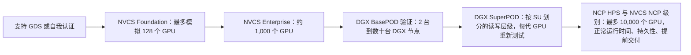
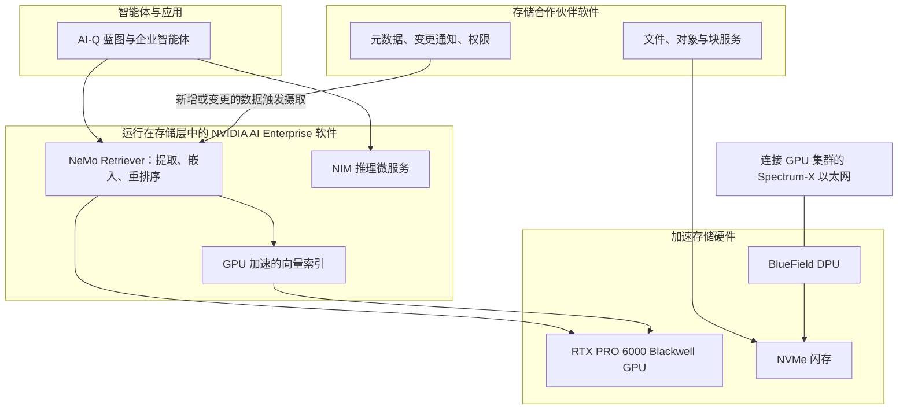

# 34. NVIDIA 生态系统与认证

> 📄 英文原文：[docs/05-ai-storage/34-nvidia-ecosystem.md](../../../docs/05-ai-storage/34-nvidia-ecosystem.md) · 本文为简体中文参考译本，如有出入以英文原文为准。

> **深度：** L2 · **阅读时间：** 约 10 分钟 · **最后核实：** 2026-11-01
> **前置阅读：** [面向存储的数据中心网络](../02-protocols-and-networking/10-datacenter-networking.md) · [GPU 数据路径](../02-protocols-and-networking/11-gpu-data-path.md) · [推理与 KV 缓存](32-inference-and-kv-cache.md)

## 要点速览（TL;DR）

- **NVIDIA 掌管着 AI 存储的合格供应商名单。** 其每一套参考设计（BasePOD、SuperPOD、NVIDIA Cloud Partner、Enterprise）都会列出通过 NVIDIA 测试的存储产品。不在名单上的厂商，通常也就进不了这笔交易。
- **该计划是一组按规模排序的层级。** NVIDIA-Certified Storage 分为 Foundation（最多模拟 128 个 GPU）、Enterprise（约 1,000 个）和 NCP（最多 10,000 个）三个级别。SuperPOD 认证另设按 GPU 代际划分的吞吐量层级。NCP 认证则增加了云级别的正常运行时间、持久性和交付时间规则。
- **认证设定的是底线，而不是对厂商的排名。** SuperPOD B200 "enhanced"层级折算下来，每个 GPU 的读取带宽不到 0.5 GB/s。约有十几家厂商持有 NVIDIA 存储认证。认证证明的是互操作性和最低吞吐量，对价格、数据缩减、运维或故障行为则只字未提。
- **NVIDIA 正不断进入存储设备内部。** AI Data Platform（2025）把 GPU 和 NVIDIA 检索软件放进了存储。BlueField-4 STX 和 CMX（2026）则将 KV 缓存层标准化在 NVIDIA 芯片之上，有 12 家存储厂商作为联合设计伙伴。
- **NVIDIA 投资了部分它所认证的厂商。** 它持有 VAST 和 WEKA 的股权，而 NVIDIA 自己的集群运行在 DDN 上。Everpure 的 FlashBlade//S 拥有所有主要认证；FlashBlade//EXA 尚未获得任何由 NVIDIA 授予的认证，Everpure 也没有任何已报道的 NVIDIA 股权关系。

## 对 Everpure 战略的意义

存储只占 AI 集群物料清单的一小部分，但 GPU 厂商决定架构、挑选参考合作伙伴，并且往往主导与客户的对话。对 Everpure（NYSE: P，原 PSTG）而言，认证是参与竞争的门槛；真正的竞争发生在跨过门槛之后。战略问题在于：每款新产品能多快通过 NVIDIA 的关卡；有多少交易流量经由自有存储产品的服务器 OEM；以及如果 NVIDIA 的参考存储（STX）吸收了当今存储软件所承担的功能，阵列的经济性将会怎样。

半导体领域有非常贴切的类比。进入晶圆代工厂的 IP 生态名单（TSMC 的 Open Innovation Platform）或某块参考板的合格供应商名单，并不能赢得插槽（socket），但不在名单上就一定会丢掉它。平台所有者还决定名单何时重新认证：通常是每一代产品。

## 核心概念

### 五个计划，一个守门人

NVIDIA 发布了五套相互重叠、与存储相关的体系：

1. **DGX BasePOD。** 从两台 DGX 节点到数十台的企业级集群[^1]；存储合作伙伴需通过验证与批准流程。于 2022 年 9 月携存储合作伙伴推出[^2]。
2. **DGX SuperPOD。** NVIDIA 的交钥匙大型集群，由 32 节点的可扩展单元（SU）构成。每一代 GPU 的参考架构都会公布一张存储性能表，供认证对照[^3]。
3. **NVIDIA Cloud Partner（NCP）参考架构。** GPU 云蓝图；存储需获得"高性能存储"（HPS）认证，NCP 还必须满足 NVIDIA 的 *Requirements for AI Clouds*[^4]。
4. **NVIDIA-Certified Storage（NVCS）。** 于 2025 年 3 月 GTC 上推出，面向基于 NVIDIA-Certified 服务器的企业 AI 工厂[^5]，分为 Foundation、Enterprise 和 NCP 三个级别[^6]。
5. **AI Data Platform 与 STX。** 规定存储本身应包含什么的参考*设计*，而非测试套件。NVCS 是基于 AI Data Platform 构建产品的前提[^5]。

*图 34.1 — 每一级都模拟或部署更多 GPU 并增加测试项；这些计划是并行的，并非正式的先决条件，但买方会把它们当作一架阶梯来看。*

### 测试实际要求什么

大部分测试细节都放在合作伙伴门户上。三个公开的锚点可以说明门槛高低：

- **NVCS 规模。** Foundation 测试模拟最多 128 个 GPU 的负载，Enterprise 约 1,000 个，NCP 最多 10,000 个[^6] [VERIFY: Foundation 的 128 个以及阶梯顶端的 10,000 个 GPU 已由 NVIDIA 文档摘要佐证；Enterprise 约 1,000 个 GPU 的数字尚未佐证]。NVIDIA 的框架涵盖训练、微调、推理、KV 缓存和检索等 I/O 特征，包括同步与异步检查点[^6]。
- **SuperPOD 吞吐量。** DGX B200 参考架构要求每个 256 GPU 的 SU 在"standard"级别达到 40/20 GB/s 读/写，在"enhanced"级别达到 125/62 GB/s，并线性扩展到四个 SU[^3]。B300 版本则要求八个 SU 达到 640 和 2,000 GB/s 的读取带宽[^7]。
- **NCP 运维。** 高速文件存储的正常运行时间约 99.5%、每 PB 年持久性 99.999%，提供 NFSv4 主目录，并要求存储在 GPU 到货*之前*八周完成上线和 API 集成[^4] [VERIFY: 阈值引自 v2.2；当前版本为 v2.4]。详细的 GB300 NVL72 存储设计位于 NVIDIA 不公开的合作伙伴门户上[^8]。

**算例：底线到底有多高？** Enhanced B200 读取带宽为 125 GB/s ÷ 256 个 GPU ≈ **每 GPU 0.49 GB/s**；standard 为 40 ÷ 256 ≈ 0.16 GB/s。NVIDIA 自己的指引称，以读取为主的工作（图像或视频训练）需要每 GPU 约 4 GB/s[^3]，是 enhanced 层级的八倍，即每个 SU 约 1 TB/s。WEKA 在其 2024 年 SuperPOD 认证中声称，单个八节点 WEKApod 即可提供 720 GB/s 的读取带宽[^9]，一台小型设备就超过了四个 SU 的 enhanced 目标。认证说明的是该系统不会让文本 LLM 训练任务"饿死"；它无法区分头部厂商的高下。

**认证能证明什么、不能证明什么**

| 认证能证明 | 认证不能证明 |
|---|---|
| 与 NVIDIA 技术栈互操作（GDS、RDMA、Spectrum-X 或 InfiniBand、Base Command） | 性价比、$/TB 或每 TB 功耗 |
| 在给定规模下达到公布的吞吐量底线 | 在 80% 容量占用时、重建期间或多租户混合负载下的表现 |
| NVIDIA 的支持和销售团队熟悉该配置 | 数据缩减后的有效容量 |
| 厂商会在下一代 GPU 上重新认证 | 长期可靠性、升级造成的中断、运维人员配置 |
| 被纳入参考物料清单 | 任何排名：该名单无序且非排他 |

*表 34.1 — 认证是一道门槛，而不是一个评级。右列中的每一项，才是真正决定交易胜负的地方（关于如何解读基准测试，见[第 37 章](37-reading-benchmarks.md)）。*

### AI Data Platform：NVIDIA 为存储设备本身绘制的蓝图

2025 年 3 月，NVIDIA 推出了 AI Data Platform。这是一套参考设计，把加速计算和 AI 智能体放进存储层，使数据在其所在位置被提取、嵌入和索引，而不必复制到单独的 RAG 管道中。NVIDIA 公布了十家首发合作伙伴，Pure Storage 位列其中[^10]。硬件配方是 RTX PRO 6000 Blackwell Server Edition GPU 搭配 BlueField DPU 和 Spectrum-X 以太网。软件配方是 AI-Q 蓝图，它调用 NeMo Retriever 微服务进行提取和检索[^11]。后来的实现走得更远：Hammerspace 的平台（2026 年 3 月正式发布）捆绑了 NIM 和 NeMo Retriever[^12]，而 Everpure 的 Data Stream（2026 年 6 月）则是基于同一设计的从摄取到推理的管道[^13]。

*图 34.2 — NVIDIA 提供 GPU、DPU、网络和检索软件；合作伙伴的差异化层——数据服务和元数据——位于这块"三明治"的中间。*

这笔交易对双方都有利有弊：合作伙伴得到了现成的 RAG 方案（[第 33 章](33-rag-vector-lakehouse.md)），NVIDIA 得以把 GPU 和软件订阅放进每一个存储机架，而每家合作伙伴的 AI 故事都会趋同于同一批 NVIDIA 部件。

### STX 与 CMX：参考存储服务器

2026 年 1 月的 CES 上，NVIDIA 更进一步，推出了 Inference Context Memory Storage（ICMS）平台——一个由 BlueField-4 驱动、部署在每个 pod 内部的 KV 缓存层[^14]。它位于 Dynamo 的本地 SSD（G3）层和网络存储（G4）层之间，因此在[第 32 章](32-inference-and-kv-cache.md)中被标为"G3.5"。在 2026 年 3 月的 GTC 上，NVIDIA 将其扩展为 **BlueField-4 STX**，这是一种基于 Vera Rubin、BlueField-4 和 Spectrum-X 构建的模块化存储参考架构。首个机架级实现是 **CMX** 上下文内存存储平台，实质上就是 CES 平台换了个新名字[^15]。包括 Everpure、VAST、WEKA、DDN、Dell 和 NetApp 在内的十二家存储厂商是联合设计伙伴；AIC、Supermicro 和 QCT 制造硬件；CoreWeave、Lambda、Nebius、OCI 以及另外四家是早期采用者[^16]。STX 是 NVIDIA 分发的蓝图，而不是它出售的设备[^17]。KV 缓存的机制见[第 32 章](32-inference-and-kv-cache.md)，DPU 在网络中的位置见[第 10 章](../02-protocols-and-networking/10-datacenter-networking.md)。

战略要点在于价值向何处转移。如果控制器是一颗运行 NVIDIA DOCA 软件、装在 ODM 制造的服务器上的 BlueField-4，那么存储软件就变成了 NVIDIA 控制器芯片上的"租户"，就像无晶圆厂（fabless）设计依托代工厂的工艺和 IP 构建一样。一家分析机构认为，随着 NVIDIA 将数据路径标准化，那些未针对推理和上下文内存优化的厂商将面临利润率压力，同时也指出这些厂商本身就是 STX 合作伙伴[^18]。这只是观点，但点出的风险是对的。
