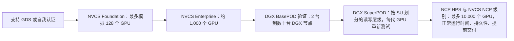
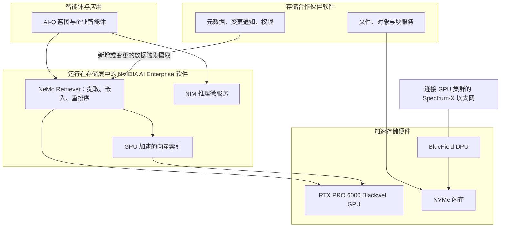
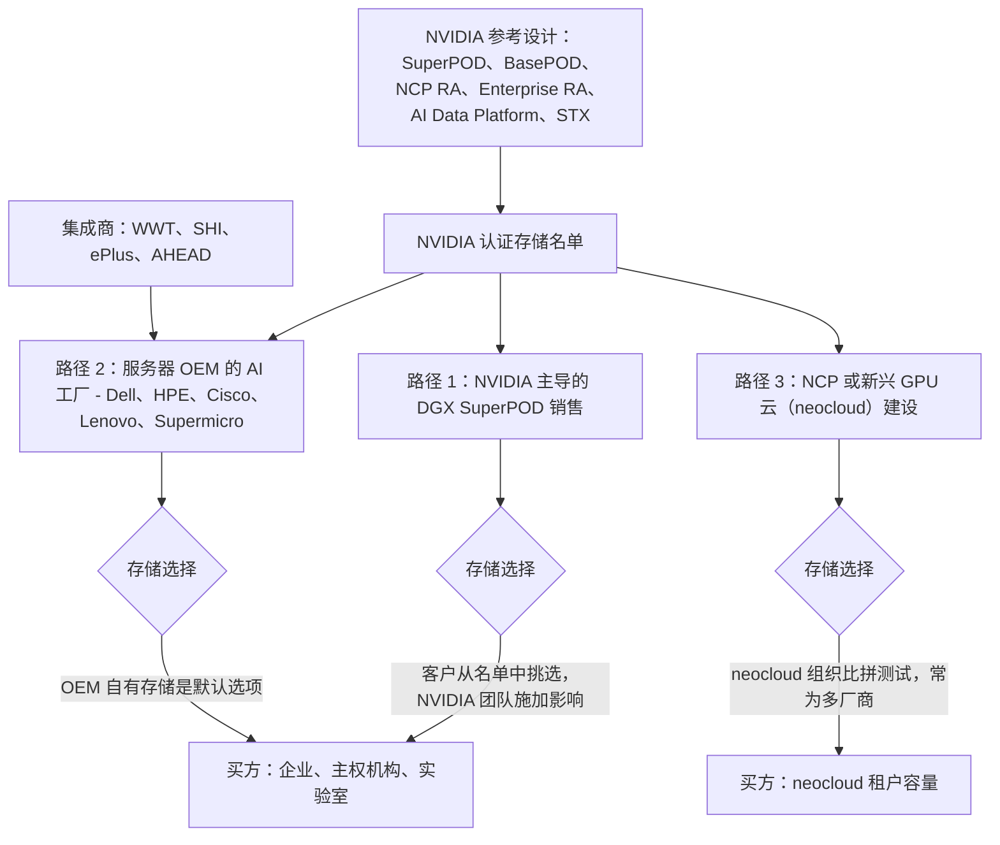
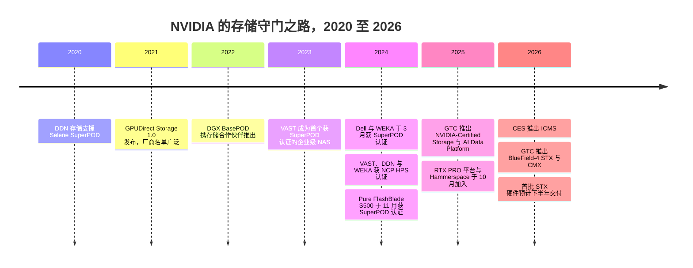

# 34. NVIDIA 生态系统与认证

> 📄 英文原文：[docs/05-ai-storage/34-nvidia-ecosystem.md](../../../docs/05-ai-storage/34-nvidia-ecosystem.md) · 本文为简体中文参考译本，如有出入以英文原文为准。

> **深度：** L2 · **阅读时间：** 约 10 分钟 · **最后核实：** 2026-11-01
> **前置阅读：** [面向存储的数据中心网络](../02-protocols-and-networking/10-datacenter-networking.md) · [GPU 数据路径](../02-protocols-and-networking/11-gpu-data-path.md) · [推理与 KV 缓存](32-inference-and-kv-cache.md)

## 要点速览（TL;DR）

- **NVIDIA 掌管着 AI 存储的合格供应商名单。** 其每一套参考设计（BasePOD、SuperPOD、NVIDIA Cloud Partner、Enterprise）都会列出通过 NVIDIA 测试的存储产品。不在名单上的厂商，通常也就进不了这笔交易。
- **该计划是一组按规模排序的层级。** NVIDIA-Certified Storage 分为 Foundation（最多模拟 128 个 GPU）、Enterprise（约 1,000 个）和 NCP（最多 10,000 个）三个级别。SuperPOD 认证另设按 GPU 代际划分的吞吐量层级。NCP 认证则增加了云级别的正常运行时间、持久性和交付时间规则。
- **认证设定的是底线，而不是对厂商的排名。** SuperPOD B200 "enhanced"层级折算下来，每个 GPU 的读取带宽不到 0.5 GB/s。约有十几家厂商持有 NVIDIA 存储认证。认证证明的是互操作性和最低吞吐量，对价格、数据缩减、运维或故障行为则只字未提。
- **NVIDIA 正不断进入存储设备内部。** AI Data Platform（2025）把 GPU 和 NVIDIA 检索软件放进了存储。BlueField-4 STX 和 CMX（2026）则将 KV 缓存层标准化在 NVIDIA 芯片之上，有 12 家存储厂商作为联合设计伙伴。
- **NVIDIA 投资了部分它所认证的厂商。** 它持有 VAST 和 WEKA 的股权，而 NVIDIA 自己的集群运行在 DDN 上。Everpure 的 FlashBlade//S 拥有所有主要认证；FlashBlade//EXA 尚未获得任何由 NVIDIA 授予的认证，Everpure 也没有任何已报道的 NVIDIA 股权关系。

## 对 Everpure 战略的意义

存储只占 AI 集群物料清单的一小部分，但 GPU 厂商决定架构、挑选参考合作伙伴，并且往往主导与客户的对话。对 Everpure（NYSE: P，原 PSTG）而言，认证是参与竞争的门槛；真正的竞争发生在跨过门槛之后。战略问题在于：每款新产品能多快通过 NVIDIA 的关卡；有多少交易流量经由自有存储产品的服务器 OEM；以及如果 NVIDIA 的参考存储（STX）吸收了当今存储软件所承担的功能，阵列的经济性将会怎样。

半导体领域有非常贴切的类比。进入晶圆代工厂的 IP 生态名单（TSMC 的 Open Innovation Platform）或某块参考板的合格供应商名单，并不能赢得插槽（socket），但不在名单上就一定会丢掉它。平台所有者还决定名单何时重新认证：通常是每一代产品。

## 核心概念

### 五个计划，一个守门人

NVIDIA 发布了五套相互重叠、与存储相关的体系：

1. **DGX BasePOD。** 从两台 DGX 节点到数十台的企业级集群[^1]；存储合作伙伴需通过验证与批准流程。于 2022 年 9 月携存储合作伙伴推出[^2]。
2. **DGX SuperPOD。** NVIDIA 的交钥匙大型集群，由 32 节点的可扩展单元（SU）构成。每一代 GPU 的参考架构都会公布一张存储性能表，供认证对照[^3]。
3. **NVIDIA Cloud Partner（NCP）参考架构。** GPU 云蓝图；存储需获得"高性能存储"（HPS）认证，NCP 还必须满足 NVIDIA 的 *Requirements for AI Clouds*[^4]。
4. **NVIDIA-Certified Storage（NVCS）。** 于 2025 年 3 月 GTC 上推出，面向基于 NVIDIA-Certified 服务器的企业 AI 工厂[^5]，分为 Foundation、Enterprise 和 NCP 三个级别[^6]。
5. **AI Data Platform 与 STX。** 规定存储本身应包含什么的参考*设计*，而非测试套件。NVCS 是基于 AI Data Platform 构建产品的前提[^5]。

*图 34.1 — 每一级都模拟或部署更多 GPU 并增加测试项；这些计划是并行的，并非正式的先决条件，但买方会把它们当作一架阶梯来看。*

### 测试实际要求什么

大部分测试细节都放在合作伙伴门户上。三个公开的锚点可以说明门槛高低：

- **NVCS 规模。** Foundation 测试模拟最多 128 个 GPU 的负载，Enterprise 约 1,000 个，NCP 最多 10,000 个[^6] [VERIFY: Foundation 的 128 个以及阶梯顶端的 10,000 个 GPU 已由 NVIDIA 文档摘要佐证；Enterprise 约 1,000 个 GPU 的数字尚未佐证]。NVIDIA 的框架涵盖训练、微调、推理、KV 缓存和检索等 I/O 特征，包括同步与异步检查点[^6]。
- **SuperPOD 吞吐量。** DGX B200 参考架构要求每个 256 GPU 的 SU 在"standard"级别达到 40/20 GB/s 读/写，在"enhanced"级别达到 125/62 GB/s，并线性扩展到四个 SU[^3]。B300 版本则要求八个 SU 达到 640 和 2,000 GB/s 的读取带宽[^7]。
- **NCP 运维。** 高速文件存储的正常运行时间约 99.5%、每 PB 年持久性 99.999%，提供 NFSv4 主目录，并要求存储在 GPU 到货*之前*八周完成上线和 API 集成[^4] [VERIFY: 阈值引自 v2.2；当前版本为 v2.4]。详细的 GB300 NVL72 存储设计位于 NVIDIA 不公开的合作伙伴门户上[^8]。

**算例：底线到底有多高？** Enhanced B200 读取带宽为 125 GB/s ÷ 256 个 GPU ≈ **每 GPU 0.49 GB/s**；standard 为 40 ÷ 256 ≈ 0.16 GB/s。NVIDIA 自己的指引称，以读取为主的工作（图像或视频训练）需要每 GPU 约 4 GB/s[^3]，是 enhanced 层级的八倍，即每个 SU 约 1 TB/s。WEKA 在其 2024 年 SuperPOD 认证中声称，单个八节点 WEKApod 即可提供 720 GB/s 的读取带宽[^9]，一台小型设备就超过了四个 SU 的 enhanced 目标。认证说明的是该系统不会让文本 LLM 训练任务"饿死"；它无法区分头部厂商的高下。

**认证能证明什么、不能证明什么**

| 认证能证明 | 认证不能证明 |
|---|---|
| 与 NVIDIA 技术栈互操作（GDS、RDMA、Spectrum-X 或 InfiniBand、Base Command） | 性价比、$/TB 或每 TB 功耗 |
| 在给定规模下达到公布的吞吐量底线 | 在 80% 容量占用时、重建期间或多租户混合负载下的表现 |
| NVIDIA 的支持和销售团队熟悉该配置 | 数据缩减后的有效容量 |
| 厂商会在下一代 GPU 上重新认证 | 长期可靠性、升级造成的中断、运维人员配置 |
| 被纳入参考物料清单 | 任何排名：该名单无序且非排他 |

*表 34.1 — 认证是一道门槛，而不是一个评级。右列中的每一项，才是真正决定交易胜负的地方（关于如何解读基准测试，见[第 37 章](37-reading-benchmarks.md)）。*

### AI Data Platform：NVIDIA 为存储设备本身绘制的蓝图

2025 年 3 月，NVIDIA 推出了 AI Data Platform。这是一套参考设计，把加速计算和 AI 智能体放进存储层，使数据在其所在位置被提取、嵌入和索引，而不必复制到单独的 RAG 管道中。NVIDIA 公布了十家首发合作伙伴，Pure Storage 位列其中[^10]。硬件配方是 RTX PRO 6000 Blackwell Server Edition GPU 搭配 BlueField DPU 和 Spectrum-X 以太网。软件配方是 AI-Q 蓝图，它调用 NeMo Retriever 微服务进行提取和检索[^11]。后来的实现走得更远：Hammerspace 的平台（2026 年 3 月正式发布）捆绑了 NIM 和 NeMo Retriever[^12]，而 Everpure 的 Data Stream（2026 年 6 月）则是基于同一设计的从摄取到推理的管道[^13]。

*图 34.2 — NVIDIA 提供 GPU、DPU、网络和检索软件；合作伙伴的差异化层——数据服务和元数据——位于这块"三明治"的中间。*

这笔交易对双方都有利有弊：合作伙伴得到了现成的 RAG 方案（[第 33 章](33-rag-vector-lakehouse.md)），NVIDIA 得以把 GPU 和软件订阅放进每一个存储机架，而每家合作伙伴的 AI 故事都会趋同于同一批 NVIDIA 部件。

### STX 与 CMX：参考存储服务器

2026 年 1 月的 CES 上，NVIDIA 更进一步，推出了 Inference Context Memory Storage（ICMS）平台——一个由 BlueField-4 驱动、部署在每个 pod 内部的 KV 缓存层[^14]。它位于 Dynamo 的本地 SSD（G3）层和网络存储（G4）层之间，因此在[第 32 章](32-inference-and-kv-cache.md)中被标为"G3.5"。在 2026 年 3 月的 GTC 上，NVIDIA 将其扩展为 **BlueField-4 STX**，这是一种基于 Vera Rubin、BlueField-4 和 Spectrum-X 构建的模块化存储参考架构。首个机架级实现是 **CMX** 上下文内存存储平台，实质上就是 CES 平台换了个新名字[^15]。包括 Everpure、VAST、WEKA、DDN、Dell 和 NetApp 在内的十二家存储厂商是联合设计伙伴；AIC、Supermicro 和 QCT 制造硬件；CoreWeave、Lambda、Nebius、OCI 以及另外四家是早期采用者[^16]。STX 是 NVIDIA 分发的蓝图，而不是它出售的设备[^17]。KV 缓存的机制见[第 32 章](32-inference-and-kv-cache.md)，DPU 在网络中的位置见[第 10 章](../02-protocols-and-networking/10-datacenter-networking.md)。

战略要点在于价值向何处转移。如果控制器是一颗运行 NVIDIA DOCA 软件、装在 ODM 制造的服务器上的 BlueField-4，那么存储软件就变成了 NVIDIA 控制器芯片上的"租户"，就像无晶圆厂（fabless）设计依托代工厂的工艺和 IP 构建一样。一家分析机构认为，随着 NVIDIA 将数据路径标准化，那些未针对推理和上下文内存优化的厂商将面临利润率压力，同时也指出这些厂商本身就是 STX 合作伙伴[^18]。这只是观点，但点出的风险是对的。

### 交易如何经由 NVIDIA 流转

*图 34.3 — 存储在三个节点上被选定：在 NVIDIA 主导的交易中，认证名单划定参赛范围；在 OEM 交易中，OEM 自有存储起步领先；neocloud 则自行测试。*

不同路径的经济性各不相同。**Dell** 把 PowerScale、ObjectScale 及其 Lightning 并行文件系统捆绑进与 NVIDIA 合作的 AI Data Platform[^19]，因此独立厂商在 Dell 主导的交易中起步就落后。**HPE** 销售自有的 X10000，同时销售运行 VAST 软件的 GreenLake for File[^20]。**Cisco** 没有存储产品，因此其与 NVIDIA 合作的 Secure AI Factory 列出了多家合作伙伴（Pure Storage、Hitachi Vantara、NetApp、VAST，后来还有 Nutanix）[^21]，这就是 Everpure 在 Cisco AI POD 中的 FlashStack CVD 之所以重要的原因[^22]。**Neocloud** 会认证多家厂商：CoreWeave 列出了 VAST、WEKA、DDN、IBM 和 Pure Storage[^23]，而它与 VAST 签订的 11.7 亿美元（US$1.17 billion）协议表明，单个决策的规模可以有多大[^24]。见[第 35 章](35-ai-factories-and-neoclouds.md)。

### 造王者还是收费站？NVIDIA 的投资

NVIDIA 还投资了部分名单上的厂商。它参与了 VAST 2021 年的 D 轮融资[^25]和 2026 年估值 300 亿美元（US$30 billion）的 F 轮融资（*公司自述*）[^26]。二手资料还将 NVIDIA 列为 VAST 2023 年 12 月 E 轮融资的投资方，但 VAST 自己的新闻稿列出的是其他投资者 [VERIFY: NVIDIA 是否参与 VAST E 轮]。NVIDIA 参与了 WEKA 2024 年 1.4 亿美元（US$140 million）的 E 轮融资（*公司自述*）[^27]。DDN 没有已报道的 NVIDIA 股权；其关系是运营层面的——为 NVIDIA 的 Selene 和 Eos 集群提供存储（Eos：48 台 AI400X2，约 4 TB/s，*公司自述*）[^28]。没有公开证据表明认证偏向 NVIDIA 投资组合中的公司；通过名单几乎囊括了所有厂商。这些投资换来的是一些不那么正式的东西：提前获知路线图、联合发布（VAST 的 CNode-X，2026 年 2 月），以及每篇新闻报道中的"NVIDIA 支持"标签。

客观地看，NVIDIA 与其说是造王者，不如说是一个设有优先车道的收费站。它很少只挑一个赢家；它设定入场费（每代 GPU 重新认证、采纳每一个新的 NVIDIA 接口），并从一群合规供应商的激烈竞争中获利。这正是平台所有者将其互补品商品化的做法。

## Everpure 的做法与竞争对手对比

| 厂商 | DGX SuperPOD | DGX BasePOD | NCP / HPS | NVIDIA-Certified Storage | AI Data Platform / STX |
|---|---|---|---|---|---|
| **Everpure** | FlashBlade//S500，2024 年 11 月[^29]；未发现 EXA 的认证 | 经由 Cisco FlashStack，2023 年 11 月[^22] | FlashBlade//S，HGX H200/B200，2025 年 3 月[^30] | FB//S500 Foundation + Enterprise，2025 年 3 月[^30]；EXA：2026 年 3 月宣布扩展验证，目标为 NCP 级别；截至 2026-11 未发现 EXA 列入名单[^31] | FlashBlade 集成 ADP（2025 年 3 月）；Data Stream（2026 年 6 月）[^13]；STX 合作伙伴 |
| **VAST** | 有，2023 年 5 月（首个企业级 NAS）[^32] | 更早的 DGX POD RA [VERIFY] | HPS，2024 年 7 月[^33] | 已列入（CNode、BlueField-3 DBox、EBox）；级别未核实[^34] | InsightEngine（ADP 首发）；STX 合作伙伴 |
| **WEKA** | WEKApod，2024 年 3 月；Nitro/Prime 2025[^9] | 有（H100）[^35] | HPS，2024 年 9 月[^35] | 已列入（WEKApod Nitro）；级别未核实[^34] | ADP 首发；STX 合作伙伴 |
| **DDN** | 自 DGX A100 时代起；为 Selene 和 Eos 提供存储[^28] | 有，2022 年 RA | HPS，2024 年 8 月[^36] | AI400X3 已列入[^34] | Infinia（ADP 首发）；STX 合作伙伴 |
| **NetApp** | AFF A90，2025 年 3 月；更早有 EF600/BeeGFS[^37] | AIPod | AFF A90，2025 年 3 月[^37] | AFF A90 与 AFX 已列入[^34] | AIPod / AI Data Engine；STX 合作伙伴 |
| **Dell** | PowerScale F710，2024 年 3 月（首个以太网存储）[^38] | [VERIFY] | [VERIFY] | PowerScale F710 已列入[^34] | Dell AI Data Platform[^19]；STX 合作伙伴 |
| **HPE** | 未发现 [VERIFY] | GreenLake for File（基于 VAST）[^20] | 未发现 | X10000 Foundation，首个对象存储平台，2026 年 3 月[^39] | ADP 首发；STX 合作伙伴 |
| **IBM** | Storage Scale System 6000，2024 年 8 月[^40] | 有（IBM 自述）[^41] | 有（IBM 自述）[^41] | Storage Scale System 3500/6000 已列入[^34] | Storage Scale AI Data Platform；STX 合作伙伴 |
| **Hitachi Vantara** | 截至 2024 年正在申请；未确认[^42] | Hitachi iQ，2024 年 7 月[^42] | 未发现 | 已列入；产品未核实[^34] | ADP 首发；STX 合作伙伴 |
| **Nutanix** | 未发现 | 未发现 | 未发现 | Enterprise 级别，2026 年 6 月[^43] [VERIFY: 日期] | ADP 首发；STX 合作伙伴 |
| **Hammerspace** | 无 | 无 | 无 | 截至 2026 年 9 月无[^44] | 基于 NVIDIA 参考设计的 AIDP，2026 年 3 月正式发布[^12]；2024 年 2 月完成 GDS 自我认证 |

*表 34.2 — 几乎每家厂商都持有几乎每一枚徽章；差异在于时间先后和产品线覆盖范围。"未发现"指未找到公开来源，并非确认不存在。*

**Everpure 的位置。** FlashBlade//S 持有全套认证。缺口在于 FlashBlade//EXA，它瞄准的是最大规模的 AI 和 neocloud 交易。2026 年 3 月，Everpure 表示正将 NVCS 验证扩展到 EXA，作为迈向 NCP 级别的一步，并使 EXA 与 STX 对齐[^31]。行业媒体报道称 NCP 认证将在"今年晚些时候"完成，但截至 2026-11-01，尚未公布任何已完成的 EXA 认证。在此之前，竞争对手可以在 EXA 所瞄准的那些交易中，恰恰指出 EXA 未获认证。Everpure 的独特举措是公开且经同行评审的基准测试：它在 2026 年 9 月提交了 MLPerf Storage v3.0 结果，而 VAST、WEKA 和 DDN 都没有提交[^45]（DDN 和 WEKA 参加过更早的轮次；VAST 从未参加[^44]）。这些结果由厂商自行运行，因此反映的是每个提交者的配置能做到什么，而不是市场排名。

**为其他厂商构建最强版本论证（steelman）。** DDN 的论据最有力：NVIDIA 自己的集群运行在 DDN 上，任何证书都无法与之相比。VAST 和 WEKA 拥有股权关系，并且通常率先支持 NVIDIA 的新接口。Dell 和 HPE 掌控服务器销售。Everpure 的反击点在于认证所不衡量的东西：Evergreen 经济性、功耗与密度（[第 38 章](38-power-and-density.md)）以及企业级数据服务。

**基于公开信息，战略团队可能评估的选项：**

1. **把认证速度作为 KPI。** 将"从 NVIDIA GPU 发布到在各层级获得认证所需的天数"作为一项产品指标，近期缺口是 EXA 的 NCP 级别认证。
2. **成为 STX/CMX 的早期实现者**，使 Purity 的数据服务能运行在 NVIDIA 标准化的任何控制器之上，而不是固守 x86 控制器。
3. **在 NVIDIA 主导的交易之外拓展市场进入路径**：Cisco、集成商、超大规模云厂商的应用市场，以及作为对冲的非 NVIDIA 加速器和 Ultra Ethernet 生态。
4. **在证书不衡量的方面竞争**：独立基准测试、有效 $/TB、每瓦 TB 数以及不停机升级。
5. **权衡与 NVIDIA 建立更深的商业或股权关系**与其代价：依赖单一供应商的路线图，以及在 AMD 和超大规模云厂商买方面前中立性下降。

## 历史与发展轨迹

*图 34.4 — 门槛已从"你的文件系统能否喂饱 GPU"（2020–2023），转向"你能否在 GPU 云中运行"（2024），再到"你是否愿意基于 NVIDIA 的存储芯片构建产品"（2026）。*

Supermicro 已展示了一台 CMX 原型服务器，并正与 Micron、Samsung 和 Phison 一起验证 STX 的 SSD 要求，计划于 2026 年下半年出货[^46]。2027 年值得关注的信号：NCP 设计是否会把 CMX 类上下文存储列为必备项，以及 CMX 节点是来自存储厂商还是直接来自 ODM。

## 关键数字

| 指标 | 数值 | 背景 | 来源 / 日期 |
|---|---|---|---|
| NVCS 模拟规模 | 128 / 约 1,000 / 10,000 个 GPU | Foundation / Enterprise / NCP 级别 | NVIDIA 文档[^6]，2026-11 检索 |
| SuperPOD B200 读取，1 个 SU | standard 40 GB/s；enhanced 125 GB/s | 每 SU 256 个 GPU | NVIDIA B200 RA[^3] |
| Enhanced 每 GPU 读取带宽 | ≈0.49 GB/s | 125 ÷ 256；NVIDIA 建议读密集型工作约 4 GB/s | 算例 |
| SuperPOD B300 读取，8 个 SU | 640 / 2,000 GB/s | Standard / enhanced | NVIDIA B300 RA[^7] |
| NCP 存储提前上线时间 | GPU 到货前 8 周 | 含 API 集成 | NVIDIA AI Cloud 要求[^4] |
| STX 联合设计存储合作伙伴 | 12 | 包括 Everpure、VAST、WEKA、DDN | StorageNewsletter，2026-03-17[^16] |
| VAST F 轮估值 | US$30B | NVIDIA 参投；公司自述 | CNBC，2026-04-22[^26] |
| WEKA E 轮 | US$140M，估值 US$1.6B | NVIDIA 参投；公司自述 | WEKA，2024-05-15[^27] |

## 对话手册

**向产品经理提的问题**

1. *"FlashBlade//EXA 何时会出现在 NVIDIA 的认证名单上？是哪个级别？在此之前我们正在输掉哪些交易？"* 高质量回答：给出级别、GPU 代际、目标季度，以及这一缺口被用来攻击 EXA 的交易类型。
2. *"在 Dell 或 HPE 主导的 AI 工厂项目中，我们如何切入？"* 高质量回答：区分客户指定存储与 OEM 默认存储，举出 Cisco 和集成商路径，并估算每条路径的规模。
3. *"STX/CMX 会对我们的物料清单和毛利率产生什么影响？"* 高质量回答：Purity 是否运行在 BlueField-4 上、硬件由谁制造，以及 CMX 是新增收入还是会蚕食阵列容量。

**向工程师提的问题**

1. *"相对于 SuperPOD enhanced 层级，我们每个 SU 有多少余量？最先限制我们的是什么？"* 高质量回答：一个倍数（比如 3 倍或 5 倍）以及第一个瓶颈（前端端口、元数据、后端网络）。
2. *"认证测试*没有*覆盖到、但客户在生产中会遇到的情况有哪些？"* 高质量回答：负载下的重建、满容量系统的表现、多租户 QoS、负载下的升级。
3. *"要在 BlueField-4 控制器上运行我们的数据路径，需要做些什么？"* 高质量回答：核心数和内存约束、哪些 Purity 服务可以放在 DPU 上，以及哪些仍留在 x86 上。

**不要这样说：**

- "我们获得了 NVIDIA 认证，所以我们和 VAST 一样好。"大家都有认证；这只是入场券。
- "SuperPOD 认证证明了顶级性能。"它证明的只是 B200 enhanced 下每 GPU 约 0.5 GB/s 的底线。
- "NVIDIA 决定存储赢家。"NVIDIA 通常会列出十几家。大多数交易由 OEM、集成商和 neocloud 的比拼测试决定。
- "STX 意味着 NVIDIA 要进入存储市场。"它是由合作伙伴构建的参考架构；风险在于控制器被商品化，而不是（至少目前不是）出现一个 NVIDIA 存储品牌。

## 深入阅读（可选，L3 指引）

- DGX SuperPOD 参考架构（B200、B300、GB200、Rubin）中的"Storage Architecture"章节。
- NVIDIA-Certified Storage 文档：负载描述与认证系统名单。
- NVIDIA *Requirements for AI Clouds* 的存储章节。
- 厂商 RA（Everpure 的 NCP 设计、IBM 的 SuperPOD 指南），用于将节点数与 NVIDIA 的层级进行对照。

## 关键术语

- **DGX BasePOD / SuperPOD**——企业级与大型集群参考架构。
- **可扩展单元（SU）**——SuperPOD 的 32 节点构建模块。
- **NCP / HPS**——NVIDIA Cloud Partner 计划及其高性能存储认证。
- **NVIDIA-Certified Storage**——分层级的存储认证（Foundation、Enterprise、NCP）。
- **AI Data Platform**——NVIDIA 在存储内部实现 GPU 加速检索的参考设计。
- **BlueField-4 STX / CMX**——NVIDIA 的存储参考架构及其上下文内存机架级实现。
- **AI-Q、NeMo Retriever、NIM**——智能体蓝图、检索与推理微服务。
- 其余术语见[术语表](../glossary.md)。

## 资料来源

[^1]: NVIDIA Docs, "DGX BasePOD Overview," n.d. https://docs.nvidia.com/dgx-basepod/reference-architecture-infrastructure-foundation-enterprise-ai/latest/dgx-basepod-overview.html (retrieved 2026-11-01; search-summary only).
[^2]: Blocks & Files, "Nvidia unveils DGX BasePOD and partners," 2022-09-21. https://blocksandfiles.com/2022/09/21/nvidia-basepod-storage-partners/ (retrieved 2026-11-01).
[^3]: NVIDIA Docs, "Storage Architecture — NVIDIA DGX SuperPOD Reference Architecture featuring DGX B200," Table 6, n.d.; PDF RA-11334-001. https://docs.nvidia.com/dgx-superpod/reference-architecture-scalable-infrastructure-b200/latest/storage-architecture.html (retrieved 2026-11-01; figures via search summary of the PDF, consistent with IBM's SuperPOD guide citing the same table: https://www-api.ibm.com/adobe/assets/urn:aaid:aem:9f7ef845-68b6-4092-8a4a-a0659d44267d/original/as/nvidia-dgx-superpod-with-ibm-storage-scale-and-ibm-storage-scale-system-6000-dgx-h100-h200-b200-b300.pdf).
[^4]: NVIDIA Docs, "NVIDIA Requirements for AI Clouds – Storage requirements," n.d. (v2.2 archive; current v2.4). https://docs.nvidia.com/dsx/ncp/nvidia-requirements-for-ai-clouds/storage-requirements (retrieved 2026-11-01).
[^5]: NVIDIA Blog, "Full Steam Ahead: NVIDIA-Certified Program Expands to Enterprise Storage for Faster AI Factory Deployment," 2025-03 (GTC 2025). https://blogs.nvidia.com/blog/nvidia-certified-enterprise-storage/ (retrieved 2026-11-01; search-summary only).
[^6]: NVIDIA Docs, "NVIDIA-Certified Storage," n.d. https://docs.nvidia.com/certification-programs/certified-storage/latest/nvidia-certified-storage.html (retrieved 2026-11-01; search-summary only; Foundation 128-GPU figure corroborated by Data Centre Magazine, June 2026, https://publication.datacentremagazine.com/data-centre-magazine-june-2026-issue-47/0520680001781516622/p96).
[^7]: NVIDIA Docs, "High Performance Storage Architecture — NVIDIA DGX SuperPOD with DGX B300 Systems (Quantum-X800)," Table 5, n.d. https://docs.nvidia.com/dgx-superpod/reference-architecture/scalable-infrastructure-b300-xdr/latest/storage-architecture.html (retrieved 2026-11-01; search-summary only).
[^8]: NVIDIA Docs, "Inference Provider Platform Requirements on GB300 NVL72 for NCPs," n.d. https://docs.nvidia.com/dsx/ncp/inference-provider-requirements/home (retrieved 2026-11-01).
[^9]: WEKA (PR Newswire), "WEKA Unveils Powerful AI-Native Data Platform Appliance for NVIDIA DGX SuperPOD with NVIDIA DGX H100 Systems," 2024-03-18. https://www.prnewswire.com/il/news-releases/weka-unveils-powerful-ai-native-data-platform-appliance-for-nvidia-dgx-superpod-with-nvidia-dgx-h100-systems-302091876.html ; AIwire/HPCwire, "WEKA Expands NVIDIA Integrations and Certifications," 2025-03-19. https://www.hpcwire.com/aiwire/2025/03/19/weka-expands-nvidia-integrations-and-certifications-unveils-augmented-memory-grid/ (retrieved 2026-11-01).
[^10]: NVIDIA Newsroom, "NVIDIA and Storage Industry Leaders Unveil New Class of Enterprise Infrastructure for the Age of AI," 2025-03-18. https://nvidianews.nvidia.com/news/nvidia-and-storage-industry-leaders-unveil-new-class-of-enterprise-infrastructure-for-the-age-of-ai (retrieved 2026-11-01).
[^11]: NVIDIA Blog, "Ready to Reason: Storage Leaders Build Infrastructure to Fuel AI Agents With NVIDIA AI Data Platform," 2025. https://blogs.nvidia.com/blog/storage-leaders-ai-data-platform-agents/ ; IT Brief UK, "NVIDIA unveils AI data platform with leading storage firms," 2025-03. https://itbrief.co.uk/story/nvidia-unveils-ai-data-platform-with-leading-storage-firms (retrieved 2026-11-01; search-summary only).
[^12]: Hammerspace (Business Wire), "Hammerspace Launches AI Data Platform Based on NVIDIA Reference Design – Available Now," 2026-03-16. https://secure.businesswire.com/news/home/20260316701813/en/Hammerspace-Launches-AI-Data-Platform-Based-on-NVIDIA-Reference-Design-Available-Now ; StorageNewsletter, "Hammerspace Hyperscale NAS Achieves GPUDirect Storage Self-Certification from Nvidia," 2024-02-26. https://www.storagenewsletter.com/2024/02/26/hammerspace-hyperscale-nas-achieves-gpudirect-storage-self-certification-from-nvidia/ (retrieved 2026-11-01).
[^13]: HPCwire/BigDATAwire, "Everpure Announces Data Stream to Expand AI-Ready Data Offerings," 2026-06-17. https://www.hpcwire.com/bigdatawire/this-just-in/everpure-announces-data-stream-to-expand-ai-ready-data-offerings/ (retrieved 2026-11-01).
[^14]: NVIDIA Newsroom, "NVIDIA BlueField-4 Powers New Class of AI-Native Storage Infrastructure for the Next Frontier of AI," 2026-01-05. https://nvidianews.nvidia.com/news/nvidia-bluefield-4-powers-new-class-of-ai-native-storage-infrastructure-for-the-next-frontier-of-ai (retrieved 2026-11-01).
[^15]: NVIDIA Investor Relations, "NVIDIA Launches BlueField-4 STX Storage Architecture With Broad Industry Adoption," 2026-03-16. https://investor.nvidia.com/news/press-release-details/2026/NVIDIA-Launches-BlueField-4-STX-Storage-Architecture-With-Broad-Industry-Adoption/default.aspx (retrieved 2026-11-01).
[^16]: StorageNewsletter, "Nvidia GTC 2026: Nvidia Launches BlueField-4 STX Storage Architecture With Broad Industry Adoption," 2026-03-17. https://www.storagenewsletter.com/2026/03/17/nvidia-gtc-2026-nvidia-launches-bluefield-4-stx-storage-architecture-with-broad-industry-adoption/ (retrieved 2026-11-01).
[^17]: VentureBeat, "Nvidia BlueField-4 STX adds a context memory layer to storage," 2026-03. https://venturebeat.com/data/nvidia-bluefield-4-stx-adds-a-context-memory-layer-to-storage-to-close-the (retrieved 2026-11-01; search-summary only).
[^18]: theCUBE Research, "Special Breaking Analysis: Nvidia moves even further down the stack — why STX signals a new battleground in storage for AI factories," 2026-03. https://thecuberesearch.com/special-breaking-analysis-nvidia-moves-even-further-down-the-stack-why-stx-signals-a-new-battleground-in-storage-for-ai-factories/ (retrieved 2026-11-01; search-summary only).
[^19]: Dell Newsroom, "Dell AI Data Platform with NVIDIA Supercharges Enterprise AI with Breakthrough Data Orchestration and Storage Innovations," 2026-03-16. https://www.dell.com/en-us/dt/corporate/newsroom/announcements/detailpage.press-releases~usa~2026~03~dell-ai-data-platform-with-nvidia-supercharges-enterprise-ai-with-breakthrough-data-orchestration-and-storage-innovations.htm (retrieved 2026-11-01).
[^20]: HPE Community, "HPE GreenLake for File Storage certified for NVIDIA DGX BasePOD," n.d. https://community.hpe.com/t5/around-the-storage-block/hpe-greenlake-for-file-storage-certified-for-nvidia-basepod-with/ba-p/7217368 ; HPE, "HPE GreenLake for File Storage," n.d. https://www.hpe.com/data/hpe-greenlake-file-storage (retrieved 2026-11-01).
[^21]: StorageNewsletter, "Cisco to Deliver Secure AI Infrastructure with NVIDIA," 2025-03-20. https://www.storagenewsletter.com/2025/03/20/cisco-to-deliver-secure-ai-infrastructure-with-nvidia/ ; Cisco, "Cisco Secure AI Factory with NVIDIA," n.d. https://www.cisco.com/site/us/en/solutions/artificial-intelligence/secure-ai-factory/ (retrieved 2026-11-01).
[^22]: StorageNewsletter, "Pure Storage and Cisco Deliver AI Factories for the Enterprise with Nvidia," 2025-11-07. https://www.storagenewsletter.com/2025/11/07/pure-storage-and-cisco-deliver-ai-factories-for-the-enterprise-with-nvidia/ ; Blocks & Files, "Pure Storage gets new Cisco FlashStack for AI certification added to Nvidia BasePOD validation," 2023-11-13. https://blocksandfiles.com/2023/11/13/pure-storage-gets-new-cisco-flashstack-for-ai-certification-added-to-nvidia-basepod-validation/ (retrieved 2026-11-01).
[^23]: CoreWeave, "Storage," n.d. https://coreweave.com/products/storage (retrieved 2026-11-01).
[^24]: Blocks & Files, "VAST Data lands $1.17 billion CoreWeave deal," 2025-11-06. https://www.blocksandfiles.com/ai-ml/2025/11/06/vast-data-lands-117-billion-coreweave-deal/1608868 (retrieved 2026-11-01).
[^25]: StorageNewsletter, "Vast Data Raised $83 Million, Total Reaching $263 Million," 2021-05-05. https://www.storagenewsletter.com/2021/05/05/vast-data-raised-83-million-total-reaching-263-million/ (retrieved 2026-11-01).
[^26]: CNBC, "Nvidia backs AI company Vast Data at $30 billion valuation," 2026-04-22. https://www.cnbc.com/2026/04/22/nvidia-backs-ai-company-vast-data.html ; Blocks & Files, "VAST Data raises $1B at $30B valuation as AI storage demand surges," 2026-03-11. https://www.blocksandfiles.com/flash/2026/03/11/vast-data-raises-1b-at-30b-valuation-as-ai-storage-demand-surges/5208106 (retrieved 2026-11-01).
[^27]: WEKA, "WEKA Nets $140M in Series E Funding at $1.6B Valuation," 2024-05-15. https://www.weka.io/news/weka-nets-140m-in-series-e-funding-at-1-6b-valuation (retrieved 2026-11-01).
[^28]: DDN, "DDN Delivers 4 Terabytes/Second of Accelerated Storage Performance in Groundbreaking NVIDIA Eos AI Supercomputer," 2024-03. https://www.ddn.com/press-releases/ddn-delivers-4-terabytes-second-of-accelerated-storage-performance-in-groundbreaking-nvidia-eos-ai-supercomputer/ ; insideHPC, "HPC at Scale Enabled by DDN A3i and NVIDIA SuperPOD," 2020-04. https://insidehpc.com/2020/04/hpc-at-scale-enabled-by-ddn-a3i-and-nvidia-superpod/ (retrieved 2026-11-01).
[^29]: Blocks & Files, "Pure Storage's FlashBlade//S500 gains Nvidia SuperPOD certification," 2024-11-18. https://www.blocksandfiles.com/ai-ml/2024/11/18/pure-storages-flashblade/s500-gains-nvidia-superpod-certification/1598641 (retrieved 2026-11-01).
[^30]: Blocks & Files, "Pure Storage expands AI capabilities with Nvidia certification," 2025-03-19. https://www.blocksandfiles.com/ai-ml/2025/03/19/pure-storage-expands-ai-capabilities-with-nvidia-certification/1595136 ; Pure Storage, "Pure Storage Integrates NVIDIA AI Data Platform into FlashBlade to Fuel Enterprise AI Innovation," 2025-03. https://investor.everpuredata.com/news-and-events/press-releases/press-release-details/2025/Pure-Storage-Integrates-NVIDIA-AI-Data-Platform-into-FlashBlade-to-Fuel-Enterprise-AI-Innovation/default.aspx (retrieved 2026-11-01).
[^31]: StorageReview, "Everpure aligns FlashBlade//EXA with NVIDIA AI factory architectures, previews Data Stream," 2026-03. https://www.storagereview.com/news/everpure-aligns-flashblade-exa-with-nvidia-ai-factory-architectures-previews-data-stream ; Blocks & Files, "Everpure dives deeper into AI," 2026-03-16. https://www.blocksandfiles.com/ai-ml/2026/03/16/everpure-dives-deeper-into-ai/5209351 (both retrieved 2026-11-01; search-summary only; no EXA entry seen in search extracts of NVIDIA's certified-storage systems list).
[^32]: VAST Data (Business Wire), "VAST Data Achieves NVIDIA DGX SuperPOD Certification," 2023-05-17. https://www.businesswire.com/news/home/20230517005089/en ; Blocks & Files, "VAST Data goes certifiably SuperPODding," 2023-05-17. https://blocksandfiles.com/2023/05/17/vast-data-goes-certifiably-superpodding/ (retrieved 2026-11-01).
[^33]: Intelligent CIO, "VAST Data achieves high-performance storage solution certification," 2024-07-10. https://www.intelligentcio.com/north-america/2024/07/10/vast-data-achieves-high-performance-storage-solution-certification/ (retrieved 2026-11-01).
[^34]: NVIDIA Docs, "List of NVIDIA-Certified Storage Systems," n.d. https://docs.nvidia.com/certification-programs/certified-storage/latest/systems-list.html (retrieved 2026-11-01; search-summary only; per-level detail not visible).
[^35]: WEKA, "WEKA Achieves NVIDIA Cloud Network Partner Certification," 2024-09-25. https://www.weka.io/news/weka-achieves-nvidia-cloud-network-partner-certification ; WEKA, "WEKA and NVIDIA DGX BasePOD reference architecture," n.d. https://weka.io/resources/reference-architecture/weka-and-nvidia-dgx-basepod (retrieved 2026-11-01).
[^36]: Blocks & Files, "DDN gets Nvidia nod to supply storage to GPU-serving cloud partners," 2024-08-21. https://www.blocksandfiles.com/ai-ml/2024/08/21/ddn-gets-nvidia-nod-to-supply-storage-to-gpu-serving-cloud-partners/1590712 (retrieved 2026-11-01).
[^37]: HPCwire/BigDATAwire, "NetApp Validated for NVIDIA DGX SuperPOD, Cloud Partners and Certified Systems," 2025-03-18. https://www.hpcwire.com/bigdatawire/this-just-in/netapp-validated-for-nvidia-dgx-superpod-cloud-partners-and-certified-systems/ (retrieved 2026-11-01).
[^38]: Dell Technologies, "PowerScale: World's First Ethernet Storage Certified on NVIDIA SuperPOD," 2024-03. https://www.dell.com/fr-ca/blog/powerscale-worlds-first-ethernet-storage-certified-on-nvidia-superpod/ (retrieved 2026-11-01).
[^39]: HPE Newsroom, "HPE accelerates secure, scalable production-ready AI through new innovations with NVIDIA," 2026-03-16. https://www.hpe.com/us/en/newsroom/press-release/2026/03/hpe-accelerates-secure-scalable-production-ready-ai-through-new-innovations-with-nvidia.html (retrieved 2026-11-01).
[^40]: IBM Community, "IBM Storage Scale System 6000 receives NVIDIA DGX SuperPOD certification," 2024-08-29. https://community.ibm.com/community/user/blogs/mike-kieran/2024/08/29/ibm-storage-scale-system-6000-receives-nvidia-dgx (retrieved 2026-11-01).
[^41]: IBM Community, "Introducing IBM Storage Scale 6.0.1 and Storage Scale System 7.0.1: An AI-Ready Data Platform," 2026-06-08. https://community.ibm.com/community/user/blogs/mike-kieran/2026/06/08/introducing-ibm-storage-scale-601-and-storage-scal (retrieved 2026-11-01).
[^42]: Hitachi, "Hitachi Vantara achieves NVIDIA DGX BasePOD certification" (press release), 2024-07-29. https://www.hitachi.com/en/press/articles/2024/07/0729/ ; Blocks & Files, "How Nvidia assesses SuperPOD AI storage performance," 2024-09-03. https://www.blocksandfiles.com/ai-ml/2024/09/03/how-nvidia-assesses-superpod-ai-storage-performance/1612775 (retrieved 2026-11-01).
[^43]: HPCwire/BigDATAwire, "Nutanix Unified Storage Achieves NVIDIA Certification as Enterprises Race to Build AI Factories," 2026-06. https://www.hpcwire.com/bigdatawire/this-just-in/nutanix-unified-storage-achieves-nvidia-certification-as-enterprises-race-to-build-ai-factories/ (retrieved 2026-11-01).
[^44]: StorageReview, "Best Storage Arrays 2026: AI Storage Leaders and Audited Results," updated 2026-09-01. https://www.storagereview.com/best/storage-arrays (retrieved 2026-11-01).
[^45]: MLCommons, "MLCommons Releases New MLPerf Storage v3.0 Benchmark Results," 2026-09-01. https://mlcommons.org/2026/09/mlperf-storage-v3-0-results/ (retrieved 2026-11-01).
[^46]: MLQ.ai, "NVIDIA Launches BlueField-4 STX Storage Architecture at GTC 2026, Supermicro Among First to Build CMX Server," 2026-03. https://mlq.ai/news/nvidia-launches-bluefield-4-stx-storage-architecture-at-gtc-2026-supermicro-among-first-to-build-cmx-server/ (retrieved 2026-11-01).
