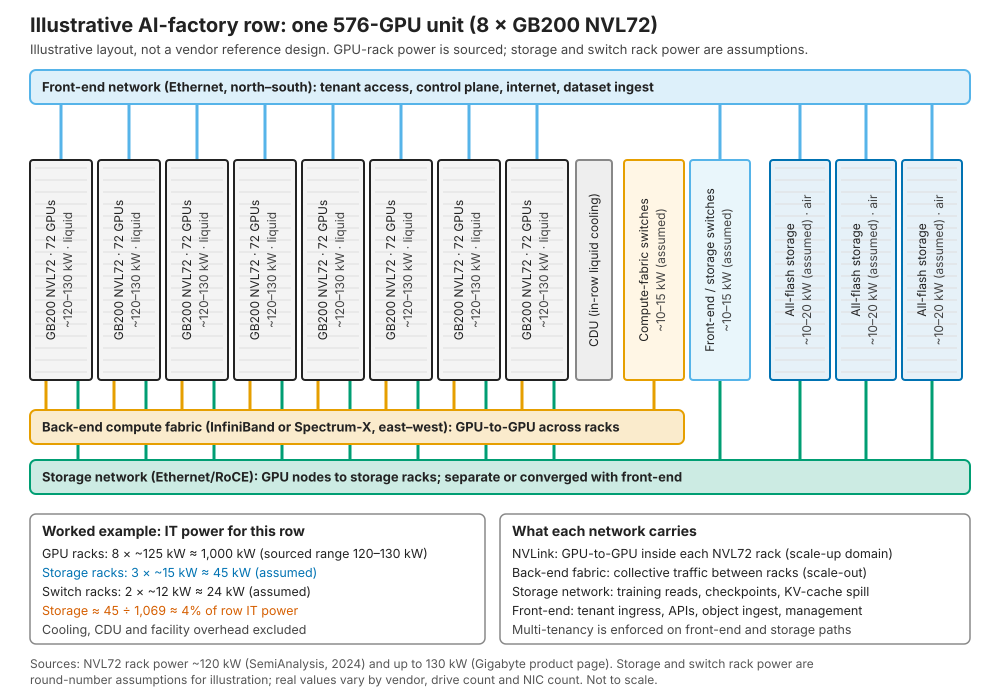
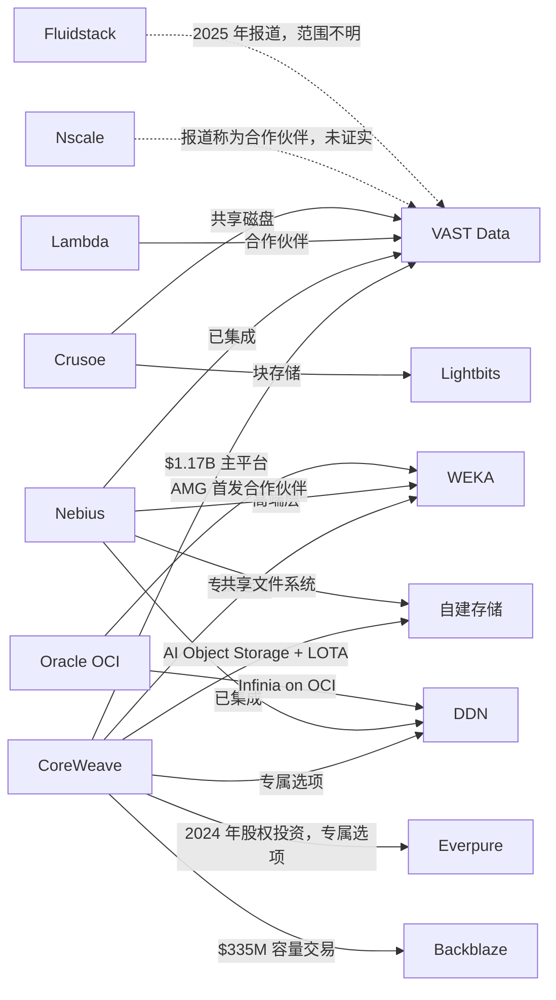
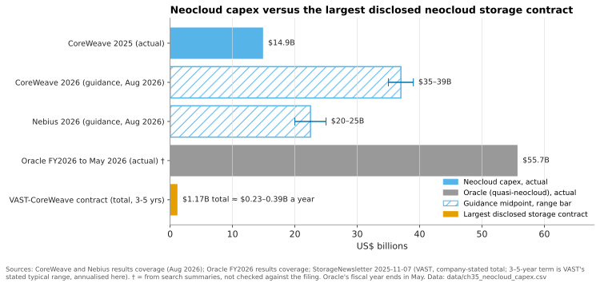

# 35. AI 工厂与新兴 GPU 云（neocloud）

> 📄 英文原文：[docs/05-ai-storage/35-ai-factories-and-neoclouds.md](../../../docs/05-ai-storage/35-ai-factories-and-neoclouds.md) · 本文为简体中文参考译本，如有出入以英文原文为准。

> **深度：** L2 · **阅读时间：** 约 10 分钟 · **最后核实：** 2026-11-01
> **前置阅读：** [GPU 数据路径](../02-protocols-and-networking/11-gpu-data-path.md) · [消费模式](../03-system-architecture/23-consumption-models.md) · [训练存储](31-training-storage.md) · [NVIDIA 生态与认证](34-nvidia-ecosystem.md)

## 要点速览（TL;DR）

- **新兴 GPU 云（neocloud）是专注 GPU 的云服务商，向 AI 实验室、企业乃至超大规模云厂商出租加速器算力。** 头部厂商如今已达公用事业级规模：CoreWeave 在 2025 年底于 43 个数据中心拥有超过 850 MW 的在运行电力[^1]，并将 2026 年资本开支指引定为 US$35–39 billion[^2]。
- **它们采购存储是为了转售，而非作为自用基础设施。** 存储必须支持多租户、通过 API 配置、按 $/GB-month 计量，并且必须在自身成本之上留出利润。
- **已披露的最大存储合同每年约占客户资本开支的 1%，存储约占一排 GPU 机柜电力的 4%，但它可以让 100% 的 GPU 闲置。** 因此，新兴 GPU 云对可靠性、部署速度和与 NVIDIA 的协同的重视程度高于价格。
- **VAST 是公认的在位者。** 其与 CoreWeave 的 US$1.17 billion 协议是已披露的最大交易[^3]。WEKA 和 DDN 在多供应商格局中占有一席，而最大的新兴 GPU 云越来越多地自建对象存储层。
- **Everpure 在这一领域是挑战者。** 它持有 CoreWeave 股权，拿下了少量 FlashBlade//EXA 新兴 GPU 云订单，消费模式也契合需求，但缺乏大型锚定客户。

## 对 Everpure 战略的意义

新兴 GPU 云是增长最快的新型存储买家，其采购方式与奠定 Everpure 业务基础的企业客户截然不同。仅 CoreWeave 在 2026 年 8 月的积压订单就约为 US$104 billion[^2]。它们选择的存储会影响参考设计、基准测试和买家预期，影响范围远超其自身的数据中心。VAST 的崛起（[第 42 章](../06-industry-and-competition/42-vast-data.md)）在很大程度上就是一个新兴 GPU 云的故事。

战略问题在于：哪类新兴 GPU 云业务值得争取。超大型新兴 GPU 云的交易规模巨大、高度集中，且越来越多地面临其自建方案的竞争。二线、主权及推理型新兴 GPU 云规模较小、数量更多、锁定程度更低。每一类都需要不同的产品、定价和融资姿态。

## 核心概念

### 新兴 GPU 云、AI 工厂与晶圆代工类比

**AI 工厂**是 NVIDIA 提出的术语，指以 token 为产出的数据中心：GPU、网络、存储和软件作为一条生产线统一设计。**新兴 GPU 云（neocloud**）则对外出租这类工厂。它按小时或通过多年期照付不议（take-or-pay）合同出售裸金属或 Kubernetes/Slurm GPU 集群，客户包括实验室、初创公司、企业以及算力紧缺的超大规模云厂商。Microsoft 与 Nebius 的合同价值约 US$17.4 billion[^4]。

半导体类比是晶圆代工模式。超大规模云厂商类似 IDM：它们自行设计存储栈（[第 36 章](36-hyperscaler-ai-storage.md)），正如 IDM 运营自己的工艺。新兴 GPU 云则类似一家年轻的纯晶圆代工厂：它们采购设备，在产能、量产速度和良率（此处即利用率）上竞争。它们采用参考流程认证过的任何设备，而 NVIDIA 云合作伙伴（NVIDIA Cloud Partner，NCP）参考设计扮演的正是 PDK 的角色。不在认证流程内的存储厂商很少能进入评估。

规模扩张非常迅速。CoreWeave 在 2025 年 IPO 时报告的机群约为 250,000 块 GPU、360 MW 在运行电力[^5]。到 2025 年底，其在运行电力超过 850 MW，已签约电力约 3.1 GW[^1]。截至 2026 年 6 月，其在运行电力约 1.5 GW、已签约约 3.7 GW，目标是在 2026 年底前实现超过 1.85 GW 的在运行电力[^6][^2]。Nebius 在 2026 年 8 月将 2026 年底已签约电力目标上调至 5 GW；已签约电力指土地和电力承诺，而非在运行容量，Nebius 预计届时并网容量为 0.8–1 GW[^7]。Oracle 扮演着准新兴 GPU 云的角色：其剩余履约义务（RPO）在 2026 财年第一季度突破 US$455 billion[^8]。Fluidstack 正在为 Anthropic 的 US$50 billion 计划建设数据中心[^9]。

### AI 工厂机柜排的构成

*图 35.1 — 在 AI 工厂的一排机柜中，存储在机柜数和电力上只占一小部分，并拥有独立网络，但每块 GPU 的数据、检查点和上下文都依赖于它。*

一个液冷 GB200 NVL72 机柜通过 NVLink 将 72 块 GPU 连接为一个纵向扩展域，功耗约 120 kW（厂商额定值最高 130 kW）[^10][^11]。八个这样的机柜构成一个 576 GPU 单元，功耗约 1 MW。从这排机柜引出三张网络：

- **后端计算网络**（InfiniBand 或 Spectrum-X 以太网）承载机柜之间 GPU 到 GPU 的集合通信。存储通常不接入该网络。
- **存储网络**（采用 RoCE 的以太网）承载训练读取、检查点和 KV 缓存溢出。它常常与前端网络融合，共用相同的网卡或 DPU。
- **前端网络**承载租户访问、API、数据集导入和管理流量。

这排机柜需要多少存储？各参考设计说法不一。Cisco 的 NCP 高性能存储设计为 1,152 块 GPU 配置 180 GB/s 读带宽，约合每块 GPU 0.16 GB/s [VERIFY: 仅见于搜索摘要][^12]。WEKA 的 NCP 认证设计给出的数字约为每块 GPU 1 GB/s[^13]。对我们的 576 块 GPU 而言，即 90–576 GB/s，相差六倍。差距主要来自检查点突发写入和可容忍的写停顿（[第 31 章](31-training-storage.md)）。NVIDIA 的 NCP 要求还增加了一道运营门槛：高速文件系统的端到端可用时间按每 PB 计需高于 99.5%；NFSv4 共享主目录层需满足更高（99.99%）的可用性目标；在就绪时间表上，数据移动系统须在 GPU 交付前约八周到位[^14]。

### 新兴 GPU 云与企业的采购差异

**1. 存储用于转售，因此按 GB-month 定价。** CoreWeave 的 Distributed File Storage 标价为 US$0.07/GB-month。其 AI Object Storage 热层 US$0.06、温层 US$0.03、冷层 US$0.015，不收取出口流量（egress）或请求费用[^15]。US$0.07/GB-month 相当于每 TB-年 US$840。仅为示意，假设四年内每可用 TB 的全部成本为 US$1,000。按标价且 100% 售出，收入为 US$3,360，成本 US$1,000，毛利率 70%。售出 50% 时毛利率降至约 40%，售出 30% 时大致盈亏平衡。**新兴 GPU 云的存储损益是一门利用率生意。** 这就是精简配置、数据缩减和按需容量定价备受重视的原因。而企业只看到那 US$1,000。

**2. 多租户本身就是产品。** 企业阵列服务于一家公司，管理员可信。新兴 GPU 云服务于数百个租户，彼此不能看到对方的数据，也不能受到对方嘈杂 I/O 的干扰。这意味着需要硬隔离（命名空间、VRF 隔离、按租户密钥）、QoS、配额、计量和自助式 API。例如，Crusoe 通过其 API、CLI 和 Terraform 提供基于 VAST 的共享磁盘[^16]。

**3. 可靠性和部署速度胜过价格。** 存储在新兴 GPU 云的资本开支中只是零头。VAST 与 CoreWeave 的协议为 US$1.17 billion，VAST 称典型期限为 3–5 年[^17]，即每年约 US$0.23–0.39 billion。相对 CoreWeave 2026 年 US$35–39 billion 的资本开支，约为 0.6–1.1%（图 35.3）。然而，一次存储故障就会让与之相连的所有 GPU 闲置（[第 11 章](../02-protocols-and-networking/11-gpu-data-path.md)测算了 GPU 闲置成本）。Blocks & Files 总结了新兴 GPU 云的观点：可靠性胜过存储价格，因为 GPU 停机的代价要高得多[^18]。

**4. 每机柜电力是硬约束。** 按图 35.1 的假设，三个存储机柜每个约 15 kW，合计 45 kW。这相当于 45 ÷ 125 ≈ 0.36 个 NVL72 机柜，约 26 块 GPU 的电力。在已签约兆瓦数封顶收入的情况下，即使存储的 $/TB 不重要，TB/W 和每机柜 TB 仍然重要（[第 38 章](38-power-and-density.md)）。

**5. 与 NVIDIA 的协同是入场券。** 新兴 GPU 云希望存储通过 NVIDIA NCP 级别认证并出现在 NCP 参考设计中（[第 34 章](34-nvidia-ecosystem.md)）。它们还希望存储在 NVIDIA 的路线图上：CoreWeave、Crusoe、Lambda、Nebius、OCI 等被列为 BlueField-4 STX 上下文内存架构的早期采用者[^19]。此外，买家会参考 SemiAnalysis 的 ClusterMAX 评级为新兴 GPU 云排名，其十项标准中就包括存储[^20]。

**6. 偏好软件定义。** 大型新兴 GPU 云希望存储运行在与其计算相同的认证服务器、备件和自动化体系上。例如，WEKA 原生运行在 Nebius 的服务器上[^21]。当一体机是通往认证配置的最快路径时，一体机才会胜出。

**7. 融资方式决定交易形态。** 新兴 GPU 云以客户合同为担保的债务、客户预付款和可转换债券为 GPU 融资。Nebius 预计 2026 年客户预付款将超过 US$9 billion，覆盖相关交易约 50–60% 的资本开支[^7]。它还在 2025 年 9 月定价发行了 US$2.75 billion 的可转换票据，若购买方全额行使选择权，最高可达约 US$3.16 billion[^22]。供应商被要求以消费式定价或延期付款相匹配，并承担交易对手风险。

| 标准 | 对新兴 GPU 云的重要性 | 得分较高的架构 |
|---|---|---|
| 硬多租户与 QoS | 数百个租户共享一个集群；一个嘈杂或泄露数据的邻居就意味着失去一个客户 | VAST（内置租户能力）；WEKA；FlashBlade//EXA（自 2026 年多租户/QoS 版本起）[^23] |
| API/Terraform 配置与计量 | 存储以自助方式出售，按 GB-month 计费 | 自建对象存储；VAST；WEKA |
| 每机柜、每瓦吞吐量 | 电力封顶收入；检查点突发决定容量规划 | 分解式闪存（VAST、FlashBlade//EXA）；追求原始 GB/s 的 DDN 一体机 |
| NVIDIA NCP 认证与 STX 路线图 | 进入参考设计和 NVIDIA 主导交易的入场券 | VAST、WEKA、DDN、Everpure、IBM、NetApp 均在争取[^19] |
| 运行在新兴 GPU 云自有硬件上 | 统一的供应链、备件池和自动化栈 | 软件定义（WEKA、VAST 软件、Lightbits、自建） |
| 规模化部署速度 | 存储就绪里程碑比 GPU 交付早数周；收入从交付时开始 | 拥有预验证机柜和规模化现场团队的厂商 |
| 消费式定价与融资 | 与债务和预付款资助的资本开支相匹配 | 订阅模式（Evergreen//One、VAST/WEKA 许可） |
| 向廉价容量的混合分层 | 冷数据的利润空间，免出口流量费的定位 | 原生对象设计；云容量合作伙伴（Backblaze） |

*表 35.1 — 新兴 GPU 云的采购标准：每 TB 价格的重要性低于租户能力、电力、与 NVIDIA 的协同和速度，这有利于软件定义的分解式设计。*

### 谁向谁供货

*图 35.2 — VAST 覆盖了每一家大型新兴 GPU 云，但最大的买家同时使用多家供应商并自建对象存储层；虚线表示有报道但未经双方确认的关系。*

连线来源：CoreWeave（其存储页面还列出了 IBM Storage Scale）[^24][^25][^3][^26][^27]；Nebius[^21][^28][^29][^30]；Lambda 和 Crusoe[^31][^16][^32]；OCI[^33][^34]。Nscale 仅出现在 Next Platform 列出的 VAST 合作伙伴名单中[^35]；Fluidstack 2025 年与 VAST 的交易可能不涵盖 Anthropic 的站点[^36]。Together AI 尚未披露其存储供应商 [VERIFY: Together AI 的存储供应商]。

### 自建的威胁

最大的新兴 GPU 云正在复制超大规模云厂商的打法。CoreWeave 的 AI Object Storage 运行 **LOTA**（Local Object Transport Accelerator，本地对象传输加速器），这是一个位于每个 GPU 节点本地 NVMe 上的缓存，宣称每块 GPU 最高可达 7 GB/s[^25]。Nebius 的自有共享文件系统目前已验证的集群规模为 100 PB [VERIFY: 仅见于搜索摘要][^30]。正在形成的模式是：自建对象存储承载海量数据，第三方文件存储承载最热层，再由低成本合作伙伴提供容量——例如 CoreWeave 与 Backblaze 签订的五年期、多 EB 级交易，由 Backblaze 在 CoreWeave AI Object Storage 之后提供基于 HDD 的存储层（初始订单约 US$335 million）[^27]。供应商只有在可量化地优于通用闪存自建方案时才能保住性能层；正是这种动态促使 Everpure 向 Meta 授权 DirectFlash，而非销售阵列[^37]（[第 29 章](../04-everpure/29-hyperscaler-ecosystem-financials.md)）。

*图 35.3 — 已披露的最大新兴 GPU 云存储交易每年约占其客户资本开支的 1%，这就是新兴 GPU 云依据风险和速度而非价格采购存储的原因。*

数据：`data/ch35_neocloud_capex.csv`

## Everpure 的做法与竞争对手对比

| 厂商 | 在新兴 GPU 云中的地位（公开信息） | 与新兴 GPU 云标准的契合度 | 弱点 |
|---|---|---|---|
| VAST Data | CoreWeave 的主平台（US$1.17B）；Lambda、Crusoe、Nebius 及众多二线厂商[^3][^31] | 原生多租户、运行在合作伙伴硬件上的软件、与 NVIDIA 关系紧密 | 集中于单一客户；新兴 GPU 云正在自建对象存储层 |
| WEKA | Nebius 高端层；CoreWeave 选项；OCI 首发合作伙伴[^21][^33] | 软件定义、运行在新兴 GPU 云服务器上、KV 缓存方案有说服力 | 规模和资产负债表较小；GPU 节点上需安装客户端软件 |
| DDN | CoreWeave 选项、Nebius、OCI；xAI 渊源[^28][^34] | 原始吞吐量、HPC 公信力、NVIDIA 参考设计 | 以一体机为中心；多租户服务下 Lustre 运维负担重 |
| Everpure（FlashBlade//EXA） | 持有 CoreWeave 股权并为其专属选项；STN、beyond.pl 订单[^26][^38] | 标准 pNFS 客户端、元数据层的 DirectFlash 密度、EXA 适用 Evergreen//One[^38]、NCP 参考架构[^39] | 多租户直到 2026 年才推出[^23]；EXA 数据节点仍是第三方 NVMe 服务器，因此 DFM 的电力密度尚未延伸到数据层（[第 37 章](37-reading-benchmarks.md)）；没有超大型新兴 GPU 云锚定客户 |
| 自建 / 开源 | CoreWeave AI Object Storage、Nebius 文件系统、Crusoe 的 Lightbits[^25][^32] | 成本最低、完全可控、硬件一致 | 工程负担重；难以胜任最热的文件层 |

*表 35.2 — VAST 占据新兴 GPU 云的锚定客户，WEKA 和 DDN 在多供应商格局中占有席位，Everpure 以挑战者身份进入，其抓手是融资，以及 DFM 数据节点出货后的电力密度。*

**VAST 的最强版本论证（steelman）。** VAST 凭借契合新兴 GPU 云经济模型的设计抢先一步。其无状态计算与共享 QLC 使新兴 GPU 云能够分别扩展性能和容量。它很早就具备多租户能力，在通用服务器上销售软件，而 CoreWeave 这一标杆客户使其成为较小新兴 GPU 云的稳妥选择——没有哪家愿意在 GPU 爬坡期间做实验。

**基于公开信息，战略团队可能评估的选项：**

1. **软件优先的 EXA。** 像对超大规模云厂商那样，在新兴 GPU 云认证的服务器上授权 EXA 软件，以收入总额换取市场存在。
2. **为爬坡提供融资。** Evergreen//One 已覆盖 EXA[^38]。与租户售出率挂钩的条款可满足标准 1 和 7，代价是承担信用风险敞口。
3. **在电力上领先。** 对照 NCP 容量规划发布 TB/W 和每机柜 TB 数据。
4. **瞄准二线、主权和推理型新兴 GPU 云。** 需求正在向企业推理转移[^18]，而 KV 缓存层（PureKVA、STX）在这一领域尚属新生、竞争激烈（[第 32 章](32-inference-and-kv-cache.md)）。
5. **利用与 CoreWeave 的关系。** 目标是拿下某一层或某个区域，而不是正面替代。

## 历史与发展轨迹

- **2023–2024：** H100 短缺催生热潮。VAST 先后成为 CoreWeave 和 Lambda 的存储平台（2023）[^40]。Crusoe 于 2024 年 9 月推出基于 VAST 的共享磁盘[^16]。Pure Storage 于 2024 年 11 月投资 CoreWeave[^26]。
- **2025：** CoreWeave 上市（3 月），并推出带 LOTA 的 AI Object Storage[^25]。Nebius 引入 DDN（5 月）和 WEKA（6 月）[^28][^21]。9 月，Nebius 签下 Microsoft 合同[^4]。10 月，Microsoft 与 Nscale 签约约 200,000 块 GB300 GPU（*公司自述*；未披露金额）[^41]。11 月，VAST 将与 CoreWeave 的关系扩展为 US$1.17 billion 协议[^3]，Anthropic 选定 Fluidstack[^9]。
- **2026：** NVIDIA 的 STX 公布新兴 GPU 云早期采用者（3 月）[^19]。Everpure 报告 EXA 新兴 GPU 云订单并将 Evergreen//One 扩展至 EXA（3 月）[^38]，随后为 EXA 增加多租户（6 月）[^23]。CoreWeave 与 Backblaze 签订 US$335M 容量交易（6 月）[^27]，并将资本开支指引上调至 US$35–39B（8 月）[^2]。
- **未来走向：** 推理重于训练、KV 缓存层兴起、头部厂商更多自建对象存储；若 GPU 租赁价格下跌快于债务摊还，较弱的新兴 GPU 云将面临信用压力。

## 关键数字

| 指标 | 数值 | 背景 | 来源 / 日期 |
|---|---|---|---|
| CoreWeave 在运行 / 已签约电力 | >850 MW / ~3.1 GW；~1.5 GW / ~3.7 GW | 2025 年底 43 个数据中心；2026 年 6 月 | 10-K FY2025[^1]；Q2 2026 电话会[^6] |
| CoreWeave 2026 年资本开支指引 | US$35–39B | 2026 年 8 月由 US$31–35B 上调 | Q2 2026 报道[^2] |
| CoreWeave 收入积压 | ~US$104B | 不含第三季度初超过 US$25B 的新增承诺 | Q2 2026 报道[^2] |
| VAST–CoreWeave 协议 | US$1.17B（*公司自述*） | 通常 3–5 年，每年 ≈ 2026 年资本开支的 0.6–1.1% | Reuters, 2025-11-06[^3] |
| CoreWeave 文件 / 热对象存储标价 | US$0.07 / US$0.06 per GB-month | 不收出口流量或请求费用 | CoreWeave 文档[^15] |
| NVL72 机柜功耗 | ~120–130 kW | 液冷；决定整排机柜的电力测算 | SemiAnalysis；Gigabyte[^10][^11] |
| 存储占整排电力比例 | ~4% | 算例，基于图 35.1 假设 | 算例 |
| NCP 就绪里程碑 | GPU 交付前约 8 周 | 数据移动系统；高速文件系统可用时间按每 PB >99.5% | NVIDIA NCP 要求[^14] |
| Nebius–Microsoft 合同 | ~US$17.4B（最高 ~US$19.4B） | 超大规模云厂商采购新兴 GPU 云算力 | Nebius 6-K, 2025-11[^4] |

## 对话手册

**向产品经理提的问题**

1. *"在 50% 售出率下，新兴 GPU 云基于 EXA 和基于 VAST 的存储损益分别是什么样？"* 高质量回答：对照租户标价给出每 TB-月成本，并计入数据缩减。
2. *"目前在新兴 GPU 云选型测试中，哪些租户功能拖了我们后腿？"* 高质量回答：具体差距（密钥、VRF、QoS 下限、计量、Terraform）及上线日期。
3. *"我们如何进入 GB300 和 Vera Rubin 的 NCP 参考设计，而不仅仅是获得认证？"* 高质量回答：能区分"获得认证"与"成为指定设计"。

**向工程师提的问题**

1. *"按每块 GPU 0.16 GB/s 与 1 GB/s 两种标准，为 1,152 块 GB300 GPU 规划存储。机柜、kW 和交换机端口会有什么变化？"* 高质量回答：给出两种情况下的节点数、kW 和端口数，并说明哪些租户需要哪种配置。
2. *"如何防止一个租户的检查点突发写入挤占另一个租户的训练读取？"* 高质量回答：在元数据层和数据层实施 QoS，并给出实测尾延迟。
3. *"EXA 数据节点能否运行在新兴 GPU 云自己的服务器型号上？"* 高质量回答：认证步骤、固件依赖、支持模式。

**不要这样说：**

- "新兴 GPU 云是价格驱动型买家。" 在存储上并非如此：已披露的最大交易每年约占资本开支的 1%，因此风险、速度和电力才是主导因素。
- "VAST 拿下了所有新兴 GPU 云。" CoreWeave 和 Nebius 都同时使用多家供应商并自建存储。
- "NCP 认证就能赢得交易。" 认证只是让你获得资格。赢得交易靠的是进入参考设计和拿下锚定客户。
- "多租户是一项功能。" 对新兴 GPU 云而言，它就是产品本身。
- "CoreWeave 是超大规模云厂商。" 它像晶圆厂采购设备一样采购第三方存储并为之融资。

## 深入阅读（可选，L3 指引）

- NVIDIA "Requirements for AI Clouds" 的存储章节；详细的 NCP 存储设计仅在合作伙伴门户提供[^14]。
- Cisco、IBM、DDN、WEKA 和 Pure Storage（FlashBlade//S500）的厂商 NCP 参考架构[^12][^39]。
- CoreWeave FY2025 10-K 中关于客户集中度和债务的风险因素[^1]。
- SemiAnalysis ClusterMAX 2.0 方法论，了解买家如何为新兴 GPU 云存储打分[^20]。

## 关键术语

- **新兴 GPU 云（Neocloud）**——出租 AI 集群的 GPU 专业云服务商。
- **AI 工厂（AI factory）**——为生产 AI token 而端到端设计的数据中心。
- **NCP（NVIDIA Cloud Partner）**——NVIDIA 面向 GPU 云的合作伙伴计划及参考设计。
- **LOTA**——CoreWeave 为其 AI Object Storage 提供的节点本地缓存。
- **售出率（Sell-through）**——已安装存储容量中实际向租户计费的比例。
- **ClusterMAX**——SemiAnalysis 的 GPU 云评级体系。
- 其余术语请参阅[术语表](../glossary.md)。

## 资料来源

[^1]: SEC, "CoreWeave, Inc. Form 10-K for fiscal year ended December 31, 2025," 2026. https://www.sec.gov/Archives/edgar/data/1769628/000176962826000104/crwv-20251231.htm (retrieved 2026-11-01).
[^2]: Channelchek, "CoreWeave Q2 2026 Earnings: CRWV Stock Jumps 14% on Record Revenue and Raised AI Capex Guidance," 2026-08. https://dashboard.channelchek.com/?p=104902 ; corroborated by TrendSpider, "CoreWeave Stock Jumps After Q2 Earnings Beat," 2026-08. https://trendspider.com/blog/coreweave-stock-q2-earnings-guidance-2026/ (both retrieved 2026-11-01).
[^3]: Reuters (via AOL), "Exclusive: Nvidia-backed Vast Data inks $1.17 billion AI deal with CoreWeave," 2025-11-06. https://www.aol.com/articles/exclusive-nvidia-backed-vast-data-120456403.html (retrieved 2026-11-01).
[^4]: SEC, "Nebius Group N.V. Form 6-K, Exhibit 99.2 (Q3 2025 results)," 2025-11. https://www.sec.gov/Archives/edgar/data/1513845/000110465925109806/tm2530882d1_ex99-2.htm (retrieved 2026-11-01).
[^5]: The Next Platform, "CoreWeave's 250,000-Strong GPU Fleet Undercuts The Big Clouds," 2025-03-06. https://www.nextplatform.com/ai/2025/03/06/coreweaves-250000-strong-gpu-fleet-undercuts-the-big-clouds/1656232 (retrieved 2026-11-01).
[^6]: MarketBeat, "CoreWeave Q2 Earnings Call Highlights," 2026-08-11. https://www.marketbeat.com/instant-alerts/coreweave-q2-earnings-call-highlights-2026-08-11/ (retrieved 2026-11-01).
[^7]: MarketBeat, "Nebius Group Q2 Earnings Call Highlights," 2026-08-12. https://www.marketbeat.com/instant-alerts/nebius-group-q2-earnings-call-highlights-2026-08-12/ ; Rivkin, "Nebius Group (NASDAQ:NBIS)" Q2 2026 results summary, 2026-08. https://rivkin.com.au/?p=37370 ; The Energy Mag, "Nebius Group reports 454% revenue growth in Q2 2026, raises power guidance to 5 GW," 2026-08. https://theenergymag.com/news/market-news/nebius-group-reports-454-revenue-growth-in-q2-2026-raises-power-guidance-to-5-gw (both retrieved 2026-11-01).
[^8]: DatacenterDynamics, "Oracle has $455bn in remaining performance obligations at end of Q1 2026," 2025-09. https://www.datacenterdynamics.com/en/news/oracle-has-455bn-in-remaining-performance-obligations-at-end-of-q1-2026/ (retrieved 2026-11-01).
[^9]: TechCrunch, "Anthropic announces $50 billion data center plan," 2025-11-12. https://www.techcrunch.com/2025/11/12/anthropic-announces-50-billion-data-center-plan/ (retrieved 2026-11-01).
[^10]: SemiAnalysis, "GB200 Hardware Architecture and Component Supply Chain & BOM," 2024-07. https://newsletter.semianalysis.com/p/gb200-hardware-architecture-and-component (retrieved 2026-11-01).
[^11]: Gigabyte, "NVIDIA GB200 NVL72 (GIGAPOD)," n.d. https://www.gigabyte.com/Enterprise/GIGAPOD-Pod-Scale/AI-DLC-POD_NVIDIA-GB200-NVL72 (retrieved 2026-11-01).
[^12]: Cisco, "High-Performance Storage Reference Architecture for NVIDIA Cloud Partners, GB200/GB300 NVL72" (EBox, per file name), n.d. https://www.cisco.com/c/dam/en/us/solutions/collateral/artificial-intelligence/cisco-ebox-hcp-nvl72-hps-ra.pdf (retrieved 2026-11-01).
[^13]: WEKA, "How Certified Storage is Reshaping the AI Factory Floor," n.d. https://weka.io/article/how-certified-storage-is-reshaping-the-ai-factory-floor (retrieved 2026-11-01).
[^14]: NVIDIA Docs, "NVIDIA Requirements for AI Clouds – Storage requirements," n.d. https://docs.nvidia.com/dsx/ncp/nvidia-requirements-for-ai-clouds/storage-requirements ; NVIDIA, "NVIDIA Requirements for AI Clouds" v2.4, 2026-09-01. https://docs.nvidia.com/dsx/ncp/nvidia-requirements-for-ai-clouds/v2.4 (both retrieved 2026-11-01; read via search summary).
[^15]: CoreWeave Docs, "Storage Pricing," n.d. https://docs.coreweave.com/docs/pricing/pricing-storage (retrieved 2026-11-01).
[^16]: Crusoe, "Crusoe announces collaboration with VAST Data to deliver high-performance, scalable data platform on Crusoe Cloud," 2024-09-26. https://www.crusoe.ai/resources/newsroom/crusoe-vast-data-to-deliver-high-performance-data (retrieved 2026-11-01).
[^17]: StorageNewsletter, "Vast Data Secures Commercial Partnership Deal with CoreWeave for $1.17 Billion to Power the Next Generation of AI," 2025-11-07. https://www.storagenewsletter.com/2025/11/07/vast-data-secures-commercial-partnership-deal-with-coreweave-for-1-17-billion-to-power-the-next-generation-of-ai/ (retrieved 2026-11-01).
[^18]: Blocks & Files, "VAST Data and the evolving neoclouds," 2026-06-16. https://www.blocksandfiles.com/ai-ml/2026/06/16/vast-data-and-the-evolving-neoclouds/5256380 (retrieved 2026-11-01).
[^19]: StorageNewsletter, "Nvidia GTC 2026: Nvidia Launches BlueField-4 STX Storage Architecture With Broad Industry Adoption," 2026-03-17. https://www.storagenewsletter.com/2026/03/17/nvidia-gtc-2026-nvidia-launches-bluefield-4-stx-storage-architecture-with-broad-industry-adoption/ (retrieved 2026-11-01).
[^20]: SemiAnalysis, "ClusterMAX 2.0," 2025 (evaluation conducted August–September 2025). https://clustermax.semianalysis.com/v2 (retrieved 2026-11-01).
[^21]: Blocks & Files, "Nebius taps WEKA for top layer of storage in GPU farms," 2025-06-10. https://www.blocksandfiles.com/ai-ml/2025/06/10/nebius-taps-weka-for-top-layer-of-storage-in-gpu-farms/1594977 (retrieved 2026-11-01).
[^22]: Nebius, "Nebius Group announces pricing of upsized private offering of $2.75 billion of convertible senior notes," 2025-09-10. https://nebius.com/newsroom/nebius-group-announces-pricing-of-upsized-private-offering-of-2-75-billion-of-convertible-senior-notes (retrieved 2026-11-01); SEC, "Nebius Group N.V. Form 424B5 (convertible senior notes due 2030 and 2032)," 2025-09. https://www.sec.gov/Archives/edgar/data/1513845/000110465925088885/tm2525503-3_424b5.htm (retrieved 2026-11-01).
[^23]: Coolspirit, "Pure Accelerate 2026: What the Latest Announcements Mean for Enterprise Storage," 2026-06. https://www.coolspirit.co.uk/blogs/pure-accelerate-2026-what-the-latest-announcements-mean-for-enterprise-storage (retrieved 2026-11-01).
[^24]: CoreWeave, "Storage" product page, n.d. https://coreweave.com/products/storage (retrieved 2026-11-01).
[^25]: CoreWeave, "CoreWeave Unveils AI Object Storage, Redefining How AI Workloads Access and Scale Data," 2025. https://coreweave.com/news/coreweave-unveils-ai-object-storage-redefining-how-ai-workloads-access-and-scale-data (retrieved 2026-11-01).
[^26]: Pure Storage, "Pure Storage Announces Strategic Investment and Technology Partnership with CoreWeave," 2024-11. https://www.purestorage.com/company/newsroom/press-releases/pure-announces-strategic-investment-and-tech-partnership-with-coreweave.html (retrieved 2026-11-01).
[^27]: Blocks & Files, "Backblaze gets $335 million CoreWeave bonanza," 2026-06-23. https://blocksandfiles.com/public-cloud/2026/06/23/backblaze-gets-335-million-coreweave-bonanza/5260288 (retrieved 2026-11-01).
[^28]: Blocks & Files, "DDN storing data for Nebius AI's GPU server farm," 2025-05-02. https://www.blocksandfiles.com/ai-ml/2025/05/02/ddn-storing-data-for-nebius-ais-gpu-server-farm/1600313 (retrieved 2026-11-01).
[^29]: Nebius, "VAST Data" partner catalogue entry, n.d. https://nebius.com/partner-catalog/vast (retrieved 2026-11-01).
[^30]: Nebius, "Storage for AI workloads," n.d. https://nebius.com/storage (retrieved 2026-11-01).
[^31]: Blocks & Files, "The nature of the VAST Data beast," 2025-12-11. https://blocksandfiles.com/2025/12/11/the-nature-of-the-vast-data-beast (retrieved 2026-11-01).
[^32]: Crusoe, "How We Built It: Block Storage for AI/ML Workloads, Powered by Lightbits," 2024. https://crusoe.ai/blog/how-we-built-it-block-storage-for-ai-ml-workloads-powered-by-lightbits/ (retrieved 2026-11-01).
[^33]: Oracle Blogs, "Scaling long-context inference on OCI with WEKA's Augmented Memory Grid," 2025-11. https://blogs.oracle.com/ai-and-datascience/scaling-long-context-inference-on-oci-with-wekas-augmented-memory-grid (retrieved 2026-11-01).
[^34]: Blocks & Files, "DDN goes hard CORE," 2025-11-18. https://www.blocksandfiles.com/ai-ml/2025/11/18/ddn-goes-hard-core/1718766 (retrieved 2026-11-01).
[^35]: The Next Platform, "VAST Data's $1.17 Billion Deal With CoreWeave Is A Leading Indicator," 2025-11-08. https://www.nextplatform.com/ai/2025/11/08/vast-datas-117-billion-deal-with-coreweave-is-a-leading-indicator/1696240 (retrieved 2026-11-01).
[^36]: Baxtel, "Fluidstack chooses VAST Data platform for AI workloads," 2025-04. https://baxtel.com/news/fluidstack-chooses-vast-data-platform-for-ai-workloads (retrieved 2026-11-01).
[^37]: SiliconANGLE, "Shares of Pure Storage jump on impressive earnings beat and strong guidance," 2024-12-03. https://siliconangle.com/2024/12/03/shares-pure-storage-jump-impressive-earnings-beat-strong-guidance/ (retrieved 2026-11-01).
[^38]: Blocks & Files, "Everpure dives deeper into AI," 2026-03-16. https://www.blocksandfiles.com/ai-ml/2026/03/16/everpure-dives-deeper-into-ai/5209351 (retrieved 2026-11-01).
[^39]: Pure Storage, "High-Performance Storage for NVIDIA Cloud Partners (Reference Architecture)," n.d. https://www.purestorage.com/content/dam/pdf/en/reference-architectures/ra-high-performance-storage-for-nvidia-cloud-partners.pdf (retrieved 2026-11-01).
[^40]: Blocks & Files, "VAST Data bags second GPU cloud customer, Lambda Labs," 2023-10-23. https://www.blocksandfiles.com/ai-ml/2023/10/23/vast-data-bags-second-gpu-cloud-customer-lambda-labs/1595654 (retrieved 2026-11-01).
[^41]: Nscale, "Nscale Contracts Approximately 200,000 NVIDIA GB300 GPUs with Microsoft to Deliver NVIDIA AI Infrastructure Across Europe and the U.S.," 2025-10-15. https://nscale.com/press-releases/nscale-microsoft-2025 ; TechCrunch, "Nscale inks massive AI infrastructure deal with Microsoft," 2025-10-15. https://techcrunch.com/2025/10/15/nscale-inks-massive-ai-infrastructure-deal-with-microsoft/ (both retrieved 2026-11-01).
