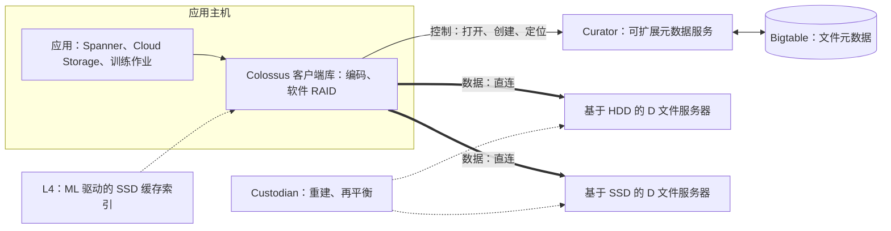
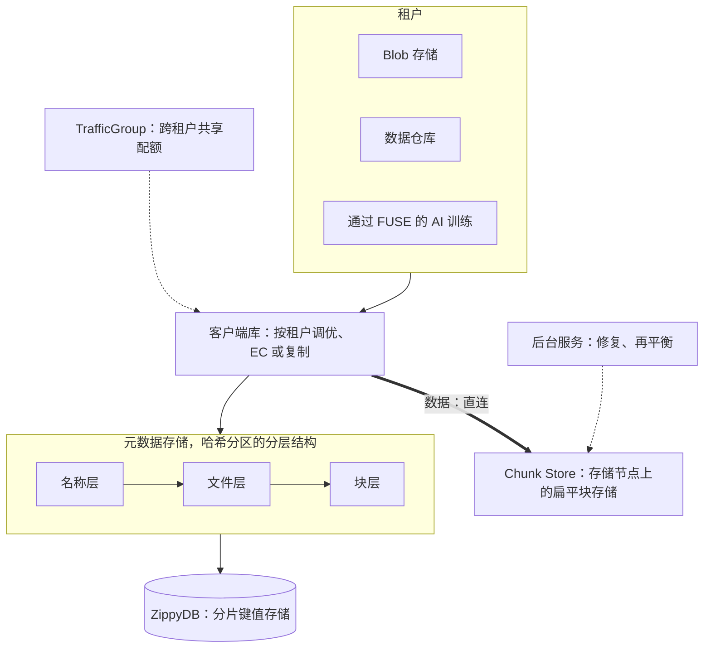
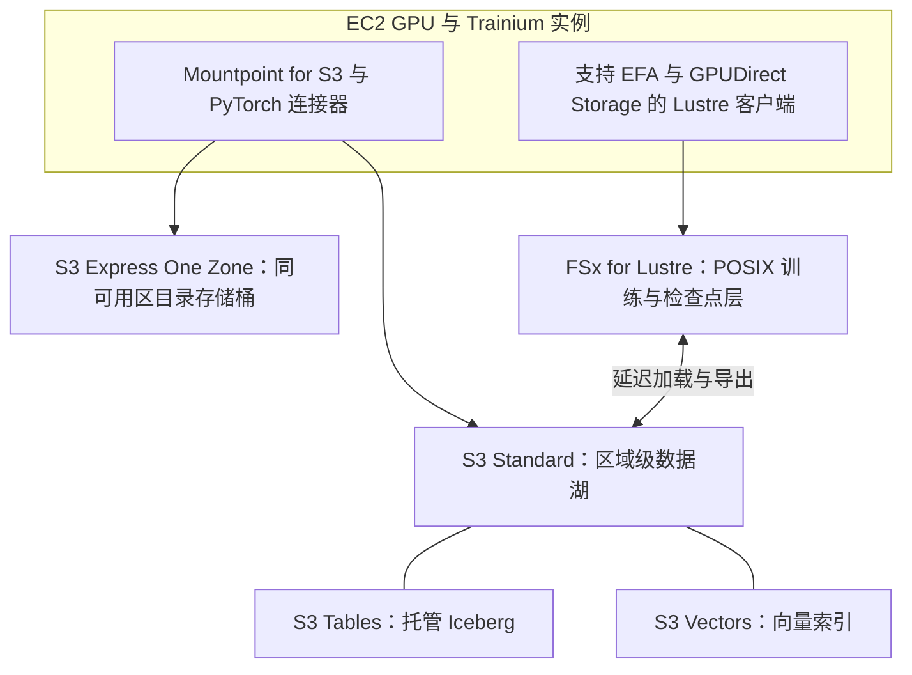
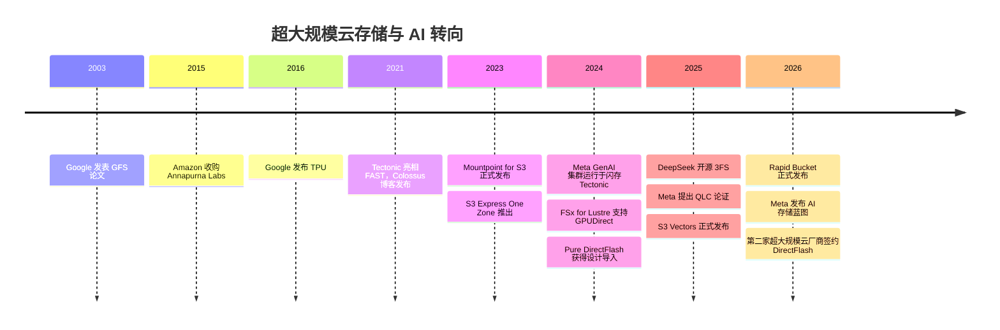

# 36. 超大规模云厂商如何构建 AI 存储

> 📄 英文原文：[docs/05-ai-storage/36-hyperscaler-ai-storage.md](../../../docs/05-ai-storage/36-hyperscaler-ai-storage.md) · 本文为简体中文参考译本，如有出入以英文原文为准。

> **深度：** L2 · **阅读时间：** 约 10 分钟 · **最后核实：** 2026-11-01
> **前置阅读：** [并行文件系统](../03-system-architecture/17-parallel-file-systems.md) · [对象存储架构](../03-system-architecture/18-object-storage-architecture.md) · [元数据](../03-system-architecture/21-metadata.md) · [训练存储](31-training-storage.md) · [Purity 与 DirectFlash](../04-everpure/26-purity-and-directflash.md)

## 要点速览（TL;DR）

- **超大规模云厂商自建文件系统、外购零部件。** Google（Colossus）、Meta（Tectonic）和 AWS（S3）运行自研软件，将一个数据中心的通用硬盘整合为一个资源池。它们不为自身工作负载采购任何阵列。
- **这些设计是近亲。** 智能客户端库、建在可扩展数据库上的元数据（Colossus 用 Bigtable，Tectonic 用 ZippyDB）以及简单的数据服务器，数据路径上没有控制器。
- **AI 推动它们从磁盘走向闪存。** 这些系统原本基于 HDD 加少量闪存构建，如今面对的是每 TB 需要高得多带宽的 GPU 集群。Meta 的 GenAI 集群运行在针对闪存优化的 Tectonic 上；Google、AWS 和 Azure 则出售按可用区部署、紧邻 GPU 的存储层。
- **超大规模云厂商即便外购，买的也是组件和 IP，而非系统。** Meta 和另一家前五大超大规模云厂商授权使用了 Everpure 的 DirectFlash 设计，同时自行采购 NAND。云*服务*确实会向租户转售合作伙伴产品（Google 上的 DDN Lustre、VAST 上架服务）。
- **这与 TPU、Trainium 和 Nitro 的逻辑相同。** 在规模足以摊薄工程投入、且该部件能形成差异化的地方自建；在商用供应商规模更大的地方外购。供应商在缝隙中取胜。

## 对 Everpure 战略的意义

头部超大规模云厂商是全球最大的存储介质买家，却几乎对存储系统厂商关闭大门。对 Everpure（NYSE: P，原 PSTG）而言，这在三个方面很重要。其超大规模云厂商收入之所以存在，完全是因为 Pure Storage 找到了一道缝隙：授权闪存管理软件和模块设计，由客户自行采购 NAND[^1][^2]。超大规模云厂商的设计确立了新兴 GPU 云和企业所仿效的参考架构。而超大规模云厂商是将冷数据继续留在 HDD 上还是迁移到 QLC，是闪存与磁盘需求之争中最大的变量（[第 48 章](../06-industry-and-competition/48-media-suppliers-and-nand-cycle.md)）。

超大规模云厂商自建哪些层、外购哪些层，以及边界为何移动，决定了授权交易的可触达范围。[第 29 章](../04-everpure/29-hyperscaler-ecosystem-financials.md)讨论交易财务；本章讨论边界背后的工程逻辑。

## 核心概念

### 共同模式：每个数据中心一个分解式文件系统

企业阵列将智能放在主机与硬盘之间的控制器中（[第 14 章](../03-system-architecture/14-scale-up-dual-controller.md)）。超大规模文件系统去掉了这个盒子：

- 每个应用中都有一个**客户端库**，负责编码数据、查找数据位置，并直接与存储服务器之间进行流式读写。
- **元数据服务**作为分片应用运行在可扩展数据库上；文件名和块映射只是数据库中的行。
- **精简的数据服务器**通过网络暴露本地磁盘，后台工作进程负责修复和再平衡。

**半导体类比。** 将 RAID 逻辑移入客户端，就像将内存控制器移到 CPU 裸片上。它省去了一跳和一个盒子，但前提是你掌控每个应用及其库。超大规模云厂商做得到；企业存储厂商做不到，所以它们出售控制器和标准协议。

### Google Colossus

Colossus 继 GFS 之后成为 Google 的集群级文件系统，支撑着 Cloud Storage、Firestore、YouTube、Drive 和 Gmail[^3]。其控制平面是一组 **Curator**，将文件系统元数据存储在 Bigtable 中。这一改变使 Colossus 的元数据规模比最大的 GFS 集群扩大了 100 倍以上。数据直接在客户端库与 **D 文件服务器**（即网络附加磁盘）之间流动。**Custodian** 负责重建和磁盘均衡[^3]。

*图 36.1 — Colossus 将元数据保存在数据库中、数据保存在简单的磁盘服务器上；掌控数据路径的是客户端库，而非控制器。*

有两个 Colossus 文件系统各自容纳超过 10 EB；最大的文件系统经常超过 50 TB/s 读取和 25 TB/s 写入，最繁忙的集群可提供超过 6 亿（600 million）IOPS[^4]。按每块 HDD 约 250 MB/s 计算，50 TB/s 相当于 200,000 块硬盘的流式带宽。

其经济性来自介质混合：Google 只购买恰好足以把 I/O 密度提升到应用所需水平的闪存，以及恰好满足容量的磁盘[^3]。一个名为 **L4** 的层决定哪些数据值得放在 SSD 上，它运行读缓存和回写策略，并按文件类别模拟诸如"SSD 保留一小时"之类的选项。同样的模拟也驱动 SSD 采购[^4]。**半导体类比：** L4 是一个采用学习型替换策略的末级缓存，在购买硅片前先通过模拟命中率来确定容量。

面向 AI，**Rapid Bucket**（2026 年 4 月正式发布）是建在 Colossus 上、按可用区部署的 Cloud Storage 存储桶；Google 宣称单个存储桶可达超过 15 TB/s、每秒 2,000 万（20 million）次请求和亚毫秒级延迟。**Rapid Cache**（原 Anywhere Cache）可在现有存储桶前增加最高 2.5 TB/s 的读缓存[^5]。对 POSIX 用户，Google 出售基于 DDN EXAScaler 构建的 Managed Lustre，目前宣称每实例最高 10 TB/s，约为其 2025 年发布时数字的 10 倍[^5][^6]。以上三个数字均为 Google 自述。

### Meta Tectonic

Tectonic 是 Meta 的 EB 级多租户文件系统（USENIX FAST '21[^7]），每个数据中心运行一个集群。它取代了照片和视频 blob 的独立系统（Haystack 和 f4）以及数据仓库的众多 HDFS 集群[^7][^8]。数据仓库集群数量减少到原来的十分之一[^8]。

*图 36.2 — Tectonic 将元数据拆分为建在共享键值存储上的多个层，并在公共块池之上为每个租户提供独立的客户端侧调优。*

有两个关键思想。**分解式元数据**：名称、文件和块是相互独立的层，每层都哈希分区到键值存储中，因此一个热点目录不会压垮保存块映射的服务器[^7][^8]。**无需按租户划分集群的多租户**：租户共享几十个流量组（traffic group），因此 blob 存储的峰值不再闲置那些本可供数据仓库使用的磁盘[^8]，而纠删码宽度等租户特定调优则放在客户端库中。这是整合论证的超大规模版本（[第 19 章](../03-system-architecture/19-software-defined-and-hci.md)）。

**AI 改变了介质。** Meta 的两个 24,576 GPU GenAI 集群（2024）使用自研 FUSE 客户端运行在针对闪存优化的 Tectonic 上，另有一套与 Hammerspace 联合开发的并行 NFS 部署，两者均运行在配备大容量 E1.S SSD 的 YV3 Sierra Point 服务器上[^9]。一个算例可以说明原因。一个含优化器状态的 405B 参数检查点约为 405e9 × 16 bytes ≈ 6.5 TB。要在 60 秒内写完，需要约 108 GB/s。这相当于约 430 块全速流式写入、每块约 250 MB/s 的 HDD（尚未计入纠删码开销），或约 22 块每块约 5 GB/s 的 NVMe SSD。

Meta 2026 年 7 月发布的"AI 存储蓝图"增加了与 GPU 同址部署、基于闪存的区域级 BLOB 存储；一个嵌入 Tectonic 块客户端以绕过代理的客户端 SDK；针对尾延迟的对冲读取（hedged read）；以及将 GPU 主机内存和本地闪存用作 L1/L2 缓存[^10]：这是围绕单一可信数据源构建的缓存层级（[第 31 章](31-training-storage.md)）。

2025 年 3 月，Meta 主张将 QLC 闪存作为中间层，因为随着硬盘容量增大，HDD 每 TB 的带宽在下降。Meta 将 QLC 用于仍需约 10 MB/s per TB 的工作负载，介于 HDD 和 TLC 之间；目前一些需要 15–20 MB/s/TB 的批处理工作负载运行在 TLC 上[^11]。算术如下：一块约 250 MB/s 的硬盘在 20 TB 时最多提供 12.5 MB/s/TB，在 30 TB 时只有 8.3 MB/s/TB。在混合访问下，真实 HDD 集群的表现更差：Meta 在 2025 年一次会议演示中给出的 HDD 集群供给为 5–7 MB/s/TB[^12]。Meta 点名了 Pure Storage 的 DirectFlash Module 以及其他厂商的标准 QLC SSD[^11][^13]。

### AWS：对象存储居中，文件与缓存在边缘

AWS 围绕 S3 构建分层栈；AWS 在 re:Invent 2025 上表示，S3 存储了超过 500 万亿（500 trillion）个对象和数百 EB 数据[^14]。另有引自 AWS 早前一次演讲的峰值接近 1 PB/s[^15] [VERIFY: S3 约 1 PB/s 峰值带宽，仅有二手来源]。

*图 36.3 — AWS 将 S3 作为记录系统，并增加可用区级对象、并行文件和客户端侧各层，把带宽带到 GPU 旁边。*

- **S3 Express One Zone**（2023 年 11 月）将目录存储桶放在计算所在的可用区（Availability Zone），实现个位数毫秒级访问。AWS 在发布时宣称其访问速度比 S3 Standard 快 10 倍[^16]，随后于 2025 年 4 月将存储价格下调 31%、GET 价格下调 85%[^17]。
- **FSx for Lustre** 是与 S3 关联的托管并行文件系统，自 2024 年 11 月起支持 EFA 和 GPUDirect Storage，每客户端最高 1,200 Gbps（150 GB/s），是此前 100 Gbps TCP 上限的 12 倍[^18]。
- **Mountpoint for S3**（2023 年 8 月正式发布）是一个开源客户端，将文件读取映射为 S3 GET，每实例最高 100 Gb/s[^19]。
- **S3 Tables**（Iceberg，2024 年 12 月）和 **S3 Vectors**（2025 年 12 月正式发布，每个索引最多 20 亿（2 billion）个向量）将分析和 RAG 数据纳入对象层[^20][^21]（[第 33 章](33-rag-vector-lakehouse.md)）。

AWS 并没有为 AI 发明新的文件系统。它以服务形式运行开源 Lustre，把自研投入集中在规模能带来回报的地方：对象存储、EFA 网络和 Nitro 卸载卡。

### Azure：EB 级 Blob 加托管 Lustre

Microsoft 以 Blob 为中心，其"扩展账户"（scaled accounts）让 OpenAI 能够跨区域运行 EB 级数据集[^22]。对 POSIX 需求，Azure Managed Lustre 的 AMLFS 20 SKU（2025 年 11 月预览）在单一命名空间内可达 25 PiB 和 512 GB/s，即每 TiB 20 MB/s：这是一个带宽偏轻、容量偏重的存储层，每 5 PiB 增加一台元数据服务器[^23]。Azure 是首个提交 MLPerf Storage 的超大规模云服务，在 v3.0 中检查点写入达到 642 GiB/s[^24]（[第 37 章](37-reading-benchmarks.md)）。Azure 还通过其 Native ISV Service 提供 VAST[^25]。

### DeepSeek 3FS：开源的超大规模设计

DeepSeek 于 2025 年 2 月开源了其 **Fire-Flyer File System（3FS）**[^26]。其设计遵循同样的模式：建在事务型键值存储（FoundationDB）上的无状态元数据服务、用于强一致性的链式复制（CRAQ），以及由所有客户端共享的存储节点。一个 180 节点的集群（每节点配备 2×200 Gb/s InfiniBand 和十六块 NVMe SSD）实现了约 6.6 TiB/s 的聚合读取[^27]。按节点计算：6.6 TiB/s ÷ 180 ≈ 37.5 GiB/s，而线速为 400 Gb/s ≈ 46.6 GiB/s，即约达到网卡的 80%。它为 AI 而非照片归档而建，因此是全闪存。它表明 AI 实验室能够构建超大规模级别的存储并免费开放，这对专有软件的定价构成压力。

### 自建还是外购，以及与定制芯片的类比

| 买家 | 自建 | 外购 | 原因 |
|---|---|---|---|
| 头部超大规模云厂商（Google、Meta、AWS、Microsoft） | 文件系统、元数据、纠删码、缓存、客户端库；按 OCP 式规范定制的服务器 | HDD、NAND/SSD、网卡；选择性 IP 授权（DirectFlash）；部分云服务中的合作伙伴软件 | EB 级规模可摊薄大型团队成本；掌控整个技术栈；介质是商品，供应商具有规模优势 |
| 拥有自有集群的 AI 实验室（DeepSeek、Meta FAIR 类） | 精简并行文件系统（3FS）或调优后的超大规模文件系统 | 服务器、SSD、InfiniBand | 工作负载窄且已知；人才集中 |
| 新兴 GPU 云（CoreWeave、Nebius、Lambda） | 对象层和 GPU 侧缓存（如 CoreWeave LOTA）[^28] | 来自 VAST、WEKA、DDN、Everpure 的专用文件系统[^28] | 上市速度；客户要求经认证、成熟的系统；存储团队规模小（[第 35 章](35-ai-factories-and-neoclouds.md)） |
| 大型企业 | 数据平台以下几乎不自建 | 阵列和 SDS（Everpure、NetApp、Dell、VAST）或云服务 | 规模不足以摊薄存储团队成本；需要支持、SLA 和功能 |

*表 36.1 — 规模越大，自建边界越低：超大规模云厂商除介质外全部自建，新兴 GPU 云只自建 GPU 侧的衔接层，企业则采购系统。*

这一逻辑与芯片如出一辙。Google 在 2016 年 5 月宣布 TPU 之前已运行它约一年[^29]。AWS 于 2015 年收购 Annapurna Labs 以打造 Nitro，随后推出 Graviton 和 Trainium（2020 年 12 月发布）[^30]。设计是专有的；晶圆来自代工厂。在存储领域，文件系统相当于芯片设计，NAND 和 HDD 则是在商用市场上采购的代工产能。DirectFlash 授权就像授权 SerDes 或 CPU 核：这类 IP 能加快自研设计，又无需把控制权让给系统厂商。

## Everpure 的做法与竞争对手对比

| 厂商 | 如何触达超大规模云厂商 | 超大规模云厂商获得什么 | 优势 | 弱点 |
|---|---|---|---|---|
| Everpure | DirectFlash 软件与模块设计授权，外加非 NAND 部件；客户自行采购 NAND[^1][^2] | 在自有文件系统之下实现高密度的裸 NAND 管理 | 公开已知唯一进入前五大超大规模云厂商自有存储内部的阵列厂商；无 NAND 库存风险 | 仅两家客户；超大规模云厂商可借助 FDP SSD 重建该功能 |
| DDN | 作为第一方云服务（Google Cloud Managed Lustre）的引擎[^6] | 为云租户提供成熟的 Lustre | Lustre 积累深厚；Google 品牌背书 | 卖给的是云*服务*，而非 Google 的内部存储 |
| VAST | Google Cloud 和 Azure 上的托管市场服务[^25][^31] | 面向租户的一站式 AI 数据平台 | 市场进入快；与本地部署相同的软件 | 属于市场上架收入，而非内部基础设施 |
| Hammerspace | 为 Meta 的 GenAI 集群联合开发并行 NFS[^9] | 基于标准、构建在现有存储之上的 NFS | 进入 Meta 的 AI 技术栈 | 是建在他人存储之上的软件层 |
| 通用 SSD 制造商（Samsung、Solidigm、Micron） | 直接供货；FDP 等标准 | 标准 QLC/TLC SSD | 规模大、多源供应 | 差异化很小 |

*表 36.2 — 供应商进入超大规模云厂商有两条路：以 IP 或组件形式进入内部基础设施，或以托管合作伙伴形式进入云服务；只有前者能触及那些 EB 级数据。*

针对 Everpure 的最强反方论证（steelman）是：超大规模云厂商可以自己做。由 Meta 和 Google 推动的 NVMe 灵活数据放置（Flexible Data Placement，FDP）让标准 SSD 能接收放置提示，从而消除 DirectFlash 所针对的大部分写放大（[第 26 章](../04-everpure/26-purity-and-directflash.md)）。Meta 在使用 DFM 的同时也在使用标准 QLC SSD[^11]。反驳的论据是显示性偏好：当 Meta 需要大规模掌控裸闪存时，它选择了授权；另一家前五大超大规模云厂商于 2026 年 8 月跟进，预计从 FY2028 起产生收入[^2]。基于公开信息，战略团队可能评估的选项包括：还有哪些超大规模云厂商的文件系统面临同样的 HDD 向闪存迁移压力，以及授权能否延伸到 FTL 之上的软件。

## 历史与发展轨迹

*图 36.4 — 2003–2021 年磁盘时代的文件系统，在 2023–2026 年间围绕闪存和 GPU 就近性被重新构建。*

有两个信号指向未来。**存储正在向 GPU 靠近**：可用区级存储桶、区域级 BLOB 栈和主机内存缓存以牺牲持久性域为代价换取延迟和带宽。**闪存正在向容量层推进**：2025 年 8 月，Pure Storage 预计到 FY26 末将向 Meta 交付 1–2 EB 的 DirectFlash[^32]。HDD 仍在超大规模 EB 级容量中占主导地位，看空者认为磁盘保有较大的 TCO 优势（[第 48 章](../06-industry-and-competition/48-media-suppliers-and-nand-cycle.md)）；争论的焦点在于闪存抢占份额的速度。

## 关键数字

| 指标 | 数值 | 背景 | 来源 / 日期 |
|---|---|---|---|
| 最大的 Colossus 文件系统 | 各 >10 EB（两个）；>50 TB/s 读取、25 TB/s 写入 | 公司自述 | Google, 2025-03-26[^4] |
| Google Rapid Bucket | >15 TB/s、20M req/s、亚毫秒 | Colossus 上的单个可用区级存储桶 | Google, 2026-04-22[^5] |
| Meta GenAI 集群规模 | 2 × 24,576 GPUs | 闪存 Tectonic + Hammerspace NFS | Meta, 2024-03-12[^9] |
| Tectonic 数据仓库整合 | 集群数量减少到 1/10（10×） | 从 HDFS 迁移之后 | Meta, 2021-06-21[^8] |
| FSx for Lustre 每客户端吞吐量 | 1,200 Gbps | 配合 EFA + GDS；此前为 100 Gbps | AWS, 2024-11-27[^18] |
| S3 Express One Zone 降价 | 存储 −31%，GET −85% | 2025 年 4 月 | AWS, 2025-04-10[^17] |
| Azure Managed Lustre AMLFS 20 | 25 PiB、512 GB/s | 预览版 | Microsoft, 2025-11[^23] |
| DeepSeek 3FS 读取吞吐量 | 180 节点约 6.6 TiB/s | 约为网卡线速的 80%（算例） | DeepSeek GitHub[^27] |
| HDD 每 TB 带宽 | 12.5 → 8.3 MB/s/TB | 250 MB/s 硬盘，20 TB 对比 30 TB | 算例 |

## 对话手册

**向产品经理提的问题**

1. *"除 Tectonic 外，还有哪些超大规模云厂商的文件系统撞上了同样的 HDD 每 TB 带宽瓶颈？"* 高质量回答：点出具体工作负载（温 blob、AI 数据湖），并说明授权如何适配各个文件系统，而不只是讲 Meta 的故事。
2. *"相比 FDP 加标准 QLC SSD，我们能为超大规模云厂商多提供什么？"* 高质量回答：给出每机柜密度、电力、写放大方面的数字，以及客户否则需要自行维护的软件。
3. *"授权模式能否卖给没有 Tectonic 这类系统的二线云或新兴 GPU 云？"* 高质量回答：授权模式假定买家拥有自己的文件系统；其他买家需要 FlashBlade//EXA 这样的完整系统。

**向工程师提的问题**

1. *"DirectFlash 相对于超大规模云厂商的文件系统处在什么位置？"* 高质量回答：位于存储服务器之下的介质与闪存管理层，放置、纠删码和元数据仍由文件系统负责（公开资料未详述集成细节）。
2. *"超大规模云厂商如何防止尾延迟导致 GPU 停顿？"* 高质量回答：对冲读取、客户端侧并发控制、主机内存和本地 NVMe 缓存，以及可用区级放置，正如 Meta 2026 年蓝图所述。
3. *"要让 Colossus 的 L4 层将海量数据从 HDD 迁移到 QLC，需要满足什么条件？"* 高质量回答：比较单位带宽成本与每 TB 成本；一旦 HDD 必须为满足带宽而超额配置，闪存就会胜出。

**不要这样说：**

- "超大规模云厂商采购存储阵列。" 在内部，它们采购的是介质，偶尔采购 IP。
- "Meta 用 Pure 替换了它的磁盘。" Meta 是在 HDD 之外增加 QLC 作为中间层，同时也使用标准 QLC SSD。
- "我们与 Colossus 或 Tectonic 竞争。" 它们是内部系统；我们竞争的是建在它们之上的服务，例如 Rapid Bucket。
- "3FS 证明存储软件一文不值。" 工作负载单一的实验室可以自建；企业仍会为支持和功能付费。

## 深入阅读（可选，L3 指引）

- Tectonic FAST '21 论文：分层元数据与一致性语义[^7]。
- 2025 年 Colossus 博文中引用的 CacheSack：L4 背后的准入策略[^4]。
- 3FS 设计说明：CRAQ 与 USRBIO 零拷贝客户端 API[^27]。

## 关键术语

- **Colossus / Curator / D 文件服务器（D file server）**——Google 的集群文件系统、其元数据服务器（基于 Bigtable）及其简单磁盘服务器。
- **L4 缓存（L4 cache）**——Colossus 中由 ML 驱动的 SSD 缓存与放置层。
- **Tectonic / ZippyDB / Chunk Store**——Meta 的多租户文件系统、保存其元数据的键值存储，以及其扁平数据层。
- **S3 Express One Zone / Rapid Bucket**——AWS 和 Google 为 AI 构建的可用区级低延迟对象存储层。
- **智能客户端（Smart client）**——自行完成放置和编码的客户端库，因此数据路径上没有控制器。
- **对冲读取（Hedged read）**——向第二个副本发送的重复请求，用于降低尾延迟。
- 其余术语请参阅[术语表](../glossary.md)。

## 资料来源

[^1]: SiliconANGLE, "Shares of Pure Storage jump on impressive earnings beat and strong guidance," 2024-12-03. https://siliconangle.com/2024/12/03/shares-pure-storage-jump-impressive-earnings-beat-strong-guidance/ (retrieved 2026-11-01).
[^2]: Everpure, "Everpure Lands New Design Win with Second Top-Five Hyperscaler," 2026-08-10. https://www.everpuredata.com/company/newsroom/press-releases/everpure-lands-new-design-win-with-second-top-five-hyperscaler.html (retrieved 2026-11-01); Motley Fool, "Everpure (P) Q2 2027 Earnings Call Transcript," 2026-08-31. https://www.fool.com/earnings/call-transcripts/2026/08/31/everpure-p-q2-2027-earnings-call-transcript/ (retrieved 2026-11-01).
[^3]: Google Cloud Blog (D. Hildebrand, D. Serenyi), "Colossus under the hood: a peek into Google's scalable storage system," 2021-04-19. https://cloud.google.com/blog/products/storage-data-transfer/a-peek-behind-colossus-googles-file-system (retrieved 2026-11-01).
[^4]: Google Cloud Blog (L. Greenfield, S. Pollen), "Colossus under the hood: How we deliver SSD performance at HDD prices," 2025-03-26. https://cloud.google.com/blog/products/storage-data-transfer/how-colossus-optimizes-data-placement-for-performance (retrieved 2026-11-01).
[^5]: Google Cloud Blog, Cloud Next '26 storage announcements, 2026-04-22. https://cloud.google.com/blog/products/storage-data-transfer/next26-storage-announcements (retrieved 2026-11-01).
[^6]: Business Wire, "DDN Announces Collaboration with Google Cloud to Advance AI Initiatives with Google Cloud Managed Lustre and Infinia at Google Cloud Next 2025," 2025-04-09. https://www.businesswire.com/news/home/20250409046523/en/ (retrieved 2026-11-01).
[^7]: USENIX, Pan et al., "Facebook's Tectonic Filesystem: Efficiency from Exascale," FAST '21, 2021-02. https://www.usenix.org/conference/fast21/presentation/pan (retrieved via search 2026-11-01).
[^8]: Meta Engineering, "Tectonic file system: Consolidating Facebook storage infrastructure," 2021-06-21. https://engineering.fb.com/2021/06/21/data-infrastructure/tectonic-file-system/ (retrieved via search 2026-11-01).
[^9]: Meta Engineering, "Building Meta's GenAI Infrastructure," 2024-03-12. https://engineering.fb.com/2024/03/12/data-center-engineering/building-metas-genai-infrastructure/ (retrieved via search 2026-11-01).
[^10]: Meta Engineering, "Meta's AI storage blueprint at scale," 2026-07-01. https://engineering.fb.com/2026/07/01/data-infrastructure/metas-ai-storage-blueprint-at-scale/ (retrieved via search 2026-11-01).
[^11]: Meta Engineering, "A case for QLC SSDs in the data center," 2025-03-04. https://engineering.fb.com/2025/03/04/data-center-engineering/a-case-for-qlc-ssds-in-the-data-center/ (retrieved via search 2026-11-01).
[^12]: S. Gupta (Meta), "QLCP-201-1," Future of Memory and Storage 2025, 2025-08-06. https://files.futurememorystorage.com/proceedings/2025/20250806_QLCP-201-1_Gupta.pdf (seen via search summary, 2026-11-01).
[^13]: Blocks & Files, "Meta's positive assessment of Pure Storage's flash mettle," 2025-04-07. https://blocksandfiles.com/2025/04/07/metas-positive-assessment-of-pure-storages-flash-mettle/ (retrieved via search 2026-11-01).
[^14]: Blocks & Files, "AWS piles on S3 upgrades from vector search to 50 TB objects," 2025-12-03. https://www.blocksandfiles.com/ai-ml/2025/12/03/aws-piles-on-s3-upgrades-from-vector-search-to-50-tb-objects/1704690 (retrieved 2026-11-01; read via search summary).
[^15]: Wikipedia, "Amazon S3" (bandwidth figure attributed to an AWS re:Invent 2024 session), n.d. https://en.wikipedia.org/wiki/Amazon_S3 (retrieved via search 2026-11-01).
[^16]: AWS What's New, "Announcing the Amazon S3 Express One Zone storage class," 2023-11-28. https://aws.amazon.com/about-aws/whats-new/2023/11/amazon-s3-express-one-zone-storage-class (retrieved 2026-11-01).
[^17]: AWS What's New, "Amazon S3 Express One Zone reduces storage and request prices," 2025-04-10. https://aws.amazon.com/about-aws/whats-new/2025/04/amazon-s3-express-one-zone-reduces-storage-request-prices/ (retrieved via search 2026-11-01).
[^18]: AWS What's New, "Amazon FSx for Lustre now supports Elastic Fabric Adapter and NVIDIA GPUDirect Storage," 2024-11-27. https://aws.amazon.com/about-aws/whats-new/2024/11/amazon-fsx-lustre-elastic-fabric-adapter-nvidia-gpudirect-storage/ (retrieved via search 2026-11-01).
[^19]: AWS News Blog, "Mountpoint for Amazon S3 – Generally Available and Ready for Production Workloads," 2023-08-09. https://aws.amazon.com/blogs/aws/mountpoint-for-amazon-s3-generally-available-and-ready-for-production-workloads/ (retrieved via search 2026-11-01).
[^20]: AWS, "Amazon S3 User Guide: Document history / What's New," n.d. https://docs.aws.amazon.com/AmazonS3/latest/userguide/WhatsNew.md (retrieved 2026-11-01).
[^21]: StorageNewsletter, "AWS re:Invent 2025: Amazon S3 Vectors is Now Generally Available with 40 Times the Scale of Preview," 2025-12-05. https://www.storagenewsletter.com/2025/12/05/aws-reinvent-2025-amazon-s3-vectors-is-now-generally-available-with-40-times-the-scale-of-preview/ (retrieved 2026-11-01).
[^22]: Microsoft, "OpenAI accelerates AI innovation with Azure Blob Storage scaled accounts" (customer story), n.d. https://www.microsoft.com/en/customers/story/23427-openai-lp-azure-blob-storage (retrieved via search 2026-11-01).
[^23]: Microsoft Tech Community, Azure HPC Blog, Azure Managed Lustre AMLFS 20 public preview, 2025-11. https://techcommunity.microsoft.com/blog/azurehighperformancecomputingblog/-/4470665 (retrieved via search 2026-11-01).
[^24]: StorageReview, "MLPerf Storage v3.0: 877 GiB/s Checkpoints, a Cloud First, and a Leaderboard Turned Over," 2026-09. https://www.storagereview.com/news/mlperf-storage-v3-0-877-gib-s-checkpoints-a-cloud-first-and-a-leaderboard-turned-over (retrieved 2026-11-01).
[^25]: VAST Data, "VAST and Microsoft Azure Unite to Advance Agentic AI," 2025-11-18. https://www.vastdata.com/press-releases/vast-and-microsoft-azure-unite-to-advance-agentic-ai (retrieved 2026-11-01).
[^26]: Tom's Hardware, "DeepSeek releases powerful new parallel file system, Fire-Flyer File System, made open source," 2025-03. https://tomshardware.com/pc-components/storage/deepseek-releases-powerful-new-parallel-file-system-fire-flyer-fire-system-made-open-source (retrieved via search 2026-11-01).
[^27]: DeepSeek, "3FS" repository README, n.d. https://github.com/deepseek-ai/3FS (retrieved 2026-11-01).
[^28]: CoreWeave, "Storage" product page, n.d. https://coreweave.com/products/storage (retrieved 2026-11-01).
[^29]: Google Cloud Blog (N. Jouppi), "Google supercharges machine learning tasks with TPU custom chip," 2016-05-18. https://cloud.google.com/blog/products/ai-machine-learning/google-supercharges-machine-learning-tasks-with-custom-chip (retrieved via search 2026-11-01).
[^30]: Amazon Science, "How silicon innovation became the 'secret sauce' behind AWS's success," n.d. https://amazon.science/how-silicon-innovation-became-the-secret-sauce-behind-awss-success (retrieved via search 2026-11-01).
[^31]: Blocks & Files, "VAST supports Google Cloud TPUs in managed service with Red Stapler's SW," 2025-11-11. https://blocksandfiles.com/2025/11/11/vast-supports-google-cloud-tpus-in-managed-service-with-red-staplers-sw/ (retrieved 2026-11-01).
[^32]: Blocks & Files, "Pure knocking it out of the park," 2025-08-29. https://blocksandfiles.com/2025/08/29/pure-knocking-it-out-of-the-park/ (retrieved 2026-11-01).
