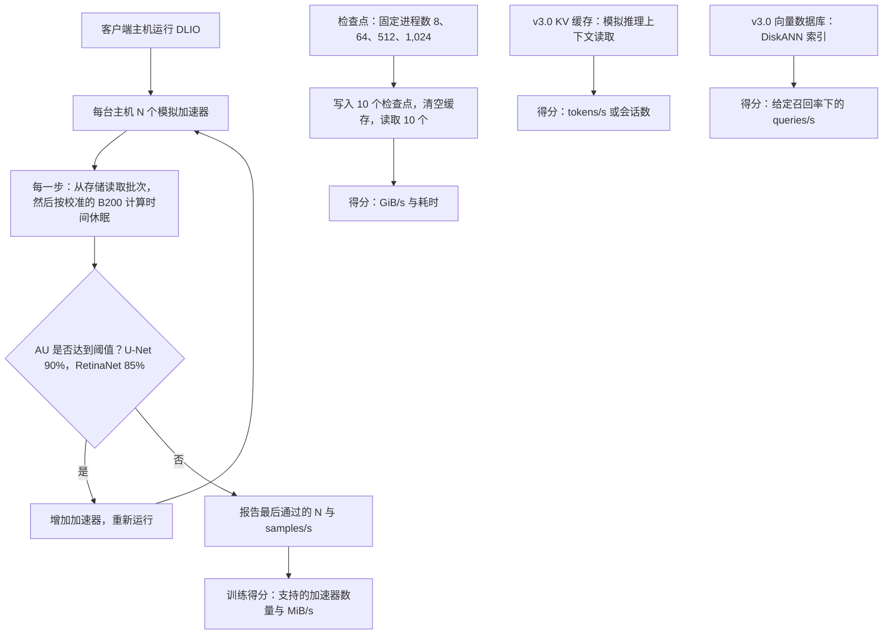
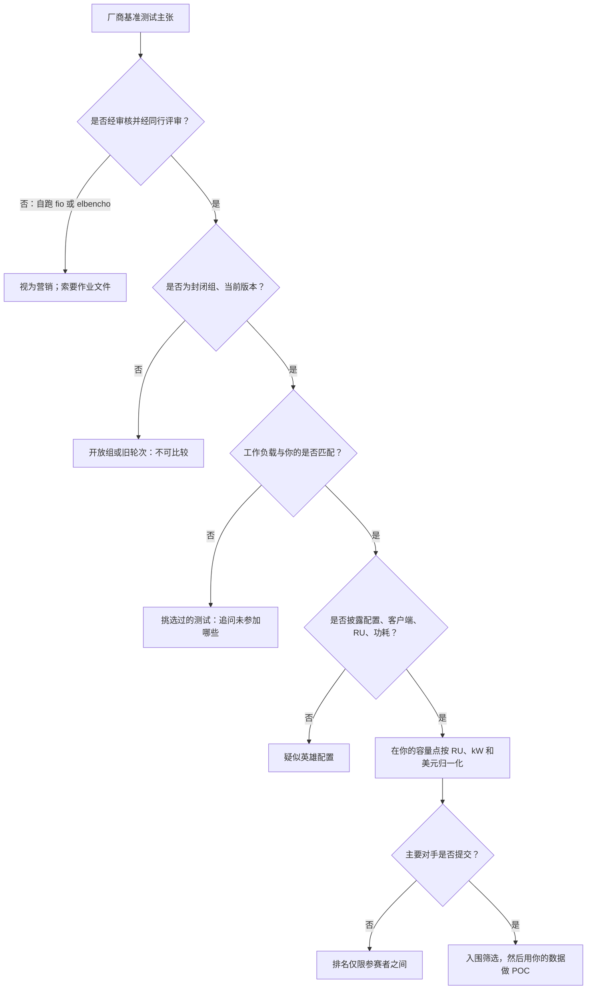
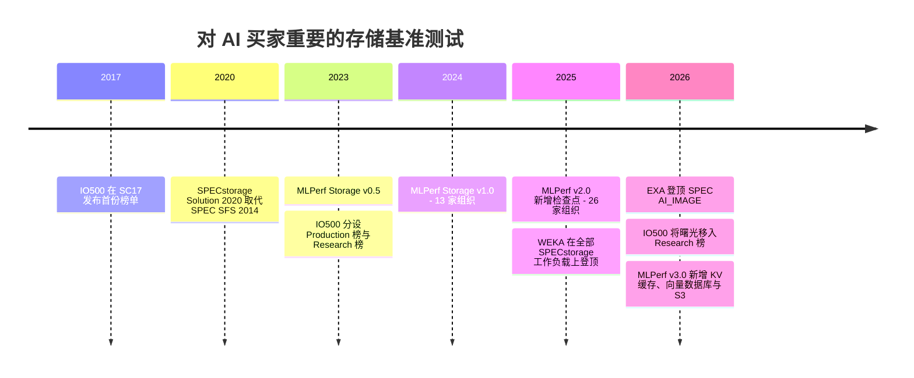

# 37. 批判性解读基准测试

> 📄 英文原文：[docs/05-ai-storage/37-reading-benchmarks.md](../../../docs/05-ai-storage/37-reading-benchmarks.md) · 本文为简体中文参考译本，如有出入以英文原文为准。

> **深度：** L2 · **阅读时间：** 约 11 分钟 · **最后核实：** 2026-11-01
> **前置阅读：** [性能与经济性指标](../01-storage-fundamentals/04-performance-and-economics-metrics.md) · [训练存储](31-training-storage.md) · [推理与 KV 缓存](32-inference-and-kv-cache.md) · [FlashArray 与 FlashBlade](../04-everpure/27-flasharray-and-flashblade.md)

## 要点速览（TL;DR）

- **存储基准测试衡量的主要是提交了多少硬件。** 横向扩展系统本身就能扩展，因此最大的配置胜出。一个数字在按买方容量点除以机架单元（RU）、千瓦或美元之前，几乎没有意义。
- **MLPerf Storage 不使用真实 GPU。** 模拟加速器以休眠代替"计算"；得分是存储能让多少个加速器保持在利用率阈值之上。这本质上是带宽除以单个加速器的需求，因此不同版本之间的结果不可比较。
- **每个基准测试都有盲区。** SPECstorage AI_IMAGE 竞争者寡；IO500 混用单位，并把生产系统与研究系统分榜；STAC-M3 以"Y 项中赢得 X 项"报告；厂商自跑的 fio 结果的可信度完全取决于其作业文件。
- **缺席本身就是数据。** VAST、WEKA 和 DDN 均未参加 MLPerf Storage v3.0（2026 年 9 月）。Everpure 在检查点和 KV 缓存上的第一名成绩经同行评审、真实可信，但取得于最强对手缺席的赛场。
- **基准测试用于入围筛选，概念验证（POC）才决定胜负。** 下文的十个问题可把工程结果与营销区分开来。

## 对 Everpure 战略的意义

基准测试是 AI 存储厂商（包括 Everpure）把工程成果转化为销售主张的方式。FlashBlade//EXA 在 MLPerf Storage v3.0 和 SPECstorage AI_IMAGE 上的成绩，是 Everpure 争取新兴 GPU 云（neocloud）和 AI 工厂订单的论据支点（[第 27 章](../04-everpure/27-flasharray-and-flashblade.md)），竞争对手会像 Everpure 攻击它们的成绩一样攻击这些成绩。为一项基准测试主张"定价"，能区分持久的技术领先与单纯的配置选择；当尽职调查标的（[第 50 章](../06-industry-and-competition/50-diligence-framework.md)）以"世界纪录"开场时，这一点同样重要。

是否参赛本身就是战略选择：一边是成本（工程人周、硬件、可能公开落败），另一边是在无法自行测试的买方中建立的可信度。参加哪些测试、如何表述结果，是战略团队可以基于公开信息评估的选项。

## 核心概念

### 为什么存储基准测试比芯片基准测试更难

CPU 基准测试运行在单颗芯片上。存储基准测试运行在一个*系统*上（服务器、驱动器、网络、客户端、软件），全部由提交方自行选择。这就像为自选数量的 HBM 堆栈宣称内存带宽，却不附带芯片面积或功耗。横向扩展存储在设计上近乎线性扩展（[第 15 章](../03-system-architecture/15-scale-out-shared-nothing.md)），所以"最快"通常意味着"配置最大"。真正有用的信息是结果的*形态*：单节点速率、扩展效率、负载下的延迟。

### MLPerf Storage 如何运作

MLCommons 推出的 MLPerf Storage 不使用加速器。一个名为 DLIO 的工具运行在普通客户端主机上，以真实数据加载器的行为读取数据，然后*休眠*一段时间，长度等于真实 GPU 计算每个批次所需的时间[^1]。v2.0 规则列出了 A100、H100、B200 和 AMD MI355[^2]，v3.0 的提交则模拟 B200 或 MI355[^3]。

关键指标是**加速器利用率（AU）**：模拟加速器处于"计算"而非等待数据状态的时间占比。提交方不断增加加速器，直到 AU 跌破阈值，然后报告通过阈值的最大加速器数量及其吞吐量。按 v2.0 规则，3D U-Net 和 ResNet-50 的阈值为 90%，CosmoFlow 为 70%[^2]。在 v3.0 中，封闭组训练工作负载为 3D U-Net（90%）和 RetinaNet（85%）[^4][^3]。CosmoFlow、ResNet-50、DLRM 和 Flux 被移入不排名的"whatif"类别[^5]。

*图 37.1 — MLPerf Storage 用休眠代替计算，把存储带宽转换成"保持忙碌的加速器数量"。检查点、KV 缓存和向量测试则直接以带宽、token 数和查询数计分。*

**"支持的加速器数量"其实是变相的带宽。** 在 v1.0 中，华为 OceanStor A800 在 3D U-Net 上以 679 GB/s 喂饱了 255 个模拟 H100[^1]。即 679 ÷ 255 ≈ 每个加速器 2.7 GB/s。DDN 的 EXAScaler AI400X2T 以 18 个客户端、36 个 H100 达到 99,018 MiB/s[^6]，即每个约 2.9 GB/s。因此这个数量大致等于吞吐量 ÷ 2.7 GB/s。更快的模拟 GPU 每个需要更多带宽，同样的存储"支持"的数量就更少，所以 v3.0 的 B200 数量不能与 v2.0 的 H100 数量相比[^7]。

**防作弊规则。** 数据集必须至少是客户端内存总量的五倍，因此无法驻留在页缓存中。结果取预热后连续多次运行的平均值，不得挑选，且须可在 5% 以内复现[^2]。检查点测试针对 Llama 3 8B、70B、405B 和 1T 使用固定进程数（8 到 1,024 个 rank；每个检查点约 105 GB 到 18 TB）；当检查点小于客户端内存的三倍时，主机必须在写入与读取之间清空文件缓存[^2]。提交须披露拓扑结构，对本地部署系统还须披露机架单元数及全部通电硬件清单；但不要求实测功耗，因此瓦数仍需估算[^2]。同行评审为封闭式：提交方可对彼此的结果提出异议，相关结果可被修正、移入开放组或撤回[^2]。

**封闭组与开放组。** *封闭组*固定代码，只允许少数可调参数（如读取线程数）；存储侧优化不受限制。*开放组*允许经披露的自定义加载器、数据格式和框架修改[^2]。把开放组结果与封闭组结果并列引用，就是混淆类别。

**v3.0 新增了什么。** 2026 年 9 月这一轮共有来自 19 家组织的 143 项结果，其中 11 家为首次提交，例如 Everpure、Azure、Nebius 和 NVIDIA。缺席的有 VAST、WEKA 和 DDN，以及华为、Hammerspace、Lightbits 等 v2.0 提交方[^8][^7]。本轮新增了 **KV 缓存**测试（由工作组设计的模拟，衡量存储为推理上下文供数的速度）、基于 Milvus 的**向量数据库**测试（以给定召回率下的每秒查询数计分），以及与 POSIX 并列的 **S3 对象路径**[^8][^4][^9]。关于向量数据集规模，各方报道不一：封闭配置为 1,000 万个向量，另一说为 100 万个、1,536 维 [VERIFY: v3.0 规则中向量数据库的数据集规模与索引类型][^4][^9]。功耗与机架空间效率开始作为报告指标被记录[^7] [VERIFY: 仅见于搜索摘要]。

### 其他基准测试

| 基准测试 | 衡量内容 | 运行方 / 审核方 | 主要指标 | 可操纵程度 | 最适用途 |
|---|---|---|---|---|---|
| **MLPerf Storage**（MLCommons） | 训练读取、检查点写入/读取、KV 缓存读取、向量检索，均使用模拟加速器 | 厂商运行；提交方之间的封闭式同行评审[^2] | 支持的加速器数量、GiB/s、tokens/s、QPS | 中：配置规模、客户端数量、选择参加哪些工作负载 | AI 训练与检查点的入围筛选 |
| **SPECstorage Solution 2020**（SPEC） | 五类文件工作负载：AI_IMAGE、EDA_BLENDED、GENOMICS、SWBUILD、VDA | 厂商运行；发布前经 SPEC 审核 | 业务指标（如 AI_Jobs）及总体响应时间（ORT）[^10] | 中：各工作负载参赛者稀少，SPEC 禁止跨工作负载比较[^10] | 负载上升时的文件系统延迟 |
| **IO500** | IOR easy（大块顺序）与 hard（小块、共享文件）带宽、mdtest easy/hard 元数据、并行 find | 站点或厂商提交；委员会对可复现性评分[^11] | 带宽得分与元数据得分的几何平均[^12] | 高：偏重元数据的技巧、研究级软件、客户端数量（因此设有 10 节点榜） | HPC 并行文件系统、元数据压力测试 |
| **STAC-M3**（STAC） | kdb+ 行情数据分析（Antuco、Kanaga 套件） | STAC 审核厂商赞助的测试 | 数十项测试的平均响应时间[^13] | 中："Y 项中 X 项最佳"式报告，完整报告常限订阅用户 | 金融时间序列买家 |
| **厂商 fio / elbencho / GDSIO** | 作业文件写什么就测什么 | 厂商，未经审核 | GB/s、IOPS、延迟 | 很高：块大小、队列深度、可压缩缓冲区、驻留缓存的工作集 | 工程调优与 POC 脚本，绝不能作为宣传主张 |

*表 37.1 — AI 存储买家会遇到的五类基准测试。审核与固定规则越少，可操纵程度越高。*

**SPECstorage Solution 2020** 于 2020 年末取代 SPEC SFS 2014[^14]。每个工作负载不断增加"业务单元"，直到响应时间崩溃，从而得到负载-延迟曲线，这比单一峰值更能说明问题。AI_IMAGE 的参赛者很少。2025 年 2 月，运行在 HPE 硬件上的 WEKA 在全部五个工作负载上登顶，其中包括 5,000 AI_Jobs[^15]。2026 年 2 月，FlashBlade//EXA 以 0.97 ms ORT 取得 6,300 AI_Jobs，使用了 30 个刀片、60 个数据节点和 80 台客户端主机[^16][^17]。

**IO500** 以 GiB/s 为带宽测试计分、以 kIOPS 为元数据测试计分，再取几何平均。混合单位没有物理意义，强劲的元数据成绩可以掩盖疲弱的带宽[^12]。写入阶段必须至少运行 300 秒[^18]。自 ISC23 起，一份可复现性问卷把 **Production（生产）**榜与 **Research（研究）**榜分开[^11]。这一规则在 ISC26 上发挥了作用：曙光（Sugon）的 ParaStor F9000 以 79,110 分（500 个客户端节点）对比 Aurora 的 32,166 分，但因缺乏可广泛获得的架构细节而被移入研究榜[^19][^20]。曙光的新闻稿曾宣称在两个生产榜上均排名第一；因此务必追问是哪个榜单、什么时间。DDN 在 ISC25 宣称的"#1"针对的是 10 节点生产榜，而该榜前两名实际上是 Argonne 的 DAOS 系统，DDN EXAScaler 系统排第三；WEKA 对此主张提出了异议[^21]。

**STAC-M3** 经过审核，但结果以子集上的胜出来表述，例如"24 项 Kanaga 基准测试中赢得 19 项"，以及在某一项指标上"比基于 Pure Storage 的 SUT 快 1.77 倍"[^13]；又如 Dell PowerScale 的"17 项 Antuco 中赢得 12 项"[^22]。要追问输掉了哪些测试。

### v3.0 的头条数字从何而来

*图 37.2 — 同一 EXA 设计，取决于提交了多少数据节点，可得到 327.6 或 877.5 GiB/s。这个排名在很大程度上是配置规模的排名。*
数据：`data/ch37_mlperf_v3_checkpoint.csv`

换一个分母，故事就变了。EXA 每个数据节点提供 877.52 ÷ 30 ≈ 29.3 GiB/s；若把其 30 个元数据刀片也计入，则约为 14.6[^23]。NVIDIA 的 AIStore 每节点提供 133.27 ÷ 12 ≈ 11.1 GiB/s，约为网卡标称带宽的 95%：这是一个受网络限制、调优良好的云端结果[^24]。Alluxio 的 147 GiB/s 使用的是较小的 405B 模型，通过 Amazon S3 之上的缓存实现[^25]。Azure 未公布节点数量，并提醒不要按客户端数归一化[^26]；对云服务而言，诚实的分母是所配置的容量和价格。分母的选择*本身就是*论点。

### 厂商如何操纵基准测试

*图 37.3 — 一项主张必须通过五道关卡，才能对你的部署说明任何问题。大多数主张卡在"工作负载与你的是否匹配"或"对手是否提交"这两关。*

常见手法：

1. **英雄配置（hero configuration）。** 提交能借到的最大系统；这些基准测试都不报告价格。
2. **客户端膨胀。** 更多客户端意味着更多 DRAM 和网卡。DDN 在 v1.0 中 36 个加速器的结果使用了 18 个客户端[^6]。
3. **缓存与可压缩数据。** 厂商的工作集可以放进 DRAM；或者 fio 缓冲区全零填充或高度可压缩，在具备内联数据缩减的阵列上（包括 Everpure 的阵列）效果虚高（[第 5 章](../01-storage-fundamentals/05-data-reduction.md)）。
4. **混用组别与版本。** 开放组与封闭组并列、H100 与 B200 并列、GiB 与 GB 并列（1 GiB/s ≈ 1.074 GB/s）。
5. **挑选工作负载。** 参加检查点而跳过训练，或报告"所参加的每项测试均排名第一"。Everpure 对 v3.0 正是采用这种表述[^27]。
6. **讨巧的分母。** 按数据节点计算而排除元数据服务器、按客户端计算、按定义不明的"机架"计算。
7. **未经验证的预览。** Hammerspace 的 v1.0 纪录在验证前就被首先报道[^28]。Pure Storage 曾发布一份 v2.0 白皮书，但它并非官方列入榜单的提交[^29]。
8. **不提交。** 缺席可避免公开落败。StorageReview 显示 VAST 在任何一轮都没有已发布的 MLPerf 成绩[^30]，而 VAST、WEKA 和 DDN 都跳过了 v3.0[^7]。

### 归一化算例（示意性假设）

两份假设的提交；所有数字均为假设，形态贴近现实，但并非任何产品的数据。

| 指标 | 提交 A（60 台服务器） | 提交 B（10 台服务器） | 计算 |
|---|---|---|---|
| 检查点写入 | 900 GB/s | 300 GB/s | 假设 |
| 机架单元（含交换机） | 130 U | 24 U | 假设：2U 服务器 + 网络 |
| 功耗 | 70 kW | 15.5 kW | 假设 |
| 价格（3 年，含安装） | $9.0M | $2.4M | 假设 |
| 可用容量 | 4.0 PB | 0.5 PB | 假设 |
| 每 RU 的 GB/s | 6.9 | 12.5 | 900/130；300/24 |
| 每 kW 的 GB/s | 12.9 | 19.4 | 900/70；300/15.5 |
| 每 $M 的 GB/s | 100 | 125 | 900/9.0；300/2.4 |
| 满足 900 GB/s + 4 PB 的成本 | $9.0M（1 套） | $19.2M（8 套，受容量约束） | 4.0/0.5 = 8 |
| 满足 900 GB/s + 1 PB 的成本 | $9.0M（1 套） | $7.2M（3 套，受带宽约束） | 900/300 = 3 |

*表 37.2 — B 在每一项比率上都胜出，但一旦买方需要 4 PB，A 反而更便宜。应在客户的需求点上归一化，而不是在厂商的需求点上。*

半导体类比是：固定工作负载下的每瓦性能与峰值 TOPS 之别。真正能预测买方账单的，是*买方自己*的带宽与容量之比下的成本，而这恰恰是各架构之间分化的维度（[第 16 章](../03-system-architecture/16-disaggregated-shared-everything.md)；[第 38 章](38-power-and-density.md)）。

### 针对任何厂商基准测试主张的十个问题

1. 是哪个基准测试、哪个版本、哪个组别？该结果是否被基准测试机构列入榜单？
2. 具体运行在什么硬件上：存储节点、元数据节点、驱动器、网卡、交换机？
3. 有多少台客户端主机、各配多少 DRAM？数据集是否大于它们的内存总和？
4. 每节点、每 RU、每 kW 的数字是多少？该配置成本多少？
5. 测试所用介质是否就是你会采购的介质（例如 DFM 与通用 NVMe 之别）？
6. 你们跳过了哪些工作负载？为什么？
7. 同一轮中有哪些竞争对手？
8. 这是读还是写、峰值还是持续、GB 还是 GiB？
9. 从测试的最小配置到最大配置，吞吐量如何扩展？
10. 你们是否愿意在 POC 中，用我们的数据、按我们的规模运行同一套测试工具？

## Everpure 的做法与竞争对手对比

| 厂商 | MLPerf Storage | SPECstorage 2020 | IO500 | STAC-M3 | 解读 |
|---|---|---|---|---|---|
| **Everpure** | v3.0 首次提交：检查点写入和 KV 缓存成绩居首[^23][^7]；v2.0 仅有白皮书[^29] | AI_IMAGE 第一，6,300 AI_Jobs（2026 年 2 月）[^16] | 未发现 | 基于 Pure Storage 的 SUT 被作为比较对象引用[^13] | 经审核的强劲数字，但出自对手缺席的轮次 |
| **VAST** | 从未提交[^30] | 未发现 | 未发现 | 未发现 | 依靠客户案例、POC 和与 NVIDIA 的协同来销售 |
| **WEKA** | v0.5 和 v1.0；未参加 v2.0 或 v3.0[^31][^32] | 2025 年 2 月五个工作负载均第一；AI_IMAGE 此后被 EXA 超越[^15][^17] | 客户提交，例如某癌症研究中心的 665.49（公司自述）[^33] | AWS 上的 kdb+（2021）[^34] | 偏好能大范围获胜的基准测试 |
| **DDN** | v0.5、v1.0 和 v2.0；跳过 v3.0[^31][^6][^35][^7] | 未发现 | 频繁参加；在 10 节点榜上宣称"#1"[^21] | EXAScaler AI400X（2020）[^36] | HPC 原生的基准测试文化 |
| **Azure、NVIDIA、Nebius** | v3.0 首次参赛[^8] | n/a | n/a | n/a | 云厂商如今也对托管存储做基准测试 |

*表 37.3 — 谁参加哪个基准测试，本身就是一种定位信号。*

对 Everpure 也应施以同样的审视。支持其 v3.0 成绩的论据很强：经同行评审，本轮最大的检查点写入，从 10 个到 30 个数据节点约 89% 的单节点扩展效率（[第 27 章](../04-everpure/27-flasharray-and-flashblade.md)），以及在 51 台主机上 1,623.4 GiB/s 的 KV 缓存读取[^7]。这一 KV 缓存领先部分来自规模：标准规模中最好的参赛者（UBIX、FarmGPU）在较小配置上报告约 444 GiB/s，因此在引用倍数之前应先按主机归一化。需要注意的是：

- 数据节点是第三方 Linux/NVMe 服务器，因此该结果几乎不能说明 DirectFlash 的经济性。
- 未披露价格。
- 根据 Everpure 的新闻稿和 Blocks & Files，检查点*读取*为 588.3 GiB/s，低于 877.5 GiB/s 的写入；StorageReview 的某一段落给出 833.0 GiB/s，似属错误[^23][^9]。以恢复为主的买方应以读取数字为准。
- KV 缓存是首轮推出的工作负载，参赛者很少。
- 报道中未见 EXA 的训练工作负载成绩：YanRong（3D U-Net 上 543.9 GiB/s）和 HPE 领跑训练榜[^7] [VERIFY: 在 MLCommons 结果表中确认 EXA 未参加任何训练工作负载]。

缺席者的最强版本论证（steelman）确有道理：neocloud 规模的买方自行做验收测试，一次运行耗费数个工程人周，而一次落败会永久公开。反方观点同样成立：没有测试实验室的企业买方依赖经审核的结果。

## 历史与发展轨迹

*图 37.4 — 基准测试已从 HPC 文件 I/O 转向 AI 流水线。每一轮都新增一个环节：从训练读取，到检查点保存，再到推理上下文。*

IO500 的首份榜单于 2017 年 11 月在 SC17 上发布[^37]；MLPerf Storage v0.5 于 2023 年 9 月发布首批结果，来自包括 DDN 和 WEKA 在内的五家提交方[^31]。MLPerf Storage 的参与组织从 v1.0（2024 年 9 月）的 13 家[^32] 增至 v2.0（2025 年 8 月，引入检查点测试）的 26 家[^38]，随后在 v3.0 中虽新增推理工作负载，却缩减至 19 家[^8]。基准测试追随 I/O 热点，而 2026 年的热点是 KV 缓存卸载（[第 32 章](32-inference-and-kv-cache.md)）和 S3 访问[^9]。值得关注的是：VAST、WEKA 或 DDN 是否参加 v4.0，功耗和机架单元效率是否成为排名指标，以及 IO500 的可复现性门槛是否会被其他基准测试效仿。

## 关键数字

| 指标 | 数值 | 背景 | 来源 / 日期 |
|---|---|---|---|
| MLPerf v3.0 参与情况 | 19 家组织、143 项结果、11 家首次参加 | 低于 v2.0 的 26 家组织 | MLCommons / StorageReview，2026-09[^8][^7] |
| v3.0 检查点写入第一 | 877.5 GiB/s（EXA，30 个数据节点） | 10 个节点时为 327.6 GiB/s | Everpure 新闻稿，2026-09-02[^23] |
| v3.0 检查点写入第二 | 642.2 GiB/s（Azure Managed Lustre） | 4,096 TiB、128 个客户端；首个超大规模云参赛者 | Microsoft；StorageReview，2026-09[^26][^7] |
| 单加速器带宽，H100 上的 3D U-Net | ≈2.7–2.9 GB/s | 根据华为和 DDN 的 v1.0 结果推算 | HPCwire 2024-10；B&F 2024-09[^1][^6] |
| MLPerf 数据集规模规则 | ≥ 客户端内存总量的 5 倍 | 限制页缓存带来的虚高 | MLCommons 规则[^2] |
| AU 阈值（v3.0 封闭组） | U-Net 90%，RetinaNet 85% | v2.0 中 CosmoFlow 为 70% | MLCommons；Nebius[^4][^3][^2] |
| SPEC AI_IMAGE 最高成绩 | 6,300 AI_Jobs，ORT 0.97 ms（EXA） | 此前领先者 WEKA/HPE 为 5,000 | SPEC，2026-02-17[^16][^15] |
| 归一化带来的摆动 | 成本最多可逆转 2 倍 | 算例：A 对 B，4 PB 对 1 PB | 算例（表 37.2） |

## 对话手册

**向产品经理提的问题**

1. *"为什么我们在 v3.0 中参加了检查点和 KV 缓存，却没有参加训练？"* 高质量回答：说明目标买方是谁，并说明参加训练测试会展示出什么。
2. *"面对'VAST 和 WEKA 不需要 MLPerf'的说法，销售如何回应？"* 高质量回答：承认在 neocloud 规模上 POC 起决定作用；把经同行评审的结果定位为帮助没有测试实验室的企业降低风险。
3. *"在客户的容量点上，EXA 每 GB/s 的成本是多少？"* 高质量回答：给出两到三种带宽与容量之比下的成本区间，而不是一个头条数字。

**向工程师提的问题**

1. *"在 30 节点的检查点测试中，瓶颈在哪里？"* 高质量回答：用单节点数字指出是网卡、SSD 还是元数据，并解释单节点效率下降 11% 的原因。
2. *"为什么检查点读取（588 GiB/s）落后于写入（878 GiB/s）？"* 高质量回答：引用"3 倍内存清缓存"规则和客户端 DRAM 容量，并指出读取路径的瓶颈（元数据、数据节点网卡或客户端并行度）。
3. *"如果使用基于 DFM 的数据节点，会有什么变化？"* 高质量回答：把介质效应与网络和软件效应区分开，并承认当前结果并未测试 DirectFlash。

**不要这样说：**

- "EXA 在 MLPerf 中击败了 VAST 和 WEKA。"它们没有参加 v3.0。
- "MLPerf Storage 测试了真实的 B200。"加速器是模拟的。
- 拿 v3.0 结果与 v2.0 结果作比较。模拟加速器已经变了，而且 Pure 的 v2.0 数字并非官方提交。
- 只说"IO500 #1"而不指明榜单（生产榜还是研究榜、完整榜还是 10 节点榜）和日期。
- 在同一比较中混用 GiB/s 和 GB/s。

## 深入阅读（可选，L3 指引）

- GitHub 上的 `mlcommons/storage`：规则、提交指南、`mlpstorage` 命令行工具。
- DLIO 源代码（Argonne）：基于休眠的加速器模拟。
- SPECstorage 完整披露报告：物料清单和负载-延迟曲线。
- IO500 可复现性问卷；`ior`/`mdtest` hard 工作负载参数。
- fio 缓冲区选项（`buffer_compress_percentage`、`zero_buffers`、`refill_buffers`）。

## 关键术语

- **加速器利用率（AU）**——模拟加速器处于计算而非等待状态的时间占比。
- **封闭组 / 开放组（closed / open division）**——固定代码的结果与经披露修改的结果。
- **英雄配置（hero configuration）**——为赢得头条而配置的系统，而非为匹配实际采购。
- 有关 MLPerf Storage、DLIO、SPECstorage、IO500、STAC-M3 等术语，参见[术语表](../glossary.md)。

## 资料来源

[^1]: HPCwire, "The New MLPerf Storage Benchmark Runs Without ML Accelerators," 2024-10-03. https://www.hpcwire.com/2024/10/03/the-new-mlperf-storage-benchmark-runs-without-ml-accelerators/ (retrieved 2026-11-01).
[^2]: MLCommons, "MLPerf Storage Submission Guidelines" (v2.0), GitHub `mlcommons/storage`, n.d. https://github.com/mlcommons/storage/blob/main/Submission_guidelines.md (retrieved 2026-11-01).
[^3]: Nebius, "MLPerf Storage v3.0 results: Leading RetinaNet training on Nebius Object Storage," 2026-09. https://nebius.com/blog/posts/mlperf-storage-v3-0-results (retrieved 2026-11-01; via search summary).
[^4]: MLCommons, "Benchmark MLPerf Storage," n.d. https://mlcommons.org/benchmarks/storage/ (retrieved 2026-11-01; via search summary).
[^5]: MLCommons, "Release MLPerf Storage v3.0," GitHub `mlcommons/storage`, 2026. https://github.com/mlcommons/storage/releases/tag/v3.0 (retrieved 2026-11-01).
[^6]: Blocks & Files, "MLPerf AI benchmark tests how storage systems keep GPUs busy," 2024-09-26. https://www.blocksandfiles.com/ai-ml/2024/09/26/mlperf-ai-benchmark-tests-how-storage-systems-keep-gpus-busy/1605043 (retrieved 2026-11-01).
[^7]: StorageReview, "MLPerf Storage v3.0: 877 GiB/s Checkpoints, a Cloud First, and a Leaderboard Turned Over," 2026-09. https://www.storagereview.com/news/mlperf-storage-v3-0-877-gib-s-checkpoints-a-cloud-first-and-a-leaderboard-turned-over (retrieved 2026-11-01).
[^8]: MLCommons via GlobeNewswire, "MLCommons Releases New MLPerf Storage v3.0 Benchmark Results," 2026-09-01. https://www.globenewswire.com/news-release/2026/09/01/3354412/0/en/mlcommons-releases-new-mlperf-storage-v3-0-benchmark-results.html (retrieved 2026-11-01).
[^9]: Blocks & Files, "MLPerf Storage benchmark updated for modern AI," 2026-09-01. https://www.blocksandfiles.com/ai-ml/2026/09/01/mlperf-storage-benchmark-updated-for-modern-ai/5293617 (retrieved 2026-11-01).
[^10]: SPEC, "SPECstorage fair use rules," n.d. https://open.spec.org/products/fairuse/spec_storage (retrieved 2026-11-01; via search summary).
[^11]: IO500 Committee via hpc-announce, "Call for Submissions IO500 ISC23," 2023-03. https://lists.mcs.anl.gov/pipermail/hpc-announce/2023-March/009424.html (retrieved 2026-11-01; via search summary).
[^12]: Lawrence Livermore National Laboratory, "IO500" (benchmark documentation), n.d. https://software.llnl.gov/benchmarks/80_io500/io500.html (retrieved 2026-11-01; via search summary).
[^13]: STAC, "STAC-M3 Benchmark Results: KX kdb+ 4.1 on Supermicro, Micron, Intel," 2025-10-27. https://stacresearch.com/news/stac-m3-benchmark-results-kx-kdb-4-1-on-supermicro-micron-intel/ (retrieved 2026-11-01; via search summary).
[^14]: Blocks & Files, "SPEC Solution 2020 benchmark," 2020-12-23. https://blocksandfiles.com/2020/12/23/spec-solutions-2020-benchmark/ (retrieved 2026-11-01; via search summary).
[^15]: Blocks & Files, "WEKA tops SPECstorage Solution 2020 benchmark," 2025-02-11. https://www.blocksandfiles.com/ai-ml/2025/02/11/weka-tops-specstorage-solution-2020-benchmark/1595764 (retrieved 2026-11-01).
[^16]: SPEC, "SPECstorage Solution 2020_ai_image Result: Pure Storage FlashBlade//EXA (storage2020-20260130-00145)," published 2026-02-17. https://www.spec.org/storage2020/results/res2026q1/storage2020-20260130-00145.html (retrieved 2026-11-01).
[^17]: Blocks & Files, "Everpure tops SPECstorage Solution 2020 AI IMAGE benchmark charts," 2026-03-13. https://www.blocksandfiles.com/flash/2026/03/13/everpure-tops-specstorage-solution-2020-ai-image-benchmark-charts/5209245 (retrieved 2026-11-01).
[^18]: A. Dilger, "IO500 Storage Benchmark for HPC," Lustre User Group 2019. https://wiki.lustre.org/images/9/92/LUG2019-IO500_Storage_Benchmark_for_HPC-Dilger.pdf (retrieved 2026-11-01; via search summary).
[^19]: Tom's Hardware, "Sanctioned Chinese supercomputer maker stripped of IO500 benchmark crown, Intel-powered Aurora retakes the lead," 2026. https://www.tomshardware.com/tech-industry/supercomputers/sanctioned-chinese-supercomputer-maker-stripped-of-io500-benchmark-crown-intel-powered-aurora-retakes-the-lead-record-breaking-parastor-f9000-storage-system-doesnt-meet-reproducibility-requirements (retrieved 2026-11-01; via search summary).
[^20]: Sugon via PR Newswire, "Sugon Showcases in Europe, Tops the IO500," 2026-06-24. https://tools.prnewswire.com/en-us/live/20813/release/20260624EN91157 (retrieved 2026-11-01; read via search summary).
[^21]: Blocks & Files, "DDN tops IO500 10-node list for HPC storage," 2025-06-20. https://www.blocksandfiles.com/ai-ml/2025/06/20/ddn-tops-io500-10-node-list-for-hpc-storage/1609176 (retrieved 2026-11-01).
[^22]: STAC, "STAC-M3 Benchmark Report: kdb+ 4.1 with Dell Technologies all-flash array," 2026-03-13. https://stacresearch.com/news/stac-m3-benchmark-report-kdb-4-1-with-dell-technologies-all-flash-array/ (retrieved 2026-11-01; via search summary).
[^23]: HPCwire (Everpure release), "Everpure Leads MLPerf Storage Tests for Large Model Checkpointing and KV Cache," 2026-09-02. https://hpcwire.com/off-the-wire/everpure-leads-mlperf-storage-tests-for-large-model-checkpointing-and-kv-cache (retrieved 2026-11-01).
[^24]: NVIDIA, "NVIDIA AIStore at MLPerf Storage v3.0: Linear Scale-Out and Multi-Cloud Portability," 2026-09-01. https://aistore.nvidia.com/blog/2026/09/01/mlperf-storage-v3 (retrieved 2026-11-01; via search summary, corroborated by StorageReview).
[^25]: Alluxio, "MLPerf Storage v3.0: Alluxio's distributed cache delivers 147 GiB/s Llama 3 checkpoint writes," 2026-09. https://www.alluxio.io/blog/mlperf-storage-v3-0-alluxios-distributed-cache-delivers-147-gib-s-llama-3-checkpoint-writes (retrieved 2026-11-01; via search summary).
[^26]: Microsoft Learn, "Azure Managed Lustre MLPerf Storage v3.0 results," 2026-09. https://learn.microsoft.com/en-us/azure/azure-managed-lustre/mlperf-storage-v3-results (retrieved 2026-11-01; via search summary).
[^27]: Everpure blog, "Everpure FlashBlade//EXA Tops MLPerf Storage v3.0 Checkpointing and KV cache Benchmarks," 2026-09. https://blog.everpuredata.com/purely-technical/everpure-flashblade-exa-tops-mlperf-storage-v3-benchmarks/ (retrieved 2026-11-01).
[^28]: Blocks & Files, "Hammerspace hammers MLPerf Storage benchmark results," 2024. https://blocksandfiles.com/?p=68906 (retrieved 2026-11-01).
[^29]: Everpure, "FlashBlade//EXA MLPerf Storage v2.0 Test Results" (white paper), n.d. https://www.everpuredata.com/content/dam/pdf/en/white-papers/twp-flashblade-exa-mlperf-storage-v2-0-test-results.pdf (retrieved 2026-11-01).
[^30]: StorageReview, "Best Storage Arrays 2026: AI Storage Leaders and Audited Results," 2026. https://www.storagereview.com/best/storage-arrays (retrieved 2026-11-01; via search summary).
[^31]: Blocks & Files, "MLCommons storage benchmark," 2023-09-18. https://blocksandfiles.com/2023/09/18/mlcommons-storage-benchmark/ (retrieved 2026-11-01; read via search summary).
[^32]: MLCommons, "New MLPerf Storage v1.0 Benchmark Results Show Storage Systems Play a Critical Role in AI Model Training Performance," 2024-09-25. https://mlcommons.org/2024/09/mlperf-storage-v1-0-benchmark-results/ (retrieved 2026-11-01).
[^33]: WEKA, "Revolutionizing Research: WEKA's IO500 Benchmark Success," n.d. https://www.weka.io/?p=39859 (retrieved 2026-11-01).
[^34]: STAC, "STAC Report: kdb+ 4.0 on WekaFS and AWS under STAC-M3 (tick analytics)," 2021. https://docs.stacresearch.com/node/46449 (retrieved 2026-11-01; via search summary).
[^35]: HPCwire/AIwire, "DDN Showcases AI400X3 Performance in Latest MLPerf Storage Benchmarks," 2025-08-05. https://www.hpcwire.com/aiwire/2025/08/05/ddn-showcases-ai400x3-performance-in-latest-mlperf-storage-benchmarks/ (retrieved 2026-11-01).
[^36]: StorageNewsletter, "STAC Report: kdb+ 3.6 with DDN EXAScaler and AI400X flash appliances under STAC-M3," 2020-10-20. https://storagenewsletter.com/2020/10/20/securities-technology-analysis-center-report-kdb-3-6-with-ddn-exascaler-and-ai400x-flash-appliances-under-stack-m3 (retrieved 2026-11-01; via search summary).
[^37]: VI4IO, "IO-500 BoF at SC17," 2017-11-15. https://www.vi4io.org/io500/bofs/sc17/start (retrieved 2026-11-01; read via search summary).
[^38]: MLCommons via GlobeNewswire, "New MLPerf Storage v2.0 Benchmark Results Demonstrate the Critical Role of Storage Performance in AI Training Systems," 2025-08-04. https://www.globenewswire.com/news-release/2025/08/04/3126718/0/en/new-mlperf-storage-v2-0-benchmark-results-demonstrate-the-critical-role-of-storage-performance-in-ai-training-systems.html (retrieved 2026-11-01).
