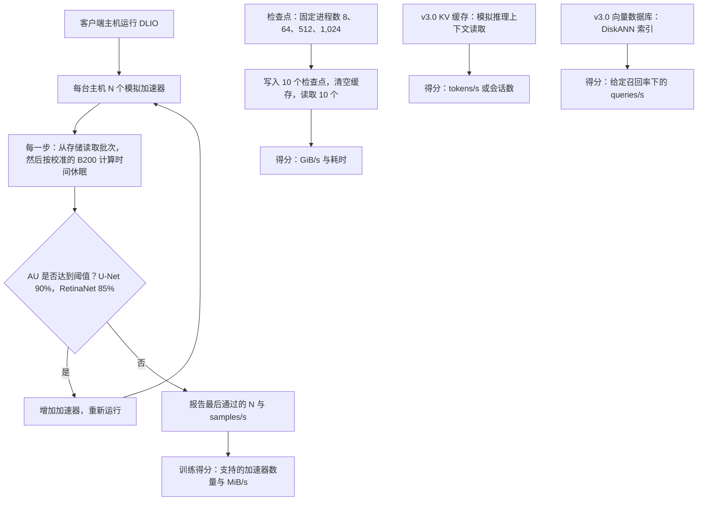

# 37. 批判性解读基准测试

> 📄 英文原文：[docs/05-ai-storage/37-reading-benchmarks.md](../../../docs/05-ai-storage/37-reading-benchmarks.md) · 本文为简体中文参考译本，如有出入以英文原文为准。

> **深度：** L2 · **阅读时间：** 约 11 分钟 · **最后核实：** 2026-11-01
> **前置阅读：** [性能与经济性指标](../01-storage-fundamentals/04-performance-and-economics-metrics.md) · [训练存储](31-training-storage.md) · [推理与 KV 缓存](32-inference-and-kv-cache.md) · [FlashArray 与 FlashBlade](../04-everpure/27-flasharray-and-flashblade.md)

## 要点速览（TL;DR）

- **存储基准测试衡量的主要是提交了多少硬件。** 横向扩展系统本身就能扩展，因此最大的配置胜出。一个数字在按买方容量点除以机架单元（RU）、千瓦或美元之前，几乎没有意义。
- **MLPerf Storage 不使用真实 GPU。** 模拟加速器以休眠代替"计算"；得分是存储能让多少个加速器保持在利用率阈值之上。这本质上是带宽除以单个加速器的需求，因此不同版本之间的结果不可比较。
- **每个基准测试都有盲区。** SPECstorage AI_IMAGE 竞争者寡；IO500 混用单位，并把生产系统与研究系统分榜；STAC-M3 以"Y 项中赢得 X 项"报告；厂商自跑的 fio 结果的可信度完全取决于其作业文件。
- **缺席本身就是数据。** VAST、WEKA 和 DDN 均未参加 MLPerf Storage v3.0（2026 年 9 月）。Everpure 在检查点和 KV 缓存上的第一名成绩经同行评审、真实可信，但取得于最强对手缺席的赛场。
- **基准测试用于入围筛选，概念验证（POC）才决定胜负。** 下文的十个问题可把工程结果与营销区分开来。

## 对 Everpure 战略的意义

基准测试是 AI 存储厂商（包括 Everpure）把工程成果转化为销售主张的方式。FlashBlade//EXA 在 MLPerf Storage v3.0 和 SPECstorage AI_IMAGE 上的成绩，是 Everpure 争取新兴 GPU 云（neocloud）和 AI 工厂订单的论据支点（[第 27 章](../04-everpure/27-flasharray-and-flashblade.md)），竞争对手会像 Everpure 攻击它们的成绩一样攻击这些成绩。为一项基准测试主张"定价"，能区分持久的技术领先与单纯的配置选择；当尽职调查标的（[第 50 章](../06-industry-and-competition/50-diligence-framework.md)）以"世界纪录"开场时，这一点同样重要。

是否参赛本身就是战略选择：一边是成本（工程人周、硬件、可能公开落败），另一边是在无法自行测试的买方中建立的可信度。参加哪些测试、如何表述结果，是战略团队可以基于公开信息评估的选项。

## 核心概念

### 为什么存储基准测试比芯片基准测试更难

CPU 基准测试运行在单颗芯片上。存储基准测试运行在一个*系统*上（服务器、驱动器、网络、客户端、软件），全部由提交方自行选择。这就像为自选数量的 HBM 堆栈宣称内存带宽，却不附带芯片面积或功耗。横向扩展存储在设计上近乎线性扩展（[第 15 章](../03-system-architecture/15-scale-out-shared-nothing.md)），所以"最快"通常意味着"配置最大"。真正有用的信息是结果的*形态*：单节点速率、扩展效率、负载下的延迟。

### MLPerf Storage 如何运作

MLCommons 推出的 MLPerf Storage 不使用加速器。一个名为 DLIO 的工具运行在普通客户端主机上，以真实数据加载器的行为读取数据，然后*休眠*一段时间，长度等于真实 GPU 计算每个批次所需的时间[^1]。v2.0 规则列出了 A100、H100、B200 和 AMD MI355[^2]，v3.0 的提交则模拟 B200 或 MI355[^3]。

关键指标是**加速器利用率（AU）**：模拟加速器处于"计算"而非等待数据状态的时间占比。提交方不断增加加速器，直到 AU 跌破阈值，然后报告通过阈值的最大加速器数量及其吞吐量。按 v2.0 规则，3D U-Net 和 ResNet-50 的阈值为 90%，CosmoFlow 为 70%[^2]。在 v3.0 中，封闭组训练工作负载为 3D U-Net（90%）和 RetinaNet（85%）[^4][^3]。CosmoFlow、ResNet-50、DLRM 和 Flux 被移入不排名的"whatif"类别[^5]。

*图 37.1 — MLPerf Storage 用休眠代替计算，把存储带宽转换成"保持忙碌的加速器数量"。检查点、KV 缓存和向量测试则直接以带宽、token 数和查询数计分。*

**"支持的加速器数量"其实是变相的带宽。** 在 v1.0 中，华为 OceanStor A800 在 3D U-Net 上以 679 GB/s 喂饱了 255 个模拟 H100[^1]。即 679 ÷ 255 ≈ 每个加速器 2.7 GB/s。DDN 的 EXAScaler AI400X2T 以 18 个客户端、36 个 H100 达到 99,018 MiB/s[^6]，即每个约 2.9 GB/s。因此这个数量大致等于吞吐量 ÷ 2.7 GB/s。更快的模拟 GPU 每个需要更多带宽，同样的存储"支持"的数量就更少，所以 v3.0 的 B200 数量不能与 v2.0 的 H100 数量相比[^7]。

**防作弊规则。** 数据集必须至少是客户端内存总量的五倍，因此无法驻留在页缓存中。结果取预热后连续多次运行的平均值，不得挑选，且须可在 5% 以内复现[^2]。检查点测试针对 Llama 3 8B、70B、405B 和 1T 使用固定进程数（8 到 1,024 个 rank；每个检查点约 105 GB 到 18 TB）；当检查点小于客户端内存的三倍时，主机必须在写入与读取之间清空文件缓存[^2]。提交须披露拓扑结构，对本地部署系统还须披露机架单元数及全部通电硬件清单；但不要求实测功耗，因此瓦数仍需估算[^2]。同行评审为封闭式：提交方可对彼此的结果提出异议，相关结果可被修正、移入开放组或撤回[^2]。

**封闭组与开放组。** *封闭组*固定代码，只允许少数可调参数（如读取线程数）；存储侧优化不受限制。*开放组*允许经披露的自定义加载器、数据格式和框架修改[^2]。把开放组结果与封闭组结果并列引用，就是混淆类别。

**v3.0 新增了什么。** 2026 年 9 月这一轮共有来自 19 家组织的 143 项结果，其中 11 家为首次提交，例如 Everpure、Azure、Nebius 和 NVIDIA。缺席的有 VAST、WEKA 和 DDN，以及华为、Hammerspace、Lightbits 等 v2.0 提交方[^8][^7]。本轮新增了 **KV 缓存**测试（由工作组设计的模拟，衡量存储为推理上下文供数的速度）、基于 Milvus 的**向量数据库**测试（以给定召回率下的每秒查询数计分），以及与 POSIX 并列的 **S3 对象路径**[^8][^4][^9]。关于向量数据集规模，各方报道不一：封闭配置为 1,000 万个向量，另一说为 100 万个、1,536 维 [VERIFY: v3.0 规则中向量数据库的数据集规模与索引类型][^4][^9]。功耗与机架空间效率开始作为报告指标被记录[^7] [VERIFY: 仅见于搜索摘要]。

### 其他基准测试

| 基准测试 | 衡量内容 | 运行方 / 审核方 | 主要指标 | 可操纵程度 | 最适用途 |
|---|---|---|---|---|---|
| **MLPerf Storage**（MLCommons） | 训练读取、检查点写入/读取、KV 缓存读取、向量检索，均使用模拟加速器 | 厂商运行；提交方之间的封闭式同行评审[^2] | 支持的加速器数量、GiB/s、tokens/s、QPS | 中：配置规模、客户端数量、选择参加哪些工作负载 | AI 训练与检查点的入围筛选 |
| **SPECstorage Solution 2020**（SPEC） | 五类文件工作负载：AI_IMAGE、EDA_BLENDED、GENOMICS、SWBUILD、VDA | 厂商运行；发布前经 SPEC 审核 | 业务指标（如 AI_Jobs）及总体响应时间（ORT）[^10] | 中：各工作负载参赛者稀少，SPEC 禁止跨工作负载比较[^10] | 负载上升时的文件系统延迟 |
| **IO500** | IOR easy（大块顺序）与 hard（小块、共享文件）带宽、mdtest easy/hard 元数据、并行 find | 站点或厂商提交；委员会对可复现性评分[^11] | 带宽得分与元数据得分的几何平均[^12] | 高：偏重元数据的技巧、研究级软件、客户端数量（因此设有 10 节点榜） | HPC 并行文件系统、元数据压力测试 |
| **STAC-M3**（STAC） | kdb+ 行情数据分析（Antuco、Kanaga 套件） | STAC 审核厂商赞助的测试 | 数十项测试的平均响应时间[^13] | 中："Y 项中 X 项最佳"式报告，完整报告常限订阅用户 | 金融时间序列买家 |
| **厂商 fio / elbencho / GDSIO** | 作业文件写什么就测什么 | 厂商，未经审核 | GB/s、IOPS、延迟 | 很高：块大小、队列深度、可压缩缓冲区、驻留缓存的工作集 | 工程调优与 POC 脚本，绝不能作为宣传主张 |

*表 37.1 — AI 存储买家会遇到的五类基准测试。审核与固定规则越少，可操纵程度越高。*

**SPECstorage Solution 2020** 于 2020 年末取代 SPEC SFS 2014[^14]。每个工作负载不断增加"业务单元"，直到响应时间崩溃，从而得到负载-延迟曲线，这比单一峰值更能说明问题。AI_IMAGE 的参赛者很少。2025 年 2 月，运行在 HPE 硬件上的 WEKA 在全部五个工作负载上登顶，其中包括 5,000 AI_Jobs[^15]。2026 年 2 月，FlashBlade//EXA 以 0.97 ms ORT 取得 6,300 AI_Jobs，使用了 30 个刀片、60 个数据节点和 80 台客户端主机[^16][^17]。

**IO500** 以 GiB/s 为带宽测试计分、以 kIOPS 为元数据测试计分，再取几何平均。混合单位没有物理意义，强劲的元数据成绩可以掩盖疲弱的带宽[^12]。写入阶段必须至少运行 300 秒[^18]。自 ISC23 起，一份可复现性问卷把 **Production（生产）**榜与 **Research（研究）**榜分开[^11]。这一规则在 ISC26 上发挥了作用：曙光（Sugon）的 ParaStor F9000 以 79,110 分（500 个客户端节点）对比 Aurora 的 32,166 分，但因缺乏可广泛获得的架构细节而被移入研究榜[^19][^20]。曙光的新闻稿曾宣称在两个生产榜上均排名第一；因此务必追问是哪个榜单、什么时间。DDN 在 ISC25 宣称的"#1"针对的是 10 节点生产榜，而该榜前两名实际上是 Argonne 的 DAOS 系统，DDN EXAScaler 系统排第三；WEKA 对此主张提出了异议[^21]。

**STAC-M3** 经过审核，但结果以子集上的胜出来表述，例如"24 项 Kanaga 基准测试中赢得 19 项"，以及在某一项指标上"比基于 Pure Storage 的 SUT 快 1.77 倍"[^13]；又如 Dell PowerScale 的"17 项 Antuco 中赢得 12 项"[^22]。要追问输掉了哪些测试。

### v3.0 的头条数字从何而来

*图 37.2 — 同一 EXA 设计，取决于提交了多少数据节点，可得到 327.6 或 877.5 GiB/s。这个排名在很大程度上是配置规模的排名。*
数据：`data/ch37_mlperf_v3_checkpoint.csv`

换一个分母，故事就变了。EXA 每个数据节点提供 877.52 ÷ 30 ≈ 29.3 GiB/s；若把其 30 个元数据刀片也计入，则约为 14.6[^23]。NVIDIA 的 AIStore 每节点提供 133.27 ÷ 12 ≈ 11.1 GiB/s，约为网卡标称带宽的 95%：这是一个受网络限制、调优良好的云端结果[^24]。Alluxio 的 147 GiB/s 使用的是较小的 405B 模型，通过 Amazon S3 之上的缓存实现[^25]。Azure 未公布节点数量，并提醒不要按客户端数归一化[^26]；对云服务而言，诚实的分母是所配置的容量和价格。分母的选择*本身就是*论点。
