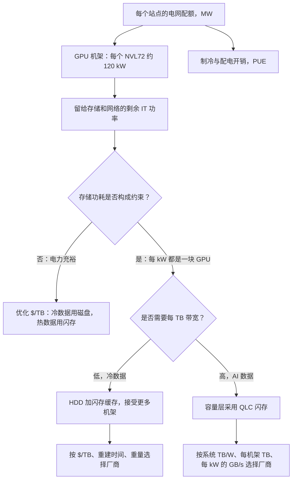

# 38. 功耗、密度与 AI 数据中心

> 📄 英文原文：[docs/05-ai-storage/38-power-and-density.md](../../../docs/05-ai-storage/38-power-and-density.md) · 本文为简体中文参考译本，如有出入以英文原文为准。

> **深度：** L2 · **阅读时间：** 约 10 分钟 · **最后核实：** 2026-11-01
> **前置阅读：** [介质物理](../01-storage-fundamentals/02-media-physics.md) · [性能与经济性指标](../01-storage-fundamentals/04-performance-and-economics-metrics.md) · [Purity 与 DirectFlash](../04-everpure/26-purity-and-directflash.md) · [AI 工厂与新兴 GPU 云](35-ai-factories-and-neoclouds.md)

## 要点速览（TL;DR）

- **AI 数据中心受限于电力，而非芯片。** NVIDIA、Microsoft、AWS、Meta 和 CoreWeave 都已公开这样表示。一个站点的电网接入容量决定了它能部署多少 GPU，因此存储每耗用一瓦，就少一瓦可用于运行 GPU。
- **在驱动器层面，QLC 闪存的每瓦容量约为磁盘的 2 倍**（各自最佳产品约 8.2 对约 4.4 TB/W）。在系统层面，差距取决于驱动器容量以及机箱内的其他部件。一台 2022 年代的闪存机箱可能不如一台现代磁盘 JBOD。
- **密度才是闪存拉开差距的地方。** 一个装满 245 TB QLC 驱动器的机架，原始容量约为装满 44 TB 磁盘的机架的 5 倍。但它每个机架也需要 2–3 倍的功率，许多机房无法供给。
- **按电网电价计算，节省的电费永远无法抵消闪存溢价。** 用 QLC 而非磁盘存储 100 PB、为期五年，可节省约 1.2 GWh，即约 $170K；而按第 4 章的输入参数，介质溢价为 $8–37M，按指数价格计算还要更高。当每 TB 带宽是硬性要求，或以超大规模云厂商的成本采购 NAND 时，闪存才会胜出；把节省下来的瓦数转化为 GPU 有帮助，但仅凭这一点很少能弥合差距。
- **对静态冷数据而言，磁盘仍然胜出**，无论是 $/TB 还是隐含碳排放（embodied carbon）。HAMR 路线图（2029 年达 100 TB）使磁盘的 TB/W 每一代都在提升。两大阵营的厂商功耗主张都需要在系统层面、同口径下核对。

## 对 Everpure 战略的意义

"闪存取代磁盘"过去是一个成本曲线论点。2026 年企业级 QLC 每 TB 价格为磁盘的 15–23 倍（[第 2 章](../01-storage-fundamentals/02-media-physics.md)），如今它已变成一个电力论点。Everpure（NYSE: P，原 PSTG）已把这一论点置于核心位置。其 DirectFlash 在超大规模云厂商中的设计导入，是以占地面积和功耗来解释的（[第 29 章](../04-everpure/29-hyperscaler-ecosystem-financials.md)），并且它销售一项合同化的每 TiB 瓦数保证。如果电力持续是 AI 扩建的约束瓶颈，系统层面 TB/W 最优的厂商就拥有一个独立于 NAND 价格周期的需求驱动因素。如果电网供给放松，或 HAMR 弥合差距，卖点就会退回到 $/TB，而在这一点上磁盘胜出。

本章提供判断一笔交易处于哪种情形的算术方法。它建立在[第 4 章](../01-storage-fundamentals/04-performance-and-economics-metrics.md)的指标和[第 26 章](../04-everpure/26-purity-and-directflash.md)的模块设计之上，不再重复其内容。

## 核心概念

### 站点功率上限是一切开支的预算来源

一个 AI 园区始于固定的电网配额，以兆瓦计，由电力公司和许可审批提前数年确定。GPU 是收入引擎，因此运营方会把尽可能多的配额分给 GPU。网络、制冷开销和存储分享剩余部分。行业领袖对此直言不讳。

| 公司 | 人物 / 场合 | 表述内容 | 日期 |
|---|---|---|---|
| NVIDIA | Jensen Huang，GTC 主题演讲 | "我们现在是一个受电力限制的行业"；收入与可用电力挂钩[^1] | 2025-03 |
| AWS | Andy Jassy，2025 年第二季度财报电话会 | "最大的单一约束是电力"[^2] | 2025-07-31 |
| Microsoft | Satya Nadella，Bg2 播客 | GPU 积压在库存中，因为缺少已通电的机房外壳（powered shell）来安装它们[^3] | 2025 年末 |
| Meta | Mark Zuckerberg，Dwarkesh 播客 | 限制集群扩建的将是能源，而非芯片[^4] | 2024-04 |
| CoreWeave | 2026 年第二季度业绩 | 1.5 GW 已投运，3.7 GW 已签约；目标是 2026 年底投运超过 1.85 GW[^5] | 2026-08-11 |
| Meta 存储团队 | FMS 2025 关于 QLC 的演讲 | QLC 机架超过 10 PB，但功耗仍高于 Meta 的期望[^6] | 2025-08-06 |

*表 38.1 — 超大规模云厂商和新兴 GPU 云的领导者都把电力而非芯片视为约束瓶颈；即便是 Meta 这样的闪存拥护者，仍希望进一步降低功耗。*

Gartner 预计 2026 年数据中心用电量将增长 26%[^7]。由此形成一条决策链：

*图 38.1 — 站点功率上限逐级传导到存储；闪存与磁盘之争取决于存储的瓦数是否挤占 GPU，以及每 TB 必须提供多少带宽。*

按每个 GB200 NVL72 机架约 120 kW 计算[^8]，一块 GPU 及其分摊的机架功耗约为 1.7 kW。[第 35 章](35-ai-factories-and-neoclouds.md)测算存储约占一排 GPU 功耗的 4%。占比虽小，但并非免费。

### 半导体类比：频率扩展终结之后的存储

这正是芯片设计在 2005 年前后 Dennard 缩放终结时所经历的转变。一旦功率密度不再随每个制程节点下降，时钟频率就不再是目标。设计变得受功耗限制，每瓦性能（perf/W）成为卖芯片的指标。在固定 TDP 的 SoC 中，非核心部分（uncore：I/O、片上互连、内存控制器）节省下来的瓦数，会变成核心的睿频余量。存储就是 AI 园区的 uncore。它节省的每一瓦都流向"核心"即 GPU，而 Huang 的表述使每瓦 token 数成为收入指标。存储厂商正被拉入每瓦性能的思维，正如二十年前的 CPU 厂商。

### 每瓦 TB：数据手册究竟怎么说

*图 38.2 — 在驱动器层面，QLC 的每瓦容量约为磁盘的 2 倍；在系统层面，较老的闪存机箱和性能型设备可能落后于现代磁盘 JBOD。*
数据：`data/ch38_tb_per_watt.csv`

有三点解读值得注意。第一，驱动器层面的 TB/W 与单设备容量同步变化，因为单设备功耗几乎不变。一块近线磁盘无论容量是 30 TB 还是 44 TB，功耗都约为 9.5–10 W[^9][^10]。一块大容量 QLC 驱动器无论容量是 122 TB 还是 245 TB，功耗都为 25–30 W[^11][^10]。Everpure 的 75 TB 模块标称功耗低于 10 W[^12]。第二，系统开销远超驱动器之间的差异。控制器、风扇、网卡和 DRAM 会使 TB/W 下降 2–10 倍。VAST 的 1U DBox 在不计 CNode 的情况下约为 1.9 TB/W[^13]。一台装 22 TB 磁盘的 WD 102 盘位 JBOD 在不计头端服务器的情况下约为 1.7 TB/W[^14]；若在相近功耗下装满 44 TB 磁盘，将达到约 3.5 TB/W（示意），超过 DBox。Everpure 的 FlashBlade//E（每扩展单元 0.83 W/TB）和 FlashBlade//S500（1.3 W/TB）则包含了其计算部分[^15][^16]。第三，性能型设备属于另一类别。DDN 的 2U AI400X3 额定功率为 2,400 W[^17]，按推算的约 500 TB 计约为 0.2 可用 TB/W [VERIFY: 每台设备的可用容量]。它为每 kW 的 GB/s 而非 TB/W 而设计，其 TB/W 取决于所装驱动器：2026 年 6 月推出的 AI400X3M 型号每台设备最高可提供 2 PB 可用容量[^18]，因此应把 DDN 的条形视为某一种配置，而非上限。

结论：比较系统时，须保持相同的范围、相同的功耗口径和相同的驱动器代际。

### 机架密度：每机架 PB 数

| 配置（42U 机架，约 36U 用于存储） | 设备数 | 每机架原始 PB | 每机架 IT kW | 依据 |
|---|---|---|---|---|
| 7 台 4U 106 盘位 JBOD + 4 台头端服务器，44 TB HDD | 742 | 32.6 | ~11 | 算例：每盘位综合 15 W |
| 同上，100 TB HAMR（WD 2029 路线图[^19]） | 742 | 74.2 | ~11 | 示意 |
| 30 台 1U 服务器，每台 24 块 122.88 TB QLC | 720 | 88.5 | ~32 | 算例：每块驱动器 25 W + 每台服务器 450 W |
| 30 台 1U 服务器，每台 24 块 245.76 TB QLC | 720 | 176.9 | ~32 | 与 Micron 的 720 块驱动器机架一致[^10] |
| 已部署的超大规模 QLC 机架（Meta） | n/d | >10 | n/d | FMS 2025[^6] |

*表 38.2 — 示意：QLC 每机架容量约为 44 TB 磁盘的 5 倍，但功率约为 3 倍，因此实际机架常因功率上限而远低于理论最大值。*

有两点保留意见可确保结论客观。一个约 32 kW 的满配闪存机架，超过了许多风冷机房 10–15 kW 的供电能力，因此运营方会把它分散到多个机架。此外，已部署的机架（例如 Meta 的">10 PB"）由于功率、制冷、网络端口和驱动器代际的限制，远低于理论上限。磁盘机架则撞上另一堵墙：楼板承重。一个装有 742 块近线驱动器的机架重量远超一吨。

### 算例：100 PB、五年

**需求**：100 PB 可用容量，五年内保持不变，以读为主。**示意**：每盘位和每服务器的功耗、PUE 及可用比例为本图谱的假设；价格有来源。

| 项目 | HDD（44 TB） | QLC（245.76 TB） | 依据 |
|---|---|---|---|
| 按 75% 可用率计的原始容量 | 133.3 PB | 133.3 PB | 8+2 纠删码加备件，假设 |
| 设备数 | 3,030 块驱动器 | 23 台服务器中的 543 块驱动器 | 原始容量 ÷ 驱动器容量 |
| IT 功率 | 45.5 kW | 23.9 kW | HDD 每盘位综合 15 W（WD JBOD ≈12.7 W/盘位[^14] + 头端分摊）；QLC 每块驱动器 25 W + 每台服务器 450 W |
| 机架数 | 5 | 1（若上限约 15 kW 则为 2） | 表 38.2 |
| PUE 1.3 下的设施功率 | 59.1 kW | 31.1 kW | 针对新建 AI 级机房的假设 |
| 5 年能耗 | 2.59 GWh | 1.36 GWh | × 43,800 h |
| 按 $0.1385/kWh 计的电费 | $359K | $189K | 美国商业用电平均价[^20]；按第 4 章的 PUE 1.54，节省约 $200K |
| 介质成本，2026 年价格 | $2.9M（$22/TB，Q1）；~$5.4M（~$40/TB，Q3） | $40.3M（$302/TB） | HDD[^21][^22]；QLC[^23]；溢价 13.7 倍，而指数为 22.6 倍 |
| 介质成本，2025 年年中价格 | $2.2M（$16.50/TB） | $10.7M（$80/TB） | [^21] |
| 介质隐含碳排放 | ~2.7 kt CO2e | ~21.3 kt CO2e | 闪存 0.16 kg/GB，磁盘约为其 1/8[^24] |

*表 38.3 — 示意：QLC 使功耗减半、机架数减少到 1/5，但约 $170K 的电费节省比介质溢价小两个数量级。*

介质输入与第 4 章相同，且对闪存有利。$302 对 $22/TB 是 13.7 倍溢价，低于 22.6 倍的指数头条数字，因为 122 TB 驱动器的每 TB 市场价低于指数所用的 30 TB QLC 驱动器（2026 年第一季度约 $504/TB）[^25]。按该指数价格，QLC 介质成本约为 $67M。磁盘价格也有变动：同一指数显示，到 2026 年第三季度一块 30 TB HDD 约为 $1,216（约 $40/TB）[^22]，这使 HDD 介质成本升至约 $5.4M，2026 年的溢价约为 $35M。无论哪种情形，电费节省都比溢价低两个数量级。

闪存方案有三条走出这张表的路径。

**1. 节省的瓦数变成 GPU。** 节省下来的 21.6 kW IT 功率，约等于 13 个 GPU 位（每个 1.7 kW）。按 CoreWeave 每 GPU 小时 US$6.16 的 H100 标价[^26]，13 块 GPU 五年内约可计费 $3.5M。这是租赁总收入，尚未扣除 GPU 自身的资本开支、融资和运营成本，而且它以 H100 的费率为 GB200 级功率位定价，因此应视为上限。[第 4 章](../01-storage-fundamentals/04-performance-and-economics-metrics.md)按每年 $15,000 的假设为每节省一千瓦估值，这使这些 GPU 位约值 $1.6M。两个数字都比电费节省高出许多倍。但都无法覆盖按 2026 年 NAND 价格计算的约 $37M 溢价，即便是上限，也不到按 2025 年年中价格计算的约 $8.5M 溢价的一半。溢价和节省的瓦数都随容量线性增长，因此仅靠规模无法弥合差距：这条路径只有与路径 2 或 3 结合时才有效。

**2. 需要每 TB 带宽。** Meta 支持 QLC 的论点是：随着驱动器容量增大，磁盘的每 TB 带宽持续下降[^27]。Meta 把 QLC 用于需要约 10 MB/s/TB 的工作负载。对 100 PB 可用容量而言，这意味着 1 TB/s。一块近线磁盘最好情况下也许能流式传输 250 MB/s，混合访问下则远低于此。按假设的 125 MB/s 有效带宽计算，需要约 8,000 块驱动器而非 3,030 块，功率约 120 kW。这是闪存方案功耗的 5 倍，在这一区间，厂商"功耗降低 75%"的说法才变得可信。

**3. 以超大规模云厂商的成本采购 NAND。** 在 Everpure 的第二个超大规模云厂商交易中，客户自行采购 NAND[^28]。这样 NAND 到达买方时接近合同价，而非阵列的市场价，从而压缩了介质溢价。这就是超大规模云厂商率先转向的原因。

### 磁盘仍然胜出的领域

磁盘在静态冷数据上胜出：归档、备份副本以及很少读取的数据湖。在这些场景中，带宽要求低，$/TB 占主导。磁盘在隐含碳排放上也胜出。Tannu 和 Nair 估算，制造闪存约排放 0.16 kg CO2e/GB，按单位容量计约为磁盘的 8 倍[^24]。在上述算例中，隐含碳排放差距（约 18.6 kt）远超运营节省（1.23 GWh，按 0.1 至 0.5 kg/kWh 的任何电网碳强度计为 120–620 t）。这一 2022 年的数字早于如今更高密度的 NAND，因此应视为数量级参考。闪存的碳排放论点依赖于更长的使用寿命，以及省下的机架和建筑。

## Everpure 的做法与竞争对手对比

| 阵营 | 主打的功耗/密度主张 | 依据 | 最强版本论证或保留意见 |
|---|---|---|---|
| Everpure | 在超大规模场景下，DFM 的功耗比磁盘低最多 75%（*公司自述*）[^29]；磁盘系统和 15 TB SSD 系统的功耗分别是其 75 TB DFM 系统的 2.4 倍、150 TB DFM 系统的 4.8 倍（*公司自述*）[^30]；Evergreen//One 提供每 TiB 瓦数保证[^31] | 自有系统模型；保证具合同效力 | 当 DFM 容量领先通用 SSD 时最有说服力；该保证假设大多数层级存在数据缩减（[第 4 章](../01-storage-fundamentals/04-performance-and-economics-metrics.md)） |
| 通用 QLC（Micron、Solidigm） | 驱动器层面约 8.2 对约 4.4 TB/W（*厂商*）[^10]；1 EB 研究：在 Ceph 上比 HDD 功耗低 77%、空间少 90%（*厂商*）[^32] | 驱动器最大功耗；10 年模型 | 驱动器层面可信；系统层面结果取决于软件厂商 |
| VAST | 使用 30 TB QLC 时每 PB 约 500 W（*公司自述*，2021）[^33] | DBox 加 CNode | 率先大规模采用 QLC；图 38.2 中使用 61 TB 驱动器的 DBox 落后于 245 TB 级设计，其 TB/W 随驱动器增大而提高 |
| HDD 厂商（Seagate、WD） | 对海量数据而言，磁盘每 TB 更具成本和能效优势（Seagate CEO）[^34]；Mozaic 3+ 使每 TB 功耗降低 40%、每 TB 隐含碳排放降低 55%，后者以 16 TB PMR 驱动器为基准（*厂商*）[^35] | 单驱动器，自设基准 | 在 $/TB 和隐含碳排放上正确；在每 TB 带宽上偏弱 |
| VDURA（混合） | HDD 系统总碳排放更低（*厂商*）[^36]；2026 年第一季度 QLC 的 $/TB 为 HDD 的 22.6 倍[^25] | 闪存加 HDD 混合 | 价格数据真实；主张混合部署 |

*表 38.4 — 每个阵营的功耗主张在其自选范围内都成立；反问永远是："整个系统、相同功耗口径、相同驱动器代际、你的每 TB 带宽"。*

Everpure 的结构性优势在于它拥有闪存转换层（FTL），因此其模块容量可以领先通用 SSD。每当 245 TB 驱动器出货，这一优势就会收窄（[第 26 章](../04-everpure/26-purity-and-directflash.md)）。VAST 和 WEKA 的最强版本论证是：通用 245 TB QLC 能以更广泛的供应基础带来大部分 TB/W 收益。磁盘的最强版本论证就是上表：按 2026 年价格，冷数据的 EB 级容量仍会留在 HDD 上。基于公开信息，战略团队可以评估的选项包括：对照 NVIDIA 参考配置发布经审计的系统层面 TB/W 和每 kW 的 GB/s；以及针对无法缩减的 AI 数据，按*可用* TiB 为保证定价。

## 历史与发展轨迹

2021 年，VAST 等闪存厂商主打每机架单元密度[^33]。2023 年，Pure Storage 推出每 TiB 瓦数 SLA[^31]，并以 FlashBlade//E 展示了约 1 W/TB[^15]。2024–25 年，电力进入 CEO 的话语体系：Zuckerberg[^4]、Huang[^1]、Jassy[^2]。Meta 发布了其 QLC 论证[^27]，被普遍解读为指向 DirectFlash，Pure 的超大规模云厂商收入随之起步。2026 年，245 TB QLC 驱动器出货[^10]，而 NAND 价格每个季度都在上涨[^37]。这恰在电力论点达到顶峰之际扩大了 $/TB 差距。

磁盘并未停滞不前。Western Digital 的目标是 2029 年 HAMR 达到 100 TB[^19]。按每块驱动器约 10 W 不变计算，即约 10 TB/W，大致相当于当今最佳 QLC 的驱动器层面水平。预计闪存将以 512 TB 级驱动器和更大的模块回应（[第 53 章](../07-history-and-future/53-future-trends.md)），竞争焦点将从 TB/W 转向每 kW 的 GB/s，而磁盘在这一维度上无法跟进。

## 关键数字

| 指标 | 数值 | 背景 | 来源 / 日期 |
|---|---|---|---|
| 驱动器 TB/W，245 TB QLC 对 44 TB HDD | ~8.2 对 ~4.4 | 最大额定功耗，厂商比较 | StorageReview，2026[^10] |
| 系统 TB/W，VAST DBox 对 WD 102 盘位 JBOD | ~1.9 对 ~1.7 | 不含 CNode 和头端服务器 | VAST；WD[^13][^14] |
| GB200 NVL72 机架功率 | ~120 kW | 一个 GPU 位 ≈ 1.7 kW | SemiAnalysis[^8] |
| CoreWeave 已投运 / 已签约电力 | 1.5 GW / 3.7 GW | 2026 年第二季度 | 业绩发布，2026-08-11[^5] |
| 100 PB × 5 年，QLC 节省的能耗 | ~1.23 GWh（~$170K） | 对比 $8–37M 介质溢价 | 算例 |
| 每机架 PB，245 TB QLC 对 44 TB HDD | ~177 对 ~33 | 每机架 ~32 对 ~11 kW | 算例；Micron[^10] |
| 闪存隐含碳排放 | ~0.16 kg CO2e/GB，约为 HDD 的 8 倍 | 2022 年估算 | Tannu & Nair[^24] |
| HAMR 路线图 | 2029 年达 100 TB | 约 10 W 下 ~10 TB/W | Western Digital，2026-02-03[^19] |

## 对话手册

**向产品经理提的问题**

1. *"在一笔受功率上限约束的 AI 交易中，按客户的实际配置（含计算部分），我们的系统 TB/W 和每 kW 的 GB/s 是多少？"* 高质量回答：给出一个数字，并说明范围和功耗口径，同时点名一个竞争对手的配置。
2. *"我们在哪些场景输给磁盘？我们是否放弃这些场景？"* 高质量回答：按 2026 年 NAND 价格，冷归档和备份；并给出各细分市场的盈亏平衡 $/TB 溢价。
3. *"对于无法缩减的 AI 数据，每 TiB 瓦数保证表现如何？"* 高质量回答：给出可用容量数字，并说明由谁承担风险。

**向工程师提的问题**

1. *"系统功耗中有多大比例来自 NAND，多少来自控制器、DRAM、风扇和网卡？"* 高质量回答：给出一份分解，说明 DFM 设计在哪里节省了瓦数，而不只是"模块更大"。
2. *"我们的设备在空闲、以读为主负载和重建期间各耗电多少？"* 高质量回答：实测曲线，而非铭牌数值。
3. *"QLC 的写入功耗如何随持续写入量变化？"* 高质量回答：每写入 1 GB/s 的瓦数，以及写入路径如何限制它。

**不要这样说：**

- "闪存省下的电足以收回成本。"按电网电价并不成立：对 100 PB 而言，约 $170K 对数千万美元。
- "我们的 TB/W 胜过磁盘"，却拿一块驱动器与一台机箱比较。应比较整个系统。
- "HDD 已死。"磁盘正以 40–44 TB 出货，HAMR 的目标是 100 TB。
- "存储功耗在 AI 数据中心中占很大比重。"它只占几个百分点；之所以重要，只是因为功率上限是硬约束。

## 深入阅读（可选，L3 指引）

- Meta 的 QLC 论证及 E2 外形规格工作[^27][^6]：以每 TB 带宽作为分层标准。
- Tannu 和 Nair，"The Dirty Secret of SSDs"[^24]：隐含碳排放的测算方法及其对更新周期的敏感性。
- 关于 NAND 定价如何移动盈亏平衡点，见[第 48 章](../06-industry-and-competition/48-media-suppliers-and-nand-cycle.md)。

## 关键术语

- **功率上限（站点）（power cap）**——限定全部 IT 负载的固定电网配额。
- **TB/W**——每瓦容量；驱动器层面与系统层面的数字差异很大。
- **每机架 PB（PB per rack）**——机架密度，受功率、制冷和楼板承重限制。
- **每 kW 的 GB/s（GB/s per kW）**——每千瓦带宽，AI 时代的存储效率指标。
- **每 TB 带宽（bandwidth per TB）**——设备每单位容量提供的吞吐量；随磁盘容量增大而下降。
- **HAMR**——热辅助磁记录（heat-assisted magnetic recording），磁盘的容量路线图。
- **隐含碳排放（embodied carbon）**——硬件制造过程中产生的排放。
- **Dennard 缩放（Dennard scaling）**——晶体管缩小时功率密度保持不变的历史规律。
- **已通电机房外壳（powered shell）**——已具备电网供电和制冷、可安装 IT 设备的数据中心建筑。

## 资料来源

[^1]: Analytics India Magazine, "We Are Now a Power-Limited Industry, Says Jensen Huang," 2025-03. https://analyticsindiamag.com/deep-tech/we-are-now-a-power-limited-industry-says-jensen-huang/ (retrieved 2026-11-01); corroborated by G. Lockwood, "GTC 2025 recap," 2025-03. https://blog.glennklockwood.com/2025/03/gtc-2025-recap.html (retrieved 2026-11-01).
[^2]: SDxCentral, "AWS achieves $123B annualized revenue run rate," 2025-07-31. https://www.sdxcentral.com/news/aws-achieves-123b-annualized-revenue-run-rate/ (retrieved 2026-11-01); corroborated by Data Center Knowledge, "Amazon, Echoing Microsoft, Says It Can't Keep Up With AI Demand," https://www.datacenterknowledge.com/cloud/amazon-echoing-microsoft-says-it-can-t-keep-up-with-ai-demand (retrieved 2026-11-01).
[^3]: TechRadar Pro, "'You may actually have a bunch of chips sitting in inventory that I can't plug in': Satya Nadella admits…," 2025-11. https://www.techradar.com/pro/you-may-actually-have-a-bunch-of-chips-sitting-in-inventory-that-i-cant-plug-in-satya-nadella-admits-an-embarrassing-shortcoming-so-lets-hope-it-doesnt-set-the-company-back-in-the-ai-arms-race (retrieved 2026-11-01); corroborated by DatacenterDynamics, "Microsoft has AI GPUs sitting in inventory because it lacks the power necessary to install them," https://www.datacenterdynamics.com/en/news/microsoft-has-ai-gpus-sitting-in-inventory-because-it-lacks-the-power-necessary-to-install-them (retrieved 2026-11-01). [VERIFY: exact podcast date, reported as late October/early November 2025]
[^4]: SDxCentral, "Meta's Mark Zuckerberg says energy constraints are holding back AI data center buildout," 2024-04. https://www.sdxcentral.com/news/metas-mark-zuckerberg-says-energy-constraints-are-holding-back-ai-data-center-buildout/ (retrieved 2026-11-01).
[^5]: MarketBeat, "CoreWeave Q2 Earnings Call Highlights," 2026-08-11. https://www.marketbeat.com/instant-alerts/coreweave-q2-earnings-call-highlights-2026-08-11/ (retrieved 2026-11-01); corroborated by The Energy Mag, "CoreWeave reports $2.58 billion Q2 2026 revenue amid infrastructure expansion," 2026-08. https://theenergymag.com/news/market-news/coreweave-reports-2-58-billion-q2-2026-revenue-amid-infrastructure-expansion (retrieved 2026-11-01).
[^6]: Future of Memory and Storage 2025 proceedings, "QLCP-201-1 (Gupta)," 2025-08-06. https://files.futurememorystorage.com/proceedings/2025/20250806_QLCP-201-1_Gupta.pdf (seen via search summary, 2026-11-01). Speaker is a Meta software engineer per the FMS speaker listing, https://www.terrapinn.com/conference/future-memory-storage/speaker-sumit-GUPTA.stm. [VERIFY: ">10 PB per rack" and power slide wording]
[^7]: Gartner, "Gartner Says Data Center Electricity Consumption to Grow 26% in 2026," 2026-06-10. https://www.gartner.com/en/newsroom/press-releases/2026-06-10-gartner-says-data-center-electricity-demand-to-grow-26-percent-in-2026 (retrieved 2026-11-01).
[^8]: SemiAnalysis, "GB200 Hardware Architecture and Component Supply Chain & BOM," 2024-07. https://newsletter.semianalysis.com/p/gb200-hardware-architecture-and-component (retrieved 2026-11-01); Gigabyte, "NVIDIA GB200 NVL72 (GIGAPOD)," n.d. https://www.gigabyte.com/Enterprise/GIGAPOD-Pod-Scale/AI-DLC-POD_NVIDIA-GB200-NVL72 (retrieved 2026-11-01).
[^9]: StorageReview, "Seagate Exos M 30TB Review: HAMR-ing Storage Density," 2025-07-15. https://www.storagereview.com/review/seagate-exos-m-30tb-review-hamr-ing-storage-density (retrieved 2026-11-01). 9.5 W max operating, 6.9 W idle.
[^10]: StorageReview, "Micron 6600 ION 245TB SSD Review: A Quarter Petabyte Per Drive Bay," 2026. https://www.storagereview.com/review/micron-6600-ion-245tb-ssd-review-a-quarter-petabyte-per-drive-bay (retrieved 2026-11-01); Micron, "Industry-Leading 245TB Micron 6600 ION Data Center SSD Now Shipping," 2026-05-05. https://investors.micron.com/news/press-release/2026/Industry-Leading-245TB-Micron-6600-ION-Data-Center-SSD-Now-Shipping/default.aspx (retrieved 2026-11-01).
[^11]: StorageReview, "Solidigm 122.88TB D5-P5336 Review," 2025. https://www.storagereview.com/review/solidigm-122-88tb-d5-p5336-review-high-capacity-storage-meets-operational-efficiency (retrieved 2026-11-01). 24 W active, 5 W idle; 25 W maximum per secondary reviews.
[^12]: Blocks & Files, "300TB flash drives coming from Pure Storage," 2023-03-01. https://blocksandfiles.com/2023/03/01/300tb-flash-drives-coming-from-pure-storage/ (retrieved via search 2026-11-01).
[^13]: VAST Data, "DBox DF-3015V2/DF-3060V2 Ceres Datasheet," n.d. https://kb.vastdata.com/docs/dbox-df-3015v2df-3060v2-ceres-datasheet (seen via search summary, 2026-11-01): 1,352 TB raw, 368 W idle, 400–728 W active, 850 W max; CDW lists 650 W operational, https://www.cdw.com/product/vast-df-3060-v2-storage-enclosure/8370305 (retrieved 2026-11-01).
[^14]: Western Digital, "Ultrastar Data102 3000 Series User Guide," 2024-08 (via ManualsLib). https://www.manualslib.com/manual/4255469/Western-Digital-Ultrastar-Data102-3000-Series.html (seen via search summary, 2026-11-01). Under 1,300 W in WD internal testing; 2,244 TB configuration per reseller listing, https://store.digital-origin.co.uk/western-digital-ultrastar-data102-disk-array-2244-tb-rack-4u-black-grey-1es2494.html. [VERIFY: search-summary only]
[^15]: Blocks & Files, "Pure swings FlashBlade//E at unstructured data," 2023-03-01. https://blocksandfiles.com/2023/03/01/pure-flashblade-e/ (retrieved 2026-11-01). About 1.06 W/TB starting configuration, 0.83 W/TB per expansion.
[^16]: Everpure Support, "FlashBlade//S Simplifies and Accelerates GPU-provider AI Services for NVIDIA Cloud Partners," n.d. https://support.everpuredata.com/r/nvidia/flashblades-simplifies-and-accelerates-gpu-provider-ai-services-for-nvidia-cloud-partners (seen via search summary, 2026-11-01). [VERIFY: search-summary only]
[^17]: DDN, "DDN Powers the AI Factory of the Future with Record-Breaking Performance Density," 2025-08-04. https://www.ddn.com/press-releases/ddn-powers-the-ai-factory-of-the-future-with-record-breaking-performance-density/ (retrieved via search 2026-11-01); corroborated by HPCwire, 2025-08-05. https://www.hpcwire.com/aiwire/2025/08/05/ddn-showcases-ai400x3-performance-in-latest-mlperf-storage-benchmarks/
[^18]: StorageReview, "DDN launches AI400X3M and Dynamo-integrated KV cache acceleration at ISC 2026," 2026-06. https://www.storagereview.com/news/ddn-launches-ai400x3m-and-dynamo-integrated-kv-cache-acceleration-at-isc-2026 (retrieved 2026-11-01; read via search summary).
[^19]: Western Digital, "Western Digital Accelerates Storage Innovation for AI Era," 2026-02-03. https://www.westerndigital.com/company/newsroom/press-releases/2026/2026-02-03-western-digital-accelerates-storage-innovation-for-ai-era (retrieved 2026-11-01).
[^20]: U.S. Energy Information Administration, "Electric Power Monthly, Table 5.3" (commercial sector, 12 months to July 2026), 2026-09. https://www.eia.gov/electricity/monthly/epm_table_grapher.php?t=epmt_5_3 (retrieved 2026-11-01). [VERIFY: search-summary only]
[^21]: ServNet UK, "All-flash vs nearline HDD TCO 2026" (30 TB HDD $668 in Q1 2026, $495 in Q2 2025; 30 TB QLC $2,450 in Q2 2025), 2026. https://www.servnetuk.com/insights/all-flash-vs-nearline-hdd-tco-2026 (retrieved 2026-11-01). Consistent with the VDURA index ratios reported by Blocks & Files (4.9× and 22.6×).
[^22]: StorageReview, "Enterprise SSD prices run at 6.5x last year; Vdura pegs a 30TB TLC drive at $22,600," 2026-08. https://storagereview.com/news/enterprise-ssd-prices-run-at-6-5x-last-year-vdura-pegs-a-30tb-tlc-drive-at-22600 (retrieved via search 2026-11-01). 18.6× TLC-to-HDD multiple implies a 30 TB HDD at ~$1,216.
[^23]: TechRadar Pro, "World's largest SSD has tripled in price in just nine months and now costs more than a new car," 2026. https://www.techradar.com/pro/worlds-largest-ssd-has-tripled-in-price-in-just-nine-months-and-now-costs-more-than-a-new-car (retrieved 2026-11-01). $37,128 for 122.88 TB (~$302/TB).
[^24]: S. Tannu and P. J. Nair, "The Dirty Secret of SSDs: Embodied Carbon," HotCarbon 2022. https://arxiv.org/abs/2207.10793 (retrieved via search 2026-11-01); coverage in Network World, "Are HDDs greener than SSDs?" https://www.networkworld.com/article/3706371/are-hdds-greener-than-ssds.html (retrieved 2026-11-01).
[^25]: Blocks & Files, "VDURA says 30 TB QLC SSD capacity now costs 22.6x more than HDD," 2026-04-08. https://www.blocksandfiles.com/flash/2026/04/08/vdura-says-30-tb-qlc-ssd-capacity-now-costs-226x-more-than-hdd/5214761 (retrieved via search 2026-11-01). VDURA index: 30 TB QLC SSD at $15,121 in Q1 2026 (~$504/TB); VDURA sells hybrid flash/disk systems.
[^26]: CoreWeave, "Pricing," n.d. (2026); 8× HGX H100 at US$49.24/hr. https://www.coreweave.com/pricing (retrieved 2026-11-01).
[^27]: Meta Engineering, "A case for QLC SSDs in the data center," 2025-03-04. https://engineering.fb.com/2025/03/04/data-center-engineering/a-case-for-qlc-ssds-in-the-data-center/ (retrieved via search 2026-11-01); The Register, "Quad goals: Meta proposes QLC SSDs as a new storage tier in datacenters," 2025-03-07. https://www.theregister.com/2025/03/07/meta_proposes_qlc_ssds_as/ (retrieved 2026-11-01).
[^28]: Everpure, "Everpure Lands New Design Win with Second Top-Five Hyperscaler," 2026-08-10. https://www.everpuredata.com/company/newsroom/press-releases/everpure-lands-new-design-win-with-second-top-five-hyperscaler.html (retrieved 2026-11-01).
[^29]: Pure Storage, "Hyperscaler," n.d. https://purestorage.com/pure-advantage/platform/hyperscaler.html (retrieved 2026-11-01).
[^30]: Blocks & Files, "Pure Storage claims its flash beats SSDs and disks on power and carbon metrics," 2025-08-11. https://blocksandfiles.com/2025/08/11/pure-storage-flash-beats-ssds-and-disks-on-power-and-carbon-metrics/ (retrieved via search 2026-11-01).
[^31]: Pure Storage, "With Industry-First Energy Efficiency Guarantee, Pure Storage Further Expands SLA Offerings for Evergreen//One," 2023-01-18. https://www.everpuredata.com/company/newsroom/press-releases/pure-expands-sla-offerings-evergreen-one.html (retrieved 2026-11-01).
[^32]: Solidigm, "The Economics of Exabyte Storage," n.d. https://www.solidigm.com/products/technology/economics-of-exabyte-data-storage.html (retrieved via search 2026-11-01).
[^33]: StorageNewsletter, "VAST Data Universal Storage All-Flash Platforms Double Storage Density With Intel QLC 30TB SSDs," 2021-12-23. https://www.storagenewsletter.com/2021/12/23/vast-data-universal-storage-all-flash-platforms-double-storage-density-with-intel-qlc-30tb-ssds/ (retrieved 2026-11-01).
[^34]: Insider Monkey, "Seagate Technology Holdings plc (NASDAQ:STX) Q3 2026 Earnings Call Transcript," 2026-04. https://www.insidermonkey.com/blog/seagate-technology-holdings-plc-nasdaqstx-q3-2026-earnings-call-transcript-1749863/ (retrieved via search 2026-11-01).
[^35]: Seagate, "Seagate's Breakthrough 30TB+ Hard Drives Ramp Volume…," 2024-01-17. https://www.businesswire.com/news/home/20240117730823/en (retrieved via search 2026-11-01).
[^36]: Blocks & Files, "VDURA argues HDD systems are greener than flash arrays," 2024-08-01. https://blocksandfiles.com/2024/08/01/vdura-hdd-storage-is-greener-than-flash/ (retrieved via search 2026-11-01).
[^37]: TrendForce, "AI Server Demand Sustains Memory Contract Price Increases in 4Q26, While Consumer-Side Pressure Persists," 2026-09-30. https://www.trendforce.com/presscenter/news/20260930-13258.html (retrieved 2026-11-01).
