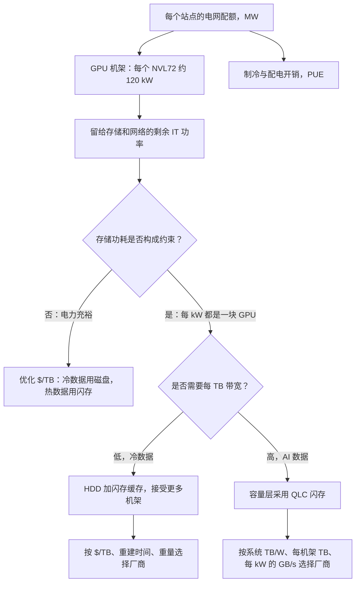

# 38. 功耗、密度与 AI 数据中心

> 📄 英文原文：[docs/05-ai-storage/38-power-and-density.md](../../../docs/05-ai-storage/38-power-and-density.md) · 本文为简体中文参考译本，如有出入以英文原文为准。

> **深度：** L2 · **阅读时间：** 约 10 分钟 · **最后核实：** 2026-11-01
> **前置阅读：** [介质物理](../01-storage-fundamentals/02-media-physics.md) · [性能与经济性指标](../01-storage-fundamentals/04-performance-and-economics-metrics.md) · [Purity 与 DirectFlash](../04-everpure/26-purity-and-directflash.md) · [AI 工厂与新兴 GPU 云](35-ai-factories-and-neoclouds.md)

## 要点速览（TL;DR）

- **AI 数据中心受限于电力，而非芯片。** NVIDIA、Microsoft、AWS、Meta 和 CoreWeave 都已公开这样表示。一个站点的电网接入容量决定了它能部署多少 GPU，因此存储每耗用一瓦，就少一瓦可用于运行 GPU。
- **在驱动器层面，QLC 闪存的每瓦容量约为磁盘的 2 倍**（各自最佳产品约 8.2 对约 4.4 TB/W）。在系统层面，差距取决于驱动器容量以及机箱内的其他部件。一台 2022 年代的闪存机箱可能不如一台现代磁盘 JBOD。
- **密度才是闪存拉开差距的地方。** 一个装满 245 TB QLC 驱动器的机架，原始容量约为装满 44 TB 磁盘的机架的 5 倍。但它每个机架也需要 2–3 倍的功率，许多机房无法供给。
- **按电网电价计算，节省的电费永远无法抵消闪存溢价。** 用 QLC 而非磁盘存储 100 PB、为期五年，可节省约 1.2 GWh，即约 $170K；而按第 4 章的输入参数，介质溢价为 $8–37M，按指数价格计算还要更高。当每 TB 带宽是硬性要求，或以超大规模云厂商的成本采购 NAND 时，闪存才会胜出；把节省下来的瓦数转化为 GPU 有帮助，但仅凭这一点很少能弥合差距。
- **对静态冷数据而言，磁盘仍然胜出**，无论是 $/TB 还是隐含碳排放（embodied carbon）。HAMR 路线图（2029 年达 100 TB）使磁盘的 TB/W 每一代都在提升。两大阵营的厂商功耗主张都需要在系统层面、同口径下核对。

## 对 Everpure 战略的意义

"闪存取代磁盘"过去是一个成本曲线论点。2026 年企业级 QLC 每 TB 价格为磁盘的 15–23 倍（[第 2 章](../01-storage-fundamentals/02-media-physics.md)），如今它已变成一个电力论点。Everpure（NYSE: P，原 PSTG）已把这一论点置于核心位置。其 DirectFlash 在超大规模云厂商中的设计导入，是以占地面积和功耗来解释的（[第 29 章](../04-everpure/29-hyperscaler-ecosystem-financials.md)），并且它销售一项合同化的每 TiB 瓦数保证。如果电力持续是 AI 扩建的约束瓶颈，系统层面 TB/W 最优的厂商就拥有一个独立于 NAND 价格周期的需求驱动因素。如果电网供给放松，或 HAMR 弥合差距，卖点就会退回到 $/TB，而在这一点上磁盘胜出。

本章提供判断一笔交易处于哪种情形的算术方法。它建立在[第 4 章](../01-storage-fundamentals/04-performance-and-economics-metrics.md)的指标和[第 26 章](../04-everpure/26-purity-and-directflash.md)的模块设计之上，不再重复其内容。

## 核心概念

### 站点功率上限是一切开支的预算来源

一个 AI 园区始于固定的电网配额，以兆瓦计，由电力公司和许可审批提前数年确定。GPU 是收入引擎，因此运营方会把尽可能多的配额分给 GPU。网络、制冷开销和存储分享剩余部分。行业领袖对此直言不讳。

| 公司 | 人物 / 场合 | 表述内容 | 日期 |
|---|---|---|---|
| NVIDIA | Jensen Huang，GTC 主题演讲 | "我们现在是一个受电力限制的行业"；收入与可用电力挂钩[^1] | 2025-03 |
| AWS | Andy Jassy，2025 年第二季度财报电话会 | "最大的单一约束是电力"[^2] | 2025-07-31 |
| Microsoft | Satya Nadella，Bg2 播客 | GPU 积压在库存中，因为缺少已通电的机房外壳（powered shell）来安装它们[^3] | 2025 年末 |
| Meta | Mark Zuckerberg，Dwarkesh 播客 | 限制集群扩建的将是能源，而非芯片[^4] | 2024-04 |
| CoreWeave | 2026 年第二季度业绩 | 1.5 GW 已投运，3.7 GW 已签约；目标是 2026 年底投运超过 1.85 GW[^5] | 2026-08-11 |
| Meta 存储团队 | FMS 2025 关于 QLC 的演讲 | QLC 机架超过 10 PB，但功耗仍高于 Meta 的期望[^6] | 2025-08-06 |

*表 38.1 — 超大规模云厂商和新兴 GPU 云的领导者都把电力而非芯片视为约束瓶颈；即便是 Meta 这样的闪存拥护者，仍希望进一步降低功耗。*

Gartner 预计 2026 年数据中心用电量将增长 26%[^7]。由此形成一条决策链：

*图 38.1 — 站点功率上限逐级传导到存储；闪存与磁盘之争取决于存储的瓦数是否挤占 GPU，以及每 TB 必须提供多少带宽。*

按每个 GB200 NVL72 机架约 120 kW 计算[^8]，一块 GPU 及其分摊的机架功耗约为 1.7 kW。[第 35 章](35-ai-factories-and-neoclouds.md)测算存储约占一排 GPU 功耗的 4%。占比虽小，但并非免费。

### 半导体类比：频率扩展终结之后的存储

这正是芯片设计在 2005 年前后 Dennard 缩放终结时所经历的转变。一旦功率密度不再随每个制程节点下降，时钟频率就不再是目标。设计变得受功耗限制，每瓦性能（perf/W）成为卖芯片的指标。在固定 TDP 的 SoC 中，非核心部分（uncore：I/O、片上互连、内存控制器）节省下来的瓦数，会变成核心的睿频余量。存储就是 AI 园区的 uncore。它节省的每一瓦都流向"核心"即 GPU，而 Huang 的表述使每瓦 token 数成为收入指标。存储厂商正被拉入每瓦性能的思维，正如二十年前的 CPU 厂商。

### 每瓦 TB：数据手册究竟怎么说

*图 38.2 — 在驱动器层面，QLC 的每瓦容量约为磁盘的 2 倍；在系统层面，较老的闪存机箱和性能型设备可能落后于现代磁盘 JBOD。*
数据：`data/ch38_tb_per_watt.csv`

有三点解读值得注意。第一，驱动器层面的 TB/W 与单设备容量同步变化，因为单设备功耗几乎不变。一块近线磁盘无论容量是 30 TB 还是 44 TB，功耗都约为 9.5–10 W[^9][^10]。一块大容量 QLC 驱动器无论容量是 122 TB 还是 245 TB，功耗都为 25–30 W[^11][^10]。Everpure 的 75 TB 模块标称功耗低于 10 W[^12]。第二，系统开销远超驱动器之间的差异。控制器、风扇、网卡和 DRAM 会使 TB/W 下降 2–10 倍。VAST 的 1U DBox 在不计 CNode 的情况下约为 1.9 TB/W[^13]。一台装 22 TB 磁盘的 WD 102 盘位 JBOD 在不计头端服务器的情况下约为 1.7 TB/W[^14]；若在相近功耗下装满 44 TB 磁盘，将达到约 3.5 TB/W（示意），超过 DBox。Everpure 的 FlashBlade//E（每扩展单元 0.83 W/TB）和 FlashBlade//S500（1.3 W/TB）则包含了其计算部分[^15][^16]。第三，性能型设备属于另一类别。DDN 的 2U AI400X3 额定功率为 2,400 W[^17]，按推算的约 500 TB 计约为 0.2 可用 TB/W [VERIFY: 每台设备的可用容量]。它为每 kW 的 GB/s 而非 TB/W 而设计，其 TB/W 取决于所装驱动器：2026 年 6 月推出的 AI400X3M 型号每台设备最高可提供 2 PB 可用容量[^18]，因此应把 DDN 的条形视为某一种配置，而非上限。

结论：比较系统时，须保持相同的范围、相同的功耗口径和相同的驱动器代际。
