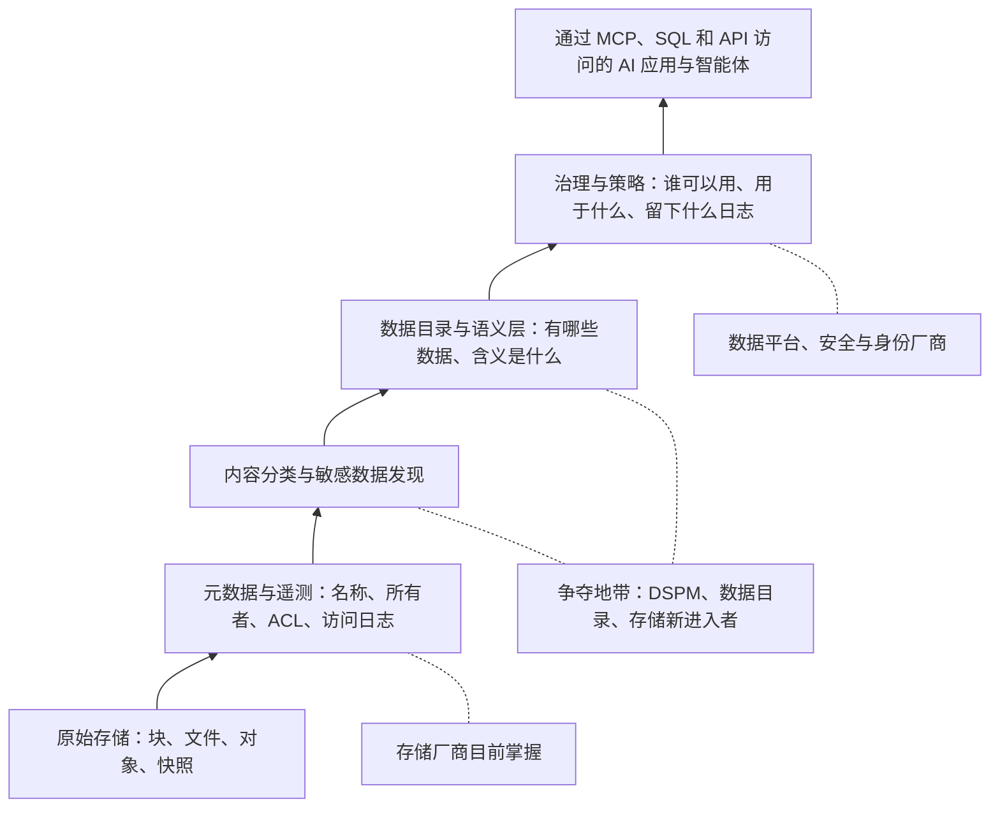
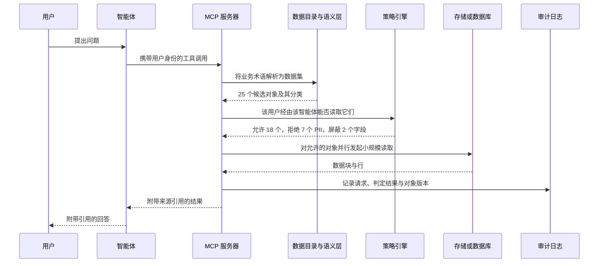
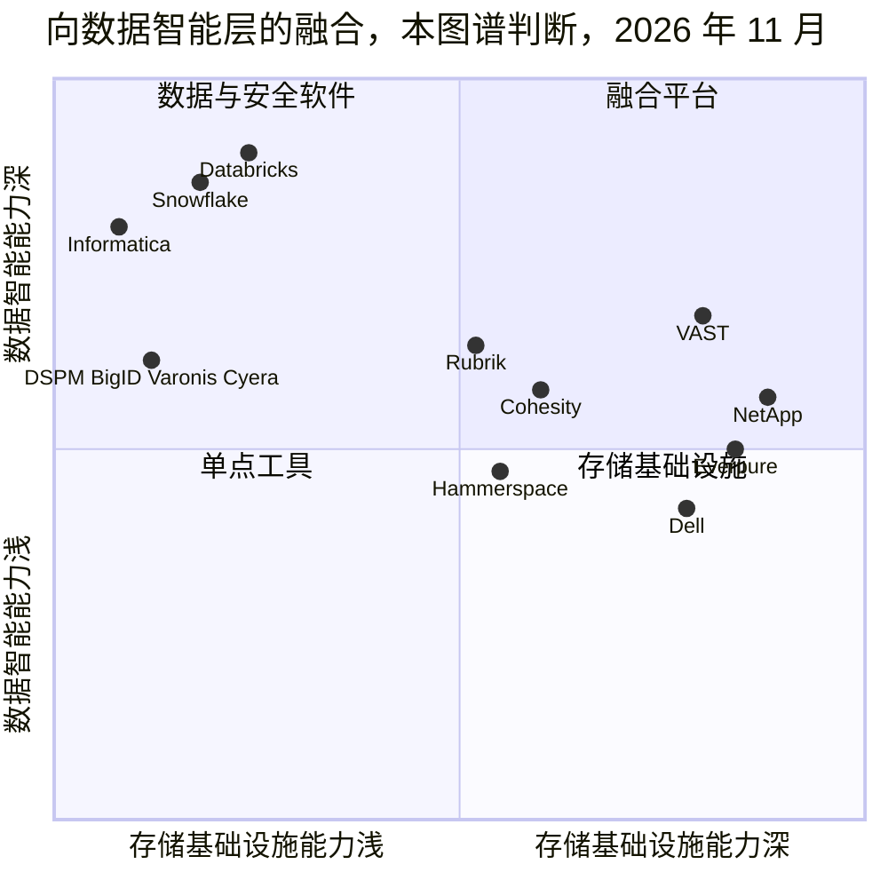
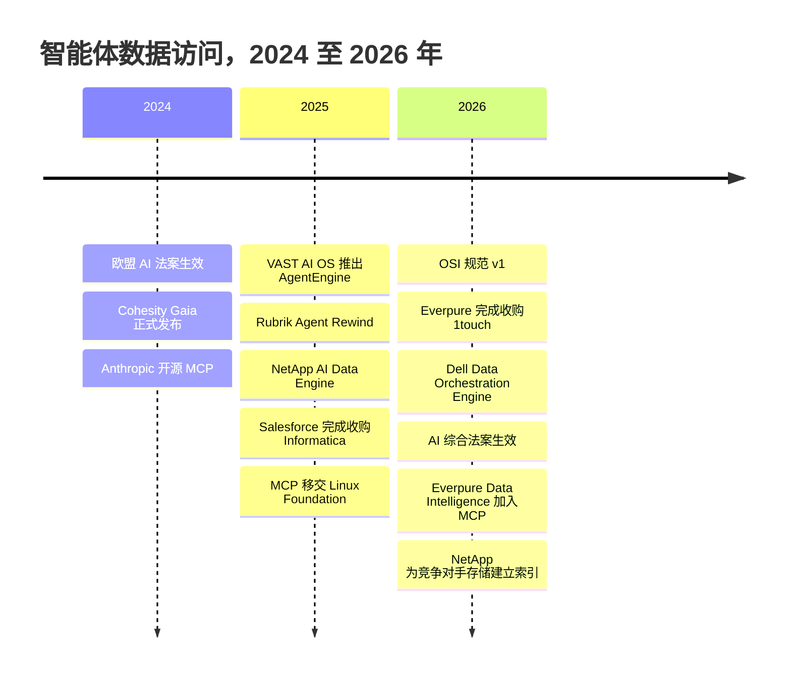

# 39. 智能体 AI 与数据智能

> 📄 英文原文：[docs/05-ai-storage/39-agentic-ai-and-data-intelligence.md](../../../docs/05-ai-storage/39-agentic-ai-and-data-intelligence.md) · 本文为简体中文参考译本，如有出入以英文原文为准。

> **深度：** L2 · **阅读时间：** 约 9 分钟 · **最后核实：** 2026-11-01
> **前置阅读：** [元数据](../03-system-architecture/21-metadata.md) · [控制平面](../03-system-architecture/22-control-planes.md) · [平台与软件](../04-everpure/28-platform-and-software.md) · [端到端 AI 数据管道](30-ai-data-pipeline.md) · [RAG、向量数据库与 AI 原生数据格式](33-rag-vector-lakehouse.md)

## 要点速览（TL;DR）

- **智能体（agent）让元数据变成一种产品。** 智能体只能使用它能找到、能理解且被允许访问的数据，因此"有哪些数据、含义是什么、谁可以用"这类知识变得与字节本身同样有价值。
- **MCP 正在成为智能体的 I/O 总线。** Model Context Protocol（模型上下文协议，2024 年 11 月开源，2025 年 12 月移交给 Linux Foundation 旗下基金，服务器数量 >10,000）统一了智能体调用工具的方式[^1]。大批量数据仍通过 S3、NFS 和 SQL 传输。
- **智能体改变了访问模式。** 一个智能体会把一个问题拆分成数十次工具调用和数百次小规模读取，每一次都需要一次委托权限判定和一条日志记录。
- **如今每家存储厂商都在争夺这一层。** VAST、NetApp、Dell、Hammerspace、Cohesity 以及 Everpure（Data Intelligence，源自 US$125.0M 的 1touch 收购[^2]）都在推销这一层，而它们面对的是规模大得多的数据目录和数据安全厂商。
- **战略问题在于中立性。** 存储厂商能看到每一次写入；数据与安全厂商则能看到所有厂商的存储，并掌握着买方。存储厂商只有覆盖到不在自家阵列上的数据，才可能胜出。

## 对 Everpure 战略的意义

Everpure 的"Data Primacy"主张及其对 1touch 的收购建立在同一个押注之上：在智能体化的企业中，稀缺资产是*关于数据的可信上下文*，而不是容量。如果智能体成为数据的主要消费者，控制权将转移到能够针对每个请求回答三个问题的一方：这是什么，这个智能体可以看吗，它拿这些数据做了什么。能回答这些问题的厂商在硬件商品化之后仍能保持黏性；不能回答的厂商则沦为别人数据目录之下的一个 S3 端点（[第 33 章](33-rag-vector-lakehouse.md)）。

对手不只是存储厂商。Salesforce 斥资 US$8 billion 收购了 Informatica 的数据目录与治理业务（2025 年 11 月完成）[^3]。数据安全态势管理（DSPM）专业厂商 Cyera 于 2026 年 6 月以 US$12 billion 估值融资 US$600 million，而一年前其估值为 US$6 billion（*媒体报道*）[^4]。这些价格说明了价值所在，也说明了通过收购切入的代价有多高。

## 核心概念

### 元数据是原材料

存储系统持有三类元数据，其中两类默认归它所有（[第 21 章](../03-system-architecture/21-metadata.md)）：

1. **系统元数据：** 名称、路径、大小、所有者、访问控制列表（ACL）、时间戳、快照、副本。
2. **遥测数据：** 谁在何时、从何处读写了什么。Pure1 等控制平面会记录这些信息（[第 22 章](../03-system-architecture/22-control-planes.md)）。
3. **内容派生元数据：** 这些字节*是什么*。例如：这个文件包含护照号码；这张表是欧盟客户数据。生成这类元数据需要打开并分类内容，这是数据发现和 DSPM 工具的工作，如今也是 Everpure Data Intelligence 的工作。

**半导体类比：** 系统元数据相当于缓存的标签 RAM（tag RAM）：它告诉你某个缓存行是否存在、位于何处。内容元数据则意味着要读取数据阵列本身，这会消耗带宽。遥测相当于片上总线监视器：只有位于写路径上的部件才能不经采样地看到每一笔事务，这正是存储厂商论点的核心（[第 28 章](../04-everpure/28-platform-and-software.md)）。

*图 39.1 — 每一层都建立在下一层之上；存储厂商掌握最底下两层，争夺焦点在第三层和第四层，即为字节赋予含义和敏感性标记的地方。*

### 数据目录与语义层

**数据目录（catalog）** 记录有哪些数据集，以及它们的模式（schema）、所有者、分类和数据血缘（lineage）。**语义层（semantic layer）** 记录业务术语的*含义*：例如"活跃客户"或"净收入"的唯一受治理定义，以及计算它所需的连接（join）和过滤条件。人类把这些定义记在脑子里，智能体则没有。让一个 LLM 在 4,000 张原始表上计算"Q3 流失率"，它会猜测一种连接方式，然后自信地给出一个错误的数字。

业界正在对这一层进行标准化。Snowflake 发起的 Open Semantic Interchange（OSI）于 2026 年 1 月发布了首个采用 Apache-2 许可的规范，涵盖数据集、指标、维度和关系。Salesforce、dbt Labs、Collibra、Atlan、Alation 等数十家机构参与了工作组，Databricks 在 1 月的更新中加入[^5]。Snowflake 称 v1 只是起点，并计划转为由基金会主导治理。有分析师指出 Everpure 不是成员[^6] [VERIFY: 仅见于搜索摘要]。**半导体类比：** 语义层就是"软件"（智能体）与"硬件"（表和文件）之间的指令集架构（ISA），谁来编写 ISA，谁就塑造了其上的一切。

### MCP：智能体的 I/O 总线

**MCP** 定义了 AI 应用（即*宿主*，内含一个 MCP *客户端*）如何发现并调用一个 MCP *服务器*；服务器对外暴露**工具**（动作）、**资源**（可读数据）和**提示词**（prompts）。消息格式为 JSON-RPC[^7]。MCP 取代了 M × N 的定制连接器网状结构[^8]：存储厂商只需编写一个服务器，所有兼容的智能体都能使用它。

MCP 是**控制与查询平面，而不是数据平面**：智能体请求"含控制权变更条款的合同"时，拿到的是引用和片段；训练规模的字节仍通过 S3、NFS 或 GPUDirect 传输（[第 11 章](../02-protocols-and-networking/11-gpu-data-path.md)）。它还把安全责任推给了服务器。2025-11-25 版规范将 MCP 服务器视为 OAuth 资源服务器，禁止把客户端的令牌直接透传给上游 API，并警示**混淆代理（confused deputy**）攻击，即拥有广泛权限的服务器被诱骗去替一个本无权限的调用方执行操作[^9]。部署在阵列前面的 MCP 服务器，从设计上就是一个特权代理。

### 为什么智能体会产生新的访问模式

*图 39.2 — 策略检查和审计写入位于每一次智能体工具调用的关键路径上。*

智能体会把任务拆分为并行子查询，进行重试并串联多个工具。由此产生四个特性。

- **大量小规模读取。** 元数据查找和 4–64 KB 的数据块读取占主导，这更有利于低延迟闪存和快速元数据服务，而非原始 GB/s 吞吐量。
- **扇出（fan-out）。** 就像 GPU warp 的分散-聚集（scatter-gather）加载一样，数百次对象访问中最慢的那一次决定完成时间。
- **细粒度的委托权限。** 智能体是*代表*用户行事的，因此实际权限是用户授权与智能体权限范围的交集，通常细化到行或字段级别，比阵列 ACL 更细。
- **数据血缘。** 要审计或撤销一个操作，必须知道是哪些对象版本影响了它；快照使这成为可能。

**算例（示意）。** 5,000 名员工每人每天交给智能体 10 项任务；每项任务发起 8 次工具调用，触及 25 个对象。即 5,000 × 10 × 8 × 25 = **每天 1,000 万次访问判定**。按 10 小时工作日计算，平均为 10M ÷ 36,000 s ≈ **每秒 280 次**，峰值还会高出数倍。同样这些人如果每人打开约 50 个文件，只会产生 250,000 次访问，少 40 倍。按每条日志记录约 1 KB 计算，每天约产生 10 GB 审计日志，六个月约 1.8 TB。Databricks 称 Neon 上约 80% 的数据库由智能体创建（*公司自述*，2025）[^10]。

**半导体类比：** 策略引擎之于智能体，正如 **IOMMU** 之于具备 DMA 能力的设备。每一次访问都要经过地址转换和权限检查，判定缓存的作用类似 IOTLB。判定太慢，每次 I/O 都会停顿；缓存时间太长，已撤销的权限仍会继续生效。

### 治理成为运行时要求

欧盟《AI 法案》（EU AI Act，Regulation 2024/1689）于 2024 年 8 月 1 日生效。其禁止性条款自 2025 年 2 月 2 日起适用，通用目的 AI 模型义务自 2025 年 8 月 2 日起适用[^11]。对于高风险系统（按用途界定，如招聘、信贷、关键基础设施，而不是看是否涉及智能体），第 10 条要求训练数据受治理且具有代表性，第 12 条要求自动记录事件日志，日志保存至少六个月[^11]。《AI 数字综合法案》（Digital Omnibus on AI，Regulation 2026/1744，2026 年 7 月 24 日公布，2026 年 7 月 27 日生效）将高风险条款的截止日期推迟至 2027 年 12 月 2 日（附件 III）和 2028 年 8 月 2 日（嵌入受监管产品的系统）。它没有推迟禁止性条款、GPAI 规则或第 50 条透明度义务，后者已自 2026 年 8 月 2 日起适用[^12][^13]。针对禁止性行为的罚款最高可达 €35 million 或全球营业额的 7%[^11]。

Gartner 于 2025 年 6 月预测，到 2027 年底将有超过 40% 的智能体 AI 项目被取消，原因包括成本、价值不明和风险控制薄弱[^14]：治理决定了智能体能否进入生产环境。

### 存储厂商能否掌握这一层？

**存储厂商的论点：** 阵列持有数据资产清单并位于写路径上，因此可以在写入时或基于快照进行分类，无需每周爬取一次。它可以在字节所在之处执行策略，不可变快照还能撤销智能体所做的操作。

**数据与安全厂商的论点：** 数据分布在多家厂商的存储、SaaS 和云上，因此单一厂商的治理只能覆盖一部分；买方（CDO 或 CISO）不是存储的买方；数据目录和 DSPM 厂商保持中立，并已与身份系统打通。决定胜负的是对*他人*数据的覆盖能力，这正是为什么 NetApp 在 2026 年 9 月推出对任意 NFS、SMB 或 S3 存储建立索引的能力[^15]，以及 Dell 声称其编排引擎可在 Dell 存储之外工作[^16]，比它们的功能清单更重要。

## Everpure 的做法与竞争对手对比

| 厂商 | 产品（首发时间） | 功能 | 能否覆盖其他厂商的数据？ | 智能体接口 | 状态（2026 年 11 月） |
|---|---|---|---|---|---|
| Everpure | Data Intelligence，原 1touch（2026 年 6 月 GA）[^17]；Data Stream | 数据发现、实体级分类、知识图谱、数据血缘、驻留与访问策略 | 分析师认为可以（数据库、SaaS、第三方存储）[^6] | 原生 MCP，2026 年 10 月[^18] | 已 GA；MCP 为新增 |
| VAST | InsightEngine（2024–25）、AgentEngine（2025 年 5 月）、PolicyEngine（2026 年 2 月）[^19][^20] | 平台内嵌入向量与 RAG；无服务器智能体运行时；内联策略检查与防篡改追踪（*公司自述*） | 主要是 VAST 上的数据 | AgentEngine 中提供兼容 MCP 的工具[^19] | PolicyEngine 预计 2026 年底前推出 |
| NetApp | AI Data Engine（2025 年 10 月）[^21] | ONTAP 中的元数据引擎、数据整理与嵌入向量、护栏 | 扩展到任意 NFS、SMB、S3（2026 年 9 月）[^15] | NetApp Console 中的 MCP 服务器[^15] | Lighthouse 2026 [VERIFY: AIDE 正式发布（GA）日期]；PEAK:AIO 交易待完成 |
| Dell | AI Data Platform、Data Orchestration Engine（2026 年 3 月）[^16] | 低代码的数据发现、准备与治理，生成 AI 就绪数据集；源自 Dataloop（约 US$120M，*媒体报道*）[^22] | 可以，据分析师[^16] | 工作流、NIM、应用市场 | 据 Dell 称于 CY26 第一季度可用 |
| Hammerspace | AI Data Platform（2025 年 10 月）[^23] | 将现有存储的元数据吸收进全局命名空间；Milvus 向量 | 可以，设计即如此 | MCP 服务[^23] | 已出货，符合 NVIDIA 设计 |
| Cohesity | Gaia（2024 年 3 月 GA）[^24]；Maestro（2026 年 6 月）[^25] | 基于备份副本的 RAG 搜索，可与 NVIDIA 合作本地部署 | 其保护的任何数据 | Gaia 现已支持 MCP；Maestro 将于 2026 年晚些时候支持 MCP | 部分 GA |
| Rubrik | Agent Rewind（2025 年 8 月）[^26] | 追踪智能体操作，并回滚文件、数据库、配置 | 其保护的任何数据 | 与智能体平台集成 | 已 GA（*公司自述*） |

*表 39.1 — 存储和数据保护厂商从不同楼层抵达同一层；分界线在于能否覆盖其他厂商的数据，以及智能体能执行操作还是只能读取。*

*图 39.3 — 本图谱的判断，非厂商数据：存储厂商正在向上攀升，而数据厂商并未向下延伸；VAST 位置最高。*

**权衡。** VAST 是"存储成为 AI 数据平台"这一论点的最强版本（steelman）：数据库、运行时和策略集于一个系统，但范围限于 VAST 上的数据。NetApp 拥有最深厚的元数据积累，如今还能为竞争对手的存储建立索引。Dell（Dataloop）和 Everpure（1touch）各自收购了一家约 US$120–125M 的初创公司来切入这一层。Cohesity 和 Rubrik 持有大多数企业数据的完整副本，能够*撤销*智能体的操作。Everpure 的优势在于实体级分类加上由 Pure1 管理的设备群（[第 28 章](../04-everpure/28-platform-and-software.md)）；其短板是缺乏在非 Everpure 数据上的实证。

**基于公开信息，战略团队可能评估的选项：**

1. **中立的元数据枢纽。** 对 Data Intelligence 单独定价，优先拓展非 Everpure 的数据资产，与 Unity Catalog、Polaris 和 Purview 对接，并加入 OSI。
2. **做最好的底座，上层靠合作。** 向 DSPM 和数据目录厂商提供写路径事件和基于快照的扫描。
3. **智能体安全原语。** 将 SafeMode 快照、按智能体的 QoS 和审计导出打包为"智能体撤销（agent undo）"。
4. **补强型并购。** 在 1touch 价格区间内收购语义层或数据血缘资产。按 Cyera 类估值计算，DSPM 领军企业遥不可及。

## 历史与发展轨迹

*图 39.4 — 两年间，业界获得了一个智能体协议、一个语义层规范和一个监管时间表。*

演进脉络从存储资源报告（2000 年代），到 GDPR 时代的分类工具（2010 年代），再到 AI 数据平台。NVIDIA 的 AI Data Platform 设计（2025 年 3 月）为厂商提供了一个把 GPU 和检索放在数据旁边的模板（[第 34 章](34-nvidia-ecosystem.md)）。2026 年的转变是从为 RAG *准备*数据，转向*治理*智能体访问。未来 12–18 个月值得关注的信号：数据智能收入的单独披露；MCP 对委托身份的支持；OSI 转为基金会治理；以及由 2027 年 12 月截止日期驱动的采购。

## 关键数字

| 指标 | 数值 | 背景 | 来源 / 日期 |
|---|---|---|---|
| 现有 MCP 服务器数量 | >10,000 | 捐赠给 Agentic AI Foundation 时 | Anthropic，2025-12[^1] |
| Everpure 收购 1touch 价格 | US$125.0M 现金 | 2026-05-07 完成 | 10-Q Q1 FY27[^2] |
| Dell 收购 Dataloop 价格 | 约 US$120M（*媒体报道*） | Data Orchestration Engine 的基础 | Calcalist via StorageNewsletter，2026-01[^22] |
| Salesforce–Informatica | US$8B 股权价值 | 数据目录、治理、MDM；2025-11-18 完成 | Salesforce，2025-11[^3] |
| Cyera 估值 | US$12B（*媒体报道*） | US$600M 融资轮，DSPM | SecurityWeek，2026-06[^4] |
| Neon 上由智能体创建的数据库 | 约 80%（*公司自述*） | 机器需求超过人类需求 | Databricks，2025-05[^10] |
| 5,000 用户智能体部署的访问判定 | 约 10M/天，约 280/s | 10 项任务 × 8 次调用 × 25 个对象 | 算例 |
| 欧盟 AI 法案高风险截止日期（附件 III） | 2 Dec 2027 | 自 2 Aug 2026 推迟 | Regulation 2026/1744[^12] |
| 高风险 AI 最短日志保存期 | 6 个月 | 提供者与部署者 | AI Act Arts 19, 26[^11] |

## 对话手册

**向产品经理提的问题**

1. *"Data Intelligence 的订单中，有多大比例覆盖的是不在 Everpure 上的数据？"* 高质量回答：给出一个数字和具体的数据资产（Oracle、M365、竞争对手 NAS）。
2. *"买方是谁：存储管理员、CDO 还是 CISO？谁来背销售指标？"* 高质量回答：明确的买方角色、单独的 SKU，以及非阵列交易的配额计入。
3. *"Data Intelligence 如何与客户现有的 Purview、Collibra 或 Cyera 共存？"* 高质量回答：为它们提供数据，无需替换。

**向工程师提的问题**

1. *"MCP 服务器如何处理用户身份：直接透传、令牌交换，还是使用服务账号？"* 高质量回答：令牌交换、按智能体划分权限范围、没有共享的超级用户。
2. *"每秒能持续处理多少次策略判定？撤销权限多快生效？"* 高质量回答：实测速率、以秒计的缓存有效期、扇出行为。
3. *"分类是在写路径上还是写路径之外？"* 高质量回答：在写路径之外，由快照或事件触发，对控制器的影响有上限。

**不要这样说：**

- "MCP 负责搬运数据。"它传递的是请求和结果；批量字节走 S3、NFS 或 SQL。
- "欧盟 AI 法案把所有智能体都列为高风险。"风险等级取决于用途。
- "阵列 ACL 对智能体来说已经够用。"它们工作在文件或共享级别；智能体需要委托式的字段级判定。
- "存储厂商将取代 Databricks 或 Snowflake。"现实的目标是它们之下的元数据和策略层。
- "数据智能不过就是 RAG。"RAG 负责检索；数据智能决定哪些内容可以被检索。

## 深入阅读（可选，L3 指引）

- MCP 规范 2025-11-25：授权与安全章节（OAuth 2.1、RFC 8707、RFC 9728）。
- 欧盟 AI 法案第 10、12、19 和 26 条，以及《数字综合法案》对第 113 条的修订。
- OSI 规范；Unity Catalog 的访问控制模型。
- Google 的 Zanzibar（USENIX ATC 2019），了解高频权限检查。

## 关键术语

- **模型上下文协议（Model Context Protocol，MCP）**、**MCP 服务器（MCP server）**、**语义层（semantic layer）**、**数据目录（data catalog）**、**DSPM**、**数据血缘（data lineage）**、**代表用户授权（on-behalf-of authorisation）**、**混淆代理（confused deputy）**、**策略决策点（policy decision point）**、**内容派生元数据（content-derived metadata）**、**Open Semantic Interchange（OSI）**、**高风险 AI 系统（high-risk AI system）**——参见[术语表](../glossary.md)。

## 资料来源

[^1]: Anthropic, "Donating the Model Context Protocol and establishing the Agentic AI Foundation," 2025-12-09. https://www.anthropic.com/news/donating-the-model-context-protocol-and-establishing-of-the-agentic-ai-foundation (retrieved 2026-11-01; read via search summary).
[^2]: SEC, "Everpure, Inc. Form 10-Q for the quarter ended May 3, 2026," 2026-06. https://www.sec.gov/Archives/edgar/data/0001474432/000147443226000061/pstg-20260503.htm (retrieved 2026-11-01).
[^3]: Salesforce via Business Wire, "Salesforce Completes Acquisition of Informatica," 2025-11-18. https://markets.financialcontent.com/clarkebroadcasting.mymotherlode/article/bizwire-2025-11-18-salesforce-completes-acquisition-of-informatica ; Seeking Alpha, "Salesforce completes acquisition of Informatica," 2025-11-18. https://seekingalpha.com/news/4523363-salesforce-completes-acquisition-of-informatica (both retrieved 2026-11-01).
[^4]: SecurityWeek, "Cyera Raises $600 Million at $12 Billion Valuation," 2026-06. https://www.securityweek.com/cyera-raises-600-million-at-12-billion-valuation/amp/ ; Globes, "Cyera raises $600m at $12b valuation," 2026-06-10. https://en.globes.co.il/en/article-1001545507 (both retrieved 2026-11-01).
[^5]: Snowflake, "Open Semantic Interchange's specs finalized," 2026-01-27. https://www.snowflake.com/en/blog/open-semantic-interchanges-specs-finalized/ (retrieved 2026-11-01; read via search summary).
[^6]: TechTarget, "Everpure grows into data management with Data Intelligence update," 2026-06. https://www.techtarget.com/searchstorage/news/366644759/Everpure-grows-into-data-management-with-Data-Intelligence-update (retrieved 2026-11-01; read via search summary).
[^7]: Model Context Protocol, "Specification, version 2025-11-25," 2025-11-25. https://modelcontextprotocol.io/specification/2025-11-25 (retrieved 2026-11-01; read via search summary).
[^8]: TechCrunch, "Anthropic proposes a new way to connect data to AI chatbots," 2024-11-25. https://techcrunch.com/2024/11/25/anthropic-proposes-a-way-to-connect-data-to-ai-chatbots/ (retrieved 2026-11-01).
[^9]: Model Context Protocol, "Security Best Practices," specification 2025-11-25. https://modelcontextprotocol.io/specification/2025-11-25/basic/security_best_practices (retrieved 2026-11-01; read via search summary).
[^10]: Databricks, "Databricks + Neon," 2025-05. https://www.databricks.com/blog/databricks-neon (retrieved 2026-11-01; read via search summary).
[^11]: European Union, "Regulation (EU) 2024/1689 (Artificial Intelligence Act)," Official Journal, 2024-07-12; Articles 10, 12, 19, 26, 99 and 113. https://eur-lex.europa.eu/eli/reg/2024/1689/oj (retrieved 2026-11-01).
[^12]: Cooley, "Digital AI Omnibus delays key deadlines, introduces new rules," 2026-07. https://cdp.cooley.com/digital-ai-omnibus-delays-key-deadlines-introduces-new-rules/ ; Northern Ireland Assembly, "EU law scrutiny tracker: Regulation (EU) 2026/1744," 2026. https://www.niassembly.gov.uk/assembly-business/brexit-and-beyond/eu-law-scrutiny-tracker/regulation-2026-1744/ (both retrieved 2026-11-01; read via search summary).
[^13]: Lewis Silkin, "The Digital Omnibus on AI enters into force today," 2026-07-27. https://www.lewissilkin.com/insights/2026/07/27/the-digital-omnibus-on-ai-enters-into-force-today-102nedo (retrieved 2026-11-01; read via search summary).
[^14]: W.Media, "Over 40 percent of Agentic AI projects could face the axe by end of 2027: Gartner," 2025-06-27. https://w.media/over-40-percent-of-agentic-ai-projects-could-face-the-axe-by-end-of-2027-gartner/ (retrieved 2026-11-01).
[^15]: Blocks & Files, "NetApp unveils fastest file system on the planet with great raft of other announcements," 2026-09-29. https://www.blocksandfiles.com/file/2026/09/29/netapp-unveils-fastest-file-system-on-the-planet-with-great-raft-of-other-announcements/5299808 ; Futurum Group, "NetApp Novus, PEAK:AIO and NetApp's Two-Market AI Strategy," 2026-09. https://futurumgroup.com/insights/netapp-novus-peakaio-and-netapps-two-market-ai-strategy/ (both retrieved 2026-11-01; read via search summary).
[^16]: Dell Technologies, "Dell AI Data Platform with NVIDIA Supercharges Enterprise AI with Breakthrough Data Orchestration and Storage Innovations," 2026-03-16. https://www.dell.com/en-us/dt/corporate/newsroom/announcements/detailpage.press-releases~usa~2026~03~dell-ai-data-platform-with-nvidia-supercharges-enterprise-ai-with-breakthrough-data-orchestration-and-storage-innovations.htm ; TechTarget, "Dell Data Orchestration Engine joins AI data pipeline fray," 2026-03. https://www.techtarget.com/searchstorage/news/366640330/Dell-Data-Orchestration-Engine-joins-AI-data-pipeline-fray (both retrieved 2026-11-01).
[^17]: HPCwire, "Everpure Wants to Improve Data Management for the Coming AI Wave," 2026-06-20. https://www.hpcwire.com/aiwire/2026/06/20/everpure-wants-to-improve-data-management-for-the-coming-ai-wave/ (retrieved 2026-11-01).
[^18]: Blocks & Files, "Everpure bulks up AI offer," 2026-09-30. https://blocksandfiles.com/flash/2026/09/30/everpure-bulks-up-ai-offer/5300162 ; NAND Research, "Everpure extends data intelligence and inference acceleration for enterprise agentic AI," 2026-09. https://nand-research.com/everpure-extends-data-intelligence-and-inference-acceleration-for-enterprise-agentic-ai/ (both retrieved 2026-11-01).
[^19]: Blocks & Files, "VAST Data launches AI operating system," 2025-05-21. https://www.blocksandfiles.com/ai-ml/2025/05/21/vast-data-launches-ai-operating-system/1613219 (retrieved 2026-11-01).
[^20]: HPCwire, "VAST Data Expands AI Data Stack, Keeps Eye on North Star," 2026-02-25. https://www.hpcwire.com/2026/02/25/vast-data-expands-ai-data-stack-keeps-eye-on-north-star/ ; IT Brief UK, "VAST Data debuts AI tools for safer, smarter agents," 2026-02. https://itbrief.co.uk/story/vast-data-debuts-ai-tools-for-safer-smarter-agents (both retrieved 2026-11-01).
[^21]: Blocks & Files, "NetApp disaggregates ONTAP storage and provides an AI Data Engine," 2025-10-14. https://blocksandfiles.com/2025/10/14/netapp-disaggregates-ontap-storage-and-provides-an-ai-data-engine/ ; NetApp, "NetApp Accelerates Momentum in AI Leadership with NVIDIA," press release, 2026-03-16. https://www.netapp.com/en/newsroom/press-releases/news-rel-20260316-181478/ (both retrieved 2026-11-01).
[^22]: StorageNewsletter, "Dell Acquired Dataloop AI for $120 Million," 2026-01-02. https://www.storagenewsletter.com/2026/01/02/dell-acquired-dataloop-ai-for-120-million/ ; Seeking Alpha, "Dell to acquire AI-data startup Dataloop in $120M deal - report," 2025-12-17. https://seekingalpha.com/news/4532624-dell-to-acquire-ai-data-startup-dataloop-in-120m-deal-report (both retrieved 2026-11-01).
[^23]: HPCwire, "Hammerspace Launches AI Data Platform Based on NVIDIA Reference Design," 2025-10-28. https://www.hpcwire.com/off-the-wire/hammerspace-launches-ai-data-platform-based-on-nvidia-reference-design/ ; Tech Field Day, "Taming Data Estate Chaos for AI with Hammerspace," 2026-01-29. https://techfieldday.com/video/taming-data-estate-chaos-for-ai-with-hammerspace/ (both retrieved 2026-11-01).
[^24]: Cohesity, "Cohesity Gaia is available now," 2024-03-15. https://www.cohesity.com/blogs/cohesity-gaia-is-available-now/ ; Business Wire, "Cohesity Introduces the Industry's First Generative AI-powered Conversational Search Assistant," 2024-02-28. https://www.businesswire.com/news/home/20240228412251/en/ (both retrieved 2026-11-01).
[^25]: Blocks & Files, "Cohesity goes agentic with headless protection," 2026-06-18. https://www.blocksandfiles.com/ai-ml/2026/06/18/cohesity-goes-agentic-with-headless-protection/5258151 ; Cohesity, "AI conversational search" solution page, n.d. https://www.cohesity.com/solutions/ai-conversational-search/ (both retrieved 2026-11-01; read via search summary).
[^26]: Rubrik via Business Wire, "Rubrik Unveils Agent Rewind For When AI Agents Go Awry," 2025-08-12. https://www.businesswire.com/news/home/20250812418116/en/Rubrik-Unveils-Agent-Rewind-For-When-AI-Agents-Go-Awry ; Blocks & Files, "Rubrik buying Predibase," 2025-06-26. https://blocksandfiles.com/2025/06/26/rubrik-buying-predibase/ (both retrieved 2026-11-01).
